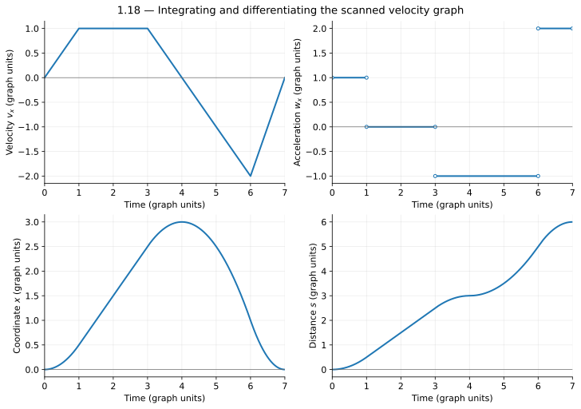
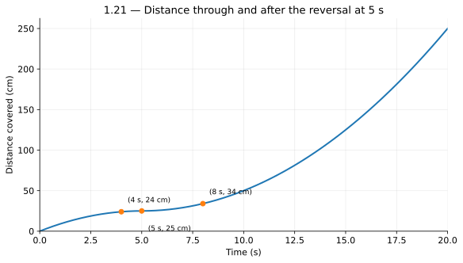
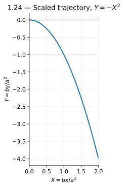
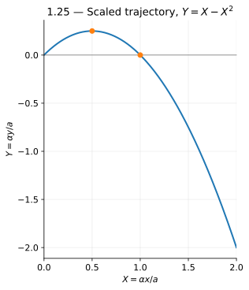
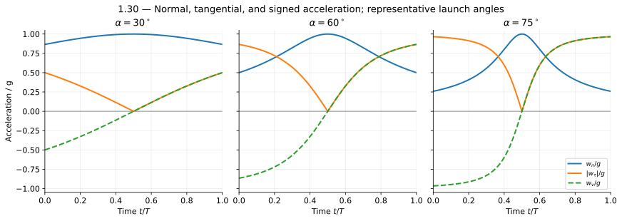
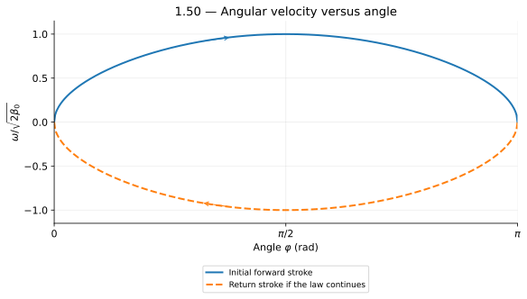

# 1.1 Kinematics

[Chapter index](../README.md#chapters) · [Structured solutions](1.1.json) · [Answer audit](../audit/README.md)

## 1.1

**Problem statement**

A motorboat going downstream overcame a raft at a point A; $\tau = 60$ min later it turned back and after some time passed the raft at a distance $l = 6.0$ km from the point A. Find the flow velocity assuming the duty of the engine to be constant.

**Solved · high confidence.** Relative motion in the water frame

**Assumptions**

- Uniform current; unchanged boat speed relative to the water on the two legs; turn duration neglected.

The raft is at rest relative to the water. The boat gains a separation uτ on its outward leg and closes the same separation at the same speed u after turning, so the return leg also lasts τ.

The raft drifts with the current for the total elapsed time 2τ.

$$
l=2v_f\tau
$$

**Results**

Flow velocity

$$
v_f=\frac{l}{2\tau}
$$

## 1.2

**Problem statement**

A point traversed half the distance with a velocity $v_0$. The remaining part of the distance was covered with velocity $v_1$ for half the time, and with velocity $v_2$ for the other half of the time. Find the mean velocity of the point averaged over the whole time of motion.

**Solved · high confidence.** Total distance divided by total time

**Assumptions**

- Speeds positive and motion along the path without reversal.

Let the total distance be L. Traversing its first half takes L/(2v₀).

The second half is covered in equal times at v₁ and v₂, so its average speed is (v₁+v₂)/2 and its duration is L/(v₁+v₂).

Add the durations and divide L by the result.

$$
T=\frac{L}{2v_0}+\frac{L}{v_1+v_2}
$$

**Results**

Mean speed

$$
\langle v\rangle=\frac{2v_0(v_1+v_2)}{2v_0+v_1+v_2}
$$

## 1.3

**Problem statement**

A car starts moving rectilinearly, first with acceleration $w = 5.0$ m/s² (the initial velocity is equal to zero), then uniformly, and finally, decelerating at the same rate $w$, comes to a stop. The total time of motion equals $t = 25$ s. The average velocity during that time is equal to $\langle v\rangle = 72$ km per hour. How long does the car move uniformly?

**Solved · high confidence.** Area under the trapezoidal velocity–time graph

Let each accelerating/decelerating stage last t_a and the uniform stage last t_u. The peak speed is wt_a.

$$
t_u=t-2t_a
$$

The displacement is the rectangular uniform-stage area plus the two triangular areas.

$$
\langle v\rangle t=wt_a(t-t_a)
$$

The physical root has t_a≤t/2; solving gives the uniform-stage duration.

$$
t_u=\sqrt{t^2-\frac{4\langle v\rangle t}{w}}
$$

**Results**

Uniform-motion duration

$$
t_u=\sqrt{t^2-4\langle v\rangle t/w}
$$

## 1.4

**Problem statement**

A point moves rectilinearly in one direction. Fig. 1.1 shows the distance $s$ traversed by the point as a function of the time $t$. Using the plot find: (a) the average velocity of the point during the time of motion; (b) the maximum velocity; (c) the time moment $t_0$ at which the instantaneous velocity is equal to the mean velocity averaged over the first $t_0$ seconds.

**Solved · medium confidence.** Read secant and tangent slopes from Fig. 1.1

**Assumptions**

- The moving interval ends where the drawn curve becomes horizontal, near 20 s.

The vertical labels on the original scan are 1.0 and 2.0 metres. The curve reaches about 2.0 m and becomes horizontal near 20 s. The mean speed during the moving interval is the endpoint secant slope.

$$
\langle v\rangle=\frac{\Delta s}{\Delta t}\simeq\frac{2.0}{20}
$$

The largest instantaneous speed is the slope of the steepest tangent, in the nearly straight central portion of the curve. Its slope is about 0.25 m/s.

The requested positive time occurs when the tangent passes through the origin; this makes the instantaneous slope equal to the mean slope since t=0. Drawing that tangent on the scan gives about 16 s.

$$
s\prime(t_0)=\frac{s(t_0)-s(0)}{t_0}
$$

**Results**

Mean speed

$$
\langle v\rangle\simeq0.10\ \mathrm{m/s}
$$

Graphical estimate; the flat segment after stopping is excluded.

Maximum speed

$$
v_{\max}\simeq0.25\ \mathrm{m/s}
$$

Approximate steepest-tangent reading, about 0.23–0.27 m/s.

Positive tangent-origin time

$$
t_0\simeq16\ \mathrm{s}
$$

Approximate reading; allow roughly ±1 s.

**Limitations**

- Graphical values should not be treated as exact numbers.

## 1.5

**Problem statement**

Two particles, 1 and 2, move with constant velocities $\mathbf{v}_1$ and $\mathbf{v}_2$. At the initial moment their radius vectors are equal to $\mathbf{r}_1$ and $\mathbf{r}_2$. How must these four vectors be interrelated for the particles to collide?

**Solved · high confidence.** Equality of the two position vectors at a common future time

Equate the positions at collision.

$$
\mathbf r_1+\mathbf v_1t_c=\mathbf r_2+\mathbf v_2t_c
$$

For nonzero relative velocity the relative initial displacement must be parallel to it and point in the direction that permits a nonnegative collision time.

$$
(\mathbf r_2-\mathbf r_1)\times(\mathbf v_1-\mathbf v_2)=0,\qquad t_c=\frac{(\mathbf r_2-\mathbf r_1)\cdot(\mathbf v_1-\mathbf v_2)}{|\mathbf v_1-\mathbf v_2|^2}\ge0
$$

**Results**

Necessary and sufficient collision condition

$$
\exists\,t_c\ge0:\quad\mathbf r_2-\mathbf r_1=(\mathbf v_1-\mathbf v_2)t_c
$$

Equal-velocity case

$$
\mathbf v_1=\mathbf v_2:\quad\text{collision iff }\mathbf r_1=\mathbf r_2
$$

## 1.6

**Problem statement**

A ship moves along the equator to the east with velocity $v_0 = 30$ km/hour. The southeastern wind blows at an angle $\varphi = 60^\circ$ to the equator with velocity $v = 15$ km/hour. Find the wind velocity $v'$ relative to the ship and the angle $\varphi'$ between the equator and the wind direction in the reference frame fixed to the ship.

**Solved · medium confidence.** Galilean vector subtraction for relative wind

**Assumptions**

- Use the usual meteorological FROM-direction convention for the principal answer.

Use east as +x and north as +y. With the meteorological convention, a southeastern wind comes FROM the southeast and travels northwest.

$$
\mathbf v_w=(-v\cos\varphi,\ v\sin\varphi),\qquad \mathbf v_s=(v_0,0)
$$

Subtract the ship velocity from the wind velocity.

$$
\mathbf v\prime=(-v_0-v\cos\varphi,\ v\sin\varphi)
$$

Take its norm and its angle north of west.

$$
v\prime=\sqrt{v_0^2+v^2+2v_0v\cos\varphi},\qquad \tan\varphi\prime=\frac{v\sin\varphi}{v_0+v\cos\varphi}
$$

**Results**

Relative wind speed

$$
v\prime=\sqrt{v_0^2+v^2+2v_0v\cos\varphi}
$$

Relative wind direction

$$
\varphi\prime=\arctan\frac{v\sin\varphi}{v_0+v\cos\varphi}
$$

Equivalently 160.893° counterclockwise from east.

If southeastern means TOWARD southeast

$$
\mathbf v\prime=(-v_0+v\cos\varphi,-v\sin\varphi),\quad v\prime=\sqrt{v_0^2+v^2-2v_0v\cos\varphi}
$$

Direction 30° south of west under this alternate wording convention.

**Limitations**

- Two direction conventions are explicitly separated rather than silently chosen.

## 1.7

**Problem statement**

Two swimmers leave point A on one bank of the river to reach point B lying right across on the other bank. One of them crosses the river along the straight line AB while the other swims at right angles to the stream and then walks the distance that he has been carried away by the stream to get to point B. What was the velocity $u$ of his walking if both swimmers reached the destination simultaneously? The stream velocity $v_0 = 2.0$ km/hour and the velocity $v'$ of each swimmer with respect to water equals 2.5 km per hour.

**Solved · high confidence.** Equate the swimming-plus-walking times

**Assumptions**

- Uniform river current and swimming speeds; straight-across swimmer can cancel the current (v′>v₀).

Let the river width be d. The first swimmer cancels the downstream current, leaving cross-river speed q.

$$
q=\sqrt{v\prime{}^2-v_0^2},\qquad T_1=d/q
$$

The second swimmer crosses in d/v′ and drifts downstream a distance v₀d/v′, which must be walked back.

$$
T_2=\frac d{v\prime}+\frac{v_0d}{v\prime u}
$$

Equate T₁ and T₂ and cancel the unknown width.

$$
u=\frac{v_0q}{v\prime-q}
$$

**Results**

Walking speed

$$
u=\frac{v_0\sqrt{v\prime{}^2-v_0^2}}{v\prime-\sqrt{v\prime{}^2-v_0^2}}
$$

## 1.8

**Problem statement**

Two boats, A and B, move away from a buoy anchored at the middle of a river along the mutually perpendicular straight lines: the boat A along the river, and the boat B across the river. Having moved off an equal distance from the buoy the boats returned. Find the ratio of times of motion of boats $\tau_A/\tau_B$ if the velocity of each boat with respect to water is $\eta = 1.2$ times greater than the stream velocity.

**Solved · high confidence.** Round-trip times along and across a current

**Assumptions**

- The stated straight paths refer to the shore frame; η>1, so both trips can be completed.

Let the current speed be u and the boat speed relative to water be v=ηu; let each outward ground displacement be L.

Along the river, add downstream and upstream durations. Across the river, steering upstream cancels the drift.

$$
\tau_A=\frac L{v+u}+\frac L{v-u}=\frac{2Lv}{v^2-u^2},\qquad\tau_B=\frac{2L}{\sqrt{v^2-u^2}}
$$

Form the ratio.

$$
\frac{\tau_A}{\tau_B}=\frac\eta{\sqrt{\eta^2-1}}
$$

**Results**

Round-trip time ratio

$$
\tau_A/\tau_B=\eta/\sqrt{\eta^2-1}
$$

## 1.9

**Problem statement**

A boat moves relative to water with a velocity which is $\eta = 2.0$ times less than the river flow velocity. At what angle to the stream direction must the boat move to minimize drifting?

**Solved · medium confidence.** Minimize downstream drift per unit cross-river displacement

**Assumptions**

- Minimizing drifting means minimizing downstream displacement while crossing a fixed river width; a stationary-time or no-crossing optimization would be a different problem.

Let the current speed be u and the boat speed in water be v=u/η. Let θ be the heading angle meas ured from the downstream current direction.

$$
v_x=u+v\cos\theta,\qquad v_y=v\sin\theta
$$

For a fixed river width the downstream drift is proportional to v_x/v_y. Differentiate this ratio with respect to θ.

$$
\frac d{d\theta}\frac{u+v\cos\theta}{v\sin\theta}=0\quad\Longrightarrow\quad u\cos\theta+v=0
$$

Select the upstream-directed heading with positive cross-river component.

$$
\theta=\arccos(-1/\eta)
$$

**Results**

Heading relative to the downstream current

$$
\theta=\arccos(-1/\eta)
$$

Resulting ground-track angle to downstream

$$
\psi=\arcsin(1/\eta)
$$

**Limitations**

- A cross-river destination constraint is essential.

## 1.10

**Problem statement**

Two bodies were thrown simultaneously from the same point: one, straight up, and the other, at an angle of $\theta = 60^\circ$ to the horizontal. The initial velocity of each body is equal to $v_0 = 25$ m/s. Neglecting the air drag, find the distance between the bodies $t = 1.70$ s later.

**Solved · high confidence.** Relative motion cancels gravity

**Assumptions**

- Uniform gravitational field, no air drag; both bodies remain in flight at the requested time.

Both bodies have the same gravitational acceleration, so their relative acceleration is zero. Their initial velocities form the angle 90°−θ.

The relative-speed magnitude follows from the chord between the two initial velocity vectors.

$$
\Delta v=2v_0\sin\frac{\pi/2-\theta}{2},\qquad d=\Delta v\,t
$$

**Results**

Separation after t

$$
d=2v_0t\sin\frac{\pi/2-\theta}{2}
$$

## 1.11

**Problem statement**

Two particles move in a uniform gravitational field with an acceleration $\mathbf{g}$. At the initial moment the particles were located at one point and moved with velocities $v_1 = 3.0$ m/s and $v_2 = 4.0$ m/s horizontally in opposite directions. Find the distance between the particles at the moment when their velocity vectors become mutually perpendicular.

**Solved · high confidence.** Perpendicularity of the two velocity vectors

**Assumptions**

- g=9.81 m/s²; both particles initially have zero vertical velocity.

Choose horizontal directions along the initial velocities and vertical upward.

$$
\mathbf v_1(t)=(v_1,-gt),\qquad\mathbf v_2(t)=(-v_2,-gt)
$$

Set their scalar product to zero.

$$
-v_1v_2+g^2t_\perp^2=0\quad\Longrightarrow\quad t_\perp=\sqrt{v_1v_2}/g
$$

Their vertical coordinates stay equal; the horizontal separation grows at speed v₁+v₂.

$$
d=(v_1+v_2)t_\perp
$$

**Results**

Separation at perpendicular velocities

$$
d=\frac{(v_1+v_2)\sqrt{v_1v_2}}g
$$

Elapsed time

$$
t_\perp=\sqrt{v_1v_2}/g
$$

## 1.12

**Problem statement**

Three points are located at the vertices of an equilateral triangle whose side equals $a$. They all start moving simultaneously with velocity $v$ constant in modulus, with the first point heading continually for the second, the second for the third, and the third for the first. How soon will the points converge?

**Solved · high confidence.** Symmetry of cyclic pursuit

The three points remain vertices of a shrinking, rotating equilateral triangle. Let its side be L(t).

The first particle moves toward the second at v, while the second has projection v cos 120°=−v/2 along the first-to-second direction. Thus the side shortens at 3v/2.

$$
\dot L=-\frac32v
$$

Integrate from L(0)=a until L=0.

$$
T=\frac{2a}{3v}
$$

**Results**

Convergence time

$$
T=2a/(3v)
$$

## 1.13

**Problem statement**

Point A moves uniformly with velocity $v$ so that the vector $\mathbf{v}$ is continually "aimed" at point B which in its turn moves rectilinearly and uniformly with velocity $u < v$. At the initial moment of time $\mathbf{v} \perp \mathbf{u}$ and the points are separated by a distance $l$. How soon will the points converge?

**Solved · high confidence.** A conserved linear combination of relative separation variables

**Assumptions**

- Constant speed magnitudes; the pursuer continuously aims at B; v>u.

Let R be the pursuer-to-target distance, X its projection along the target velocity, and θ the angle between the line of sight and that direction. Initially R=l and X=0 because the initial velocities are perpendicular.

$$
\dot R=u\cos\theta-v,\qquad\dot X=u-v\cos\theta
$$

Eliminate the unknown line-of-sight angle.

$$
\frac d{dt}\left(R+\frac uvX\right)=-\frac{v^2-u^2}v
$$

At capture both R and X vanish. Integrating gives the capture time.

$$
0-l=-\frac{v^2-u^2}vT
$$

**Results**

Capture time

$$
T=\frac{lv}{v^2-u^2}
$$

## 1.14

**Problem statement**

A train of length $l = 350$ m starts moving rectilinearly with constant acceleration $w = 3.0\cdot 10^{-2}$ m/s²; $t = 30$ s after the start the locomotive headlight is switched on (event 1), and $\tau = 60$ s after that event the tail signal light is switched on (event 2). Find the distance between these events in the reference frames fixed to the train and to the Earth. How and at what constant velocity $V$ relative to the Earth must a certain reference frame K move for the two events to occur in it at the same point?

**Solved · high confidence.** Space–time separation of the two emission events

**Assumptions**

- Rigid train of fixed length; starts from rest; Galilean coordinates appropriate.

Choose +x in the train direction, and place the rear of the initially stationary train at x=0. The front is at l.

$$
x_1=l+\frac12wt^2,\qquad x_2=\frac12w(t+\tau)^2
$$

Subtract the event coordinates. The train-coordinate separation is instead simply −l.

$$
\Delta x_E=w\tau(t+\tau/2)-l=-242\ \mathrm m,\qquad\Delta x_{train}=-350\ \mathrm m
$$

An inertial frame translating at V has Δx′=Δx_E−Vτ. Requiring the two events at the same point gives V=Δx_E/τ.

$$
V=\frac{\Delta x_E}{\tau}
$$

**Results**

Event distance in train coordinates

$$
|\Delta x_{train}|=l
$$

Event distance in Earth frame

$$
|\Delta x_E|=|w\tau(t+\tau/2)-l|
$$

Signed displacement of event 2 relative to event 1 is −242 m.

Required translating frame velocity

$$
V=w(t+\tau/2)-l/\tau
$$

Opposite to the train direction; speed 4.03 m/s.

## 1.15

**Problem statement**

An elevator car whose floor-to-ceiling distance is equal to 2.7 m starts ascending with constant acceleration 1.2 m/s²; 2.0 s after the start a bolt begins falling from the ceiling of the car. Find: (a) the bolt's free fall time; (b) the displacement and the distance covered by the bolt during the free fall in the reference frame fixed to the elevator shaft.

**Solved · high confidence.** Relative free fall and Earth-frame reversal of motion

**Assumptions**

- H=2.7 m, a_e=1.2 m/s², release time t_r=2.0 s, g=9.81 m/s²; elevator starts from rest.

At release the bolt has the elevator upward speed v_r=a_e t_r=2.4 m/s. Relative to the floor it starts at height H with zero relative velocity and downward acceleration g+a_e.

$$
\tau_f=\sqrt{\frac{2H}{g+a_e}}
$$

In the shaft frame, meas ure displacement from the release position. The bolt initially rises, turns at v_r/g, and then falls.

$$
\Delta y=v_r\tau_f-\frac12g\tau_f^2,\qquad h_{rise}=\frac{v_r^2}{2g}
$$

Because the floor impact is below the release position here, the total travel is the upward segment plus the longer downward segment.

$$
s=2h_{rise}-\Delta y
$$

**Results**

Time from release until reaching the floor

$$
\tau_f=\sqrt{2H/(g+a_e)}
$$

Shaft-frame displacement

$$
\Delta y=v_r\tau_f-\frac12g\tau_f^2
$$

Upward is positive; displacement is 0.725 m downward.

Shaft-frame distance travelled

$$
s=v_r^2/g-\Delta y
$$

## 1.16

**Problem statement**

Two particles, 1 and 2, move with constant velocities $v_1$ and $v_2$ along two mutually perpendicular straight lines toward the intersection point O. At the moment $t = 0$ the particles were located at the distances $l_1$ and $l_2$ from the point O. How soon will the distance between the particles become the smallest? What is it equal to?

**Solved · high confidence.** Minimize squared separation

**Assumptions**

- Positive approach speeds; particles continue straight through O if they reach it.

The particles approach O along perpendicular axes, so the squared separation is the sum of the squared signed distances from O.

$$
d^2(t)=(l_1-v_1t)^2+(l_2-v_2t)^2
$$

Differentiate d², set the result to zero, and use the positive second derivative.

$$
t_{min}=\frac{l_1v_1+l_2v_2}{v_1^2+v_2^2}
$$

Substitute this time and simplify the determinant in the numerator.

$$
d_{min}=\frac{|l_1v_2-l_2v_1|}{\sqrt{v_1^2+v_2^2}}
$$

**Results**

Time of closest approach

$$
t_{min}=\frac{l_1v_1+l_2v_2}{v_1^2+v_2^2}
$$

Minimum distance

$$
d_{min}=\frac{|l_1v_2-l_2v_1|}{\sqrt{v_1^2+v_2^2}}
$$

## 1.17

**Problem statement**

From point A located on a highway (Fig. 1.2) one has to get by car as soon as possible to point B located in the field at a distance $l$ from the highway. It is known that the car moves in the field $\eta$ times slower than on the highway. At what distance from point D one must turn off the highway?

**Solved · high confidence.** Fermat-type time minimization for two travel speeds

**Assumptions**

- η>1; A lies before D as in Fig. 1.2; leaving the highway between A and D is allowed.

Let AD=d and let CD=x, meas ured back from D toward A. If the highway speed is V, the field speed is V/η.

$$
T(x)=\frac{d-x}{V}+\frac{\eta\sqrt{l^2+x^2}}V
$$

Differentiate and solve the stationary condition.

$$
-1+\frac{\eta x}{\sqrt{l^2+x^2}}=0\quad\Longrightarrow\quad x=\frac l{\sqrt{\eta^2-1}}
$$

The second derivative is positive. If the optimal point would lie behind A, the feasible optimum is to leave the highway immediately at A.

**Results**

Distance of the turn point before D

$$
CD=\frac l{\sqrt{\eta^2-1}}
$$

Interior solution if AD≥l/√(η²−1). Otherwise CD=AD and the car leaves at A.

Constrained optimum

$$
CD=\min\{AD,\ l/\sqrt{\eta^2-1}\}
$$

## 1.18

**Problem statement**

A point travels along the x axis with a velocity whose projection $v_x$ is presented as a function of time by the plot in Fig. 1.3. Assuming the coordinate of the point $x = 0$ at the moment $t = 0$, draw the approximate time dependence plots for the acceleration $w_x$, the x coordinate, and the distance covered $s$.

**Solved · medium confidence.** Differentiate and integrate the piecewise-linear velocity graph

**Assumptions**

- Use the time and velocity scale units shown by the graph; the scan gives no explicit SI unit labels for these axes.

Reading Fig. 1.3 gives velocity vertices (0,0),(1,1),(3,1),(6,−2),(7,0). The zero crossing on the descending line occurs at t=4.

$$
v_x(t)=\begin{cases}t&0\le t\le1\\1&1\le t\le3\\4-t&3\le t\le6\\2t-14&6\le t\le7\end{cases}
$$

Differentiate each straight segment. Acceleration changes abruptly at the corners but velocity remains continuous.

Integrate velocity with x(0)=0, choosing constants so x is continuous.

Integrate |v_x| for distance. Position and distance agree until t=4; afterward the velocity is negative, so distance keeps increasing while x decreases.

**Results**

Acceleration plot

$$
w_x(t)=\begin{cases}1&0<t<1\\0&1<t<3\\-1&3<t<6\\2&6<t<7\end{cases}
$$

At t=1,3,6 the idealized acceleration has different one-sided values; the graph is not specified outside 0≤t≤7.

Coordinate plot

$$
x(t)=\begin{cases}t^2/2&0\le t\le1\\t-1/2&1\le t\le3\\4t-t^2/2-5&3\le t\le6\\(t-7)^2&6\le t\le7\end{cases}
$$

Distance plot

$$
s(t)=\begin{cases}x(t)&0\le t\le4\\6-x(t)&4\le t\le7\end{cases}
$$

Thus s(7)=6 and x(7)=0 in the corresponding plotted units; s is nondecreasing.

**Limitations**

- No extrapolation beyond the displayed interval is implied.

## 1.19

**Problem statement**

A point traversed half a circle of radius $R = 160$ cm during time interval $\tau = 10.0$ s. Calculate the following quantities averaged over that time: (a) the mean velocity $\langle v\rangle$; (b) the modulus of the mean velocity vector $|\langle\mathbf{v}\rangle|$; (c) the modulus of the mean vector of the total acceleration $|\langle\mathbf{w}\rangle|$ if the point moved with constant tangent acceleration.

**Solved · high confidence.** Distinguish path length, displacement, and velocity change

**Assumptions**

- Motion along the semicircle without reversal; tangential acceleration constant.

The path length is πR, whereas the displacement between the endpoints of a semicircle has magnitude 2R.

$$
\langle v\rangle=\pi R/\tau,\qquad|\langle\mathbf v\rangle|=2R/\tau
$$

The endpoint tangent directions are opposite. Constant tangential acceleration implies the mean speed is the arithmetic mean of the endpoint speeds.

$$
v_i+v_f=2\pi R/\tau
$$

The magnitude of the velocity change is v_i+v_f, even if the initial speed is not zero.

$$
|\langle\mathbf w\rangle|=|\Delta\mathbf v|/\tau=2\pi R/\tau^2
$$

**Results**

Mean speed

$$
\langle v\rangle=\pi R/\tau
$$

Magnitude of mean velocity

$$
|\langle\mathbf v\rangle|=2R/\tau
$$

Magnitude of mean acceleration

$$
|\langle\mathbf w\rangle|=2\pi R/\tau^2
$$

## 1.20

**Problem statement**

A radius vector of a particle varies with time $t$ as $\mathbf{r} = \mathbf{a}t(1-\alpha t)$, where $\mathbf{a}$ is a constant vector and $\alpha$ is a positive factor. Find: (a) the velocity $\mathbf{v}$ and the acceleration $\mathbf{w}$ of the particle as functions of time; (b) the time interval $\Delta t$ taken by the particle to return to the initial points, and the distance $s$ covered during that time.

**Solved · high confidence.** Differentiate the position and split path length at the turning point

**Assumptions**

- α>0, |a|>0; t≥0.

Differentiate the given vector-valued position twice.

$$
\mathbf v=\mathbf a(1-2\alpha t),\qquad\mathbf w=-2\alpha\mathbf a
$$

The first positive return to the initial position occurs at 1/α. The intervening turning point is at 1/(2α).

$$
\mathbf r_{turn}=\frac{\mathbf a}{4\alpha}
$$

The total path equals twice the distance to the turning point.

$$
s=\frac{|\mathbf a|}{2\alpha}
$$

**Results**

Velocity

$$
\mathbf v(t)=\mathbf a(1-2\alpha t)
$$

Acceleration

$$
\mathbf w(t)=-2\alpha\mathbf a
$$

First positive return time

$$
\Delta t=1/\alpha
$$

Distance travelled by the return time

$$
s=|\mathbf a|/(2\alpha)
$$

## 1.21

**Problem statement**

At the moment $t = 0$ a particle leaves the origin and moves in the positive direction of the x axis. Its velocity varies with time as $\mathbf{v} = \mathbf{v}_0(1-t/\tau)$, where $\mathbf{v}_0$ is the initial velocity vector whose modulus equals $v_0 = 10.0$ cm/s; $\tau = 5.0$ s. Find: (a) the x coordinate of the particle at the moments of time 6.0, 10, and 20 s; (b) the moments of time when the particle is at the distance 10.0 cm from the origin; (c) the distance $s$ covered by the particle during the first 4.0 and 8.0 s; draw the approximate plot $s(t)$.

**Solved · high confidence.** Integrate signed velocity and absolute velocity separately

**Assumptions**

- The stated linear velocity law continues to hold after the reversal at 5 s.

The scalar coordinate along the initial velocity is obtained by integrating v₀(1−t/τ). The direction reverses at t=τ.

$$
x(t)=v_0\left(t-\frac{t^2}{2\tau}\right),\qquad x_{max}=v_0\tau/2
$$

For the supplied data, x=10t−t² in centimetres when t is in seconds. Evaluate it at the three requested times.

Being 10 cm from the origin means both x=+10 cm and x=−10 cm. Solve both quadratics and keep nonnegative roots.

For distance integrate the positive speed before τ and its negative after τ.

$$
s(t)=\begin{cases}v_0(t-t^2/(2\tau))&0\le t\le\tau\\v_0\tau-v_0t+v_0t^2/(2\tau)&t\ge\tau\end{cases}
$$

**Results**

Coordinate at 6.0 s

$$
x(6)=24\ \mathrm{cm}
$$

Coordinate at 10 s

$$
x(10)=0
$$

Coordinate at 20 s

$$
x(20)=-200\ \mathrm{cm}
$$

Times at 10.0 cm from origin

$$
t=5-\sqrt{15},\quad5+\sqrt{15},\quad5+\sqrt{35}\ \mathrm{s}
$$

Distance during first 4.0 s

$$
s(4)=24\ \mathrm{cm}
$$

Distance during first 8.0 s

$$
s(8)=34\ \mathrm{cm}
$$

Distance-versus-time plot

$$
s(t)=\begin{cases}10t-t^2&0\le t\le5\\t^2-10t+50&t\ge5\end{cases}\quad(\mathrm{cm},\ t\text{ in s})
$$

## 1.22

**Problem statement**

The velocity of a particle moving in the positive direction of the x axis varies as $v=\alpha\sqrt{x}$, where α is a positive constant. Assuming that at the moment t = 0 the particle was located at the point x = 0, find: (a) the time dependence of the velocity and the acceleration of the particle; (b) the mean velocity of the particle averaged over the time that the particle takes to cover the first s metres of the path.

**Solved · high confidence.** Separate dx/dt = α√x; integrate on the immediately moving branch.

**Assumptions**

- Use the nonnegative velocity branch and assume motion begins immediately at t=0 for the principal answer.
- The law is applied for t≥0 and α>0.

For x>0, separate variables and impose zero position at the start of the moving branch.

$$
2\sqrt{x}=\alpha t,\qquad x(t)=\frac{\alpha^2t^2}{4}
$$

Differentiate the moving solution; obtain the travel time to the first s metres.

$$
v(t)=\frac{\alpha^2t}{2},\quad w(t)=\frac{\alpha^2}{2},\quad t_s=\frac{2\sqrt{s}}{\alpha}
$$

Mean velocity is distance divided by elapsed time.

$$
\langle v\rangle=\frac{s}{t_s}=\frac{\alpha\sqrt{s}}{2}
$$

**Results**

Velocity

$$
v(t)=\alpha^2t/2
$$

Acceleration on the moving branch

$$
w(t)=\alpha^2/2
$$

Mean velocity over the first s metres

$$
\langle v\rangle=\alpha\sqrt{s}/2
$$

General delayed-start branch

$$
x(t)=\begin{cases}0,&0\le t\le t_d,\\\alpha^2(t-t_d)^2/4,&t>t_d,\end{cases}\quad t_d\ge0
$$

If elapsed time is measured from t=0 and a waiting interval t_d is allowed, the mean becomes s/(t_d+2√s/α).

**Limitations**

- The first-order initial-value problem is non-Lipschitz at x=0: the stationary solution and arbitrarily delayed departures also satisfy it. Thus immediate motion is an extra interpretation, not uniqueness implied by x(0)=0.

## 1.23

**Problem statement**

A point moves rectilinearly with deceleration whose modulus depends on the velocity v of the particle as $w=a\sqrt{v}$, where a is a positive constant. At the initial moment the velocity of the point is equal to v_0. What distance will it traverse before it stops? What time will it take to cover that distance?

**Solved · high confidence.** Integrate the velocity-dependent deceleration and then integrate the speed.

**Assumptions**

- v_0>0, a>0; the particle remains at rest once the nonnegative speed reaches zero.

The signed tangential acceleration is negative.

$$
\frac{dv}{dt}=-a\sqrt v\quad\Longrightarrow\quad\sqrt{v(t)}=\sqrt{v_0}-\frac{at}{2}
$$

The first zero gives the stopping time; integrate the nonnegative speed until that time.

$$
t_* =\frac{2\sqrt{v_0}}a,\qquad s=\int_0^{t_*}\left(\sqrt{v_0}-\frac{at}{2}\right)^2dt
$$

**Results**

Stopping time

$$
t_* = 2\sqrt{v_0}/a
$$

Stopping distance

$$
s=2v_0^{3/2}/(3a)
$$

## 1.24

**Problem statement**

A radius vector of a point A relative to the origin varies with time t as $\mathbf{r}=at\mathbf{i}-bt^2\mathbf{j}$, where a and b are positive constants, and i and j are the unit vectors of the x and y axes. Find: (a) the equation of the point's trajectory y (x); plot this function; (b) the time dependence of the velocity v and acceleration w vectors, as well as of the moduli of these quantities; (c) the time dependence of the angle α between the vectors w and v; (d) the mean velocity vector averaged over the first t seconds of motion, and the modulus of this vector.

**Solved · high confidence.** Differentiate the parametric position and eliminate time.

**Assumptions**

- Consider t≥0, a>0, b>0; angle α is the usual angle in [0,π] between vectors.

Eliminate t=x/a to obtain a downward-opening parabola.

$$
y=-\frac{b}{a^2}x^2,\qquad x\ge0
$$

Differentiate once and twice.

$$
\mathbf v=a\mathbf i-2bt\mathbf j,\quad\mathbf w=-2b\mathbf j
$$

The angle follows from the dot product, and the average vector equals displacement divided by time.

$$
\cos\alpha=\frac{\mathbf v\cdot\mathbf w}{|\mathbf v||\mathbf w|}=\frac{2bt}{\sqrt{a^2+4b^2t^2}},\qquad\langle\mathbf v\rangle=\frac{\mathbf r(t)}t
$$

**Results**

Trajectory; plot the indicated parabola

$$
y(x)=-bx^2/a^2\quad(x\ge0)
$$

Velocity vector and magnitude

$$
\mathbf v=a\mathbf i-2bt\mathbf j,\qquad v=\sqrt{a^2+4b^2t^2}
$$

Acceleration vector and magnitude

$$
\mathbf w=-2b\mathbf j,\qquad w=2b
$$

Angle between velocity and acceleration

$$
\alpha(t)=\arccos\frac{2bt}{\sqrt{a^2+4b^2t^2}}=\operatorname{atan2}(a,2bt)
$$

Mean velocity and its magnitude

$$
\langle\mathbf v\rangle=a\mathbf i-bt\mathbf j,\qquad |\langle\mathbf v\rangle|=\sqrt{a^2+b^2t^2}
$$

## 1.25

**Problem statement**

A point moves in the plane xy according to the law $x=at$, $y=at(1-\alpha t)$, where a and α are positive constants, and t is time. Find: (a) the equation of the point's trajectory y (x); plot this function; (b) the velocity v and the acceleration w of the point as functions of time; (c) the moment t_0 at which the velocity vector forms an angle π/4 with the acceleration vector.

**Solved · high confidence.** Eliminate time, differentiate position, and apply the vector-angle condition.

**Assumptions**

- t≥0, a>0, α>0; π/4 means the directed-vector angle, not the acute angle between two unoriented lines.

Eliminate t=x/a.

$$
y=x-\frac{\alpha}{a}x^2
$$

Differentiate the two position components.

$$
\mathbf v=a\mathbf i+a(1-2\alpha t)\mathbf j,\quad\mathbf w=-2a\alpha\mathbf j
$$

For an angle π/4 with downward acceleration, the velocity must have equal positive horizontal and negative vertical components.

$$
\frac{2\alpha t_0-1}{\sqrt{1+(1-2\alpha t_0)^2}}=\frac1{\sqrt2}\quad\Longrightarrow\quad t_0=\frac1\alpha
$$

**Results**

Trajectory

$$
y=x-(\alpha/a)x^2\quad(x\ge0)
$$

Downward parabola with vertex (a/(2α), a/(4α)).

Velocity

$$
\mathbf v(t)=a\mathbf i+a(1-2\alpha t)\mathbf j
$$

Acceleration

$$
\mathbf w(t)=-2a\alpha\mathbf j
$$

Time

$$
t_0=1/\alpha
$$

## 1.26

**Problem statement**

A point moves in the plane xy according to the law $x=a\sin\omega t$, $y=a(1-\cos\omega t)$, where a and ω are positive constants. Find: (a) the distance s traversed by the point during the time τ; (b) the angle between the point's velocity and acceleration vectors.

**Solved · high confidence.** Differentiate the circular parametrization.

**Assumptions**

- a>0, ω>0, τ≥0.

The trajectory is a circle of radius a centered at (0,a).

$$
x^2+(y-a)^2=a^2
$$

Differentiate to find the constant speed and check orthogonality.

$$
\mathbf v=a\omega(\cos\omega t\,\mathbf i+\sin\omega t\,\mathbf j),\quad\mathbf w=a\omega^2(-\sin\omega t\,\mathbf i+\cos\omega t\,\mathbf j),\quad\mathbf v\cdot\mathbf w=0
$$

**Results**

Distance traversed

$$
s=a\omega\tau
$$

Angle between velocity and acceleration

$$
\pi/2
$$

## 1.27

**Problem statement**

A particle moves in the plane xy with constant acceleration w directed along the negative y axis. The equation of motion of the particle has the form $y=ax-bx^2$ , where a and b are positive constants. Find the velocity of the particle at the origin of coordinates.

**Solved · high confidence.** Match the quadratic trajectory to constant-acceleration projectile motion.

**Assumptions**

- w>0 is the downward acceleration magnitude; a>0,b>0 are the trajectory coefficients.
- For the conventional outgoing branch take v_x>0; the opposite traversal is also listed.

The horizontal acceleration is zero, so write x=ut and y=v_{y0}t−wt²/2 at the origin.

$$
y=\frac{v_{y0}}u x-\frac{w}{2u^2}x^2
$$

Compare the coefficients with y=ax−bx².

$$
v_{y0}=au,\qquad u^2=\frac{w}{2b}
$$

**Results**

Velocity at the origin, conventional positive-x branch

$$
\mathbf v_0=\sqrt{\frac{w}{2b}}(\mathbf i+a\mathbf j)
$$

Speed at the origin

$$
v_0=\sqrt{\frac{w(1+a^2)}{2b}}
$$

Both possible traversals of the same geometric curve

$$
\mathbf v_0=\pm\sqrt{\frac{w}{2b}}(\mathbf i+a\mathbf j)
$$

**Limitations**

- The geometric trajectory and downward acceleration do not by themselves fix the sign of horizontal motion.

## 1.28

**Problem statement**

A small body is thrown at an angle to the horizontal with the initial velocity v_0 . Neglecting the air drag, find: (a) the displacement of the body as a function of time $\mathbf{r}(t)$; (b) the mean velocity vector $\langle\mathbf{v}\rangle$ averaged over the first t seconds and over the total time of motion.

**Solved · high confidence.** Integrate constant gravitational acceleration and divide displacement by elapsed time.

**Assumptions**

- Uniform gravity g downward, no drag; the origin is the launch point.
- For the complete-flight result, landing is at launch height. Let α be the launch angle.

Integrate the acceleration with the stated initial velocity.

$$
\mathbf r(t)=\mathbf v_0t+\frac12\mathbf g t^2
$$

A mean velocity vector is displacement divided by the averaging interval.

$$
\langle\mathbf v\rangle_{[0,t]}=\mathbf v_0+\frac12\mathbf g t
$$

For return to the launch level, T=2v_0 sinα/g and the vertical displacement is zero.

$$
\langle\mathbf v\rangle_{[0,T]}=v_0\cos\alpha\,\mathbf i
$$

**Results**

Displacement vector

$$
\mathbf r(t)=v_0\cos\alpha\,t\,\mathbf i+\left(v_0\sin\alpha\,t-\frac12gt^2\right)\mathbf j
$$

Mean over first t seconds

$$
\langle\mathbf v\rangle=v_0\cos\alpha\,\mathbf i+\left(v_0\sin\alpha-\frac12gt\right)\mathbf j
$$

Mean over the complete flight to launch height

$$
\langle\mathbf v\rangle_T=v_0\cos\alpha\,\mathbf i
$$

**Limitations**

- If the landing height differs, use the general averaging formula at the actual impact time rather than the same-height specialization.

## 1.29

**Problem statement**

A body is thrown from the surface of the Earth at an angle α to the horizontal with the initial velocity v_0 . Assuming the air drag to be negligible, find: (a) the time of motion; (b) the maximum height of ascent and the horizontal range; at what value of the angle α they will be equal to each other; (c) the equation of trajectory y (x), where y and x are displacements of the body along the vertical and the horizontal respectively; (d) the curvature radii of trajectory at its initial point and at its peak.

**Solved · high confidence.** Use constant-acceleration projectile equations and the curvature formula.

**Assumptions**

- Uniform gravity g, flat launch/landing level, no drag, 0<α<π/2.

Use x=v_0 cosα t, y=v_0 sinα t−gt²/2; solve y(T)=0 and v_y(t_H)=0.

$$
T=\frac{2v_0\sin\alpha}{g},\quad t_H=\frac{v_0\sin\alpha}{g}
$$

Evaluate peak height and horizontal range. Equating them gives tanα=4 for a nontrivial flight.

$$
H=\frac{v_0^2\sin^2\alpha}{2g},\quad L=\frac{v_0^2\sin2\alpha}{g},\quad H=L\Longrightarrow\tan\alpha=4
$$

Eliminate time for the trajectory. Curvature radius is v³/|v×g|, with |v×g|=g v_0 cosα.

$$
y=x\tan\alpha-\frac{gx^2}{2v_0^2\cos^2\alpha},\qquad R_c=\frac{v^3}{g v_0\cos\alpha}
$$

**Results**

Time of flight

$$
T=2v_0\sin\alpha/g
$$

Maximum height

$$
H=v_0^2\sin^2\alpha/(2g)
$$

Horizontal range

$$
L=v_0^2\sin2\alpha/g
$$

Nontrivial angle for H=L

$$
\alpha=\arctan4
$$

Trajectory

$$
y(x)=x\tan\alpha-gx^2/(2v_0^2\cos^2\alpha)
$$

Curvature radius initially

$$
R_{c,0}=v_0^2/(g\cos\alpha)
$$

Curvature radius at the peak

$$
R_{c,H}=v_0^2\cos^2\alpha/g
$$

**Limitations**

- A purely vertical trajectory is a straight-line degenerate case and has zero speed at its apex; the stated curvature formulas are for a nonvertical launch.

## 1.30

**Problem statement**

Using the conditions of the foregoing problem, draw the approximate time dependence of moduli of the normal $w_n$ and tangent $w_\tau$ acceleration vectors, as well as of the projection of the total acceleration vector $w_v$ on the velocity vector direction.

**Solved · high confidence.** Resolve the constant gravity vector along and perpendicular to the instantaneous velocity.

**Assumptions**

- Use the nonvertical projectile of 1.29, 0≤t≤T; w_τ denotes the magnitude, while w_v is signed.

Define the constant horizontal and changing vertical velocity components.

$$
u=v_0\cos\alpha,\quad q(t)=v_0\sin\alpha-gt,\quad V(t)=\sqrt{u^2+q(t)^2}
$$

Project gravity onto the unit tangent; obtain the normal magnitude from the perpendicular component.

$$
w_v=\frac{\mathbf g\cdot\mathbf v}{V}=-\frac{gq}{V},\quad |w_\tau|=\frac{g|q|}{V},\quad w_n=\frac{gu}{V}
$$

**Results**

Normal acceleration for plotting

$$
w_n(t)=\frac{g v_0\cos\alpha}{\sqrt{v_0^2\cos^2\alpha+(v_0\sin\alpha-gt)^2}}
$$

Tangential acceleration magnitude for plotting

$$
|w_\tau(t)|=\frac{g|v_0\sin\alpha-gt|}{\sqrt{v_0^2\cos^2\alpha+(v_0\sin\alpha-gt)^2}}
$$

Signed projection onto velocity direction for plotting

$$
w_v(t)=-\frac{g(v_0\sin\alpha-gt)}{\sqrt{v_0^2\cos^2\alpha+(v_0\sin\alpha-gt)^2}}
$$

**Limitations**

- The plots are determined analytically, but no unique numerical plot exists until a launch angle and speed (or scaled time and angle) are chosen.

## 1.31

**Problem statement**

A ball starts falling with zero initial velocity on a smooth inclined plane forming an angle α with the horizontal. Having fallen the distance h, the ball rebounds elastically off the inclined plane. At what distance from the impact point will the ball rebound for the second time?

**Solved · high confidence.** Resolve motion along the incline and along its outward normal across an elastic reflection.

**Assumptions**

- h is the vertical free-fall distance before first impact; the plane is smooth, fixed and perfectly elastic.
- Use a point ball, uniform gravity, and 0≤α<π/2. The requested distance is measured along the plane.

Before impact the speed is V=√(2gh). A smooth elastic collision reverses only the normal velocity component.

$$
v_{s,+}=V\sin\alpha,\qquad v_{n,+}=V\cos\alpha
$$

After impact, normal displacement returns to zero when V cosα t−g cosα t²/2=0.

$$
\Delta t=2V/g
$$

During that interval the downhill acceleration is g sinα. Evaluate the downhill displacement.

$$
\Delta s=V\sin\alpha\,\Delta t+\frac12g\sin\alpha\,(\Delta t)^2=\frac{4V^2\sin\alpha}{g}=8h\sin\alpha
$$

**Results**

Distance between first and second impacts along the incline

$$
\Delta s=8h\sin\alpha
$$

**Limitations**

- If “distance” were instead intended as horizontal projection, it is Δx=8h sinα cosα. The physical separation of two impact points on the straight plane is Δs.

## 1.32

**Problem statement**

A cannon and a target are 5.10 km apart and located at the same level. How soon will the shell launched with the initial velocity 240 m/s reach the target in the absence of air drag?

**Solved · high confidence.** Eliminate the launch angle from the two projectile displacement equations.

**Assumptions**

- Uniform g=9.81 m/s², no drag, same launch and target height, point projectile.

For a flight time T, the initial components must satisfy v_x=D/T and v_y=gT/2.

$$
v_0^2=\frac{D^2}{T^2}+\frac{g^2T^2}{4}
$$

Solve the quadratic in T²; real shots require D≤v_0²/g.

$$
T_{\pm}=\sqrt{\frac{2}{g^2}\left(v_0^2\pm\sqrt{v_0^4-g^2D^2}\right)}
$$

Substitute D=5100 m and v_0=240 m/s. The lower and higher trajectories have launch angles approximately 30.148° and 59.852°.

**Results**

Low-trajectory flight time

$$
T_- =\sqrt{2(v_0^2-\sqrt{v_0^4-g^2D^2})/g^2}
$$

High-trajectory flight time

$$
T_+ =\sqrt{2(v_0^2+\sqrt{v_0^4-g^2D^2})/g^2}
$$

**Limitations**

- The launch angle is not specified, so there are two physically valid answers, not one. Numerical times depend slightly on the selected value of g.

## 1.33

**Problem statement**

A cannon fires successively two shells with velocity v_0 = 250 m/s; the first at the angle θ_1 = 60° and the second at the angle θ_2 = 45° to the horizontal, the azimuth being the same. Neglecting the air drag, find the time interval between firings leading to the collision of the shells.

**Solved · high confidence.** Impose simultaneous equality of horizontal and vertical positions for the two shell ages.

**Assumptions**

- Uniform g=9.81 m/s², same launch point, common azimuth, no drag; the second firing is delayed by Δ>0.

At collision let the first shell age be T and the second age T−Δ. Horizontal equality fixes their age ratio.

$$
\cos\theta_1 T=\cos\theta_2(T-\Delta),\qquad T=\frac{\cos\theta_2}{\cos\theta_2-\cos\theta_1}\Delta
$$

Equate vertical positions and substitute the horizontal age relation.

$$
v_0\sin\theta_1 T-\frac12gT^2=v_0\sin\theta_2(T-\Delta)-\frac12g(T-\Delta)^2
$$

Collect the terms to obtain the firing delay.

$$
\Delta=\frac{2v_0\sin(\theta_1-\theta_2)}{g(\cos\theta_1+\cos\theta_2)}
$$

**Results**

Time between firings

$$
\Delta=\frac{2v_0\sin(\theta_1-\theta_2)}{g(\cos\theta_1+\cos\theta_2)}
$$

## 1.34

**Problem statement**

A balloon starts rising from the surface of the Earth. The ascension rate is constant and equal to v_0 . Due to the wind the balloon gathers the horizontal velocity component v_x = ay, where a is a constant and y is the height of ascent. Find how the following quantities depend on the height of ascent: (a) the horizontal drift of the balloon x (y); (b) the total, tangential, and normal accelerations of the balloon.

**Solved · high confidence.** Integrate the height-dependent horizontal velocity; resolve acceleration along the velocity.

**Assumptions**

- v_0>0 is the constant vertical speed, the balloon starts at x=y=0, and y≥0. a may have either sign.

Because y=v_0t, dx/dy=ay/v_0.

$$
x(y)=\frac{ay^2}{2v_0},\qquad\mathbf v=ay\,\mathbf i+v_0\mathbf j
$$

Differentiate the horizontal velocity along the motion.

$$
\mathbf w=av_0\mathbf i,\qquad w=|a|v_0
$$

Use w_τ=(w·v)/|v| and w_n=|v×w|/|v|.

$$
w_\tau=\frac{a^2v_0y}{\sqrt{v_0^2+a^2y^2}},\qquad w_n=\frac{|a|v_0^2}{\sqrt{v_0^2+a^2y^2}}
$$

**Results**

Horizontal drift

$$
x(y)=ay^2/(2v_0)
$$

Total acceleration vector and magnitude

$$
\mathbf w=av_0\mathbf i,\qquad w=|a|v_0
$$

Tangential acceleration magnitude

$$
w_\tau=\frac{a^2v_0y}{\sqrt{v_0^2+a^2y^2}}
$$

Normal acceleration magnitude

$$
w_n=\frac{|a|v_0^2}{\sqrt{v_0^2+a^2y^2}}
$$

## 1.35

**Problem statement**

A particle moves in the plane xy with velocity $\mathbf{v}=a\mathbf{i}+bx\mathbf{j}$, where i and j are the unit vectors of the x and y axes, and a and b are constants. At the initial moment of time the particle was located at the point x = y = 0. Find: (a) the equation of the particle's trajectory y (x); (b) the curvature radius of trajectory as a function of x.

**Solved · high confidence.** Divide velocity components to obtain the trajectory, then use planar curvature.

**Assumptions**

- a≠0 for nontrivial motion from the origin; b≠0 for a curved trajectory.

The trajectory slope is dy/dx=(bx)/a; integrate through the origin.

$$
y(x)=\frac{b}{2a}x^2
$$

Use the curvature of a graph y(x).

$$
R_c(x)=\frac{[1+(y^\prime)^2]^{3/2}}{|y^{\prime\prime}|}=\frac{|a|}{|b|}\left[1+\left(\frac{bx}{a}\right)^2\right]^{3/2}
$$

**Results**

Trajectory

$$
y(x)=bx^2/(2a)
$$

Curvature radius

$$
R_c(x)=\frac{|a|}{|b|}\left[1+(bx/a)^2\right]^{3/2}
$$

For positive a,b this reduces to (a/b)[1+(bx/a)²]^(3/2).

**Limitations**

- If a=0, the specified initial position implies a stationary particle, so there is no nontrivial trajectory whose curvature can be assigned.

## 1.36

**Problem statement**

A particle A moves in one direction along a given trajectory with a tangential acceleration $w_\tau=\mathbf{a}\cdot\boldsymbol{\tau}$, where a is a constant vector coinciding in direction with the x axis (Fig. 1.4), and τ is a unit vector coinciding in direction with the velocity vector at a given point. Find how the velocity of the particle depends on x provided that its velocity is negligible at the point x = 0.

**Solved · high confidence.** Integrate the tangential-acceleration law along the actual trajectory.

**Assumptions**

- a=|a-vector|>0 points along +x; initial speed is neglected, as stated.
- The figure is used only to identify the direction of a and the tangent; no answer source was consulted.

Write dv/dt=a τ_x and note τ_x=dx/ds, where s is path length.

$$
v\frac{dv}{ds}=a\frac{dx}{ds}
$$

Multiply by ds and integrate from the initially negligible speed at x=0.

$$
\int_0^v v\,dv=\int_0^x a\,dx\quad\Longrightarrow\quad\frac12v^2=ax
$$

**Results**

Speed as a function of x

$$
v(x)=\sqrt{2ax}
$$

**Limitations**

- The formula applies on the accessible positive-x portion of the path; an assumed negative x with zero initial speed would be incompatible with this law.

## 1.37

**Problem statement**

A point moves along a circle with a velocity v = at, where a = 0.50 m/s² . Find the total acceleration of the point at the moment when it covered the n-th (n = 0.10) fraction of the circle after the beginning of motion.

**Solved · high confidence.** Combine constant tangential acceleration and centripetal acceleration after a prescribed arc length.

**Assumptions**

- Speed is v=at from rest; n is the fraction of the full circumference traversed.

The arc covered is s=at²/2=2πRn.

$$
t^2=\frac{4\pi Rn}{a}
$$

Tangential and normal acceleration components are perpendicular.

$$
w_\tau=a,\quad w_n=\frac{a^2t^2}{R}=4\pi an,\quad w=a\sqrt{1+16\pi^2n^2}
$$

**Results**

Total acceleration

$$
w=a\sqrt{1+16\pi^2n^2}
$$

## 1.38

**Problem statement**

A point moves with deceleration along the circle of radius R so that at any moment of time its tangential and normal accelerations are equal in moduli. At the initial moment t = 0 the velocity of the point equals v_0 . Find: (a) the velocity of the point as a function of time and as a function of the distance covered s; (b) the total acceleration of the point as a function of velocity and the distance covered.

**Solved · high confidence.** Integrate dv/dt=−v²/R and then change variable from time to arc length.

**Assumptions**

- R>0, v_0>0; motion retains its direction while the speed decreases.

The normal magnitude is v²/R and the equal tangential magnitude is a deceleration.

$$
\frac{dv}{dt}=-\frac{v^2}{R}\quad\Longrightarrow\quad v(t)=\frac{v_0}{1+v_0t/R}
$$

Integrate ds/dt=v and eliminate t.

$$
s=R\ln(1+v_0t/R),\qquad v(s)=v_0e^{-s/R}
$$

The perpendicular acceleration components have equal magnitude.

$$
w=\sqrt{w_\tau^2+w_n^2}=\frac{\sqrt2\,v^2}{R}
$$

**Results**

Speed versus time

$$
v(t)=v_0/(1+v_0t/R)
$$

Speed versus distance

$$
v(s)=v_0e^{-s/R}
$$

Total acceleration versus speed

$$
w(v)=\sqrt2\,v^2/R
$$

Total acceleration versus distance

$$
w(s)=\sqrt2\,v_0^2e^{-2s/R}/R
$$

## 1.39

**Problem statement**

A point moves along an arc of a circle of radius R. Its velocity depends on the distance covered s as $v=a\sqrt{s}$, where a is a constant. Find the angle α between the vector of the total acceleration and the vector of velocity as a function of s.

**Solved · high confidence.** Evaluate the tangential and normal acceleration components from v(s).

**Assumptions**

- a>0, R>0; use s>0 so the velocity direction is defined.

Differentiate speed with respect to path length.

$$
w_\tau=v\frac{dv}{ds}=a\sqrt{s}\frac{a}{2\sqrt{s}}=\frac{a^2}{2}
$$

Use circular normal acceleration and form the angle with the forward tangent.

$$
w_n=\frac{v^2}{R}=\frac{a^2s}{R},\qquad\tan\alpha=\frac{w_n}{w_\tau}=\frac{2s}{R}
$$

**Results**

Angle between total acceleration and velocity

$$
\alpha(s)=\arctan(2s/R)
$$

**Limitations**

- At exactly s=0 the speed vanishes, so the angle with the zero velocity vector is undefined; the displayed expression specifies its right-hand limit.

## 1.40

**Problem statement**

A particle moves along an arc of a circle of radius R according to the law $l=a\sin\omega t$, where l is the displacement from the initial position measured along the arc, and a and ω are constants. Assuming R = 1.00 m, a = 0.80 m, and ω = 2.00 rad/s, find: (a) the magnitude of the total acceleration of the particle at the points l = 0 and l = ±a; (b) the minimum value of the total acceleration w_min and the corresponding displacement l_m .

**Solved · high confidence.** Resolve acceleration into tangential and normal components and minimize its squared magnitude.

**Assumptions**

- The arc displacement l is signed and satisfies |l|≤a; acceleration remains defined at the turning points.

Differentiate l=a sinωt; eliminate time from the squared speed.

$$
w_\tau=\ddot l=-\omega^2l,\quad v^2=\dot l^2=\omega^2(a^2-l^2),\quad w_n=\frac{\omega^2(a^2-l^2)}R
$$

The acceleration components are perpendicular.

$$
w(l)=\omega^2\sqrt{l^2+\frac{(a^2-l^2)^2}{R^2}}
$$

Put u=l² and minimize u+(a²−u)²/R² on 0≤u≤a².

$$
\frac{d}{du}\left[u+\frac{(a^2-u)^2}{R^2}\right]=1-\frac{2(a^2-u)}{R^2}=0\quad\Longrightarrow\quad l_m^2=a^2-\frac{R^2}{2}
$$

**Results**

Acceleration at l=0

$$
w(0)=\omega^2a^2/R
$$

Acceleration at l=±a

$$
w(\pm a)=\omega^2a
$$

Minimum acceleration for the given parameters

$$
w_{\min}=\omega^2\sqrt{a^2-R^2/4}
$$

Corresponding signed displacements

$$
l_m=\pm\sqrt{a^2-R^2/2}
$$

General minimum when a<R/√2

$$
l_m=0,\qquad w_{\min}=\omega^2a^2/R
$$

## 1.41

**Problem statement**

A point moves in the plane so that its tangential acceleration w_τ = a, and its normal acceleration $w_n=bt^4$ , where a and b are positive constants, and t is time. At the moment t = 0 the point was at rest. Find how the curvature radius R of the point's trajectory and the total acceleration w depend on the distance covered s.

**Solved · high confidence.** Integrate tangential acceleration, then eliminate time using the travelled distance.

The point starts from rest, so its speed and distance follow from the constant tangential acceleration.

$$
v=at,\qquad s=\frac12at^2,\qquad t^2=\frac{2s}{a}.
$$

Use the definition of normal acceleration to find curvature radius and combine orthogonal acceleration components.

$$
R=\frac{v^2}{w_n}=\frac{a^2t^2}{bt^4},\qquad w=\sqrt{w_\tau^2+w_n^2}.
$$

**Results**

Curvature radius as a function of distance

$$
R(s)=\frac{a^3}{2bs}\quad(s>0)
$$

Total acceleration magnitude

$$
w(s)=\sqrt{a^2+\frac{16b^2s^4}{a^4}}
$$

**Limitations**

- At the initial instant the speed is zero, so the Frenet normal is understood by its limit from positive time.

## 1.42

**Problem statement**

A particle moves along the plane trajectory y (x) with velocity v whose modulus is constant. Find the acceleration of the particle at the point x = 0 and the curvature radius of the trajectory at that point if the trajectory has the form (a) of a parabola $y=ax^2$ ; (b) of an ellipse $(x/a)^2+(y/b)^2=1$; a and b are constants here.

**Solved · high confidence.** Use the curvature of a plane curve and the absence of tangential acceleration.

**Assumptions**

- The speed v is constant and nonzero. For the ellipse, a and b denote positive semiaxis lengths.

A constant-speed particle has only normal acceleration. For a graph, curvature is the second derivative divided by the appropriate slope factor.

$$
\kappa=\frac{|y^{\prime\prime}|}{(1+y^{\prime 2})^{3/2}},\qquad w=v^2\kappa,\qquad R=1/\kappa.
$$

The parabola has horizontal tangent at the origin and second derivative 2a.

$$
y^{\prime}(0)=0,\qquad y^{\prime\prime}(0)=2a.
$$

At x=0 the ellipse is at its upper or lower end, y=±b. Its curvature radius there is a²/b; acceleration points inward.

$$
\mathbf w(0,y_0)=-\frac{v^2y_0}{a^2}\mathbf j,\qquad y_0=\pm b.
$$

**Results**

Parabola acceleration and radius

$$
\mathbf w=2av^2\mathbf j,\qquad |\mathbf w|=2|a|v^2,\qquad R=\frac1{2|a|}
$$

Ellipse acceleration and radius

$$
\mathbf w=\mp\frac{bv^2}{a^2}\mathbf j\text{ at }y=\pm b,\qquad R=\frac{a^2}{b}
$$

**Limitations**

- For the degenerate parabola a=0, R is infinite.

## 1.43

**Problem statement**

A particle A moves along a circle of radius R = 50 cm so that its radius vector r relative to the point O (Fig. 1.5) rotates with the constant angular velocity ω = 0.40 rad/s. Find the modulus of the velocity of the particle, and the modulus and direction of its total acceleration.

**Solved · high confidence.** Relate the angle of a chord from a point on a circle to the central angle.

**Assumptions**

- As shown in Fig. 1.5, O lies on the circumference; it is not the centre of the circle.

Choose the centre at (R,0) with O at the origin. If the chord OA makes angle φ, the circle equation gives its length and the coordinates of A.

$$
r=2R\cos\varphi,\qquad x=R(1+\cos2\varphi),\quad y=R\sin2\varphi.
$$

The angle about the circle centre therefore changes at twice the prescribed chord angular velocity. The speed is constant, so acceleration is purely centripetal.

$$
\Omega=2\omega,\qquad v=2R\omega,\qquad w=\frac{v^2}{R}=4R\omega^2.
$$

**Results**

Speed

$$
v=2R\omega=0.40\ \mathrm{m/s}
$$

Acceleration magnitude and direction

$$
w=4R\omega^2=0.32\ \mathrm{m/s^2}
$$

The acceleration points from A toward the circle centre.

**Limitations**

- When A passes through O the zero chord has no defined direction at that instant; the uniform circular motion has the stated continuous limiting speed and acceleration.

## 1.44

**Problem statement**

A wheel rotates around a stationary axis so that the rotation angle φ varies with time as $φ=at²$, where a = 0.20 rad/s² . Find the total acceleration w of the point A at the rim at the moment t = 2.5 s if the linear velocity of the point A at this moment v = 0.65 m/s.

**Solved · high confidence.** Resolve the acceleration of a rotating rim point into tangential and normal components.

Differentiate the angle law and infer the wheel radius from the specified linear speed.

$$
\omega=2at=1.00\ \mathrm{s^{-1}},\quad \beta=2a=0.40\ \mathrm{s^{-2}},\quad R=\frac{v}{\omega}=0.65\ \mathrm m.
$$

The tangential and normal acceleration components are perpendicular.

$$
w_\tau=R\beta=0.26\ \mathrm{m/s^2},\quad w_n=R\omega^2=0.65\ \mathrm{m/s^2},\quad w=\sqrt{w_\tau^2+w_n^2}.
$$

**Results**

Total acceleration

$$
w=v\sqrt{(2at)^2+t^{-2}}=0.700071\ldots\ \mathrm{m/s^2}
$$

## 1.45

**Problem statement**

A shell acquires the initial velocity v = 320 m/s, having made n = 2.0 turns inside the barrel whose length is equal to l = 2.0 m. Assuming that the shell moves inside the barrel with a uniform acceleration, find the angular velocity of its axial rotation at the moment when the shell escapes the barrel.

**Solved · medium confidence.** Relate axial rotation angle to progress through uniform helical rifling.

**Assumptions**

- The rifling has uniform pitch, so the shell rotation angle is proportional to axial displacement. Equivalently, both linear and angular accelerations may be assumed uniform from rest.
- The shell begins its motion in the barrel from rest.

With n complete rotations over barrel length l, the spin angle per unit axial distance is fixed.

$$
\frac{d\varphi}{dx}=\frac{2\pi n}{l}.
$$

Multiply this ratio by the exit translation speed. The same result follows from t=2l/v and final angular speed twice its mean value.

$$
\omega_{\rm exit}=\frac{d\varphi}{dx}\frac{dx}{dt}=\frac{2\pi n v}{l}.
$$

**Results**

Axial spin angular speed at the muzzle

$$
\omega_{\rm exit}=\frac{2\pi n v}{l}=640\pi\ \mathrm{rad/s}\approx2.0\times10^3\ \mathrm{rad/s}
$$

**Limitations**

- Uniform translational acceleration and the total number of turns alone do not fix the final spin if the rifling pitch is allowed to vary.

## 1.46

**Problem statement**

A solid body rotates about a stationary axis according to the law $\varphi=at-bt^3$ , where a = 6.0 rad/s and b = 2.0 rad/s³ . Find: (a) the mean values of the angular velocity and angular acceleration averaged over the time interval between t = 0 and the complete stop; (b) the angular acceleration at the moment when the body stops.

**Solved · high confidence.** Differentiate the prescribed angle and average over the interval ending at the first zero angular velocity.

**Assumptions**

- Positive rotation is the direction of the initial angular velocity; angular acceleration is reported with its sign.

Angular velocity and acceleration follow by differentiating φ(t). The first stop occurs when angular velocity reaches zero.

$$
\omega=a-3bt^2,\quad\beta=-6bt,\quad T=\sqrt{\frac{a}{3b}}=1.00\ \mathrm s.
$$

Time means are obtained from net angle and change in angular velocity over T.

$$
\langle\omega\rangle=\frac{\varphi(T)}{T}=\frac{2a}{3},\qquad \langle\beta\rangle=\frac{0-a}{T}=-\sqrt{3ab}.
$$

**Results**

Mean angular velocity

$$
\langle\omega\rangle=2a/3=4.0\ \mathrm{rad/s}
$$

Mean angular acceleration

$$
\langle\beta\rangle=-\sqrt{3ab}=-6.0\ \mathrm{rad/s^2}
$$

Its magnitude is 6.0 rad/s².

Angular acceleration at the stop

$$
\beta(T)=-6b\sqrt{a/(3b)}=-12\ \mathrm{rad/s^2}
$$

## 1.47

**Problem statement**

A solid body starts rotating about a stationary axis with an angular acceleration β = at, where a = 2.0·10⁻² rad/s³ . How soon after the beginning of rotation will the total acceleration vector of an arbitrary point of the body form an angle α = 60° with its velocity vector?

**Solved · high confidence.** Integrate angular acceleration and compare normal with tangential acceleration.

**Assumptions**

- The body starts from rest; consider a point away from the rotation axis.

For β=at, angular velocity grows quadratically in time.

$$
\omega=\int_0^t a t^\prime dt^\prime=\frac12at^2.
$$

For any nonzero radius, the angle of total acceleration to the forward velocity satisfies tan α = w_n/w_τ. The radius cancels.

$$
\tan\alpha=\frac{R\omega^2}{R\beta}=\frac{at^3}{4}.
$$

**Results**

Elapsed time

$$
t=\left(\frac{4\tan\alpha}{a}\right)^{1/3}=7.02312\ldots\ \mathrm s\approx7.0\ \mathrm s
$$

**Limitations**

- A point on the axis has zero velocity and acceleration, so the angle is undefined there.

## 1.48

**Problem statement**

A solid body rotates with deceleration about a stationary axis with an angular deceleration $\beta\propto\sqrt{\omega}$, where ω is its angular velocity. Find the mean angular velocity of the body averaged over the whole time of rotation if at the initial moment of time its angular velocity was equal to ω_0.

**Solved · high confidence.** Integrate square-root angular braking and average the resulting quadratic decay.

**Assumptions**

- Write the deceleration law as dω/dt=-k√ω with k>0 while ω≥0; motion ends at the first stop.

Separate variables to find the stopping time and speed history.

$$
\sqrt\omega=\sqrt{\omega_0}-\frac{k t}{2},\quad T=\frac{2\sqrt{\omega_0}}{k},\quad \omega(t)=\omega_0(1-t/T)^2.
$$

Integrating the quadratic history gives the time-averaged angular velocity.

$$
\langle\omega\rangle=\frac1T\int_0^T\omega_0(1-t/T)^2\,dt=\frac{\omega_0}{3}.
$$

**Results**

Mean angular velocity over the whole rotation

$$
\langle\omega\rangle=\omega_0/3
$$

## 1.49

**Problem statement**

A solid body rotates about a stationary axis so that its angular velocity depends on the rotation angle φ as $ω=ω_0-aφ$, where ω_0 and a are positive constants. At the moment t = 0 the angle φ = 0. Find the time dependence of (a) the rotation angle; (b) the angular velocity.

**Solved · high confidence.** Solve the first-order equation for the angle, then differentiate.

Use ω=dφ/dt in the stated linear relation and solve the resulting initial-value problem.

$$
\dot\varphi+a\varphi=\omega_0,\qquad\varphi(0)=0.
$$

The exponential solution approaches its limiting angle without reaching a finite-time stop.

$$
\varphi(t)=\frac{\omega_0}{a}(1-e^{-at}),\qquad\omega(t)=\omega_0e^{-at}.
$$

**Results**

Rotation angle

$$
\varphi(t)=\frac{\omega_0}{a}(1-e^{-at})
$$

Angular velocity

$$
\omega(t)=\omega_0e^{-at}
$$

## 1.50

**Problem statement**

A solid body starts rotating about a stationary axis with an angular acceleration $\boldsymbol{\beta}=\boldsymbol{\beta}_0\cos\varphi$, where β_0 is a constant vector and φ is an angle of rotation from the initial position. Find the angular velocity of the body as a function of the angle φ. Draw the plot of this dependence.

**Solved · high confidence.** Eliminate time between angular acceleration and angular velocity.

**Assumptions**

- Choose the positive axis along the constant vector β_0; let β_0 denote its positive magnitude. The body starts from rest at φ=0.

Along a fixed axis the scalar angular acceleration satisfies β=ω dω/dφ.

$$
\omega\frac{d\omega}{d\varphi}=\beta_0\cos\varphi.
$$

Integrate from the initial state. The startup branch has positive angular velocity until φ reaches π.

$$
\frac12\omega^2=\beta_0\sin\varphi,\qquad\omega=+\sqrt{2\beta_0\sin\varphi}\quad(0\leq\varphi\leq\pi).
$$

For plotting, the curve begins at zero, reaches its maximum at π/2, and returns to zero at π. If the same law continues thereafter, the body reverses and follows the negative square-root branch back toward φ=0.

$$
\omega_{\max}=\sqrt{2\beta_0},\qquad\omega(0)=\omega(\pi)=0,\quad\omega(\pi-\varphi)=\omega(\varphi).
$$

**Results**

Angular velocity on the initial forward stroke

$$
\boldsymbol\omega(\varphi)=\sqrt{2\beta_0\sin\varphi}\,\widehat{\boldsymbol\beta}_0,\quad0\leq\varphi\leq\pi
$$

Full-motion branches if the law continues

$$
\omega_\pm(\varphi)=\pm\sqrt{2\beta_0\sin\varphi},\quad0\leq\varphi\leq\pi
$$

**Limitations**

- Beyond the first stop, angular velocity is not a single-valued function of angle unless the direction of motion is specified.

## 1.51

**Problem statement**

A rotating disc (Fig. 1.6) moves in the positive direction of the x axis. Find the equation y (x) describing the position of the instantaneous axis of rotation, if at the initial moment the axis C of the disc was located at the point O after which it moved (a) with a constant velocity v, while the disc started rotating counterclockwise with a constant angular acceleration β (the initial angular velocity is equal to zero); (b) with a constant acceleration w (and the zero initial velocity), while the disc rotates counterclockwise with a constant angular velocity ω.

**Solved · high confidence.** Locate the point whose instantaneous rigid-body velocity is zero.

**Assumptions**

- The disc translates in the +x direction and rotates counterclockwise about +z, as in Fig. 1.6. Coordinates are fixed to the plane.

For a point P displaced from the disc centre C, require its velocity to vanish.

$$
0=V_C\mathbf i+\Omega\mathbf k\times[(x-x_C)\mathbf i+y\mathbf j].
$$

The two components yield x=x_C and y=V_C/Ω, so the instantaneous centre is above C.

$$
x=x_C,\qquad y=V_C/\Omega.
$$

In case (a), eliminate t from x_C=vt and Ω=βt. In case (b), eliminate t from x_C=wt²/2 and V_C=wt.

$$
\text{(a)}\ y=\frac{v^2}{\beta x};\qquad\text{(b)}\ y=\frac{\sqrt{2wx}}{\omega}.
$$

**Results**

Instantaneous-axis locus

$$
y(x)=\frac{v^2}{\beta x},\quad x>0
$$

Instantaneous-axis locus

$$
y^2=\frac{2wx}{\omega^2},\quad y\geq0,\quad x\geq0
$$

**Limitations**

- The instantaneous centre can lie outside the physical disc; it is an instantaneous kinematic construction, not a fixed material point.

## 1.52

**Problem statement**

A point A is located on the rim of a wheel of radius R = 0.50 m which rolls without slipping along a horizontal surface with velocity v = 1.00 m/s. Find: (a) the modulus and the direction of the acceleration vector of the point A; (b) the total distance s traversed by the point A between the two successive moments at which it touches the surface.

**Solved · high confidence.** Use uniform rolling kinematics and integrate one cycloidal arch.

**Assumptions**

- The stated rolling velocity v is constant; the wheel centre therefore has zero acceleration.

The angular speed is constant and equals v/R. Relative to the centre, each rim point has only centripetal acceleration.

$$
\omega=v/R,\qquad\mathbf w_A=-\omega^2\boldsymbol\rho_A,\qquad|\mathbf w_A|=v^2/R.
$$

A rim point starting at contact traces a cycloid. Integrate its geometric arc element over a full turn.

$$
x=R(\theta-\sin\theta),\quad y=R(1-\cos\theta),\quad ds=2R\sin(\theta/2)\,d\theta\quad(0\leq\theta\leq2\pi).
$$

**Results**

Acceleration

$$
|\mathbf w_A|=v^2/R=2.00\ \mathrm{m/s^2}
$$

It always points from A toward the wheel centre, including upward at contact.

Distance travelled between consecutive contacts

$$
s=\int_0^{2\pi}2R\sin(\theta/2)\,d\theta=8R=4.00\ \mathrm m
$$

## 1.53

**Problem statement**

A ball of radius R = 10.0 cm rolls without slipping down an inclined plane so that its centre moves with constant acceleration w = 2.50 cm/s² ; t = 2.00 s after the beginning of motion its position corresponds to that shown in Fig. 1.7. Find: (a) the velocities of the points A, B, and O; (b) the accelerations of these points.

**Solved · high confidence.** Apply rigid-body velocity and acceleration formulas in a plane-adapted coordinate frame.

**Assumptions**

- The ball starts from rest at the beginning of the stated motion.
- Let e_x point down the incline and e_y point normally away from its surface. In Fig. 1.7, A is the top point, B the forward side point, and O the contact point.

At the requested instant, determine centre speed, angular speed and angular acceleration from no-slip rolling.

$$
V=wt=5.00\ \mathrm{cm/s},\quad\boldsymbol\omega=-\frac VR\mathbf e_z=-0.500\mathbf e_z\ \mathrm{s^{-1}},\quad\boldsymbol\beta=-\frac wR\mathbf e_z=-0.250\mathbf e_z\ \mathrm{s^{-2}}.
$$

Use offsets ρ_A=R e_y, ρ_B=R e_x and ρ_O=-R e_y. The velocity formula gives each required vector.

$$
\mathbf v_P=V\mathbf e_x+\boldsymbol\omega\times\boldsymbol\rho_P.
$$

Acceleration has centre, tangential-rotation and centripetal terms. Here V²/R=2.50 cm/s².

$$
\mathbf w_P=w\mathbf e_x+\boldsymbol\beta\times\boldsymbol\rho_P-\frac{V^2}{R^2}\boldsymbol\rho_P.
$$

**Results**

Velocity of A

$$
\mathbf v_A=2V\mathbf e_x=10.0\mathbf e_x\ \mathrm{cm/s}
$$

Velocity of B

$$
\mathbf v_B=V(\mathbf e_x-\mathbf e_y)=(5.00\mathbf e_x-5.00\mathbf e_y)\ \mathrm{cm/s}
$$

Its magnitude is 7.07 cm/s, directed 45° below the down-slope direction.

Velocity of O

$$
\mathbf v_O=0
$$

Acceleration of A

$$
\mathbf w_A=2w\mathbf e_x-\frac{V^2}{R}\mathbf e_y=(5.00\mathbf e_x-2.50\mathbf e_y)\ \mathrm{cm/s^2}
$$

Its magnitude is 5.59 cm/s².

Acceleration of B

$$
\mathbf w_B=(w-V^2/R)\mathbf e_x-w\mathbf e_y=-2.50\mathbf e_y\ \mathrm{cm/s^2}
$$

Acceleration of O

$$
\mathbf w_O=(V^2/R)\mathbf e_y=2.50\mathbf e_y\ \mathrm{cm/s^2}
$$

**Limitations**

- If the phrase “beginning of motion” is not taken to imply rest, an initial centre speed must be supplied for the numerical answers.

## 1.54

**Problem statement**

A cylinder rolls without slipping over a horizontal plane. The radius of the cylinder is equal to r. Find the curvature radii of trajectories traced out by the points A and B (see Fig. 1.7).

**Solved · high confidence.** Find curvature of the cycloidal rim-point path; variable rolling speed does not change the geometric curve.

**Assumptions**

- The cylinder rolls without slipping on a straight horizontal plane. Evaluate local curvature at the illustrated top point A and right-side point B.

No slip fixes the rim trajectory as a cycloid, irrespective of its time parametrization.

$$
x=r(\theta-\sin\theta),\quad y=r(1-\cos\theta).
$$

Compute curvature using the parameter θ.

$$
\rho=\frac{(x^{\prime2}+y^{\prime2})^{3/2}}{|x^\prime y^{\prime\prime}-y^\prime x^{\prime\prime}|}=4r|\sin(\theta/2)|.
$$

At A, y=2r and θ=π. At either side point, y=r, giving |sin(θ/2)|=1/√2.

$$
\rho_A=4r,\qquad\rho_B=2\sqrt2\,r.
$$

**Results**

Curvature radius of the top-point trajectory

$$
\rho_A=4r
$$

Curvature radius of the side-point trajectory

$$
\rho_B=2\sqrt2\,r
$$

**Limitations**

- The curvature formula using time derivatives is singular at an instant of zero rolling speed, but the geometric curve has the stated limiting curvature at A and B.

## 1.55

**Problem statement**

Two solid bodies rotate about stationary mutually perpendicular intersecting axes with constant angular velocities ω_1 = 3.0 rad/s and ω_2 = 4.0 rad/s. Find the angular velocity and angular acceleration of one body relative to the other.

**Solved · high confidence.** Compose angular velocities and differentiate using a rotating-frame derivative.

**Assumptions**

- Define the requested relative motion as body 2 observed in a reference frame fixed in body 1. The prescribed angular-velocity vectors are constant in the inertial frame.

Relative angular velocity is the vector difference. Perpendicular axes make its magnitude the hypotenuse.

$$
\boldsymbol\omega_{2/1}=\boldsymbol\omega_2-\boldsymbol\omega_1,\qquad |\boldsymbol\omega_{2/1}|=\sqrt{\omega_1^2+\omega_2^2}=5.0\ \mathrm{rad/s}.
$$

The inertial derivative of this vector is zero, but its components in frame 1 rotate. The transport formula supplies the relative angular acceleration.

$$
\boldsymbol\beta_{2/1}=\left(\frac{d\boldsymbol\omega_{2/1}}{dt}\right)_1=-\boldsymbol\omega_1\times(\boldsymbol\omega_2-\boldsymbol\omega_1)=\boldsymbol\omega_2\times\boldsymbol\omega_1.
$$

**Results**

Relative angular velocity

$$
\boldsymbol\omega_{2/1}=\boldsymbol\omega_2-\boldsymbol\omega_1,\qquad |\boldsymbol\omega_{2/1}|=5.0\ \mathrm{rad/s}
$$

Relative angular acceleration

$$
\boldsymbol\beta_{2/1}=\boldsymbol\omega_2\times\boldsymbol\omega_1,\qquad |\boldsymbol\beta_{2/1}|=12\ \mathrm{rad/s^2}
$$

For body 1 relative to body 2 the vector is ω_1×ω_2; the magnitudes are unchanged.

**Limitations**

- The angular acceleration is the derivative in the observing body’s frame; the inertial derivative of the vector difference itself is zero.

## 1.56

**Problem statement**

A solid body rotates with angular velocity $\boldsymbol{\omega}=at\mathbf{i}+bt^2\mathbf{j}$, where a = 0.50 rad/s² , b = 0.060 rad/s³, and i and j are the unit vectors of the x and y axes. Find: (a) the moduli of the angular velocity and the angular acceleration at the moment t = 10.0 s; (b) the angle between the vectors of the angular velocity and the angular acceleration at that moment.

**Solved · high confidence.** Differentiate the angular-velocity vector in the fixed Cartesian basis and use its dot/cross products.

**Assumptions**

- The unit vectors i and j are fixed in the reference frame of the given angular-velocity law.

Differentiate component by component and evaluate at t=10.0 s.

$$
\boldsymbol\beta=a\mathbf i+2bt\mathbf j,\qquad\boldsymbol\omega=(5.00\mathbf i+6.00\mathbf j)\ \mathrm{rad/s},\quad\boldsymbol\beta=(0.500\mathbf i+1.20\mathbf j)\ \mathrm{rad/s^2}.
$$

Use the dot product or the ratio of cross-product magnitude to dot product for the angle.

$$
\cos\theta=\frac{a^2t+2b^2t^3}{\sqrt{a^2t^2+b^2t^4}\sqrt{a^2+4b^2t^2}}=\frac{9.7}{1.3\sqrt{61}},\qquad\tan\theta=\frac{3.0}{9.7}.
$$

**Results**

Angular-speed magnitude

$$
|\boldsymbol\omega|=\sqrt{61}=7.81025\ldots\ \mathrm{rad/s}
$$

Angular-acceleration magnitude

$$
|\boldsymbol\beta|=\sqrt{0.5^2+1.2^2}=1.30\ \mathrm{rad/s^2}
$$

Angle between the vectors

$$
\theta=\arctan(3.0/9.7)=17.1857\ldots{}^\circ
$$

## 1.57

**Problem statement**

A round cone with half-angle α = 30° and the radius of the base R = 5.0 cm rolls uniformly and without slipping over a horizontal plane as shown in Fig. 1.8. The cone apex is hinged at the point O which is on the same level with the point C, the cone base centre. The velocity of point C is v = 10.0 cm/s. Find the moduli of (a) the vector of the angular velocity of the cone and the angle it forms with the vertical; (b) the vector of the angular acceleration of the cone.

**Solved · high confidence.** Use the stationary apex and no-slip contact point to determine the instantaneous rotation axis.

**Assumptions**

- Fig. 1.8 and the statement place the apex O and base centre C at the same height. Let K be the base-rim contact point with the horizontal plane.
- Let n point horizontally from O to C, let z point upward, and choose the tangential direction t=z×n along the positive velocity of C.

Cone geometry gives the horizontal distance from the fixed apex to its base centre.

$$
L=OC=R\cot\alpha,\quad \overrightarrow{OK}=L\mathbf n-R\mathbf z.
$$

Both O and K are instantaneously at rest; angular velocity is therefore parallel to OK. Choosing its direction from K toward O gives the specified positive velocity of C.

$$
\boldsymbol\omega=-\frac vR\mathbf n+\frac vL\mathbf z,\qquad\boldsymbol\omega\times(L\mathbf n)=v\mathbf t.
$$

The centre moves uniformly on a horizontal circle of radius L, so n turns at v/L. Differentiate the angular-velocity vector in space.

$$
\dot{\mathbf n}=\frac vL\mathbf t,\qquad\boldsymbol\beta=-\frac{v^2}{RL}\mathbf t.
$$

Evaluate the magnitude and the acute inclination to the vertical axis. For the chosen circulation, this is also the angle with upward vertical.

$$
|\boldsymbol\omega|=\frac{v}{R\cos\alpha},\qquad\theta=\arctan(L/R)=\frac\pi2-\alpha,\qquad|\boldsymbol\beta|=\frac{v^2\tan\alpha}{R^2}.
$$

**Results**

Angular-velocity magnitude

$$
|\boldsymbol\omega|=\frac{v}{R\cos\alpha}=2.30940\ldots\ \mathrm{rad/s}
$$

Acute angle with the vertical axis

$$
\theta=90^\circ-\alpha=60^\circ
$$

Angular velocity points from contact K toward O for the chosen sense of travel. Its angle with upward vertical is 60 degrees for this choice and 120 degrees for the reverse circulation; its acute angle with the vertical axis is always 60 degrees.

Angular-acceleration magnitude

$$
|\boldsymbol\beta|=\frac{v^2\tan\alpha}{R^2}=2.30940\ldots\ \mathrm{rad/s^2}
$$

Its vector is opposite to the instantaneous velocity of C in the chosen orientation.

## 1.58

**Problem statement**

A solid body rotates with a constant angular velocity ω_0 = 0.50 rad/s about a horizontal axis AB. At the moment t = 0 the axis AB starts turning about the vertical with a constant angular acceleration β_0 = 0.10 rad/s² . Find the angular velocity and angular acceleration of the body after t = 3.5 s.

**Solved · high confidence.** Compose spin about the turning horizontal axis with the axis’s yaw rotation, then differentiate in space.

**Assumptions**

- The turning of AB starts from zero yaw angular velocity at t=0. Its angular acceleration is the constant β_0 about a fixed upward vertical z.
- The spin rate ω_0 is constant relative to the frame carrying the horizontal axis AB. Let n(t) point along its positive spin direction.

The axis yaw speed and angle are obtained by integrating the imposed vertical angular acceleration.

$$
\Omega(t)=\beta_0t,\qquad\psi(t)=\frac12\beta_0t^2,\qquad\mathbf n(t)=\cos\psi\,\mathbf i+\sin\psi\,\mathbf j.
$$

Add the two perpendicular angular-velocity contributions.

$$
\boldsymbol\omega(t)=\omega_0\mathbf n(t)+\beta_0t\mathbf z.
$$

The spin vector turns with the yawing axis. Its derivative contributes a horizontal angular-acceleration term, in addition to the imposed vertical term.

$$
\boldsymbol\beta(t)=\omega_0\beta_0t(\mathbf z\times\mathbf n(t))+\beta_0\mathbf z.
$$

The perpendicular components give the requested magnitudes at t=3.5 s.

$$
|\boldsymbol\omega|=\sqrt{\omega_0^2+\beta_0^2t^2},\qquad|\boldsymbol\beta|=\beta_0\sqrt{1+\omega_0^2t^2}.
$$

**Results**

Angular velocity vector and magnitude

$$
\boldsymbol\omega=0.500\mathbf n+0.350\mathbf z\ \mathrm{rad/s},\qquad|\boldsymbol\omega|=0.610328\ldots\ \mathrm{rad/s}
$$

At the requested instant the horizontal spin axis has yawed through ψ=0.6125 rad.

Angular acceleration vector and magnitude

$$
\boldsymbol\beta=0.175(\mathbf z\times\mathbf n)+0.100\mathbf z\ \mathrm{rad/s^2},\qquad|\boldsymbol\beta|=0.201556\ldots\ \mathrm{rad/s^2}
$$
