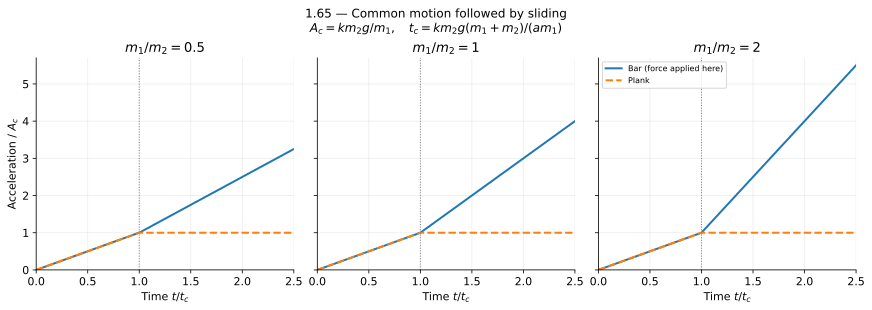
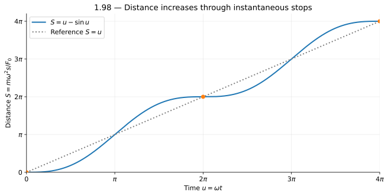

# 1.2 The Fundamental Equation of Dynamics

[Chapter index](../README.md#chapters) · [Structured solutions](1.2.json) · [Answer audit](../audit/README.md)

## 1.59

**Problem statement**

An aerostat of mass m starts coming down with a constant acceleration w. Determine the ballast mass to be dumped for the aerostat to reach the upward acceleration of the same magnitude. The air drag is to be neglected.

**Solved · high confidence.** Apply Newton’s law before and after ballast release.

**Assumptions**

- Buoyancy is unchanged by releasing the ballast; the release gives the aerostat no impulse. Its total mass before release is m.

Let B be the upward buoyant force. Before release the downward acceleration is w.

$$
mg-B=mw,\qquad B=m(g-w).
$$

If the dumped mass is Δm, require upward acceleration w afterward and eliminate B.

$$
B-(m-\Delta m)g=(m-\Delta m)w\quad\Longrightarrow\quad m(g-w)=(m-\Delta m)(g+w).
$$

**Results**

Ballast mass

$$
\Delta m=\frac{2mw}{g+w}
$$

**Limitations**

- A positive buoyant force requires w<g. Changes of volume or density during ballast release are neglected.

## 1.60

**Problem statement**

In the arrangement of Fig. 1.9 the masses m_0 , m_1 , and m_2 of bodies are equal, the masses of the pulley and the threads are negligible, and there is no friction in the pulley. Find the acceleration w with which the body m_0 comes down, and the tension of the thread binding together the bodies m_1 and m_2 , if the coefficient of friction between these bodies and the horizontal surface is equal to k. Consider possible cases.

**Solved · high confidence.** Use the common acceleration and distinguish sliding from static equilibrium.

**Assumptions**

- Each body has mass m. Motion, if it begins from rest, takes m₀ downward and the two table bodies toward the pulley.
- Use the supplied k for both the limiting static friction and sliding friction. Strings are taut; let T be the thread tension between m₁ and m₂ and T₀ the hanging-thread tension.

For sliding, the two table bodies each have friction kmg. Sum all three equations to eliminate the tensions.

$$
mg-T_0=mw,\quad T_0-T-kmg=mw,\quad T-kmg=mw;\quad 3mw=mg-2kmg.
$$

A release from rest therefore slides only for k<1/2. The m₂ equation gives T.

$$
w=\frac{g(1-2k)}3,\qquad T=\frac{mg(1+k)}3.
$$

For k≥1/2, equilibrium is possible. Then T₀=mg. The static friction on m₂ is T; that on m₁ is mg−T, which can have either sign. Their magnitudes cannot exceed kmg.

$$
0\le T\le kmg,\qquad |mg-T|\le kmg.
$$

**Results**

Downward acceleration for release from rest, k<1/2

$$
w=\frac{g(1-2k)}3
$$

Connecting tension for k<1/2

$$
T=\frac{mg(1+k)}3
$$

For k≥1/2

$$
w=0,\qquad mg\max(0,1-k)\le T\le kmg
$$

Static friction is not automatically equal to its limiting value, so the connecting tension is not uniquely determined for k>1/2. At k=1/2, T=mg/2.

**Limitations**

- The rest/sliding classification assumes release from rest. An already descending system with k>1/2 decelerates according to the sliding equations until it stops; the subsequent tension depends on its static load history.

## 1.61

**Problem statement**

Two touching bars 1 and 2 are placed on an inclined plane forming an angle α with the horizontal (Fig. 1.10). The masses of the bars are equal to m_1 and m_2 , and the coefficients of friction between the inclined plane and these bars are equal to k_1 and k_2 respectively, with k_1 > k_2 . Find: (a) the force of interaction of the bars in the process of motion; (b) the minimum value of the angle α at which the bars start sliding down.

**Solved · high confidence.** Add the downslope force balances, then recover the contact force.

**Assumptions**

- As in Fig. 1.10, bar 1 is below bar 2. They remain in contact and slide down together. Use the given coefficients also as limiting static coefficients for part (b).

Take downslope as positive and let Q be the compressive interaction. Bar 2 pushes bar 1 downslope.

$$
m_1w=m_1g\sin\alpha-k_1m_1g\cos\alpha+Q,\quad m_2w=m_2g\sin\alpha-k_2m_2g\cos\alpha-Q.
$$

Add the equations and substitute the resulting acceleration into either equation.

$$
w=g\left(\sin\alpha-\bar k\cos\alpha\right),\qquad \bar k=\frac{m_1k_1+m_2k_2}{m_1+m_2}.
$$

At incipient downward sliding, the total downslope gravity equals the sum of the limiting frictions.

$$
(m_1+m_2)g\sin\alpha_{\min}=(m_1k_1+m_2k_2)g\cos\alpha_{\min}.
$$

**Results**

Interaction force magnitude

$$
Q=\frac{m_1m_2}{m_1+m_2}g(k_1-k_2)\cos\alpha
$$

Downslope on bar 1, upslope on bar 2.

Threshold inclination

$$
\alpha_{\min}=\arctan\frac{m_1k_1+m_2k_2}{m_1+m_2}
$$

## 1.62

**Problem statement**

A small body was launched up an inclined plane set at an angle α = 15° against the horizontal. Find the coefficient of friction, if the time of the ascent of the body is η = 2.0 times less than the time of its descent.

**Solved · high confidence.** Compare uniformly accelerated ascent and descent over the same distance.

**Assumptions**

- The body returns to its launch point. Sliding friction has the same coefficient in both directions; η=t_down/t_up.

The acceleration magnitude uphill is g(sin α+k cos α), whereas downhill it is g(sin α−k cos α). Denote these by a₊ and a₋.

$$
t_{\uparrow}=\frac{v_0}{a_+},\quad L=\frac{v_0^2}{2a_+},\quad t_{\downarrow}=\sqrt{\frac{2L}{a_-}}.
$$

Their ratio eliminates the launch speed. Solve it for k.

$$
\eta^2=\frac{a_+}{a_-}=\frac{\sin\alpha+k\cos\alpha}{\sin\alpha-k\cos\alpha}.
$$

**Results**

Friction coefficient

$$
k=\tan\alpha\,\frac{\eta^2-1}{\eta^2+1}=0.16077\ldots
$$

## 1.63

**Problem statement**

The following parameters of the arrangement of Fig. 1.11 are available: the angle α which the inclined plane forms with the horizontal, and the coefficient of friction k between the body m_1 and the inclined plane. The masses of the pulley and the threads, as well as the friction in the pulley, are negligible. Assuming both bodies to be motionless at the initial moment, find the mass ratio m_2 /m_1 at which the body m_2 (a) starts coming down; (b) starts going up; (c) is at rest.

**Solved · high confidence.** Compare the hanging weight with the two limiting friction balances.

**Assumptions**

- Let η=m₂/m₁>0 and 0≤α<π/2. Use k as the limiting static coefficient; the thread remains taut.

At rest T=m₂g, and the tangential force that friction must balance on m₁ is m₁g(η−sin α). The normal force is m₁g cos α.

$$
|\eta-\sin\alpha|\le k\cos\alpha.
$$

Above the upper limit the hanging body pulls m₁ uphill, while below the lower limit m₁ pulls it upward.

$$
\eta_{\pm}=\sin\alpha\pm k\cos\alpha.
$$

**Results**

m₂ starts downward

$$
\eta>\sin\alpha+k\cos\alpha
$$

m₂ starts upward

$$
0<\eta<\sin\alpha-k\cos\alpha
$$

This branch exists only if tan α>k.

m₂ remains at rest

$$
\max(0,\sin\alpha-k\cos\alpha)\le\eta\le\sin\alpha+k\cos\alpha
$$

Restrict to η>0. Equality denotes limiting equilibrium; the strict inequalities in (a) and (b) guarantee motion from rest.

## 1.64

**Problem statement**

The inclined plane of Fig. 1.11 forms an angle α = 30° with the horizontal. The mass ratio m_2/m_1 = η = 2/3. The coefficient of friction between the body m_1 and the inclined plane is equal to k = 0.10. The masses of the pulley and the threads are negligible. Find the magnitude and the direction of acceleration of the body m_2 when the formerly stationary system of masses starts moving.

**Solved · high confidence.** Identify the impending direction, then sum the two force balances.

**Assumptions**

- Use the same friction coefficient for onset and sliding, with a taut thread.

The downward-driving mass ratio exceeds the upper static threshold.

$$
\eta=\frac23>\sin30^\circ+0.10\cos30^\circ=0.58660\ldots
$$

Take m₂ downward and m₁ uphill as positive. Add their equations.

$$
m_2g-T=m_2w,\quad T-m_1g\sin\alpha-km_1g\cos\alpha=m_1w.
$$

**Results**

Acceleration of m₂

$$
w=\frac{g(\eta-\sin\alpha-k\cos\alpha)}{1+\eta}=0.471257\ldots\ \mathrm{m/s^2}
$$

Vertically downward.

## 1.65

**Problem statement**

A plank of mass m_1 with a bar of mass m_2 placed on it lies on a smooth horizontal plane. A horizontal force growing with time t as F = at (a is constant) is applied to the bar. Find how the accelerations of the plank w_1 and of the bar w_2 depend on t, if the coefficient of friction between the plank and the bar is equal to k. Draw the approximate plots of these dependences.

**Solved · high confidence.** Separate the sticking regime from the subsequent sliding regime.

**Assumptions**

- a>0, m₁,m₂>0. The supplied k is used for both limiting static and sliding friction. The bar and plank start at rest.

While the surfaces stick, the external force accelerates the total mass. The friction needed to accelerate the plank is m₁at/(m₁+m₂).

$$
w_1=w_2=\frac{at}{m_1+m_2},\quad f=\frac{m_1at}{m_1+m_2}\le km_2g.
$$

Sliding begins at t*. Thereafter the plank has constant frictional driving force km₂g, and the bar has net force at−km₂g.

$$
t_* =\frac{km_2g(m_1+m_2)}{am_1}.
$$

**Results**

Plank acceleration

$$
w_1(t)=\begin{cases}at/(m_1+m_2),&0\le t\le t_*,\\km_2g/m_1,&t\ge t_*;\end{cases}
$$

Bar acceleration

$$
w_2(t)=\begin{cases}at/(m_1+m_2),&0\le t\le t_*,\\at/m_2-kg,&t\ge t_*;\end{cases}
$$

Plot description

$$
w_*=\frac{km_2g}{m_1},\qquad \frac{w_1}{w_*}=\min(t/t_*,1)
$$

Both plots are the same straight line until (t*,w*). The plank plot then becomes horizontal; the bar plot continues upward with the larger slope a/m₂. For k=0, w₁=0 and w₂=at/m₂ from the start. The transition time may also be denoted t_c=t_*.

## 1.66

**Problem statement**

A small body A starts sliding down from the top of a wedge (Fig. 1.12) whose base is equal to l = 2.10 m. The coefficient of friction between the body and the wedge surface is k = 0.140. At what value of the angle α will the time of sliding be the least? What will it be equal to?

**Solved · high confidence.** Maximize the geometric factor controlling the slide time.

**Assumptions**

- The wedge is fixed. The body starts at rest and slides along the full straight face. Its horizontal base length is l.

The incline length is l/cos α and the downward acceleration is g(sin α−k cos α). Thus sliding requires tan α>k.

$$
t^2=\frac{2l}{g\cos\alpha(\sin\alpha-k\cos\alpha)}.
$$

Minimize t by maximizing D=cos α(sin α−k cos α). Its derivative vanishes at the stated angle, and D tends to zero at the allowed endpoints.

$$
D=\frac{\sin2\alpha-k-k\cos2\alpha}{2},\quad D\prime=\cos2\alpha+k\sin2\alpha=0,\quad D_{\max}=\frac{\sqrt{1+k^2}-k}{2}.
$$

**Results**

Optimum inclination

$$
\alpha_* =\frac\pi4+\frac12\arctan k=48.984805\ldots{}^\circ
$$

Minimum slide time

$$
t_{\min}=\sqrt{\frac{4l}{g(\sqrt{1+k^2}-k)}}=0.992218\ldots\ \mathrm s
$$

## 1.67

**Problem statement**

A bar of mass m is pulled by means of a thread up an inclined plane forming an angle α with the horizontal (Fig. 1.13). The coefficient of friction is equal to k. Find the angle β which the thread must form with the inclined plane for the tension of the thread to be minimum. What is it equal to?

**Solved · medium confidence.** Minimize the tension for steady upward sliding, while enforcing contact.

**Assumptions**

- Interpret the requested pulling tension as that needed for uniform upward motion, or limiting onset of upward sliding with the supplied coefficient k. Without a specified tangential acceleration this convention is necessary.
- The thread is above the plane as drawn, 0≤β≤π/2; the normal force must remain nonnegative.

Project force balance along and normal to the plane.

$$
T\cos\beta=mg\sin\alpha+kN,\qquad N=mg\cos\alpha-T\sin\beta.
$$

Eliminate N. The unconstrained minimum maximizes cos β+k sin β, whose maximum √(1+k²) occurs at β=arctan k.

$$
T=\frac{mg(\sin\alpha+k\cos\alpha)}{\cos\beta+k\sin\beta},\qquad N=\frac{mg\cos(\alpha+\beta)}{\cos\beta+k\sin\beta}.
$$

The unconstrained optimum is permissible only if α+arctan k≤π/2. Otherwise the best contact-preserving angle is the boundary β=π/2−α, at which the thread is vertical and N=0.

**Results**

Minimum with positive or limiting contact, α+arctan k≤π/2

$$
\beta_* =\arctan k,\qquad T_{\min}=\frac{mg(\sin\alpha+k\cos\alpha)}{\sqrt{1+k^2}}
$$

Steep-plane contact boundary, α+arctan k>π/2

$$
\beta_* =\frac\pi2-\alpha,\qquad T_{\min}=mg,\qquad N=0
$$

For strictly positive contact force this is an infimum approached as β tends upward to the boundary.

**Limitations**

- For a prescribed nonzero uphill acceleration, replace the tangential force balance accordingly; the quoted minimum tension need not apply.

## 1.68

**Problem statement**

At the moment t = 0 the force F = at is applied to a small body of mass m resting on a smooth horizontal plane (a is a constant). The permanent direction of this force forms an angle α with the horizontal (Fig. 1.14). Find: (a) the velocity of the body at the moment of its breaking off the plane; (b) the distance traversed by the body up to this moment.

**Solved · high confidence.** Find the loss-of-contact time, then integrate the horizontal acceleration.

**Assumptions**

- a>0 and 0<α≤π/2. The force points above the horizontal as in Fig. 1.14.

While contact persists the vertical acceleration is zero, so the support reaction decreases until it vanishes.

$$
N=mg-at\sin\alpha,\qquad t_b=\frac{mg}{a\sin\alpha}.
$$

The horizontal acceleration grows linearly. Integrate from rest and evaluate at t_b; vertical velocity is still zero at that instant.

$$
v_x(t)=\frac{a\cos\alpha}{2m}t^2,\quad x(t)=\frac{a\cos\alpha}{6m}t^3.
$$

**Results**

Velocity at lift-off

$$
\mathbf v_b=\frac{mg^2\cos\alpha}{2a\sin^2\alpha}\,\mathbf e_x
$$

Distance before lift-off

$$
s_b=\frac{m^2g^3\cos\alpha}{6a^2\sin^3\alpha}
$$

## 1.69

**Problem statement**

A bar of mass m resting on a smooth horizontal plane starts moving due to the force F = mg/3 of constant magnitude. In the process of its rectilinear motion the angle α between the direction of this force and the horizontal varies as α = as, where a is a constant, and s is the distance traversed by the bar from its initial position. Find the velocity of the bar as a function of the angle α.

**Solved · high confidence.** Integrate Newton’s law with distance as the independent variable.

**Assumptions**

- a>0; take positive horizontal displacement in the initial motion direction. The force points above the horizontal when α>0.

The vertical reaction remains positive because F=mg/3. Horizontally use v dv/ds=F cos(as)/m.

$$
N=mg-\frac{mg}{3}\sin\alpha>0,\qquad v\frac{dv}{ds}=\frac g3\cos(as).
$$

Integrate from s=0 and rest, and substitute α=as.

$$
\frac{v^2}{2}=\frac{g}{3a}\sin(as).
$$

**Results**

Speed on the first outward leg

$$
v(\alpha)=\sqrt{\frac{2g}{3a}\sin\alpha},\qquad0\le\alpha\le\pi
$$

The velocity points in the initial positive direction before the first stop. The maximum is √(2g/(3a)) at α=π/2.

**Limitations**

- The formula covers the first forward leg through the first stop. Later motion requires accounting for velocity reversal while the cumulative distance s continues to grow.

## 1.70

**Problem statement**

A horizontal plane with the coefficient of friction k supports two bodies: a bar and an electric motor with a battery on a block. A thread attached to the bar is wound on the shaft of the electric motor. The distance between the bar and the electric motor is equal to l. When the motor is switched on, the bar, whose mass is twice as great as that of the other body, starts moving with a constant acceleration w. How soon will the bodies collide?

**Solved · high confidence.** Obtain the motor’s acceleration from the bar’s force balance, then use relative motion.

**Assumptions**

- The motor block has mass m and the bar has mass 2m; both start at rest. Their common horizontal thread tension is T, with the same sliding coefficient k on both bodies.

The bar accelerates toward the motor at w, so its thread tension is fixed.

$$
T-2kmg=2mw\quad\Longrightarrow\quad T=2m(w+kg).
$$

The same tension pulls the motor toward the bar. Its friction is kmg.

$$
w_M=\frac{T-kmg}{m}=2w+kg.
$$

The closing acceleration is the sum because the bodies accelerate toward one another.

$$
l=\frac12(w+w_M)t_c^2=\frac12(3w+kg)t_c^2.
$$

**Results**

Collision time

$$
t_c=\sqrt{\frac{2l}{3w+kg}}
$$

## 1.71

**Problem statement**

A pulley fixed to the ceiling of an elevator car carries a thread whose ends are attached to the loads of masses m_1 and m_2 . The car starts going up with an acceleration w_0 . Assuming the masses of the pulley and the thread, as well as the friction, to be negligible find: (a) the acceleration of the load m_1 relative to the elevator shaft and relative to the car; (b) the force exerted by the pulley on the ceiling of the car.

**Solved · high confidence.** Use the elevator’s effective gravity and transform the acceleration back to the shaft.

**Assumptions**

- Take upward as positive in both frames. The elevator accelerates upward at w₀, and the thread remains taut.

In the car frame the effective downward gravity is g+w₀, and the two loads have opposite accelerations.

$$
T-m_1(g+w_0)=m_1a_{1/c},\qquad T-m_2(g+w_0)=-m_2a_{1/c}.
$$

Solve for the relative acceleration and tension, then add the elevator acceleration for the shaft-frame result.

$$
a_{1/c}=\frac{m_2-m_1}{m_1+m_2}(g+w_0),\quad T=\frac{2m_1m_2}{m_1+m_2}(g+w_0),\quad a_{1/s}=w_0+a_{1/c}.
$$

Both vertical thread segments pull down on the pulley, so the pulley pulls down on the ceiling with force 2T.

**Results**

Acceleration relative to the car, upward positive

$$
a_{1/c}=\frac{m_2-m_1}{m_1+m_2}(g+w_0)
$$

Acceleration relative to the shaft, upward positive

$$
a_{1/s}=\frac{(m_2-m_1)g+2m_2w_0}{m_1+m_2}
$$

Force on the ceiling

$$
F=\frac{4m_1m_2}{m_1+m_2}(g+w_0)
$$

Vertically downward.

## 1.72

**Problem statement**

Find the acceleration of body 2 in the arrangement shown in Fig. 1.15, if its mass is η times as great as the mass of bar 1 and the angle that the inclined plane forms with the horizontal is equal to α. The masses of the pulleys and the threads, as well as the friction, are assumed to be negligible. Look into possible cases.

**Solved · high confidence.** Apply both pulley constraints and the massless movable-pulley force balance.

**Assumptions**

- In Fig. 1.15 the upper thread joins bar 1 to the movable pulley; a second thread passes around that pulley, with its left end fixed and its right end carrying body 2. Let m₁=m and m₂=ηm.
- Choose a₂ positive downward and a₁ positive uphill.

The first thread gives the movable pulley’s downward acceleration equal to a₁; the second gives a₂=2a₁. If its tension is T, the upper thread has tension 2T.

$$
a_2=2a_1,\qquad T_{\rm upper}=2T.
$$

Write Newton’s laws along the motions and substitute the constraint.

$$
ma_1=2T-mg\sin\alpha,\quad \eta ma_2=\eta mg-T.
$$

Eliminate T and a₁. The sign determines the possible directions.

$$
a_2=\frac{2g(2\eta-\sin\alpha)}{1+4\eta},\qquad T=\frac{\eta mg(1+2\sin\alpha)}{1+4\eta}.
$$

**Results**

Signed downward acceleration of body 2

$$
a_2=\frac{2g(2\eta-\sin\alpha)}{1+4\eta}
$$

Direction cases

$$
\begin{cases}\eta>\tfrac12\sin\alpha:&\text{body 2 accelerates downward},\\\eta=\tfrac12\sin\alpha:&a_2=0,\\0<\eta<\tfrac12\sin\alpha:&\text{body 2 accelerates upward}.\end{cases}
$$

The magnitude is |a₂|. Bar 1 has half that magnitude, in the opposite cable direction; the equality case remains at rest if released from rest.

## 1.73

**Problem statement**

In the arrangement shown in Fig. 1.16 the bodies have masses m_0, m_1, m_2, the friction is absent, the masses of the pulleys and the threads are negligible. Find the acceleration of the body m_1 . Look into possible cases.

**Solved · high confidence.** Use a dynamic movable pulley and its two string-length constraints.

**Assumptions**

- Take m₀ rightward and both suspended bodies downward as positive. The movable pulley descends when m₀ moves right.

Let T be the tension of the lower thread; the upper thread tension is 2T. The constraints give a_P=a₀ and a₁+a₂=2a₀.

$$
m_0a_0=2T,\quad m_1a_1=m_1g-T,\quad m_2a_2=m_2g-T.
$$

Eliminate the accelerations in the constraint to determine the tension.

$$
D=m_0(m_1+m_2)+4m_1m_2,\qquad T=\frac{2gm_0m_1m_2}{D}.
$$

Substitute this T into the m₁ equation and inspect the numerator’s sign.

**Results**

Signed downward acceleration of m₁

$$
a_1=g\,\frac{m_0(m_1-m_2)+4m_1m_2}{m_0(m_1+m_2)+4m_1m_2}
$$

Direction cases

$$
\begin{cases}m_1>\dfrac{m_0m_2}{m_0+4m_2}:&a_1>0\quad(\text{downward}),\\m_1=\dfrac{m_0m_2}{m_0+4m_2}:&a_1=0,\\m_1<\dfrac{m_0m_2}{m_0+4m_2}:&a_1<0\quad(\text{upward}).\end{cases}
$$

The acceleration magnitude is |a₁|; zero acceleration means rest only if its initial velocity is zero.

## 1.74

**Problem statement**

In the arrangement shown in Fig. 1.17 the mass of the rod M exceeds the mass m of the ball. The ball has an opening permitting it to slide along the thread with some friction. The mass of the pulley and the friction in its axle are negligible. At the initial moment the ball was located opposite the lower end of the rod. When set free, both bodies began moving with constant accelerations. Find the friction force between the ball and the thread if t seconds after the beginning of motion the ball got opposite the upper end of the rod. The rod length equals l.

**Solved · high confidence.** Use the measured relative displacement to determine the sliding friction.

**Assumptions**

- Let F≥0 be the friction force, upward on the ball, with equal thread tension F. The free thread below the ball is massless and unforced. Initially both bodies and the thread are at rest.
- The ball slides downward relative to its adjacent thread segment; the force and accelerations are constant over the interval.

Take downward as positive. The rod and ball accelerations are obtained from their respective force balances.

$$
a_M=g-\frac FM,\qquad a_m=g-\frac Fm.
$$

The ball gains a height l relative to the rod, so the rod’s downward displacement exceeds the ball’s by l.

$$
l=\frac12(a_M-a_m)t^2=\frac F2\left(\frac1m-\frac1M\right)t^2.
$$

The thread beside the ball moves upward at the rod’s speed. For the assumed sliding direction from rest, its relative downward acceleration must be nonnegative.

$$
a_m+a_M=2g-F\left(\frac1m+\frac1M\right)\ge0.
$$

**Results**

Friction force magnitude

$$
F=\frac{2mMl}{(M-m)t^2}
$$

Upward on the ball and downward on the sliding thread.

Admissibility of the assumed sliding from rest

$$
F\le\frac{2mMg}{M+m}\quad\Longleftrightarrow\quad t^2\ge\frac{l(M+m)}{g(M-m)}
$$

Strict inequality corresponds to downward slipping relative to the thread; equality is the sticking/zero-relative-speed limit.

## 1.75

**Problem statement**

In the arrangement shown in Fig. 1.18 the mass of ball 1 is η = 1.8 times as great as that of rod 2. The length of the latter is l = 100 cm. The masses of the pulleys and the threads, as well as the friction, are negligible. The ball is set on the same level as the lower end of the rod and then released. How soon will the ball be opposite the upper end of the rod?

**Solved · high confidence.** Combine the two pulley constraints and compare the ball with the moving rod.

**Assumptions**

- In Fig. 1.18 ball 1 is on the free end of the upper thread, whose other end supports the movable pulley. The lower thread has one end fixed and the other carrying rod 2. Both bodies start at rest.
- Let rod mass be m and ball mass ηm. Choose the ball acceleration a positive downward.

The movable pulley accelerates opposite the ball; the rod has twice that pulley acceleration. Therefore the rod’s signed downward acceleration is −2a. Let T be the lower-thread tension.

$$
a_{\rm rod}=-2a,\quad \eta ma=\eta mg-2T,\quad -2ma=mg-T.
$$

Eliminate T. For η=1.8<2 the ball rises and the rod descends.

$$
a=\frac{g(\eta-2)}{\eta+4},\qquad a_{\rm relative\ rise}=-3a=\frac{3g(2-\eta)}{\eta+4}.
$$

The ball must gain the rod length l relative to the rod; both relative position and relative velocity initially vanish.

$$
l=\frac12a_{\rm relative\ rise}t^2.
$$

**Results**

Time to reach the upper end’s level

$$
t=\sqrt{\frac{2l(\eta+4)}{3g(2-\eta)}}=1.403844\ldots\ \mathrm s
$$

**Limitations**

- This passage to the upper end from rest occurs for η<2. For η≥2 it does not occur in the stated direction.

## 1.76

**Problem statement**

In the arrangement shown in Fig. 1.19 the mass of body 1 is η = 4.0 times as great as that of body 2. The height h = 20 cm. The masses of the pulleys and the threads, as well as the friction, are negligible. At a certain moment body 2 is released and the arrangement set in motion. What is the maximum height that body 2 will go up to?

**Solved · medium confidence.** Separate the constrained motion before impact from the free upward flight afterward.

**Assumptions**

- Body 1 descends a distance h before contacting the floor and then stays there; after that the thread becomes slack while body 2 continues upward. Heights of body 2 are measured from its initial floor level.
- The bodies start at rest; the contacts and pulley paths are as in Fig. 1.19.

Let body 1 accelerate downward at a. The movable-pulley constraint gives body 2 upward acceleration 2a. With m₁=ηm₂ and thread tension T:

$$
m_1a=m_1g-2T,\qquad 2m_2a=T-m_2g,\qquad a=\frac{g(\eta-2)}{\eta+4}.
$$

Before body 1 reaches the floor, body 2 rises 2h and acquires speed u.

$$
u^2=2(2a)(2h)=8ah.
$$

The subsequent slack-thread rise is u²/(2g). Add it to 2h.

$$
H=2h+\frac{4ah}{g}=\frac{6\eta h}{\eta+4}.
$$

**Results**

Maximum height of body 2 above its initial level

$$
H=\frac{6\eta h}{\eta+4}=3h=0.600\ \mathrm m
$$

**Limitations**

- The formula is for η>2 and the standard non-rebounding floor contact. A specified rebound law could require a later sequence of slack and taut thread motion.

## 1.77

**Problem statement**

Find the accelerations of rod A and wedge B in the arrangement shown in Fig. 1.20 if the ratio of the mass of the wedge to that of the rod equals η, and the friction between all contact surfaces is negligible.

**Solved · high confidence.** Use the wedge–rod contact geometry and their separate force balances.

**Assumptions**

- The rod A is constrained by its smooth vertical guide, and wedge B moves horizontally on the smooth floor. Let the rod mass be m and the wedge mass ηm.
- Take the wedge acceleration a_B rightward and the rod acceleration a_A downward.

At the fixed horizontal position of the rod, a rightward wedge displacement lowers the surface height by its displacement times tan α.

$$
a_A=a_B\tan\alpha.
$$

The contact normal N has upward vertical component N cos α on the rod; its horizontal reaction on the wedge points right.

$$
ma_A=mg-N\cos\alpha,\qquad \eta ma_B=N\sin\alpha.
$$

Eliminate N and impose the geometric constraint.

**Results**

Wedge acceleration to the right

$$
a_B=\frac{g\tan\alpha}{\eta+\tan^2\alpha}=\frac{g\sin\alpha\cos\alpha}{\eta\cos^2\alpha+\sin^2\alpha}
$$

Rod acceleration downward

$$
a_A=\frac{g\tan^2\alpha}{\eta+\tan^2\alpha}=\frac{g\sin^2\alpha}{\eta\cos^2\alpha+\sin^2\alpha}
$$

## 1.78

**Problem statement**

In the arrangement shown in Fig. 1.21 the masses of the wedge M and the body m are known. The appreciable friction exists only between the wedge and the body m, the friction coefficient being equal to k. The masses of the pulley and the thread are negligible. Find the acceleration of the body m relative to the horizontal surface on which the wedge slides.

**Solved · high confidence.** Read the two-pulley string constraint, then solve the horizontal and vertical force balances.

**Assumptions**

- Both pulleys are fixed to the wedge. The thread runs upward from m, around the upper pulley, down around the lower pulley, then rightward to a fixed anchor as in Fig. 1.21.
- Take x rightward and y upward in the ground frame. The body remains against the wedge’s vertical face and slides downward relative to it.

The variable thread lengths are the vertical distance from m to the upper pulley and the horizontal distance from the lower pulley to the fixed anchor.

$$
L=\text{constant}-y_m-x_M\quad\Longrightarrow\quad a_{m,y}=-a_{M,x}.
$$

Let a=a_M,x=a_m,x. The horizontal normal N is the only horizontal force on m. The wedge receives a rightward thread resultant T and a leftward normal reaction.

$$
N=ma,\qquad Ma=T-N\quad\Longrightarrow\quad T=(M+m)a.
$$

Friction on the downward-sliding body is upward and equals kN. Its downward acceleration is a by the rope constraint.

$$
mg-T-kN=ma\quad\Longrightarrow\quad a=\frac{mg}{M+(2+k)m}.
$$

**Results**

Body acceleration relative to the ground

$$
\mathbf a_m=\frac{mg}{M+(2+k)m}(\mathbf e_x-\mathbf e_y)
$$

Downward and rightward at 45° to the horizontal.

Acceleration magnitude

$$
|\mathbf a_m|=\frac{\sqrt2\,mg}{M+(2+k)m}
$$

## 1.79

**Problem statement**

What is the minimum acceleration with which bar A (Fig. 1.22) should be shifted horizontally to keep bodies 1 and 2 stationary relative to the bar? The masses of the bodies are equal, and the coefficient of friction between the bar and the bodies is equal to k. The masses of the pulley and the threads are negligible, the friction in the pulley is absent.

**Solved · high confidence.** Intersect the two static-friction feasibility intervals in the accelerating bar frame.

**Assumptions**

- Fig. 1.22 has body 1 on the top surface and body 2 against the right vertical face. The bar accelerates to the right, toward body 2; leftward acceleration cannot supply the required nonnegative side normal force.
- Both bodies have mass m. Interpret k as the limiting static-friction coefficient, with k≥0; the thread remains taut.

Let a be the rightward acceleration and T the common thread tension. The top normal is mg, and the side normal is ma. Let f₁ be rightward friction on body 1 and f₂ upward friction on body 2.

$$
T+f_1=ma,\qquad T+f_2=mg,\qquad |f_1|\le kmg,\quad |f_2|\le kma.
$$

Thus T must lie in both intervals. At the smallest acceleration for k<1, body 1’s friction is leftward at its limit and body 2’s friction is upward at its limit.

$$
ma-kmg\le T\le ma+kmg,\quad mg-kma\le T\le mg+kma,\quad T\ge0.
$$

The first overlap condition gives the minimum. The other overlap condition gives an upper limit when k<1; sufficiently large acceleration can also destroy sticking.

$$
g(1-k)\le a(1+k),\qquad a(1-k)\le g(1+k).
$$

**Results**

Minimum rightward acceleration

$$
a_{\min}=g\max\!\left(0,\frac{1-k}{1+k}\right)
$$

Full sticking range

$$
\begin{cases}\dfrac{g(1-k)}{1+k}\le a\le\dfrac{g(1+k)}{1-k},&0\le k<1,\\a\ge0,&k\ge1.\end{cases}
$$

For k≥1, the minimum is zero: the top friction can support T=mg while body 2 hangs without a side normal force.

## 1.80

**Problem statement**

Prism 1 with bar 2 of mass m placed on it gets a horizontal acceleration w directed to the left (Fig. 1.23). At what maximum value of this acceleration will the bar be still stationary relative to the prism, if the coefficient of friction between them k < cot α?

**Solved · high confidence.** Resolve gravity and the translational inertial force along the incline.

**Assumptions**

- The prism slope rises to the right, as in Fig. 1.23. The prism acceleration w is leftward, so the inertial force in its frame is mw to the right.
- The bar is to remain at rest relative to the prism; use limiting static friction k, with 0<α<π/2 and 0≤k<cot α.

Resolve perpendicular and uphill to the slope. The normal remains positive for w≥0.

$$
N=m(g\cos\alpha+w\sin\alpha),\qquad F_{\parallel}=m(w\cos\alpha-g\sin\alpha).
$$

At the largest admissible w the impending relative motion is uphill, and friction acts downhill at its limiting magnitude.

$$
w\cos\alpha-g\sin\alpha=k(g\cos\alpha+w\sin\alpha).
$$

Solving the equality gives the upper bound. The absolute-value inequality also gives the lower bound required to prevent downhill slipping.

$$
|w\cos\alpha-g\sin\alpha|\le k(g\cos\alpha+w\sin\alpha).
$$

**Results**

Maximum leftward acceleration

$$
w_{\max}=g\frac{\sin\alpha+k\cos\alpha}{\cos\alpha-k\sin\alpha}=g\frac{\tan\alpha+k}{1-k\tan\alpha}
$$

Complete interval for remaining stationary

$$
\max\!\left(0,g\frac{\sin\alpha-k\cos\alpha}{\cos\alpha+k\sin\alpha}\right)\le w\le w_{\max}
$$

## 1.81

**Problem statement**

Prism 1 of mass m_1 and with angle α (see Fig. 1.23) rests on a horizontal surface. Bar 2 of mass m_2 is placed on the prism. Assuming the friction to be negligible, find the acceleration of the prism.

**Solved · high confidence.** Combine horizontal momentum conservation with the block’s equation along the moving slope.

**Assumptions**

- All contact surfaces, including the prism–floor contact, are smooth. The slope rises to the right in Fig. 1.23.
- Let X be the prism displacement to the right and q the block’s displacement down the slope relative to the prism.

The block has horizontal coordinate X−q cos α. There is no external horizontal force on the combined system.

$$
(m_1+m_2)\ddot X-m_2\ddot q\cos\alpha=0.
$$

Project the block’s equation along the downslope direction, including the prism’s horizontal acceleration.

$$
\ddot q=g\sin\alpha+\ddot X\cos\alpha.
$$

Eliminate the relative acceleration.

$$
\ddot X\bigl(m_1+m_2\sin^2\alpha\bigr)=m_2g\sin\alpha\cos\alpha.
$$

**Results**

Prism acceleration, to the right

$$
w_1=\frac{m_2g\sin\alpha\cos\alpha}{m_1+m_2\sin^2\alpha}
$$

## 1.82

**Problem statement**

In the arrangement shown in Fig. 1.24 the masses m of the bar and M of the wedge, as well as the wedge angle α, are known. The masses of the pulley and the thread are negligible. The friction is absent. Find the acceleration of the wedge M.

**Solved · medium confidence.** Use the thread-length constraint to reduce the moving-wedge system to one coordinate.

**Assumptions**

- Fig. 1.24 shows one thread end attached to the block, the thread passing over a pulley fixed to the wedge, and the other end attached to the fixed wall on the right.
- All contacts are smooth; the thread remains taut and massless. Take X rightward for the wedge and q downslope from the pulley for the bar.
- For the primary constant-acceleration branch the bar remains pressed against the incline, requiring M cos α≥m(1−cos α)². The initial lift-off branch is given separately for release from rest.

The inclined thread segment has length q and the horizontal wall segment shortens by X. Hence the bar’s downslope displacement relative to the wedge equals the wedge displacement.

$$
q-X=\mathrm{constant},\qquad \ddot q=\ddot X.
$$

The bar’s velocity has components (1−cos α)Ẋ horizontally and −sin α Ẋ vertically. Express the total kinetic energy and gravitational potential in X.

$$
K=\frac12\left[M+2m(1-\cos\alpha)\right]\dot X^2,\qquad U=U_0-mgX\sin\alpha.
$$

Apply the one-coordinate equation of motion.

$$
\left[M+2m(1-\cos\alpha)\right]\ddot X=mg\sin\alpha.
$$

Check the unilateral contact rather than assuming the normal can pull. Project the bar acceleration perpendicular to the incline and require N≥0.

$$
N=m(g\cos\alpha-w_M\sin\alpha)\ge0\quad\Longleftrightarrow\quad M\cos\alpha\ge m(1-\cos\alpha)^2.
$$

If the constrained normal would be negative, the bar separates immediately. For release from rest set N=0 and let A be the initial wedge acceleration. The initial string-length constraint still gives the bar acceleration projected up the initial incline as A(cos α−1). The wedge is driven only by the two pulley tensions, whose horizontal resultant is T(1−cos α).

$$
\frac Tm-g\sin\alpha=A(\cos\alpha-1),\qquad MA=T(1-\cos\alpha).
$$

**Results**

Wedge acceleration, toward the wall

$$
w_M=\frac{mg\sin\alpha}{M+2m(1-\cos\alpha)}
$$

Valid while the bar remains in contact: M cos α≥m(1−cos α)². The thread tension is positive in this regime.

Initial acceleration if contact is lost at release

$$
w_{M,0}=\frac{mg\sin\alpha(1-\cos\alpha)}{M+m(1-\cos\alpha)^2},\qquad M\cos\alpha<m(1-\cos\alpha)^2.
$$

For release from rest with the initial geometry of Fig.1.24. This initial acceleration is rightward; after lift-off the thread angle evolves, so the acceleration is no longer constant.

**Limitations**

- The ordinary constant-acceleration result applies only while the bar stays against the slope. In the lift-off regime the second formula gives the instantaneous acceleration at release from rest; subsequent evolution requires following the changing thread angle and may include later contact.

## 1.83

**Problem statement**

A particle of mass m moves along a circle of radius R. Find the modulus of the average vector of the force acting on the particle over the distance equal to a quarter of the circle, if the particle moves (a) uniformly with velocity v; (b) with constant tangential acceleration w_τ, the initial velocity being equal to zero.

**Solved · high confidence.** Average the force in time through the momentum change.

**Assumptions**

- “Average vector of the force over a quarter-circle” is interpreted as the time average during traversal of that arc.
- In part (b) w_τ>0 is the constant tangential acceleration; the initial speed is zero.

The general time-average force is the momentum increment divided by the traversal time.

$$
\langle\mathbf F\rangle=m\frac{\mathbf v_f-\mathbf v_i}{\Delta t}.
$$

For uniform motion, the initial and final tangents are perpendicular and have the same speed.

$$
|\mathbf v_f-\mathbf v_i|=\sqrt2v,\qquad \Delta t=\frac{\pi R}{2v}.
$$

For uniform tangential acceleration from rest, the final speed divided by elapsed time is w_τ; the initial momentum is zero.

$$
v_f^2=2w_\tau\frac{\pi R}{2}=\pi Rw_\tau,\qquad\Delta t=v_f/w_\tau.
$$

**Results**

Uniform-speed average force magnitude

$$
|\langle\mathbf F\rangle|=\frac{2\sqrt2}{\pi}\frac{mv^2}{R}
$$

Constant-tangential-acceleration average force magnitude

$$
|\langle\mathbf F\rangle|=mw_\tau
$$

The average vector points along the final velocity.

## 1.84

**Problem statement**

An aircraft loops the loop of radius R = 500 m with a constant velocity v = 360 km per hour. Find the weight of the flyer of mass m = 70 kg in the lower, upper, and middle points of the loop.

**Solved · high confidence.** Subtract gravity from the required centripetal net force to obtain the support force.

**Assumptions**

- The speed is constant, 360 km/h=100 m/s; g=9.81 m/s².
- Weight means the magnitude of the total force exerted on the flyer by the seat and restraints, equivalently the magnitude exerted by the flyer on them. At the side of the loop, support must balance gravity tangentially as well as accelerate inward.

Write the acceleration as (v²/R)n, where n points toward the loop centre. The total support force is net force minus gravity.

$$
\mathbf P_{\rm support}=m\frac{v^2}{R}\mathbf n-m\mathbf g,\qquad v^2/R=20.0\ \mathrm{m/s^2}.
$$

At the bottom inward is upward; at the top it is downward; at a side point it is horizontal. Combine the perpendicular components at the side.

$$
P_{\rm bottom}=m(g+v^2/R),\quad P_{\rm top}=m(v^2/R-g),\quad P_{\rm side}=m\sqrt{g^2+(v^2/R)^2}.
$$

**Results**

Weight at the lower point

$$
P_{\rm bottom}=2086.7\ \mathrm N
$$

Weight at the upper point

$$
P_{\rm top}=713.3\ \mathrm N
$$

Weight at either side point

$$
P_{\rm side}=m\sqrt{g^2+(v^2/R)^2}\simeq1.559\times10^3\ \mathrm N
$$

The radial component alone is mv²/R=1400 N; the total support force also has an upward component mg=686.7 N.

## 1.85

**Problem statement**

A small sphere of mass m suspended by a thread is first taken aside so that the thread forms the right angle with the vertical and then released. Find: (a) the total acceleration of the sphere and the thread tension as a function of θ, the angle of deflection of the thread from the vertical; (b) the thread tension at the moment when the vertical component of the sphere's velocity is maximum; (c) the angle θ between the thread and the vertical at the moment when the total acceleration vector of the sphere is directed horizontally.

**Solved · high confidence.** Use energy conservation, radial Newton’s law, and the vertical acceleration component.

**Assumptions**

- Let the thread length be L, and measure θ from downward vertical. The sphere is released from rest at θ=π/2; the first descent has 0≤θ≤π/2.
- The thread is massless and inextensible; air resistance is neglected.

The fall from the horizontal release position is L cos θ. Obtain the speed and the radial and tangential acceleration components.

$$
v^2=2gL\cos\theta,\quad w_n=2g\cos\theta,\quad w_\tau=g\sin\theta.
$$

The inward radial force balance gives the tension; the orthogonal acceleration components give its total magnitude.

$$
T-mg\cos\theta=mv^2/L,\qquad w=g\sqrt{4\cos^2\theta+\sin^2\theta}.
$$

The downward vertical speed is v sin θ. Maximize its square, proportional to cos θ(1−cos²θ).

$$
v_y^2=2gL\cos\theta\sin^2\theta,\qquad 1-3\cos^2\theta=0.
$$

Independently, the vertical acceleration vanishes when the acceleration vector is horizontal. The support force has vertical component T cos θ upward.

$$
w_y=-g+\frac Tm\cos\theta=g(3\cos^2\theta-1).
$$

**Results**

Total acceleration magnitude

$$
w(\theta)=g\sqrt{1+3\cos^2\theta}
$$

Thread tension

$$
T(\theta)=3mg\cos\theta
$$

Tension at maximum vertical speed

$$
T=\sqrt3\,mg\quad\left(\cos\theta=1/\sqrt3\right)
$$

Angle for horizontal total acceleration

$$
\theta=\arccos(1/\sqrt3)=54.7356\ldots{}^\circ
$$

## 1.86

**Problem statement**

A ball suspended by a thread swings in a vertical plane so that its acceleration values in the extreme and the lowest position are equal. Find the thread deflection angle in the extreme position.

**Solved · high confidence.** Equate tangential acceleration at the turning point and centripetal acceleration at the bottom.

**Assumptions**

- The nontrivial oscillation has an extreme deflection 0<θ₀<π/2, so the thread stays taut.
- Air resistance and thread mass are neglected.

At the extreme point the speed is zero and the acceleration magnitude is g sin θ₀. Energy conservation gives the bottom speed.

$$
w_{\rm extreme}=g\sin\theta_0,\qquad v_b^2=2gL(1-\cos\theta_0).
$$

At the bottom the tangential acceleration is zero. Equate the two acceleration magnitudes.

$$
\sin\theta_0=2(1-\cos\theta_0)\quad\Longrightarrow\quad\tan(\theta_0/2)=\frac12.
$$

**Results**

Nonzero extreme deflection

$$
\theta_0=2\arctan(1/2)=\arccos(3/5)=53.1301\ldots{}^\circ
$$

## 1.87

**Problem statement**

A small body A starts sliding off the top of a smooth sphere of radius R. Find the angle θ (Fig. 1.25) corresponding to the point at which the body breaks off the sphere, as well as the break-off velocity of the body.

**Solved · high confidence.** Combine energy conservation with zero normal reaction at detachment.

**Assumptions**

- The body starts arbitrarily close to the top with negligible speed, as implicit in “starts sliding off”; exact unperturbed rest at the top is an unstable equilibrium.
- θ is measured from upward vertical as in Fig. 1.25. The sphere is fixed and smooth.

The vertical fall is R(1−cos θ), fixing the speed. Project Newton’s law toward the centre.

$$
v^2=2gR(1-\cos\theta),\qquad mg\cos\theta-N=mv^2/R.
$$

The contact can only push, N≥0. At first loss of contact N=0.

$$
g\cos\theta=2g(1-\cos\theta).
$$

**Results**

Break-off angle

$$
\theta=\arccos(2/3)=48.1897\ldots{}^\circ
$$

Break-off speed

$$
v=\sqrt{\frac{2gR}{3}}
$$

## 1.88

**Problem statement**

A device (Fig. 1.26) consists of a smooth L-shaped rod located in a horizontal plane and a sleeve A of mass m attached by a weightless spring to a point B. The spring stiffness is equal to κ. The whole system rotates with a constant angular velocity ω about a vertical axis passing through the point O. Find the elongation of the spring. How is the result affected by the rotation direction?

**Solved · medium confidence.** Balance spring force and centrifugal force along the free arm of the rotating L-shaped rod.

**Assumptions**

- Interpret the question as the steady configuration in which the sleeve is stationary relative to the rod. Without initial conditions, a freely sliding sleeve can also oscillate or move away from equilibrium.
- Fig. 1.26 has OB perpendicular to BA. Let l₀>0 be the spring’s unstretched length and L=BA its current length; the unspecified l₀ is required for an absolute elongation.
- The sleeve lies on the arm extending from B in the direction shown; the rod supplies transverse constraint forces.

The component of the radius vector along BA is just L, since OB is perpendicular to BA. In the rotating frame the centrifugal component along the arm is mω²L; Coriolis force vanishes in the steady configuration.

$$
\kappa(L-l_0)=m\omega^2L.
$$

Solve for the extension Δl=L−l₀. The effective restoring coefficient also determines stability.

$$
(\kappa-m\omega^2)L=\kappa l_0,\qquad m\ddot{\delta L}=-(\kappa-m\omega^2)\delta L.
$$

**Results**

Steady spring elongation

$$
\Delta l=\frac{m\omega^2l_0}{\kappa-m\omega^2},\qquad \frac{\Delta l}{l_0}=\frac{m\omega^2}{\kappa-m\omega^2}\quad(\kappa>m\omega^2)
$$

Effect of reversing the rotation

$$
\Delta l(-\omega)=\Delta l(\omega)
$$

Only ω² enters the steady balance; reversing the rotation leaves the extension unchanged.

**Limitations**

- An absolute numerical elongation cannot be fixed without l₀. For κ≤mω² and l₀>0 there is no finite equilibrium with L≥0 on the indicated arm.
- The rod is smooth, so equilibrium is not automatically reached from arbitrary initial data; transient motion requires initial conditions.

## 1.89

**Problem statement**

A cyclist rides along the circumference of a circular horizontal plane of radius R, the friction coefficient being dependent only on distance r from the centre O of the plane as $k=k_0(1-r/R)$, where k_0 is a constant. Find the radius of the circle with the centre at the point O along which the cyclist can ride with the maximum velocity. What is this velocity?

**Solved · high confidence.** Maximize the radius-dependent friction limit on centripetal acceleration.

**Assumptions**

- Treat the cyclist as a point mass and use k(r) as the available limiting lateral grip. The circular path is centred at O and 0≤r≤R.

The required lateral force cannot exceed the available friction.

$$
mv^2/r\le mgk_0(1-r/R),\qquad v^2\le gk_0\left(r-\frac{r^2}{R}\right).
$$

Complete the square or differentiate the right-hand side.

$$
r-\frac{r^2}{R}=\frac R4-\frac{(r-R/2)^2}{R}.
$$

**Results**

Optimal radius

$$
r_{\rm opt}=R/2
$$

Largest speed

$$
v_{\max}=\frac12\sqrt{k_0gR}
$$

## 1.90

**Problem statement**

A car moves with a constant tangential acceleration w_τ = 0.62 m/s² along a horizontal surface circumscribing a circle of radius R = 40 m. The coefficient of sliding friction between the wheels of the car and the surface is k = 0.20. What distance will the car ride without sliding if at the initial moment of time its velocity is equal to zero?

**Solved · high confidence.** Apply the friction-circle limit to simultaneous tangential and normal accelerations.

**Assumptions**

- Use the stated coefficient k as the available limiting tyre–road grip at the onset of sliding; no distinct static coefficient is supplied.
- The car follows the radius-R circle with constant tangential acceleration w_τ from rest; aerodynamic forces are neglected.

Friction supplies both perpendicular horizontal acceleration components. The no-sliding condition concerns their vector sum.

$$
\sqrt{w_\tau^2+v^4/R^2}\le kg.
$$

Constant tangential acceleration gives v²=2w_τs. Substitute this relation and impose equality at first sliding.

$$
s_{\max}=\frac{R}{2w_\tau}\sqrt{(kg)^2-w_\tau^2}.
$$

**Results**

Distance before the onset of sliding

$$
s_{\max}=\frac{R}{2w_\tau}\sqrt{(kg)^2-w_\tau^2}=60.0472\ldots\ \mathrm m
$$

**Limitations**

- The formula requires 0<w_τ<kg. If w_τ>kg sliding occurs immediately; equality allows no positive nonsliding distance.

## 1.91

**Problem statement**

A car moves uniformly along a horizontal sine curve $y=a\sin(x/\alpha)$, where a and α are certain constants. The coefficient of friction between the wheels and the road is equal to k. At what velocity will the car ride without sliding?

**Solved · high confidence.** Find the maximum geometric curvature and apply the lateral-friction constraint.

**Assumptions**

- Take a>0 and α>0 without loss of generality for the sinusoid’s scale parameters; the speed v is constant.
- Use the coefficient k as the limiting available lateral friction.

For a planar graph, curvature is |y″|/(1+y′²)^(3/2).

$$
\mathcal K(x)=\frac{(a/\alpha^2)|\sin(x/\alpha)|}{[1+(a^2/\alpha^2)\cos^2(x/\alpha)]^{3/2}}.
$$

The numerator is at most a/α² and the denominator at least 1. Both bounds are attained simultaneously at the crests and troughs, so the maximum curvature is exactly a/α².

$$
\mathcal K_{\max}=a/\alpha^2,\qquad v^2\mathcal K_{\max}\le kg.
$$

**Results**

Speed range without sliding

$$
0\le v\le v_{\max}=\alpha\sqrt{\frac{kg}{a}}
$$

## 1.92

**Problem statement**

A chain of mass m forming a circle of radius R is slipped on a smooth round cone with half-angle θ. Find the tension of the chain if it rotates with a constant angular velocity ω about a vertical axis coinciding with the symmetry axis of the cone.

**Solved · high confidence.** Balance forces on an infinitesimal arc of the rotating chain.

**Assumptions**

- The chain is on the outside of a cone whose half-angle θ is measured from its vertical axis. It remains a uniform horizontal circle of radius R.
- Let dm=(m/2π)dφ and dN be the normal force on an arc dφ; the cone is smooth.

The cone normal has upward component dN sin θ and outward radial component dN cos θ. Vertical equilibrium fixes the normal force.

$$
dN\sin\theta=dm\,g.
$$

The two end tensions have inward resultant T dφ to first order. Subtract the outward normal component to obtain the required centripetal force.

$$
T\,d\varphi-dN\cos\theta=dm\,\omega^2R.
$$

Eliminate dN and dm.

$$
T\,d\varphi=\frac{m}{2\pi}d\varphi\left(\omega^2R+g\cot\theta\right).
$$

**Results**

Chain tension

$$
T=\frac{m}{2\pi}\left(\omega^2R+g\cot\theta\right)
$$

## 1.93

**Problem statement**

A fixed pulley carries a weightless thread with masses m_1 and m_2 at its ends. There is friction between the thread and the pulley. It is such that the thread starts slipping when the ratio m_2/m_1 = η_0 . Find: (a) the friction coefficient; (b) the acceleration of the masses when m_2/m_1 = η > η_0.

**Solved · medium confidence.** Use the capstan tension ratio and Newton’s equations for the two hanging masses.

**Assumptions**

- The pulley surface is fixed against rotation and the thread wraps through π radians between the two vertical hanging segments.
- Use Coulomb friction and assume the same coefficient for impending slip and sliding. If static and kinetic coefficients differ, the threshold ratio alone does not determine the subsequent acceleration.
- Take η₀≥1 and η=m₂/m₁>η₀, so m₂ accelerates downward and m₁ upward.

An infinitesimal thread element on the pulley obeys dT=kT dφ at impending/sliding motion. Integrate over the half-wrap.

$$
T_2/T_1=e^{k\pi},\qquad\eta_0=e^{k\pi}.
$$

During slipping, apply the translational equations to the masses; the high-tension side is the m₂ side.

$$
T_1=m_1(g+w),\qquad T_2=m_2(g-w).
$$

Impose T₂/T₁=η₀ and solve for the common acceleration magnitude.

$$
\eta\frac{g-w}{g+w}=\eta_0.
$$

**Results**

Friction coefficient

$$
k=\frac{\ln\eta_0}{\pi}
$$

Acceleration when m₂/m₁=η>η₀

$$
w=g\frac{\eta-\eta_0}{\eta+\eta_0}
$$

Mass m₂ moves downward and m₁ upward. If the sliding coefficient is k_kin instead, replace η₀ by exp(πk_kin) in this expression.

**Limitations**

- If the pulley rotates freely or the wrap angle is not π, the model changes. For wrap angle γ the measured threshold fixes k=ln(η₀)/γ.

## 1.94

**Problem statement**

A particle of mass m moves along the internal smooth surface of a vertical cylinder of radius R. Find the force with which the particle acts on the cylinder wall if at the initial moment of time its velocity equals v_0 and forms an angle α with the horizontal.

**Solved · high confidence.** Separate the vertical free fall from the horizontal circular motion.

**Assumptions**

- The particle remains on the internal cylindrical wall; its initial velocity is tangent to that surface and makes angle α with the horizontal.
- The cylinder is sufficiently tall that no end or base is encountered during the motion under consideration.

Gravity has no azimuthal component, and the smooth wall reaction is radial. Thus the horizontal tangential speed is constant, while the vertical velocity changes freely.

$$
v_\varphi=v_0\cos\alpha,\qquad v_z(t)=v_{z0}-gt.
$$

Only the radial component contributes to the wall reaction.

$$
N=m\frac{v_\varphi^2}{R}.
$$

**Results**

Force exerted on the cylinder wall

$$
N=\frac{mv_0^2\cos^2\alpha}{R}
$$

It is radially outward from the cylinder axis, and its magnitude is constant in time; the wall exerts the opposite inward force on the particle.

## 1.95

**Problem statement**

Find the magnitude and direction of the force acting on the particle of mass m during its motion in the plane xy according to the law $x=a\sin\omega t$, $y=b\cos\omega t$, where a, b, and ω are constants.

**Solved · high confidence.** Differentiate the prescribed motion twice and apply Newton’s second law.

**Assumptions**

- The origin is the centre of the prescribed trajectory. The force asked for is the total resultant force.

Both Cartesian coordinates satisfy the same oscillator equation.

$$
\ddot x=-\omega^2x,\qquad\ddot y=-\omega^2y.
$$

Multiply the acceleration vector by m and take its norm.

$$
\mathbf F=-m\omega^2\left[a\sin(\omega t)\mathbf i+b\cos(\omega t)\mathbf j\right]=-m\omega^2\mathbf r.
$$

**Results**

Force vector and direction

$$
\mathbf F(t)=-m\omega^2\mathbf r(t)
$$

The force points from the instantaneous position toward the origin whenever r≠0.

Force magnitude

$$
F(t)=m\omega^2\sqrt{a^2\sin^2(\omega t)+b^2\cos^2(\omega t)}
$$

**Limitations**

- At a degenerate point where r=0 the force vanishes and its direction is undefined.

## 1.96

**Problem statement**

A body of mass m is thrown at an angle to the horizontal with the initial velocity v_0 . Assuming the air drag to be negligible, find: (a) the momentum increment $\Delta\mathbf{p}$ that the body acquires over the first t seconds of motion; (b) the modulus of the momentum increment $\Delta p$ during the total time of motion.

**Solved · high confidence.** Use gravitational impulse over the stated time interval.

**Assumptions**

- Uniform gravity and no drag. For part (b), interpret the full flight as returning to the launch height, and denote the launch elevation angle by α.
- If the landing height differs, the total flight time T must instead be supplied or determined from that height.

The momentum increment equals the impulse of the constant gravitational force.

$$
\Delta\mathbf p(t)=\int_0^t m\mathbf g\,dt=m\mathbf g\,t.
$$

For equal launch and landing heights, the flight time is fixed by the vertical motion.

$$
T=\frac{2v_0\sin\alpha}{g},\qquad |\Delta\mathbf p|=mgT.
$$

**Results**

Momentum increment during the first t seconds

$$
\Delta\mathbf p=m\mathbf g\,t
$$

Vertically downward; its magnitude is mgt.

Magnitude over the full flight

$$
\Delta p=2mv_0\sin\alpha
$$

For a different landing height the general result is Δp=mgT instead.

## 1.97

**Problem statement**

At the moment t = 0 a stationary particle of mass m experiences a time-dependent force $\mathbf{F}=\mathbf{a}t(\tau-t)$, where a is a constant vector, τ is the time during which the given force acts. Find: (a) the momentum of the particle when the action of the force discontinued; (b) the distance covered by the particle while the force acted.

**Solved · high confidence.** Integrate the time-dependent force and then the resulting velocity.

**Assumptions**

- The force acts only over 0≤t≤τ with τ>0; the particle starts from rest. The constant vector a sets the force direction and scale.

Integrate from zero initial momentum.

$$
\mathbf p(t)=\mathbf a\left(\frac{\tau t^2}{2}-\frac{t^3}{3}\right),\quad0\le t\le\tau.
$$

The scalar factor multiplying a is nonnegative throughout the force interval, so there is no reversal and distance equals the displacement magnitude.

$$
s=\frac{|\mathbf a|}{m}\int_0^\tau\left(\frac{\tau t^2}{2}-\frac{t^3}{3}\right)dt.
$$

**Results**

Momentum when the force ceases

$$
\mathbf p(\tau)=\frac{\mathbf a\tau^3}{6}
$$

Distance covered while the force acts

$$
s=\frac{|\mathbf a|\tau^4}{12m}
$$

## 1.98

**Problem statement**

At the moment t = 0 a particle of mass m starts moving due to a force $\mathbf{F}=\mathbf{F}_0\sin\omega t$, where F_0 and ω are constants. Find the distance covered by the particle as a function of t. Draw the approximate plot of this function.

**Solved · high confidence.** Integrate the sinusoidal force and use the nonnegative speed factor.

**Assumptions**

- The particle starts from rest at t=0; ω>0 and F₀ denotes the magnitude of the constant vector F₀.

One integration gives the velocity. Although the force reverses every half-period, this velocity never reverses direction.

$$
\mathbf v(t)=\frac{\mathbf F_0}{m\omega}(1-\cos\omega t).
$$

Since 1−cos ωt≥0, integrate the speed without any sign changes.

$$
s(t)=\frac{F_0}{m\omega}\int_0^t(1-\cos\omega u)du.
$$

Use scaled coordinates for the requested graph: the curve increases monotonically, with stationary horizontal tangents at u=2πn. It oscillates around the straight line S=u.

$$
u=\omega t,\qquad S=\frac{m\omega^2s}{F_0}=u-\sin u,\qquad \frac{dS}{du}=1-\cos u\ge0.
$$

**Results**

Distance as a function of time

$$
s(t)=\frac{F_0}{m\omega^2}(\omega t-\sin\omega t),\qquad t\ge0
$$

Scaled plot

$$
S(u)=u-\sin u,\quad u\ge0
$$

S(0)=0; stops at u=2πn are instantaneous with no reversal. At u=(2n+1)π the slope is maximal, equal to 2.

## 1.99

**Problem statement**

At the moment t = 0 a particle of mass m starts moving due to a force $\mathbf{F}=\mathbf{F}_0\cos\omega t$, where F_0 and ω are constants. How long will it be moving until it stops for the first time? What distance will it traverse during that time? What is the maximum velocity of the particle over this distance?

**Solved · high confidence.** Integrate the sinusoidal force and locate the first positive velocity zero.

**Assumptions**

- The particle starts from rest; ω>0 and F₀ denotes the positive magnitude of the constant vector.

Choose the x direction along F₀ and integrate Newton’s equation.

$$
v_x(t)=\frac{F_0}{m\omega}\sin\omega t.
$$

The velocity remains nonnegative until the first positive zero, so distance is its signed integral on that interval.

$$
t_*=\frac\pi\omega,\qquad s=\int_0^{\pi/\omega}\frac{F_0}{m\omega}\sin\omega t\,dt=\frac{2F_0}{m\omega^2}.
$$

The largest speed occurs halfway through this interval, where the force passes through zero.

$$
t_{\max}=\frac\pi{2\omega},\qquad v_{\max}=\frac{F_0}{m\omega}.
$$

**Results**

Time until first stop

$$
t_*=\pi/\omega
$$

Distance before first stop

$$
s=2F_0/(m\omega^2)
$$

Maximum speed

$$
v_{\max}=F_0/(m\omega)
$$

## 1.100

**Problem statement**

A motorboat of mass m moves along a lake with velocity v_0 . At the moment t = 0 the engine of the boat is shut down. Assuming the resistance of water to be proportional to the velocity of the boat F = —rv, find: (a) how long the motorboat moved with the shutdown engine; (b) the velocity of the motorboat as a function of the distance covered with the shutdown engine, as well as the total distance covered till the complete stop; (c) the mean velocity of the motorboat over the time interval (beginning with the moment t = 0), during which its velocity decreases η times.

**Solved · high confidence.** Solve linear drag in time, then eliminate time and average over a finite interval.

**Assumptions**

- r>0, v₀>0; drag alone acts horizontally after shutdown.
- η>1 is the factor by which the speed decreases.

The linear drag equation gives exponential decay and an asymptotic limiting displacement.

$$
m\dot v=-rv,\quad v=v_0e^{-rt/m},\quad s=\frac{mv_0}{r}(1-e^{-rt/m}).
$$

Eliminate the exponential. Since v(t) is positive at every finite time, the mathematical complete stop occurs only asymptotically.

$$
v(s)=v_0-\frac rm s,\quad 0\le s<\frac{mv_0}{r},\qquad t_{\rm stop}=\infty.
$$

For the specified finite speed reduction, compute the elapsed time and displacement before dividing.

$$
t_\eta=\frac mr\ln\eta,\quad s_\eta=\frac{mv_0}{r}(1-\eta^{-1}),\quad\overline v=\frac{v_0(1-\eta^{-1})}{\ln\eta}.
$$

**Results**

Complete-stop time in the ideal drag law

$$
t_{\rm stop}=\infty
$$

Speed as a function of distance

$$
v(s)=v_0-rs/m\quad(0\le s<mv_0/r)
$$

Total limiting distance

$$
s_\infty=mv_0/r
$$

Mean velocity during an η-fold speed decrease

$$
\overline{\mathbf v}=\frac{1-\eta^{-1}}{\ln\eta}\,\mathbf v_0
$$

**Limitations**

- A practical stopping time requires a nonzero speed threshold or an additional low-speed resistance law; neither is supplied.

## 1.101

**Problem statement**

Having gone through a plank of thickness h, a bullet changed its velocity from v_0 to v. Find the time of motion of the bullet in the plank, assuming the resistance force to be proportional to the square of the velocity.

**Solved · high confidence.** Eliminate the unknown quadratic-drag coefficient using the measured entry and exit speeds.

**Assumptions**

- 0<v<v₀ and h>0; the opposing force is −kv² with the same constant k throughout the plank.

Use v dv/dx to integrate the spatial drag law.

$$
mv\frac{dv}{dx}=-kv^2\quad\Rightarrow\quad \ln\frac{v_0}{v}=\frac{kh}{m}.
$$

Integrate the time equation and substitute the coefficient inferred above.

$$
t=\frac mk\left(\frac1v-\frac1{v_0}\right)=\frac{h(v_0-v)}{v_0v\ln(v_0/v)}.
$$

**Results**

Transit time

$$
t=\frac{h(v_0-v)}{v_0v\ln(v_0/v)}
$$

## 1.102

**Problem statement**

A small bar starts sliding down an inclined plane forming an angle α with the horizontal. The friction coefficient depends on the distance x covered as k = ax, where a is a constant. Find the distance covered by the bar till it stops, and its maximum velocity over this distance.

**Solved · high confidence.** Integrate work per unit mass with distance-dependent friction.

**Assumptions**

- The bar starts from rest at x=0, a>0, and 0<α<π/2.
- The incline is long enough for the bar to reach its first stop; the given k is used for sliding friction.

Until the first stop, gravity acts down the incline and friction acts up it.

$$
v\frac{dv}{dx}=g(\sin\alpha-ax\cos\alpha).
$$

Integrate from rest, then take the positive root between the two zeros.

$$
v^2(x)=2gx\sin\alpha-agx^2\cos\alpha.
$$

The second zero gives the stopping distance; the maximum of v² occurs where its derivative vanishes.

$$
x_*=\frac{2\tan\alpha}{a},\qquad x_{\max}=\frac{\tan\alpha}{a},\qquad v_{\max}^2=\frac{g\sin^2\alpha}{a\cos\alpha}.
$$

**Results**

Distance to first stop

$$
x_*=2\tan\alpha/a
$$

Maximum speed

$$
v_{\max}=\sqrt{\frac{g\sin^2\alpha}{a\cos\alpha}}
$$

Location of the maximum

$$
x_{\max}=\tan\alpha/a
$$

## 1.103

**Problem statement**

A body of mass m rests on a horizontal plane with the friction coefficient k. At the moment t = 0 a horizontal force is applied to it, which varies with time as F = at, where a is a constant vector. Find the distance traversed by the body during the first t seconds after the force action began.

**Solved · high confidence.** Include the initial static-friction interval before integrating the growing net force.

**Assumptions**

- Let A=|a|>0 and take the positive axis along the applied horizontal force.
- The limiting static and kinetic friction coefficients are both k, as implied by a single friction coefficient.

The body remains at rest until the applied force exceeds the limiting friction.

$$
t_0=\frac{kmg}{A}.
$$

After departure, the net force is A(t−t₀). Integrate with zero velocity and displacement at t₀.

$$
\dot v=\frac Am(t-t_0),\qquad v=\frac{A}{2m}(t-t_0)^2,\qquad s=\frac{A}{6m}(t-t_0)^3.
$$

**Results**

Distance during the first t seconds

$$
s(t)=\begin{cases}0,&0\le t\le t_0,\\\dfrac{A}{6m}(t-t_0)^3,&t>t_0,\end{cases}\qquad t_0=\frac{kmg}{A}
$$

## 1.104

**Problem statement**

A body of mass m is thrown straight up with velocity v_0 . Find the velocity v' with which the body comes down if the air drag equals kv² , where k is a constant and v is the velocity of the body.

**Solved · high confidence.** Relate ascent height and return speed using the opposite drag directions.

**Assumptions**

- The requested downward speed is measured when the body returns to its launch height.
- The drag always opposes velocity; k≥0 and gravity is constant.

On ascent, use v dv/dy to integrate both gravity and drag.

$$
mv\frac{dv}{dy}=-mg-kv^2,\qquad H=\frac{m}{2k}\ln\left(1+\frac{kv_0^2}{mg}\right).
$$

On descent, let u≥0 be downward speed and z the distance below the highest point. Drag now acts upward.

$$
mu\frac{du}{dz}=mg-ku^2,\qquad u^2(z)=\frac{mg}{k}(1-e^{-2kz/m}).
$$

Substitute z=H and eliminate the height.

$$
v\prime{}^2=\frac{v_0^2}{1+kv_0^2/(mg)}.
$$

**Results**

Downward return speed

$$
v\prime=\frac{v_0}{\sqrt{1+kv_0^2/(mg)}}
$$

Return velocity for an upward-positive axis

$$
\mathbf v_{\rm return}=-v\prime\mathbf e_y
$$

## 1.105

**Problem statement**

A particle of mass m moves in a certain plane P due to a force F whose magnitude is constant and whose vector rotates in that plane with a constant angular velocity ω. Assuming the particle to be stationary at the moment t = 0, find: (a) its velocity as a function of time; (b) the distance covered by the particle between two successive stops, and the mean velocity over this time.

**Solved · high confidence.** Integrate a uniformly rotating force vector and distinguish speed from vector velocity.

**Assumptions**

- ω>0; choose eₓ along F(0) and eᵧ a quarter-turn ahead in the sense of force rotation.
- The particle starts from rest; F denotes the positive force magnitude.

Resolve and integrate the force components.

$$
\mathbf F=F(\cos\omega t\,\mathbf e_x+\sin\omega t\,\mathbf e_y),\qquad\mathbf v(t)=\frac{F}{m\omega}[\sin\omega t\,\mathbf e_x+(1-\cos\omega t)\,\mathbf e_y].
$$

The speed is nonnegative and has consecutive zeros one forcing period apart.

$$
v(t)=\frac{2F}{m\omega}|\sin(\omega t/2)|,\qquad T=\frac{2\pi}{\omega}.
$$

Integrate speed for path length and integrate velocity for displacement over a period.

$$
s_T=\frac{8F}{m\omega^2},\qquad\Delta\mathbf r=\frac{2\pi F}{m\omega^2}\mathbf e_y,\qquad\langle\mathbf v\rangle=\frac{F}{m\omega}\mathbf e_y.
$$

**Results**

Velocity vector

$$
\mathbf v(t)=\frac{F}{m\omega}[\sin\omega t\,\mathbf e_x+(1-\cos\omega t)\,\mathbf e_y]
$$

Speed

$$
v(t)=\frac{2F}{m\omega}|\sin(\omega t/2)|
$$

Distance between successive stops

$$
s_T=8F/(m\omega^2)
$$

Mean velocity over that interval

$$
\langle\mathbf v\rangle=\frac{F}{m\omega}\mathbf e_y
$$

Mean speed, for comparison

$$
\langle v\rangle=4F/(\pi m\omega)
$$

## 1.106

**Problem statement**

A small disc A is placed on an inclined plane forming an angle α with the horizontal (Fig. 1.27) and is imparted an initial velocity v_0 . Find how the velocity of the disc depends on the angle φ if the friction coefficient k = tan α and at the initial moment φ_0 = π/2.

**Solved · high confidence.** Resolve gravity and friction along the instantaneous velocity and perpendicular to it.

**Assumptions**

- In Fig. 1.27 the x axis is down the steepest slope; φ is the angle between the velocity and this axis.
- The disc slides with Coulomb friction, k=tanα, so kg cosα=g sinα. The initial velocity is transverse to the slope.

Write q=g sinα and resolve the acceleration in the plane of the incline.

$$
\dot{\mathbf v}=q(\mathbf e_x-\widehat{\mathbf v}),\qquad\dot v=q(\cos\varphi-1),\qquad v\dot\varphi=-q\sin\varphi.
$$

Eliminate time and integrate from φ₀=π/2, v=v₀.

$$
\frac{dv}{v}=\tan\frac\varphi2\,d\varphi,\qquad\ln\frac v{v_0}=-2\ln\frac{\cos(\varphi/2)}{\cos(\pi/4)}.
$$

Use the half-angle identity to simplify.

$$
v(\varphi)=\frac{v_0}{2\cos^2(\varphi/2)}=\frac{v_0}{1+\cos\varphi}.
$$

**Results**

Speed versus direction angle

$$
v(\varphi)=\frac{v_0}{1+\cos\varphi},\qquad0<\varphi\le\pi/2
$$

Asymptotic downslope speed

$$
\lim_{\varphi\to0}v=v_0/2
$$

## 1.107

**Problem statement**

A chain of length l is placed on a smooth spherical surface of radius R with one of its ends fixed at the top of the sphere. What will be the acceleration w of each element of the chain when its upper end is released? It is assumed that the length of the chain $l<\frac{1}{2}\pi R$.

**Solved · high confidence.** Integrate tangential gravity over the inextensible chain at release.

**Assumptions**

- The chain has uniform linear density and lies along a meridian of the sphere.
- The question is evaluated immediately after release from rest; all elements are still in contact, and the chain is inextensible.

Because the chain is inextensible, all elements initially have the same scalar tangential acceleration w. Their initial normal acceleration is zero because their speed is zero.

$$
\theta(s)=s/R,\qquad0\le s\le l.
$$

Sum tangential equations along the chain. Internal tensions cancel and the two ends are free after release.

$$
\lambda l\,w=\int_0^l\lambda g\sin(s/R)\,ds=\lambda gR[1-\cos(l/R)].
$$

**Results**

Initial acceleration magnitude of every element

$$
w=\frac{gR}{l}\left(1-\cos\frac lR\right)
$$

Acceleration vector at arclength s from the top

$$
\mathbf w(s)=w\,\mathbf t_{\rm downhill}(s)
$$

**Limitations**

- At later times the chain has nonzero normal acceleration and a changed position; the displayed common magnitude applies at the instant of release.

## 1.108

**Problem statement**

A small body is placed on the top of a smooth sphere of radius R. Then the sphere is imparted a constant acceleration w_0 in the horizontal direction and the body begins sliding down. Find: (a) the velocity of the body relative to the sphere at the moment of break-off; (b) the angle θ_0 between the vertical and the radius vector drawn from the centre of the sphere to the break-off point; calculate θ_0 for w_0 = g.

**Solved · high confidence.** Use energy and the zero-normal-reaction condition in the translating sphere frame.

**Assumptions**

- The sphere begins translating with acceleration w₀≥0 without an initial velocity jump.
- Let θ grow from the upward vertical toward the side opposite the sphere acceleration. Gravity is constant; the sphere does not rotate.

The translating frame has uniform inertial acceleration opposite w₀. Its work gives the relative speed while contact persists.

$$
v_{\rm rel}^2=2R[g(1-\cos\theta)+w_0\sin\theta].
$$

The inward radial equation determines the normal reaction; break-off occurs when it vanishes.

$$
N=m\left(g\cos\theta-w_0\sin\theta-\frac{v_{\rm rel}^2}{R}\right),\qquad3(g\cos\theta_0-w_0\sin\theta_0)=2g.
$$

Eliminate the angular combination between these two equations.

$$
v_{\rm rel,0}=\sqrt{\frac{2gR}{3}},\qquad\theta_0=\arccos\frac{2g}{3\sqrt{g^2+w_0^2}}-\arctan\frac{w_0}{g}.
$$

**Results**

Relative speed at break-off

$$
v_{\rm rel,0}=\sqrt{2gR/3}
$$

Break-off angle

$$
\theta_0=\arccos\frac{2g}{3\sqrt{g^2+w_0^2}}-\arctan\frac{w_0}{g}
$$

Angle for w₀=g

$$
\theta_0=\arccos(\sqrt2/3)-\pi/4\approx16.8745^\circ
$$

**Limitations**

- At exactly w₀=0, exact rest at the exact top is an unstable equilibrium; descent requires an arbitrarily small perturbation.

## 1.109

**Problem statement**

A particle moves in a plane under the action of a force which is always perpendicular to the particle's velocity and depends on a distance to a certain point on the plane as $1/r^n$, where n is a constant. At what value of n will the motion of the particle along the circle be steady?

**Solved · medium confidence.** Linearize the planar constant-speed equations about a circular orbit.

**Assumptions**

- Interpret “steady” as dynamically stable under small in-plane perturbations.
- Write F=K/rⁿ with K>0; choose the continuous force orientation that bends the velocity toward the orbit centre near the reference circle. The force remains perpendicular to velocity after perturbation.

Since the force does no work, speed v is constant. Let ψ be the angle from the outward radius to the velocity; its circular-orbit value is π/2.

$$
\dot r=v\cos\psi,\qquad\dot\psi=\frac{K}{mv r^n}-\frac vr\sin\psi.
$$

For an orbit of radius R, force balance requires K/(mv²)=Rⁿ⁻¹. Put r=R+δr and ψ=π/2+δψ and retain first-order terms.

$$
\delta\dot r=-v\,\delta\psi,\qquad\delta\dot\psi=\frac{v(1-n)}{R^2}\delta r.
$$

The radial perturbation oscillates only if the coefficient is positive.

$$
\delta\ddot r+\frac{v^2(1-n)}{R^2}\delta r=0.
$$

**Results**

Condition for restoring stability of the circular motion

$$
n<1
$$

Boundary and unstable cases

$$
n=1:\ \delta\ddot r=0;\qquad n>1:\ \delta r\text{ has an exponentially growing mode}
$$

**Limitations**

- If “steady” means only that an exact circular orbit can exist, no unique n is selected: K/Rⁿ=mv²/R is sufficient. The n<1 result answers the stability interpretation.

## 1.110

**Problem statement**

A sleeve A can slide freely along a smooth rod bent in the shape of a half-circle of radius R (Fig. 1.28). The system is set in rotation with a constant angular velocity ω about a vertical axis OO'. Find the angle θ corresponding to the steady position of the sleeve.

**Solved · high confidence.** Balance tangential gravity and centrifugal force using the angle in Fig. 1.28.

**Assumptions**

- The vertical rotation axis is the diameter joining the semicircle endpoints; θ is measured from the downward vertical through its centre.
- Steady position means relative equilibrium; the physically stable branch is specified separately.

For a sleeve at rest in the rotating frame, Coriolis force vanishes. The horizontal distance from the axis is R sinθ.

$$
m\omega^2R\sin\theta\cos\theta-mg\sin\theta=0.
$$

The same condition follows by differentiating the effective potential.

$$
U_{\rm eff}=-mgR\cos\theta-\frac12m\omega^2R^2\sin^2\theta.
$$

The bottom is stable up to the threshold ω²R=g. Above it, the bottom loses stability and the off-axis root is stable.

$$
\theta_{\rm stable}=\begin{cases}0,&\omega^2R\le g,\\\arccos[g/(\omega^2R)],&\omega^2R>g.\end{cases}
$$

**Results**

Stable steady position

$$
\theta=0\ (\omega^2R\le g),\qquad\cos\theta=\frac{g}{\omega^2R}\ (\omega^2R>g)
$$

Other formal equilibrium roots

$$
\theta=0\text{ for every }\omega;\qquad\theta=\pi\text{ at the top}
$$

The bottom is unstable above threshold; the top root is unstable. At the threshold the bottom has a positive quartic potential term and remains a degenerate stable equilibrium.

## 1.111

**Problem statement**

A rifle was aimed at the vertical line on the target located precisely in the northern direction, and then fired. Assuming the air drag to be negligible, find how much off the line, and in what direction, will the bullet hit the target. The shot was fired in the horizontal direction at the latitude φ = 60°, the bullet velocity v = 900 m/s, and the distance from the target equals s = 1.0 km.

**Solved · high confidence.** Integrate the east component of the Coriolis acceleration during the northward flight.

**Assumptions**

- Use local east, north and upward axes; retain first order in Earth angular velocity Ω=2π/(1.00 day)=7.2722052×10⁻⁵ rad/s from Appendix Table 10 (PDF381, printed374).
- Use constant local g=9.81 m/s² and flight time T=s/v; neglect air drag, Earth-curvature corrections and terms of order Ω².

At latitude φ, Earth angular velocity is Ω(cosφ e_N+sinφ e_U). The leading bullet velocity is v e_N−gt e_U.

$$
\mathbf a_C=-2\boldsymbol\Omega\times\mathbf v,\qquad a_E=2\Omega(v\sin\varphi+gt\cos\varphi).
$$

Double integration with zero initial east displacement and velocity gives the lateral shift.

$$
x_E(T)=\Omega v\sin\varphi\,T^2+\frac13\Omega g\cos\varphi\,T^3,\qquad T=\frac sv.
$$

The horizontal-velocity term is dominant; the fall correction is only about 0.16 mm for the supplied data.

$$
x_{E,\rm leading}=\frac{\Omega s^2\sin\varphi}{v}\approx0.06998\ \mathrm m.
$$

**Results**

Leading lateral displacement

$$
x_E\simeq\Omega s^2\sin\varphi/v\simeq7.0\ \mathrm{cm}\quad\text{eastward}
$$

First-order result also retaining the vertical-fall contribution

$$
x_E=\frac{\Omega s^2\sin\varphi}{v}+\frac{\Omega g s^3\cos\varphi}{3v^3}\approx0.07014\ \mathrm m
$$

The bullet strikes to the right of the vertical target line when viewed toward the north.

## 1.112

**Problem statement**

A horizontal disc rotates with a constant angular velocity ω = 6.0 rad/s about a vertical axis passing through its centre. A small body of mass m = 0.50 kg moves along a diameter of the disc with a velocity v' = 50 cm/s which is constant relative to the disc. Find the force that the disc exerts on the body at the moment when it is located at the distance r = 30 cm from the rotation axis.

**Solved · high confidence.** Transform constant relative radial motion to inertial acceleration and add vertical support.

**Assumptions**

- The disc is horizontal and the body has no vertical acceleration.
- Use e_r outward at the current point and e_φ in the direction of disc rotation. Let signed u be +v′ outward and −v′ inward.

The relative radial speed is constant, so the relative acceleration is zero. With constant disc rotation, the inertial acceleration has centripetal and transport terms.

$$
\mathbf a=-\omega^2r\mathbf e_r+2\omega u\mathbf e_\varphi.
$$

The disc must supply the full horizontal force and balance gravity vertically.

$$
\mathbf F_{\rm disc}=-m\omega^2r\mathbf e_r+2m\omega u\mathbf e_\varphi+mg\mathbf e_z.
$$

Insert m=0.50 kg, ω=6.0 rad/s, r=0.30 m and |u|=0.50 m/s.

$$
\mathbf F_{\rm disc}=(-5.40\mathbf e_r\pm3.00\mathbf e_\varphi+4.905\mathbf e_z)\ \mathrm N.
$$

**Results**

Magnitude of the total disc contact force

$$
F_{\rm disc}=m\sqrt{g^2+\omega^4r^2+4\omega^2v\prime{}^2}\approx7.89\ \mathrm N
$$

Horizontal contact-force magnitude

$$
F_h=m\sqrt{\omega^4r^2+4\omega^2v\prime{}^2}\approx6.18\ \mathrm N
$$

The azimuthal component reverses between outward and inward travel; the magnitude is the same.

## 1.113

**Problem statement**

A horizontal smooth rod AB rotates with a constant angular velocity ω = 2.00 rad/s about a vertical axis passing through its end A. A freely sliding sleeve of mass m = 0.50 kg moves along the rod from the point A with the initial velocity v_0 = 1.00 m/s. Find the Coriolis force acting on the sleeve (in the reference frame fixed to the rotating rod) at the moment when the sleeve is located at the distance r = 50 cm from the rotation axis.

**Solved · high confidence.** Use the centrifugal radial equation in the rod frame, then evaluate the Coriolis force.

**Assumptions**

- The sleeve starts at the rotation axis and initially moves outward with speed v₀.
- The rod is smooth; gravity and vertical support cancel, and the rod exerts no radial force.

The rotating-frame radial equation contains only centrifugal acceleration; integrate once with respect to r.

$$
\ddot r=\omega^2r,\qquad\dot r^2=v_0^2+\omega^2r^2.
$$

Coriolis force is perpendicular to both the upward rotation vector and outward relative velocity.

$$
\mathbf F_C=-2m\boldsymbol\omega\times(\dot r\mathbf e_r)=-2m\omega\sqrt{v_0^2+\omega^2r^2}\,\mathbf e_\varphi.
$$

**Results**

Coriolis force magnitude

$$
F_C=2m\omega\sqrt{v_0^2+\omega^2r^2}=2\sqrt2\ \mathrm N\approx2.83\ \mathrm N
$$

Direction

$$
\mathbf F_C\parallel-\mathbf e_\varphi
$$

Opposite the local direction of rod rotation for the outward-moving sleeve.

## 1.114

**Problem statement**

A horizontal disc of radius R rotates with a constant angular velocity ω about a stationary vertical axis passing through its edge. Along the circumference of the disc a particle of mass m moves with a velocity that is constant relative to the disc. At the moment when the particle is at the maximum distance from the rotation axis, the resultant of the inertial forces F_in acting on the particle in the reference frame fixed to the disc turns into zero. Find: (a) the acceleration w′ of the particle relative to the disc; (b) the dependence of F_in on the distance from the rotation axis.

**Solved · high confidence.** Determine the relative circulation from inertial-force cancellation at the far edge.

**Assumptions**

- The particle moves with constant relative speed along the rim; its relative angular direction is to be determined.
- Let O be the fixed rotation axis and C the disc centre, OC=R. In disc-fixed coordinates take C=R eₓ and particle position r=R eₓ+R e_ρ.

Let signed u be the tangential relative speed in the positive disc-rotation sense. The centrifugal and Coriolis forces add to:

$$
\mathbf F_{\rm in}=m\omega^2R\mathbf e_x+(m\omega^2R+2m\omega u)\mathbf e_\rho.
$$

At the farthest point, e_ρ=eₓ. Requiring the sum to vanish fixes u, including its sign.

$$
2m\omega^2R+2m\omega u=0\quad\Rightarrow\quad u=-\omega R.
$$

The relative acceleration is centripetal about C. Substitution gives the inertial-force vector at any point.

$$
\mathbf w\prime=-\omega^2R\mathbf e_\rho,\qquad\mathbf F_{\rm in}=m\omega^2R(\mathbf e_x-\mathbf e_\rho)=m\omega^2(2\overrightarrow{OC}-\mathbf r).
$$

Because r²=2R²(1+cosθ), eliminate the rim angle from the magnitude.

$$
F_{\rm in}=m\omega^2\sqrt{4R^2-r^2},\qquad0\le r\le2R.
$$

**Results**

Relative acceleration

$$
|\mathbf w\prime|=\omega^2R,\qquad\mathbf w\prime\text{ points toward the disc centre }C
$$

Required relative circulation

$$
u=-\omega R
$$

The particle travels around the rim opposite to the disc rotation.

Inertial-force magnitude versus distance from the axis

$$
F_{\rm in}(r)=m\omega^2\sqrt{4R^2-r^2}
$$

Direction where the force is nonzero

$$
\mathbf F_{\rm in}=m\omega^2(2\overrightarrow{OC}-\mathbf r),\qquad\mathbf F_{\rm in}\cdot\mathbf r=0
$$

Its direction is tangent to the circle about O for 0<r<2R. At O the displayed vector formula remains valid.

## 1.115

**Problem statement**

A small body of mass m = 0.30 kg starts sliding down from the top of a smooth sphere of radius R = 1.00 m. The sphere rotates with a constant angular velocity ω = 6.0 rad/s about a vertical axis passing through its centre. Find the centrifugal force of inertia and the Coriolis force at the moment when the body breaks off the surface of the sphere in the reference frame fixed to the sphere.

**Solved · high confidence.** Obtain the inertial sphere-slide motion, then transform its velocity to the sphere frame.

**Assumptions**

- The rotating sphere is smooth, so it exerts no tangential force and its rotation does not change the inertial meridional slide.
- An infinitesimal perturbation initiates descent from the unstable top. Use cylindrical e_ρ outward from the rotation axis, e_φ in the sphere’s rotation sense and e_z upward.

Energy and the zero-normal-reaction condition give the usual break-off geometry and inertial speed.

$$
v^2=2gR(1-\cos\theta),\qquad v^2=gR\cos\theta\quad\Rightarrow\quad\cos\theta_0=\frac23,\quad\sin\theta_0=\frac{\sqrt5}{3},\quad v=\sqrt{\frac{2gR}{3}}.
$$

The sphere-frame velocity includes an azimuthal component because the body does not corotate with the smooth sphere.

$$
\mathbf v\prime=v\cos\theta_0\mathbf e_\rho-v\sin\theta_0\mathbf e_z-\omega R\sin\theta_0\mathbf e_\varphi.
$$

Evaluate centrifugal and Coriolis forces using this full relative velocity.

$$
\mathbf F_{\rm cf}=m\omega^2R\sin\theta_0\mathbf e_\rho,\qquad\mathbf F_C=-2m\omega^2R\sin\theta_0\mathbf e_\rho-2m\omega v\cos\theta_0\mathbf e_\varphi.
$$

Their magnitudes follow from orthogonal radial and azimuthal components.

$$
F_{\rm cf}=\frac{\sqrt5}{3}m\omega^2R,\qquad F_C=2m\omega\sqrt{\frac59\omega^2R^2+\frac{8gR}{27}}.
$$

**Results**

Centrifugal force of inertia

$$
\mathbf F_{\rm cf}=8.04984\,\mathbf e_\rho\ \mathrm N,\qquad F_{\rm cf}\approx8.05\ \mathrm N
$$

Coriolis force vector

$$
\mathbf F_C=(-16.09969\,\mathbf e_\rho-6.13762\,\mathbf e_\varphi)\ \mathrm N
$$

Coriolis force magnitude

$$
F_C\approx17.23\ \mathrm N
$$

## 1.116

**Problem statement**

A train of mass m = 2000 tons moves in the latitude φ = 60° North. Find: (a) the magnitude and direction of the lateral force that the train exerts on the rails if it moves along a meridian with a velocity v = 54 km per hour; (b) in what direction and with what velocity the train should move for the resultant of the inertial forces acting on the train in the reference frame fixed to the Earth to be equal to zero.

**Solved · high confidence.** Resolve Earth centrifugal and Coriolis forces in local geographic axes.

**Assumptions**

- Treat Earth as a sphere of radius R_E=6.37×10⁶ m rotating uniformly at Ω=2π/(1.00 day)=7.2722052×10⁻⁵ rad/s from Appendix Table 10 (PDF381, printed374).
- Use metric tons, so m=2.000×10⁶ kg; ignore other lateral loads such as banking and wind. Inertial forces mean centrifugal plus Coriolis forces, excluding gravity.

For meridional speed v, the lateral Coriolis force is to the right in the Northern Hemisphere. Rails supply the opposite force on the train, so the train pushes the rails in the Coriolis-force direction.

$$
F_{\rm lateral}=2m\Omega v\sin\varphi,\qquad v=15\ \mathrm{m/s}.
$$

The centrifugal force points away from Earth’s rotation axis. Define e_s=cosφ e_U−sinφ e_N. For signed eastward speed u, the Coriolis force is parallel to the same axis-radial direction.

$$
\mathbf F_{\rm cf}=m\Omega^2R_E\cos\varphi\,\mathbf e_s,\qquad\mathbf F_C=2m\Omega u\,\mathbf e_s.
$$

Cancellation requires westward travel. A meridional component would additionally create an east–west Coriolis component and cannot be present.

$$
u=-\frac12\Omega R_E\cos\varphi.
$$

**Results**

Lateral force of the train on the rails

$$
F_{\rm lateral}=2m\Omega v\sin60^\circ\approx3.78\times10^3\ \mathrm N
$$

Eastward for northbound travel and westward for southbound travel: toward the right of the direction of motion.

Velocity for zero resultant inertial force

$$
\mathbf v=-\frac{\Omega R_E\cos\varphi}{2}\,\mathbf e_E,\quad |v|\approx115.8\ \mathrm{m/s}\approx417\ \mathrm{km/h}
$$

Westward along the latitude circle at 60° North.

## 1.117

**Problem statement**

At the equator a stationary (relative to the Earth) body falls down from the height h = 500 m. Assuming the air drag to be negligible, find how much off the vertical, and in what direction, the body will deviate when it hits the ground.

**Solved · high confidence.** Integrate first-order Coriolis acceleration during an equatorial fall.

**Assumptions**

- Use Ω=2π/(1.00 day)=7.2722052×10⁻⁵ rad/s from Appendix Table 10 (PDF381, printed374), constant local g=9.81 m/s² and local east–north–up axes.
- The body initially rests relative to Earth. Retain terms through first order in Ω and neglect air drag, Earth-curvature corrections and O(Ω²) terms.

At the equator, Earth’s angular velocity is horizontal northward. The leading vertical motion is v_z=−gt.

$$
\boldsymbol\Omega=\Omega\mathbf e_N,\qquad\mathbf a_C=-2\boldsymbol\Omega\times(-gt\mathbf e_U)=2\Omega gt\mathbf e_E.
$$

Integrate twice from zero relative east velocity and displacement, and use the leading fall time.

$$
x_E(t)=\frac13\Omega gt^3,\qquad T=\sqrt{\frac{2h}{g}}.
$$

Evaluate the eastward displacement at impact.

$$
x_E(T)=\frac{\Omega}{3}\sqrt{\frac{8h^3}{g}}=\frac{2\sqrt2\,\Omega h^{3/2}}{3\sqrt g}.
$$

**Results**

Horizontal deviation from the initial vertical

$$
x_E\approx0.2447\ \mathrm m\quad\text{eastward}
$$

Fall time used in the first-order approximation

$$
T=\sqrt{2h/g}\approx10.0964\ \mathrm s
$$
