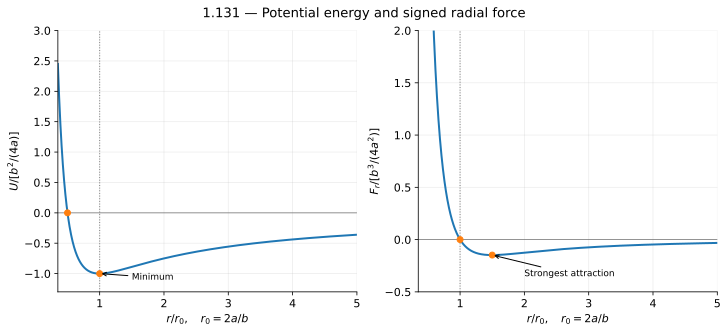
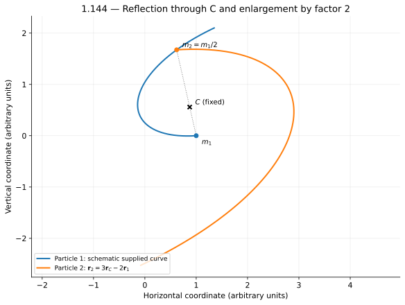

# 1.3 Laws of Conservation of Energy, Momentum, and Angular Momentum

[Chapter index](../README.md#chapters) · [Structured solutions](1.3.json) · [Answer audit](../audit/README.md)

## 1.118

**Problem statement**

A particle has shifted along some trajectory in the plane xy from point 1 whose radius vector $\mathbf{r}_1=\mathbf{i}+2\mathbf{j}$ to point 2 with the radius vector $\mathbf{r}_2=2\mathbf{i}-3\mathbf{j}$. During that time the particle experienced the action of certain forces, one of which being $\mathbf{F}=3\mathbf{i}+4\mathbf{j}$. Find the work performed by the force F. (Here r_1, r_2 , and F are given in SI units).

**Solved · high confidence.** Use the endpoint formula for the work of a constant force.

A constant force has the same work along every path between two fixed endpoints.

$$
W=\int_1^2\mathbf F\cdot d\mathbf r=\mathbf F\cdot(\mathbf r_2-\mathbf r_1).
$$

The displacement components are 1 m east and −5 m in the y direction.

$$
W=(3,4)\cdot(1,-5)=3-20=-17\ \mathrm J.
$$

**Results**

Work of the specified force

$$
W=-17\ \mathrm J
$$

## 1.119

**Problem statement**

A locomotive of mass m starts moving so that its velocity varies according to the law $v=a\sqrt{s}$, where a is a constant, and s is the distance covered. Find the total work performed by all the forces which are acting on the locomotive during the first t seconds after the beginning of motion.

**Solved · high confidence.** Integrate the speed–distance law and apply the work–energy theorem.

**Assumptions**

- Take a>0 and measure t from the actual beginning of motion; use the immediate moving branch of ds/dt=a√s.

Separate variables on the moving branch, using s=0 at its start.

$$
2\sqrt{s}=at,\qquad s=\frac{a^2t^2}{4},\quad v=\frac{a^2t}{2}.
$$

The work of all forces equals the increase in kinetic energy from rest.

$$
W=\Delta T=\frac12mv^2=\frac{ma^4t^2}{8}.
$$

**Results**

Total work during the first t seconds of motion

$$
W(t)=ma^4t^2/8
$$

**Limitations**

- As a differential equation at s=0 the speed law also permits delayed starts; the wording fixes t to start when motion begins.

## 1.120

**Problem statement**

The kinetic energy of a particle moving along a circle of radius R depends on the distance covered s as T = as² , where a is a constant. Find the force acting on the particle as a function of s.

**Solved · high confidence.** Resolve the resultant force into tangent and inward-normal components.

**Assumptions**

- a≥0, R>0 and s≥0; e_τ follows the motion and e_n points toward the circle centre.

Differentiate kinetic energy with respect to arc length to find the tangential force.

$$
F_\tau=\frac{dT}{ds}=2as.
$$

Use the prescribed energy to evaluate the centripetal force.

$$
v^2=\frac{2as^2}{m},\qquad F_n=\frac{mv^2}{R}=\frac{2as^2}{R}.
$$

**Results**

Resultant force

$$
\mathbf F(s)=2as\,\mathbf e_\tau+\frac{2as^2}{R}\,\mathbf e_n
$$

Magnitude

$$
F(s)=2as\sqrt{1+s^2/R^2}
$$

## 1.121

**Problem statement**

A body of mass m was slowly hauled up the hill (Fig. 1.29) by a force F which at each point was directed along a tangent to the trajectory. Find the work performed by this force, if the height of the hill is h, the length of its base l, and the coefficient of friction k.

**Solved · high confidence.** Integrate the quasistatic tangential force along the hill.

**Assumptions**

- The motion is sufficiently slow that kinetic-energy and speed-dependent curvature terms can be neglected.
- As in Fig. 1.29 the path rises monotonically and advances horizontally through the base length l. The pull has no normal component.

For local slope angle θ, quasistatic normal balance gives N=mg cosθ. The pulling force balances tangential gravity and sliding friction.

$$
F=mg\sin\theta+kmg\cos\theta.
$$

Use dy=sinθ ds and dx=cosθ ds in the work integral.

$$
W=mg\int dy+kmg\int dx=mgh+kmgl.
$$

**Results**

Hauling work

$$
W=mg(h+kl)
$$

## 1.122

**Problem statement**

A disc of mass m = 50 g slides with the zero initial velocity down an inclined plane set at an angle α = 30° to the horizontal; having traversed the distance l = 50 cm along the horizontal plane, the disc stops. Find the work performed by the friction forces over the whole distance, assuming the friction coefficient k = 0.15 for both inclined and horizontal planes.

**Solved · high confidence.** Use horizontal stopping work to infer the initial height.

**Assumptions**

- The transition from incline to horizontal redirects the velocity without an additional collision loss; only the specified sliding friction dissipates energy.
- The same coefficient applies on both portions, and tanα>k so the initially resting disc can slide.

If the incline height is H, its length is H/sinα. The kinetic energy at the foot equals the gravitational work minus the incline-friction work.

$$
T_{\rm foot}=mgH-kmg\cos\alpha\frac H{\sin\alpha}=mgH(1-k\cot\alpha).
$$

The horizontal stopping distance fixes that same energy to kmgl.

$$
mgH(1-k\cot\alpha)=kmgl,\qquad H=\frac{kl}{1-k\cot\alpha}.
$$

The disc begins and ends at rest; total friction work cancels the gravitational work.

$$
W_f=-mgH=-\frac{mgkl}{1-k\cot\alpha}.
$$

**Results**

Total friction work

$$
W_f=-\frac{mgkl}{1-k\cot\alpha}=-0.0496999\ldots\ \mathrm J
$$

## 1.123

**Problem statement**

Two bars of masses m_1 and m_2 connected by a non-deformed light spring rest on a horizontal plane. The coefficient of friction between the bars and the surface is equal to k. What minimum constant force has to be applied in the horizontal direction to the bar of mass m_1 in order to shift the other bar?

**Solved · high confidence.** Use spring overshoot while the second bar remains held by static friction.

**Assumptions**

- Apply the constant force suddenly to bar 1 in a direction stretching the spring; let its stiffness be κ.
- Use the supplied k for both limiting static and sliding friction. The spring begins undeformed and bar 2 is initially at rest.

Before bar 2 starts moving, the extension x equals the displacement of bar 1. Its energy balance is

$$
\frac12m_1v_1^2=(F-km_1g)x-\frac12\kappa x^2.
$$

The largest attainable extension while bar 2 is still fixed is obtained by setting v₁=0. Bar 2 reaches its friction threshold when κx=km₂g.

$$
x_{\max}=\frac{2(F-km_1g)}{\kappa},\qquad x_c=\frac{km_2g}{\kappa}.
$$

Require the maximum spring force to reach the threshold. The stiffness cancels.

$$
F_{\rm threshold}=kg\left(m_1+\frac{m_2}{2}\right).
$$

**Results**

Threshold constant force

$$
F_{\min}=kg(m_1+m_2/2)
$$

This is the limiting threshold. A force strictly above it guarantees actual movement of bar 2; exact equality only reaches limiting equilibrium at the first turning point of bar 1.

## 1.124

**Problem statement**

A chain of mass m = 0.80 kg and length l = 1.5 m rests on a rough-surfaced table so that one of its ends hangs over the edge. The chain starts sliding off the table all by itself provided the overhanging part equals η = 1/3 of the chain length. What will be the total work performed by the friction forces acting on the chain by the moment it slides completely off the table?

**Solved · high confidence.** Infer friction from the self-sliding threshold, then integrate the changing table load.

**Assumptions**

- The chain is uniform and flexible; edge friction, bending losses and any finite edge radius are neglected.
- Interpret the stated onset length as the limiting threshold, with an arbitrarily small perturbation initiating the slide.

Balance the hanging weight against the maximum table friction at the onset.

$$
\frac{m}{l}g\eta l=k\frac{m}{l}g(1-\eta)l,\qquad k=\frac\eta{1-\eta}=\frac12.
$$

When the hanging length is x, only length l−x contributes to table friction. Integrate from ηl until the last link leaves.

$$
W_f=-\int_{\eta l}^{l}k\frac{m}{l}g(l-x)\,dx=-\frac{k mgl}{2}(1-\eta)^2=-\frac{mgl}{2}\eta(1-\eta).
$$

**Results**

Total friction work

$$
W_f=-mgl\eta(1-\eta)/2=-1.308\ \mathrm J
$$

## 1.125

**Problem statement**

A body of mass m is thrown at an angle α to the horizontal with the initial velocity v_0 . Find the mean power developed by gravity over the whole time of motion of the body, and the instantaneous power of gravity as a function of time.

**Solved · high confidence.** Use gravity’s scalar product with the instantaneous velocity.

**Assumptions**

- Uniform gravity and no air drag; the complete flight returns to the launch height.

Take upward y as positive. The vertical speed component is v₀ sinα−gt.

$$
P_g(t)=\mathbf{mg}\cdot\mathbf v=-mg(v_0\sin\alpha-gt).
$$

Over the full flight gravity does zero net work because the endpoint heights agree.

$$
T=\frac{2v_0\sin\alpha}{g},\qquad\langle P_g\rangle=\frac{W_g}{T}=0.
$$

**Results**

Instantaneous gravity power

$$
P_g(t)=mg(gt-v_0\sin\alpha)
$$

Mean over the complete same-height flight

$$
\langle P_g\rangle=0
$$

**Limitations**

- For a different landing height, the mean power is mg(y_initial−y_final)/T instead.

## 1.126

**Problem statement**

A particle of mass m moves along a circle of radius R with a normal acceleration varying with time as $w_n=at^2$ , where a is a constant. Find the time dependence of the power developed by all the forces acting on the particle, and the mean value of this power averaged over the first t seconds after the beginning of motion.

**Solved · high confidence.** Recover kinetic energy from the normal acceleration.

**Assumptions**

- a≥0 and t≥0; the given law applies from the motion’s beginning.

Normal acceleration fixes the speed squared and hence the kinetic energy.

$$
v^2=Rw_n=Ra t^2,\qquad T=\frac12mRa t^2.
$$

Differentiate for instantaneous total power and divide the energy increment by time for its mean.

$$
P(t)=\frac{dT}{dt}=mRa t,\qquad\langle P\rangle_t=\frac{T(t)-T(0)}{t}=\frac12mRa t.
$$

**Results**

Power of all forces

$$
P(t)=mRa t
$$

Mean power over the first t seconds

$$
\langle P\rangle_t=mRa t/2
$$

## 1.127

**Problem statement**

A small body of mass m is located on a horizontal plane at the point O. The body acquires a horizontal velocity v_0 . Find: (a) the mean power developed by the friction force during the whole time of motion, if the friction coefficient k = 0.27, m = 1.0 kg, and v_0 = 1.5 m/s; (b) the maximum instantaneous power developed by the friction force, if the friction coefficient varies as $k=\alpha x$, where α is a constant, and x is the distance from the point O.

**Solved · high confidence.** Divide total dissipated energy by stopping time, then optimize the variable-friction power.

**Assumptions**

- For part (a), k is constant; for part (b), k(x)=αx with α>0.
- Power is signed work per unit time. Because friction does negative work, the usual maximum dissipative power means the maximum magnitude of that negative power; both interpretations are stated.

For constant friction the stopping time is v₀/(kg), and friction does total work −mv₀²/2.

$$
\langle P_f\rangle=-\frac12mkgv_0.
$$

For distance-dependent friction, integrate m v dv/dx=−mαgx.

$$
v^2(x)=v_0^2-\alpha gx^2,\quad P_f(x)=-m\alpha gx\sqrt{v_0^2-\alpha gx^2}.
$$

Maximize x²(v₀²−αgx²), the square of the dissipative-power factor.

$$
x_* =\frac{v_0}{\sqrt{2\alpha g}},\qquad v_* =\frac{v_0}{\sqrt2},\qquad |P_f|_{\max}=\frac12mv_0^2\sqrt{\alpha g}.
$$

**Results**

Mean signed friction power

$$
\langle P_f\rangle=-mkgv_0/2=-1.986525\ \mathrm W
$$

Maximum dissipative power magnitude

$$
|P_f|_{\max}=mv_0^2\sqrt{\alpha g}/2
$$

Most negative instantaneous power

$$
P_{f,\min}=-mv_0^2\sqrt{\alpha g}/2
$$

Literal maximum of signed friction power

$$
P_{f,\max}=0
$$

Attained at the initial point and at the stop; the nonzero quantity usually requested is the maximum dissipative magnitude.

## 1.128

**Problem statement**

A small body of mass m = 0.10 kg moves in the reference frame rotating about a stationary axis with a constant angular velocity ω = 5.0 rad/s. What work does the centrifugal force of inertia perform during the transfer of this body along an arbitrary path from point 1 to point 2 which are located at the distances r_1 = 30 cm and r_2 = 50 cm from the rotation axis?

**Solved · high confidence.** Use the centrifugal force’s conservative potential in the uniformly rotating frame.

**Assumptions**

- The reference frame rotates uniformly about a fixed axis; r denotes perpendicular distance from that axis.

The centrifugal force is outward, with work differential mω²r dr, irrespective of azimuthal or axial path components.

$$
W_{\rm cf}=\int_{r_1}^{r_2}m\omega^2r\,dr=\frac12m\omega^2(r_2^2-r_1^2).
$$

**Results**

Centrifugal-force work

$$
W_{\rm cf}=0.200\ \mathrm J
$$

## 1.129

**Problem statement**

A system consists of two springs connected in series and having the stiffness coefficients k_1 and k_2. Find the minimum work to be performed in order to stretch this system by Δl.

**Solved · high confidence.** Minimize elastic energy subject to the total extension.

**Assumptions**

- The springs are Hookean, initially undeformed, with k₁,k₂>0; final kinetic energy is negligible.

Let the extensions be x₁ and x₂. Equal series tension and x₁+x₂=Δl determine the division.

$$
k_1x_1=k_2x_2,\quad x_1=\frac{k_2\Delta l}{k_1+k_2},\quad x_2=\frac{k_1\Delta l}{k_1+k_2}.
$$

The minimum external work is the final elastic energy.

$$
W_{\min}=\frac12k_1x_1^2+\frac12k_2x_2^2=\frac12\frac{k_1k_2}{k_1+k_2}(\Delta l)^2.
$$

**Results**

Minimum stretching work

$$
W_{\min}=\frac{k_1k_2(\Delta l)^2}{2(k_1+k_2)}
$$

## 1.130

**Problem statement**

A body of mass m is hauled from the Earth's surface by applying a force F varying with the height of ascent y as F = $2(ay-1)mg$, where a is a positive constant. Find the work performed by this force and the increment of the body's potential energy in the gravitational field of the Earth over the first half of the ascent.

**Provisional · low confidence.** Audit the printed force law before integrating it.

**Assumptions**

- The scan on problem page 039 literally prints F=2(ay−1)mg, with a>0; this is retained rather than silently sign-corrected.
- For the conditional integrals below, take the quoted F as its upward signed component and uniform gravity g. Let H denote a separately supplied total ascent height.

At the surface the printed upward force is −2mg, so with gravity the net force is −3mg. A body released from rest cannot begin the described upward ascent.

$$
F(0)-mg=-3mg.
$$

Even if an unmentioned initial upward velocity were supplied, its value would set the first turning height. The given law alone does not determine the total ascent.

$$
\frac12mv^2(y)=\frac12mv_i^2+mg(ay^2-3y).
$$

If an actual total height H is supplied, integration to H/2 gives a well-defined conditional answer.

$$
W_{0\to H/2}=\int_0^{H/2}2mg(ay-1)\,dy=mg\left(\frac{aH^2}{4}-H\right),\qquad\Delta U_{0\to H/2}=\frac{mgH}{2}.
$$

**Results**

Literal problem is not uniquely solvable as stated

$$
F(0)-mg=-3mg
$$

No upward ascent from rest exists under the printed law. The total height or initial conditions needed to interpret its first half are absent.

Applied-force work if total ascent H is supplied

$$
W_{\rm half}=mg(aH^2/4-H)
$$

Potential-energy increment for that supplied H

$$
\Delta U_{\rm half}=mgH/2
$$

**Limitations**

- A possible reversed-sign force law would define a different problem. No such unverified repair has been adopted, and no published answers were consulted.
- If F was intended as an unsigned magnitude, its negative surface value is itself inconsistent.

## 1.131

**Problem statement**

The potential energy of a particle in a certain field has the form $U=a/r^2-b/r$, where a and b are positive constants, r is the distance from the centre of the field. Find: (a) the value of r_0 corresponding to the equilibrium position of the particle; examine whether this position is steady; (b) the maximum magnitude of the attraction force; draw the plots U (r) and F_r(r) (the projections of the force on the radius vector r).

**Solved · high confidence.** Differentiate the central potential and locate its extrema.

**Assumptions**

- r>0 and a,b>0. In part (a), stability refers to radial displacement from the equilibrium shell.

A stationary particle is in equilibrium where the radial force vanishes.

$$
F_r=-\frac{dU}{dr}=\frac{2a}{r^3}-\frac b{r^2},\qquad r_0=\frac{2a}{b}.
$$

The potential has a radial minimum there.

$$
U(r_0)=-\frac{b^2}{4a},\qquad U^{\prime\prime}(r_0)=\frac{b^4}{8a^3}>0.
$$

For r>r₀ the force is attractive. Maximize its magnitude b/r²−2a/r³.

$$
\frac d{dr}\left(\frac b{r^2}-\frac{2a}{r^3}\right)=0\ \Longrightarrow\ r_*=\frac{3a}{b},\quad |F_{\rm attr}|_{\max}=\frac{b^3}{27a^2}.
$$

Scaled functions fix both requested plots. U diverges upward at the origin, crosses zero at r=a/b, has its minimum at r₀, and tends to zero from below. F_r starts positive, crosses zero at r₀, has its negative minimum at 3a/b, and tends to zero from below.

$$
x=\frac r{r_0},\qquad\frac{U}{b^2/(4a)}=x^{-2}-2x^{-1},\qquad\frac{F_r}{b^3/(4a^2)}=x^{-3}-x^{-2}.
$$

**Results**

Equilibrium radius

$$
r_0=2a/b
$$

Radial stability

$$
U^{\prime\prime}(r_0)=b^4/(8a^3)>0
$$

Maximum attractive-force magnitude and location

$$
F_{\rm attr,max}=b^3/(27a^2),\quad r=3a/b
$$

Scaled potential and radial-force plots

$$
\widehat U=x^{-2}-2x^{-1},\quad\widehat F_r=x^{-3}-x^{-2},\quad x=r/r_0
$$

**Limitations**

- The central symmetry makes all points on r=r₀ equilibria; angular displacement has no restoring force. The radial minimum does not define an isolated equilibrium point or prevent slow angular drift after an angular impulse.

## 1.132

**Problem statement**

In a certain two-dimensional field of force the potential energy of a particle has the form $U=\alpha x^2+\beta y^2$, where α and β are positive constants whose magnitudes are different. Find out: (a) whether this field is central; (b) what is the shape of the equipotential surfaces and also of the surfaces for which the magnitude of the vector of force F = const.

**Solved · high confidence.** Inspect the gradient direction and the level-set equations.

**Assumptions**

- The field is two-dimensional and α,β>0 with α≠β.

The force points along unequal scaled coordinate components and is not generally collinear with the radius vector.

$$
\mathbf F=-2\alpha x\,\mathbf i-2\beta y\,\mathbf j,\qquad(\mathbf r\times\mathbf F)_z=2(\alpha-\beta)xy\ne0\ \text{in general}.
$$

The unique zero-force point is the origin, so no shifted centre can restore centrality. The level sets follow directly from U and |F|.

$$
U=U_c:\ \alpha x^2+\beta y^2=U_c,\qquad |\mathbf F|=F_c:\ \alpha^2x^2+\beta^2y^2=F_c^2/4.
$$

**Results**

Centrality

$$
\mathbf F\not\parallel\mathbf r\ \text{generically: the field is not central}
$$

Equipotential curves

$$
\alpha x^2+\beta y^2=U_c
$$

Equal-force-magnitude curves

$$
\alpha^2x^2+\beta^2y^2=F_c^2/4
$$

**Limitations**

- If the two-dimensional functions are embedded in three dimensions with no z dependence, the corresponding surfaces are elliptic cylinders; in the stated plane they are curves.

## 1.133

**Problem statement**

There are two stationary fields of force $\mathbf{F}=ay\mathbf{i}$ and $\mathbf{F}=ax\mathbf{i}+by\mathbf{j}$, where i and j are the unit vectors of the x and y axes, and a and b are constants. Find out whether these fields are potential.

**Solved · high confidence.** Apply the curl criterion and integrate a conservative field.

**Assumptions**

- The fields are defined on the entire xy plane; a and b are real constants.

The first field has nonzero planar curl unless a vanishes.

$$
\mathbf F_1=ay\,\mathbf i,\qquad(\nabla\times\mathbf F_1)_z=-a.
$$

The second field has zero curl everywhere and admits a global potential.

$$
\mathbf F_2=ax\,\mathbf i+by\,\mathbf j=-\nabla U,\qquad U=-\frac12(ax^2+by^2)+C.
$$

**Results**

First field

$$
\mathbf F_1\text{ is non-potential for }a\ne0;\ \text{potential for }a=0
$$

Second field and its potential

$$
\mathbf F_2\text{ is potential},\qquad U=-\tfrac12(ax^2+by^2)+C
$$

## 1.134

**Problem statement**

A body of mass m is pushed with the initial velocity v_0 up an inclined plane set at an angle α to the horizontal. The friction coefficient is equal to k. What distance will the body cover before it stops and what work do the friction forces perform over this distance?

**Solved · high confidence.** Equate the initial kinetic energy to gravitational and friction work.

**Assumptions**

- The body initially moves uphill and the question concerns its first stop.
- Assume sinα+k cosα>0; if both α=0 and k=0 it never stops.

Both gravity and friction oppose the ascent.

$$
\frac12mv_0^2=mg(\sin\alpha+k\cos\alpha)s_*.
$$

Friction alone performs its constant force times the travelled distance.

$$
W_f=-kmg\cos\alpha\,s_*.
$$

**Results**

Distance before the first stop

$$
s_* =\frac{v_0^2}{2g(\sin\alpha+k\cos\alpha)}
$$

Friction work

$$
W_f=-\frac{m v_0^2 k\cos\alpha}{2(\sin\alpha+k\cos\alpha)}
$$

## 1.135

**Problem statement**

A small disc A slides down with initial velocity equal to zero from the top of a smooth hill of height H having a horizontal portion (Fig. 1.30). What must be the height of the horizontal portion h to ensure the maximum distance s covered by the disc? What is it equal to?

**Solved · high confidence.** Combine energy on the hill with horizontal projectile range.

**Assumptions**

- The disc remains on the smooth hill until it leaves the horizontal edge at height h, as intended in Fig. 1.30.
- Air resistance is neglected; 0≤h≤H and the ground is horizontal.

The horizontal launch speed follows from the loss of gravitational potential before departure.

$$
v=\sqrt{2g(H-h)}.
$$

The fall lasts √(2h/g), so the horizontal range from the edge is

$$
s(h)=2\sqrt{h(H-h)}.
$$

Maximize h(H−h); its unique interior maximum is at H/2.

$$
h_* =H/2,\qquad s_{\max}=H.
$$

**Results**

Optimum horizontal-edge height

$$
h=H/2
$$

Maximum horizontal range from the edge

$$
s_{\max}=H
$$

## 1.136

**Problem statement**

A small body A starts sliding from the height h down an inclined groove passing into a half-circle of radius h/2 (Fig. 1.31). Assuming the friction to be negligible, find the velocity of the body at the highest point of its trajectory (after breaking off the groove).

**Solved · high confidence.** Find the groove detachment point and retain the horizontal projectile velocity at the apex.

**Assumptions**

- The body moves on the inner side of the circular part shown in Fig. 1.31; its radius is R=h/2.
- Let θ be the angle from the downward radius at the groove bottom; the body starts from rest at height 2R.

Conservation of energy fixes speed along the circular portion.

$$
y=R(1-\cos\theta),\qquad v^2=2gR(1+\cos\theta).
$$

The normal points inward. Its vanishing determines detachment on the upper-right quarter of the groove.

$$
N=m\left(\frac{v^2}{R}+g\cos\theta\right)=mg(2+3\cos\theta)=0\ \Longrightarrow\ \cos\theta_b=-2/3.
$$

At detachment v_b=√(gh/3), and its horizontal component points left. During free flight that component is unchanged, while the vertical component vanishes at the apex.

$$
v_{x,b}=-\frac23\sqrt{\frac{gh}{3}},\qquad v_{y,b}=\frac{\sqrt5}{3}\sqrt{\frac{gh}{3}}.
$$

**Results**

Velocity at the highest point after detachment

$$
\mathbf v_{\rm apex}=-\sqrt{\frac{4gh}{27}}\,\mathbf e_x
$$

eₓ points right in Fig. 1.31; thus the velocity is horizontal to the left.

Speed at that ballistic apex

$$
v_{\rm apex}=\sqrt{4gh/27}
$$

Ballistic apex height above the groove bottom

$$
y_{\rm apex}=25h/27
$$

## 1.137

**Problem statement**

A ball of mass m is suspended by a thread of length l. With what minimum velocity has the point of suspension to be shifted in the horizontal direction for the ball to move along the circle about that point? What will be the tension of the thread at the moment it will be passing the horizontal position?

**Solved · medium confidence.** Work in the uniformly translating suspension-point frame and apply the taut-thread condition.

**Assumptions**

- The initially stationary suspension point is given a horizontal velocity u abruptly and then continues uniformly; the ball receives no instantaneous impulse.
- The ball initially hangs at rest at the lowest point, and the ideal thread must remain taut for the complete vertical circle.

In the frame moving with the support, the ball initially has bottom speed u. At the top energy conservation gives

$$
v_{\rm top}^2=u^2-4gl.
$$

The limiting top tension is zero, so v_top² must be at least gl.

$$
T_{\rm top}=m(v_{\rm top}^2/l-g)\ge0\ \Longrightarrow\ u_{\min}=\sqrt{5gl}.
$$

At the horizontal position for this limiting motion, energy gives v_h²=3gl. Gravity has no radial component there.

$$
T_h=mv_h^2/l=3mg.
$$

**Results**

Minimum uniform support velocity

$$
u_{\min}=\sqrt{5gl}
$$

Horizontal-position tension for the minimum-speed case

$$
T_h=3mg
$$

**Limitations**

- The point-of-suspension velocity alone is insufficient if its preceding or later acceleration is arbitrary.

## 1.138

**Problem statement**

A horizontal plane supports a stationary vertical cylinder of radius R and a disc A attached to the cylinder by a horizontal thread AB of length l_0 (Fig. 1.32, top view). An initial velocity v_0 is imparted to the disc as shown in the figure. How long will it move along the plane until it strikes against the cylinder? The friction is assumed to be absent.

**Solved · high confidence.** Parametrize the taut string’s involute as it winds onto the fixed cylinder.

**Assumptions**

- The string is inextensible and winds without slipping on the fixed cylinder; l₀ is its initially free tangent length AB.
- The disc is pointlike, starts perpendicular to the tangent string as drawn, and no friction acts on the plane.

If the tangency point rotates through φ, the free string length is L=l₀−Rφ. Differentiating the disc position gives an involute tangent perpendicular to the free string.

$$
\left|\frac{d\mathbf r}{d\varphi}\right|=L=l_0-R\varphi.
$$

Tension is perpendicular to the disc velocity, so its speed remains v₀. Collision occurs when L=0.

$$
dt=\frac{l_0-R\varphi}{v_0}\,d\varphi,\qquad0\le\varphi\le l_0/R.
$$

Integrate the time to complete winding.

$$
t=\frac1{v_0}\int_0^{l_0/R}(l_0-R\varphi)\,d\varphi=\frac{l_0^2}{2Rv_0}.
$$

**Results**

Time until the disc reaches the cylinder

$$
t=l_0^2/(2Rv_0)
$$

**Limitations**

- The ideal point-disc tension diverges near complete winding; finite disc size or thread thickness would end the ideal motion earlier.

## 1.139

**Problem statement**

A smooth rubber cord of length l whose coefficient of elasticity is k is suspended by one end from the point O (Fig. 1.33). The other end is fitted with a catch B. A small sleeve A of mass m starts falling from the point O. Neglecting the masses of the thread and the catch, find the maximum elongation of the cord.

**Solved · high confidence.** Apply energy conservation from release to maximum spring extension.

**Assumptions**

- Interpret the elasticity coefficient k as Hooke stiffness: tension=k times extension.
- The sleeve slides freely until it reaches the massless catch after falling l; capture by a massless catch dissipates no finite kinetic energy. The cord remains Hookean.

At maximum extension x the sleeve has fallen a total distance l+x and is instantaneously at rest. Gravity has supplied the cord’s elastic energy.

$$
mg(l+x)=\frac12kx^2.
$$

Choose the positive root of the resulting quadratic.

$$
x_{\max}=\frac{mg}{k}\left(1+\sqrt{1+\frac{2kl}{mg}}\right).
$$

**Results**

Maximum elongation

$$
\Delta l_{\max}=\frac{mg}{k}\left(1+\sqrt{1+\frac{2kl}{mg}}\right)
$$

## 1.140

**Problem statement**

A small bar A resting on a smooth horizontal plane is attached by threads to a point P (Fig. 1.34) and, by means of a weightless pulley, to a weight B possessing the same mass as the bar itself. Besides, the bar is also attached to a point O by means of a light nondeformed spring of length l_0 = 50 cm and stiffness $\kappa=5mg/l_0$ , where m is the mass of the bar. The thread PA having been burned, the bar starts moving. Find its velocity at the moment when it is breaking off the plane.

**Solved · high confidence.** Combine the vertical lift-off condition with the two-body energy balance.

**Assumptions**

- Both bodies have mass m; the string and pulley are ideal. Before lift-off, the bar’s horizontal displacement x equals the weight’s downward displacement, and both speeds equal v.
- The spring is initially vertical and undeformed with length l₀.

When the bar has moved right by x, the spring length is L=√(l₀²+x²). Its upward force component reduces the normal reaction.

$$
N=mg-\kappa(L-l_0)\frac{l_0}{L}.
$$

Set N=0 and use κ=5mg/l₀ to obtain the lift-off geometry.

$$
1=5(1-l_0/L)\ \Longrightarrow\ L=5l_0/4,\quad x=3l_0/4,\quad L-l_0=l_0/4.
$$

The falling weight supplies the kinetic energies of both masses and the stored spring energy.

$$
mgx=mv^2+\frac12\kappa(L-l_0)^2\ \Longrightarrow\ v^2=\frac{19gl_0}{32}.
$$

**Results**

Bar velocity at lift-off

$$
v=\sqrt{19gl_0/32}=1.706559\ldots\ \mathrm{m/s}
$$

The velocity is horizontal to the right at the instant of lift-off.

## 1.141

**Problem statement**

A horizontal plane supports a plank with a bar of mass m = 1.0 kg placed on it and attached by a light elastic non-deformed cord of length l_0 = 40 cm to a point O (Fig. 1.35). The coefficient of friction between the bar and the plank equals k = 0.20. The plank is slowly shifted to the right until the bar starts sliding over it. It occurs at the moment when the cord deviates from the vertical by an angle θ = 30°. Find the work that has been performed by that moment by the friction force acting on the bar in the reference frame fixed to the plane.

**Solved · high confidence.** Use quasistatic work and infer the cord tension from the onset of sliding.

**Assumptions**

- The fixed plane defines the inertial laboratory frame; the plank is shifted quasistatically.
- Before slipping the bar moves with the plank. The cord is Hookean and initially undeformed, with unstretched length l₀ equal to the fixed vertical separation from O.

At the specified angle the cord length is L=l₀/cosθ, so its extension is Δl=l₀(secθ−1). The limiting horizontal friction balances T sinθ, while N=mg−T cosθ.

$$
T\sin\theta=k(mg-T\cos\theta)\ \Longrightarrow\ T=\frac{kmg}{\sin\theta+k\cos\theta}.
$$

In the plane-fixed frame friction performs positive work as the bar moves right. Its quasistatic work equals the stored elastic energy; eliminate the unknown stiffness with T=κΔl.

$$
W_f=\frac12\kappa(\Delta l)^2=\frac12T\Delta l=\frac{kmgl_0(\sec\theta-1)}{2(\sin\theta+k\cos\theta)}.
$$

**Results**

Friction work on the bar in the plane-fixed frame

$$
W_f=0.0901724\ldots\ \mathrm J
$$

## 1.142

**Problem statement**

A smooth light horizontal rod AB can rotate about a vertical axis passing through its end A. The rod is fitted with a small sleeve of mass m attached to the end A by a weightless spring of length l_0 and stiffness κ. What work must be performed to slowly get this system going and reaching the angular velocity ω?

**Solved · high confidence.** Follow the stable quasistatic radial equilibrium and compute final mechanical energy.

**Assumptions**

- The rod and spring are massless; the sleeve starts at r=l₀ with zero angular velocity.
- Spin-up is arbitrarily slow so radial kinetic energy tends to zero. A finite stable radial equilibrium requires mω²<κ.

The final spring force supplies the radial centripetal force.

$$
\kappa(r-l_0)=m\omega^2r,\qquad r=\frac{\kappa l_0}{\kappa-m\omega^2}.
$$

The applied motor’s work supplies both final rotational kinetic energy and elastic energy.

$$
W=\frac12m\omega^2r^2+\frac12\kappa(r-l_0)^2.
$$

Substitute the equilibrium radius.

$$
W=\frac{m\kappa\omega^2l_0^2(\kappa+m\omega^2)}{2(\kappa-m\omega^2)^2}.
$$

**Results**

Required quasistatic spin-up work

$$
W=\frac{m\kappa\omega^2l_0^2(\kappa+m\omega^2)}{2(\kappa-m\omega^2)^2},\qquad m\omega^2<\kappa
$$

**Limitations**

- No finite quasistatic endpoint exists for ω²≥κ/m in the ideal unbounded Hookean model.

## 1.143

**Problem statement**

A pulley fixed to the ceiling carries a thread with bodies of masses m_1 and m_2 attached to its ends. The masses of the pulley and the thread are negligible, friction is absent. Find the acceleration w_C of the centre of inertia of this system.

**Solved · high confidence.** Mass-weight the signed Atwood accelerations.

**Assumptions**

- Take downward as positive; both hanging masses are positive and the strings are taut.

The two bodies have opposite accelerations of equal magnitude.

$$
a_1=\frac{m_1-m_2}{m_1+m_2}g,\qquad a_2=-a_1.
$$

Use the definition of centre-of-mass acceleration.

$$
a_C=\frac{m_1a_1+m_2a_2}{m_1+m_2}=g\left(\frac{m_1-m_2}{m_1+m_2}\right)^2.
$$

**Results**

Centre-of-mass acceleration

$$
\mathbf w_C=\left(\frac{m_1-m_2}{m_1+m_2}\right)^2\mathbf g
$$

It is vertically downward regardless of which mass is heavier; it vanishes for equal masses.

## 1.144

**Problem statement**

Two interacting particles form a closed system whose centre of inertia is at rest. Fig. 1.36 illustrates the positions of both particles at a certain moment and the trajectory of the particle of mass m_1. Draw the trajectory of the particle of mass m_2 if m_2 = m_1 /2.

**Solved · high confidence.** Use the fixed centre-of-mass relation as a geometric map.

**Assumptions**

- The system is closed and its centre of mass C is at rest. Fig.1.36 is inspected on problem scan042.
- Let r₁*,r₂* be the two shown simultaneous positions; m₂=m₁/2.

Locate the fixed centre of mass on the segment joining the shown particles.

$$
\mathbf r_C=\frac{2\mathbf r_{1*}+\mathbf r_{2*}}3.
$$

At all later times the mass-weighted displacements from C sum to zero.

$$
m_1(\mathbf r_1-\mathbf r_C)+\frac{m_1}2(\mathbf r_2-\mathbf r_C)=0\ \Longrightarrow\ \mathbf r_2=\mathbf r_C-2(\mathbf r_1-\mathbf r_C).
$$

Construct the second trajectory by sending every point on the drawn first trajectory to its opposite point through C at twice the distance. The shown particle-2 point lies on this transformed curve. This is a 180-degree rotation followed by a scale factor 2 about C.

**Results**

Trajectory construction

$$
\mathbf r_2(t)-\mathbf r_C=-2[\mathbf r_1(t)-\mathbf r_C]
$$

Apply the homothety of factor −2 about the fixed C to the entire curve shown for particle 1.

## 1.145

**Problem statement**

A closed chain A of mass m = 0.36 kg is attached to a vertical rotating shaft by means of a thread (Fig. 1.37), and rotates with a constant angular velocity ω = 35 rad/s. The thread forms an angle θ = 45° with the vertical. Find the distance between the chain's centre of gravity and the rotation axis, and the tension of the thread.

**Solved · high confidence.** Apply the centre-of-mass force equation to the entire rotating chain.

**Assumptions**

- The chain has a steady shape, so its centre of mass travels on a horizontal circle. The thread and gravity are the only external forces.

Resolve the thread tension vertically and toward the shaft; internal forces cancel.

$$
T\cos\theta=mg,\qquad T\sin\theta=m\omega^2r_C.
$$

Eliminate tension and substitute the data.

$$
r_C=\frac{g\tan\theta}{\omega^2}.
$$

**Results**

Distance from the centre of gravity to the shaft

$$
r_C=\frac{g\tan45^\circ}{35^2}=8.00816\times10^{-3}\ \mathrm m
$$

Thread tension

$$
T=\frac{mg}{\cos45^\circ}=4.99444\ \mathrm N
$$

## 1.146

**Problem statement**

A round cone A of mass m = 3.2 kg and half-angle α = 10° rolls uniformly and without slipping along a round conical surface B so that its apex O remains stationary (Fig. 1.38). The centre of gravity of the cone A is at the same level as the point O and at a distance l = 17 cm from it. The cone's axis moves with angular velocity ω. Find: (a) the static friction force acting on the cone A, if ω = 1.0 rad/s; (b) at what values of ω the cone A will roll without sliding, if the coefficient of friction between the surfaces is equal to k = 0.25.

**Solved · high confidence.** Resolve the required contact force along and perpendicular to the common cone generator.

**Assumptions**

- Gravity and the distributed contact forces from B are the only external forces; no apex hinge supplies an additional force. The stationary apex is maintained by rolling contact as drawn.
- The centre of mass travels on a horizontal circle of radius l. The contacting generator is α below horizontal.

Use outward horizontal e_r and upward e_z. Centre-of-mass Newton’s law fixes the contact resultant.

$$
\mathbf R=-m\omega^2l\,\mathbf e_r+mg\,\mathbf e_z.
$$

Project it on the down-and-out generator tangent and upward normal.

$$
\mathbf t=\cos\alpha\,\mathbf e_r-\sin\alpha\,\mathbf e_z,\quad\mathbf n=\sin\alpha\,\mathbf e_r+\cos\alpha\,\mathbf e_z;\quad f=m(g\sin\alpha+\omega^2l\cos\alpha),\quad N=m(g\cos\alpha-\omega^2l\sin\alpha).
$$

Static friction points toward O along the generator. Require f≤kN and N≥0.

$$
\omega^2l(\cos\alpha+k\sin\alpha)\le g(k\cos\alpha-\sin\alpha).
$$

**Results**

Static friction at ω=1.0 rad/s

$$
f=m(g\sin\alpha+\omega^2l\cos\alpha)\simeq5.99\ \mathrm N
$$

Up the common generator, toward O. N≈30.82062 N.

No-sliding angular-speed range

$$
0\le |\omega|\le\sqrt{\frac{g(k-\tan\alpha)}{l(1+k\tan\alpha)}}\simeq2.02\ \mathrm{rad/s}
$$

The number is the upper bound; either rotation sense gives the same condition.

**Limitations**

- The coefficient is the limiting static-friction coefficient. An externally constrained apex supplying an extra force would change the force balance.

## 1.147

**Problem statement**

In the reference frame K two particles travel along the x axis, one of mass m_1 with velocity v_1 , and the other of mass m_2 with velocity v_2 . Find: (a) the velocity V of the reference frame K' in which the cumulative kinetic energy of these particles is minimum; (b) the cumulative kinetic energy of these particles in the K' frame.

**Solved · high confidence.** Minimize the Galilean-transformed kinetic energy.

**Assumptions**

- v₁ and v₂ are signed x-axis velocities. The new frame translates without rotating.

Differentiate the transformed total kinetic energy with respect to V.

$$
T(V)=\tfrac12m_1(v_1-V)^2+\tfrac12m_2(v_2-V)^2,\qquad dT/dV=0.
$$

Completing the square separates common translation from relative motion.

$$
T(V)=\frac{m_1m_2}{2(m_1+m_2)}(v_1-v_2)^2+\frac{m_1+m_2}{2}(V-V_C)^2.
$$

**Results**

Minimum-energy frame velocity

$$
V=V_C=\frac{m_1v_1+m_2v_2}{m_1+m_2}
$$

Minimum total kinetic energy

$$
T_{\min}=\frac{m_1m_2}{2(m_1+m_2)}(v_1-v_2)^2
$$

## 1.148

**Problem statement**

The reference frame, in which the centre of inertia of a given system of particles is at rest, translates with a velocity V relative to an inertial reference frame K. The mass of the system of particles equals m, and the total energy of the system in the frame of the centre of inertia is equal to $\widetilde{E}$. Find the total energy E of this system of particles in the reference frame K.

**Solved · high confidence.** Separate centre-of-mass translation from internal energy.

**Assumptions**

- Classical mechanics applies. Internal potential energies depend on relative positions; the potential-energy zero is the same in both frames.

Expand each kinetic energy with v_i=V+ṽ_i. The cross term vanishes because the centre-of-mass-frame momentum is zero.

$$
\sum_i\frac{m_iv_i^2}{2}=\sum_i\frac{m_i\widetilde v_i^2}{2}+\frac{mV^2}{2}+\mathbf V\cdot\sum_i m_i\widetilde{\mathbf v}_i,\qquad\sum_i m_i\widetilde{\mathbf v}_i=0.
$$

Add the unchanged internal potential energy.

**Results**

Total energy in K

$$
E=\widetilde E+\frac12mV^2
$$

**Limitations**

- An external potential requires consistent frame/time dependence and reference zero; this is the usual decomposition of kinetic plus internal energy.

## 1.149

**Problem statement**

Two small discs of masses m_1 and m_2 interconnected by a weightless spring rest on a smooth horizontal plane. The discs are set in motion with initial velocities v_1 and v_2 whose directions are mutually perpendicular and lie in a horizontal plane. Find the total energy $\widetilde{E}$ of this system in the frame of the centre of inertia.

**Solved · high confidence.** Compute relative kinetic energy with the reduced mass.

**Assumptions**

- The initially unforced spring is relaxed, as implied by rest on a smooth plane. Its natural length defines zero elastic potential energy.

Subtract centre-of-mass translational energy from the initial energy.

$$
\widetilde E=\frac12m_1v_1^2+\frac12m_2v_2^2-\frac{|m_1\mathbf v_1+m_2\mathbf v_2|^2}{2(m_1+m_2)}=\frac{\mu}{2}|\mathbf v_1-\mathbf v_2|^2,\quad\mu=\frac{m_1m_2}{m_1+m_2}.
$$

Perpendicular velocities have squared relative speed v₁²+v₂². The isolated spring system conserves this energy.

**Results**

Energy in the centre-of-mass frame

$$
\widetilde E=\frac{m_1m_2}{2(m_1+m_2)}(v_1^2+v_2^2)
$$

**Limitations**

- If the spring were preloaded, add its initial elastic potential energy.

## 1.150

**Problem statement**

A system consists of two small spheres of masses m_1 and m_2 interconnected by a weightless spring. At the moment t = 0 the spheres are set in motion with the initial velocities v_1 and v_2 after which the system starts moving in the Earth's uniform gravitational field. Neglecting the air drag, find the time dependence of the total momentum of this system in the process of motion and of the radius vector of its centre of inertia relative to the initial position of the centre.

**Solved · high confidence.** Integrate the total external force and centre-of-mass velocity.

**Assumptions**

- Gravity is uniform; g is the downward vector. Internal spring forces cancel.

Sum Newton’s laws.

$$
\dot{\mathbf P}=(m_1+m_2)\mathbf g,\qquad\mathbf P_0=m_1\mathbf v_1+m_2\mathbf v_2.
$$

Divide by total mass and integrate again from the initial centre-of-mass position.

$$
\dot{\mathbf r}_C=\frac{\mathbf P_0}{m_1+m_2}+\mathbf g t.
$$

**Results**

Total momentum

$$
\mathbf P(t)=m_1\mathbf v_1+m_2\mathbf v_2+(m_1+m_2)\mathbf g t
$$

Centre-of-mass displacement

$$
\mathbf r_C(t)=\frac{m_1\mathbf v_1+m_2\mathbf v_2}{m_1+m_2}t+\frac12\mathbf g t^2
$$

## 1.151

**Problem statement**

Two bars of masses m_1 and m_2 connected by a weightless spring of stiffness κ (Fig. 1.39) rest on a smooth horizontal plane. Bar 2 is shifted a small distance x to the left and then released. Find the velocity of the centre of inertia of the system after bar 1 breaks off the wall.

**Solved · high confidence.** Follow the wall-supported spring release, then conserve momentum after separation.

**Assumptions**

- The spring is initially relaxed before bar 2 is shifted left by x>0. Bar 1 touches the wall on the left; right is positive.

While compressed, the spring pushes bar 1 into the wall. When natural length is reached, the wall reaction vanishes and spring stretching begins to pull bar 1 rightward.

$$
\frac12\kappa x^2=\frac12m_2v_2^2,\qquad v_2=x\sqrt{\kappa/m_2}.
$$

Bar 1 has zero velocity at separation; thereafter there is no external horizontal force.

$$
V_C=\frac{m_2v_2}{m_1+m_2}.
$$

**Results**

Centre-of-mass velocity after leaving the wall

$$
\mathbf V_C=\frac{x\sqrt{\kappa m_2}}{m_1+m_2}\,\mathbf e_x
$$

To the right, away from the wall.

## 1.152

**Problem statement**

Two bars connected by a weightless spring of stiffness κ and length (in the non-deformed state) l_0 rest on a horizontal plane. A constant horizontal force F starts acting on one of the bars as shown in Fig. 1.40. Find the maximum and minimum distances between the bars during the subsequent motion of the system, if the masses of the bars are: (a) equal; (b) equal to m_1 and m_2 , and the force F is applied to the bar of mass m_2 .

**Solved · high confidence.** Solve the driven relative-coordinate oscillator.

**Assumptions**

- The smooth-plane spring starts relaxed with zero relative velocity. F>0 acts rightward on bar m₂ as drawn.

Let x be the increase of separation. Subtract the two accelerations.

$$
\ddot x+\Omega^2x=\frac{F}{m_2},\quad\Omega^2=\kappa\left(\frac1{m_1}+\frac1{m_2}\right).
$$

The initial conditions give an oscillation between zero and twice the equilibrium extension.

$$
x(t)=\frac{Fm_1}{\kappa(m_1+m_2)}(1-\cos\Omega t).
$$

**Results**

Equal masses: separation extrema

$$
l_{\min}=l_0,\qquad l_{\max}=l_0+F/\kappa
$$

Unequal masses, force on m₂

$$
l_{\min}=l_0,\qquad l_{\max}=l_0+\frac{2Fm_1}{\kappa(m_1+m_2)}
$$

## 1.153

**Problem statement**

A system consists of two identical cubes, each of mass m, linked together by the compressed weightless spring of stiffness κ (Fig. 1.41). The cubes are also connected by a thread which is burned through at a certain moment. Find: (a) at what values of Δl, the initial compression of the spring, the lower cube will bounce up after the thread has been burned through; (b) to what height h the centre of gravity of this system will rise if the initial compression of the spring Δl = 7mg/κ.

**Solved · high confidence.** Separate floor-supported spring motion from ballistic centre-of-mass flight.

**Assumptions**

- Write a=mg/κ and q for spring extension. Both cubes initially rest, the lower on a rigid floor; the spring supports tension and compression.
- The spring natural length permits the stated compression and cube clearance. Height means rise above the initial centre-of-mass level.

With the lower cube supported, the upper oscillates about q=−a. Its maximum extension is Δl−2a when Δl>a. Lift-off needs extension exceeding a, for which spring tension exceeds mg.

$$
q_{\max}=\Delta l-2a,\qquad N=mg-\kappa q;\qquad \Delta l>3a.
$$

For Δl=7a, at lift-off q=a the upper cube has risen 8a. Energy fixes its speed while the lower cube still has zero speed.

$$
\frac12mv^2=\frac12\kappa[(7a)^2-a^2]-mg(8a)=16\kappa a^2,\qquad v^2=32ga.
$$

The centre of mass has risen 4a and moves upward at v/2. During subsequent free flight it rises another v²/(8g)=4a.

$$
h=4a+\frac{(v/2)^2}{2g}=8a.
$$

**Results**

Finite lift-off condition

$$
\Delta l>\frac{3mg}{\kappa}
$$

At equality N only touches zero at zero upper-cube speed; no finite hop follows.

Maximum centre-of-mass rise at Δl=7mg/κ

$$
h=\frac{8mg}{\kappa}
$$

## 1.154

**Problem statement**

Two identical buggies 1 and 2 with one man in each move without friction due to inertia along the parallel rails toward each other. When the buggies get opposite each other, the men exchange their places by jumping in the direction perpendicular to the motion direction. As a consequence, buggy 1 stops and buggy 2 keeps moving in the same direction, with its velocity becoming equal to v. Find the initial velocities of the buggies v_1 and v_2 if the mass of each buggy (without a man) equals M and the mass of each man m.

**Solved · high confidence.** Conserve longitudinal momentum at each landing.

**Assumptions**

- The men jump transversely, retaining their original longitudinal velocities. Landing is inelastic; rails give no longitudinal impulse.
- Take buggy 1’s initial direction as positive. v₁,v₂>0 are initial speed magnitudes, so buggy 2’s signed velocity is −v₂.

Buggy 1 stops, while buggy 2 retains its original negative direction with final speed v.

$$
Mv_1-mv_2=0,\qquad -Mv_2+mv_1=-(M+m)v.
$$

Solve the two equations and impose positive initial speeds.

**Results**

Initial speed of buggy 1

$$
v_1=\frac{mv}{M-m}
$$

Initial speed of buggy 2

$$
v_2=\frac{Mv}{M-m}
$$

Opposite buggy 1; the stated outcome requires M>m.

**Limitations**

- For M≤m the stipulated nonzero final velocity in buggy 2’s original direction is incompatible with this transverse-jump protocol.

## 1.155

**Problem statement**

Two identical buggies move one after the other due to inertia (without friction) with the same velocity v_0 . A man of mass m rides the rear buggy. At a certain moment the man jumps into the front buggy with a velocity u relative to his buggy. Knowing that the mass of each buggy is equal to M, find the velocities with which the buggies will move after that.

**Solved · medium confidence.** Conserve momentum during take-off and capture.

**Assumptions**

- u>0 is the man’s forward velocity relative to the recoiling rear buggy immediately after take-off, the usual ejection-speed convention. Each empty buggy has mass M.
- The man stays on the front buggy after landing, without external longitudinal impulse.

Let V₁ be the rear buggy’s post-jump speed. The man has speed V₁+u.

$$
(M+m)v_0=MV_1+m(V_1+u),\qquad V_1=v_0-\frac{mu}{M+m}.
$$

The front buggy captures the man; its final mass is M+m.

$$
(M+m)V_2=Mv_0+m\left(v_0+\frac{Mu}{M+m}\right).
$$

**Results**

Rear buggy after take-off

$$
V_1=v_0-\frac{mu}{M+m}
$$

Front buggy after capture

$$
V_2=v_0+\frac{mMu}{(M+m)^2}
$$

**Limitations**

- If u is measured relative to the pre-jump buggy velocity, the different protocol gives V₁=v₀−mu/M and V₂=v₀+mu/(M+m).

## 1.156

**Problem statement**

Two men, each of mass m, stand on the edge of a stationary buggy of mass M. Assuming the friction to be negligible, find the velocity of the buggy after both men jump off with the same horizontal velocity u relative to the buggy: (1) simultaneously; (2) one after the other. In what case will the velocity of the buggy be greater and how many times?

**Solved · medium confidence.** Apply successive mass-ejection momentum balances.

**Assumptions**

- Both men jump in the same positive direction. At each separation u>0 is relative to the recoiling buggy and any remaining occupant.
- Initially all are at rest; the second man comoves with the buggy until his jump.

For simultaneous jumps both men have velocity V_s+u.

$$
0=MV_s+2m(V_s+u),\quad V_s=-\frac{2mu}{M+2m}.
$$

The first sequential jump leaves mass M+m; the second leaves M. Add the two recoil changes.

$$
V_a=-\frac{mu}{M+2m},\quad V_{\rm seq}=V_a-\frac{mu}{M+m}=-\frac{mu(2M+3m)}{(M+2m)(M+m)}.
$$

Divide the recoil-speed magnitudes.

$$
\frac{|V_{\rm seq}|}{|V_s|}=1+\frac{m}{2(M+m)}>1.
$$

**Results**

Simultaneous-jump buggy velocity

$$
V_s=-\frac{2mu}{M+2m}
$$

Sequential-jump buggy velocity

$$
V_{\rm seq}=-\frac{mu(2M+3m)}{(M+2m)(M+m)}
$$

Larger speed and ratio

$$
|V_{\rm seq}|>|V_s|,\quad\frac{|V_{\rm seq}|}{|V_s|}=1+\frac{m}{2(M+m)}
$$

Both velocities are opposite to the jumps.

**Limitations**

- Measuring u against the buggy velocity before each jump changes the comparison.

## 1.157

**Problem statement**

A chain hangs on a thread and touches the surface of a table by its lower end. Show that after the thread has been burned through, the force exerted on the table by the falling part of the chain at any moment is twice as great as the force of pressure exerted by the part already resting on the table.

**Solved · high confidence.** Distinguish incoming momentum flux from deposited-chain weight.

**Assumptions**

- The chain is uniform with linear density λ, flexible, and piles without rebound. The moving part falls freely and is not pulled by the deposited part.
- x is the length already deposited, equal to the moving part’s downward displacement.

The arriving elements have free-fall speed v and mass flux λv.

$$
v^2=2gx,\qquad\dot m=\lambda v.
$$

Stopping this incoming momentum gives an additional downward force. The deposited chain separately supplies its weight.

$$
F_{\rm falling}=\dot m v=\lambda v^2=2\lambda gx,\qquad F_{\rm resting}=\lambda gx.
$$

**Results**

Impact-force to deposited-weight ratio

$$
F_{\rm falling}=2F_{\rm resting}
$$

Total downward table force during deposition

$$
F_{\rm total}=3\lambda gx
$$

**Limitations**

- The factor of two applies during deposition, before the final element has stopped.

## 1.158

**Problem statement**

A steel ball of mass m = 50 g falls from the height h = 1.0 m on the horizontal surface of a massive slab. Find the cumulative momentum that the ball imparts to the slab after numerous bounces, if every impact decreases the velocity of the ball η = 1.25 times.

**Solved · high confidence.** Sum the geometric sequence of impact impulses.

**Assumptions**

- The massive slab is stationary. Restitution is e=1/η, so successive incident speeds are eⁿ√(2gh).
- The requested quantity sums the downward impact impulses, excluding continuing static support after bouncing ends.

At impact n the ball reverses velocity, giving the slab impulse m(1+e)eⁿ√(2gh).

$$
J_n=m(1+e)e^n\sqrt{2gh},\qquad n=0,1,2,\ldots
$$

Sum for e<1.

$$
J=\frac{m(1+e)}{1-e}\sqrt{2gh}=m\frac{\eta+1}{\eta-1}\sqrt{2gh}.
$$

**Results**

Cumulative downward impact impulse

$$
J=m\frac{\eta+1}{\eta-1}\sqrt{2gh}=1.99325\ \mathrm{kg\,m/s}
$$

Downward on the slab.

## 1.159

**Problem statement**

A raft of mass M with a man of mass m aboard stays motionless on the surface of a lake. The man moves a distance l′ relative to the raft with velocity v'(t) and then stops. Assuming the water resistance to be negligible, find: (a) the displacement of the raft l relative to the shore; (b) the horizontal component of the force with which the man acted on the raft during the motion.

**Solved · high confidence.** Use zero total horizontal momentum and the prescribed relative velocity.

**Assumptions**

- The positive direction is the man’s relative displacement. v′ is signed, M is raft mass alone, and water gives no horizontal force.

The raft speed V and man’s shore speed V+v′ must give zero total momentum.

$$
MV+m(V+v\prime)=0,\quad V=-\frac{m}{M+m}v\prime.
$$

Integrate for displacement and differentiate for the force on the raft.

$$
\Delta x_{\rm raft}=-\frac{m}{M+m}l\prime,\qquad F_{\rm man\to raft}=M\dot V.
$$

**Results**

Signed raft displacement

$$
\Delta x_{\rm raft}=-\frac{m}{M+m}l\prime
$$

Magnitude ml′/(M+m), opposite the man’s relative displacement.

Horizontal force exerted on the raft

$$
F_{\rm man\to raft}(t)=-\frac{Mm}{M+m}\frac{dv\prime}{dt}
$$

## 1.160

**Problem statement**

A stationary pulley carries a rope whose one end supports a ladder with a man and the other end the counterweight of mass M. The man of mass m climbs up a distance l′ with respect to the ladder and then stops. Neglecting the mass of the rope and the friction in the pulley axle, find the displacement l of the centre of inertia of this system.

**Solved · medium confidence.** Use rope geometry with the implicit balanced-counterweight condition.

**Assumptions**

- Interpret counterweight as balancing the initial ladder-plus-man load: ladder mass is M−m and total system mass 2M.
- If the ladder rises x, the counterweight drops x; the man rises x+l′.

Take the mass-weighted average of the three vertical displacements.

$$
\Delta y_C=\frac{(M-m)x+m(x+l\prime)-Mx}{2M}.
$$

The unknown rope displacement cancels under initial load balance.

**Results**

Upward centre-of-mass displacement under initial balance

$$
\Delta y_C=\frac{ml\prime}{2M}
$$

**Limitations**

- Without initial balance, the supplied data do not determine the centre-of-mass displacement.

## 1.161

**Problem statement**

A cannon of mass M starts sliding freely down a smooth inclined plane at an angle α to the horizontal. After the cannon covered the distance l, a shot was fired, the shell leaving the cannon in the horizontal direction with a momentum p. As a consequence, the cannon stopped. Assuming the mass of the shell to be negligible, as compared to that of the cannon, determine the duration of the shot.

**Solved · high confidence.** Balance momentum along the slope over the finite shot.

**Assumptions**

- The cannon stays against the smooth incline. Shell mass is negligible compared with M, so cannon mass and weight are constant.
- p is the shell’s ground-frame momentum, horizontal toward the downhill side; that direction gives the stopping recoil. Assume 0<α<π/2.

Gravitational work during the initial downhill slide determines the speed before firing.

$$
V=\sqrt{2gl\sin\alpha}.
$$

During shot duration τ the external downhill impulse is Mg sin α τ. The final along-slope momentum is p cos α.

$$
MV+Mg\sin\alpha\,\tau=p\cos\alpha.
$$

Solve and require nonnegative time.

**Results**

Shot duration

$$
\tau=\frac{p\cos\alpha-M\sqrt{2gl\sin\alpha}}{Mg\sin\alpha}
$$

Compatibility condition

$$
p\cos\alpha\ge M\sqrt{2gl\sin\alpha}
$$

Strict inequality gives a positive duration; equality is the ideal instantaneous-impulse limit.

**Limitations**

- No constant firing force is needed. A shell momentum defined relative to the cannon must first be converted to the ground frame.

## 1.162

**Problem statement**

A horizontally flying bullet of mass m gets stuck in a body of mass M suspended by two identical threads of length l (Fig. 1.42). As a result, the threads swerve through an angle θ. Assuming m << M, find: (a) the velocity of the bullet before striking the body; (b) the fraction of the bullet's initial kinetic energy that turned into heat.

**Solved · high confidence.** Combine short inelastic impact with conservative pendulum rise.

**Assumptions**

- The impact is short enough to neglect gravity’s impulse. The two parallel threads enforce translation, and the bullet sticks.

The subsequent swing raises the joined body by l(1−cos θ), fixing its post-impact speed V.

$$
\frac12(M+m)V^2=(M+m)gl(1-\cos\theta),\quad V=\sqrt{2gl(1-\cos\theta)}.
$$

Conserve horizontal momentum through impact. The retained-energy fraction is m/(M+m).

$$
mu=(M+m)V,\qquad K_f/K_i=m/(M+m).
$$

**Results**

Bullet speed, exact and small-mass limit

$$
u=\frac{M+m}{m}\sqrt{2gl(1-\cos\theta)}\simeq\frac{M}{m}\sqrt{2gl(1-\cos\theta)}
$$

Initial-energy fraction converted to heat

$$
Q/K_i=\frac{M}{M+m}\simeq1-\frac mM
$$

## 1.163

**Problem statement**

A body of mass M (Fig. 1.43) with a small disc of mass m placed on it rests on a smooth horizontal plane. The disc is set in motion in the horizontal direction with velocity v. To what height (relative to the initial level) will the disc rise after breaking off the body M? The friction is assumed to be absent.

**Solved · high confidence.** Conserve horizontal momentum and energy through the projectile’s eventual apex.

**Assumptions**

- The ramp ends in a vertical tangent as drawn, so disc and ramp have equal horizontal velocity at departure.
- The disc has enough initial speed to reach the vertical exit; both bodies translate without dissipative forces.

Horizontal momentum fixes the common horizontal speed at departure; afterward neither body has a horizontal force.

$$
V=\frac{mv}{M+m}.
$$

At the later apex the disc’s vertical speed is zero. Subtract the remaining common horizontal energy from the initial energy.

$$
\frac12mv^2=\frac12(M+m)V^2+mgh.
$$

**Results**

Maximum rise above the initial disc level

$$
h=\frac{Mv^2}{2g(M+m)}
$$

**Limitations**

- The result is independent of exit height only if the vertical exit is reached; an excessively high ramp makes the disc turn back before departure.

## 1.164

**Problem statement**

A small disc of mass m slides down a smooth hill of height h without initial velocity and gets onto a plank of mass M lying on the horizontal plane at the base of the hill (Fig. 1.44). Due to friction between the disc and the plank the disc slows down and, beginning with a certain moment, moves in one piece with the plank. (1) Find the total work performed by the friction forces in this process. (2) Can it be stated that the result obtained does not depend on the choice of the reference frame?

**Solved · high confidence.** Compute the kinetic-energy loss of the horizontal disc–plank subsystem.

**Assumptions**

- The plank is long enough for slipping to cease before the disc reaches its edge. The plane below it is smooth.
- Frame independence refers to inertial frames related by constant Galilean boosts.

Smooth descent gives speed u; horizontal momentum fixes the final shared velocity V.

$$
u=\sqrt{2gh},\qquad V=\frac{mu}{M+m}.
$$

The sum of the two friction works equals their total kinetic-energy change.

$$
W_{\rm friction}=\frac12(M+m)V^2-\frac12mu^2=-\frac{mM}{M+m}gh.
$$

For a boost U the kinetic-energy change differs by −U·ΔP. The pair’s net friction impulse is zero, so this term vanishes.

$$
\Delta K\prime=\Delta K-\mathbf U\cdot\Delta\mathbf P=\Delta K.
$$

**Results**

Total work of both friction forces

$$
W_{\rm friction}=-\frac{mM}{M+m}gh
$$

Frame dependence

$$
W_{\rm friction}\prime=W_{\rm friction}\quad\text{under a constant Galilean boost}
$$

Individual friction works generally change; their sum does not.

## 1.165

**Problem statement**

A stone falls down without initial velocity from a height h onto the Earth's surface. The air drag assumed to be negligible, the stone hits the ground with velocity $v_0=\sqrt{2gh}$ relative to the Earth. Obtain the same formula in terms of the reference frame "falling" to the Earth with a constant velocity v_0 .

**Solved · high confidence.** Apply work–energy in a downward-translating inertial frame.

**Assumptions**

- Use downward-positive coordinates. A frame moving downward at any constant speed V is inertial; the ground moves in this frame.
- Let w be Earth-relative impact speed and T the fall time; gravity is uniform.

The initial and final stone velocities in the moving frame are −V and w−V. Its displacement is h−VT, giving gravity work mg(h−VT).

$$
\frac m2[(w-V)^2-V^2]=mg(h-VT).
$$

The frame-independent velocity increment is gT, hence w=gT. All terms containing V cancel.

$$
\frac12w^2-wV=gh-gVT\quad\Longrightarrow\quad w^2=2gh.
$$

Choose the requested V=v₀=w. The stone stops in that frame at impact, but Earth moves upward at v₀; their relative speed is unchanged.

**Results**

Impact speed relative to Earth

$$
v_0=\sqrt{2gh}
$$

## 1.166

**Problem statement**

A particle of mass 1.0 g moving with velocity $\mathbf{v}_1=3.0\mathbf{i}-2.0\mathbf{j}$ experiences a perfectly inelastic collision with another particle of mass 2.0 g and velocity $\mathbf{v}_2=4.0\mathbf{j}-6.0\mathbf{k}$. Find the velocity of the formed particle (both the vector v and its modulus), if the components of the vectors v_1 and v_2 are given in the SI units.

**Solved · high confidence.** Conserve the three momentum components in a perfectly inelastic collision.

**Assumptions**

- The masses are 0.001 kg and 0.002 kg; both stick together without significant external impulse.

Divide total momentum by total mass.

$$
\mathbf v=\frac{0.001(3\mathbf i-2\mathbf j)+0.002(4\mathbf j-6\mathbf k)}{0.003}.
$$

Take the Euclidean magnitude.

$$
v=\sqrt{1^2+2^2+(-4)^2}=\sqrt{21}.
$$

**Results**

Final velocity vector

$$
\mathbf v=(\mathbf i+2\mathbf j-4\mathbf k)\ \mathrm{m/s}
$$

Final speed

$$
v=\sqrt{21}=4.58258\ldots\ \mathrm{m/s}
$$

## 1.167

**Problem statement**

Find the increment of the kinetic energy of the closed system comprising two spheres of masses m_1 and m_2 due to their perfectly inelastic collision, if the initial velocities of the spheres were equal to v_1 and v_2 .

**Solved · high confidence.** Subtract initial energy from the energy of joined centre-of-mass motion.

**Assumptions**

- v₁ and v₂ are velocity vectors; the particles stick in a closed nonrelativistic system.

Momentum gives the joined velocity.

$$
\mathbf V=\frac{m_1\mathbf v_1+m_2\mathbf v_2}{m_1+m_2}.
$$

Insert it in the final energy and simplify with reduced mass μ.

$$
\Delta K=\frac12(m_1+m_2)V^2-\frac12m_1v_1^2-\frac12m_2v_2^2=-\frac\mu2|\mathbf v_1-\mathbf v_2|^2.
$$

**Results**

Kinetic-energy increment

$$
\Delta K=-\frac{m_1m_2}{2(m_1+m_2)}|\mathbf v_1-\mathbf v_2|^2
$$

## 1.168

**Problem statement**

A particle of mass m_1 experienced a perfectly elastic collision with a stationary particle of mass m_2 . What fraction of the kinetic energy does the striking particle lose, if (a) it recoils at right angles to its original motion direction; (b) the collision is a head-on one?

**Solved · high confidence.** Use elastic energy and vector momentum for both scattering geometries.

**Assumptions**

- Target m₂ is initially at rest; u is incoming striker speed and v its outgoing speed.

At 90° deflection the target momentum components are m₁u and −m₁v. Their squared sum fixes its energy.

$$
m_1u^2=m_1v^2+\frac{m_1^2}{m_2}(u^2+v^2),\qquad\frac{v^2}{u^2}=\frac{m_2-m_1}{m_1+m_2}.
$$

The head-on equations instead give signed outgoing striker velocity.

$$
v_{1x}=\frac{m_1-m_2}{m_1+m_2}u.
$$

**Results**

Striker-energy fraction lost at a 90° deflection

$$
\eta_a=\frac{2m_1}{m_1+m_2}
$$

A nonzero 90° outgoing velocity requires m₂>m₁. For equal masses the striker stops and its direction is undefined.

Fraction lost in a head-on collision

$$
\eta_b=\frac{4m_1m_2}{(m_1+m_2)^2}
$$

## 1.169

**Problem statement**

Particle 1 experiences a perfectly elastic collision with a stationary particle 2. Determine their mass ratio, if (a) after a head-on collision the particles fly apart in the opposite directions with equal velocities; (b) the particles fly apart symmetrically relative to the initial motion direction of particle 1 with the angle of divergence θ = 60°.

**Solved · high confidence.** Solve momentum and elastic-energy equations for the prescribed outgoing symmetry.

**Assumptions**

- In part (a) particle 1 recoils and particle 2 moves forward at equal speed. In (b), outgoing angles are ±δ with δ=θ/2.

For equal opposite outgoing speeds w, combine m₁u=(m₂−m₁)w with the energy equation.

$$
m_1u^2=(m_1+m_2)w^2,\quad(m_2-m_1)^2=m_1(m_1+m_2)\quad\Longrightarrow\quad m_2=3m_1.
$$

For symmetric angles transverse momentum gives m₁w₁=m₂w₂. Insert this into longitudinal momentum and energy.

$$
m_1u=2m_1w_1\cos\delta,\quad m_1u^2=m_1w_1^2+m_2w_2^2,\quad m_1/m_2=4\cos^2\delta-1.
$$

**Results**

Mass ratio for equal opposite outgoing speeds

$$
\frac{m_1}{m_2}=\frac13
$$

Mass ratio for symmetric divergence θ=60°

$$
\frac{m_1}{m_2}=4\cos^2(30^\circ)-1=2
$$

## 1.170

**Problem statement**

A ball moving translationally collides elastically with another, stationary, ball of the same mass. At the moment of impact the angle between the straight line passing through the centres of the balls and the direction of the initial motion of the striking ball is equal to α = 45°. Assuming the balls to be smooth, find the fraction η of the kinetic energy of the striking ball that turned into potential energy at the moment of the maximum deformation.

**Solved · high confidence.** Compute the relative normal energy stored at maximum compression.

**Assumptions**

- Smooth equal balls have no tangential impulse; initially there is no spin or deformation energy.

Normal incoming relative speed is u cos α. At maximum compression both normal velocities are u cos α/2; tangential motion is unchanged.

$$
U_{\max}=\frac12\mu(u\cos\alpha)^2,\qquad\mu=m/2.
$$

Divide by initial striker energy ½mu².

$$
\eta=\frac12\cos^2\alpha.
$$

**Results**

Fraction converted to deformation energy

$$
\eta=\frac12\cos^2(45^\circ)=\frac14
$$

## 1.171

**Problem statement**

A shell flying with velocity v = 500 m/s bursts into three identical fragments so that the kinetic energy of the system increases η = 1.5 times. What maximum velocity can one of the fragments obtain?

**Solved · high confidence.** Maximize one fragment speed at fixed momentum and total energy.

**Assumptions**

- External impulse during the explosion is negligible. Each fragment has mass m; final energy is η times initial energy.

For one fragment velocity V, the other two have minimum energy when their velocities are equal to (3v−V)/2. To maximize speed, V is forward along the initial motion.

$$
K_f\ge\frac m2\left[V^2+\frac{(3v-V)^2}{2}\right],\qquad K_f=\frac{3m}{2}\eta v^2.
$$

The resulting bound is saturated when the other two velocities coincide.

$$
(V-v)^2\le2(\eta-1)v^2.
$$

**Results**

Maximum fragment speed

$$
V_{\max}=v[1+\sqrt{2(\eta-1)}]=1000\ \mathrm{m/s}
$$

The remaining two fragments each move forward at 250 m/s.

## 1.172

**Problem statement**

Particle 1 moving with velocity v = 10 m/s experienced a head-on collision with a stationary particle 2 of the same mass. As a result of the collision, the kinetic energy of the system decreased by η = 1.0%. Find the magnitude and direction of the velocity of particle 1 after the collision.

**Solved · high confidence.** Use one-dimensional momentum and energy, then select the separating branch.

**Assumptions**

- The equal-mass collision is passive. Particle 2 is ahead, so outgoing u₂≥u₁ is required for separation.
- η=0.010 is the lost fraction of initial energy.

Momentum and energy loss give two scalar equations.

$$
u_1+u_2=v,\qquad u_1^2+u_2^2=(1-\eta)v^2.
$$

The two algebraic roots exchange labels. The physical separating branch is the smaller outgoing velocity for particle 1.

$$
u_1=\frac v2(1-\sqrt{1-2\eta}),\qquad u_2=\frac v2(1+\sqrt{1-2\eta}).
$$

**Results**

Velocity of particle 1 after collision

$$
u_1=5(1-\sqrt{0.98})=0.0502525\ldots\ \mathrm{m/s}
$$

Forward, in its initial direction. Particle 2 moves forward at 9.9497475 m/s.

## 1.173

**Problem statement**

A particle of mass m having collided with a stationary particle of mass M deviated by an angle π/2 whereas the particle M recoiled at an angle θ = 30° to the direction of the initial motion of the particle m. How much (in per cent) and in what way has the kinetic energy of this system changed after the collision, if M/m = 5.0?

**Solved · high confidence.** Resolve both momentum components, then compare the total kinetic energies.

**Assumptions**

- Choose x along the incident velocity u of mass m. The two outgoing transverse components have opposite signs; θ=30 degrees is the recoil angle of M.

The incident particle has no final x component. The recoil momentum fixes V, and transverse momentum then fixes the final speed w of m.

$$
mu=MV\cos\theta,\qquad mw=MV\sin\theta,\qquad V=\frac{mu}{M\cos\theta},\quad w=u\tan\theta.
$$

Divide the final kinetic energy by the initial kinetic energy and insert M/m=5.

$$
\frac{K_f}{K_i}=\tan^2\theta+\frac mM\sec^2\theta=\frac13+\frac{4}{15}=\frac35.
$$

**Results**

Kinetic-energy change

$$
\frac{K_f-K_i}{K_i}=-0.40
$$

The kinetic energy decreases by 40 percent.

## 1.174

**Problem statement**

A closed system consists of two particles of masses m_1 and m_2 which move at right angles to each other with velocities v_1 and v_2 . Find: (a) the momentum of each particle and (b) the total kinetic energy of the two particles in the reference frame fixed to their centre of inertia.

**Solved · high confidence.** Subtract the centre-of-mass velocity and use the reduced mass.

**Assumptions**

- Take v₁=v₁ eₓ and v₂=v₂ eᵧ with perpendicular unit vectors. Let μ=m₁m₂/(m₁+m₂).

The centre-of-mass velocity is the total momentum divided by the total mass.

$$
\mathbf V_C=\frac{m_1\mathbf v_1+m_2\mathbf v_2}{m_1+m_2}.
$$

Subtract V_C from each velocity. The two centre-frame momenta are equal and opposite.

$$
\widetilde{\mathbf p}_1=\mu(\mathbf v_1-\mathbf v_2)=-\widetilde{\mathbf p}_2.
$$

Use the relative speed to obtain the centre-frame kinetic energy.

$$
\widetilde K=\frac12\mu|\mathbf v_1-\mathbf v_2|^2=\frac12\mu(v_1^2+v_2^2).
$$

**Results**

Centre-frame momentum of particle 1

$$
\widetilde{\mathbf p}_1=\mu(v_1\mathbf e_x-v_2\mathbf e_y)
$$

Centre-frame momentum of particle 2 and both magnitudes

$$
\widetilde{\mathbf p}_2=-\widetilde{\mathbf p}_1,\qquad |\widetilde{\mathbf p}_{1,2}|=\mu\sqrt{v_1^2+v_2^2}
$$

Total kinetic energy in the centre frame

$$
\widetilde K=\frac{m_1m_2(v_1^2+v_2^2)}{2(m_1+m_2)}
$$

## 1.175

**Problem statement**

A particle of mass m_1 collides elastically with a stationary particle of mass m_2 (m_1 > m_2 ). Find the maximum angle through which the striking particle may deviate as a result of the collision.

**Solved · high confidence.** Use the circle of allowed final velocities in velocity space.

**Assumptions**

- The collision is elastic, m₁>m₂, and particle 2 is initially stationary. The allowed scattering direction is not otherwise constrained.

In the centre frame the striking particle retains its speed. In the laboratory its final velocity is the sum of a fixed vector V_C and a rotating vector of radius u₁.

$$
V_C=\frac{m_1v}{m_1+m_2},\qquad u_1=\frac{m_2v}{m_1+m_2}.
$$

The greatest deviation is the direction tangent from the velocity-space origin to that circle. Since u₁<V_C, the tangent triangle gives the maximum angle.

$$
\sin\theta_{\max}=\frac{u_1}{V_C}=\frac{m_2}{m_1}.
$$

**Results**

Maximum deviation angle

$$
\theta_{\max}=\arcsin(m_2/m_1)
$$

## 1.176

**Problem statement**

Three identical discs A, B, and C (Fig. 1.45) rest on a smooth horizontal plane. The disc A is set in motion with velocity v after which it experiences an elastic collision simultaneously with the discs B and C. The distance between the centres of the latter discs prior to the collision is η times greater than the diameter of each disc. Find the velocity of the disc A after the collision. At what value of η will the disc A recoil after the collision; stop; move on?

**Solved · high confidence.** Use symmetric normal impulses and conservation of kinetic energy for the simultaneous collision.

**Assumptions**

- The discs are identical and their contacts are smooth, so the impulses lie on their centre lines and impart no spin.
- Fig. 1.45 is symmetric about the incident path. If D is a disc diameter, BC=ηD; nonoverlap and simultaneous two-contact geometry require 1≤η<2. η=2 is the grazing limit.

Let β be the angle of either contact normal to the incident direction. The geometry gives sin β=η/2. If each contact transfers impulse J, B and C move along the two normals and A remains on the symmetry axis.

$$
c=\cos\beta=\sqrt{1-\eta^2/4},\qquad v_A=v-2Jc/m,\quad v_B=v_C=J/m.
$$

Energy conservation determines the nonzero impulse. Symmetry has already enforced both momentum components.

$$
v^2=(v-2Jc/m)^2+2(J/m)^2\quad\Longrightarrow\quad \frac Jm=\frac{2vc}{1+2c^2}.
$$

Substitute the geometric cosine and retain the sign of the outgoing A velocity.

$$
v_A=v\frac{1-2c^2}{1+2c^2}=v\frac{\eta^2-2}{6-\eta^2}.
$$

**Results**

Signed outgoing velocity of A

$$
\mathbf v_A=v\frac{\eta^2-2}{6-\eta^2}\,\mathbf e_x
$$

Recoil, stopping and continued forward motion

$$
\begin{cases}1\le\eta<\sqrt2:&v_A<0,\\\eta=\sqrt2:&v_A=0,\\\sqrt2<\eta<2:&v_A>0.\end{cases}
$$

At η=2 the limiting grazing impulse is zero and A continues with v; η>2 gives no simultaneous contact on this path.

## 1.177

**Problem statement**

A molecule collides with another, stationary, molecule of the same mass. Demonstrate that the angle of divergence (a) equals 90° when the collision is ideally elastic; (b) differs from 90° when the collision is inelastic.

**Solved · high confidence.** Combine vector momentum conservation with the change in kinetic energy.

**Assumptions**

- The two masses are equal and one is initially stationary. The divergence angle is defined only when both outgoing velocities are nonzero.
- Inelastic means a positive loss of translational kinetic energy unless stated otherwise.

Momentum gives v₀=v₁+v₂. Squaring this identity relates the outgoing scalar product to the kinetic-energy loss Q.

$$
Q=K_i-K_f=\frac m2\bigl(|\mathbf v_1+\mathbf v_2|^2-v_1^2-v_2^2\bigr)=m\mathbf v_1\cdot\mathbf v_2.
$$

For elastic scattering Q=0, so the two nonzero outgoing vectors are perpendicular. For dissipative scattering Q>0 the angle is acute.

$$
\cos\theta=\frac{Q}{mv_1v_2}.
$$

**Results**

Elastic divergence angle

$$
\theta=\pi/2\quad(Q=0)
$$

Dissipative inelastic divergence angle

$$
0\le\theta<\pi/2\quad(Q>0)
$$

For an energy-releasing (superelastic) collision Q<0, the nondegenerate angle is obtuse instead.

## 1.178

**Problem statement**

A rocket ejects a steady jet whose velocity is equal to u relative to the rocket. The gas discharge rate equals μ kg/s. Demonstrate that the rocket motion equation in this case takes the form $m\mathbf{w}=\mathbf{F}-\mu\mathbf{u}$, where m is the mass of the rocket at a given moment, w is its acceleration, and F is the external force.

**Solved · high confidence.** Apply momentum conservation to the rocket and the small mass ejected during dt.

**Assumptions**

- μ>0 is the mass ejection rate, dm/dt=−μ. The vector u is exhaust velocity relative to the rocket, so it points with the jet rather than the thrust.
- External force F is the force on the rocket-plus-newly-ejected infinitesimal mass during dt. Terms of order dt² are neglected.

At the start the mass is m and velocity is v. At the end the rocket mass is m−μdt and velocity v+dv; the emitted mass has velocity v+u to the required accuracy.

$$
m\mathbf v+\mathbf F\,dt=(m-\mu dt)(\mathbf v+d\mathbf v)+\mu dt(\mathbf v+\mathbf u).
$$

Expand and discard products of infinitesimals. The change of rocket mass does not permit replacing the right-hand side by d(mv)/dt alone.

$$
\mathbf F\,dt=m\,d\mathbf v+\mu\mathbf u\,dt.
$$

**Results**

Rocket equation

$$
m\mathbf w=\mathbf F-\mu\mathbf u
$$

## 1.179

**Problem statement**

A rocket moves in the absence of external forces by ejecting a steady jet with velocity u constant relative to the rocket. Find the velocity v of the rocket at the moment when its mass is equal to m, if at the initial moment it possessed the mass m_0 and its velocity was equal to zero. Make use of the formula given in the foregoing problem.

**Solved · high confidence.** Integrate the force-free rocket equation with respect to remaining mass.

**Assumptions**

- The exhaust speed u is constant, and its direction remains opposite the straight rocket motion. Initially v=0 and the rocket mass is m₀.

Take the positive axis opposite the exhaust direction. Since dm/dt=−μ, the rocket equation becomes m dv=−u dm.

$$
dv=-u\frac{dm}{m}.
$$

Integrate from mass m₀ and zero velocity to the current mass m.

$$
v=u\int_m^{m_0}\frac{dM}{M}.
$$

**Results**

Rocket speed

$$
v=u\ln(m_0/m)
$$

Vector form for a fixed exhaust vector

$$
\mathbf v=-\mathbf u\ln(m_0/m)
$$

## 1.180

**Problem statement**

Find the law according to which the mass of the rocket varies with time, when the rocket moves with a constant acceleration w, the external forces are absent, the gas escapes with a constant velocity u relative to the rocket, and its mass at the initial moment equals m_0 .

**Solved · high confidence.** Impose constant thrust acceleration in the rocket equation.

**Assumptions**

- w>0 is the constant acceleration magnitude along a fixed direction and the exhaust has constant backward relative speed u>0.

The thrust must equal m w. Relate the required ejection rate to the mass derivative.

$$
mw=\mu u=-u\frac{dm}{dt}.
$$

Separate variables and apply m(0)=m₀.

$$
\frac{dm}{m}=-\frac wu\,dt.
$$

**Results**

Remaining mass law

$$
m(t)=m_0e^{-wt/u}
$$

Required discharge rate

$$
\mu(t)=\frac wu\,m_0e^{-wt/u}
$$

**Limitations**

- The exponential law applies only while sufficient propellant remains; a dry-mass cutoff is not specified.

## 1.181

**Problem statement**

A spaceship of mass m_0 moves in the absence of external forces with a constant velocity v_0 . To change the motion direction, a jet engine is switched on. It starts ejecting a gas jet with velocity u which is constant relative to the spaceship and directed at right angles to the spaceship motion. The engine is shut down when the mass of the spaceship decreases to m. Through what angle α did the motion direction of the spaceship deviate due to the jet engine operation?

**Solved · high confidence.** Resolve the rocket acceleration perpendicular to its velocity.

**Assumptions**

- The exhaust is kept perpendicular to the instantaneous spaceship velocity in a fixed sense of turning. v₀>0 and u>0.
- α denotes accumulated turning angle; the smaller angle between initial and final directions can be obtained modulo 2π.

The thrust has no tangential component, so the speed remains v₀. The normal acceleration is v₀ dα/dt.

$$
v=v_0,\qquad mv_0\frac{d\alpha}{dt}=\mu u.
$$

Use dm/dt=−μ and integrate over the lost mass.

$$
d\alpha=-\frac u{v_0}\frac{dm}{m}.
$$

**Results**

Accumulated change of direction

$$
\alpha=\frac u{v_0}\ln(m_0/m)
$$

Principal angle between the two velocity vectors

$$
\alpha_{\rm principal}=\arccos(\cos\alpha)
$$

The turn is opposite the transverse jet direction.

## 1.182

**Problem statement**

A cart loaded with sand moves along a horizontal plane due to a constant force F coinciding in direction with the cart's velocity vector. In the process, sand spills through a hole in the bottom with a constant velocity μ kg/s. Find the acceleration and the velocity of the cart at the moment t, if at the initial moment t = 0 the cart with loaded sand had the mass m_0 and its velocity was equal to zero. The friction is to be neglected.

**Solved · high confidence.** Use zero horizontal exhaust velocity relative to the leaking cart.

**Assumptions**

- The sand leaves vertically, with the cart’s current horizontal velocity; it gives no horizontal thrust.
- F>0 and μ>0 are constant. The expressions apply while sand remains, with m(t)=m₀−μt>0.

The cart obeys m dv/dt=F because the departing sand has zero horizontal relative velocity.

$$
m(t)=m_0-\mu t,\qquad \frac{dv}{dt}=\frac F{m_0-\mu t}.
$$

Integrate from rest.

$$
v(t)=\int_0^t\frac F{m_0-\mu s}\,ds.
$$

**Results**

Acceleration

$$
w(t)=\frac F{m_0-\mu t}
$$

Velocity along the applied force

$$
v(t)=\frac F\mu\ln\frac{m_0}{m_0-\mu t}
$$

## 1.183

**Problem statement**

A flatcar of mass m_0 starts moving to the right due to a constant horizontal force F (Fig. 1.46). Sand spills on the flatcar from a stationary hopper. The velocity of loading is constant and equal to μ kg/s. Find the time dependence of the velocity and the acceleration of the flatcar in the process of loading. The friction is negligibly small.

**Solved · high confidence.** Include the zero incoming horizontal momentum of the loaded sand.

**Assumptions**

- The hopper is stationary, so incoming sand has zero horizontal velocity. It sticks to the flatcar inelastically.
- The flatcar starts at rest and m(t)=m₀+μt while loading continues.

Horizontal momentum flux from the hopper is zero. The external impulse therefore equals the growth of the flatcar-plus-loaded-sand momentum.

$$
\frac d{dt}(mv)=F,\qquad (m_0+\mu t)v=Ft.
$$

Differentiate the resulting velocity to obtain acceleration.

$$
\frac{dv}{dt}=\frac{F(m_0+\mu t)-F\mu t}{(m_0+\mu t)^2}.
$$

**Results**

Velocity

$$
v(t)=\frac{Ft}{m_0+\mu t}
$$

Acceleration

$$
w(t)=\frac{Fm_0}{(m_0+\mu t)^2}
$$

## 1.184

**Problem statement**

A chain AB of length l is located in a smooth horizontal tube so that its fraction of length h hangs freely and touches the surface of the table with its end B (Fig. 1.47). At a certain moment the end A of the chain is set free. With what velocity will this end of the chain slip out of the tube?

**Solved · high confidence.** Balance the moving chain while links are deposited inelastically on the table.

**Assumptions**

- The chain is uniform, flexible and inextensible; its moving part has a common speed v. The vertical hanging length remains h while links accumulate as a slack, stationary pile on the table.
- Deposited links do not rebound or pull on the still moving chain. Tube bending forces are ideal and do no work; 0<h≤l.

Let x be the length already deposited after release and λ the linear density. The moving mass is λ(l−x), while gravity drives the fixed vertical length h. The outgoing momentum flux cancels the mass-derivative term, leaving the acceleration equation.

$$
\lambda(l-x)\dot v=\lambda hg,\qquad \dot x=v.
$$

Alternatively, the moving kinetic energy changes by gravitational power minus the inelastic deposition loss λv³/2, giving the same equation.

$$
\frac d{dt}\left[\frac12\lambda(l-x)v^2\right]=\lambda hgv-\frac12\lambda v^3.
$$

Eliminate time and integrate from rest. End A reaches the tube exit when x=l−h.

$$
v\,dv=\frac{gh}{l-x}\,dx,\qquad v^2=2gh\ln\frac l{l-x}.
$$

**Results**

Speed of A on leaving the tube

$$
v_A=\sqrt{2gh\ln(l/h)}
$$

## 1.185

**Problem statement**

The angular momentum of a particle relative to a certain point O varies with time as $\mathbf{M}=\mathbf{a}+\mathbf{b}t^2$ , where a and b are constant vectors, with $\mathbf{a}\perp\mathbf{b}$. Find the force moment N relative to the point O acting on the particle when the angle between the vectors N and M equals 45°.

**Solved · high confidence.** Differentiate the angular momentum and impose the vector-angle condition.

**Assumptions**

- Let a=|a|>0 and b=|b|>0; the constant vectors a and b are perpendicular. Take the physical time t≥0.

The torque is the time derivative of angular momentum.

$$
\mathbf N=\dot{\mathbf M}=2t\mathbf b.
$$

For t>0 the torque is parallel to b. The components of M perpendicular and parallel to b have magnitudes a and bt², so an angle of 45 degrees requires them to be equal.

$$
bt_*^2=a,\qquad t_*=\sqrt{a/b}.
$$

**Results**

Torque vector at the specified angle

$$
\mathbf N_*=2\sqrt{a/b}\,\mathbf b
$$

Torque magnitude

$$
N_*=2\sqrt{ab}
$$

## 1.186

**Problem statement**

A ball of mass m is thrown at an angle α to the horizontal with the initial velocity v_0 . Find the time dependence of the magnitude of the ball's angular momentum vector relative to the point from which the ball is thrown. Find the angular momentum M at the highest point of the trajectory if m = 130 g, α = 45° , and v_0 = 25 m/s. The air drag is to be neglected.

**Solved · high confidence.** Evaluate the cross product of projectile position and momentum.

**Assumptions**

- Take the launch point as the fixed origin, uniform gravity g and launch elevation 0≤α≤π/2.

Write the projectile position and velocity in vector form and expand their cross product.

$$
\mathbf r=\mathbf v_0t+\tfrac12\mathbf gt^2,\qquad\mathbf v=\mathbf v_0+\mathbf gt,\qquad\mathbf M=\frac m2t^2(\mathbf v_0\times\mathbf g).
$$

The apex occurs at t_H=v₀ sin α/g. Substitute into the magnitude.

$$
M(t)=\frac12mgv_0\cos\alpha\,t^2,\qquad M_H=\frac{mv_0^3\sin^2\alpha\cos\alpha}{2g}.
$$

**Results**

Angular-momentum magnitude

$$
M(t)=\tfrac12mgv_0\cos\alpha\,t^2
$$

Angular momentum at the apex

$$
M_H=36.603228\ \mathrm{kg\,m^2/s}
$$

## 1.187

**Problem statement**

A disc A of mass m sliding over a smooth horizontal surface with velocity v experiences a perfectly elastic collision with a smooth stationary wall at a point O (Fig. 1.48). The angle between the motion direction of the disc A and the normal of the wall is equal to α. Find: (a) the points relative to which the angular momentum M of the disc remains constant in this process; (b) the magnitude of the increment of the vector of the disc's angular momentum relative to the point O' which is located in the plane of the disc's motion at the distance l from the point O.

**Solved · high confidence.** Use the impulse moment about a general fixed point.

**Assumptions**

- The disc’s wall contact is smooth and elastic, and the ideal impact is instantaneous. Its spin is unchanged.
- As drawn in Fig. 1.48, O′ lies on the wall at distance l below O; it is not an arbitrary point on a radius-l circle.

Only the normal momentum component reverses, so the impulse has magnitude 2mv cos α and lies on the normal through O.

$$
|\Delta\mathbf p|=2mv\cos\alpha,\qquad\Delta\mathbf M_P=\overrightarrow{PO}\times\Delta\mathbf p.
$$

The angular-momentum increment vanishes precisely for points P on the impulse line. At O′ on the wall the lever arm is perpendicular to the impulse.

$$
|\Delta\mathbf M_{O\prime}|=l|\Delta\mathbf p|.
$$

**Results**

Points with unchanged angular momentum

$$
P\text{ lies on the line normal to the wall through }O
$$

Angular-momentum increment about the drawn O′

$$
|\Delta\mathbf M_{O\prime}|=2mvl\cos\alpha
$$

**Limitations**

- At grazing incidence cos α=0 there is no impulse, so every fixed point has unchanged angular momentum.

## 1.188

**Problem statement**

A small ball of mass m suspended from the ceiling at a point O by a thread of length l moves along a horizontal circle with a constant angular velocity ω. Relative to which points does the angular momentum M of the ball remain constant? Find the magnitude of the increment of the vector of the ball's angular momentum relative to the point O picked up during half a revolution.

**Solved · high confidence.** Locate the zero-torque centre of the circle and compare the two opposite angular-momentum vectors.

**Assumptions**

- A nondegenerate conical pendulum is intended: ω>0 and ω²l>g. Let C be the centre of its horizontal circle, θ the angle of the thread from downward vertical and r=l sin θ.
- The points sought are fixed in the inertial frame; the ball is treated as a particle.

The vertical and radial force balances fix the cone geometry. The net force points toward C, so angular momentum about C is constant. No other fixed point lies on all the instantaneous force lines.

$$
\cos\theta=\frac g{\omega^2l},\qquad r=\sqrt{l^2-g^2/\omega^4}.
$$

Relative to O, the position is r e_r−l cos θ e_z and the velocity is ωr e_φ. Its horizontal angular-momentum component reverses after half a revolution, while its vertical component is unchanged.

$$
\mathbf M_O=m\omega r^2\mathbf e_z+m\omega lr\cos\theta\,\mathbf e_r.
$$

**Results**

Fixed point with constant angular momentum

$$
P=C\quad\text{(the centre of the horizontal circle)}
$$

Magnitude of the half-revolution increment about O

$$
|\Delta\mathbf M_O|=2m\omega lr\cos\theta=\frac{2mg}{\omega}\sqrt{l^2-\frac{g^2}{\omega^4}}
$$

## 1.189

**Problem statement**

A ball of mass m falls down without initial velocity from a height h over the Earth's surface. Find the increment of the ball's angular momentum vector picked up during the time of falling (relative to the point O of the reference frame moving translationally in a horizontal direction with a velocity V ). The ball starts falling from the point O. The air drag is to be neglected.

**Solved · high confidence.** Compute position and velocity in the translating frame, then form their cross product.

**Assumptions**

- The frame translates at the constant horizontal velocity V and its origin coincides with the release point at t=0. Gravity is uniform and the frame axes do not rotate.

The initial relative velocity is −V. Write the relative trajectory and its velocity.

$$
\mathbf r\prime=-\mathbf Vt+\tfrac12\mathbf gt^2,\qquad\mathbf v\prime=-\mathbf V+\mathbf gt.
$$

Their cross product has two terms which partially cancel. Initially M′=0.

$$
\mathbf M\prime(t)=\frac m2t^2(\mathbf g\times\mathbf V).
$$

The fall time satisfies t_f²=2h/g.

$$
\Delta\mathbf M\prime=\frac{mh}{g}(\mathbf g\times\mathbf V).
$$

**Results**

Angular-momentum increment in the translating frame

$$
\Delta\mathbf M\prime=\frac{mh}{g}(\mathbf g\times\mathbf V)
$$

Increment magnitude

$$
|\Delta\mathbf M\prime|=mhV
$$

## 1.190

**Problem statement**

A smooth horizontal disc rotates with a constant angular velocity ω about a stationary vertical axis passing through its centre, the point O. At a moment t = 0 a disc is set in motion from that point with velocity v_0 . Find the angular momentum M (t) of the disc relative to the point O in the reference frame fixed to the disc. Make sure that this angular momentum is caused by the Coriolis force.

**Solved · high confidence.** Transform the freely moving particle velocity to the uniformly rotating frame.

**Assumptions**

- Let m denote the mass of the small moving disc, which is not numerically specified in the statement. The supporting rotating disc is smooth, so its motion exerts no horizontal force.
- Take Ω=ω e_z; the origin is the common fixed centre. Gravity and vertical support cancel.

In the inertial frame the particle moves straight with r=v₀t and constant velocity v₀. Its relative velocity is v′=v₀−Ω×r.

$$
\mathbf M\prime=\mathbf r\times m(\mathbf v_0-\boldsymbol\Omega\times\mathbf r)=-mv_0^2t^2\boldsymbol\Omega.
$$

The centrifugal force has zero moment about O. The Coriolis torque gives exactly the rotating-frame derivative of M′.

$$
\mathbf N_C=\mathbf r\times(-2m\boldsymbol\Omega\times\mathbf v\prime)=-2mv_0^2t\boldsymbol\Omega=\frac{d\mathbf M\prime}{dt}.
$$

**Results**

Angular momentum in the rotating frame

$$
\mathbf M\prime(t)=-m\omega v_0^2t^2\mathbf e_z
$$

Coriolis torque

$$
\mathbf N_C(t)=-2m\omega v_0^2t\mathbf e_z
$$

## 1.191

**Problem statement**

A particle moves along a closed trajectory in a central field of force where the particle's potential energy U = kr² (k is a positive constant, r is the distance of the particle from the centre O of the field). Find the mass of the particle if its minimum distance from the point O equals r_1 and its velocity at the point farthest from O equals v_2 .

**Solved · high confidence.** Use angular momentum and energy at the two radial turning points.

**Assumptions**

- The trajectory is a nondegenerate bound orbit with r₁>0 and v₂>0. The circular-orbit limit is included.

At minimum and maximum radius the velocity is tangential. Angular momentum relates the two speeds.

$$
r_1v_1=r_2v_2.
$$

Equate the energies and eliminate v₁. For r₂≠r₁ the common factor r₂²−r₁² cancels.

$$
\frac m2v_2^2\left(\frac{r_2^2}{r_1^2}-1\right)=k(r_2^2-r_1^2).
$$

**Results**

Particle mass

$$
m=\frac{2kr_1^2}{v_2^2}
$$

## 1.192

**Problem statement**

A small ball is suspended from a point O by a light thread of length l. Then the ball is drawn aside so that the thread deviates through an angle θ from the vertical and set in motion in a horizontal direction at right angles to the vertical plane in which the thread is located. What is the initial velocity that has to be imparted to the ball so that it could deviate through the maximum angle π/2 in the process of motion?

**Solved · high confidence.** Conserve vertical angular momentum and mechanical energy for the spherical pendulum.

**Assumptions**

- The initial deflection obeys 0≤θ<π/2. The launch is tangential in the azimuthal direction; the thread remains taut.
- For θ=0 use the continuous planar-pendulum limit. The exact initial-horizontal case θ=π/2 is a separate degenerate boundary.

The initial vertical angular momentum is m l sin θ v₀. At the maximum deflection π/2 the meridional velocity is zero, so the remaining speed is v₀ sin θ.

$$
L_z=mlv_0\sin\theta,\qquad v_{\rm top}=v_0\sin\theta.
$$

Equate the energy at launch and at the horizontal thread position.

$$
\frac12mv_0^2+mgl(1-\cos\theta)=\frac12mv_0^2\sin^2\theta+mgl.
$$

Cancel cos θ>0 to obtain the required initial speed.

$$
v_0^2\cos\theta=2gl.
$$

**Results**

Required initial speed

$$
v_0=\sqrt{\frac{2gl}{\cos\theta}}\qquad(0\le\theta<\pi/2)
$$

**Limitations**

- If the ball starts exactly at θ=π/2, that is already the maximum deflection for its initial meridional velocity zero; the cancellation used above does not apply and no unique initial azimuthal speed is selected by that boundary condition.

## 1.193

**Problem statement**

A small body of mass m tied to a non-stretchable thread moves over a smooth horizontal plane. The other end of the thread is being drawn into a hole O (Fig. 1.49) with a constant velocity. Find the thread tension as a function of the distance r between the body and the hole if at r = r_0 the angular velocity of the thread is equal to ω_0 .

**Solved · high confidence.** Conserve angular momentum and use the radial Newton equation.

**Assumptions**

- The thread is drawn inward at a constant speed, so ṙ is constant and r̈=0; r>0. Its force on the particle is purely radial.

There is no torque about O, hence r²ω remains constant.

$$
r^2\omega=r_0^2\omega_0.
$$

The radial acceleration is r̈−rω²=−rω². Equating it to −T/m gives the tension.

$$
T=mr\omega^2.
$$

**Results**

Thread tension

$$
T(r)=\frac{mr_0^4\omega_0^2}{r^3}
$$

## 1.194

**Problem statement**

A light non-stretchable thread is wound on a massive fixed pulley of radius R. A small body of mass m is tied to the free end of the thread. At a moment t = 0 the system is released and starts moving. Find its angular momentum relative to the pulley axle as a function of time t.

**Solved · medium confidence.** Apply the external torque equation to the body-plus-pulley system.

**Assumptions**

- The requested angular momentum is that of the whole released system: the body, thread and pulley. “Fixed pulley” means a fixed axle permitting free rotation, with negligible axle-friction torque.
- The vertical free thread is tangent at a distance R from the axle. Initially all parts are at rest; the pulley centre of mass lies on the axle.

The body’s weight supplies the external moment mgR. The axle reaction and pulley weight have zero moment about the axle; the thread tension is internal to this system.

$$
\frac{dM}{dt}=mgR.
$$

Integrate from initial rest. This result does not require the pulley moment of inertia.

$$
M(0)=0\quad\Longrightarrow\quad M(t)=mgRt.
$$

**Results**

Total angular-momentum magnitude about the axle

$$
M_{\rm system}(t)=mgRt
$$

Its direction is the rotation direction caused by the descending body, given by the right-hand rule.

If only the small body were intended

$$
M_{\rm body}(t)=\frac{m^2gR^3}{I+mR^2}\,t
$$

I is the pulley inertia about the axle; it is not specified, so the body-only answer cannot be fixed from m and R alone.

**Limitations**

- A locked pulley or a non-negligible bearing torque changes the external torque balance.

## 1.195

**Problem statement**

A uniform sphere of mass m and radius R starts rolling without slipping down an inclined plane at an angle α to the horizontal. Find the time dependence of the angular momentum of the sphere relative to the point of contact at the initial moment. How will the obtained result change in the case of a perfectly smooth inclined plane?

**Solved · high confidence.** Add centre-of-mass orbital momentum and sphere spin about the fixed initial contact point.

**Assumptions**

- The sphere starts at rest. The reference point P is the fixed point of the plane that was in contact at t=0, not a point attached to the rolling sphere.
- Use eₓ downslope, eᵧ normal outward from the plane and e_z=eₓ×eᵧ; rolling spin is in the −e_z direction.

The centre has position s eₓ+R eᵧ relative to P and momentum mv eₓ. Its orbital angular momentum is independent of s. For a uniform sphere I_C=2mR²/5.

$$
\mathbf M_P=-mRv\mathbf e_z-\frac25mR^2\frac vR\mathbf e_z=-\frac75mRv\mathbf e_z.
$$

No-slip rolling gives v=(5/7)g sin α t. On a perfectly smooth plane there is no spin, but v=g sin α t, giving the same total result.

$$
\mathbf M_{P,\rm rolling}=-mRg\sin\alpha\,t\mathbf e_z,\qquad\mathbf M_{P,\rm smooth}=-mR(g\sin\alpha\,t)\mathbf e_z.
$$

**Results**

Angular momentum for rolling

$$
\mathbf M_P(t)=-mRg\sin\alpha\,t\mathbf e_z
$$

Angular momentum for the smooth-plane slide

$$
\mathbf M_P(t)=-mRg\sin\alpha\,t\mathbf e_z
$$

The result is unchanged, although its split between translation and spin differs.

## 1.196

**Problem statement**

A certain system of particles possesses a total momentum p and an angular momentum M relative to a point O. Find its angular momentum M' relative to a point O' whose position with respect to the point O is determined by the radius vector r_0 . Find out when the angular momentum of the system of particles does not depend on the choice of the point O.

**Solved · high confidence.** Translate the origin in the defining sum of angular momentum.

**Assumptions**

- The same particle velocities and momenta in frame K are used for both fixed reference points; O′ is displaced from O by r₀.

Each position changes from rᵢ to rᵢ−r₀. Sum the cross products.

$$
\mathbf M\prime=\sum_i(\mathbf r_i-\mathbf r_0)\times\mathbf p_i=\mathbf M-\mathbf r_0\times\mathbf p.
$$

**Results**

Angular-momentum origin transformation

$$
\mathbf M\prime=\mathbf M-\mathbf r_0\times\mathbf p
$$

Independence of every choice of origin

$$
\mathbf p=0
$$

For a particular translation, invariance requires only r₀×p=0; translations parallel to nonzero p also leave M unchanged.

## 1.197

**Problem statement**

Demonstrate that the angular momentum M of the system of particles relative to a point O of the reference frame K can be represented as $\mathbf{M}=\widetilde{\mathbf{M}}+[\mathbf{r}_C\mathbf{p}]$, where $\widetilde{\mathbf{M}}$ is its proper angular momentum (in the reference frame moving translationally and fixed to the centre of inertia), r_C is the radius vector of the centre of inertia relative to the point O, p is the total momentum of the system of particles in the reference frame K.

**Solved · high confidence.** Separate each particle position and velocity into centre and relative parts.

**Assumptions**

- The centre frame translates without rotating. This is an instantaneous kinematic identity, regardless of whether external forces act.

Write rᵢ=r_C+ρᵢ and vᵢ=V_C+uᵢ. The mass-weighted relative position and velocity sums vanish.

$$
\sum_i m_i\boldsymbol\rho_i=0,\qquad\sum_i m_i\mathbf u_i=0.
$$

Expand the angular-momentum sum. Both cross terms vanish, leaving centre-of-mass orbital momentum and proper angular momentum.

$$
\begin{aligned}\mathbf M&=\sum_i m_i(\mathbf r_C+\boldsymbol\rho_i)\times(\mathbf V_C+\mathbf u_i)\\&=\mathbf r_C\times\left(\sum_i m_i\mathbf V_C\right)+\sum_i\boldsymbol\rho_i\times m_i\mathbf u_i.\end{aligned}
$$

**Results**

Angular-momentum decomposition

$$
\mathbf M=\widetilde{\mathbf M}+\mathbf r_C\times\mathbf p
$$

## 1.198

**Problem statement**

A ball of mass m moving with velocity v_0 experiences a head-on elastic collision with one of the spheres of a stationary rigid dumbbell as shown in Fig. 1.50. The mass of each sphere equals m/2, and the distance between them is l. Disregarding the size of the spheres, find the proper angular momentum $\widetilde{M}$ of the dumbbell after the collision, i.e. the angular momentum in the reference frame moving translationally and fixed to the dumbbell's centre of inertia.

**Solved · high confidence.** Use the collision impulse, dumbbell inertia and elastic restitution at the struck end.

**Assumptions**

- Fig. 1.50 shows the incident velocity perpendicular to the dumbbell, striking its upper sphere head-on. Contacts are smooth and impulsive; the rigid connector is massless.
- The dumbbell total mass is m and its inertia about its centre is I=m l²/4.

An impulse J in the incident direction gives dumbbell centre speed J/m and proper angular-momentum magnitude Jl/2. Its struck endpoint therefore has forward speed 2J/m.

$$
V_C=J/m,\qquad\widetilde M=Jl/2,\qquad\Omega=\frac{2J}{ml},\qquad v_{\rm end}=V_C+\Omega l/2=2J/m.
$$

The incident ball leaves at v₀−J/m. Elastic restitution reverses the relative normal velocity at contact.

$$
\frac{2J}{m}-\left(v_0-\frac Jm\right)=v_0\quad\Longrightarrow\quad J=\frac23mv_0.
$$

**Results**

Dumbbell proper angular-momentum magnitude

$$
\widetilde M=\frac{mv_0l}{3}
$$

It points perpendicular to the figure, in the sense of the torque of the impact at the struck upper end.

## 1.199

**Problem statement**

Two small identical discs, each of mass m, lie on a smooth horizontal plane. The discs are interconnected by a light non-deformed spring of length l_0 and stiffness κ. At a certain moment one of the discs is set in motion in a horizontal direction perpendicular to the spring with velocity v_0 . Find the maximum elongation of the spring in the process of motion, if it is known to be considerably less than unity.

**Solved · medium confidence.** Use relative-coordinate energy and angular momentum, then expand for small fractional extension.

**Assumptions**

- The discs are point masses and the spring obeys Hooke’s law. Let x=Δl be its absolute extension and ε=x/l₀ the relative extension.
- The scanned wording “considerably less than unity” is dimensionally meaningful for ε, so interpret it as ε≪1. Initial relative speed is v₀ perpendicular to the original spring.

The reduced mass is μ=m/2. Initial relative energy and angular momentum are fixed independently of centre-of-mass translation.

$$
\mu=m/2,\qquad E_{\rm rel}=\frac12\mu v_0^2,\qquad L_{\rm rel}=\mu l_0v_0.
$$

At maximum separation r=l₀+x the radial speed is zero. The remaining relative kinetic energy is rotational.

$$
\frac12\kappa x^2+\frac{\mu v_0^2l_0^2}{2(l_0+x)^2}=\frac12\mu v_0^2.
$$

For the positive turning point divide by x and expand the remaining expression for x/l₀≪1.

$$
\kappa x=\mu v_0^2\frac{2l_0+x}{(l_0+x)^2}\simeq\frac{2\mu v_0^2}{l_0}.
$$

**Results**

Maximum relative extension to leading order

$$
\varepsilon_{\max}=\frac{\Delta l_{\max}}{l_0}\simeq\frac{mv_0^2}{\kappa l_0^2}\ll1
$$

Maximum absolute extension to leading order

$$
\Delta l_{\max}\simeq\frac{mv_0^2}{\kappa l_0}
$$

Exact positive turning-point equation

$$
\kappa x=\frac{mv_0^2}{2}\frac{2l_0+x}{(l_0+x)^2},\qquad x>0
$$

**Limitations**

- The leading formula is not valid for extensions comparable with l₀. The exact implicit equation remains valid in the ideal Hooke-law model.
