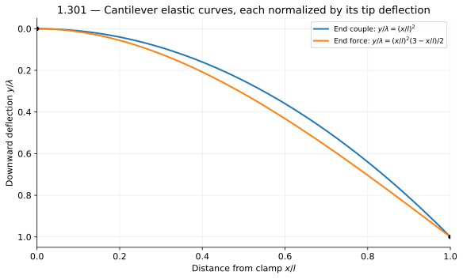

# 1.6 Elastic Deformations of a Solid Body

[Chapter index](../README.md#chapters) · [Structured solutions](1.6.json) · [Answer audit](../audit/README.md)

## 1.290

**Problem statement**

What pressure has to be applied to the ends of a steel cylinder to keep its length constant on raising its temperature by 100 °C?

**Solved · high confidence.** Cancel free thermal expansion with uniaxial elastic compression.

**Assumptions**

- The lateral surface is free, so the applied end pressures create uniaxial stress rather than hydrostatic pressure.
- Use the Appendix values E_s=2.00×10¹¹ Pa (Table 13) and α_s=11×10⁻⁶ K⁻¹ (Table 12), both on PDF page 382, printed page 375. The cylinder remains in the elastic regime.

The net longitudinal strain is the sum of its thermal and mechanical parts. Choose positive strain for extension and p>0 for compression.

$$
\varepsilon_l=\alpha_s\Delta T-\frac p{E_s}.
$$

Keeping the length constant means setting this sum to zero.

$$
p=E_s\alpha_s\Delta T.
$$

A temperature rise of 100 degrees Celsius has magnitude 100 kelvins.

$$
p=(2.00\times10^{11})(11\times10^{-6})(100)=2.20\times10^8\ \mathrm{Pa}.
$$

**Results**

Axial pressure on each end

$$
p=E_s\alpha_s\Delta T=2.20\times10^8\ \mathrm{Pa}
$$

Uses the book Appendix Tables 12 and 13.

**Limitations**

- The Appendix tensile strength is not a compressive yield limit. The calculation assumes elastic compression and neglects temperature dependence of E and α across the temperature interval.

## 1.291

**Problem statement**

What internal pressure (in the absence of an external pressure) can be sustained (a) by a glass tube; (b) by a glass spherical flask, if in both cases the wall thickness is equal to Δr = 1.0 mm and the radius of the tube and the flask equals r = 25 mm?

**Solved · high confidence.** Use thin-wall pressure-vessel force balance and limit the largest tensile stress.

**Assumptions**

- The glass is homogeneous and the walls are thin relative to radius: t/r=0.040. Neglect local defects, fittings and stress concentrations.
- Use the glass tensile strength σ_B=5.00×10⁷ Pa supplied in Appendix Table 13, PDF page 382, printed page 375.

Cut a length L of the tube through an axial plane. The pressure resultant on one half balances tension in its two wall sections.

$$
2prL=2\sigma_\theta tL,\qquad\sigma_\theta=\frac{pr}{t}.
$$

For a closed tube the longitudinal wall stress is half the hoop stress; for an open tube it is absent. Thus the hoop stress controls in either ideal model.

$$
\sigma_z=\frac{pr}{2t}\quad\text{(closed ends)},\qquad p_{\rm tube,max}=\frac{\sigma_Bt}{r}.
$$

Cut the spherical flask into hemispheres. Pressure on the great-circle area balances meridional wall tension around the circumference.

$$
p\pi r^2=\sigma(2\pi rt),\qquad \sigma=\frac{pr}{2t},\qquad p_{\rm sphere,max}=\frac{2\sigma_Bt}{r}.
$$

Insert t=0.0010 m and r=0.025 m using the declared strength model.

$$
p_{\rm tube,max}=0.040\sigma_B=2.00\times10^6\ \mathrm{Pa},\qquad p_{\rm sphere,max}=0.080\sigma_B=4.00\times10^6\ \mathrm{Pa}.
$$

**Results**

Tube maximum internal pressure

$$
p_{\rm tube,max}=\sigma_B\frac{\Delta r}{r}=2.00\ \mathrm{MPa}
$$

Uses the glass tensile strength supplied by Appendix Table 13; thin-wall idealization.

Spherical flask maximum internal pressure

$$
p_{\rm sphere,max}=2\sigma_B\frac{\Delta r}{r}=4.00\ \mathrm{MPa}
$$

Uses the glass tensile strength supplied by Appendix Table 13; thin-wall idealization.

**Limitations**

- Finite wall thickness changes the leading thin-wall stresses by relative terms of order t/r. A calculation at that accuracy should specify whether the quoted radius is inner, outer or mean and apply the corresponding thick-wall vessel model.
- The Appendix strength is a model material value; defects and a design safety factor can lower a real vessel’s operating pressure.

## 1.292

**Problem statement**

A horizontally oriented copper rod of length l = 1.0 m is rotated about a vertical axis passing through its middle. What is the number of rps at which this rod ruptures?

**Solved · high confidence.** Find the centrifugal tensile stress maximum at the rod midpoint.

**Assumptions**

- Treat the rod as uniform and slender, with negligible deformation before evaluating its centrifugal load.
- Use copper density ρ_Cu=8.90×10³ kg/m³ from Appendix Table 11 (PDF page 381, printed page 374) and tensile strength σ_B=3.00×10⁸ Pa from Table 13 (PDF page 382, printed page 375).

At distance x from the midpoint, the inward tensile force must supply the centrifugal load of the segment between x and the free end l/2. Let S be its cross-sectional area.

$$
T(x)=\rho S\omega^2\int_x^{l/2}s\,ds=\frac{\rho S\omega^2}{2}\left(\frac{l^2}{4}-x^2\right),\qquad 0\leq x\leq l/2.
$$

The maximum axial stress occurs at the midpoint, so equate it to the failure stress.

$$
\sigma_{\max}=\frac{T(0)}S=\frac{\rho\omega^2l^2}{8}=\sigma_B.
$$

Convert the limiting angular speed to revolutions per second.

$$
n_c=\frac{\omega_c}{2\pi}=\frac1{\pi l}\sqrt{\frac{2\sigma_B}{\rho}},\qquad n_c=82.6477\ \mathrm{s^{-1}}\quad(l=1.0\ \mathrm m).
$$

**Results**

Rupture rotation frequency

$$
n_c=\frac1{\pi l}\sqrt{\frac{2\sigma_B}{\rho}}\simeq82.6\ \mathrm{rps}
$$

Uses the copper density and tensile strength supplied by Appendix Tables 11 and 13.

**Limitations**

- The result uses the Appendix tensile-strength model and neglects changes of shape before failure. Yield and material-state variation can alter a real rupture frequency.

## 1.293

**Problem statement**

A ring of radius r = 25 cm made of lead wire is rotated about a stationary vertical axis passing through its centre and perpendicular to the plane of the ring. What is the number of rps at which the ring ruptures?

**Solved · high confidence.** Balance the resultant of hoop tensions against the centrifugal load of a small ring element.

**Assumptions**

- The thin wire forms a uniform circular ring and its radius change is neglected in the centrifugal-load calculation.
- Use lead density ρ_Pb=1.13×10⁴ kg/m³ from Appendix Table 11 (PDF page 381, printed page 374) and tensile strength σ_B=1.50×10⁷ Pa from Table 13 (PDF page 382, printed page 375).

For an element subtending dθ, the inward resultant of its two end tensions is T dθ to first order. Its mass is ρSr dθ.

$$
T\,d\theta=(\rho Sr\,d\theta)\omega^2r,\qquad T=\rho S\omega^2r^2.
$$

The hoop stress is uniform around the ring. Set it equal to the assumed failure strength.

$$
\sigma=\frac TS=\rho\omega^2r^2,\qquad n_c=\frac1{2\pi r}\sqrt{\frac{\sigma_B}{\rho}}.
$$

Use r=0.25 m and the Appendix material data to evaluate the failure frequency.

$$
n_c=\frac1{2\pi(0.25)}\sqrt{\frac{1.50\times10^7}{1.13\times10^4}}=23.1946\ \mathrm{rps}.
$$

**Results**

Rupture rotation frequency

$$
n_c=\frac1{2\pi r}\sqrt{\frac{\sigma_B}{\rho}}\simeq23.2\ \mathrm{rps}
$$

Uses the lead density and tensile strength supplied by Appendix Tables 11 and 13.

**Limitations**

- Yield, creep, dimensional change and local flaws are excluded from the fixed-radius failure model based on the Appendix tensile strength.

## 1.294

**Problem statement**

A steel wire of diameter d = 1.0 mm is stretched horizontally between two clamps located at the distance l = 2.0 m from each other. A weight of mass m = 0.25 kg is suspended from the midpoint O of the wire. What will the resulting descent of the point O be in centimetres?

**Solved · medium confidence.** Combine the geometric extension of two straight wire halves with vertical force balance.

**Assumptions**

- The initial wire is straight, its unstretched length equals the clamp separation l, and it has no initial tensile preload.
- Neglect wire weight, bending stiffness and clamp motion. Use small elastic strains and E_s=2.00×10¹¹ Pa from Appendix Table 13 (PDF page 382, printed page 375); g=9.81 m/s² is the rounded gravity convention.

Let y be the midpoint descent, a=l/2 the horizontal half-span and s the stretched half-length. Both halves carry the same tension.

$$
s=\sqrt{a^2+y^2},\qquad \varepsilon=\frac{s-a}{a},\qquad S=\frac{\pi d^2}{4},\qquad T=ES\frac{s-a}{a}.
$$

The vertical components of the two tensions support the attached mass. This gives an implicit equation valid with the full straight-segment geometry.

$$
2T\frac ys=mg,\qquad 2ES\left(\frac sa-1\right)\frac ys=mg.
$$

For y≪l the extension is quadratic in descent; substituting this approximation into force balance gives the useful cube-root expression.

$$
\varepsilon\simeq\frac{y^2}{2a^2},\qquad mg\simeq\frac{ESy^3}{a^3},\qquad y\simeq\frac l2\left(\frac{mg}{ES}\right)^{1/3}=\left(\frac{mgl^3}{2\pi Ed^2}\right)^{1/3}.
$$

The small-sag formula and the exact geometric equation give nearly the same descent for the given data.

$$
y_{\rm small}=0.0249937\ \mathrm m=2.49937\ \mathrm{cm},\qquad y_{\rm geom}=0.0249976\ \mathrm m=2.49976\ \mathrm{cm}.
$$

**Results**

Midpoint descent with full segment geometry

$$
y\simeq2.50\ \mathrm{cm}
$$

Uses zero initial tension and the exact geometric force-balance equation.

Leading small-sag expression

$$
y\simeq\left(\frac{mgl^3}{2\pi Ed^2}\right)^{1/3}
$$

**Limitations**

- An unknown initial tension changes the descent. For initial stress-free half-length a0 different from l/2, use T=ES(s−a0)/a0 in the same vertical balance.
- Wire self-weight is neglected; including it makes each half curved rather than exactly straight.

## 1.295

**Problem statement**

A uniform elastic plank moves over a smooth horizontal plane due to a constant force F_0 distributed uniformly over the end face. The surface of the end face is equal to S, and Young's modulus of the material to E. Find the compressive strain of the plank in the direction of the acting force.

**Solved · high confidence.** Find the nonuniform internal force needed to accelerate each section of the plank.

**Assumptions**

- Use the uniform-acceleration linear-elastic state after neglecting elastic-wave transients; deformation is small and the cross-sectional area is S.
- Let x run from the driven end x=0 to the free end x=L. Compressive strain is reported as a positive magnitude.

The total mass M has acceleration F0/M. The subsegment beyond a cut at x has mass M(1−x/L), so its required pushing force decreases linearly toward the free end.

$$
a=\frac{F_0}{M},\qquad N(x)=M\left(1-\frac xL\right)a=F_0\left(1-\frac xL\right).
$$

Hooke’s law gives the local compression rather than a uniform F0/(ES) strain.

$$
\varepsilon_c(x)=\frac{N(x)}{ES}=\frac{F_0}{ES}\left(1-\frac xL\right).
$$

Integrate this strain over the plank to obtain its total shortening and fractional compression.

$$
\Delta L_c=\int_0^L\varepsilon_c(x)\,dx=\frac{F_0L}{2ES},\qquad\frac{\Delta L_c}{L}=\frac{F_0}{2ES}.
$$

**Results**

Overall compressive strain

$$
\frac{\Delta L_c}{L}=\frac{F_0}{2ES}
$$

The signed longitudinal strain is −F0/(2ES).

Local compressive strain

$$
\varepsilon_c(x)=\frac{F_0}{ES}\left(1-\frac xL\right),\quad0\leq x\leq L
$$

x is measured from the driven end.

**Limitations**

- An abruptly applied load launches elastic waves. Without a time history or damping data, the instantaneous transient strain is not specified; the result is the usual uniformly accelerating elastic state.

## 1.296

**Problem statement**

A thin uniform copper rod of length l and mass m rotates uniformly with an angular velocity ω in a horizontal plane about a vertical axis passing through one of its ends. Determine the tension in the rod as a function of the distance r from the rotation axis. Find the elongation of the rod.

**Solved · high confidence.** Integrate the centrifugal load beyond a rod section, then integrate its tensile strain.

**Assumptions**

- The copper rod is slender, uniform and linearly elastic; use the undeformed length and positions in the centrifugal force, valid for small extension.
- Let S=m/(ρl) be its initial cross-sectional area. The Appendix gives copper E=1.30×10¹¹ Pa in Table 13 (PDF page 382, printed page 375) and ρ=8.90×10³ kg/m³ in Table 11 (PDF page 381, printed page 374).

A section at radius r pulls inward on all rod material between r and the free end l. Each element requires centripetal force ω²s dm.

$$
T(r)=\frac ml\omega^2\int_r^ls\,ds=\frac{m\omega^2}{2l}(l^2-r^2).
$$

The elongation is the integral of the longitudinal strain T/(ES).

$$
\Delta l=\int_0^l\frac{T(r)}{ES}\,dr=\frac{m\omega^2}{2lES}\left(l^3-\frac{l^3}{3}\right)=\frac{m\omega^2l^2}{3ES}.
$$

Eliminate the unspecified area using the rod density.

$$
S=\frac m{\rho l},\qquad\Delta l=\frac{\rho\omega^2l^3}{3E}.
$$

**Results**

Tension as a function of radius

$$
T(r)=\frac{m\omega^2}{2l}(l^2-r^2),\qquad0\leq r\leq l
$$

Rod elongation

$$
\Delta l=\frac{m\omega^2l^2}{3ES}=\frac{\rho\omega^2l^3}{3E}
$$

**Limitations**

- Large strains change the centrifugal lever arms and density and require a nonlinear rotating-rod calculation.

## 1.297

**Problem statement**

A solid copper cylinder of length l = 65 cm is placed on a horizontal surface and subjected to a vertical compressive force F = 1000 N directed downward and distributed uniformly over the end face. What will be the resulting change of the volume of the cylinder in cubic millimetres?

**Solved · high confidence.** Use Poisson expansion to combine axial and transverse strains under a uniform compressive load.

**Assumptions**

- The cylinder stands with its axis vertical on the horizontal surface, consistent with the downward force distributed over its upper end face.
- Calculate the additional volume change caused by F, excluding any preexisting self-weight deformation. End constraints do not suppress lateral Poisson strain away from local end effects.
- Use copper E=1.30×10¹¹ Pa and ν=0.34 from Appendix Table 13, PDF page 382, printed page 375.

If S is the cylinder cross-sectional area, the incremental stress is uniaxial compression. Its transverse strains have the opposite sign through Poisson’s ratio.

$$
\varepsilon_z=-\frac F{ES},\qquad\varepsilon_x=\varepsilon_y=\frac{\nu F}{ES}.
$$

To first order the relative volume change is the sum of three normal strains; multiply by the initial volume Sl.

$$
\frac{\Delta V}{V}=-(1-2\nu)\frac F{ES},\qquad\Delta V=-(1-2\nu)\frac{Fl}{E}.
$$

The cross-sectional area cancels. Insert l=0.65 m and convert cubic metres to cubic millimetres.

$$
\Delta V=-\frac{(1-2\times0.34)(1000)(0.65)}{1.30\times10^{11}}=-1.60000\times10^{-9}\ \mathrm{m^3}=-1.60000\ \mathrm{mm^3}.
$$

**Results**

Force-induced volume change

$$
\Delta V=-(1-2\nu)\frac{Fl}{E}=-1.60\ \mathrm{mm^3}
$$

A decrease; uses Appendix Table 13 and excludes self-weight preload.

**Limitations**

- The result is a first-order uniform uniaxial model; frictional end restraint or a horizontally lying cylinder loaded across its side would require a different stress analysis.

## 1.298

**Problem statement**

A copper rod of length l is suspended from the ceiling by one of its ends. Find: (a) the elongation Δl of the rod due to its own weight; (b) the relative increment of its volume ΔV/V.

**Solved · high confidence.** Integrate the uniaxial strain caused by the weight below each cross-section.

**Assumptions**

- The suspended copper rod is uniform and slender, with initial area S, density ρ and Young’s modulus E. Its lateral surface is traction-free.
- Use small-strain isotropic linear elasticity and neglect changes of geometry and density in calculating the self-weight load.
- For numerical evaluation, copper ρ=8.90×10³ kg/m³ is supplied by Appendix Table 11 (PDF page 381, printed page 374), while E=1.30×10¹¹ Pa and ν=0.34 are in Table 13 (PDF page 382, printed page 375).

Measure x downward from the ceiling. A section supports the weight of the length l−x below it.

$$
T(x)=\rho Sg(l-x),\qquad\sigma(x)=\rho g(l-x),\qquad\varepsilon_l(x)=\frac{\rho g(l-x)}E.
$$

Integrating the longitudinal strain gives the total elongation.

$$
\Delta l=\int_0^l\varepsilon_l(x)\,dx=\frac{\rho gl^2}{2E}.
$$

The local volume strain includes both transverse Poisson contractions; average it along the initial uniform rod.

$$
\varepsilon_V(x)=(1-2\nu)\varepsilon_l(x),\qquad\frac{\Delta V}{V}=\frac1l\int_0^l\varepsilon_V(x)\,dx=(1-2\nu)\frac{\rho gl}{2E}=(1-2\nu)\frac{\Delta l}{l}.
$$

**Results**

Elongation from self-weight

$$
\Delta l=\frac{\rho gl^2}{2E}
$$

Relative volume increment

$$
\frac{\Delta V}{V}=(1-2\nu)\frac{\rho gl}{2E}=(1-2\nu)\frac{\Delta l}{l}
$$

**Limitations**

- Local stresses at the ceiling attachment and nonlinear deformation of very long rods are excluded.

## 1.299

**Problem statement**

A bar made of material whose Young's modulus is equal to E and Poisson's ratio to μ is subjected to the hydrostatic pressure p. Find: (a) the fractional decrement of its volume; (b) the relationship between the compressibility β and the elastic constants E and μ. Show that Poisson's ratio μ cannot exceed 1/2.

**Solved · high confidence.** Superpose the three equal principal compressive stresses in isotropic linear elasticity.

**Assumptions**

- Use infinitesimal strains and an isotropic, thermodynamically stable elastic material. Pressure p is positive in compression; E>0.

Each principal stress is −p; Poisson expansion from the other two directions offsets part of the direct contraction.

$$
\sigma_x=\sigma_y=\sigma_z=-p,\qquad \varepsilon_x=\varepsilon_y=\varepsilon_z=-\frac{p}{E}(1-2\mu).
$$

To first order the fractional volume change is the sum of the three normal strains.

$$
\frac{\Delta V}{V}=\varepsilon_x+\varepsilon_y+\varepsilon_z=-\frac{3(1-2\mu)p}{E}.
$$

The compressibility is the negative pressure derivative of the fractional volume change; invert it to obtain the bulk modulus.

$$
\beta=-\frac1V\frac{dV}{dp}=\frac{3(1-2\mu)}{E},\qquad K=\frac1\beta=\frac{E}{3(1-2\mu)}.
$$

Positive hydrostatic strain energy requires a positive bulk modulus. Thus a compressible stable material has μ strictly below one half; the equality is the ideal incompressible limit.

$$
u=\frac{p^2}{2K}>0\ \Longrightarrow\ \mu<\frac12,\qquad \mu\to\frac12^-:\ \beta\to0,\ K\to\infty.
$$

**Results**

Fractional volume decrement

$$
-\Delta V/V=3(1-2\mu)p/E
$$

Compressibility

$$
\beta=3(1-2\mu)/E
$$

Upper bound on Poisson ratio

$$
\mu\leq\frac12
$$

Strict inequality holds for finite positive bulk modulus. Equality is the incompressible limit.

**Limitations**

- The first-order volume formula requires |p/E|≪1 and a linear material response; the Poisson bound is for stable isotropic elasticity.

## 1.300

**Problem statement**

One end of a steel rectangular girder is embedded into a wall (Fig. 1.74). Due to gravity it sags slightly. Find the radius of curvature of the neutral layer (see the dotted line in the figure) in the vicinity of the point O if the length of the protruding section of the girder is equal to l = 6.0 m and the thickness of the girder equals h = 10 cm.

**Solved · high confidence.** Balance the self-weight moment at the clamped section and use the beam curvature law.

**Assumptions**

- The girder is uniform with width b, vertical thickness h, and a clamped section at O as in Fig.1.74. Use Euler–Bernoulli bending and neglect shear deformation.
- Use steel E=2.00×10¹¹ Pa from Appendix Table 13 (PDF page 382, printed page 375), density ρ=7.80×10³ kg/m³ from Table 11 (PDF page 381, printed page 374), and the rounded gravity convention g=9.81 m/s².

The weight per unit length and rectangular cross-section moment depend on the unknown width b, which will cancel.

$$
q=\rho b h g,\qquad I=\frac{bh^3}{12}.
$$

The weight of the whole protruding span acts at its midpoint. Its moment about the clamped section sets the magnitude of the local curvature.

$$
M_O=q l\frac l2=\frac{q l^2}{2},\qquad \frac1{\mathcal R_O}=\frac{M_O}{EI}=\frac{6\rho g l^2}{E h^2}.
$$

Insert l=6.0 m and h=0.10 m; the radius is measured in the downward bending plane.

$$
\mathcal R_O=\frac{E h^2}{6\rho g l^2}\simeq1.21\times10^2\ \mathrm m.
$$

**Results**

Radius of curvature near the wall

$$
\mathcal R_O=\frac{E h^2}{6\rho g l^2}\simeq121\ \mathrm m
$$

Numerical value uses the book Appendix Tables 11 and 13.

**Limitations**

- The result uses the Appendix steel modulus and density in the small-deflection beam model; the symbolic formula retains both constants.

## 1.301

**Problem statement**

The bending of an elastic rod is described by the elastic curve passing through centres of gravity of rod’s cross-sections. At small bendings the equation of this curve takes the form $N(x)=EI\,d^2y/dx^2$, where N(x) is the bending moment of the elastic forces in the cross-section corresponding to the x coordinate, E is Young’s modulus, I is the moment of inertia of the cross-section relative to the axis passing through the neutral layer ($I=\int z^2dS$, Fig. 1.75). Suppose one end of a steel rod of a square cross-section with side a is embedded into a wall, the protruding section being of length l (Fig. 1.76). Assuming the mass of the rod to be negligible, find the shape of the elastic curve and the deflection of the rod λ, if its end A experiences (a) the bending moment of the couple N_0; (b) a force F oriented along the y axis.

**Solved · high confidence.** Integrate the signed small-slope beam curvature with clamped-end displacement and slope conditions.

**Assumptions**

- Use x from the wall, positive y downward as in Fig.1.76, and I=a⁴/12 for the square cross-section. Choose positive N0 to bend the end in positive y.
- Neglect rod weight, shear deformation and axial stretch; E is the steel Young modulus.

The clamp fixes both displacement and slope. For the tip couple the bending moment is constant.

$$
y(0)=y^{\prime}(0)=0,\qquad I=\frac{a^4}{12},\qquad EI y^{\prime\prime}=N_0.
$$

Integrate twice and evaluate the deflection at the tip for the applied couple.

$$
y_a(x)=\frac{N_0x^2}{2EI}=\frac{6N_0x^2}{Ea^4},\qquad \lambda_a=y_a(l)=\frac{N_0l^2}{2EI}=\frac{6N_0l^2}{Ea^4}.
$$

For a downward tip force the bending moment at a cut is the force times its remaining lever arm.

$$
EI y^{\prime\prime}=F(l-x),\qquad y_b(x)=\frac{Fx^2(3l-x)}{6EI}=\frac{2Fx^2(3l-x)}{Ea^4}.
$$

The tip displacement follows by substituting x=l; both formulas give signed deflections in the selected force or couple sense.

$$
\lambda_b=y_b(l)=\frac{Fl^3}{3EI}=\frac{4Fl^3}{Ea^4}.
$$

**Results**

Elastic curve under the tip couple

$$
y_a(x)=\frac{6N_0x^2}{Ea^4},\quad0\leq x\leq l
$$

Tip deflection under the tip couple

$$
\lambda_a=\frac{6N_0l^2}{Ea^4}
$$

Elastic curve under the tip force

$$
y_b(x)=\frac{2Fx^2(3l-x)}{Ea^4},\quad0\leq x\leq l
$$

Tip deflection under the tip force

$$
\lambda_b=\frac{4Fl^3}{Ea^4}
$$

**Limitations**

- The linear curves require small slopes, |N0|l/(EI)≪1 and |F|l²/(EI)≪1.

## 1.302

**Problem statement**

A steel girder of length l rests freely on two supports (Fig. 1.77). The moment of inertia of its cross-section is equal to I (see the foregoing problem). Neglecting the mass of the girder and assuming the sagging to be slight, find the deflection λ due to the force F applied to the middle of the girder.

**Solved · high confidence.** Use equal support reactions and integrate the bending equation on either half of the span.

**Assumptions**

- The ideal supports in Fig.1.77 exert forces without end couples; y is positive downward and x runs from the left support. Deflection is symmetric about x=l/2.

Symmetry gives one half of the force at each support. In the left half the signed curvature is negative for the selected downward displacement.

$$
R_L=R_R=F/2,\qquad EI y^{\prime\prime}=-Fx/2,\quad0\leq x\leq l/2.
$$

Integrate with zero displacement at the left support and zero slope at midspan.

$$
y(0)=0,\quad y^{\prime}(l/2)=0,\qquad y(x)=\frac{Fx(3l^2-4x^2)}{48EI}.
$$

Evaluate at the centre, where symmetry makes the sag maximal.

$$
\lambda=y(l/2)=\frac{Fl^3}{48EI}.
$$

**Results**

Midspan deflection

$$
\lambda=\frac{Fl^3}{48EI}
$$

**Limitations**

- The supports must allow the usual small axial end displacement; membrane tension and shear deformation are excluded.

## 1.303

**Problem statement**

The thickness of a rectangular steel girder equals h. Using the equation of Problem 1.301, find the deflection λ caused by the weight of the girder in two cases: (a) one end of the girder is embedded into a wall with the length of the protruding section being equal to l (Fig. 1.78a); (b) the girder of length 2l rests freely on two supports (Fig. 1.78b).

**Solved · high confidence.** Integrate the uniform-load beam equation with the boundary conditions for each support arrangement.

**Assumptions**

- Use a uniform rectangular cross-section of width b and vertical thickness h, q=ρbhg and I=bh³/12.
- Case (a) has cantilever length l; case (b) has complete simply supported span L=2l as shown in Fig.1.78. Neglect shear and axial stretching.

In the cantilever the bending moment at x is the weight of the overhanging portion times its lever arm.

$$
EI y_a^{\prime\prime}=\frac q2(l-x)^2,\qquad y_a(0)=y_a^{\prime}(0)=0.
$$

Twice integrating gives the quartic elastic curve and free-end deflection.

$$
y_a(x)=\frac{qx^2(6l^2-4lx+x^2)}{24EI},\qquad \lambda_a=\frac{ql^4}{8EI}=\frac{3\rho gl^4}{2Eh^2}.
$$

For a simply supported beam of complete length L, equal reactions are qL/2. The signed curvature is negative and the support displacements vanish.

$$
EI y_b^{\prime\prime}=-\frac q2x(L-x),\quad y_b(0)=y_b(L)=0,\qquad y_b(x)=\frac{qx(L^3-2Lx^2+x^3)}{24EI}.
$$

The maximum lies at midspan. Substituting L=2l is essential for the requested second case.

$$
\lambda_b=y_b(L/2)=\frac{5qL^4}{384EI}=\frac{5\rho gl^4}{2Eh^2},\qquad L=2l.
$$

**Results**

Free-end cantilever deflection

$$
\lambda_a=\frac{3\rho gl^4}{2Eh^2}
$$

Midspan sag of the span 2l

$$
\lambda_b=\frac{5\rho gl^4}{2Eh^2}
$$

**Limitations**

- ρ denotes the steel density; the result retains it symbolically. Small-slope and elastic-range conditions must hold.

## 1.304

**Problem statement**

A steel plate of thickness h has the shape of a square whose side equals l, with h ≪ l. The plate is rigidly fixed to a vertical axle OO which is rotated with a constant angular acceleration β (Fig. 1.79). Find the deflection λ, assuming the sagging to be small.

**Solved · medium confidence.** Treat the vertical square plate as cantilever beam strips loaded by tangential inertia, and integrate the linearly varying load.

> **Audit update.** For Fig. 1.79’s square geometry and ν=0.29, use the thin-plate corner coefficient 1.024 in the quasistatic model with centrifugal prestress neglected. The saved 1.10 is the beam-strip approximation.

**Assumptions**

- Use the elementary Euler–Bernoulli beam-strip approximation: the vertical edge of length b=l is clamped to the axle, the radial span is l and the tangential bending thickness is h.
- Use a quasistatic response in the accelerating frame; neglect transverse edge coupling, shear, elastic transients and centrifugal prestress stiffening. Take β as the signed angular acceleration.
- ρ and E are the steel density and Young modulus. The deflection λ is the tangential lag of the outer edge relative to the unbent radial plane in Fig.1.79.
- Appendix Table 13 (PDF page 382, printed page 375) supplies the steel Poisson ratio μ=0.29, as well as E; a full plate calculation must incorporate that coupling rather than the beam-strip simplification.

At undeformed radius x, the imposed tangential acceleration is βx. The opposing inertial load per radial length therefore grows linearly outward.

$$
q(x)=\rho b h\,\beta x,\qquad I=\frac{bh^3}{12}.
$$

The bending moment magnitude at radius x is obtained by integrating the load times its lever arm over the remaining span.

$$
M(x)=\int_x^l\rho b h\beta s(s-x)\,ds=\rho b h\beta\left(\frac{l^3}{3}-\frac{xl^2}{2}+\frac{x^3}{6}\right).
$$

Set y(0)=y′(0)=0 and integrate the curvature. Positive y denotes lag opposite the imposed angular acceleration.

$$
y(x)=\frac{\rho b h\beta}{EI}\left(\frac{l^3x^2}{6}-\frac{l^2x^3}{12}+\frac{x^5}{120}\right).
$$

Evaluate at the free edge and cancel the vertical width b. The result is the elementary beam estimate of the requested deflection.

$$
\lambda=y(l)=\frac{11\rho b h\beta l^5}{120EI}=\frac{11\rho\beta l^5}{10Eh^2}.
$$

**Results**

Free-edge lag in the quasistatic beam approximation

$$
|\lambda|=\frac{11\rho|\beta|l^5}{10Eh^2}
$$

The edge lags opposite the angular acceleration. A general elastic square-plate response requires further modeling data.

**Limitations**

- A square plate is not a slender beam. A full plate calculation depends on Poisson coupling and lateral boundary conditions; the displayed coefficient is the elementary beam-strip model implicit in the surrounding bending problems.
- Constant angular acceleration alone does not specify a time-dependent elastic vibration state. Quasistatic loading or decay of transients is assumed.
- At sufficiently high rotation speed, centrifugal membrane tension alters the bending compliance; that prestress is neglected and no angular velocity is specified.

## 1.305

**Problem statement**

Determine the relationship between the torque N and the torsion angle φ for (a) the tube whose wall thickness Δr is considerably less than the tube radius; (b) for the solid rod of circular cross-section. Their length l, radius r, and shear modulus G are supposed to be known.

**Solved · high confidence.** Integrate the shear stress times radius over a circular cross-section.

**Assumptions**

- Use isotropic linear torsion with a uniform twist φ/l and circular sections remaining plane. In part (a), r is the mean tube radius and Δr≪r.

A material line at distance s from the axis experiences shear strain sφ/l and stress proportional to that strain.

$$
\gamma(s)=s\varphi/l,\qquad\tau(s)=G s\varphi/l.
$$

Integrating the local torque gives the polar second area moment, distinct from a mass moment of inertia.

$$
N=\int_A\tau(s)s\,dA=\frac{G\varphi}{l}J,\qquad J=\int_A s^2\,dA.
$$

For a thin tube all its cross-sectional material is approximately at radius r.

$$
J_{\rm tube}\simeq r^2(2\pi r\Delta r)=2\pi r^3\Delta r,\qquad N_{\rm tube}\simeq\frac{2\pi G r^3\Delta r}{l}\varphi.
$$

For a solid circular rod, integrate concentric annuli from zero to the outer radius.

$$
J_{\rm solid}=\int_0^r s^2(2\pi s\,ds)=\frac{\pi r^4}{2},\qquad N_{\rm solid}=\frac{\pi G r^4}{2l}\varphi.
$$

**Results**

Thin-walled circular tube

$$
N=\frac{2\pi G r^3\Delta r}{l}\varphi
$$

Solid circular rod

$$
N=\frac{\pi G r^4}{2l}\varphi
$$

**Limitations**

- The applied end torque is in the direction of φ; the internal restoring torque on a twisted end is opposite. Plastic yielding, noncircular warping and large material shear strains are excluded.

## 1.306

**Problem statement**

Calculate the torque N twisting a steel tube of length l = 3.0 m through an angle φ = 2.0° about its axis, if the inside and outside diameters of the tube are equal to d_1 = 30 mm and d_2 = 50 mm.

**Solved · high confidence.** Use the exact polar area moment of the annular tube, not a thin-wall approximation.

**Assumptions**

- Use the steel shear modulus G=8.10×10¹⁰ Pa from Appendix Table 13, PDF page 382, printed page 375. The tube is uniform and remains linearly elastic.

Convert the diameters and twist to SI units; the given wall is not especially thin relative to its mean radius.

$$
d_1=0.030\ \mathrm m,\quad d_2=0.050\ \mathrm m,\quad l=3.0\ \mathrm m,\quad\varphi=2\pi/180=0.0349066\ \mathrm{rad}.
$$

Integrate the circular annulus to obtain its exact torsional second area moment.

$$
J=\frac\pi{32}(d_2^4-d_1^4)=5.34071\times10^{-7}\ \mathrm{m^4}.
$$

Substitute into the torque–twist relation; the symbolic result allows any specified material modulus.

$$
N=\frac{GJ\varphi}{l}=\frac{\pi G(d_2^4-d_1^4)\varphi}{32l}\simeq5.03\times10^2\ \mathrm{N\,m}.
$$

**Results**

Applied torque magnitude

$$
N=\frac{\pi G(d_2^4-d_1^4)\varphi}{32l}\simeq503\ \mathrm{N\,m}
$$

Computed with the Appendix Table 13 steel shear modulus G=8.10×10¹⁰ Pa.

**Limitations**

- The calculation uses the Appendix material modulus and assumes elastic torsion; a different actual steel modulus would rescale the torque proportionally.

## 1.307

**Problem statement**

Find the maximum power which can be transmitted by means of a steel shaft rotating about its axis with an angular velocity ω = 120 rad/s, if its length l = 200 cm, radius r = 1.50 cm, and the permissible torsion angle φ = 2.5°.

**Solved · high confidence.** Use the elastic torsional stiffness of a solid circular shaft and multiply its limiting torque by the angular velocity.

**Assumptions**

- The shaft is solid, circular, uniform and linearly elastic; the specified twist limits the steady torque rather than a separate strength criterion.
- Appendix Table 13 (PDF page 382, printed page 375) gives steel shear modulus G=81 GPa=8.10×10^10 Pa. The numerical power uses this book value.

For a circular shaft, shear strain at radius s is sφ/l. Integrating shear stress times its moment arm gives the polar second moment.

$$
\gamma(s)=s\varphi/l,\qquad J=\int_Ss^2\,dS=\frac{\pi r^4}{2},\qquad N=\frac{GJ}{l}\varphi.
$$

A torque N turning with angular velocity ω transmits power Nω; insert the permissible twist in radians.

$$
P_{\max}=N_{\max}\omega=\frac{\pi G r^4\omega\varphi_{\max}}{2l},\qquad \varphi_{\max}=2.5\frac{\pi}{180}=0.0436332.
$$

Use the dimensions in metres and the Appendix Table 13 shear modulus to evaluate torque and power.

$$
N_{\max}=140.526\ \mathrm{N\,m},\qquad P_{\max}=1.68631\times10^4\ \mathrm W.
$$

**Results**

Maximum transmitted power

$$
P_{\max}=\frac{\pi G r^4\omega\varphi_{\max}}{2l}\simeq1.69\times10^4\ \mathrm W
$$

Uses the book’s Appendix Table 13 value G=8.10×10^10 Pa; the symbolic formula retains the material dependence.

**Limitations**

- A lower material yield limit, inadequate support or dynamic loading could impose a lower power; none is specified.

## 1.308

**Problem statement**

A uniform ring of mass m, with the outside radius r_2 , is fitted tightly on a shaft of radius r_1 . The shaft is rotated about its axis with a constant angular acceleration β. Find the moment of elastic forces in the ring as a function of the distance r from the rotation axis.

**Solved · high confidence.** Isolate the material outside a cylindrical section and supply its angular acceleration with the torque transmitted across that section.

**Assumptions**

- The ring is a uniform annulus occupying r1≤r≤r2, with constant axial thickness.
- Use the quasistatic accelerating state in which all annular layers share angular acceleration β. Torsional-wave transients are neglected. Positive torque is in the direction of β.

The annulus mass per radial interval follows from its uniform volume density and the area of the circular strip.

$$
dm=\frac{2m s}{r_2^2-r_1^2}\,ds.
$$

Take the outer part r<s<r2 as a separate body. With no external torque on the free outer rim, its only driving torque is the elastic traction from the inner part.

$$
N(r)=\beta I_{\rm outer}(r)=\beta\int_r^{r_2}s^2\,dm.
$$

Integrate the outer-part moment of inertia and substitute its mass normalization.

$$
N(r)=\frac{2m\beta}{r_2^2-r_1^2}\int_r^{r_2}s^3\,ds=\frac{m\beta(r_2^4-r^4)}{2(r_2^2-r_1^2)}.
$$

**Results**

Torque exerted by the inner material on the outer annulus

$$
N(r)=\frac{m\beta(r_2^4-r^4)}{2(r_2^2-r_1^2)},\qquad r_1\le r\le r_2
$$

This signed torque acts in the direction of β; the outer material exerts the opposite torque on the inner material.

**Limitations**

- This is the torsional moment from angular acceleration. Radial centrifugal stresses due to angular speed are a separate effect.

## 1.309

**Problem statement**

Find the elastic deformation energy of a steel rod of mass m = 3.1 kg stretched to a tensile strain ε = 1.0·10⁻³ .

**Solved · high confidence.** Integrate the uniform uniaxial elastic-energy density over the rod volume inferred from its mass.

**Assumptions**

- The tensile strain is uniform and the rod follows linear uniaxial elasticity; lateral surfaces are free.
- Appendix Table 13 (PDF page 382, printed page 375) gives steel E=200 GPa; Table 11 (PDF page 381, printed page 374) gives ρ=7.8 g/cm³=7.80×10^3 kg/m³. Dimensions and volume are evaluated to leading order in strain.

The work per reference volume is the area below the linear stress-strain curve.

$$
u=\int_0^\varepsilon E\epsilon\,d\epsilon=\frac12E\varepsilon^2.
$$

The undeformed rod volume is m/ρ, so its elastic energy is determined without knowing its length or radius.

$$
U=\frac{E m\varepsilon^2}{2\rho}.
$$

Insert the specified mass and strain with the book’s Appendix Tables 11 and 13 constants.

$$
U=\frac{(2.00\times10^{11})(3.1)(10^{-3})^2}{2(7.80\times10^3)}=39.7436\ \mathrm J.
$$

**Results**

Elastic deformation energy

$$
U=\frac{E m\varepsilon^2}{2\rho}\simeq39.7\ \mathrm J
$$

Numerical value uses Appendix Tables 11 and 13; its material dependence is proportional to E/ρ.

## 1.310

**Problem statement**

A steel cylindrical rod of length l and radius r is suspended by its end from the ceiling. (a) Find the elastic deformation energy U of the rod. (b) Define U in terms of tensile strain Δl/l of the rod.

**Solved · high confidence.** Use the linearly varying self-weight tension rather than treating the rod as uniformly strained.

**Assumptions**

- The rod is uniform, slender, linearly elastic and hangs at rest under gravity. Self-weight acts on the undeformed geometry to first order.
- Write S=πr² for its cross-sectional area, ρ for density, and εbar=Δl/l for the mean longitudinal strain.

At depth x below the top, the cross-section supports the rod material of length l−x beneath it.

$$
T(x)=\rho Sg(l-x),\qquad \varepsilon(x)=\frac{T(x)}{ES}=\frac{\rho g(l-x)}{E}.
$$

Integrate the local strain-energy density over the whole rod.

$$
U=\int_0^l\frac{T(x)^2}{2ES}\,dx=\frac{\rho^2 Sg^2}{2E}\int_0^l(l-x)^2\,dx=\frac{\rho^2 Sg^2l^3}{6E}.
$$

The elongation is the integral of the local strain and is half the maximum strain times the original length.

$$
\Delta l=\int_0^l\varepsilon(x)\,dx=\frac{\rho gl^2}{2E},\qquad\bar\varepsilon=\frac{\Delta l}{l}=\frac{\rho gl}{2E}.
$$

Eliminate density and gravity using the mean strain, or use the rod mass m=ρSl for an equivalent expression.

$$
U=\frac23 ESl\bar\varepsilon^2=\frac13mg\Delta l=\frac13mgl\bar\varepsilon.
$$

**Results**

Elastic energy from the self-weight tension profile

$$
U=\frac{\pi\rho^2g^2r^2l^3}{6E}
$$

Energy in terms of the total relative elongation

$$
U=\frac{2\pi Er^2l}{3}\left(\frac{\Delta l}{l}\right)^2=\frac13mg\Delta l
$$

**Limitations**

- The mean tensile strain is not uniform throughout the rod, so U=½ESl(Δl/l)² would be incorrect here.

## 1.311

**Problem statement**

What work has to be performed to make a hoop out of a steel band of length l = 2.0 m, width h = 6.0 cm, and thickness δ = 2.0 mm? The process is assumed to proceed within the elasticity range of the material.

**Solved · medium confidence.** Store the bending energy of a thin strip whose initially straight neutral line becomes a circle.

**Assumptions**

- Use the slender-strip pure-bending model: the band bends through its thickness δ, with its width h parallel to the hoop axis. Anticlastic relaxation is allowed, so bending stiffness is EI rather than a constrained cylindrical-plate stiffness.
- The neutral line keeps length l; the hoop is held circular or its ends are joined so it cannot spring back. The problem explicitly stipulates that the deformation remains elastic.
- Use steel E=200 GPa from Appendix Table 13 (PDF page 382, printed page 375). External work is quasistatic and equals stored elastic energy.

Closing the neutral line into a circular hoop fixes its radius and curvature. The second moment of the rectangular section is taken across the thin direction.

$$
R=\frac{l}{2\pi},\qquad \kappa=\frac1R=\frac{2\pi}{l},\qquad I=\frac{h\delta^3}{12}.
$$

A fibre at signed thickness coordinate z has longitudinal strain zκ. Integrate its elastic energy first over the section and then over the band length.

$$
W=U=\int_0^l\int_S\frac12E z^2\kappa^2\,dS\,dx=\frac12EI\kappa^2l=\frac{\pi^2Eh\delta^3}{6l}.
$$

Convert the width and thickness to metres and insert Young modulus from Appendix Table 13.

$$
W=\frac{\pi^2(2.00\times10^{11})(0.060)(0.0020)^3}{6(2.0)}=78.9568\ \mathrm J.
$$

Check the largest fibre strain to make the stipulated elastic requirement explicit.

$$
|\varepsilon|_{\max}=\frac{\delta}{2R}=\frac{\pi\delta}{l}=0.00314159,\qquad |\sigma|_{\max}=E|\varepsilon|_{\max}=6.28319\times10^8\ \mathrm{Pa}.
$$

**Results**

Work to form the hoop in the thin-strip bending model

$$
W=\frac{\pi^2Eh\delta^3}{6l}\simeq79.0\ \mathrm J
$$

The numerical value scales linearly with E. It assumes bending through the 2 mm thickness.

**Limitations**

- The specified elastic process requires an elastic-limit stress at least about 628 MPa for the chosen E; a steel grade with a lower limit would yield, contrary to the premise.
- If transverse curvature were forcibly suppressed to make an exactly cylindrical wide plate, its flexural rigidity would involve E/(1−μ²). No such additional transverse constraint is specified; the displayed result uses the rod/strip bending model.
- This is deformation work, excluding joining work and any elastic energy that would be released if the unjoined band were allowed to spring back.
- Appendix Table 13 lists steel tensile strength 0.60 GPa, slightly below the 0.628 GPa maximum stress predicted for this geometry. That nominal strength does not establish the stipulated purely elastic feasibility; the worked answer retains the problem’s explicit elastic-process idealization.

## 1.312

**Problem statement**

Find the elastic deformation energy of a steel rod whose one end is fixed and the other is twisted through an angle φ = 6.0°. The length of the rod is equal to l = 1.0 m, and the radius to r = 10 mm.

**Solved · high confidence.** Integrate the work required to increase the torsion angle of a solid circular rod from zero to its final value.

**Assumptions**

- The rod is solid, uniform, circular and linearly elastic. Twist is quasistatic, and end effects are neglected.
- Use steel shear modulus G=81 GPa=8.10×10^10 Pa from Appendix Table 13 (PDF page 382, printed page 375).

The torsional stiffness is constant in the linear theory, so torque grows linearly with the twist angle.

$$
J=\frac{\pi r^4}{2},\qquad N(\theta)=\frac{GJ}{l}\theta.
$$

Integrate torque over angle; final torque times final angle must be divided by two.

$$
U=\int_0^\varphi N(\theta)\,d\theta=\frac{GJ\varphi^2}{2l}=\frac{\pi G r^4\varphi^2}{4l}.
$$

Express the angle in radians and insert the dimensions in SI units.

$$
\varphi=6.0\frac\pi{180}=\frac\pi{30},\quad r=0.010\ \mathrm m,\quad l=1.0\ \mathrm m,\quad U=6.97641\ \mathrm J.
$$

**Results**

Elastic torsional energy

$$
U=\frac{\pi G r^4\varphi^2}{4l}\simeq6.98\ \mathrm J
$$

Uses G=8.10×10^10 Pa from Appendix Table 13; U scales linearly with G.

## 1.313

**Problem statement**

Find how the volume density of the elastic deformation energy is distributed in a steel rod depending on the distance r from its axis. The length of the rod is equal to l, the torsion angle to φ.

**Solved · high confidence.** Apply the local shear strain in Saint-Venant torsion and integrate the linear stress-strain relation.

**Assumptions**

- The rod is solid and circular, with uniform twist per unit length φ/l. End effects and nonlinear elasticity are neglected.
- Use r for distance from the axis and R for the outer radius, to distinguish a local coordinate from the rod radius.

A longitudinal separation dx between sections produces a relative circumferential displacement r(φ/l)dx.

$$
\gamma(r)=\frac{r\varphi}{l},\qquad\tau(r)=G\gamma(r).
$$

The energy per unit volume is the work in building this local shear strain from zero.

$$
u(r)=\int_0^{\gamma(r)}G\gamma\,d\gamma=\frac12G\gamma(r)^2=\frac{G\varphi^2r^2}{2l^2}.
$$

The distribution is quadratic across each section, zero on the axis and largest at the cylindrical surface.

$$
u(0)=0,\qquad u(R)=\frac{G\varphi^2R^2}{2l^2},\qquad \frac{u(r)}{u(R)}=\frac{r^2}{R^2}.
$$

**Results**

Radial elastic-energy density distribution

$$
u(r)=\frac{G\varphi^2r^2}{2l^2},\qquad0\le r\le R
$$

## 1.314

**Problem statement**

Find the volume density of the elastic deformation energy in fresh water at the depth of h = 1000 m.

**Solved · high confidence.** Use hydrostatic pressure as the compressive load and integrate the volumetric compression energy.

**Assumptions**

- Use the book’s freshwater inputs: ρ=1.00 g/cm³=1.00×10^3 kg/m³ from Appendix Table 11 (PDF page 381, printed page 374), and β=0.49 GPa^−1=4.90×10^−10 Pa^−1 from Table 13 (PDF page 382, printed page 375). Use g=9.81 m/s², rounded from Table 30’s 9.807 m/s².
- Measure the additional compression and stored energy relative to water at the surface pressure; p denotes the pressure increment below that reference. Density changes are neglected in the leading-order hydrostatic relation.

Hydrostatic equilibrium gives the pressure increase at depth h when density is treated as constant.

$$
p=\rho gh=(1000)(9.81)(1000)=9.81\times10^6\ \mathrm{Pa}.
$$

The positive fractional volume compression is βp. Its work-conjugate pressure increases linearly, so the stored energy is half the final pressure times the compression.

$$
e_v=-\frac{\Delta V}{V}=\beta p,\qquad u=\int_0^{e_v}p(e)\,de=\frac{e_v^2}{2\beta}=\frac12\beta p^2.
$$

Substitute hydrostatic pressure and the freshwater density and compressibility from Appendix Tables 11 and 13.

$$
u=\frac12\beta\rho^2g^2h^2=\frac12(4.90\times10^{-10})(9.81\times10^6)^2=2.35778\times10^4\ \mathrm{J\,m^{-3}}.
$$

The fractional compression calculated using the book’s Table 13 value is small, supporting the linearized model and use of reference volume.

$$
\beta p=0.0048069\ll1,\qquad u/p=\frac12\beta p=0.00240345.
$$

**Results**

Elastic compression energy per reference volume

$$
u=\frac12\beta(\rho gh)^2\simeq2.36\times10^4\ \mathrm{J\,m^{-3}}
$$

Relative to the surface-pressure state, using the book’s Appendix Tables 11 and 13 values for constant ρ and β. The value scales linearly with β and quadratically with ρ, g and h.

**Limitations**

- Actual freshwater compressibility depends on temperature and pressure. The book’s tabulated density and compressibility are held constant to leading order; no equation of state is specified.
- Adding surface atmospheric pressure without specifying the reference state would count a different baseline compression energy.
