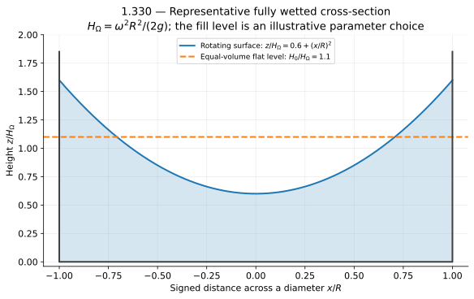

# 1.7 Hydrodynamics

[Chapter index](../README.md#chapters) · [Structured solutions](1.7.json) · [Answer audit](../audit/README.md)

## 1.315

**Problem statement**

Ideal fluid flows along a flat tube of constant cross-section, located in a horizontal plane and bent as shown in Fig. 1.80 (top view). The flow is steady. Are the pressures and velocities of the fluid equal at points 1 and 2? What is the shape of the streamlines?

**Solved · medium confidence.** Use the cross-stream pressure gradient required for curved motion, with a common Bernoulli constant for the usual irrotational inlet flow.

**Assumptions**

- Treat the flat tube as two-dimensional and the fluid as incompressible. In Fig. 1.80 point 1 is on the outer side of the bend and point 2 on the inner side.
- For the usual comparison of speed magnitudes, assume uniform irrotational flow sufficiently far upstream, so the Bernoulli constant is the same on all incoming streamlines. Inviscid steady flow alone does not specify vorticity.

Constant area fixes the mean discharge speed at successive sections, not the local speed across a bend.

$$
Q=\int_S\mathbf v\cdot d\mathbf S=\text{constant},\qquad\bar v=Q/S.
$$

A fluid element turning with curvature radius ℛ needs inward centripetal acceleration. Thus pressure increases toward the outside of a locally curved family of streamlines.

$$
\frac{\partial p}{\partial n}=\rho\frac{v^2}{\mathcal R}>0\quad\text{for outward normal }n.
$$

In the usual irrotational flow the common Bernoulli head then makes the inner stream faster: the outer point has higher static pressure.

$$
p_1>p_2,\qquad p_1+\frac12\rho v_1^2=p_2+\frac12\rho v_2^2\quad\Longrightarrow\quad v_2>v_1.
$$

Streamlines follow the tube walls, curve smoothly through the bend and crowd toward the inner corner. In a locally circular approximation the irrotational speed rises inversely with distance from the bend centre.

$$
v(r)\simeq\frac C r,\qquad\frac{dp}{dr}\simeq\rho\frac{C^2}{r^3}.
$$

**Results**

Usual outer versus inner pressure comparison

$$
p_1>p_2
$$

Point 1 is outside the bend and point 2 inside; the comparison refers to the normal pressure variation in the illustrated turn.

Speed comparison for an irrotational inlet

$$
v_2>v_1
$$

Equal pipe areas imply equal cross-sectional mean speeds, not equal local speeds.

Qualitative streamline shape

$$
\text{Curved through the bend, with tighter spacing near the inner wall}
$$

The full elbow has a rounded outside and a sharp inside; its entire streamline field is not exactly a set of concentric circular arcs.

**Limitations**

- For a general steady rotational inviscid flow, Bernoulli constants can differ between streamlines and v2>v1 cannot be deduced solely from negligible viscosity.
- No exact global streamline equation is determined by the schematic geometry and unspecified inlet profile. A sharp ideal inner corner can produce a singular potential-flow speed; a real corner or boundary layer regularizes it.

## 1.316

**Problem statement**

Two manometric tubes are mounted on a horizontal pipe of varying cross-section at the sections S_1 and S_2 (Fig. 1.81). Find the volume of water flowing across the pipe's section per unit time if the difference in water columns is equal to Δh.

**Solved · high confidence.** Combine the piezometric pressure difference with Bernoulli and continuity in a Venturi tube.

**Assumptions**

- Steady incompressible water flow is treated as one-dimensional in each measurement section, with uniform representative speed and negligible kinetic-energy correction.
- Both open manometric columns contain water and are measured from the same horizontal pipe-axis level. Fig. 1.81 has S1<S2; define Δh=h2−h1>0.

The pressure difference is the difference of hydrostatic water-column heads.

$$
p_2-p_1=\rho g\Delta h.
$$

Continuity fixes the two representative speeds in terms of the common volume flow rate.

$$
v_1=Q/S_1,\qquad v_2=Q/S_2.
$$

Because the two pipe sections have the same height, Bernoulli relates the pressure difference to their speed squares.

$$
p_2-p_1=\frac12\rho(v_1^2-v_2^2)=\frac12\rho Q^2\left(\frac1{S_1^2}-\frac1{S_2^2}\right).
$$

Eliminate density and solve for the positive volume flow rate.

$$
Q=S_1S_2\sqrt{\frac{2g\Delta h}{S_2^2-S_1^2}}.
$$

**Results**

Volume of water flowing per unit time

$$
Q=S_1S_2\sqrt{\frac{2g\Delta h}{S_2^2-S_1^2}}
$$

For S1<S2 and Δh=h2−h1. With unlabeled ordering use |S2²−S1²| and the positive head difference.

**Limitations**

- If S1=S2, the ideal model predicts Δh=0 for every flow rate, so this pressure difference cannot determine Q. Real meters need profile and contraction corrections.

## 1.317

**Problem statement**

A Pitot tube (Fig. 1.82) is mounted along the axis of a gas pipeline whose cross-sectional area is equal to S. Assuming the viscosity to be negligible, find the volume of gas flowing across the section of the pipe per unit time, if the difference in the liquid columns is equal to Δh, and the densities of the liquid and the gas are ρ_0 and ρ respectively.

**Solved · medium confidence.** Measure the local stagnation pressure with the Pitot opening, then convert it to discharge only under a uniform-velocity assumption.

**Assumptions**

- The Pitot opening faces upstream at the pipe axis as shown. Its other manometer arm measures the local static gas pressure.
- Treat gas density ρ as effectively constant, appropriate to negligible compressibility effects, and take manometric density ρ0>ρ.
- To infer Q from the axis speed, adopt the usual plug-flow approximation v_axis=mean speed; negligible viscosity alone does not guarantee this profile.

Hydrostatic balance includes the gas displaced by the unequal manometer levels, not just the heavy liquid contribution.

$$
p_{\rm stag}-p=(\rho_0-\rho)g\Delta h.
$$

Bernoulli along the incoming gas streamline gives the local axial speed from its stagnation pressure.

$$
p_{\rm stag}-p=\frac12\rho v_{\rm axis}^2,\qquad v_{\rm axis}=\sqrt{\frac{2(\rho_0-\rho)g\Delta h}{\rho}}.
$$

For a uniform velocity profile the discharge is area times this measured speed.

$$
Q=S\sqrt{2g\Delta h\left(\frac{\rho_0}{\rho}-1\right)}.
$$

If the profile is not uniform, one axis measurement is insufficient to evaluate the area integral; define a profile correction explicitly.

$$
Q=\int_Sv\,dS=C_vS v_{\rm axis},\qquad C_v=\bar v/v_{\rm axis}.
$$

**Results**

Local gas speed at the Pitot opening

$$
v_{\rm axis}=\sqrt{2g\Delta h(\rho_0/\rho-1)}
$$

Volume flow under the uniform-profile assumption

$$
Q=S\sqrt{2g\Delta h(\rho_0/\rho-1)}
$$

For a nonuniform profile multiply by Cv=mean speed/axis speed; that factor is not determined by the statement.

**Limitations**

- At appreciable gas Mach number a compressible stagnation relation and thermodynamic state are needed instead of the constant-density Bernoulli expression.

## 1.318

**Problem statement**

A wide vessel with a small hole in the bottom is filled with water and kerosene. Neglecting the viscosity, find the velocity of the water flow, if the thickness of the water layer is equal to h_1 = 30 cm and that of the kerosene layer to h_2 = 20 cm.

**Solved · high confidence.** Convert the two-layer hydrostatic pressure into the kinetic energy of water at the bottom outlet.

**Assumptions**

- The vessel is wide enough to neglect both free-surface and interface speeds. Water and kerosene are immiscible and the layer thicknesses are their instantaneous values.
- Both the top surface and outlet jet are at atmospheric pressure; the outlet is small and losses are neglected.
- Appendix Table 11 (PDF page 381, printed page 374) gives ρ_water=1000 kg/m³ and ρ_kerosene=800 kg/m³. Use g=9.81 m/s², the rounded Appendix standard-gravity convention.

The liquid layers produce an excess pressure at the bottom that includes their separate densities.

$$
p_b-p_{\rm atm}=\rho_wgh_1+\rho_kgh_2.
$$

Apply Bernoulli within the water between the nearly stationary vessel interior and the emerging jet at the same height.

$$
\frac12\rho_wv^2=\rho_wgh_1+\rho_kgh_2,\qquad v=\sqrt{2g\left(h_1+\frac{\rho_k}{\rho_w}h_2\right)}.
$$

The kerosene layer contributes an equivalent water head of 0.16 m.

$$
h_{\rm equiv}=0.30+0.80(0.20)=0.46\ \mathrm m,\qquad v=\sqrt{2(9.81)(0.46)}=3.00420\ \mathrm{m/s}.
$$

**Results**

Water outflow speed

$$
v=\sqrt{2g(h_1+\rho_kh_2/\rho_w)}\simeq3.00\ \mathrm{m/s}
$$

Uses Appendix Table 11 water and kerosene densities.

## 1.319

**Problem statement**

A wide cylindrical vessel 50 cm in height is filled with water and rests on a table. Assuming the viscosity to be negligible, find at what height from the bottom of the vessel a small hole should be perforated for the water jet coming out of it to hit the surface of the table at the maximum distance l_max from the vessel. Find l_max .

**Solved · high confidence.** Maximize the projectile range produced by the hydrostatic head above a horizontal outlet.

**Assumptions**

- The vessel base rests on the table, so a hole at height y above the base has the same height y above the landing plane.
- The small side hole ejects water horizontally and the water surface is initially H=0.50 m above the base. Treat the discharge and level as instantaneous; neglect air drag and surface motion.

Bernoulli gives the horizontal exit speed and free fall gives the time to reach the table.

$$
v(y)=\sqrt{2g(H-y)},\qquad t_f(y)=\sqrt{2y/g}.
$$

Their product is the horizontal distance from the hole to the impact point.

$$
l(y)=2\sqrt{y(H-y)},\qquad l(y)^2=4\left[\frac{H^2}{4}-\left(y-\frac H2\right)^2\right].
$$

The square is maximized when the two height intervals are equal.

$$
y_{\max}=H/2=0.25\ \mathrm m,\qquad l_{\max}=H=0.50\ \mathrm m.
$$

**Results**

Hole height above the vessel bottom

$$
y_{\max}=H/2=25\ \mathrm{cm}
$$

Maximum horizontal distance from the outlet

$$
l_{\max}=H=50\ \mathrm{cm}
$$

**Limitations**

- The result concerns the initial or instantaneous water level. As the vessel drains, the head and impact distance change; the statement gives no time-integrated target criterion.

## 1.320

**Problem statement**

A bent tube is lowered into a water stream as shown in Fig. 1.83. The velocity of the stream relative to the tube is equal to v = 2.5 m/s. The closed upper end of the tube located at the height h_0 = 12 cm has a small orifice. To what height h will the water jet spurt?

**Solved · high confidence.** Use the incoming stagnation head to supply both the outlet elevation and the jet rise.

**Assumptions**

- Fig. 1.83 measures h0 from the stream free surface to the upper orifice, and h from that orifice to the jet apex.
- The tube inlet faces the stream. The upper orifice is small enough that inlet-area and approach-speed changes are negligible; neglect losses and air resistance.
- Use g=9.81 m/s² rounded from Appendix Table 30 standard gravity 9.807 m/s² (PDF page 393, printed page 386).

The tube captures the incoming dynamic head. Hydrostatic depth of the submerged inlet cancels against its elevation term when referenced to the stream surface.

$$
\frac p\rho+gz+\frac{v_{\rm local}^2}{2}=\frac{p_{\rm atm}}\rho+\frac{v^2}{2}.
$$

At the top orifice z=h0 and static pressure is atmospheric, so its jet exit speed u satisfies the remaining head balance.

$$
\frac{u^2}{2g}=\frac{v^2}{2g}-h_0.
$$

The jet gains the additional elevation h before reaching its apex; evaluate both possible height references explicitly.

$$
h=\frac{u^2}{2g}=\frac{v^2}{2g}-h_0=\frac{(2.5)^2}{2(9.81)}-0.12=0.1985525\ \mathrm m,\qquad h+h_0=0.3185525\ \mathrm m.
$$

**Results**

Jet rise above the upper orifice

$$
h=\frac{v^2}{2g}-h_0\simeq19.9\ \mathrm{cm}
$$

Apex height above the undisturbed stream surface

$$
h+h_0=\frac{v^2}{2g}\simeq31.9\ \mathrm{cm}
$$

## 1.321

**Problem statement**

The horizontal bottom of a wide vessel with an ideal fluid has a round orifice of radius R_1 over which a round closed cylinder is mounted, whose radius R_2 > R_1 (Fig. 1.84). The clearance between the cylinder and the bottom of the vessel is very small, the fluid density is ρ. Find the static pressure of the fluid in the clearance as a function of the distance r from the axis of the orifice (and the cylinder), if the height of the fluid is equal to h.

**Solved · high confidence.** Combine radial continuity in the thin annular clearance with Bernoulli and the atmospheric free-jet condition at its inner rim.

**Assumptions**

- The clearance has uniform height δ≪R1 and is negligibly small compared with h, so radial motion can be treated at a common elevation.
- The vessel is wide, its free surface is at atmospheric pressure, and its speed is negligible.
- At r=R1 the radial layer emerges into the open hole as a thin annular free sheet at atmospheric pressure; the entire hole is not assumed filled by a uniform vertical pipe flow. Ignore edge-scale streamline curvature and vena-contracta corrections.

Radial continuity through cylindrical area 2πrδ gives an inward speed inversely proportional to radius.

$$
Q=2\pi r\delta\,v(r),\qquad v(r)=\frac C r.
$$

At the inner rim, the thin free sheet has atmospheric pressure and the reservoir head converts into its speed.

$$
p(R_1)=p_{\rm atm},\qquad\frac12\rho v(R_1)^2=\rho gh,\qquad C=R_1\sqrt{2gh}.
$$

Apply Bernoulli from the nearly stationary free surface to a point in the clearance.

$$
p(r)+\frac12\rho v(r)^2=p_{\rm atm}+\rho gh,\qquad p(r)=p_{\rm atm}+\rho gh\left(1-\frac{R_1^2}{r^2}\right).
$$

The outer cylinder radius sets the end of the radial domain, where a finite entrance speed already reduces pressure below the surrounding hydrostatic value.

$$
R_1\leq r\leq R_2,\qquad p(R_2)=p_{\rm atm}+\rho gh\left(1-\frac{R_1^2}{R_2^2}\right),\qquad Q=2\pi\delta R_1\sqrt{2gh}.
$$

**Results**

Static pressure in the radial clearance

$$
p(r)=p_{\rm atm}+\rho gh\left(1-\frac{R_1^2}{r^2}\right),\qquad R_1\leq r\leq R_2
$$

Gauge pressure

$$
p(r)-p_{\rm atm}=\rho gh\left(1-\frac{R_1^2}{r^2}\right)
$$

**Limitations**

- This is the leading thin-gap ideal-flow pressure away from the entrance and exit turning regions. A finite gap or detailed edge geometry can change local pressures near those edges.
- Imposing both exact hydrostatic pressure at r=R2 and a nonzero radial entrance speed conflicts with reservoir Bernoulli. Assuming the entire outlet hole is filled also introduces a different, unspecified downstream-flow model.

## 1.322

**Problem statement**

What work should be done in order to squeeze all water from a horizontally located cylinder (Fig. 1.85) during the time t by means of a constant force acting on the piston? The volume of water in the cylinder is equal to V, the cross-sectional area of the orifice to s, with s being considerably less than the piston area. The friction and viscosity are negligibly small.

**Solved · high confidence.** Use constant pressure to obtain a nearly steady jet, then equate piston work to the kinetic energy carried out.

**Assumptions**

- Let A denote the piston area, with s/A≪1 as stated. Neglect piston inertia and the short startup transient; use the leading quasisteady flow at nearly uniform cylinder pressure.
- Piston exterior and emerging jet are at the same atmospheric pressure, so F is the applied force in excess of atmospheric balance.
- Water density is ρ=1000 kg/m³ from Appendix Table 11 (PDF page 381, printed page 374). Keep ρ symbolic in the result.

A constant piston force gives a constant excess pressure F/A and therefore an approximately constant jet speed u. Expelling the stated volume in time t fixes that speed.

$$
Q=su=V/t,\qquad u=\frac V{st},\qquad p-p_{\rm atm}\simeq\frac12\rho u^2=\frac FA.
$$

The piston moves through distance V/A; multiply the constant force by that distance.

$$
W=F\frac VA=(p-p_{\rm atm})V\simeq\frac12\rho Vu^2=\frac{\rho V^3}{2s^2t^2}.
$$

As an independent energy check, all the expelled water has the same leading-order jet speed and total mass ρV.

$$
K_{\rm out}\simeq\frac12(\rho V)\left(\frac V{st}\right)^2=W.
$$

For an already established finite-area quasisteady flow, retaining the small piston speed v_p=su/A supplies the expected relative correction to the pressure work.

$$
\frac FA=\frac12\rho(u^2-v_p^2),\qquad W_{\rm qs}=\frac{\rho V^3}{2s^2t^2}\left(1-\frac{s^2}{A^2}\right).
$$

**Results**

Leading work required to expel all water in time t

$$
W\simeq\frac{\rho V^3}{2s^2t^2}
$$

Leading term for s≪A, negligible piston inertia and a short startup transient; ρ=1000 kg/m³ for water.

**Limitations**

- An exact startup calculation needs the piston area, piston mass and initial motion. The stated data determine the leading quasisteady work, rather than a universal finite-area transient correction.
- The finite-area expression is a steady-flow check, not an exact startup result; it includes the small kinetic energy already present in the cylinder fluid.

## 1.323

**Problem statement**

A cylindrical vessel of height h and base area S is filled with water. An orifice of area s ≪ S is opened in the bottom of the vessel. Neglecting the viscosity of water, determine how soon all the water will pour out of the vessel.

**Solved · high confidence.** Integrate the falling water-level equation using the instantaneous Torricelli discharge.

**Assumptions**

- The vessel has constant cross-sectional area S, the outlet area is s≪S, and both free surface and jet are at atmospheric pressure.
- Use ideal quasisteady outflow with no contraction or discharge loss, neglecting free-surface kinetic energy to leading order in s/S.

When the remaining water height is z, Bernoulli gives the speed at the small bottom outlet.

$$
u(z)=\sqrt{2gz},\qquad Q(z)=s\sqrt{2gz}.
$$

Conservation of volume relates this discharge to the rate of decrease of the water level.

$$
S\frac{dz}{dt}=-s\sqrt{2gz}.
$$

Integrate from the initial height h to the empty limit z=0; the decreasing speed makes the total time twice the initial-volume/initial-discharge estimate.

$$
T=\frac Ss\int_0^h\frac{dz}{\sqrt{2gz}}=\frac Ss\sqrt{\frac{2h}{g}}.
$$

The same integration gives a water-height history that satisfies both endpoint conditions.

$$
\sqrt{z(t)}=\sqrt h-\frac sS\sqrt{\frac g2}\,t,\qquad z(t)=h\left(1-\frac tT\right)^2,\quad0\leq t\leq T.
$$

**Results**

Ideal emptying time

$$
T=\frac Ss\sqrt{\frac{2h}{g}}
$$

**Limitations**

- Near the final drop, surface tension, wetting and detailed outlet geometry can dominate; the formula is the continuum ideal-fluid emptying limit.

## 1.324

**Problem statement**

A horizontally oriented tube AB of length l rotates with a constant angular velocity ω about a stationary vertical axis OO′ passing through the end A (Fig. 1.86). The tube is filled with an ideal fluid. The end A of the tube is open, the closed end B has a very small orifice. Find the velocity of the fluid relative to the tube as a function of the column “height” h.

**Solved · high confidence.** Integrate the radial pressure balance or rotating-frame Bernoulli equation between the inner free surface and the outlet.

**Assumptions**

- In Fig.1.86, h is the length of the remaining liquid column, from its inner meniscus at radius a=l−h to the outlet at radius l. It is not a vertical height.
- The outlet is much smaller than the main tube area. Neglect the slow bulk radial motion and drainage transients when computing the pressure head; both the meniscus and the emerging jet are at ambient pressure.
- The confined liquid follows the tube azimuth; the flow is radial relative to the tube and viscosity is neglected.

The effective centrifugal body force per unit mass in the rotating frame is ω²r outward. Its potential is negative and quadratic in radius.

$$
\frac{dp}{dr}=\rho\omega^2r,\qquad \Phi_{\rm cf}=-\frac12\omega^2r^2,\qquad a=l-h.
$$

Starting at the ambient-pressure inner meniscus gives the pressure immediately upstream of the small outlet.

$$
p(l)-p_{\rm atm}=\int_a^l\rho\omega^2r\,dr=\frac12\rho\omega^2(l^2-a^2).
$$

That pressure surplus becomes relative jet kinetic energy. Equivalently, rotating-frame Bernoulli has the same centrifugal potential difference.

$$
\frac{u^2}{2}=\frac{p(l)-p_{\rm atm}}\rho=\frac12\omega^2\big[l^2-(l-h)^2\big],\qquad u=|\omega|\sqrt{h(2l-h)}.
$$

The Coriolis acceleration is transverse to the radial relative velocity. Tube-wall forces supply that transverse constraint, but it makes no contribution to the relative energy balance.

$$
\mathbf u\cdot(-2\boldsymbol\omega\times\mathbf u)=0.
$$

**Results**

Efflux speed relative to the tube

$$
u(h)=|\omega|\sqrt{h(2l-h)},\qquad0\leq h\leq l
$$

The emerging flow is radially outward relative to the rotating tube.

**Limitations**

- The tiny-orifice approximation neglects the kinetic energy of the slowly moving meniscus and bulk liquid, and it assumes quasi-steady drainage and an effective jet area without contraction losses.

## 1.325

**Problem statement**

Demonstrate that in the case of a steady flow of an ideal fluid Eq. (1.7a) turns into Bernoulli equation.

**Solved · high confidence.** Project steady Euler flow along a streamline and integrate the pressure and body-force terms.

**Assumptions**

- Equation (1.7a) is ρd v/dt=f−∇p, with f the body force per unit volume and d/dt the material derivative.
- The body force per mass is conservative, f/ρ=−∇Φ. For the familiar incompressible form use constant density; the barotropic extension requires ρ to be a function of p.

A steady velocity field has no explicit time derivative, but a moving fluid element still has convective acceleration.

$$
\frac{\partial\mathbf v}{\partial t}=0,\qquad (\mathbf v\cdot\nabla)\mathbf v=-\frac1\rho\nabla p-\nabla\Phi.
$$

Use the vector identity for convective acceleration and define the barotropic pressure integral.

$$
(\mathbf v\cdot\nabla)\mathbf v=\nabla(v^2/2)-\mathbf v\times(\nabla\times\mathbf v),\qquad \mathcal H(p)=\int^p\frac{dp^{\prime}}{\rho(p^{\prime})}.
$$

Displacement along a streamline is parallel to v, so its dot product with the vorticity cross product vanishes.

$$
\nabla\big(v^2/2+\mathcal H+\Phi\big)=\mathbf v\times(\nabla\times\mathbf v),\qquad d\big(v^2/2+\mathcal H+\Phi\big)=0\quad\text{along a streamline}.
$$

For an incompressible fluid in uniform gravity, replace the pressure integral by p/ρ and the body-force potential by gz.

$$
\frac{v^2}{2}+\frac p\rho+gz=C_{\rm streamline},\qquad \frac12\rho v^2+p+\rho gz=\text{constant along a streamline}.
$$

**Results**

Incompressible Bernoulli equation

$$
\frac12\rho v^2+p+\rho gz=C_{\rm streamline}
$$

Barotropic form under conservative body forces

$$
\frac{v^2}{2}+\int^p\frac{dp^{\prime}}{\rho(p^{\prime})}+\Phi=C_{\rm streamline}
$$

**Limitations**

- Steadiness alone does not establish a single global Bernoulli constant. The simple p/ρ form is not valid for arbitrary variable-density flow, and a nonconservative body force requires its work integral.

## 1.326

**Problem statement**

On the opposite sides of a wide vertical vessel filled with water two identical holes are opened, each having the cross-sectional area S = 0.50 cm² . The height difference between them is equal to Δh = 51 cm. Find the resultant force of reaction of the water flowing out of the vessel.

**Solved · high confidence.** Subtract the opposing jet momentum fluxes using Torricelli speeds at the two depths.

**Assumptions**

- Use water density ρ=1000 kg/m³ from Appendix Table 11 (PDF381, printed374) and the rounded gravity convention g=9.81 m/s² from Appendix Table 30 standard value 9.807 m/s².
- The vessel is wide, so motion of its free surface and stored horizontal momentum are negligible in the initial quasi-steady discharge. The two effective jet areas both equal S; neglect contraction and dissipation.
- Both openings discharge horizontally to the same ambient pressure. Let the lower hole be deeper by Δh.

At depth d below the free surface, the pressure head gives the exit speed and the outward horizontal momentum flux.

$$
v^2=2gd,\qquad \dot m=\rho S v,\qquad F_{\rm jet}=\dot m v=2\rho Sgd.
$$

Opposite jet directions make their recoil forces subtract; the unknown common depth cancels.

$$
F_{\rm net}=2\rho Sg(d_{\rm lower}-d_{\rm upper})=2\rho Sg\,\Delta h.
$$

Convert the given hole area and depth difference to SI units and evaluate.

$$
S=0.50\ \mathrm{cm^2}=5.0\times10^{-5}\ \mathrm{m^2},\quad\Delta h=0.51\ \mathrm m,\quad F_{\rm net}=0.50031\ \mathrm N.
$$

**Results**

Resultant water-jet reaction on the vessel

$$
F=2\rho gS\Delta h\simeq0.50\ \mathrm N
$$

Opposite the outgoing jet at the lower hole; equivalently, toward the side containing the upper hole.

**Limitations**

- At the exact opening instant, acceleration of the initially resting fluid produces a short transient. The requested initial force uses the established discharge before the water level changes appreciably.

## 1.327

**Problem statement**

The side wall of a wide vertical cylindrical vessel of height h = 75 cm has a narrow vertical slit running all the way down to the bottom of the vessel. The length of the slit is l = 50 cm and the width b = 1.0 mm. With the slit closed, the vessel is filled with water. Find the resultant force of reaction of the water flowing out of the vessel immediately after the slit is opened.

**Solved · high confidence.** Integrate the depth-dependent horizontal momentum flux over the vertical slit.

**Assumptions**

- Use water density ρ=1000 kg/m³ from Appendix Table 11 (PDF381, printed374) and the rounded gravity convention g=9.81 m/s² from Appendix Table 30 standard value 9.807 m/s².
- The slit runs upward from the vessel bottom through length l=0.50 m, while the initial free surface is at h=0.75 m. Its width b=0.0010 m is uniform.
- Use initial quasi-steady ideal discharge with the full effective slit area, negligible contraction, and no appreciable free-surface descent.

A strip at height z above the bottom has depth h−z, area b dz and exit speed determined by its pressure head.

$$
0\leq z\leq l,\qquad v(z)^2=2g(h-z),\qquad dF=\rho v(z)^2b\,dz.
$$

All strips discharge in the same horizontal direction, so their recoil magnitudes add.

$$
F=2\rho gb\int_0^l(h-z)\,dz=\rho gb l(2h-l).
$$

Substitute the given dimensions into this integrated momentum flux.

$$
F=(1000)(9.81)(0.0010)(0.50)\big[2(0.75)-0.50\big]=4.905\ \mathrm N.
$$

**Results**

Initial slit-discharge reaction magnitude

$$
F=\rho gb l(2h-l)\simeq4.9\ \mathrm N
$$

Horizontally opposite the emerging water, normal to the slit wall.

**Limitations**

- The ideal initial discharge means after the opening transient but before substantial drainage. With a falling level or an exposed portion, the integration range and pressure head must be updated.

## 1.328

**Problem statement**

Water flows out of a big tank along a tube bent at right angles: the inside radius of the tube is equal to r = 0.50 cm (Fig. 1.87). The length of the horizontal section of the tube is equal to l = 22 cm. The water flow rate is Q = 0.50 litres per second. Find the moment of reaction forces of flowing water, acting on the tube's walls, relative to the point O.

**Solved · medium confidence.** Use the angular-momentum flux about the inlet, separating flow-induced recoil from the static weight of contained water.

**Assumptions**

- Use water density ρ=1000 kg/m³ from Appendix Table 11 (PDF381, printed374) and the rounded gravity convention g=9.81 m/s² from Appendix Table 30 standard value 9.807 m/s².
- Take O at the inlet centreline in Fig.1.87. The outlet jet is vertical downward at horizontal lever arm l. Use a uniform mean speed v=Q/A, A=πr².
- The requested reaction of the flowing water is interpreted as the flow-induced jet recoil. Gauge pressure is zero at the outlet; the inlet pressure resultant passes through O and has zero moment.
- A total wall moment including the weight of all water in the tube needs the complete tube geometry. The length of any vertical outlet leg is not supplied.

Convert radius and flow rate, then find the common tube and jet speed.

$$
A=\pi r^2=7.85398\times10^{-5}\ \mathrm{m^2},\quad Q=0.50\ \mathrm{L/s}=5.0\times10^{-4}\ \mathrm{m^3/s},\quad v=Q/A=6.36620\ \mathrm{m/s}.
$$

The incoming momentum crosses at O and carries no angular momentum about it. The downward outlet flux carries moment magnitude ρQlv, so the flow-induced reaction tends to raise the bend.

$$
M_{\rm flow}=\rho Qvl=\frac{\rho Q^2l}{\pi r^2}=0.700282\ \mathrm{N\,m}.
$$

To distinguish the complete water-on-wall moment, take positive moment to raise the elbow. Angular momentum balance includes the downward weight of the contained liquid.

$$
M_{\rm water\to wall}=\rho Qvl-\rho g\int_{\rm tube}x\,dV.
$$

The known straight horizontal column alone contributes a clockwise weight moment. Neglecting bend volume and any vertical leg gives the corresponding illustrative total.

$$
M_{g,\rm horizontal}=-\rho gA\int_0^l x\,dx=-\frac{\rho gAl^2}{2}=-0.0186455\ \mathrm{N\,m},\qquad M_{\rm flow}+M_{g,\rm horizontal}=0.681636\ \mathrm{N\,m}.
$$

**Results**

Flow-induced reaction moment about O

$$
M_{\rm flow}=\frac{\rho Q^2l}{\pi r^2}\simeq0.700\ \mathrm{N\,m}
$$

Its sense tends to lift the outer bend, opposite the angular momentum carried away by the downward jet.

Known horizontal-column weight contribution if included

$$
M_{g,\rm horizontal}=-\frac{\rho g\pi r^2l^2}{2}\simeq-0.01865\ \mathrm{N\,m}
$$

This is a separate static gravity load. A finite vertical leg adds another gravity moment and its length is unspecified.

Total for a horizontal-column-only volume idealization

$$
M_{\rm total,horizontal}=\frac{\rho Q^2l}{\pi r^2}-\frac{\rho g\pi r^2l^2}{2}\simeq0.6816\ \mathrm{N\,m}
$$

Includes the known horizontal water weight but neglects bend volume and any vertical-leg volume.

**Limitations**

- The term reaction of flowing water can mean jet recoil alone or the complete load on the walls. The first is uniquely determined here; the second also contains gravity moments from tube volumes not fully dimensioned in the figure.

## 1.329

**Problem statement**

A side wall of a wide open tank is provided with a narrowing tube (Fig. 1.88) through which water flows out. The cross-sectional area of the tube decreases from S = 3.0 cm² to s = 1.0 cm² . The water level in the tank is h = 4.6 m higher than that in the tube. Neglecting the viscosity of the water, find the horizontal component of the force tending to pull the tube out of the tank.

**Solved · high confidence.** Combine Bernoulli pressure at the inlet section with the nozzle control-volume momentum balance.

**Assumptions**

- Use water density ρ=1000 kg/m³ from Appendix Table 11 (PDF381, printed374) and the rounded gravity convention g=9.81 m/s² from Appendix Table 30 standard value 9.807 m/s².
- The tank is open and wide, the nozzle is horizontal, and the inlet and outlet sections have uniform mean speeds. The outlet is at ambient pressure.
- Use gauge pressures so the common ambient pressure on all exposed surfaces is removed consistently. Neglect viscosity, contraction and entrance losses.

Bernoulli from the nearly stationary free surface to the exit fixes the jet speed; continuity then fixes the inlet-section speed.

$$
v_2=\sqrt{2gh},\qquad Q=sv_2=Sv_1,\qquad v_1=\frac{s}{S}v_2.
$$

The pressure at the inlet section is below the static tank pressure by its kinetic term. Bernoulli between the two nozzle sections gives that gauge pressure.

$$
p_{1,g}=\frac12\rho(v_2^2-v_1^2)=\rho gh\left(1-\frac{s^2}{S^2}\right).
$$

Let F denote the outward force of the water on the tube. The opposite tube-on-water force enters horizontal momentum balance.

$$
p_{1,g}S-F=\rho Q(v_2-v_1),\qquad F=p_{1,g}S-\rho Q(v_2-v_1).
$$

Eliminate the speeds using continuity; this produces a positive outward pulling force.

$$
F=\frac12\rho S(v_2-v_1)^2=\rho gh\frac{(S-s)^2}{S}.
$$

Convert the cross-sectional areas to square metres and substitute the data.

$$
S=3.0\times10^{-4}\ \mathrm{m^2},\quad s=1.0\times10^{-4}\ \mathrm{m^2},\qquad F=6.0168\ \mathrm N.
$$

**Results**

Horizontal outward force tending to pull the tube from the tank

$$
F=\rho gh\frac{(S-s)^2}{S}\simeq6.0\ \mathrm N
$$

Along the emerging jet direction, outward from the tank.

**Limitations**

- The result refers to the tube-wall load with the specified inlet and exit sections; additional attachment geometry or dissipative losses are outside the ideal nozzle model.

## 1.330

**Problem statement**

A cylindrical vessel with water is rotated about its vertical axis with a constant angular velocity ω. Find: (a) the shape of the free surface of the water; (b) the water pressure distribution over the bottom of the vessel along its radius provided the pressure at the central point is equal to p_0.

**Solved · high confidence.** Integrate pressure equilibrium in the frame of rigidly rotating liquid.

**Assumptions**

- Use water density ρ=1000 kg/m³ from Appendix Table 11 (PDF381, printed374) and the rounded gravity convention g=9.81 m/s² from Appendix Table 30 standard value 9.807 m/s².
- Assume the water has reached steady rigid-body rotation with the vessel, vφ=ωr. Real viscosity can entrain the water during spin-up; the final pressure balance neglects viscous stresses.
- Take the horizontal bottom as z=0 and use absolute or gauge pressure consistently. The centre and the region under consideration remain wetted.

In the rotating frame the liquid is at rest and pressure balances centrifugal acceleration and gravity.

$$
\frac{\partial p}{\partial r}=\rho\omega^2r,\qquad \frac{\partial p}{\partial z}=-\rho g.
$$

Use the specified central bottom pressure p0 to integrate both gradients.

$$
p(r,z)=p_0+\frac12\rho\omega^2r^2-\rho gz.
$$

Atmospheric pressure is constant on the free surface, so its height grows quadratically with radius.

$$
z_s(r)=z_s(0)+\frac{\omega^2r^2}{2g},\qquad z_s(0)=\frac{p_0-p_{\rm atm}}{\rho g}\quad\text{if }p_0\text{ is absolute}.
$$

At the horizontal bottom, set z=0 to obtain the radial pressure distribution.

$$
p_b(r)=p_0+\frac12\rho\omega^2r^2.
$$

**Results**

Free-surface shape

$$
z_s(r)=z_s(0)+\frac{\omega^2r^2}{2g}
$$

A circular paraboloid of revolution; the total water volume fixes its vertical offset.

Pressure on the bottom

$$
p_b(r)=p_0+\frac12\rho\omega^2r^2
$$

**Limitations**

- An exactly inviscid fluid initially at rest would not acquire angular momentum merely from a perfectly axisymmetric rotating wall. Co-rotation is an assumed established state, not a consequence of the static pressure equation alone.
- Overflow or a dry central bottom requires additional geometric and volume information and is excluded.

## 1.331

**Problem statement**

A thin horizontal disc of radius R = 10 cm is located within a cylindrical cavity filled with oil whose viscosity η = 0.08 P (Fig. 1.89). The clearance between the disc and the horizontal planes of the cavity is equal to h = 1.0 mm. Find the power developed by the viscous forces acting on the disc when it rotates with the angular velocity ω = 60 rad/s. The end effects are to be neglected.

**Solved · high confidence.** Integrate viscous Couette shear torque over both faces of the rotating disc.

**Assumptions**

- Appendix Table 28 (PDF389, printed382) gives 1 Pa·s=10 P, hence the specified viscosity is η=0.08 P=0.008 Pa·s. No assumed oil-property lookup is needed.
- The cavity walls are stationary and no slip holds at the disc and walls. Use the narrow-gap, laminar linear-shear model in each clearance h=0.0010 m; neglect edge effects and secondary circulation.
- The upper and lower clearances are both h as shown in Fig.1.89; R=0.100 m and ω=60 rad/s.

At radius r the disc speed is ωr, so each gap has tangential velocity gradient ωr/h and shear traction opposite the motion.

$$
\tau(r)=\eta\frac{\omega r}{h},\qquad dS=2\pi r\,dr.
$$

The shear force acts with lever arm r. Adding the equal contributions from both faces gives the total resisting torque.

$$
N_{\rm visc}=-2\int_0^R\tau(r)r(2\pi r\,dr)=-\frac{\pi\eta\omega R^4}{h}.
$$

The power of these forces on the rotating disc is torque times angular velocity and is negative.

$$
P_{\rm visc}=N_{\rm visc}\omega=-\frac{\pi\eta\omega^2R^4}{h}.
$$

Substitution gives the viscous power loss; the motor must supply its positive magnitude to maintain constant speed.

$$
N_{\rm visc}=-0.150796\ \mathrm{N\,m},\qquad P_{\rm visc}=-9.04779\ \mathrm W.
$$

**Results**

Power of viscous forces acting on the disc

$$
P_{\rm visc}=-\frac{\pi\eta\omega^2R^4}{h}\simeq-9.05\ \mathrm W
$$

Positive dissipation rate and required steady driving power

$$
\dot Q_{\rm heat}=P_{\rm drive}=\frac{\pi\eta\omega^2R^4}{h}\simeq9.05\ \mathrm W
$$

**Limitations**

- This is the elementary linear-shear model. Strong secondary flows, inertia-modified gap profiles or turbulence would require a fuller viscous-flow calculation.

## 1.332

**Problem statement**

A long cylinder of radius R_1 is displaced along its axis with a constant velocity v_0 inside a stationary co-axial cylinder of radius R_2 . The space between the cylinders is filled with viscous liquid. Find the velocity of the liquid as a function of the distance r from the axis of the cylinders. The flow is laminar.

**Solved · medium confidence.** Solve the axial viscous stress balance in an annulus with no slip on its translating inner and stationary outer surfaces.

**Assumptions**

- Use a Newtonian incompressible liquid in steady, fully developed, axisymmetric parallel flow; end effects are neglected. The axial velocity is v(r).
- For the conventional Couette answer assume no imposed effective axial pressure gradient or axial body-force driving. If the cylinder axis is vertical, gravity must be included in the modified pressure before imposing this condition.

For zero effective axial pressure gradient, the axial momentum equation says that r times the radial velocity gradient is constant.

$$
\frac1r\frac{d}{dr}\left(r\frac{dv}{dr}\right)=0,\qquad v(r)=A\ln r+B.
$$

No slip fixes the liquid velocity at both coaxial cylindrical surfaces.

$$
v(R_1)=v_0,\quad v(R_2)=0\quad\Longrightarrow\quad v(r)=v_0\frac{\ln(R_2/r)}{\ln(R_2/R_1)}.
$$

The omitted axial pressure condition matters: an independent annular Poiseuille component can be superposed. Define G as the net axial pressure-plus-body-force driving per volume.

$$
0=G+\eta\frac1r(r v^{\prime})^{\prime},\qquad v_G(r)=\frac{G}{4\eta}\left[R_2^2-r^2-\frac{R_2^2-R_1^2}{\ln(R_2/R_1)}\ln\frac{R_2}{r}\right].
$$

The displayed conventional result is the member G=0 of this general boundary-value family.

$$
v_{\rm general}(r)=v_0\frac{\ln(R_2/r)}{\ln(R_2/R_1)}+v_G(r),\qquad R_1\le r\le R_2.
$$

**Results**

Axial liquid velocity without additional pressure driving

$$
v(r)=v_0\frac{\ln(R_2/r)}{\ln(R_2/R_1)},\qquad R_1\le r\le R_2
$$

Additional velocity if an effective axial pressure gradient is imposed

$$
v_G(r)=\frac{G}{4\eta}\left[R_2^2-r^2-\frac{R_2^2-R_1^2}{\ln(R_2/R_1)}\ln\frac{R_2}{r}\right]
$$

G=−dp/dz for a horizontal axis; an axial body force is added to G if present. Add this to the Couette profile.

**Limitations**

- A finite sealed annulus or a specified axial flux can generate a nonzero pressure gradient. The statement does not give end conditions or net flux, so the conventional zero-gradient branch is an explicit assumption.

## 1.333

**Problem statement**

A fluid with viscosity η fills the space between two long co-axial cylinders of radii R_1 and R_2 , with R_1 < R_2 . The inner cylinder is stationary while the outer one is rotated with a constant angular velocity ω_2 . The fluid flow is laminar. Taking into account that the friction force acting on a unit area of a cylindrical surface of radius r is defined by the formula $\sigma=\eta r(\partial\omega/\partial r)$, find: (a) the angular velocity of the rotating fluid as a function of radius r; (b) the moment of the friction forces acting on a unit length of the outer cylinder.

**Solved · high confidence.** Use constant transmitted torque across coaxial cylindrical layers to determine angular velocity and the reaction torque on the outer cylinder.

**Assumptions**

- The Newtonian liquid has steady axisymmetric azimuthal flow with no radial or axial motion. No slip applies and end effects are negligible.
- Take the positive rotation direction along the outer-cylinder angular velocity ω2. Part (b) asks for the torque exerted by the liquid on that cylinder, which opposes its motion.

At radius r, the shear stress ηr dω/dr acts over a cylindrical area 2πr per unit axial length, with moment arm r. Steady angular momentum balance makes this torque independent of r.

$$
\mathcal N=2\pi\eta r^3\frac{d\omega}{dr}=\text{constant},\qquad\omega(r)=A+\frac B{r^2}.
$$

Apply zero angular velocity at R1 and the specified angular velocity at R2.

$$
\omega(R_1)=0,\quad\omega(R_2)=\omega_2\quad\Longrightarrow\quad\omega(r)=\omega_2\frac{R_2^2}{R_2^2-R_1^2}\left(1-\frac{R_1^2}{r^2}\right).
$$

Differentiate the profile and use the stress formula supplied in the problem.

$$
\sigma(r)=\eta r\omega^{\prime}(r)=\frac{2\eta\omega_2R_1^2R_2^2}{(R_2^2-R_1^2)r^2},\qquad |\mathcal N|=\frac{4\pi\eta|\omega_2|R_1^2R_2^2}{R_2^2-R_1^2}.
$$

The rotating wall applies the driving torque to the fluid; the liquid applies the opposite friction torque to the wall.

$$
\frac{\mathbf N_{\rm fluid\to outer}}{L}=-\frac{4\pi\eta R_1^2R_2^2}{R_2^2-R_1^2}\,\boldsymbol\omega_2.
$$

**Results**

Angular velocity of the liquid

$$
\omega(r)=\omega_2\frac{R_2^2(r^2-R_1^2)}{r^2(R_2^2-R_1^2)}
$$

Friction torque on one unit length of the outer cylinder

$$
\frac{\mathbf N}{L}=-\frac{4\pi\eta R_1^2R_2^2}{R_2^2-R_1^2}\,\boldsymbol\omega_2
$$

The magnitude is the positive coefficient times |ω2|; its direction opposes the outer-cylinder rotation.

## 1.334

**Problem statement**

A tube of length l and radius R carries a steady flow of fluid whose density is ρ and viscosity η. The fluid flow velocity depends on the distance r from the axis of the tube as $v=v_0(1-r^2/R^2)$. Find: (a) the volume of the fluid flowing across the section of the tube per unit time; (b) the kinetic energy of the fluid within the tube’s volume; (c) the friction force exerted on the tube by the fluid; (d) the pressure difference at the ends of the tube.

**Solved · medium confidence.** Integrate the given parabolic profile and use its wall shear and the axial force balance.

**Assumptions**

- The tube is straight, circular and of constant radius. Flow is steady, incompressible, fully developed and Newtonian. Its orientation is not specified: let z_in and z_out denote the vertical elevations of its ends.
- v0 is the centre-line speed; the positive axial direction is the flow direction. The tube is stationary and no slip holds at r=R.

Integrate velocity over concentric area elements to obtain volume flow and the mean speed.

$$
Q=2\pi\int_0^R v_0\left(1-\frac{r^2}{R^2}\right)r\,dr=\frac{\pi R^2v_0}{2},\qquad\bar v=v_0/2.
$$

The total kinetic energy contains the average of the square speed, not the square of the average speed.

$$
K=\frac12\rho l\int_Sv^2\,dS=\pi\rho l v_0^2\int_0^R\left(1-\frac{r^2}{R^2}\right)^2r\,dr=\frac{\pi\rho lR^2v_0^2}{6}.
$$

Differentiate the profile at the wall and multiply the shear stress by the wetted surface area.

$$
\tau_w=\eta\left|\frac{dv}{dr}\right|_{r=R}=\frac{2\eta v_0}{R},\qquad F_{\rm fluid\to tube}=\tau_w(2\pi Rl)=4\pi\eta lv_0.
$$

Include both pressure and the component of gravity along the tube in the steady axial force balance. Friction fixes the piezometric pressure drop regardless of orientation.

$$
[(p_{\rm in}+\rho gz_{\rm in})-(p_{\rm out}+\rho gz_{\rm out})]\pi R^2=F,\qquad \Delta\Pi=\frac{4\eta lv_0}{R^2}.
$$

Separate the hydrostatic elevation contribution to obtain the actual pressure difference; the familiar friction-only expression is the horizontal special case.

$$
p_{\rm in}-p_{\rm out}=\frac{4\eta lv_0}{R^2}+\rho g(z_{\rm out}-z_{\rm in}),\qquad z_{\rm out}=z_{\rm in}:\quad\Delta p=\frac{4\eta lv_0}{R^2}.
$$

**Results**

Volume flow per unit time

$$
Q=\frac{\pi R^2v_0}{2}
$$

Kinetic energy in the tube

$$
K=\frac{\pi\rho lR^2v_0^2}{6}
$$

Friction force exerted by the liquid on the tube

$$
F=4\pi\eta lv_0
$$

Along the flow; the force on the liquid is opposite.

Upstream-minus-downstream pressure difference for a general orientation

$$
p_{\rm in}-p_{\rm out}=\frac{4\eta lv_0}{R^2}+\rho g(z_{\rm out}-z_{\rm in})
$$

Equivalently, the piezometric pressure drop Δ(p+ρgz)=4ηlv0/R². If the pipe is horizontal, its pressure drop is the first term alone.

**Limitations**

- The section velocity profile alone fixes the effective pressure-plus-gravity driving, not the actual endpoint pressure difference unless the endpoint elevations are known.

## 1.335

**Problem statement**

In the arrangement shown in Fig. 1.90 a viscous liquid whose density is ρ = 1.0 g/cm³ flows along a tube out of a wide tank A. Find the velocity of the liquid flow, if h_1 = 10 cm, h_2 = 20 cm, and h_3 = 35 cm. All the distances l are equal.

**Solved · medium confidence.** Read the linear piezometric pressure drop from equal tube segments, then separate the remaining tank head from friction head.

**Assumptions**

- The pipe is horizontal and of constant cross-section. The tank surface and the standpipes are open to atmosphere, and tank-surface speed is negligible. The pressure decrease per equal pipe segment is treated as constant.
- Fig.1.90 places h2 at x=l, h1 at x=2l and the atmospheric outlet at x=3l. The given density is ρ=1.0g/cm³=1000kg/m³.
- The conventional numerical answer uses a one-dimensional Bernoulli velocity with kinetic-energy coefficient α=1 and no additional entrance loss. More general profile/entrance assumptions are separated below.
- Use g=9.81m/s², rounded from Appendix Table30 value9.807m/s².

The two pressure taps measure static pressure heads. Their difference is the head loss over one length l.

$$
\frac{p(l)}{\rho g}=h_2,\qquad\frac{p(2l)}{\rho g}=h_1,\qquad\frac{\Delta p_l}{\rho g}=h_2-h_1=0.10\ \mathrm m.
$$

Extrapolate one equal segment upstream to obtain the pipe inlet static head, then subtract it from the tank-surface elevation.

$$
h_0=2h_2-h_1=0.30\ \mathrm m,\qquad H=h_3-h_0=h_3-2h_2+h_1=0.05\ \mathrm m.
$$

In the conventional uniform-velocity entrance model, the remaining head is the velocity head.

$$
\frac{v^2}{2g}=H\quad\Longrightarrow\quad v=\sqrt{2g(h_3-2h_2+h_1)}=0.990454\ \mathrm{m/s}.
$$

An actual section-mean velocity depends on kinetic-energy flux and any entrance loss. Write the entrance-loss coefficient as Ke, referred to the mean speed.

$$
H=(\alpha+K_e)\frac{\bar v^2}{2g},\qquad\bar v=\sqrt{\frac{2gH}{\alpha+K_e}}.
$$

For a fully developed parabolic profile α is two. With no additional entrance loss this gives a different mean speed, illustrating the role of the modeling convention.

$$
\alpha=\frac{\int_Sv^3\,dS}{S\bar v^3}=2,\qquad K_e=0:\quad\bar v=\sqrt{gH}=0.700357\ \mathrm{m/s}.
$$

**Results**

Conventional velocity-head answer

$$
v=\sqrt{2g(h_3-2h_2+h_1)}\simeq0.990\ \mathrm{m/s}
$$

This is the one-dimensional α=1, no-additional-entrance-loss interpretation.

Section-mean speed for a parabolic profile with no extra entrance loss

$$
\bar v=\sqrt{g(h_3-2h_2+h_1)}\simeq0.700\ \mathrm{m/s}
$$

Mean speed with explicit profile and entrance-loss coefficients

$$
\bar v=\sqrt{\frac{2g(h_3-2h_2+h_1)}{\alpha+K_e}}
$$

**Limitations**

- The diagram does not specify the entrance geometry or velocity profile. A unique exact section-mean speed cannot be inferred without a kinetic-energy coefficient and entrance-loss model. The conventional and parabolic-model answers are explicitly distinguished.

## 1.336

**Problem statement**

The cross-sectional radius of a pipeline decreases gradually as $r=r_0e^{-\alpha x}$, where α = 0.50 m⁻¹ , x is the distance from the pipeline inlet. Find the ratio of Reynolds numbers for two cross-sections separated by Δx = 3.2 m.

**Solved · high confidence.** Combine incompressible continuity with the local Reynolds number based on tube diameter.

**Assumptions**

- The density and dynamic viscosity are constant, and the steady volume flow is the same through every cross-section. Use the section-mean speed and diameter2r in the Reynolds number.

Continuity fixes how the mean speed changes as the pipe radius decreases exponentially.

$$
Q=\pi r(x)^2\bar v(x)=\text{constant},\qquad r(x)=r_0e^{-\alpha x}\quad\Longrightarrow\quad\bar v(x)=\bar v(0)e^{2\alpha x}.
$$

Only one of the two radius powers cancels in the Reynolds number; its growth therefore has exponent αx.

$$
\operatorname{Re}(x)=\frac{2\rho\bar v(x)r(x)}{\eta}=\operatorname{Re}(0)e^{\alpha x}.
$$

Take the downstream section a distance Δx beyond the upstream one and insert the given numbers.

$$
\frac{\operatorname{Re}(x+\Delta x)}{\operatorname{Re}(x)}=e^{\alpha\Delta x}=e^{0.50(3.2)}=4.95303.
$$

**Results**

Downstream-to-upstream Reynolds-number ratio

$$
\frac{\operatorname{Re}_{\rm downstream}}{\operatorname{Re}_{\rm upstream}}=e^{\alpha\Delta x}\simeq4.95
$$

The inverse ratio is e^−1.6≈0.201897 if the section order is reversed.

## 1.337

**Problem statement**

When a sphere of radius r_1 = 1.2 mm moves in glycerin, the laminar flow is observed if the velocity of the sphere does not exceed v_1 = 23 cm/s. At what minimum velocity v_2 of a sphere of radius r_2 = 5.5 cm will the flow in water become turbulent? The viscosities of glycerin and water are equal to η_1 = 13.9 P and η_2 = 0.011 P respectively.

**Solved · medium confidence.** Transfer the stated empirical transition condition by equating Reynolds numbers for geometrically similar spheres.

**Assumptions**

- Use the same critical Reynolds number and the same characteristic-length convention for both spheres. This is the similarity assumption required to infer a water threshold from the glycerin observation.
- Appendix Table11 gives glycerin density1.26g/cm³=1260kg/m³ and water density1.00g/cm³=1000kg/m³.
- Appendix Table28 gives1Pa·s=10P, so the specified viscosities becomeη1=1.39Pa·s andη2=0.0011Pa·s. Radii are r1=0.0012m,r2=0.055m and v1=0.23m/s.

Apply the same sphere-diameter Reynolds number to the two boundary velocities.

$$
\operatorname{Re}_c=\frac{\rho_1v_1(2r_1)}{\eta_1}=\frac{\rho_2v_2(2r_2)}{\eta_2}.
$$

Solve for the water velocity; the factor two cancels because the same length convention is used.

$$
v_2=v_1\frac{\eta_2\rho_1r_1}{\eta_1\rho_2r_2}.
$$

Evaluate the critical Reynolds number implied by the observation, then the inferred water velocity.

$$
\operatorname{Re}_c=0.500374,\qquad v_2=5.00374\times10^{-6}\ \mathrm{m/s}=5.00374\ \mathrm{\mu m/s}.
$$

**Results**

Threshold velocity transferred by Reynolds-number similarity

$$
v_2=v_1\frac{\eta_2\rho_1r_1}{\eta_1\rho_2r_2}\simeq5.00\times10^{-6}\ \mathrm{m/s}
$$

Critical Reynolds number implied by the supplied glycerin datum

$$
\operatorname{Re}_c\simeq0.5004
$$

**Limitations**

- The result transfers the problem’s empirical flow-regime criterion. It does not establish a universal onset of turbulence near Re=0.5; flow-regime labels and critical values must be interpreted consistently with the stated observation.

## 1.338

**Problem statement**

A lead sphere is steadily sinking in glycerin whose viscosity is equal to η = 13.9 P. What is the maximum diameter of the sphere at which the flow around that sphere still remains laminar? It is known that the transition to the turbulent flow corresponds to Reynolds number Re = 0.5. (Here the characteristic length is taken to be the sphere diameter.)

**Solved · medium confidence.** Combine buoyancy-corrected terminal Stokes settling with the specified diameter-based Reynolds criterion.

**Assumptions**

- Treat the lead sphere as isolated in a large quiescent Newtonian glycerin bath. Use steady Stokes drag3πηdv, neglect wall effects and assume no slip.
- Appendix Table11 givesρPb=11300kg/m³ andρg=1260kg/m³; Table28 convertsη=13.9P to1.39Pa·s. Use g=9.81m/s², rounded from Table30.
- Use the problem’s stated transition value Rec=0.5 with characteristic length equal to the sphere diameter.

At terminal speed the apparent weight is balanced by viscous drag.

$$
\frac\pi6d^3(\rho_{\rm Pb}-\rho_g)g=3\pi\eta d v_t,\qquad v_t=\frac{(\rho_{\rm Pb}-\rho_g)gd^2}{18\eta}.
$$

Substitute terminal speed into the diameter-based Reynolds number; it increases as diameter cubed.

$$
\operatorname{Re}=\frac{\rho_gv_td}{\eta}=\frac{\rho_g(\rho_{\rm Pb}-\rho_g)gd^3}{18\eta^2}.
$$

The largest admissible diameter reaches the supplied criterion with equality.

$$
d_{\max}=\left[\frac{18\eta^2\operatorname{Re}_c}{\rho_g(\rho_{\rm Pb}-\rho_g)g}\right]^{1/3}=5.19397\times10^{-3}\ \mathrm m.
$$

Use the calculated diameter to check both terminal speed and Reynolds number numerically.

$$
v_t=0.106198\ \mathrm{m/s},\qquad\frac{(1260)(0.106198)(0.00519397)}{1.39}\simeq0.500.
$$

**Results**

Maximum diameter in the stipulated Stokes/critical-Re model

$$
d_{\max}=\left[\frac{18\eta^2\operatorname{Re}_c}{\rho_g(\rho_{\rm Pb}-\rho_g)g}\right]^{1/3}\simeq5.19\ \mathrm{mm}
$$

Terminal speed at that diameter

$$
v_t\simeq0.106\ \mathrm{m/s}
$$

**Limitations**

- Stokes drag is asymptotically justified for Re≪1, while the supplied boundary Re=0.5 is finite. Thus the numerical diameter is a leading Stokes estimate under the problem’s criterion, not an exact finite-Re transition prediction.

## 1.339

**Problem statement**

A steel ball of diameter d = 3.0 mm starts sinking with zero initial velocity in olive oil whose viscosity is η = 0.90 P. How soon after the beginning of motion will the velocity of the ball differ from the steady-state velocity by n = 1.0%?

**Solved · medium confidence.** Solve the linear Stokes-drag relaxation equation and impose the specified relative distance from terminal speed.

**Assumptions**

- Use a quasisteady Stokes drag model for an isolated steel sphere in a quiescent, unbounded Newtonian liquid. Neglect added fluid mass, hydrodynamic history, wall effects and nonlinear drag corrections.
- Appendix Table11 gives steel densityρs=7800kg/m³. Table28 convertsη=0.90P to0.090Pa·s. The ball diameter is d=0.0030m.
- The oil density is not supplied or tabulated in Table11; retain it asρo<ρs. Its value is unnecessary for the relative relaxation time in the stated model.

Write the buoyancy-corrected weight and the viscous drag coefficient, retaining the actual sphere mass in the acceleration term.

$$
m_s\dot v=(\rho_s-\rho_o)Vg-kv,\qquad m_s=\rho_s\frac{\pi d^3}{6},\quad V=\frac{\pi d^3}{6},\quad k=3\pi\eta d.
$$

The terminal speed depends on oil density, while the exponential time constant depends only on sphere mass and the linear drag coefficient.

$$
v_\infty=\frac{(\rho_s-\rho_o)gd^2}{18\eta},\qquad\tau=\frac{m_s}{k}=\frac{\rho_sd^2}{18\eta}.
$$

Starting from rest gives an exponentially decreasing fractional velocity deficit.

$$
v(t)=v_\infty(1-e^{-t/\tau}),\qquad\frac{v_\infty-v(t)}{v_\infty}=e^{-t/\tau}.
$$

Set that fractional deficit to n/100 with n=1.0 and evaluate the elapsed time.

$$
t=\tau\ln\frac{100}{n},\quad\tau=\frac{(7800)(0.0030)^2}{18(0.090)}=0.0433333\ \mathrm s,\quad t=\tau\ln100=0.199557\ \mathrm s.
$$

**Results**

Time to reach99% of terminal speed in the Stokes relaxation model

$$
t=\frac{\rho_sd^2}{18\eta}\ln\frac{100}{n}\simeq0.200\ \mathrm s
$$

Linear-drag relaxation time

$$
\tau=\frac{\rho_sd^2}{18\eta}=0.0433333\ \mathrm s
$$

**Limitations**

- A sphere accelerating through liquid generally also experiences added-mass and hydrodynamic-history forces, and finite Reynolds number changes the drag law. These effects are not included in the elementary exponential model.
- Without the oil density, the terminal Reynolds number cannot be checked numerically from the supplied data. The quoted time is conditional on the stated Stokes relaxation approximation.
