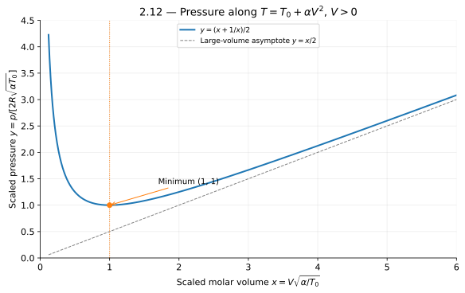

# 2.1 Equation of the Gas State. Processes

[Chapter index](../README.md#chapters) · [Structured solutions](2.1.json) · [Answer audit](../audit/README.md)

## 2.1

**Problem statement**

A vessel of volume V = 30 l contains ideal gas at the temperature 0 °C. After a portion of the gas has been let out, the pressure in the vessel decreased by Δp = 0.78 atm (the temperature remaining constant). Find the mass of the released gas. The gas density under the normal conditions ρ = 1.3 g/l.

**Solved · high confidence.** Relate the removed amount of ideal gas to the pressure change at fixed volume and temperature.

**Assumptions**

- Interpret normal conditions as 0°C and pressure p_n=1 atm, consistent with the supplied density reference. The vessel temperature equals that reference temperature.
- The vessel volume is fixed, the released gas is the same species throughout and both initial and final states obey the ideal-gas law.

At fixed V and T, the pressure decrement is proportional to the mass removed.

$$
\Delta p\,V=\frac{\Delta m}{M}RT.
$$

The supplied normal density eliminates the unknown molar mass and gas constant.

$$
\rho_n=\frac{p_nM}{RT_n},\qquad\Delta m=\rho_nV\frac{\Delta p}{p_n}\frac{T_n}{T}=\rho_nV\frac{\Delta p}{p_n}.
$$

Use the litre and gram units directly; the pressure unit cancels in its ratio.

$$
\Delta m=(1.3\ \mathrm{g/l})(30\ \mathrm l)\frac{0.78\ \mathrm{atm}}{1\ \mathrm{atm}}=30.42\ \mathrm g=0.03042\ \mathrm{kg}.
$$

**Results**

Mass of released gas

$$
\Delta m=\rho_nV\frac{\Delta p}{p_n}=30.42\ \mathrm g\simeq30\ \mathrm g
$$

## 2.2

**Problem statement**

Two identical vessels are connected by a tube with a valve letting the gas pass from one vessel into the other if the pressure difference Δp ≥ 1.10 atm. Initially there was a vacuum in one vessel while the other contained ideal gas at a temperature t_1 = 27 °C and pressure p_1 = 1.00 atm. Then both vessels were heated to a temperature t_2 = 107 °C. Up to what value will the pressure in the first vessel (which had vacuum initially) increase?

**Solved · high confidence.** Combine conservation of the total gas amount with the valve’s limiting pressure difference.

**Assumptions**

- The two vessels have equal fixed volumes and ultimately share the stated final temperature. Use T=t_C+273.15 K.
- Treat the valve as an ideal one-way threshold valve: it remains closed below p_B−p_A=δ and transfers gas from the initially filled vessel B to the initially empty vessel A until the pressure difference reaches δ=1.10 atm. Ignore hysteresis and finite-flow transients.

If the valve stayed closed, the filled vessel pressure would scale with absolute temperature. Check whether the final heated pressure reaches the opening threshold.

$$
T_1=300.15\ \mathrm K,\qquad T_2=380.15\ \mathrm K,\qquad p_{B,\rm closed}=p_1\frac{T_2}{T_1}=1.2665334\ \mathrm{atm}>\delta.
$$

The gas amount is conserved. Because vessel volumes and final temperatures are equal, the final pressure sum is fixed.

$$
p_A+p_B=p_1\frac{T_2}{T_1}.
$$

At the end of threshold-regulated transfer the pressure difference equals the valve setting. Solve the sum and difference.

$$
p_B-p_A=\delta,\qquad p_A=\frac12\left(p_1\frac{T_2}{T_1}-\delta\right)=0.08326670\ \mathrm{atm}.
$$

The initially empty vessel therefore remains well below the valve threshold itself: the threshold refers to the difference of pressures, not its own absolute pressure.

$$
p_A=8.43492\ \mathrm{kPa},\qquad p_B=1.1832667\ \mathrm{atm}.
$$

**Results**

Final pressure in the initially empty vessel

$$
p_A=\frac12[p_1T_2/T_1-\delta]\simeq0.0833\ \mathrm{atm}
$$

Same receiving-vessel pressure in SI

$$
p_A\simeq8.43\times10^3\ \mathrm{Pa}
$$

Uses Appendix Table 28 rounded conversion 1 atm=101.3 kPa.

**Limitations**

- An actual valve with hysteresis, leakage or insufficient equilibration time can give a different final pressure difference. The result uses the ideal threshold interpretation in the statement.

## 2.3

**Problem statement**

A vessel of volume V = 20 l contains a mixture of hydrogen and helium at a temperature t = 20 °C and pressure p = 2.0 atm. The mass of the mixture is equal to m = 5.0 g. Find the ratio of the mass of hydrogen to that of helium in the given mixture.

**Solved · high confidence.** Determine total moles from the gas law and solve the two-component mass balance.

**Assumptions**

- The gases are ideal and nonreacting, so their mole numbers add and the pressure is the total mixture pressure.
- Consult Appendix Table 15 first: molecular hydrogen M_H2=2.0 g/mol and helium M_He=4.0 g/mol. Table 30 gives R=8.314 J/(mol K); Table 28 gives 1 atm=101.3 kPa. Use T=20+273.15=293.15 K.

The vessel data determine the total amount, independently of the unknown composition.

$$
\nu=\frac{pV}{RT}=\frac{(2.0)(101300)(0.020)}{(8.314)(293.15)}=1.66253010\ \mathrm{mol}.
$$

Write conservation of total mass and the additive mole count.

$$
m_H+m_{He}=m,\qquad\frac{m_H}{M_H}+\frac{m_{He}}{M_{He}}=\nu.
$$

Eliminate the component masses to obtain the general mass ratio.

$$
\frac{m_H}{m_{He}}=\frac{M_H(M_{He}\nu-m)}{M_{He}(m-M_H\nu)}.
$$

Using grams with molar masses in g/mol gives the individual masses and requested ratio.

$$
m_H=(4\nu-5)\ \mathrm g=1.65012042\ \mathrm g,\qquad m_{He}=3.34987958\ \mathrm g,\qquad m_H/m_{He}=0.492590965.
$$

**Results**

Hydrogen-to-helium mass ratio

$$
\frac{m_H}{m_{He}}=\frac{M_H(M_{He}\nu-m)}{M_{He}(m-M_H\nu)}\simeq0.49
$$

## 2.4

**Problem statement**

A vessel contains a mixture of nitrogen (m_1 = 7.0 g) and carbon dioxide (m_2 = 11 g) at a temperature T = 290 K and pressure p_0 = 1.0 atm. Find the density of this mixture, assuming the gases to be ideal.

**Solved · high confidence.** Add the component mole numbers, determine the mixture volume and divide its total mass by that volume.

**Assumptions**

- The mixture is ideal, nonreacting and at a common equilibrium temperature.
- Appendix Table 15 gives M_N2=28 g/mol and M_CO2=44 g/mol; Table 30 gives R=8.314 J/(mol K), and Table 28 gives 1 atm=101.3 kPa.

The stated masses correspond to equal amounts of the two gases.

$$
\nu_1=\frac{7.0}{28}=0.25\ \mathrm{mol},\qquad\nu_2=\frac{11}{44}=0.25\ \mathrm{mol},\qquad\nu=0.50\ \mathrm{mol}.
$$

The total mass is 18 g; its ratio to total moles is the mixture molar mass.

$$
m=0.018\ \mathrm{kg},\qquad\bar M=m/\nu=0.036\ \mathrm{kg/mol}.
$$

Use the mixture equation of state to eliminate the unknown vessel volume.

$$
V=\frac{\nu RT}{p_0},\qquad\rho=\frac mV=\frac{p_0\bar M}{RT}=\frac{(101300)(0.036)}{(8.314)(290)}=1.51252976\ \mathrm{kg/m^3}.
$$

**Results**

Mixture mass density

$$
\rho=\frac{p_0(m_1+m_2)}{RT(m_1/M_1+m_2/M_2)}\simeq1.51\ \mathrm{kg/m^3}
$$

## 2.5

**Problem statement**

A vessel of volume V = 7.5 l contains a mixture of ideal gases at a temperature T = 300 K: ν_1 = 0.10 mole of oxygen, ν_2 = 0.20 mole of nitrogen, and ν_3 = 0.30 mole of carbon dioxide. Assuming the gases to be ideal, find: (a) the pressure of the mixture; (b) the mean molar mass M of the given mixture which enters its equation of state pV = (m/M) RT, where m is the mass of the mixture.

**Solved · high confidence.** Use Dalton’s mole addition for total pressure and a mole-weighted molar mass.

**Assumptions**

- Each gas is ideal, the mixture is nonreacting and all components share volume V=0.0075 m³ and temperature 300 K.
- Appendix Table 15 gives M_O2=32 g/mol, M_N2=28 g/mol and M_CO2=44 g/mol. Appendix Table 30 gives R=8.314 J/(mol K).

Total pressure depends on the total mole number, rather than any individual gas’s molar mass.

$$
\nu=\nu_1+\nu_2+\nu_3=0.60\ \mathrm{mol},\qquad p=\frac{\nu RT}{V}=\frac{(0.60)(8.314)(300)}{0.0075}=199536\ \mathrm{Pa}.
$$

The total mixture mass is the sum of each amount times its molar mass.

$$
m=\sum_i\nu_iM_i=(0.10)(32)+(0.20)(28)+(0.30)(44)=22.0\ \mathrm g.
$$

Comparing pV=νRT with pV=(m/M)RT identifies the requested effective molar mass.

$$
\bar M=\frac m\nu=\frac{\sum_i\nu_iM_i}{\sum_i\nu_i}=\frac{22.0}{0.60}=36.6667\ \mathrm{g/mol}.
$$

**Results**

Mixture pressure

$$
p=\frac{RT}{V}\sum_i\nu_i=1.99536\times10^5\ \mathrm{Pa}
$$

Mean molar mass in the mixture equation of state

$$
\bar M=\frac{\sum_i\nu_iM_i}{\sum_i\nu_i}=36.6667\ \mathrm{g/mol}
$$

Stored SI value is 0.0366667 kg/mol.

## 2.6

**Problem statement**

A vertical cylinder closed from both ends is equipped with an easily moving piston dividing the volume into two parts, each containing one mole of air. In equilibrium at T_0 = 300 K the volume of the upper part is η = 4.0 times greater than that of the lower part. At what temperature will the ratio of these volumes be equal to η′ = 3.0?

**Solved · high confidence.** Eliminate the piston weight by comparing pressure-balance equations at the two volume ratios.

**Assumptions**

- The piston is frictionless, has fixed cross-sectional area A and fixed mass, and no gas leaks between its sides. The total gas volume V_c is constant.
- Both one-mole samples reach the same final temperature T. Ratios η=V_upper/V_lower exceed one because the lower pressure must support the piston weight.

The two one-mole gases obey their separate equations of state, while the piston weight fixes their pressure difference.

$$
p_l=RT/V_l,\qquad p_u=RT/V_u,\qquad p_l-p_u=mg/A=\text{constant}.
$$

At volume ratio q=Vu/Vl, express each volume in terms of the fixed total volume.

$$
V_l=\frac{V_c}{1+q},\qquad V_u=\frac{qV_c}{1+q},\qquad p_l-p_u=\frac{RT}{V_c}\left(q-\frac1q\right).
$$

The same piston weight applies initially and finally, so temperature times the indicated ratio function is constant.

$$
T_0\left(\eta-\eta^{-1}\right)=T\left(\eta^{\prime}-\eta^{\prime-1}\right),\qquad T=T_0\frac{\eta-1/\eta}{\eta^{\prime}-1/\eta^{\prime}}.
$$

Insert the given ratios and initial absolute temperature.

$$
T=300\frac{4-1/4}{3-1/3}=421.875\ \mathrm K\simeq422\ \mathrm K.
$$

**Results**

Temperature for upper/lower volume ratio 3.0

$$
T=T_0\frac{\eta-1/\eta}{\eta^{\prime}-1/\eta^{\prime}}=421.875\ \mathrm K
$$

**Limitations**

- For a positive-mass piston and equal amounts at one temperature, the upper/lower ratio must exceed one. Equality is approached only in the infinite-temperature limit in this fixed-volume model.

## 2.7

**Problem statement**

A vessel of volume V is evacuated by means of a piston air pump. One piston stroke captures the volume ΔV. How many strokes are needed to reduce the pressure in the vessel η times? The process is assumed to be isothermal, and the gas ideal.

**Solved · high confidence.** Apply isothermal expansion into the pump intake volume once per suction stroke.

**Assumptions**

- Each suction stroke opens an initially empty pump volume ΔV to the vessel, lets gas equilibrate isothermally, then isolates and expels the pump contents without returning gas to the vessel.
- The pump has ideal valves and no residual clearance volume, and the vessel volume V is fixed. Count complete intake strokes; take η≥1 and ΔV>0.

During a suction stroke the same amount of gas expands from volume V into total volume V+ΔV.

$$
p_{k+1}(V+\Delta V)=p_kV,\qquad p_{k+1}=\frac{p_k}{1+\Delta V/V}.
$$

Expelling the isolated pump contents does not change the vessel pressure. Repeating the same pressure-reduction factor yields a geometric law.

$$
p_N=p_0\left(\frac{V}{V+\Delta V}\right)^N.
$$

Set pN=p0/η to obtain the ideal real-valued stroke count, and round upward if only whole strokes are allowed.

$$
N_*=\frac{\ln\eta}{\ln(1+\Delta V/V)},\qquad N_{\rm full}=\left\lceil\frac{\ln\eta}{\ln(1+\Delta V/V)}\right\rceil.
$$

The common continuum approximation applies when one intake volume is small compared with the vessel.

$$
\Delta V\ll V:\qquad N_*\simeq\frac{V}{\Delta V}\ln\eta.
$$

**Results**

Ideal real-valued count for an exact factor η

$$
N_*=\frac{\ln\eta}{\ln(1+\Delta V/V)}
$$

Minimum number of complete strokes for a reduction by at least η

$$
N_{\rm full}=\left\lceil\frac{\ln\eta}{\ln(1+\Delta V/V)}\right\rceil
$$

**Limitations**

- An exact pressure factor need not occur after an integer number of whole strokes. The ceiling gives at least the requested reduction; a partial final stroke would be needed for exact equality.
- Pump dead volume or a nonzero exhaust/backflow pressure changes the recurrence and can impose an ultimate pressure.

## 2.8

**Problem statement**

Find the pressure of air in a vessel being evacuated as a function of evacuation time t. The vessel volume is V, the initial pressure is p_0 . The process is assumed to be isothermal, and the evacuation rate equal to C and independent of pressure. Note. The evacuation rate is the gas volume being evacuated per unit time, with that volume being measured under the gas pressure attained by that moment.

**Solved · high confidence.** Balance the vessel mole loss against the pumping speed measured at the instantaneous vessel pressure.

**Assumptions**

- The vessel volume and gas temperature are constant, with ideal gas and no leaks, incoming gas or pump ultimate-pressure offset.
- The stated pumping speed C is volume removed per unit time referred to the instantaneous vessel pressure, not volume at a fixed reference pressure.

The amount of gas within the vessel is pV/(RT), while a small intake volume Cdt at the same pressure removes pCdt/(RT).

$$
\nu=\frac{pV}{RT},\qquad d\nu=-\frac{pC}{RT}\,dt.
$$

Cancel the constant factors and solve the resulting linear pressure-decay equation.

$$
V\,dp=-Cp\,dt,\qquad\frac{dp}{p}=-\frac CVdt,\qquad\ln\frac{p(t)}{p_0}=-\frac{Ct}{V}.
$$

The evacuation time constant is volume divided by pumping speed.

$$
p(t)=p_0e^{-Ct/V},\qquad\tau=V/C.
$$

**Results**

Pressure as a function of evacuation time

$$
p(t)=p_0\exp(-Ct/V),\qquad t\geq0
$$

**Limitations**

- A pumping rate quoted as volume per time at a fixed external reference pressure would imply a different gas-removal law.

## 2.9

**Problem statement**

A chamber of volume V = 87 l is evacuated by a pump whose evacuation rate (see Note to the foregoing problem) equals C = 10 l/s. How soon will the pressure in the chamber decrease by η = 1000 times?

**Solved · high confidence.** Use the exponential pressure law for constant pumping speed at the instantaneous pressure.

**Assumptions**

- Use the pumping-speed definition of Problem 2.8, with constant vessel volume and temperature, ideal gas and no leakage or ultimate-pressure floor.
- The volume and pumping-speed litre units cancel in V/C.

The pressure ratio fixes the elapsed number of pump time constants.

$$
\frac{p(t)}{p_0}=e^{-Ct/V}=\frac1\eta\quad\Longrightarrow\quad t=\frac VC\ln\eta.
$$

Insert the chamber volume, pumping speed and reduction factor.

$$
t=\frac{87\ \mathrm l}{10\ \mathrm{l/s}}\ln1000=(8.7\ \mathrm s)(6.90775528)=60.09747\ \mathrm s.
$$

**Results**

Time for a thousandfold pressure reduction

$$
t=\frac VC\ln\eta\simeq60.1\ \mathrm s
$$

## 2.10

**Problem statement**

A smooth vertical tube having two different sections is open from both ends and equipped with two pistons of different areas (Fig. 2.1). Each piston slides within a respective tube section. One mole of ideal gas is enclosed between the pistons tied with a non-stretchable thread. The cross-sectional area of the upper piston is ΔS = 10 cm² greater than that of the lower one. The combined mass of the two pistons is equal to m = 5.0 kg. The outside air pressure is p_0 = 1.0 atm. By how many kelvins must the gas between the pistons be heated to shift the pistons through l = 5.0 cm?

**Solved · high confidence.** Add the forces on the tied piston pair, then use the constant-pressure gas law for the volume change.

**Assumptions**

- The motion is quasistatic; both pistons remain in their respective uniform tube sections and the taut thread keeps their separation fixed.
- Neglect gas weight, piston friction and thermal expansion of the tube. The uniform gas pressure acts on upper area Su and lower area Sl, with Su−Sl=Delta S.
- Use Appendix R=8.314 J/(mol K), the book rounded 1 atm=101300 Pa and g=9.81 m/s².

Thread forces cancel when the two piston force balances are added. Upward gas force exceeds the downward atmospheric resultant by the total piston weight.

$$
p(S_u-S_l)-p_0(S_u-S_l)-mg=0,\qquad p=p_0+\frac{mg}{\Delta S}.
$$

This pressure is independent of piston position. Moving both pistons upward by l increases the enclosed volume by the difference of the swept volumes.

$$
\Delta V=(S_u-S_l)l=\Delta S\,l,\qquad R\Delta T=p\Delta V\quad(\nu=1\ \mathrm{mol}).
$$

Combine and substitute areas and lengths in SI units.

$$
\Delta T=\frac{(p_0\Delta S+mg)l}{R}=\frac{[(101300)(10^{-3})+(5.0)(9.81)](0.050)}{8.314}=0.904198\ \mathrm K.
$$

**Results**

Temperature increase

$$
\Delta T=\frac{(p_0\Delta S+mg)l}{R}\simeq0.90\ \mathrm K
$$

**Limitations**

- The result applies while the thread is taut and neither piston reaches the step or tube end.

## 2.11

**Problem statement**

Find the maximum attainable temperature of ideal gas in each of the following processes: (a) p = p_0 − αV² ; (b) p = p_0e^(-βV) , where p_0, α and β are positive constants, and V is the volume of one mole of gas.

**Solved · high confidence.** Maximize the one-mole temperature T(V)=p(V)V/R on each positive-pressure branch.

**Assumptions**

- V is the volume of one mole of ideal gas; all specified constants are positive, and only V>0 with p>0 is physical.

For the quadratic pressure law, differentiate the temperature. The physical interval ends when pressure vanishes.

$$
T_a(V)=\frac{p_0V-\alpha V^3}{R},\quad 0<V<\sqrt{p_0/\alpha};\qquad \frac{dT_a}{dV}=\frac{p_0-3\alpha V^2}{R}.
$$

The unique stationary point is a maximum: the second derivative is negative and temperature vanishes at both ends of the branch.

$$
V_a^*=\sqrt{\frac{p_0}{3\alpha}},\quad p_a^*=\frac{2p_0}{3},\qquad T_{a,\max}=\frac{2p_0}{3R}\sqrt{\frac{p_0}{3\alpha}}.
$$

For the exponential law, the product V exp(−beta V) vanishes at zero and at infinity and has only one stationary point.

$$
T_b(V)=\frac{p_0}{R}Ve^{-\beta V},\qquad \frac{dT_b}{dV}=\frac{p_0}{R}e^{-\beta V}(1-\beta V).
$$

Evaluate at that stationary volume.

$$
V_b^*=\frac1\beta,\quad p_b^*=\frac{p_0}{e},\qquad T_{b,\max}=\frac{p_0}{e\beta R}.
$$

**Results**

Maximum temperature for p=p0−alpha V²

$$
T_{\max}=\frac{2p_0}{3R}\sqrt{\frac{p_0}{3\alpha}},\qquad V^*=\sqrt{\frac{p_0}{3\alpha}}
$$

Maximum temperature for p=p0 exp(−beta V)

$$
T_{\max}=\frac{p_0}{e\beta R},\qquad V^*=\frac1\beta
$$

## 2.12

**Problem statement**

Find the minimum attainable pressure of ideal gas in the process T = T_0 + αV² , where T_0 and α are positive constants, and V is the volume of one mole of gas. Draw the approximate p vs V plot of this process.

**Solved · high confidence.** Insert the given temperature law into the one-mole ideal-gas equation and minimize the resulting pressure.

**Assumptions**

- T0>0, alpha>0 and V>0. V is the volume of one mole of ideal gas.

Separate the inverse-volume and linear-volume pressure contributions.

$$
p(V)=\frac{RT(V)}V=R\left(\frac{T_0}{V}+\alpha V\right).
$$

The derivative vanishes at one positive volume; the second derivative is everywhere positive.

$$
\frac{dp}{dV}=R\left(\alpha-\frac{T_0}{V^2}\right)=0\ \Longrightarrow\ V_* =\sqrt{\frac{T_0}{\alpha}},\qquad\frac{d^2p}{dV^2}=\frac{2RT_0}{V^3}>0.
$$

Evaluate the minimum and the corresponding temperature.

$$
p_{\min}=2R\sqrt{\alpha T_0},\qquad T(V_*)=2T_0.
$$

Use dimensionless axes to specify the requested curve independently of the positive constants.

$$
x=V/V_*,\quad y=p/p_{\min}:\qquad y=\frac12\left(x+\frac1x\right),\quad x>0.\qquad y\sim\frac1{2x}\ (x\to0^+),\quad y\sim\frac x2\ (x\to\infty).
$$

**Results**

Minimum pressure

$$
p_{\min}=2R\sqrt{\alpha T_0},\qquad V_* =\sqrt{T_0/\alpha}
$$

Dimensionless pressure–volume curve

$$
\frac p{p_{\min}}=\frac12\left(\frac V{V_*}+\frac{V_*}V\right)
$$

The curve falls from infinity to (V/V*,p/pmin)=(1,1), then rises without bound; it is strictly convex and approaches p=R alpha V from above at large volume.

## 2.13

**Problem statement**

A tall cylindrical vessel with gaseous nitrogen is located in a uniform gravitational field in which the free-fall acceleration is equal to g. The temperature of the nitrogen varies along the height h so that its density is the same throughout the volume. Find the temperature gradient dT/dh.

**Solved · high confidence.** Combine hydrostatic pressure balance with the ideal-gas equation at constant density.

**Assumptions**

- Height h increases upward and the gas is treated as ideal and hydrostatic in a uniform downward gravitational field.
- The nitrogen composition and density rho are independent of height. Appendix Table15 gives molar mass M=0.028 kg/mol; use R=8.314 and g=9.81 m/s² for the optional numerical gradient.

At fixed density, differentiating the ideal-gas equation links the pressure and temperature gradients.

$$
p=\frac{\rho R}{M}T,\qquad\frac{dp}{dh}=\frac{\rho R}{M}\frac{dT}{dh}.
$$

Hydrostatic pressure falls by the weight density per unit height. Cancel the common density.

$$
\frac{dp}{dh}=-\rho g\quad\Longrightarrow\quad\frac{dT}{dh}=-\frac{Mg}{R}.
$$

Insert the nitrogen molar mass if an Earth-gravity value is wanted.

$$
\frac{dT}{dh}=-\frac{(0.028)(9.81)}{8.314}=-0.0330382\ \mathrm{K/m}\simeq-33.0\ \mathrm{K/km}.
$$

**Results**

Required upward temperature gradient

$$
\frac{dT}{dh}=-\frac{Mg}{R}\simeq-0.0330\ \mathrm{K/m}\quad(g=9.81\ \mathrm{m/s^2})
$$

**Limitations**

- This is the required maintained hydrostatic profile, over heights for which T remains positive. A freely convecting gas need not maintain this steep temperature gradient.

## 2.14

**Problem statement**

Suppose the pressure p and the density ρ of air are related as p/ρⁿ = const regardless of height (n is a constant here). Find the corresponding temperature gradient.

**Solved · high confidence.** Differentiate the polytropic relation and eliminate the density gradient using hydrostatic balance.

**Assumptions**

- Use a uniform downward field g and upward height h. Air is ideal with constant molar mass M; the positive coefficient in p=K rho^n is independent of height.
- For the numerical coefficient use Appendix air M=0.029 kg/mol, R=8.314 and g=9.81 m/s².

For n nonzero, take the differential of the prescribed pressure-density relation.

$$
p=K\rho^n,\qquad\frac{dp}{p}=n\frac{d\rho}{\rho},\qquad\frac{dp}{dh}=-\rho g.
$$

Differentiate T=Mp/(R rho), substitute the relation between differentials, and then hydrostatic balance.

$$
dT=\frac{M}{R}\left(\frac{dp}{\rho}-\frac{p\,d\rho}{\rho^2}\right)=\frac{M}{R}\frac{n-1}{n}\frac{dp}{\rho}\quad\Longrightarrow\quad\frac{dT}{dh}=-\frac{n-1}{n}\frac{Mg}{R}.
$$

The isothermal case n=1 is allowed directly. The excluded n=0 case would prescribe spatially constant pressure, inconsistent with the weight of a nonvacuum gas when g is nonzero.

$$
n=1:\quad\frac{dT}{dh}=0;\qquad n=0:\quad\frac{dp}{dh}=0\ne-\rho g\quad(\rho>0,\ g>0).
$$

With the tabulated molar mass the result can be expressed as a numerical lapse-rate coefficient.

$$
\frac{dT}{dh}=-0.0342182\frac{n-1}{n}\ \mathrm{K/m}=-34.2182\frac{n-1}{n}\ \mathrm{K/km}.
$$

**Results**

Temperature gradient for n nonzero

$$
\frac{dT}{dh}=-\frac{n-1}{n}\frac{Mg}{R}
$$

Case n=1

$$
\frac{dT}{dh}=0
$$

Case n=0

$$
\text{No nonvacuum hydrostatic solution for }g>0
$$

A constant pressure cannot balance the nonzero gas weight.

**Limitations**

- The profile applies only where pressure, density and absolute temperature stay positive. It is a hydrostatic relation, not a guarantee of convective stability.

## 2.15

**Problem statement**

Let us assume that air is under standard conditions close to the Earth's surface. Presuming that the temperature and the molar mass of air are independent of height, find the air pressure at the height 5.0 km over the surface and in a mine at the depth 5.0 km below the surface.

**Solved · high confidence.** Integrate the hydrostatic equation for an isothermal ideal atmosphere above and below the reference level.

**Assumptions**

- Interpret the book standard conditions explicitly as T0=0°C=273.15 K and p0=1 book atmosphere=101300 Pa at h=0. The conversion T[K]=t[°C]+273.15 is a stated convention.
- Air is ideal with height-independent molar mass M=0.029 kg/mol and temperature. Use uniform g=9.81 m/s² over the specified ±5.0 km; neglect gas flow.

Eliminate density in hydrostatic balance using the ideal-gas equation.

$$
\frac{dp}{dh}=-\rho g=-\frac{Mg}{RT_0}p,\qquad \frac{dp}{p}=-\frac{dh}{H},\qquad H=\frac{RT_0}{Mg}.
$$

Integrate with the stated surface pressure and evaluate the scale height.

$$
p(h)=p_0e^{-h/H},\qquad H=\frac{(8.314)(273.15)}{(0.029)(9.81)}=7982.5973\ \mathrm m.
$$

A positive height lowers the pressure, while mine depth is a negative height.

$$
p(+5000\ \mathrm m)=p_0e^{-5000/H}=0.534533p_0=54.1482\ \mathrm{kPa},\qquad p(-5000\ \mathrm m)=p_0e^{5000/H}=1.87079p_0=189.511\ \mathrm{kPa}.
$$

**Results**

Pressure 5.0 km above the surface

$$
p(+5.0\ \mathrm{km})=p_0e^{-Mg(5000)/(RT_0)}\simeq54.1\ \mathrm{kPa}
$$

Pressure at 5.0 km mine depth

$$
p(-5.0\ \mathrm{km})=p_0e^{Mg(5000)/(RT_0)}\simeq190\ \mathrm{kPa}
$$

**Limitations**

- These are values in the specified isothermal ideal-atmosphere model. Actual atmospheric temperature and mine ventilation are outside that model.

## 2.16

**Problem statement**

Assuming the temperature and the molar mass of air, as well as the free-fall acceleration, to be independent of the height, find the difference in heights at which the air densities at the temperature 0 °C differ (a) e times; (b) by η = 1.0%.

**Solved · high confidence.** Use the exponential isothermal density law and express each required density ratio as a logarithm.

**Assumptions**

- Temperature is 0°C=273.15 K, with height-independent air M=0.029 kg/mol and g=9.81 m/s². Air is ideal.
- Let h2>h1 so rho1>rho2. In part(b), the primary exact convention is (rho1−rho2)/rho1=eta=0.010; also give the other common percentage denominator explicitly.

At constant temperature density is proportional to pressure, so the barometric scale height is also the density scale height.

$$
\rho(h)=\rho(h_1)e^{-(h-h_1)/H},\quad H=\frac{RT}{Mg}=7982.5973\ \mathrm m,\qquad \Delta h=H\ln\frac{\rho_1}{\rho_2}.
$$

An e-fold density difference is exactly one scale height.

$$
\rho_1/\rho_2=e\quad\Longrightarrow\quad\Delta h_a=H=7.98260\ \mathrm{km}.
$$

A one-percent decrease relative to the denser lower-level air gives rho2=(1−eta)rho1.

$$
\Delta h_b=-H\ln(1-\eta)=80.2278\ \mathrm m\simeq\eta H=79.8260\ \mathrm m.
$$

If the percent is instead relative to the less dense upper-level air, the exact ratio is 1+eta. Both conventions agree at the accuracy of the leading small-percentage estimate.

$$
\frac{\rho_1-\rho_2}{\rho_2}=\eta\quad\Longrightarrow\quad\Delta h_{b,\mathrm{alt}}=H\ln(1+\eta)=79.4295\ \mathrm m,\qquad\Delta h_b\simeq80\ \mathrm m\ \text{in either convention}.
$$

**Results**

Height separation for an e-fold density ratio

$$
\Delta h=\frac{RT}{Mg}\simeq7.98\ \mathrm{km}
$$

Height separation for a 1% decrease relative to lower-level density

$$
\Delta h=-\frac{RT}{Mg}\ln(1-\eta)\simeq80.2\ \mathrm m
$$

Exact result with percentage relative to upper-level density

$$
\Delta h=\frac{RT}{Mg}\ln(1+\eta)\simeq79.4\ \mathrm m
$$

Leading small-percentage estimate independent of convention

$$
\Delta h\simeq\eta\frac{RT}{Mg}\simeq79.8\ \mathrm m
$$

**Limitations**

- The scan does not name the percentage denominator. The primary convention and the alternate exact value are both retained rather than assigning an unstated unique precise value.

## 2.17

**Problem statement**

An ideal gas of molar mass M is contained in a tall vertical cylindrical vessel whose base area is S and height h. The temperature of the gas is T, its pressure on the bottom base is p_0 . Assuming the temperature and the free-fall acceleration g to be independent of the height, find the mass of gas in the vessel.

**Solved · high confidence.** Integrate the isothermal barometric density profile, or equivalently use the pressure difference to weigh the gas.

**Assumptions**

- Height z is measured upward from the bottom. The vessel has uniform area S and height h, and the gas is ideal at uniform absolute temperature T in a uniform field g.
- The bottom pressure p0 is absolute. M is the gas molar mass, and gas self-gravity is neglected.

Solve hydrostatic balance and the ideal-gas equation with the given bottom pressure.

$$
\frac{dp}{dz}=-\frac{Mg}{RT}p,\qquad p(z)=p_0e^{-z/H},\quad \rho(z)=\frac{Mp_0}{RT}e^{-z/H},\quad H=\frac{RT}{Mg}.
$$

Integrate density over the full cylindrical volume.

$$
m=S\int_0^h\rho(z)\,dz=\frac{SMp_0}{RT}H\left(1-e^{-h/H}\right)=\frac{Sp_0}{g}\left(1-e^{-Mgh/(RT)}\right).
$$

The same result follows by equating the gas weight to the bottom-minus-top pressure force.

$$
mg=S[p(0)-p(h)]=Sp_0\left(1-e^{-Mgh/(RT)}\right).
$$

**Results**

Total gas mass

$$
m=\frac{Sp_0}{g}\left[1-\exp\left(-\frac{Mgh}{RT}\right)\right]
$$

## 2.18

**Problem statement**

An ideal gas of molar mass M is contained in a very tall vertical cylindrical vessel in the uniform gravitational field in which the free-fall acceleration equals g. Assuming the gas temperature to be the same and equal to T, find the height at which the centre of gravity of the gas is located.

**Solved · high confidence.** Use the isothermal barometric density profile and integrate its first height moment.

**Assumptions**

- Set h=0 at the vessel bottom, with constant positive T, molar mass M and uniform gravity g. The cylinder has constant cross-sectional area S.
- Interpret very tall as a height L much greater than the scale height ell=RT/(Mg), so that the upper truncation is negligible. The exact finite-height formula is also given.
- The gas is ideal and in static equilibrium. No missing numerical material inputs are needed; all parameters remain symbolic.

Combine hydrostatic balance with the ideal-gas density to obtain the exponentially decreasing density.

$$
\frac{dp}{dh}=-\rho g,\qquad\rho=\frac{Mp}{RT},\qquad\ell=\frac{RT}{Mg},\qquad\rho(h)=\rho(0)e^{-h/\ell}.
$$

With constant cross section, the centre-of-gravity height is a ratio of density-weighted integrals. For a semi-infinite column both converge.

$$
h_{\rm cg}=\frac{\int_0^\infty h\rho(h)S\,dh}{\int_0^\infty\rho(h)S\,dh}=\frac{\ell^2}{\ell}=\ell=\frac{RT}{Mg}.
$$

If the cylinder instead has a specified finite height L, evaluate the truncated integrals before taking the tall-vessel limit.

$$
h_{\rm cg}(L)=\frac{\ell^2[1-(1+L/\ell)e^{-L/\ell}]}{\ell(1-e^{-L/\ell})}=\ell-\frac{L}{e^{L/\ell}-1}.
$$

**Results**

Centre-of-gravity height above the bottom for a very tall vessel

$$
h_{\rm cg}\simeq\frac{RT}{Mg}\qquad(L\gg RT/(Mg))
$$

Exact height if the vessel height is finite

$$
h_{\rm cg}(L)=\frac{RT}{Mg}-\frac{L}{\exp(MgL/(RT))-1}
$$

**Limitations**

- The simple result ell is the tall-column limit, not the exact result for every vessel called tall. A finite-height numerical correction needs L.

## 2.19

**Problem statement**

An ideal gas of molar mass M is located in the uniform gravitational field in which the free-fall acceleration is equal to g. Find the gas pressure as a function of height h, if p = p_0 at h = 0, and the temperature varies with height as (a) T = T_0 (1 — ah); (b) T = T_0 (1 + ah), where a is a positive constant.

**Solved · high confidence.** Integrate the hydrostatic equation with the prescribed height-dependent temperature.

**Assumptions**

- The ideal gas is in static equilibrium in uniform gravity, with fixed molar mass M. The specified T(h) is maintained and positive in the region considered.
- Use h increasing upward and p(0)=p0. Define lambda=Mg/(RT0) and a>0; both lambda and a have dimensions of inverse length.

Use the local ideal-gas relation to remove density from hydrostatic balance.

$$
\frac{dp}{dh}=-\frac{Mg}{RT(h)}p,\qquad\ln\frac{p(h)}{p_0}=-\frac{Mg}{R}\int_0^h\frac{dz}{T(z)}.
$$

For the decreasing temperature profile, the integral of 1/(1−az) is a negative logarithm.

$$
T(h)=T_0(1-ah):\qquad\ln\frac p{p_0}=\frac{\lambda}{a}\ln(1-ah),\qquad p(h)=p_0(1-ah)^{Mg/(aRT_0)},\quad h<1/a.
$$

For the increasing temperature profile, the integral has the opposite logarithmic sign.

$$
T(h)=T_0(1+ah):\qquad\ln\frac p{p_0}=-\frac{\lambda}{a}\ln(1+ah),\qquad p(h)=p_0(1+ah)^{-Mg/(aRT_0)},\quad h>-1/a.
$$

**Results**

Pressure for T=T0(1−ah)

$$
p(h)=p_0(1-ah)^{Mg/(aRT_0)},\qquad T(h)>0
$$

Pressure for T=T0(1+ah)

$$
p(h)=p_0(1+ah)^{-Mg/(aRT_0)},\qquad T(h)>0
$$

**Limitations**

- For case (a) the imposed law reaches zero temperature at h=1/a; the ideal-gas hydrostatic model must not be extended through or above that point.

## 2.20

**Problem statement**

A horizontal cylinder closed from one end is rotated with a constant angular velocity ω about a vertical axis passing through the open end of the cylinder. The outside air pressure is equal to p_0 , the temperature to T, and the molar mass of air to M. Find the air pressure as a function of the distance r from the rotation axis. The molar mass is assumed to be independent of r.

**Solved · high confidence.** Balance the radial pressure gradient against centrifugal force in the rotating frame.

**Assumptions**

- The air has reached steady co-rotation with the tube and is isothermal at the stated absolute temperature T. The open end at the rotation axis imposes p(0)=p0.
- Treat air as an ideal gas with the stated uniform molar mass M; centrifugal separation of different species is excluded by the problem.
- Use a narrow horizontal cylinder, so pressure variation across its section and vertical gravitational variation may be neglected relative to the axial radial variation. The motion is nonrelativistic.

A stationary gas element in the rotating frame experiences an outward centrifugal body force per volume. Its inward pressure force balances it.

$$
\frac{dp}{dr}=\rho\omega^2r,\qquad\rho=\frac{Mp}{RT}.
$$

Separate variables and integrate from the open end to radial position r.

$$
\int_{p_0}^{p(r)}\frac{dp}{p}=\frac{M\omega^2}{RT}\int_0^r r^{\prime}\,dr^{\prime}=\frac{M\omega^2r^2}{2RT}.
$$

Exponentiation gives the pressure rise toward the closed outer end.

$$
p(r)=p_0\exp\!\left(\frac{M\omega^2r^2}{2RT}\right).
$$

**Results**

Pressure at distance r from the rotation axis

$$
p(r)=p_0\exp\!\left(\frac{M\omega^2r^2}{2RT}\right)
$$

**Limitations**

- The result describes the established equilibrium, after transient flows have ceased. The cylinder walls must be able to sustain the calculated outer pressure.

## 2.21

**Problem statement**

Under what pressure will carbon dioxide have the density ρ = 500 g/l at the temperature T = 300 K? Carry out the calculations both for an ideal and for a Van der Waals gas.

**Solved · high confidence.** Convert density to molar volume and evaluate the ideal and van der Waals equations at the same temperature and density.

**Assumptions**

- Appendix Table15 supplies CO2 molar mass M=.044 kg/mol and van der Waals constants a=3.62 atm·L²/mol², b=.043 L/mol.
- Use the printed SI gas constant R=8.314 J/(mol K) from Appendix30. Convert pressure with Appendix28’s printed 1 atm=101.3 kPa: a=.366706 Pa·m^6/mol² and b=4.30e−5 m³/mol.
- The density500 g/L equals500 kg/m³. Both predictions refer to the same T=300 K and molar volume; they are alternative equations of state, not two different amounts or densities.
- The explicit book-rounded atmosphere conversion .1013 Pa·m^6 per atm·L² is used rather than the digitized column metadata’s exact-atmosphere multiplier .101325.

The supplied density and molar mass determine the molar volume.

$$
V_m=\frac M\rho=\frac{0.044}{500}\ {\rm m^3/mol}=8.80\times10^{-5}\ {\rm m^3/mol}=0.0880\ {\rm L/mol}>b.
$$

The ideal gas pressure follows directly from RT per molar volume.

$$
p_{\rm id}=\frac{RT}{V_m}=\frac{8.314\times300}{8.80\times10^{-5}}\ {\rm Pa}=2.83431818\times10^7\ {\rm Pa}.
$$

For the same molar volume, excluded volume raises the first term while attraction subtracts the second term.

$$
p_{\rm vdW}=\frac{RT}{V_m-b}-\frac a{V_m^2}=\frac{2494.2}{4.50\times10^{-5}}-\frac{0.366706}{(8.80\times10^{-5})^2}\ {\rm Pa}=8.07310262\times10^6\ {\rm Pa}.
$$

The evaluated homogeneous van der Waals state lies on a mechanically stable branch; its isothermal pressure derivative is negative.

$$
-\left(\frac{\partial p}{\partial V_m}\right)_T=\frac{RT}{(V_m-b)^2}-\frac{2a}{V_m^3}=1.55486339\times10^{11}\ {\rm Pa\,mol/m^3}>0.
$$

**Results**

Ideal-gas pressure at the supplied density

$$
p_{\rm id}\simeq28.3432\ {\rm MPa}
$$

Van der Waals pressure at the supplied density

$$
p_{\rm vdW}\simeq8.07310\ {\rm MPa}
$$

**Limitations**

- The van der Waals equation is the specified approximate model; this computation does not establish experimental pressure accuracy for dense CO2. Extra stored digits reflect arithmetic, not the precision of the tabulated parameters.

## 2.22

**Problem statement**

One mole of nitrogen is contained in a vessel of volume V = 1.00 l. Find: (a) the temperature of the nitrogen at which the pressure can be calculated from an ideal gas law with an error η = 10% (as compared with the pressure calculated from the Van der Waals equation of state); (b) the gas pressure at this temperature.

**Solved · high confidence.** Solve both signed branches of the pressure-error equation and retain only positive-temperature, positive-pressure states.

**Assumptions**

- There is one mole, V=1.00e−3 m³, and eta=.10 is the magnitude of the ideal-pressure error divided by the van der Waals pressure: |p_id−p_vdW|/p_vdW=eta, with p_vdW>0.
- Appendix15 gives nitrogen a=1.35 atm·L²/mol² and b=.039 L/mol. Use Appendix28 1 atm=101300 Pa and Appendix30 R=8.314, hence a=.136755 Pa·m^6/mol² and b=3.90e−5 m³/mol.
- The explicit book-rounded atmosphere conversion is used consistently; it differs slightly from exact-atmosphere unit metadata.

Write the two pressure laws and their difference for this fixed volume.

$$
p_i=\frac{RT}{V},\qquad p_w=\frac{RT}{V-b}-\frac a{V^2},\qquad p_i-p_w=\frac a{V^2}-\frac{RTb}{V(V-b)}.
$$

Introduce the two signs explicitly: s=+1 means the ideal law overestimates the pressure and s=−1 means it underestimates it.

$$
p_i-p_w=s\eta p_w\iff p_i=(1+s\eta)p_w,\qquad s\in\{+1,-1\}.
$$

Solve the linear equation for the temperature of either formal branch.

$$
T_s=\frac{(1+s\eta)a(V-b)}{RV(b+s\eta V)}.
$$

The overestimate branch is a physical state with positive temperature and pressure.

$$
T_+=125.0934200\ {\rm K},\qquad p_w(T_+)=\frac{RT_+}{(1+\eta)V}=9.45478813\times10^5\ {\rm Pa}\simeq9.33345\ {\rm atm},\qquad p_i=1.04002669\times10^6\ {\rm Pa}.
$$

For an underestimate of ten percent, b−eta V is negative while the remaining factors are positive. The algebraic candidate is outside the allowed thermodynamic domain.

$$
b-\eta V=(0.039-0.100)\ {\rm L/mol}<0,\qquad T_-=-233.2218606\ {\rm K},\qquad p_w(T_-)=-2.15445172\times10^6\ {\rm Pa};\quad\text{reject}.
$$

At high positive temperatures the ideal law underestimates by at most the excluded-volume fraction b/V, which is smaller than the requested error.

$$
\lim_{T\to\infty}\frac{p_w-p_i}{p_w}=\frac bV=0.039<0.10,\qquad p_i=p_w\ \text{at}\ T=\frac{a(V-b)}{RVb}=405.314345\ {\rm K}.
$$

**Results**

Unique positive-temperature state with exactly ten-percent relative pressure error

$$
T=\frac{(1+\eta)a(V-b)}{RV(b+\eta V)}\simeq125.0934\ {\rm K}
$$

Van der Waals pressure at that temperature

$$
p_{\rm vdW}=\frac{RT}{(1+\eta)V}\simeq0.945479\ {\rm MPa}
$$

Ideal-law pressure used in the error comparison

$$
p_{\rm id}=(1+\eta)p_{\rm vdW}\simeq1.04003\ {\rm MPa}
$$

The requested physical pressure is the van der Waals value; the ideal prediction is ten percent higher.

## 2.23

**Problem statement**

One mole of a certain gas is contained in a vessel of volume V = 0.250 l. At a temperature T_1 = 300 K the gas pressure is p_1 = 90 atm, and at a temperature T_2 = 350 K the pressure is p_2 = 110 atm. Find the Van der Waals parameters for this gas.

**Solved · high confidence.** Fit the slope and intercept of the one-mole van der Waals isochore.

**Assumptions**

- The same one mole remains in fixed volume V=.250 L=2.50e−4 m³ at both measurements. Parameters a and b are temperature independent in the specified model.
- Use R=8.314 J/(mol K) from Appendix30 and Appendix28’s printed atmosphere conversion1 atm=101300 Pa. Thus p1=9.117e6 Pa and p2=1.1143e7 Pa.

At fixed molar volume, the van der Waals pressure is linear in absolute temperature.

$$
p=\frac{R}{V-b}T-\frac a{V^2},\qquad A=\frac{p_2-p_1}{T_2-T_1}=\frac{20\times101300}{50}\ {\rm Pa/K}=40520\ {\rm Pa/K}.
$$

The slope gives the available volume and hence b.

$$
V-b=\frac RA,\qquad b=V-\frac{R(T_2-T_1)}{p_2-p_1}=4.48173741\times10^{-5}\ {\rm m^3/mol}=0.0448173741\ {\rm L/mol}.
$$

Use the intercept of either measurement to obtain a.

$$
a=V^2(AT_1-p_1)=(2.50\times10^{-4})^2(40520\times300-90\times101300)=0.1899375\ {\rm Pa\,m^6/mol^2}.
$$

Express a in the original atmosphere-litre units for a direct numerical check.

$$
a=1.875\ {\rm atm\,L^2/mol^2},\qquad p(T)=0.400\,T-30.0\quad\text{in atm when T is in K}.
$$

**Results**

Van der Waals attraction parameter

$$
a=0.1899375\ {\rm Pa\,m^6/mol^2}=1.875\ {\rm atm\,L^2/mol^2}
$$

Van der Waals excluded-volume parameter

$$
b=4.48173741\times10^{-5}\ {\rm m^3/mol}=0.0448173741\ {\rm L/mol}
$$

**Limitations**

- Two isochoric measurements determine the two constant parameters within the van der Waals model; they do not independently test whether that model describes this unspecified real gas.

## 2.24

**Problem statement**

Find the isothermal compressibility κ of a Van der Waals gas as a function of volume V at temperature T. Note. By definition, $\kappa=-\frac{1}{V}\frac{\partial V}{\partial p}$.

**Solved · high confidence.** Differentiate the van der Waals pressure at fixed temperature and fixed gas amount, then invert the slope.

**Assumptions**

- Let nu be the fixed number of moles, V the total volume, and Vm=V/nu the molar volume. The material parameters a and b are defined per mole.
- The derivative is isothermal and refers to a homogeneous branch of the van der Waals equation. Physical local mechanical stability requires (partial p/partial V)_T<0.

Write the pressure law for an arbitrary fixed amount, making the distinction between total and molar volume explicit.

$$
p(V,T)=\frac{\nu RT}{V-\nu b}-\frac{a\nu^2}{V^2},\qquad V>\nu b.
$$

Differentiate while holding T and nu fixed.

$$
\left(\frac{\partial p}{\partial V}\right)_{T,\nu}=-\frac{\nu RT}{(V-\nu b)^2}+\frac{2a\nu^2}{V^3}.
$$

Apply the definition of isothermal compressibility and invert this scalar derivative.

$$
\kappa_T=-\frac1V\left(\frac{\partial V}{\partial p}\right)_{T,\nu}=\frac1{V\left[\nu RT/(V-\nu b)^2-2a\nu^2/V^3\right]}.
$$

In molar variables the amount cancels. For one mole, V in the molar formula is simply that mole volume.

$$
\kappa_T(V_m,T)=\left[\frac{RTV_m}{(V_m-b)^2}-\frac{2a}{V_m^2}\right]^{-1},\qquad V_m>b.
$$

The denominator must be positive on a mechanically stable branch. Its zero marks a spinodal, where the formal compressibility diverges.

$$
T>T_{\rm sp}(V_m)=\frac{2a(V_m-b)^2}{RV_m^3}\quad\Longleftrightarrow\quad\kappa_T>0.
$$

**Results**

Compressibility in terms of total volume and fixed mole number

$$
\kappa_T=\frac1{V\left[\nu RT/(V-\nu b)^2-2a\nu^2/V^3\right]}
$$

Compressibility in terms of molar volume

$$
\kappa_T=\left[\frac{RTV_m}{(V_m-b)^2}-\frac{2a}{V_m^2}\right]^{-1}
$$

**Limitations**

- A negative formal compressibility describes a mechanically unstable homogeneous branch, not an equilibrium response.
- In a two-phase coexistence region the equilibrium isotherm must be treated with phase redistribution; differentiating an unstable van der Waals loop is not that response.

## 2.25

**Problem statement**

Making use of the result obtained in the foregoing problem, find at what temperature the isothermal compressibility κ of a Van der Waals gas is greater than that of an ideal gas. Examine the case when the molar volume is much greater than the parameter b.

**Solved · high confidence.** Compare the positive compressibility denominators at fixed temperature and molar volume, retaining the stable branch.

**Assumptions**

- The primary comparison is at the same temperature T and the same molar volume Vm, the independent variables of Problem2.24. The corresponding ideal and van der Waals pressures generally differ.
- Assume the usual positive parameters a,b and Vm>b, and use only homogeneous states with positive pressure and negative isothermal pressure derivative.
- The question requests Vm much greater than b. An exact finite-volume threshold is provided before the dilute-volume expansion. A separately labeled same-temperature-and-pressure comparison is included because it is a different finite-volume condition.

At fixed T and Vm, write the ideal compressibility and the result from the preceding problem.

$$
\kappa_i=\frac{V_m}{RT},\qquad\kappa_w=\left[\frac{RTV_m}{(V_m-b)^2}-\frac{2a}{V_m^2}\right]^{-1}.
$$

On a stable branch both denominators are positive, so the inequality between compressibilities reverses to an inequality between their denominators.

$$
\kappa_w>\kappa_i\iff\frac{RTV_m}{(V_m-b)^2}-\frac{2a}{V_m^2}<\frac{RT}{V_m}\iff\frac{RTb(2V_m-b)}{V_m(V_m-b)^2}<\frac{2a}{V_m^2}.
$$

Solve for the exact temperature threshold at the same molar volume.

$$
T<T_*(V_m)=\frac{2a(V_m-b)^2}{RbV_m(2V_m-b)}.
$$

Expand in x=b/Vm. The attraction-induced increase exceeds the excluded-volume decrease below the leading threshold a/(Rb).

$$
T_* =\frac a{Rb}\frac{2(1-x)^2}{2-x}=\frac a{Rb}\left[1-\frac32x+O(x^2)\right],\qquad V_m\gg b:\quad T\lesssim\frac a{Rb}.
$$

State the independent physical-domain conditions, so that the inequality is not applied to a negative-compressibility or negative-pressure branch.

$$
T>T_{\rm sp}=\frac{2a(V_m-b)^2}{RV_m^3},\qquad p_w>0\iff T>T_p=\frac{a(V_m-b)}{RV_m^2}.\qquad\max(T_{\rm sp},T_p)<T<T_*.
$$

In the requested dilute-volume regime the stability lower bound is approximately 2a/(RVm), and it dominates the positive-pressure bound.

$$
V_m\gg b:\qquad\frac{2a}{RV_m}\ \text{approximately}<T<\frac a{Rb},\qquad\frac{T_*}{T_{\rm sp}}=\frac{V_m^2}{b(2V_m-b)}>1.
$$

For comparison at equal T and equal pressure p, the ideal comparator instead has compressibility1/p and generally a different molar volume. Using p=p_w at the van der Waals state gives a different exact threshold.

$$
\kappa_w>\frac1{p_w}\iff\frac{RTb}{(V_m-b)^2}<\frac a{V_m^2}\iff T<\frac a{Rb}\left(1-\frac b{V_m}\right)^2,\qquad p_w>0,\quad\kappa_w>0.
$$

**Results**

Exact threshold at equal T and Vm on a stable positive-pressure branch

$$
\max\!\left[\frac{2a(V_m-b)^2}{RV_m^3},\frac{a(V_m-b)}{RV_m^2}\right]<T<\frac{2a(V_m-b)^2}{RbV_m(2V_m-b)}
$$

Leading threshold when Vm is much greater than b

$$
T<\frac a{Rb}\quad\text{to leading order in }b/V_m
$$

The gas must also lie on the stable positive-pressure branch; near the threshold retain finite-volume corrections.

Alternative exact upper bound if comparison is instead at equal T and p

$$
T<\frac a{Rb}\left(1-\frac b{V_m}\right)^2
$$

Vm is the van der Waals molar volume; positivity and stability are still required. This is a different comparison, but has the same leading dilute-volume threshold.

**Limitations**

- The comparison must state which thermodynamic variables are held equal; finite-volume exact thresholds depend on that choice.
- The stable homogeneous equation-of-state response is being compared. Phase coexistence and the unstable loop require separate equilibrium treatment.
