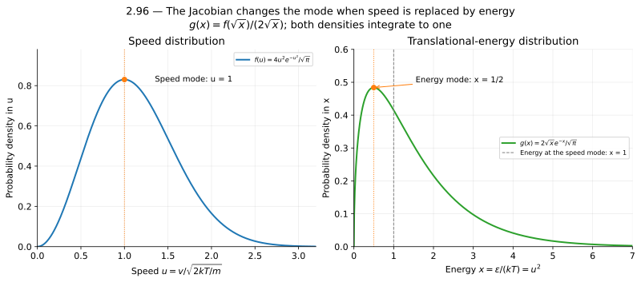

# 2.3 Kinetic Theory of Gases. Boltzmann's Law and Maxwell's Distribution

[Chapter index](../README.md#chapters) · [Structured solutions](2.3.json) · [Answer audit](../audit/README.md)

## 2.62

**Solved · medium confidence.** Use the molecular ideal-gas law and infer the characteristic intermolecular spacing.

**Assumptions**

- The gas is dilute ideal nitrogen in equilibrium at absolute temperature T. Room temperature is unspecified, so T is retained and 300 K is an explicitly assumed example.
- Appendix 28 gives 1 atm=101300 Pa and Appendix 30 gives k=1.380e−23 J/K. Mean distance is interpreted as the conventional characteristic spacing ell=n^(−1/3), rather than the statistical nearest-neighbour mean.

Convert the extremely low pressure and express the equilibrium number density.

$$
p=4\times10^{-15}\times101300=4.052\times10^{-10}\ {\rm Pa},\qquad n=\frac p{kT}.
$$

Multiply number density by the volume of one cubic centimetre.

$$
N_{1{\rm cm^3}}=\frac{p\,10^{-6}\ {\rm m^3}}{kT}=9.78743961\times10^4\frac{300\ {\rm K}}T.
$$

Assign one mean volume1/n to a molecule and take its cube root.

$$
\ell=n^{-1/3}=\left(\frac{kT}{p}\right)^{1/3}=2.16991956\times10^{-4}\left(\frac{T}{300\ {\rm K}}\right)^{1/3}\ {\rm m}.
$$

Evaluate only as an explicitly chosen room-temperature example.

$$
T=300\ {\rm K}:\quad N_{1{\rm cm^3}}\simeq9.79\times10^4,\qquad\ell\simeq0.217\ {\rm mm}.
$$

**Results**

Molecules in one cubic centimetre as a function of temperature

$$
N_{1{\rm cm^3}}=9.78744\times10^4(300\ {\rm K}/T)
$$

Characteristic spacing as a function of temperature

$$
\ell=2.16992\times10^{-4}(T/(300\ {\rm K}))^{1/3}\ {\rm m}
$$

Molecular count in one cm³ at the assumed 300 K

$$
N_{1{\rm cm^3}}\simeq97874.4
$$

Characteristic spacing at the assumed 300 K

$$
\ell\simeq2.16992\times10^{-4}\ {\rm m}
$$

**Limitations**

- A Poisson-gas statistical nearest-neighbour mean is Gamma(4/3)(3/(4pi n))^(1/3), about .554 times n^(−1/3); this differs from the conventional spacing used here.

## 2.63

**Solved · high confidence.** Count the extra gas particles produced by partial molecular dissociation.

**Assumptions**

- Atoms and remaining molecules form an ideal mixture at 1800 K. Eta=.30 is the fraction of the original N2 molecules dissociated; ionization and interactions are excluded.
- Appendix 15 gives N2 molar mass .028 kg/mol; Appendix 30 gives R=8.314 J/(mol K).

Each dissociated N2 molecule produces two atoms, adding one net pressure-carrying particle.

$$
\nu_0=\frac mM=0.0500\ {\rm mol},\quad\nu_{N_2}=(1-\eta)\nu_0,\quad\nu_N=2\eta\nu_0.
$$

Sum molecular and atomic amounts for the ideal mixture law.

$$
\nu_{\rm particles}=(1+\eta)\nu_0=0.0650\ {\rm mol},\qquad p=\frac{(1+\eta)mRT}{MV}.
$$

Evaluate using the fixed vessel volume.

$$
p=\frac{1.30\times0.0500\times8.314\times1800}{0.0050}\ {\rm Pa}=194547.6\ {\rm Pa}.
$$

**Results**

Pressure of the dissociated nitrogen mixture

$$
p\simeq1.94548\times10^5\ {\rm Pa}
$$

## 2.64

**Solved · high confidence.** Infer the mixture molar mass, solve its helium particle fraction, and multiply by total number density.

**Assumptions**

- Standard conditions are p0=101300 Pa and 0°C=273.15 K. Ideal He atoms and N2 molecules have mixture density .60 g/L=.60 kg/m³.
- Appendix 15 gives M_He=.004 and M_N2=.028 kg/mol. Concentration means helium number density; its number/mole fraction is also supplied.
- Use Appendix R=8.314 for molar-mass formulas and k=1.380e−23 for molecular number density. The printed k NA=8.31174 differs from R by .0272%; the associated tiny mass-balance residual is historical rounding.

The ideal-gas mixture density determines its mean molar mass.

$$
\overline M=\frac{\rho RT_0}{p_0}=0.0134509522\ {\rm kg/mol}.
$$

Solve the two-species molar-mass average for the helium particle fraction.

$$
\overline M=xM_{He}+(1-x)M_{N_2},\qquad x=\frac{M_{N_2}-\overline M}{M_{N_2}-M_{He}}=0.606210324.
$$

Multiply by the k-based total number density to obtain helium concentration.

$$
n_{He}=x\frac{p_0}{kT_0}=1.62911778\times10^{25}\ {\rm m^{-3}}=1.62911778\times10^{19}\ {\rm cm^{-3}}.
$$

A direct microscopic density balance using molecular masses M/NA quantifies the small printed-constant mismatch.

$$
n_{He}^{\rm micro}=\frac{M_{N_2}p_0/(kT_0)-\rho N_A}{M_{N_2}-M_{He}}\simeq1.62952720\times10^{25}\ {\rm m^{-3}}.
$$

**Results**

Helium number density using the stated R/k convention

$$
n_{He}\simeq1.62912\times10^{25}\ {\rm m^{-3}}
$$

Helium number fraction, also its mole fraction

$$
x_{He}\simeq0.606210\simeq60.62\%
$$

Microscopic M/NA mass-balance cross-check

$$
n_{He}^{\rm micro}\simeq1.62953\times10^{25}\ {\rm m^{-3}}
$$

Both constant conventions give 1.63e25 m−3 at warranted precision; this is a rounding cross-check, not a different physical state.

**Limitations**

- Extra digits specify arithmetic conventions rather than the precision of the measured density.

## 2.65

**Solved · high confidence.** Multiply incident beam flux by normal momentum transfer per specular elastic collision.

**Assumptions**

- The parallel beam number density .9e19 cm−3 is the incident volume density. The30° angle is from the wall normal.
- Elastic reflection at the stationary smooth wall reverses normal velocity and preserves tangential velocity. Nitrogen molecular mass is M/NA, using Appendix M=.028 kg/mol and NA=6.023e23 mol−1.

Normal velocity controls both the incidence rate per wall area and the collision impulse.

$$
v_n=v\cos\theta,\qquad j=nv_n,\qquad\Delta p_n=2m_{N_2}v_n.
$$

The product is normal force per area.

$$
p_{\rm wall}=2n\frac{M}{N_A}v^2\cos^2\theta.
$$

Convert density to SI and evaluate the two cosine factors.

$$
n=9.0\times10^{24}\ {\rm m^{-3}},\quad p_{\rm wall}=2(9.0\times10^{24})\frac{0.028}{6.023\times10^{23}}400^2\frac34=100415.076\ {\rm Pa}.
$$

**Results**

Pressure exerted by the reflected molecular beam

$$
p_{\rm wall}\simeq1.00415\times10^5\ {\rm Pa}
$$

## 2.66

**Solved · high confidence.** Infer gamma from the adiabatic sound speed and recover the active quadratic degree count.

**Assumptions**

- Use an ideal gas with one effective constant heat capacity. Sound is an adiabatic small disturbance, with sound-speed squared gamma p/rho.
- Standard pressure is101300 Pa. Density1.3 mg/cm³ equals1.3 kg/m³. The given density and speed are rounded, so the molecular degree count is inferred to the nearest physical integer.

Infer the adiabatic exponent from the density and sound speed.

$$
v_s^2=\gamma p/\rho,\qquad\gamma=\frac{1.3\times330^2}{101300}=1.39753208.
$$

Use equipartition and the ideal-gas heat-capacity difference.

$$
C_V=fR/2,\qquad\gamma=1+2/f,\qquad f=\frac2{\gamma-1}=5.03104048\simeq5.
$$

**Results**

Number of active quadratic degrees of freedom

$$
f\simeq5
$$

Continuous estimate before integer interpretation

$$
f_{\rm effective}\simeq5.03104
$$

## 2.67

**Solved · high confidence.** Eliminate the common temperature and molar-mass factors from sound and translational RMS speeds.

**Assumptions**

- Use a classical ideal gas. RMS molecular speed describes translation, including for molecules with internal modes.
- Monatomic molecules have f=3 and gamma=5/3; rigid diatomic molecules have f=5 and gamma=7/5 with vibrational excitation excluded.

Form the ratio using the two speed expressions.

$$
v_s=\sqrt{\gamma RT/M},\qquad v_{\rm rms}=\sqrt{3RT/M},\qquad\frac{v_s}{v_{\rm rms}}=\sqrt{\gamma/3}.
$$

Insert the exact degree-model values for the two species.

$$
\text{Monatomic:}\quad v_s/v_{\rm rms}=\sqrt5/3\simeq0.745356;\qquad\text{rigid diatomic:}\quad v_s/v_{\rm rms}=\sqrt{7/15}\simeq0.683130.
$$

**Results**

Monatomic sound/RMS speed ratio

$$
v_s/v_{\rm rms}=\sqrt5/3
$$

Rigid-diatomic sound/RMS speed ratio

$$
v_s/v_{\rm rms}=\sqrt{7/15}
$$

## 2.68

**Solved · high confidence.** Count translational, rotational and vibrational quadratic energy terms and apply equipartition.

**Assumptions**

- All classical translational, rotational and harmonic vibrational modes are excited. Each vibrational normal mode has kinetic and potential quadratic terms and contributes kT.
- Molecular geometry is unspecified. Linear N>=2 molecules have2 rotations and3N−5 vibrational modes; nonlinear N>=3 molecules have3 rotations and3N−6 vibrational modes. Both are supplied, with N=1 treated separately.

Count effective quadratic terms for a linear molecule, including two per vibrational mode.

$$
f_{\rm lin}=3+2+2(3N-5)=6N-5,\qquad\langle\varepsilon\rangle_{\rm lin}=\frac{6N-5}{2}kT.
$$

For a nonlinear geometry the rotational and vibrational counts both change.

$$
f_{\rm nonlin}=3+3+2(3N-6)=6N-6,\qquad\langle\varepsilon\rangle_{\rm nonlin}=3(N-1)kT.
$$

Divide the translational contribution3kT/2 by total energy.

$$
\frac{\varepsilon_{\rm tr}}{\langle\varepsilon\rangle}=\begin{cases}3/(6N-5),&\text{linear }N\ge2,\\1/[2(N-1)],&\text{nonlinear }N\ge3.\end{cases}
$$

The monatomic case has no molecular rotations or vibrations in this model.

$$
N=1:\qquad\langle\varepsilon\rangle=\frac32kT,\qquad\varepsilon_{\rm tr}/\langle\varepsilon\rangle=1.
$$

**Results**

Mean fully excited linear molecular energy

$$
\langle\varepsilon\rangle=(6N-5)kT/2\quad(N\ge2)
$$

Linear-molecule translational fraction

$$
\varepsilon_{\rm tr}/\langle\varepsilon\rangle=3/(6N-5)
$$

Mean fully excited nonlinear molecular energy

$$
\langle\varepsilon\rangle=3(N-1)kT\quad(N\ge3)
$$

Nonlinear-molecule translational fraction

$$
\varepsilon_{\rm tr}/\langle\varepsilon\rangle=1/[2(N-1)]
$$

Separate monatomic result

$$
\langle\varepsilon\rangle=3kT/2,\qquad f_{\rm tr}=1
$$

**Limitations**

- Electronic excitation, dissociation and anharmonicity are excluded. Partial vibrational excitation would require temperature-dependent mode energies.

## 2.69

**Solved · high confidence.** Obtain molar Cv from the fully excited quadratic count and use Cp−Cv=R.

**Assumptions**

- All classical translational, rotational and harmonic vibrational modes are excited in the ideal gas. Electronic modes and chemical changes are excluded.
- Part(c)’s network molecule is nonlinear, with three rotations and3N−6 vibration modes. The linear formulas apply for N>=2 and nonlinear formulas for N>=3.

Equipartition gives molar capacity R/2 per quadratic term.

$$
C_V=\frac f2R,\qquad\gamma=1+\frac2f.
$$

A fully excited diatomic molecule has one two-term vibrational mode beyond its rigid degrees.

$$
f=3+2+2=7,\qquad C_V=\frac72R,\qquad\gamma=\frac97.
$$

Use3N−5 vibration modes for the linear molecule.

$$
f_{\rm lin}=6N-5,\qquad C_{V,\rm lin}=\frac{6N-5}{2}R,\qquad\gamma_{\rm lin}=\frac{6N-3}{6N-5}.
$$

Use3N−6 vibration modes for the nonlinear network molecule.

$$
f_{\rm nonlin}=6N-6,\qquad C_{V,\rm nonlin}=3(N-1)R,\qquad\gamma_{\rm nonlin}=\frac{3N-2}{3N-3}.
$$

**Results**

Fully excited diatomic molar capacity

$$
C_V=7R/2
$$

Fully excited diatomic gamma

$$
\gamma=9/7
$$

Fully excited linear N-atomic molar capacity

$$
C_V=(6N-5)R/2
$$

Fully excited linear N-atomic gamma

$$
\gamma=(6N-3)/(6N-5)
$$

Fully excited nonlinear N-atomic molar capacity

$$
C_V=3(N-1)R
$$

Fully excited nonlinear N-atomic gamma

$$
\gamma=(3N-2)/(3N-3)
$$

## 2.70

**Solved · high confidence.** Form the ratio of isobaric expansion work to isobaric heat input.

**Assumptions**

- The ideal gas has fully excited classical molecular modes and constant capacities. Both work and heat are positive in the stated isobaric expansion.
- Molecular geometry is unspecified, so give both linear and nonlinear N-atomic results and the separate requested monatomic case.

Both work and heat are proportional to the same temperature increment.

$$
A=\nu R\Delta T,\quad Q=\nu C_p\Delta T,\quad\frac AQ=\frac R{C_p}=\frac2{f+2}=\frac{\gamma-1}{\gamma}.
$$

Insert the geometry-specific fully excited quadratic counts.

$$
\left(\frac AQ\right)_{\rm lin}=\frac2{6N-3}\quad(N\ge2),\qquad\left(\frac AQ\right)_{\rm nonlin}=\frac1{3N-2}\quad(N\ge3).
$$

A monatomic gas has three translational degrees only.

$$
f=3:\qquad A/Q=2/5=0.40.
$$

**Results**

Linear fully excited molecular work fraction

$$
A/Q=2/(6N-3)
$$

Nonlinear fully excited molecular work fraction

$$
A/Q=1/(3N-2)
$$

Monatomic work fraction

$$
A/Q=2/5=40\%
$$

**Limitations**

- N alone does not determine whether an N-atomic molecule is linear or nonlinear.

## 2.71

**Solved · high confidence.** Use the specific-heat difference to infer molar mass and the capacity ratio to infer degree count.

**Assumptions**

- Use an ideal gas with constant active quadratic count f. Given capacities are per gram; convert to per kilogram for SI molar mass.
- Appendix 30 gives R=8.314 J/(mol K).

Convert capacities and use the mass-specific Mayer relation.

$$
c_V=650\ {\rm J/(kg\,K)},\quad c_p=910\ {\rm J/(kg\,K)},\quad c_p-c_V=R/M=260\ {\rm J/(kg\,K)}.
$$

Solve for molar mass.

$$
M=\frac{8.314}{260}\ {\rm kg/mol}=0.0319769231\ {\rm kg/mol}\simeq32\ {\rm g/mol}.
$$

Recover the degree count independently of mass.

$$
c_V=\frac f2\frac RM,\qquad f=\frac{2c_V}{c_p-c_V}=\frac{2\times0.65}{0.91-0.65}=5.
$$

**Results**

Inferred molar mass

$$
M\simeq0.0319769\ {\rm kg/mol}\simeq32\ {\rm g/mol}
$$

Active quadratic degree count

$$
f=5
$$

## 2.72

**Solved · high confidence.** Remove the process work contribution from measured molar capacity, then infer Cv and degrees.

**Assumptions**

- Use an ideal gas with constant active quadratic count f, so Cv=fR/2. The given29 J/(mol K) is rounded; report nearest physical integer counts.
- Use Appendix R=8.314. In part(b), pT=constant is the imposed quasistatic path, not a fixed-pressure process.

In part(a), subtract R from the constant-pressure molar capacity.

$$
f_a=2(C_p/R-1)=2(29/8.314-1)=4.97618475\simeq5.
$$

In part(b), combine the imposed pressure-temperature relation with the ideal-gas law.

$$
pT=\text{constant},\quad pV=\nu RT\quad\Longrightarrow\quad V\propto T^2,\qquad dV/V=2dT/T.
$$

The work per mole per temperature increment is2R; subtract it from C.

$$
\delta A/\nu=2R\,dT,\quad C=C_V+2R,\quad f_b=2(C/R-2)=2(29/8.314-2)=2.97618475\simeq3.
$$

**Results**

Degree count from the constant-pressure capacity

$$
f_a\simeq5
$$

Continuous estimate4.97618.

Degree count on the pT=constant path

$$
f_b\simeq3
$$

Continuous estimate2.97618.

## 2.73

**Solved · high confidence.** Add monatomic and rigid-diatomic capacities before forming their mixture ratio.

**Assumptions**

- The ideal mixture has common temperature, nonnegative mole amounts and at least one nonzero amount.
- Use exact molecular models: monatomic f=3 and rigid diatomic f=5, excluding vibrational excitation.

Add component constant-volume capacities.

$$
C_{V,{\rm total}}=\frac R2(3\nu_1+5\nu_2).
$$

Each mole contributes R more to the constant-pressure capacity.

$$
C_{p,{\rm total}}=\frac R2(5\nu_1+7\nu_2).
$$

Take the ratio of the total capacities.

$$
\gamma_{\rm mix}=\frac{5\nu_1+7\nu_2}{3\nu_1+5\nu_2}.
$$

**Results**

Mixture heat-capacity ratio

$$
\gamma_{\rm mix}=\frac{5\nu_1+7\nu_2}{3\nu_1+5\nu_2}
$$

## 2.74

**Solved · high confidence.** Thermalize the gas bulk kinetic energy and use fixed-volume pressure-temperature proportionality.

**Assumptions**

- The rigid insulated vessel is abruptly stopped and held stationary during gas relaxation. The initial gas bulk kinetic energy becomes gas internal energy; vessel heat capacity and energy absorption are neglected, as in Problem2.27.
- Appendix 15 gives nitrogen M=.028 kg/mol and gamma=1.40, taken constant. Initial 27°C is 300.15 K.

Equate the initial bulk kinetic energy to the gas internal-energy gain.

$$
\frac mM\frac R{\gamma-1}\Delta T=\frac12mv^2,\qquad\Delta T=\frac{(\gamma-1)Mv^2}{2R}.
$$

Evaluate the temperature rise.

$$
\Delta T=\frac{0.40\times0.028\times100^2}{2\times8.314}=6.73562665\ {\rm K}.
$$

At fixed amount and volume, pressure changes in proportion to absolute temperature.

$$
\Delta p/p_i=\Delta T/T_i=6.73562665/300.15=0.0224408684,\qquad100\Delta p/p_i=+2.24408684\%.
$$

**Results**

Percentage pressure increase after stopping

$$
\Delta p/p_i\simeq+2.24409\%
$$

Temperature rise after gas equilibration

$$
\Delta T\simeq6.73563\ {\rm K}
$$

**Limitations**

- If walls share or remove the deposited gas energy, their energy balance changes the final pressure rise.

## 2.75

**Solved · high confidence.** Apply translational equipartition to an oxygen molecule and the centre of mass of a suspended water droplet.

**Assumptions**

- The gas and spherical liquid-water droplet are in equilibrium at 17°C=290.15 K. The droplet undergoes classical Brownian translation.
- Appendix 15 oxygen M=.032 kg/mol and Appendix 11 water density 1000 kg/m³ are used. Droplet diameter .10 micrometre is 1.0e−7 m.
- Use R=8.314 for the molar-mass oxygen speed and k=1.380e−23 for molecular energy and droplet equipartition. Independently printed constants differ from R=k NA by .0272%; the small residual is rounding.

Three translational velocity components determine oxygen RMS speed.

$$
v_{{\rm rms},O_2}=\sqrt{3RT/M}=\sqrt{3(8.314)(290.15)/0.032}=475.556296\ {\rm m/s}.
$$

Mean translational kinetic energy is independent of the oxygen rotational modes.

$$
\langle K_{\rm tr}\rangle=\frac32kT=\frac32(1.380\times10^{-23})(290.15)=6.006105\times10^{-21}\ {\rm J}.
$$

Compute droplet mass from its diameter and the liquid density.

$$
m_d=\rho_w\frac\pi6d^3=1000\frac\pi6(10^{-7})^3=5.23598776\times10^{-19}\ {\rm kg}.
$$

The droplet centre of mass has the same3kT/2 translational energy, giving a much lower speed.

$$
\frac12m_d\langle v_d^2\rangle=\frac32kT,\qquad v_{{\rm rms},d}=\sqrt{3kT/m_d}=0.151464950\ {\rm m/s}.
$$

**Results**

Oxygen molecule RMS translational speed

$$
v_{{\rm rms},O_2}\simeq475.556\ {\rm m/s}
$$

Mean molecular translational kinetic energy

$$
\langle K_{\rm tr}\rangle\simeq6.00611\times10^{-21}\ {\rm J}
$$

Droplet centre-of-mass RMS speed

$$
v_{{\rm rms},d}\simeq0.151465\ {\rm m/s}
$$

**Limitations**

- The droplet value is instantaneous thermal RMS speed, not a drift velocity or speed averaged over an instrumental sampling interval. Droplet internal modes do not enter centre-of-mass equipartition.

## 2.76

**Solved · high confidence.** Convert the RMS speed ratio to a temperature ratio and use the reversible adiabatic volume law.

**Assumptions**

- The ideal fixed gas amount expands quasistatically and adiabatically. Rigid-diatomic gamma=7/5 is constant, excluding vibration.
- Eta=1.50 is the factor by which RMS speed is reduced: final speed is initial speed divided by eta.

RMS speed squared is proportional to absolute temperature.

$$
v_{{\rm rms},f}/v_{{\rm rms},i}=1/\eta,\qquad T_f/T_i=1/\eta^2.
$$

Insert that ratio into the reversible adiabatic temperature-volume relation.

$$
TV^{\gamma-1}=\text{constant},\qquad V_f/V_i=\eta^{2/(\gamma-1)}=\eta^5.
$$

Evaluate the requested expansion factor.

$$
V_f/V_i=1.50^5=7.59375.
$$

**Results**

Required expansion volume factor

$$
V_f/V_i=\eta^5=7.59375
$$

**Limitations**

- An irreversible insulated free expansion does not follow this temperature-volume power law; the usual quasistatic interpretation of the exercise is used.

## 2.77

**Solved · high confidence.** Infer the temperature rise needed to double RMS speed and calculate fixed-volume nitrogen heating.

**Assumptions**

- The enclosing vessel is rigid and sealed, so there is no boundary work. Nitrogen is ideal with constant gamma=1.40 from Appendix 15.
- Use m=.015 kg, M=.028 kg/mol and R=8.314. The required eta=2 speed factor quadruples absolute temperature.

Convert the molecular speed increase to final temperature and its increment.

$$
T_f=\eta^2T_i=1200\ {\rm K},\qquad\Delta T=T_i(\eta^2-1)=900\ {\rm K}.
$$

Heat equals internal-energy rise at fixed volume.

$$
Q=\Delta U=\frac mM\frac R{\gamma-1}T_i(\eta^2-1).
$$

Evaluate within the stated constant-capacity model.

$$
Q=\frac{0.015}{0.028}\frac{8.314}{0.40}(300)(3)=10021.3393\ {\rm J}\simeq10.02\ {\rm kJ}.
$$

**Results**

Required heat in the constant-capacity nitrogen model

$$
Q\simeq1.00213\times10^4\ {\rm J}
$$

**Limitations**

- Heating to 1200 K can change nitrogen heat capacity through excitation. A refined result requires(m/M) times the integral of Cv(T) from 300 to 1200 K; the numerical result assumes constant Appendix gamma.

## 2.78

**Solved · high confidence.** Use equipartition for two perpendicular rotations of a rigid diatomic molecule.

**Assumptions**

- The rigid linear molecule has two excited rotations perpendicular to its axis, each with the stated moment I. Rotation about the internuclear axis is neglected.
- The requested angular RMS speed is the square root of the mean squared angular-velocity vector magnitude, not one component. Appendix k=1.380e−23 J/K is used.

Convert moment of inertia from cgs units.

$$
1\ {\rm g\,cm^2}=10^{-7}\ {\rm kg\,m^2},\qquad I=2.1\times10^{-46}\ {\rm kg\,m^2}.
$$

The two rotational quadratic terms carry mean energy kT in total.

$$
\langle K_{\rm rot}\rangle=\frac I2\langle\omega_x^2+\omega_y^2\rangle=kT,\qquad\omega_{\rm rms}=\sqrt{2kT/I}.
$$

Evaluate the angular-speed magnitude at 300 K.

$$
\omega_{\rm rms}=\sqrt{\frac{2(1.380\times10^{-23})(300)}{2.1\times10^{-46}}}=6.27921742\times10^{12}\ {\rm rad/s}.
$$

**Results**

RMS angular-velocity magnitude

$$
\omega_{\rm rms}\simeq6.27922\times10^{12}\ {\rm rad/s}
$$

## 2.79

**Solved · high confidence.** Use reversible adiabatic heating and equipartition of the two rotational degrees of freedom.

**Assumptions**

- The gas consists of classical rigid diatomic molecules: translational degrees 3, rotational degrees 2, gamma=7/5. Vibrations are frozen out.
- Interpret standard conditions explicitly as initial 0°C=273.15 K. The compression factor 5.0 is the initial-to-final volume ratio; compression is reversible and adiabatic.
- The requested kinetic energy of a rotating molecule is taken primarily as its rotational kinetic-energy component. The translation-plus-rotation total is also identified.

The reversible adiabatic temperature law uses gamma−1=2/5.

$$
T_f=T_0(V_0/V_f)^{\gamma-1}=(273.15\ \mathrm K)5^{2/5}=519.983073\ \mathrm K.
$$

Two quadratic rotational terms each contribute kT/2.

$$
\langle E_{\rm rot}\rangle=\frac22 kT_f=kT_f=7.17576641\times10^{-21}\ \mathrm J.
$$

If kinetic energy includes both the translating and rotating molecule, the five active quadratic terms give the following separate total.

$$
\langle E_{\rm trans}+E_{\rm rot}\rangle=\frac52kT_f=1.79394160\times10^{-20}\ \mathrm J.
$$

**Results**

Mean rotational kinetic energy

$$
\langle E_{\rm rot}\rangle=kT_0\eta^{2/5}\simeq7.18\times10^{-21}\ \mathrm J
$$

Translation-plus-rotation mean kinetic energy, if that broader meaning is intended

$$
\langle E_{\rm kinetic,total}\rangle=\frac52kT_0\eta^{2/5}\simeq1.79\times10^{-20}\ \mathrm J
$$

**Limitations**

- Adiabatic alone does not determine this temperature for an arbitrary irreversible compression; the usual reversible compression model is used.

## 2.80

**Solved · medium confidence.** Scale the Maxwell incident flux with density and temperature during reversible adiabatic expansion.

**Assumptions**

- The gas amount is fixed, remains in local Maxwell equilibrium, and consists of rigid diatomic molecules with Cv=5R/2 and gamma=7/5.
- Primary collision rate means incident molecules per unit wall area per unit time, j. A total rate over a wall of area A is jA and requires the area change to be specified.
- The volume expansion factor is eta=Vf/Vi>1; the adiabatic path is reversible.

The incident collision flux is one quarter of concentration times mean molecular speed.

$$
j=\frac14 n\langle v\rangle=n\sqrt{\frac{kT}{2\pi m}},\qquad j\propto\frac{\sqrt T}{V}.
$$

The temperature falls as V^(−2/5) on the rigid-diatomic adiabat.

$$
T_f/T_i=\eta^{-2/5}\quad\Longrightarrow\quad j_f/j_i=\eta^{-1}\eta^{-1/5}=\eta^{-6/5}.
$$

For an entire wall multiply by its area ratio; geometrically similar expansion supplies one useful specified example.

$$
\frac{\dot N_f}{\dot N_i}=\frac{A_f}{A_i}\eta^{-6/5};\qquad A\propto V^{2/3}:\quad\frac{\dot N_f}{\dot N_i}=\eta^{-8/15}.
$$

**Results**

Per-unit-area collision flux ratio

$$
j_f/j_i=\eta^{-6/5}
$$

The local rate is reduced by the factor eta^(6/5).

Whole-wall rate ratio with known wall area change

$$
\dot N_f/\dot N_i=(A_f/A_i)\eta^{-6/5}
$$

Whole-surface rate ratio for geometrically similar expansion

$$
\dot N_f/\dot N_i=\eta^{-8/15}
$$

**Limitations**

- No unique integrated wall rate follows without its area change. The primary answer uses the standard local collision-flux interpretation.

## 2.81

**Solved · medium confidence.** Use the specified polytropic heat capacity to determine the temperature-volume law, then scale the wall flux.

**Assumptions**

- The gas amount is fixed, remains in local Maxwell equilibrium, and consists of rigid diatomic molecules with Cv=5R/2 and gamma=7/5.
- Primary collision rate means incident molecules per unit wall area per unit time, j. A total rate over a wall of area A is jA and requires the area change to be specified.

The first law and C=R give a temperature decrease during expansion.

$$
\delta Q=C\,dT=C_VdT+RT\frac{dV}{V}\quad\Longrightarrow\quad\frac{dT}{T}=\frac{R}{C-C_V}\frac{dV}{V}=-\frac23\frac{dV}{V}.
$$

Therefore T is proportional to V^(−2/3), equivalent to a polytropic index5/3. The local flux scales as sqrt(T)/V.

$$
T_f/T_i=\eta^{-2/3},\qquad j_f/j_i=\eta^{-4/3};\qquad j_i/j_f=2^{4/3}=2.51984210.
$$

A total wall rate includes the area ratio. In a geometrically similar expansion the total surface rate falls by a different factor.

$$
\dot N_f/\dot N_i=(A_f/A_i)\eta^{-4/3};\qquad A\propto V^{2/3}:\quad\dot N_i/\dot N_f=\eta^{2/3}=2^{2/3}=1.58740105.
$$

**Results**

Reduction factor of per-unit-area collision rate

$$
j_i/j_f=2^{4/3}\simeq2.52
$$

Whole-surface reduction factor for geometrically similar expansion

$$
\dot N_i/\dot N_f=2^{2/3}\simeq1.59
$$

**Limitations**

- The stated rate scope is not explicit; the local and specified whole-surface interpretations are separated.

## 2.82

**Solved · medium confidence.** Require constant incident molecular flux and infer the temperature-volume exponent and path heat capacity.

**Assumptions**

- The gas amount is fixed, remains in local Maxwell equilibrium, and consists of rigid diatomic molecules with Cv=5R/2 and gamma=7/5.
- Primary collision rate means incident molecules per unit wall area per unit time, j. A total rate over a wall of area A is jA and requires the area change to be specified.

For constant per-unit-area rate, the density decrease must be exactly offset by a mean-speed increase.

$$
j\propto\sqrt T/V=\mathrm{const}\quad\Longrightarrow\quad T\propto V^2,\qquad\frac{dT}{T}=2\frac{dV}{V}.
$$

Use the first law per mole to find the path heat capacity.

$$
C=C_V+RT\frac{dV}{dT}\frac1V=\frac52R+\frac R2=3R=24.942\ \mathrm{J/(mol\,K)}.
$$

For constant total rate over a surface A(V), the required temperature scales as (V/A)^2. For geometrically similar vessels that yields a different heat capacity.

$$
A\propto V^{2/3}:\quad\dot N=jA\propto V^{-1/3}\sqrt T=\mathrm{const},\quad T\propto V^{2/3},\quad C=\frac52R+\frac32R=4R=33.256\ \mathrm{J/(mol\,K)}.
$$

**Results**

Molar heat capacity for constant per-unit-area collision rate

$$
C=3R=24.942\ \mathrm{J/(mol\,K)}
$$

Molar heat capacity for constant whole-surface rate in geometrically similar expansion

$$
C=4R=33.256\ \mathrm{J/(mol\,K)}
$$

**Limitations**

- The whole-wall interpretation needs geometry. For arbitrary area law A proportional to V^s, constant total rate requires C=Cv+R/[2(1−s)] when s is not1.

## 2.83

**Solved · high confidence.** Eliminate temperature and molecular mass from Maxwell characteristic speeds using p/rho.

**Assumptions**

- The gas is ideal and in Maxwell equilibrium. The given density 1.00 g/l equals 1.00 kg/m³ at the specified atmospheric pressure p=101300 Pa; its temperature need not be supplied.

The ideal-gas equation gives thermal speed squared directly from the known pressure and density.

$$
\frac{kT}{m}=\frac{RT}{M}=\frac p\rho.
$$

Insert this combination into the most probable, mean and root-mean-square speed formulas.

$$
v_p=\sqrt{\frac{2p}\rho},\qquad\langle v\rangle=\sqrt{\frac{8p}{\pi\rho}},\qquad v_{\rm rms}=\sqrt{\frac{3p}\rho}.
$$

Evaluate using the stated density and the Appendix atmosphere conversion.

$$
v_p=450.11110\ \mathrm{m/s},\qquad\langle v\rangle=507.89599\ \mathrm{m/s},\qquad v_{\rm rms}=551.27126\ \mathrm{m/s}.
$$

**Results**

Most probable speed

$$
v_p=\sqrt{2p/\rho}\simeq450\ \mathrm{m/s}
$$

Mean speed

$$
\langle v\rangle=\sqrt{8p/(\pi\rho)}\simeq508\ \mathrm{m/s}
$$

Root-mean-square speed

$$
v_{\rm rms}=\sqrt{3p/\rho}\simeq551\ \mathrm{m/s}
$$

## 2.84

**Solved · high confidence.** Integrate the Maxwell speed density over the symmetric relative-speed interval, then expand for a narrow interval.

**Assumptions**

- The wording means |v−v*|/v*<delta with delta=0.0100: a symmetric interval from 0.99v* to1.01v*. It is not a one-percent-wide total bin.
- Use the normalized Maxwell distribution. Endpoints of a continuous distribution do not affect the fraction.

Scale speeds by the most probable speed; the density and its cumulative integral are universal.

$$
x=\frac v{\sqrt{2kT/m}},\quad f(x)=\frac4{\sqrt\pi}x^2e^{-x^2},\qquad G(x)=\operatorname{erf}(x)-\frac{2x}{\sqrt\pi}e^{-x^2}.
$$

For a target speed represented by x*, the exact requested fraction is the cumulative difference. Symmetric expansion gives the leading narrow-bin estimate with cubic absolute error.

$$
P(x_*)=G[(1+\delta)x_*]-G[(1-\delta)x_*]=\frac{8\delta}{\sqrt\pi}x_*^3e^{-x_*^2}+O(\delta^3).
$$

The most probable target has x*=1.

$$
P_p=G(1.01)-G(0.99)=0.01660319299\quad(1.66031930\%),\qquad P_{p,\rm narrow}=\frac{8\delta}{\sqrt\pi e}=0.01660429990.
$$

The root-mean-square target has x*=sqrt(3/2).

$$
P_{\rm rms}=G[1.01\sqrt{3/2}]-G[0.99\sqrt{3/2}]=0.01850040616\quad(1.85004062\%),\qquad P_{{\rm rms},\rm narrow}=\frac{8\delta}{\sqrt\pi}(3/2)^{3/2}e^{-3/2}=0.01850163958.
$$

**Results**

Exact fraction within1% of the most probable speed

$$
P_p=0.016603193\simeq1.66032\%
$$

Leading narrow-interval estimate

$$
P_p\simeq8\delta/(\sqrt\pi e)=0.016604300
$$

Exact fraction within1% of the rms speed

$$
P_{\rm rms}=0.018500406\simeq1.85004\%
$$

Leading narrow-interval estimate

$$
P_{\rm rms}\simeq\frac{8\delta}{\sqrt\pi}(3/2)^{3/2}e^{-3/2}=0.018501640
$$

## 2.85

**Solved · high confidence.** Apply the Maxwell most probable and rms speed formulas with Appendix molar masses.

**Assumptions**

- Hydrogen is molecular H2 with M=0.002 kg/mol and oxygen is O2 with M=0.032 kg/mol, from Appendix Table15. Use the printed R=8.314 for molar-mass formulas.
- The oxygen F(v) is the normalized speed distribution, whose maximum is at the most probable speed.

The difference between rms and most probable speeds is a fixed numerical factor times sqrt(RT/M).

$$
v_{\rm rms}-v_p=(\sqrt3-\sqrt2)\sqrt{RT/M_H}=\Delta v\quad\Longrightarrow\quad T_a=\frac{M_H(\Delta v)^2}{R(\sqrt3-\sqrt2)^2}=381.004743\ \mathrm K.
$$

For oxygen the given maximum speed equals sqrt(2RT/M).

$$
v_p=420\ \mathrm{m/s},\qquad T_b=\frac{M_Ov_p^2}{2R}=339.475583\ \mathrm K.
$$

**Results**

Hydrogen temperature for the specified speed difference

$$
T_a=\frac{M_H(400\ \mathrm{m/s})^2}{R(\sqrt3-\sqrt2)^2}\simeq381\ \mathrm K
$$

Oxygen temperature for maximum speed density at420 m/s

$$
T_b=\frac{M_O(420\ \mathrm{m/s})^2}{2R}\simeq339\ \mathrm K
$$

## 2.86

**Solved · high confidence.** Equate the normalized Maxwell speed densities and take logarithms after removing the positive-speed prefactor.

**Assumptions**

- Nitrogen is N2 with M=0.028 kg/mol. In part(a), both speeds are positive and belong to the same distribution.
- In part(b), compare distributions at T0 and eta T0 for eta>0. The nontrivial formula assumes eta is not1; the stated higher-temperature case has eta>1.

At fixed temperature, the normalization cancels between the two speeds.

$$
v_1^2e^{-Mv_1^2/(2RT)}=v_2^2e^{-Mv_2^2/(2RT)}\quad\Longrightarrow\quad T=\frac{M(v_2^2-v_1^2)}{4R\ln(v_2/v_1)}.
$$

Insert the nitrogen mass and the two given speeds.

$$
T_a=\frac{(0.028)(600^2-300^2)}{4(8.314)\ln2}=327.964112\ \mathrm K.
$$

For a fixed positive speed the prefactor changes as T^(−3/2); retaining it is essential.

$$
F_T(v)\propto T^{-3/2}v^2e^{-Mv^2/(2RT)},\qquad\frac{Mv^2}{2RT_0}\left(1-\frac1\eta\right)=\frac32\ln\eta.
$$

Solve for the positive crossing and state the zero-speed and identical-temperature degeneracies.

$$
v_*=\sqrt{\frac{3RT_0}{M}\frac{\eta\ln\eta}{\eta-1}};\qquad v=0\ \text{also has }F_{T_0}=F_{\eta T_0}=0;\qquad\eta=1:\ \text{all speeds}.
$$

**Results**

Nitrogen temperature giving equal density at300 and600 m/s

$$
T=\frac{M(v_2^2-v_1^2)}{4R\ln(v_2/v_1)}\simeq328\ \mathrm K
$$

Positive crossing speed of the two temperature distributions

$$
v_*=\sqrt{\frac{3RT_0}{M}\frac{\eta\ln\eta}{\eta-1}},\quad\eta\ne1
$$

Trivial common zero

$$
v=0
$$

For eta=1 the distributions coincide at every speed.

## 2.87

**Solved · high confidence.** Subtract the two most probable speeds at their common mixture temperature.

**Assumptions**

- Both gases share one temperature and are ideal Maxwell gases. Appendix molar masses are MN=0.028 and MO=0.032 kg/mol; nitrogen therefore has the greater most probable speed.

Factor the temperature dependence from the speed difference.

$$
\Delta v=\sqrt{2RT}\left(\frac1{\sqrt{M_N}}-\frac1{\sqrt{M_O}}\right).
$$

Invert and substitute the specified30 m/s difference.

$$
T=\frac{(\Delta v)^2}{2R(1/\sqrt{M_N}-1/\sqrt{M_O})^2}=363.319252\ \mathrm K.
$$

**Results**

Mixture temperature

$$
T=\frac{(\Delta v)^2}{2R(1/\sqrt{M_N}-1/\sqrt{M_O})^2}\simeq363\ \mathrm K
$$

## 2.88

**Solved · high confidence.** Equate the normalized species Maxwell speed densities, retaining their different mass-dependent normalization factors.

**Assumptions**

- Hydrogen is H2 and helium is He, with MH=0.002 and MHe=0.004 kg/mol from Appendix Table15. Both species are at 300 K.
- F(v) is a probability density normalized separately for each species. Equality of absolute molecule counts per speed bin would also require the mixture composition, which is not supplied.

At fixed temperature the Maxwell density is proportional to M^(3/2) v² exp(−Mv²/(2RT)). Cancel v² only for positive speed.

$$
F_H(v)=F_{He}(v)\quad\Longrightarrow\quad\frac{(M_{He}-M_H)v^2}{2RT}=\frac32\ln\frac{M_{He}}{M_H}\quad(v>0).
$$

Solve for the unique positive crossing speed.

$$
v_*=\sqrt{\frac{3RT\ln(M_{He}/M_H)}{M_{He}-M_H}}=\sqrt{\frac{3(8.314)(300)\ln2}{0.002}}=1610.36379\ \mathrm{m/s}.
$$

The cancelled v² factor supplies a separate trivial root.

$$
v=0:\qquad F_H(0)=F_{He}(0)=0.
$$

**Results**

Positive crossing speed

$$
v_*=\sqrt{\frac{3RT\ln(M_{He}/M_H)}{M_{He}-M_H}}\simeq1.61\times10^3\ \mathrm{m/s}
$$

Trivial common zero

$$
v=0
$$

## 2.89

**Solved · high confidence.** Maximize the Maxwell speed density with respect to temperature at a fixed positive speed.

**Assumptions**

- The total molecule number and the infinitesimal laboratory speed interval [v,v+dv] are fixed while temperature varies. The specified speed v is positive.
- This maximizes the fraction or number in a fixed speed bin, not a bin whose endpoints scale with temperature.

At fixed v and dv, the Maxwell density has this temperature dependence.

$$
dN=NF(v;T)dv,\qquad F(v;T)\propto T^{-3/2}\exp\left(-\frac{mv^2}{2kT}\right).
$$

Set the temperature derivative of its logarithm to zero.

$$
\frac{\partial\ln F}{\partial T}=-\frac3{2T}+\frac{mv^2}{2kT^2}=0\quad\Longrightarrow\quad T_*=\frac{mv^2}{3k}.
$$

The density tends to zero at both temperature extremes for positive v, so the sole stationary point is the global maximum.

$$
\left.\frac{\partial^2\ln F}{\partial T^2}\right|_{T_*}=-\frac3{2T_*^2}<0;\qquad v=\sqrt{3kT_*/m}=v_{\rm rms}(T_*).
$$

**Results**

Temperature maximizing population of the fixed infinitesimal speed interval

$$
T_* =\frac{mv^2}{3k}
$$

**Limitations**

- For a finite-width interval the exact optimum requires maximizing its integrated probability; the formula uses the differential interval stated in the problem.

## 2.90

**Solved · high confidence.** Integrate the three-dimensional Maxwell density over the azimuthal angle in the plane perpendicular to x.

**Assumptions**

- The gas is in equilibrium with no bulk drift. vx can be any real number, while v_perp=sqrt(vy²+vz²) is nonnegative.
- The intervals are infinitesimal; integration covers all directions in the perpendicular plane.

The normalized three-dimensional Gaussian depends only on the squared speed.

$$
f_3(v_x,v_y,v_z)=\left(\frac{m}{2\pi kT}\right)^{3/2}\exp\left[-\frac{m(v_x^2+v_y^2+v_z^2)}{2kT}\right].
$$

Use polar coordinates in the vy,vz plane and integrate the azimuth from0 to2pi.

$$
dv_y\,dv_z=v_\perp\,dv_\perp\,d\phi\quad\Longrightarrow\quad\frac{dN}{N}=2\pi\left(\frac{m}{2\pi kT}\right)^{3/2}v_\perp e^{-m(v_x^2+v_\perp^2)/(2kT)}dv_x\,dv_\perp.
$$

Equivalently, the joint distribution factorizes into a one-dimensional Gaussian and a Rayleigh density.

$$
\frac{dN}{N}=\left[\sqrt{\frac{m}{2\pi kT}}e^{-mv_x^2/(2kT)}dv_x\right]\left[\frac{m}{kT}v_\perp e^{-mv_\perp^2/(2kT)}dv_\perp\right].
$$

**Results**

Fraction in the specified joint component intervals

$$
\frac{dN}{N}=2\pi\left(\frac{m}{2\pi kT}\right)^{3/2}v_\perp e^{-m(v_x^2+v_\perp^2)/(2kT)}dv_x\,dv_\perp
$$

## 2.91

**Solved · high confidence.** Integrate the signed and absolute first moments of the Gaussian x-component distribution.

**Assumptions**

- Use an isotropic equilibrium gas with no bulk drift. The normalized component density is fx(u)=sqrt(m/(2pi kT)) exp(−mu²/(2kT)).

The signed first moment vanishes by oddness over the full real axis.

$$
\langle v_x\rangle=\int_{-\infty}^{\infty}u f_x(u)\,du=0.
$$

For the absolute moment double the integral over positive velocities.

$$
\langle|v_x|\rangle=2\sqrt{\frac{m}{2\pi kT}}\int_0^\infty u e^{-mu^2/(2kT)}du=\sqrt{\frac{2kT}{\pi m}}.
$$

**Results**

Mean signed x projection

$$
\langle v_x\rangle=0
$$

Mean magnitude of the x projection

$$
\langle|v_x|\rangle=\sqrt{\frac{2kT}{\pi m}}
$$

## 2.92

**Solved · high confidence.** Evaluate the second moment of the one-dimensional Maxwell Gaussian.

**Assumptions**

- The gas is isotropic in its rest frame with molecular mass m and temperature T.

Write the normalized component moment with a=m/(2kT).

$$
\langle v_x^2\rangle=\sqrt{\frac a\pi}\int_{-\infty}^{\infty}u^2e^{-au^2}du,\qquad a=\frac{m}{2kT}.
$$

Differentiate the Gaussian normalization integral to compute its second moment.

$$
\int_{-\infty}^{\infty}e^{-au^2}du=\sqrt{\pi/a}\quad\Longrightarrow\quad\int_{-\infty}^{\infty}u^2e^{-au^2}du=\frac{\sqrt\pi}{2a^{3/2}},\qquad\langle v_x^2\rangle=\frac1{2a}=\frac{kT}{m}.
$$

**Results**

Mean squared x projection

$$
\langle v_x^2\rangle=\frac{kT}{m}
$$

## 2.93

**Solved · high confidence.** Weight the positive normal-velocity half of the Maxwell distribution by its approach speed.

**Assumptions**

- Take x normal to the stationary planar wall, with vx>0 directed toward it. The gas has no drift, and n is the bulk molecular concentration.
- The requested nu is an incident count per unit wall area per unit time, not a total over an unspecified wall.

Molecules with normal velocity u>0 in a layer of thickness u dt reach a unit area during dt.

$$
\nu=n\int_0^\infty u f_x(u)du=n\sqrt{\frac{m}{2\pi kT}}\int_0^\infty u e^{-mu^2/(2kT)}du.
$$

Evaluate the elementary Gaussian integral.

$$
\nu=n\sqrt{\frac{kT}{2\pi m}}=\frac14n\langle v\rangle,\qquad\langle v\rangle=\sqrt{\frac{8kT}{\pi m}}.
$$

**Results**

Incident molecular rate per unit wall area

$$
\nu=n\sqrt{\frac{kT}{2\pi m}}=\frac14n\langle v\rangle
$$

## 2.94

**Solved · high confidence.** Integrate the normal momentum transferred per elastic impact over the incident Maxwell flux.

**Assumptions**

- Use a stationary wall and isotropic equilibrium gas with molecular concentration n. For a specular elastic wall, an incident normal component u transfers momentum 2mu.
- Pressure is normal force per unit area; no bulk flow or shear is included.

Multiply the speed-weighted incident count by its momentum transfer.

$$
p=n\int_0^\infty (2mu)\,u f_x(u)du=2mn\int_0^\infty u^2f_x(u)du.
$$

Evenness makes the positive-half second moment one half of the full Gaussian moment.

$$
p=mn\langle v_x^2\rangle=mn\frac{kT}{m}=nkT.
$$

**Results**

Pressure on the wall

$$
p=nkT
$$

## 2.95

**Solved · high confidence.** Integrate the inverse-speed moment of the Maxwell speed density and compare it with the inverse mean speed.

**Assumptions**

- v denotes nonnegative molecular speed, not a signed velocity component. Use the normalized Maxwell speed density in the gas rest frame.

Write the inverse-speed moment with a=m/(2kT). The v² density factor removes the apparent singularity at zero.

$$
F(v)=\frac4{\sqrt\pi}a^{3/2}v^2e^{-av^2},\qquad\left\langle\frac1v\right\rangle=\frac4{\sqrt\pi}a^{3/2}\int_0^\infty v e^{-av^2}dv.
$$

Evaluate the integral and express the mean speed separately.

$$
\left\langle\frac1v\right\rangle=\frac{2\sqrt a}{\sqrt\pi}=\sqrt{\frac{2m}{\pi kT}},\qquad\frac1{\langle v\rangle}=\sqrt{\frac{\pi m}{8kT}}.
$$

Form the dimensionless comparison.

$$
\frac{\langle1/v\rangle}{1/\langle v\rangle}=\frac4\pi=1.27323954>1.
$$

**Results**

Mean reciprocal speed

$$
\langle1/v\rangle=\sqrt{\frac{2m}{\pi kT}}
$$

Ratio to the reciprocal mean speed

$$
\langle1/v\rangle=\frac4\pi\frac1{\langle v\rangle}>\frac1{\langle v\rangle}
$$

## 2.96

**Solved · high confidence.** Transform the Maxwell speed density to translational kinetic energy, including its Jacobian.

**Assumptions**

- The dilute nonrelativistic gas is in classical thermal equilibrium. m is the mass of one molecule, and epsilon=mv²/2 is its translational kinetic energy.
- Most probable velocity in this context means the mode of the speed density, not the mode of the three-dimensional velocity-vector density.

Start with the normalized Maxwell density for the speed magnitude.

$$
f_v(v)=4\pi\left(\frac m{2\pi kT}\right)^{3/2}v^2e^{-mv^2/(2kT)},\qquad v\ge0.
$$

Conservation of probability requires the derivative dv/d epsilon, not just substitution in the exponential.

$$
f_\varepsilon(\varepsilon)d\varepsilon=f_v(v)dv,\qquad v=\sqrt{2\varepsilon/m},\quad\frac{dv}{d\varepsilon}=\frac1{\sqrt{2m\varepsilon}},\qquad f_\varepsilon=\frac2{\sqrt\pi}\frac{\sqrt\varepsilon}{(kT)^{3/2}}e^{-\varepsilon/(kT)}.
$$

Differentiate the logarithm of the energy density to find its mode.

$$
\frac{d\ln f_\varepsilon}{d\varepsilon}=\frac1{2\varepsilon}-\frac1{kT}=0\quad\Longrightarrow\quad\varepsilon_p=\frac12kT.
$$

Compare with the speed-density mode; a nonlinear variable change need not preserve a density mode.

$$
v_p=\sqrt{2kT/m},\qquad\frac12mv_p^2=kT\ne\varepsilon_p,\qquad v(\varepsilon_p)=\sqrt{kT/m}=v_p/\sqrt2.
$$

**Results**

Normalized kinetic-energy density

$$
f_\varepsilon(\varepsilon)=\frac2{\sqrt\pi}\frac{\sqrt\varepsilon}{(kT)^{3/2}}e^{-\varepsilon/(kT)},\quad\varepsilon\ge0
$$

Most probable kinetic energy

$$
\varepsilon_p=kT/2
$$

Energy at the most probable speed

$$
\varepsilon(v_p)=kT=2\varepsilon_p
$$

## 2.97

**Solved · high confidence.** Integrate the energy density over the symmetric one-percent band about its mean.

**Assumptions**

- The molecules are monatomic and classical, so the molecular kinetic energy in equilibrium has mean epsilon_bar=3kT/2.
- Differing by1.0 percent and less means absolute deviation |epsilon−epsilon_bar|≤delta epsilon_bar with delta=.010. Both sides of the mean are included.

Express the energy band in units of kT.

$$
x=\varepsilon/(kT),\qquad\bar x=\frac32,\qquad x_-=\frac32(1-0.010)=1.485,\quad x_+=1.515.
$$

Use the normalized energy density to write the exact fraction.

$$
P=\frac2{\sqrt\pi}\int_{1.485}^{1.515}\sqrt{x}\,e^{-x}\,dx=F(1.515)-F(1.485),\qquad F(x)=\operatorname{erf}\sqrt{x}-\frac2{\sqrt\pi}\sqrt{x}\,e^{-x}.
$$

Evaluate the integral and compare with the narrow-band approximation.

$$
P=0.009250896872=0.9250896872\%,\qquad P\simeq(0.030)\frac2{\sqrt\pi}\sqrt{\frac32}e^{-3/2}=0.009250819788.
$$

**Results**

Fraction in the symmetric one-percent energy band

$$
P\simeq0.00925090\simeq0.92509\%
$$

## 2.98

**Solved · high confidence.** Integrate the energy-density tail exactly and expand it for a large energy threshold.

**Assumptions**

- The gas is classical and nonrelativistic at equilibrium temperature T. Define x0=epsilon0/(kT), with x0 much greater than1 for the requested asymptotic approximation.

The fraction above threshold is the upper tail of the shape3/2 gamma distribution.

$$
P(\varepsilon>\varepsilon_0)=\frac2{\sqrt\pi}\int_{x_0}^{\infty}\sqrt{x}\,e^{-x}\,dx.
$$

One integration by parts isolates a complementary error function.

$$
P=\operatorname{erfc}\sqrt{x_0}+\frac2{\sqrt\pi}\sqrt{x_0}\,e^{-x_0}.
$$

Expand the complementary error function for large argument; the leading term includes the energy-density phase-space factor.

$$
P\sim\frac2{\sqrt\pi}\sqrt{x_0}\,e^{-x_0}\left[1+\frac1{2x_0}-\frac1{4x_0^2}+\frac3{8x_0^3}+\cdots\right],\qquad x_0\gg1.
$$

**Results**

Exact translational-energy tail fraction

$$
P=\operatorname{erfc}\sqrt{\varepsilon_0/(kT)}+\frac2{\sqrt\pi}\sqrt{\frac{\varepsilon_0}{kT}}e^{-\varepsilon_0/(kT)}
$$

Leading large-threshold fraction

$$
P\simeq\frac2{\sqrt\pi}\sqrt{\frac{\varepsilon_0}{kT}}e^{-\varepsilon_0/(kT)}
$$

**Limitations**

- The expansion is asymptotic for large x0; use the exact error-function expression when the threshold is not much greater than kT.

## 2.99

**Solved · high confidence.** Locate the beam speed mode and transform its density to energy before locating the energy mode.

**Assumptions**

- The given F(v) is a probability density per unit speed for beam particles, with v≥0. Normalize it if needed; beta=m/(2kT).
- m is an individual molecule mass, and epsilon=mv²/2. The beam distribution differs from the vessel Maxwell speed density by an extra factor of speed.

The normalization and speed mode follow from a Gaussian integral and the logarithmic derivative.

$$
\int_0^\infty v^3e^{-\beta v^2}dv=\frac1{2\beta^2},\quad A=2\beta^2;\qquad\frac{d\ln F}{dv}=\frac3v-2\beta v=0,\quad v_{p,\rm beam}=\sqrt{3kT/m}.
$$

Compare with the vessel speed mode.

$$
v_{p,\rm vessel}=\sqrt{2kT/m},\qquad\frac{v_{p,\rm beam}}{v_{p,\rm vessel}}=\sqrt{3/2}.
$$

Transform the probability density using dv/d epsilon. The beam energy density is a shape2 gamma density.

$$
G(\varepsilon)=F\!\left(\sqrt{2\varepsilon/m}\right)\frac1{\sqrt{2m\varepsilon}}=\frac{\varepsilon}{(kT)^2}e^{-\varepsilon/(kT)}.
$$

The energy-density mode is not the energy corresponding to the speed-density mode.

$$
\frac{d\ln G}{d\varepsilon}=\frac1\varepsilon-\frac1{kT}=0\quad\Longrightarrow\quad\varepsilon_{p,\rm beam}=kT,\qquad\varepsilon(v_{p,\rm beam})=\frac32kT.
$$

**Results**

Beam speed mode and vessel comparison

$$
v_{p,\rm beam}=\sqrt{3kT/m}=\sqrt{3/2}\,v_{p,\rm vessel}
$$

Most probable beam kinetic energy

$$
\varepsilon_{p,\rm beam}=kT
$$

## 2.100

**Solved · high confidence.** Integrate the isotropic Maxwell velocity density over incident speeds and azimuth, weighting by normal velocity.

**Assumptions**

- The gas has number concentration n and an isotropic Maxwell distribution at T. The wall is stationary; count incident molecules, independently of their subsequent reflection or absorption.
- Theta is the incidence angle to the normal directed toward the wall, so0≤theta≤pi/2. Azimuths are integrated over0 to2pi.

Resolve the isotropic distribution into speed and solid angle, then include the normal velocity that crosses unit area.

$$
dJ=\frac n{4\pi}f_v(v)dv\,v\cos\theta\,d\Omega,\qquad d\Omega=2\pi\sin\theta\,d\theta.
$$

Integrating v times the speed density produces the mean speed.

$$
dJ(\theta)=\frac{n\langle v\rangle}{2}\sin\theta\cos\theta\,d\theta=\frac{n\langle v\rangle}{4}\sin(2\theta)\,d\theta,\qquad\langle v\rangle=\sqrt{\frac{8kT}{\pi m}}.
$$

The total wall flux and normalized incident angular distribution follow by integrating over the incoming hemisphere.

$$
J=\frac{n\langle v\rangle}{4}=n\sqrt{\frac{kT}{2\pi m}},\qquad\frac{dJ}{J}=\sin(2\theta)d\theta.
$$

**Results**

Incident count per unit wall area and unit time in the angular interval

$$
dJ=\frac{n\langle v\rangle}{4}\sin(2\theta)d\theta,\qquad0\le\theta\le\pi/2
$$

## 2.101

**Solved · high confidence.** Integrate the incident flux over the hemisphere while retaining the speed interval.

**Assumptions**

- Use the stationary wall, isotropic Maxwell gas and incident-angle convention of2.100. f_v is normalized per unit speed, not per velocity component.

Integrate the directional factor for particles with a fixed speed.

$$
dJ(v)=n f_v(v)dv\,\frac v{4\pi}\int_0^{2\pi}d\phi\int_0^{\pi/2}\cos\theta\sin\theta\,d\theta=\frac n4v f_v(v)dv.
$$

Insert the Maxwell speed density to obtain the explicit speed-resolved rate.

$$
dJ(v)=n\pi\left(\frac m{2\pi kT}\right)^{3/2}v^3e^{-mv^2/(2kT)}dv,\qquad v\ge0.
$$

Normalization by the total incident rate recovers the speed-biased beam distribution of2.99.

$$
J=\frac n4\langle v\rangle,\qquad\frac{dJ(v)}J=\frac{v f_v(v)}{\langle v\rangle}dv=2\left(\frac m{2kT}\right)^2v^3e^{-mv^2/(2kT)}dv.
$$

**Results**

Speed-resolved incident count per unit area and time

$$
dJ(v)=\frac n4v f_v(v)dv=n\pi\left(\frac m{2\pi kT}\right)^{3/2}v^3e^{-mv^2/(2kT)}dv
$$

## 2.102

**Solved · high confidence.** Apply the Boltzmann concentration ratio in a uniform-force potential.

**Assumptions**

- The particles are dilute and in thermal equilibrium at uniform temperature280 K. Delta h=.030 m is measured along the force direction.
- The concentration is higher on the lower-potential side, so eta=2 is interpreted as n_high/n_low. Use Appendix30 k=1.380e−23 J/K.

The uniform force changes potential energy by minus F times displacement along its direction.

$$
\Delta U=-F\Delta h,\qquad\frac{n_{\rm high}}{n_{\rm low}}=\exp\!\left(\frac{F\Delta h}{kT}\right).
$$

Solve for the force magnitude and insert the measured ratio and separation.

$$
F=\frac{kT}{\Delta h}\ln\eta=\frac{(1.380\times10^{-23})(280)}{0.030}\ln2\ {\rm N}=8.92773569\times10^{-20}\ {\rm N}.
$$

**Results**

Uniform force magnitude on one particle

$$
F=\frac{kT\ln\eta}{\Delta h}\simeq8.93\times10^{-20}\ {\rm N}
$$

## 2.103

**Solved · high confidence.** Infer the thermal constant from the buoyancy-corrected sedimentation ratio and divide the molar gas constant by it.

**Assumptions**

- The observed layers have equal sampling volumes, so the measured number ratio equals the concentration ratio. The suspension is dilute, at equilibrium and at uniform T=290 K.
- Droplets are spherical with diameter d=.40 micrometres. The stated density excess is Delta rho=.20 g/cm³=200 kg/m³, so buoyancy is included using the excess mass rather than the full droplet mass.
- Use R=8.314 from Appendix30 and rounded g=9.81 m/s². This experiment determines N_A; do not insert the tabulated N_A or k to predetermine the result.

Compute the mass entering gravitational potential after buoyancy correction.

$$
m_{\rm eff}=\Delta\rho\frac{\pi d^3}{6}=200\frac{\pi(0.40\times10^{-6})^3}{6}\ {\rm kg}=6.70206433\times10^{-18}\ {\rm kg}.
$$

The logarithm of the measured ratio determines the inferred Boltzmann constant.

$$
\ln\eta=\frac{m_{\rm eff}gh}{k_{\rm inferred}T},\qquad k_{\rm inferred}=\frac{m_{\rm eff}gh}{T\ln\eta}=1.30832046\times10^{-23}\ {\rm J/K}.
$$

Use the physical molar-to-particle relation with the experimentally inferred k, not a separately rounded tabular k.

$$
N_A=\frac R{k_{\rm inferred}}=\frac{6RT\ln\eta}{\pi d^3\Delta\rho gh}=6.35471223\times10^{23}\ {\rm mol^{-1}}.
$$

**Results**

Avogadro constant inferred from the suspension data

$$
N_A=\frac{6RT\ln\eta}{\pi d^3\Delta\rho gh}\simeq6.35\times10^{23}\ {\rm mol^{-1}}
$$

**Limitations**

- The result assumes equilibrium sedimentation, spherical droplets and negligible interparticle interactions. Measurement rounding, especially of diameter, limits its precision.

## 2.104

**Solved · high confidence.** Divide the two independently normalized barometric profiles.

**Assumptions**

- Hydrogen and nitrogen are ideal, nonreacting components in diffusive thermal equilibrium. T=280 K and g=9.81 are uniform; bulk atmospheric mixing is excluded by this model.
- Appendix15 gives molar masses M_H2=.002 and M_N2=.028 kg/mol. Use the printed SI R=8.314 directly for these molar-mass exponents.

Each species follows its own molar barometric factor.

$$
n_i(h)=n_i(0)\exp\!\left(-\frac{M_i gh}{RT}\right).
$$

The heavier nitrogen concentration decreases faster, so the hydrogen-to-nitrogen ratio grows with height.

$$
\frac\eta{\eta_0}=\exp\!\left[\frac{(M_{N_2}-M_{H_2})gh}{RT}\right]=\exp\!\left[\frac{(0.028-0.002)(9.81)(3000)}{(8.314)(280)}\right]=1.38915669.
$$

**Results**

Relative increase of the hydrogen-to-nitrogen concentration ratio

$$
\eta/\eta_0\simeq1.38916
$$

**Limitations**

- The calculation is an equilibrium separation model; it does not include turbulent mixing in the actual lower atmosphere.

## 2.105

**Solved · high confidence.** Equate the two barometric concentration profiles and solve the logarithmic ratio.

**Assumptions**

- The two ideal-gas species have individual molecule masses m2>m1 and positive bottom concentrations n2>n1. Gravity and uniform temperature T are constant.

The heavier component loses concentration more rapidly with height.

$$
n_1(h)=n_1e^{-m_1gh/(kT)},\qquad n_2(h)=n_2e^{-m_2gh/(kT)}.
$$

Set the concentrations equal and take logarithms.

$$
\ln\frac{n_2}{n_1}=\frac{(m_2-m_1)gh_*}{kT},\qquad h_* =\frac{kT}{(m_2-m_1)g}\ln\frac{n_2}{n_1}>0.
$$

**Results**

Height where the component concentrations coincide

$$
h_* =\frac{kT\ln(n_2/n_1)}{(m_2-m_1)g}
$$

**Limitations**

- The crossing exists inside a finite vessel only if its height is at least h*. Equal species masses with unequal bottom concentrations would produce no crossing.

## 2.106

**Solved · high confidence.** Use hydrostatic support of the fixed gas weight and check finite-height normalization.

**Assumptions**

- The gas amount and cylinder area S are fixed during heating; there is no exchange of CO2 with a reservoir. Initial and final states are isothermal equilibria in uniform gravity.
- Interpret very tall as a height L much larger than both initial and final scale heights H=kT/(mg) and eta H. The top pressure is then negligible.
- For the finite-height formula assume an ideal Boltzmann gas, with m the mass of one CO2 molecule and N the total molecule count.

The bottom-minus-top pressure supports the full gas weight.

$$
[p_b-p_t]S=Nmg;\qquad p_t\simeq0\quad\Longrightarrow\quad p_b=\frac{Nmg}{S}.
$$

This tall-column pressure depends on total weight rather than temperature. Heating spreads the gas over a larger scale height instead of raising bottom pressure.

$$
T\longrightarrow\eta T:\qquad p_{b,f}/p_{b,i}\simeq1.
$$

For a finite closed cylinder, normalize the exponential density to the same N.

$$
N=Sn_bH(1-e^{-L/H}),\qquad p_b(T)=n_bkT=\frac{Nmg}{S(1-e^{-L/H})}.
$$

The finite-height pressure ratio shows the correction and its range of validity.

$$
\frac{p_b(\eta T)}{p_b(T)}=\frac{1-e^{-L/H}}{1-e^{-L/(\eta H)}}.\qquad L\gg\eta H:\ \frac{p_b(\eta T)}{p_b(T)}\to1.
$$

**Results**

Bottom-pressure change in the very tall closed cylinder

$$
p_{b,f}=p_{b,i}\simeq Nmg/S
$$

Finite-height correction for fixed gas amount

$$
\frac{p_b(\eta T)}{p_b(T)}=\frac{1-e^{-L/H}}{1-e^{-L/(\eta H)}},\qquad H=\frac{kT}{mg}
$$

**Limitations**

- A fixed bottom concentration or an open vessel exchanging gas would be a different constraint. The unchanged-pressure result assumes fixed total gas weight.

## 2.107

**Solved · high confidence.** Average the linear gravitational potential over each species exponential height distribution.

**Assumptions**

- Set potential energy zero at the bottom. The classical ideal gas is at uniform T in a cylinder of constant cross section and uniform gravity.
- The very tall limit means the upper boundary is many scale heights above the bottom for every species considered. Average per molecule, with species weights N_i/sum N_i.

A molecule of mass mi has gravitational potential mi g h and a normalized exponential height density.

$$
P_i(h)=\frac1{H_i}e^{-h/H_i},\qquad H_i=\frac{kT}{m_i g},\quad h\ge0.
$$

The mean height is Hi, so every species has the same mean potential energy.

$$
\langle U_i\rangle=m_i g\int_0^\infty hP_i(h)dh=m_i gH_i=kT.
$$

Number-weighting the identical species means gives the mixture mean.

$$
\langle U\rangle=\frac{\sum_iN_i\langle U_i\rangle}{\sum_iN_i}=kT.
$$

A finite top changes the species-dependent mean and removes the universal mass cancellation.

$$
\langle U_i\rangle_L=kT-\frac{m_i gL}{e^{m_i gL/(kT)}-1},\qquad\langle U\rangle_L=\frac{\sum_iN_i\langle U_i\rangle_L}{\sum_iN_i}.
$$

**Results**

Mean gravitational potential energy in the very tall limit

$$
\langle U\rangle=kT
$$

Independent of whether the gas contains one species or a mixture, provided all species satisfy the tall-column approximation.

Finite-cylinder species mean

$$
\langle U_i\rangle_L=kT-\frac{m_i gL}{\exp[m_i gL/(kT)]-1}
$$

## 2.108

**Solved · high confidence.** Apply the Boltzmann law in the uniformly accelerating tube frame and state both percent conventions.

**Assumptions**

- The argon has established equilibrium in the accelerating tube frame at uniform T=330 K. The effective inertial force is opposite the acceleration.
- Let n_rear>n_front and l=1.00 m. The primary percent convention is (n_rear−n_front)/n_rear=eta=.010; the alternate denominator n_front is also given.
- Appendix15 gives argon M=.040 kg/mol; use R=8.314 in the molar concentration-ratio exponent.

In the tube frame the fictitious-force potential rises in the forward direction.

$$
U_{\rm inertial}(x)=mw x,\qquad\frac{n_{\rm rear}}{n_{\rm front}}=\exp\!\left(\frac{Mwl}{RT}\right).
$$

A one-percent decrease relative to the higher rear concentration gives the primary exact value.

$$
\frac{n_{\rm rear}-n_{\rm front}}{n_{\rm rear}}=\eta:\quad w=-\frac{RT}{Ml}\ln(1-\eta)=689.357561\ {\rm m/s^2}.
$$

If the percentage is instead relative to the smaller front concentration, use ratio1+eta.

$$
\frac{n_{\rm rear}-n_{\rm front}}{n_{\rm front}}=\eta:\quad w=\frac{RT}{Ml}\ln(1+\eta)=682.498168\ {\rm m/s^2}.
$$

Both conventions have the same leading small-percentage result.

$$
w\simeq\frac{RT}{Ml}\eta=685.905\ {\rm m/s^2}\simeq6.9\times10^2\ {\rm m/s^2}.
$$

**Results**

Acceleration with percent normalized by the denser end

$$
w=-\frac{RT}{Ml}\ln(1-\eta)\simeq689.358\ {\rm m/s^2}
$$

Acceleration with percent normalized by the less dense end

$$
w=\frac{RT}{Ml}\ln(1+\eta)\simeq682.498\ {\rm m/s^2}
$$

Common leading-order one-percent estimate

$$
w\simeq\eta RT/(Ml)=685.905\ {\rm m/s^2}
$$

**Limitations**

- The scan does not specify the percent denominator; the two exact values are separated rather than assigned one unstated convention.
- The tube must have reached the stated accelerated equilibrium; initial acoustic transients are excluded.

## 2.109

**Solved · medium confidence.** Use centrifugal sedimentation equilibrium with the buoyancy-reduced particle mass.

**Assumptions**

- Introduce the uniform equilibrium temperature T, which is not specified in the printed problem statement. The colloid is dilute, its particles are identical and interactions are negligible.
- The solvent co-rotates and has uniform density rho0. A particle of true mass m and density rho displaces solvent mass m rho0/rho, giving effective centrifugal mass m_eff=m(1−rho0/rho).
- M denotes the true mass of one mole of particles; it differs from the buoyant molar mass. Let Delta r²=r2²−r1² and use the molar Boltzmann form with R.

The centrifugal potential for sedimentation includes solvent buoyancy.

$$
U_{\rm eff}(r)=-\frac12m\left(1-\frac{\rho_0}{\rho}\right)\omega^2r^2,\qquad n(r)\propto e^{-U_{\rm eff}(r)/(kT)}.
$$

Write the concentration ratio in molar form, retaining the effective-mass factor.

$$
\ln\eta=\frac{M(1-\rho_0/\rho)\omega^2(r_2^2-r_1^2)}{2RT}.
$$

Solve for the true particle molar mass.

$$
M=\frac{2RT\ln\eta}{\omega^2(r_2^2-r_1^2)(1-\rho_0/\rho)}.
$$

A positive inferred mass requires the logarithm and the effective potential difference to have the same sign. For the usual outward concentration increase, particles must be denser than solvent.

$$
M>0\iff\frac{\ln\eta}{(r_2^2-r_1^2)(1-\rho_0/\rho)}>0;\qquad r_2>r_1,\ \eta>1\Longrightarrow\rho>\rho_0.
$$

**Results**

True mass of a mole of colloidal particles

$$
M=\frac{2RT\ln\eta}{\omega^2(r_2^2-r_1^2)(1-\rho_0/\rho)}
$$

Depends on the equilibrium temperature T, absent from the supplied statement. Density matching removes the centrifugal concentration signal.

**Limitations**

- A temperature is essential; the stated ratio, rotation and densities alone do not fix a numerical molar mass.
- If omega=0, r2²=r1² or rho=rho0, the equilibrium ratio must be1. Such degenerate data do not determine mass.

## 2.110

**Solved · high confidence.** Integrate the centrifugal Boltzmann exponent along the co-rotating tube.

**Assumptions**

- The gas has reached isothermal co-rotation at300 K in a horizontal tube of length1.00 m; one end is on the rotation axis.
- The gas is ideal CO2, with Appendix15 molar mass M=.044 kg/mol. Use R=8.314. The outer-end concentration is twice the on-axis value.

The molar centrifugal potential is minus M omega²r²/2, so concentration rises outward.

$$
\frac{n(l)}{n(0)}=\exp\!\left(\frac{M\omega^2l^2}{2RT}\right)=\eta.
$$

Take the logarithm and solve for the angular speed.

$$
\omega=\sqrt{\frac{2RT\ln\eta}{Ml^2}}=\sqrt{\frac{2(8.314)(300)\ln2}{(0.044)(1.00)^2}}=280.328354\ {\rm rad/s}.
$$

**Results**

Angular speed giving a factor-two endpoint concentration ratio

$$
\omega=\sqrt{2RT\ln\eta/(Ml^2)}\simeq280.328\ {\rm rad/s}
$$

## 2.111

**Solved · high confidence.** Combine the spatial Boltzmann density with the spherical-shell measure, then normalize the confining distribution.

**Assumptions**

- The gas is dilute, classical, at equilibrium temperature T, and occupies the three-dimensional confining field U=ar² with a>0. Boundaries are absent or far beyond the thermal radius.
- For the cooling part hold total molecule number N and field constant a fixed. This closed-gas condition is needed to determine the central concentration change.

Boltzmann equilibrium fixes the local concentration, while the shell volume supplies the radial measure.

$$
\lambda=\frac a{kT},\qquad n(r)=n_0e^{-\lambda r^2},\qquad dN=4\pi n_0r^2e^{-\lambda r^2}dr.
$$

The most probable radius maximizes the radial number density, not the local concentration.

$$
\frac{d}{dr}\ln\frac{dN}{dr}=\frac2r-2\lambda r=0\quad\Longrightarrow\quad r_p=\frac1{\sqrt\lambda}=\sqrt{\frac{kT}{a}}.
$$

Integrate all shell numbers to obtain total N and normalize the shell fraction.

$$
N=4\pi n_0\int_0^\infty r^2e^{-\lambda r^2}dr=n_0\left(\frac{\pi kT}{a}\right)^{3/2},\qquad\frac{dN}{N}=\frac4{\sqrt\pi}\left(\frac a{kT}\right)^{3/2}r^2e^{-ar^2/(kT)}dr.
$$

At fixed N, the same normalization gives central density proportional to T^(−3/2).

$$
n_0=N\left(\frac a{\pi kT}\right)^{3/2},\qquad T_f=T/\eta:\quad\frac{n_{0,f}}{n_{0,i}}=\eta^{3/2}.
$$

**Results**

Molecule count in a spherical layer

$$
dN=4\pi n_0r^2e^{-ar^2/(kT)}dr
$$

Most probable radius

$$
r_p=\sqrt{kT/a}
$$

Fraction in the spherical layer

$$
\frac{dN}{N}=\frac4{\sqrt\pi}\left(\frac a{kT}\right)^{3/2}r^2e^{-ar^2/(kT)}dr
$$

Central concentration factor after cooling by eta

$$
n_{0,f}/n_{0,i}=\eta^{3/2}
$$

For fixed total N and unchanged field; the central concentration increases.

**Limitations**

- Part(d) requires fixed total N. A reservoir imposing central chemical potential or concentration can change N and gives a different temperature dependence.
- Finite nearby vessel walls change the normalization and can modify the radial mode or central-density scaling.

## 2.112

**Solved · high confidence.** Transform the radial shell count into potential energy using d r/d U.

**Assumptions**

- Use the same three-dimensional confining equilibrium and normalization as2.111, with U=ar²≥0. The energy density is per unit U, not per unit radius.

Transform the shell measure with its Jacobian.

$$
r=\sqrt{U/a},\qquad dr=\frac{dU}{2\sqrt{aU}},\qquad dN=\frac{2\pi n_0}{a^{3/2}}\sqrt U\,e^{-U/(kT)}dU.
$$

Alternatively use the total molecule number to write the normalized potential-energy density.

$$
\frac{dN}{N}=\frac2{\sqrt\pi}\frac{\sqrt U}{(kT)^{3/2}}e^{-U/(kT)}dU.
$$

Maximize the energy density and compare with the potential evaluated at the radial mode.

$$
\frac{d}{dU}\ln\frac{dN}{dU}=\frac1{2U}-\frac1{kT}=0\quad\Longrightarrow\quad U_p=\frac12kT,\qquad U(r_p)=a\frac{kT}{a}=kT=2U_p.
$$

**Results**

Number with potential energies between U and U+dU

$$
dN=\frac{2\pi n_0}{a^{3/2}}\sqrt U\,e^{-U/(kT)}dU
$$

Most probable potential energy

$$
U_p=kT/2
$$

Potential energy at the most probable radius

$$
U(r_p)=kT=2U_p
$$
