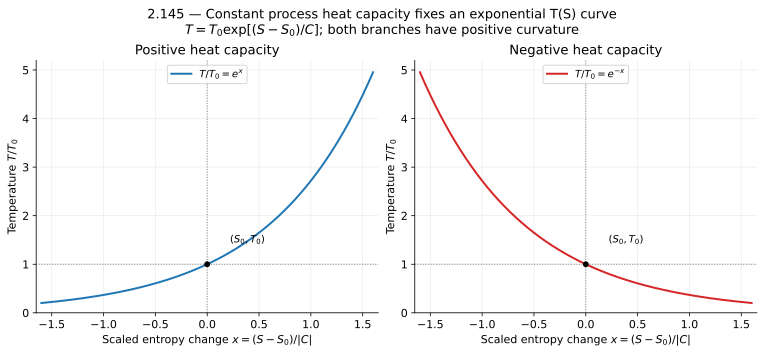

# 2.4 The Second Law of Thermodynamics. Entropy

[Chapter index](../README.md#chapters) · [Structured solutions](2.4.json) · [Answer audit](../audit/README.md)

## 2.113

**Solved · high confidence.** Compare the two Carnot efficiencies using the same finite positive temperature change.

**Assumptions**

- Initial reservoir temperatures obey Th>Tc>0. Use0<DeltaT<Tc so the cooled reservoir retains positive absolute temperature. Both cycles are reversible Carnot engines.

Write the modified efficiency for heating the hot body and for cooling the cold body.

$$
\eta_h=1-\frac{T_c}{T_h+\Delta T},\qquad\eta_c=1-\frac{T_c-\Delta T}{T_h}.
$$

Subtract the two efficiencies without assuming an infinitesimal change.

$$
\eta_c-\eta_h=\frac{\Delta T(T_h+\Delta T-T_c)}{T_h(T_h+\Delta T)}>0.
$$

**Results**

Change giving the higher Carnot efficiency

$$
\eta_c>\eta_h:\quad\text{lower the cold-body temperature by }\Delta T
$$

Exact difference between the two efficiencies

$$
\eta_c-\eta_h=\frac{\Delta T(T_h+\Delta T-T_c)}{T_h(T_h+\Delta T)}
$$

## 2.114

**Solved · high confidence.** Relate the Carnot temperature ratio to reversible ideal-gas adiabatic expansion ratios.

**Assumptions**

- Use ideal hydrogen with constant Appendix15 gamma=1.41. The adiabat connects the hot isotherm Th to the cold isotherm Tc, with reversible relations TV^(gamma−1)=constant and T p^((1−gamma)/gamma)=constant.
- The supplied factor n=2 applies respectively to volume increase or pressure decrease. A separately assumed rigid-diatomic gamma=1.40 model is given as an alternative; it is not substituted for the printed hydrogen datum.

Carnot efficiency depends only on the end temperatures of the adiabat.

$$
\eta=1-T_c/T_h.
$$

In part(a), the final volume is n times the initial volume.

$$
T_c/T_h=n^{1-\gamma},\qquad\eta_a=1-n^{1-\gamma}=1-2^{-0.41}=0.247376626.
$$

In part(b), the final pressure is initial pressure divided by n.

$$
T_c/T_h=n^{-(\gamma-1)/\gamma},\qquad\eta_b=1-n^{-(\gamma-1)/\gamma}=1-2^{-0.41/1.41}=0.182540105.
$$

The rigid-diatomic alternative uses gamma=1.40 consistently in each expression.

$$
\gamma=1.40:\qquad\eta_a=0.242141717,\qquad\eta_b=0.179664644.
$$

**Results**

Efficiency for twofold adiabatic volume expansion with Appendix hydrogen gamma

$$
\eta_a\simeq0.247377=24.7377\%
$$

Efficiency for twofold adiabatic pressure decrease with Appendix hydrogen gamma

$$
\eta_b\simeq0.182540=18.2540\%
$$

Alternative rigid-diatomic efficiency for the volume ratio

$$
\eta_a^{(\gamma=1.40)}\simeq0.242142
$$

Alternative rigid-diatomic efficiency for the pressure ratio

$$
\eta_b^{(\gamma=1.40)}\simeq0.179665
$$

**Limitations**

- The temperature range is unspecified. A refined hydrogen model with temperature-dependent heat capacities would require the hot temperature and an entropy integral.

## 2.115

**Solved · high confidence.** Express the reversed Carnot refrigerator coefficient of performance through the original engine efficiency.

**Assumptions**

- The same reservoirs are retained, and the reversible Carnot cycle is run backward. Refrigerating efficiency means the coefficient of performance Qcold/Win, not heat-pump performance Qhot/Win.

Relate the original efficiency to the reservoir temperature ratio.

$$
\eta=1-T_c/T_h=0.10,\qquad T_c/T_h=0.90.
$$

In the reversed cycle, reversible heat ratios give refrigerator performance.

$$
\varepsilon=\frac{Q_c}{W_{\rm in}}=\frac{T_c}{T_h-T_c}=\frac{1-\eta}{\eta}=9.
$$

**Results**

Carnot refrigerator coefficient of performance

$$
\varepsilon=9
$$

## 2.116

**Solved · high confidence.** Use reversible entropy closure to determine the cold isotherm compression and total heat balance.

**Assumptions**

- Figure2.2 on scan096 shows two isothermal expansions at T1 and T2 and one isothermal compression at T3, joined by three reversible adiabats; T1>T2>T3>0.
- Let each expansion volume ratio be r>1. The ideal gas has fixed mole number nu, and heat exchange occurs only on the isotherms.

Each isothermal expansion increases gas entropy by the same amount.

$$
\Delta S_1=\Delta S_2=\nu R\ln r,\qquad Q_1=\nu RT_1\ln r,\quad Q_2=\nu RT_2\ln r.
$$

Adiabats have no entropy change, so the cold compression must cancel the two expansion increments.

$$
\Delta S_3=-2\nu R\ln r,\qquad V_{3,\rm start}/V_{3,\rm end}=r^2,\qquad Q_{\rm out}=2\nu RT_3\ln r.
$$

Divide net cycle work by the total positive heat input.

$$
Q_{\rm in}=\nu R(T_1+T_2)\ln r,\qquad\eta=1-\frac{Q_{\rm out}}{Q_{\rm in}}=1-\frac{2T_3}{T_1+T_2}.
$$

**Results**

Efficiency of the Figure2.2 cycle

$$
\eta=1-2T_3/(T_1+T_2)
$$

## 2.117

**Solved · high confidence.** Use the reversible ideal-gas adiabats to compare the two constant-volume heat transfers.

**Assumptions**

- The ordinary clockwise Otto-type cycle contains two reversible adiabats and two externally heated/cooled isochores. The volume ratio is n=Vmax/Vmin=10.
- Use constant nitrogen gamma=1.40 from Appendix15. Perfect regeneration is not assumed.

Label1 the cold state at maximum volume,2 its adiabatically compressed state,3 the hot state at minimum volume, and4 its adiabatically expanded state.

$$
T_2=n^{\gamma-1}T_1,\qquad T_3=n^{\gamma-1}T_4.
$$

Both heat transfers use the same constant-volume capacity.

$$
Q_{\rm in}=\nu C_V(T_3-T_2),\quad Q_{\rm out}=\nu C_V(T_4-T_1),\quad Q_{\rm out}/Q_{\rm in}=n^{1-\gamma}.
$$

Evaluate the cycle efficiency.

$$
\eta=1-n^{1-\gamma}=1-10^{-0.40}=0.601892829.
$$

**Results**

Efficiency of the nitrogen cycle

$$
\eta\simeq0.601893=60.1893\%
$$

**Limitations**

- The fixed-gamma value assumes a calorically perfect nitrogen model across the unspecified cycle temperature range.

## 2.118

**Solved · high confidence.** Compare the isobaric heat transfers using the pressure ratio along the reversible adiabats.

**Assumptions**

- Use a clockwise ordinary Brayton-type ideal-gas cycle, two reversible adiabats and two external isobars, with constant gamma>1.
- n=pmax/pmin>1. There is no regenerative heat recovery; each positive or negative isobaric heat transfer is exchanged externally.

Let1→2 be adiabatic compression and3→4 adiabatic expansion. Their pressure ratios are reciprocal.

$$
T_2/T_1=T_3/T_4=n^{(\gamma-1)/\gamma}\equiv b.
$$

The hot isobar is2→3 and the cold isobar is4→1.

$$
Q_{\rm in}=\nu C_p(T_3-T_2),\qquad Q_{\rm out}=\nu C_p(T_4-T_1).
$$

Use the common adiabatic factor to eliminate the unspecified heating amplitude.

$$
T_4-T_1=(T_3-T_2)/b,\qquad\eta=1-n^{-(\gamma-1)/\gamma}.
$$

**Results**

Ordinary two-isobar/two-adiabat efficiency

$$
\eta=1-n^{-(\gamma-1)/\gamma}
$$

**Limitations**

- Adding a regenerator changes the external heat accounting and requires extra state information; that is a different cycle specification.

## 2.119

**Solved · high confidence.** Determine the four rectangle states and add both positive heat inputs.

**Assumptions**

- The ideal gas has constant gamma>1 and the cycle is clockwise with ordinary external heat exchange. Let A be the minimum-temperature state(p0,V0,T0).
- Isochoric heating and subsequent isobaric expansion each multiply temperature by n>1. This gives both a pressure ratio and a volume ratio equal to n.

Assign the four states in cycle order.

$$
A:(p_0,V_0,T_0),\quad B:(np_0,V_0,nT_0),\quad C:(np_0,nV_0,n^2T_0),\quad D:(p_0,nV_0,nT_0).
$$

Add the isochoric and isobaric positive heats.

$$
Q_{\rm in}=\nu C_VT_0(n-1)+\nu C_p nT_0(n-1)=\nu C_VT_0(n-1)(1+\gamma n).
$$

The rectangular cycle area is its net work.

$$
W=p_0V_0(n-1)^2=\nu RT_0(n-1)^2.
$$

Use Cp=gamma Cv and R=(gamma−1)Cv.

$$
\eta=\frac{W}{Q_{\rm in}}=\frac{(\gamma-1)(n-1)}{1+\gamma n}.
$$

**Results**

Ordinary rectangle-cycle efficiency

$$
\eta=(\gamma-1)(n-1)/(1+\gamma n)
$$

## 2.120

**Solved · high confidence.** Find the cold-isotherm compression ratio from closure, then compare the cold heat with the non-isothermal heating.

**Assumptions**

- The cycles are clockwise and quasistatic, with a reversible adiabat, fixed gas amount, constant ideal-gas gamma>1 and no regeneration.
- The isotherm is at Tl, the minimum temperature; Th=n Tl with n>1. Part(a) heats isochorically, part(b) heats isobarically, and the cold isotherm rejects heat.

In part(a), the isochore heats from Tl to Th, followed by adiabatic expansion back to Tl.

$$
V_{\rm cold,start}/V_{\rm cold,end}=n^{1/(\gamma-1)},\quad Q_{{\rm in},a}=\nu C_VT_l(n-1).
$$

Cold isothermal compression rejects heat proportional to the logarithm of that ratio.

$$
Q_{{\rm out},a}=\nu RT_l\frac{\ln n}{\gamma-1}=\nu C_VT_l\ln n.
$$

In part(b), the heating isobar itself expands by n before the adiabat adds its expansion ratio.

$$
V_{\rm cold,start}/V_{\rm cold,end}=n^{\gamma/(\gamma-1)},\quad Q_{{\rm in},b}=\nu C_pT_l(n-1),\quad Q_{{\rm out},b}=\nu C_pT_l\ln n.
$$

The capacity cancels in either ratio.

$$
\eta_a=\eta_b=1-\frac{\ln n}{n-1}.
$$

**Results**

Isochoric/adiabatic/cold-isothermal cycle efficiency

$$
\eta_a=1-\ln n/(n-1)
$$

Isobaric/adiabatic/cold-isothermal cycle efficiency

$$
\eta_b=1-\ln n/(n-1)
$$

## 2.121

**Solved · high confidence.** Determine the hot isothermal expansion needed to balance the non-isothermal cooling entropy.

**Assumptions**

- The cycles are clockwise, quasistatic and ordinary, with a reversible adiabat and constant ideal-gas heat capacities.
- The isotherm is at Th, the maximum temperature; Tl=Th/n with n>1. Part(a) rejects heat isochorically; part(b) rejects heat isobarically.

In part(a), an isothermal expansion at Th is followed by isochoric cooling to Tl, then adiabatic compression closes the cycle.

$$
V_{\rm hot,end}/V_{\rm hot,start}=n^{1/(\gamma-1)},\quad Q_{{\rm in},a}=\nu C_VT_h\ln n,\quad Q_{{\rm out},a}=\nu C_VT_h(1-1/n).
$$

In part(b), hot isothermal expansion is followed by isobaric cooling; the adiabat closes the cycle.

$$
V_{\rm hot,end}/V_{\rm hot,start}=n^{\gamma/(\gamma-1)},\quad Q_{{\rm in},b}=\nu C_pT_h\ln n,\quad Q_{{\rm out},b}=\nu C_pT_h(1-1/n).
$$

Form the same heat ratio for the two capacities.

$$
\eta_a=\eta_b=1-\frac{1-1/n}{\ln n}.
$$

**Results**

Isochoric/adiabatic/hot-isothermal cycle efficiency

$$
\eta_a=1-(1-1/n)/\ln n
$$

Isobaric/adiabatic/hot-isothermal cycle efficiency

$$
\eta_b=1-(1-1/n)/\ln n
$$

## 2.122

**Solved · high confidence.** Use reversible entropy closure and the constant heat capacity of a nondegenerate polytropic branch.

**Assumptions**

- The cycle is a clockwise ideal-gas engine with constant intrinsic Cv and gamma>1, a reversible adiabat and an isotherm at Th. The full temperature ratio is n=Th/Tl>1.
- Write the polytropic law as p V^q=constant, distinguishing its exponent q from the given temperature factor n. For q≠1 it has constant process capacity Cq=Cv+R/(1−q).
- The ordinary three-branch cycle has external heat input on the hot isotherm and heat rejection on the polytrope. Its direction is selected to make this true, including when Cq is negative.

State the process heat capacity and identify whether cooling or heating rejects heat.

$$
C_q=C_V+\frac{R}{1-q}=\frac{R(\gamma-q)}{(\gamma-1)(1-q)}.\quad C_q>0:\ T_h\to T_l;\qquad C_q<0:\ T_l\to T_h.
$$

A positive-capacity cooling polytrope and a negative-capacity heating polytrope have the same negative entropy-change magnitude.

$$
\Delta S_{\rm poly}=-\nu|C_q|\ln n,\qquad Q_{\rm out}=\nu|C_q|(T_h-T_l).
$$

The reversible adiabat has zero entropy change, so the hot-isotherm heat input cancels the polytrope entropy change.

$$
Q_{\rm in}/T_h=\nu|C_q|\ln n,\qquad Q_{\rm in}=\nu|C_q|T_h\ln n.
$$

The otherwise unspecified polytropic capacity cancels from the efficiency.

$$
\eta=1-\frac{Q_{\rm out}}{Q_{\rm in}}=1-\frac{1-1/n}{\ln n}.
$$

The isobaric and isochoric limits reproduce the previous problem; the exact isothermal and adiabatic exponents are degenerate.

$$
q=0:\ C_q=C_p;\qquad |q|\to\infty:\ C_q\to C_V.\qquad q=1\ \text{or}\ q=\gamma:\ \text{no nondegenerate three-branch engine with }n>1.
$$

**Results**

Efficiency for a nondegenerate finite-capacity polytropic branch

$$
\eta=1-(1-1/n)/\ln n
$$

For q≠1,gamma with the proper engine orientation; the capacity may be positive or negative.

Excluded exact polytropic degeneracies

$$
q=1\ \text{(isothermal)},\qquad q=\gamma\ \text{(adiabatic)}
$$

A finite efficiency formula at these exponents would divide vanishing or geometrically degenerate heat/work; evaluate the actual path separately.

**Limitations**

- The pressure exponent alone is insufficient if the gas has temperature-dependent intrinsic heat capacity; the stated result uses the calorically perfect model.

## 2.123

**Solved · high confidence.** Use the stated adiabatic volume ratio to construct each clockwise triangular cycle and identify its heating leg.

**Assumptions**

- Use a fixed amount of ideal gas with constant gamma>1. The three branches are a reversible adiabat, an isobar and an isochore, with the clockwise orientation specified in the statement.
- n>1 is the volume ratio along the adiabat. In part(a) the adiabat expands; in part(b) it compresses. Other non-isothermal heat transfers are external and ordinary.

For part(a), start the expanding adiabat at A(p0,V0,T0). B has nV0, and the following isobar compresses to V0 before isochoric heating closes the cycle.

$$
A\to B:\quad T_B=T_0n^{1-\gamma};\qquad C:\ T_C=T_0n^{-\gamma}.
$$

In this orientation the isochore supplies heat and the isobar rejects it.

$$
Q_{{\rm in},a}=\nu C_VT_0(1-n^{-\gamma}),\qquad Q_{{\rm out},a}=\nu C_pT_0n^{-\gamma}(n-1),\qquad\eta_a=1-\frac{\gamma(n-1)}{n^\gamma-1}.
$$

For part(b), take A at the start of adiabatic compression and follow compression by isobaric expansion back to the original volume.

$$
T_B=T_0n^{\gamma-1},\qquad T_C=T_0n^\gamma.
$$

The isobar now supplies heat, while the closing isochore rejects it.

$$
Q_{{\rm in},b}=\nu C_pT_0n^{\gamma-1}(n-1),\qquad Q_{{\rm out},b}=\nu C_VT_0(n^\gamma-1),\qquad\eta_b=1-\frac{n^\gamma-1}{\gamma n^{\gamma-1}(n-1)}.
$$

**Results**

Efficiency with adiabatic volume expansion

$$
\eta_a=1-\gamma(n-1)/(n^\gamma-1)
$$

Efficiency with adiabatic volume compression

$$
\eta_b=1-(n^\gamma-1)/[\gamma n^{\gamma-1}(n-1)]
$$

## 2.124

**Solved · high confidence.** Construct each clockwise isothermal/isobaric/isochoric triangle and sum all positive heats.

**Assumptions**

- Use a calorically perfect ideal gas with gamma>1. The question is interpreted as a direct engine cycle; reversing the cycle would require work and would not have an engine efficiency.
- n>1 is the volume factor on the isotherm. Part(a) has hot isothermal expansion and part(b) cold isothermal compression. No regenerative heat recovery is included.

For part(a), expand isothermally at Th from V0 to nV0, compress isobarically to V0 at temperature Th/n, and reheat isochorically.

$$
Q_{{\rm in},a}=\nu RT_h\ln n+\nu C_VT_h(1-1/n),\qquad Q_{{\rm out},a}=\nu C_pT_h(1-1/n).
$$

Subtract the heat magnitudes and form the efficiency for part(a).

$$
W_a=\nu RT_h[\ln n-(1-1/n)],\qquad\eta_a=\frac{(\gamma-1)[\ln n-(1-1/n)]}{(\gamma-1)\ln n+(1-1/n)}.
$$

For part(b), compress isothermally at Tl from nV0 to V0, expand isobarically back to nV0 at temperature nTl, and cool isochorically.

$$
Q_{{\rm in},b}=\nu C_pT_l(n-1),\qquad Q_{{\rm out},b}=\nu C_VT_l(n-1)+\nu RT_l\ln n.
$$

Use the net work for the part(b) heat ratio.

$$
W_b=\nu RT_l[(n-1)-\ln n],\qquad\eta_b=\frac{\gamma-1}{\gamma}\left[1-\frac{\ln n}{n-1}\right].
$$

**Results**

Efficiency for isothermal volume expansion

$$
\eta_a=\frac{(\gamma-1)[\ln n-(1-1/n)]}{(\gamma-1)\ln n+(1-1/n)}
$$

Efficiency for isothermal volume compression

$$
\eta_b=\frac{\gamma-1}{\gamma}[1-\ln n/(n-1)]
$$

## 2.125

**Solved · high confidence.** Calculate the ordinary Stirling-cycle work and include isochoric reheating in external heat input.

**Assumptions**

- Let r=Vmax/Vmin be the statement’s volume factor nu, and tau=Th/Tl>1. Use nu_g for the number of moles to avoid confusing it with the supplied volume factor.
- The cycle is clockwise with constant gamma>1, two reversible isotherms and two isochores. The primary answer is the ordinary cycle without a regenerator. The perfect-regeneration alternative is labeled separately.

The isothermal expansion and compression give the complete net work; the isochores do no work.

$$
W=\nu_gR(T_h-T_l)\ln r.
$$

External heat input includes hot isothermal expansion and constant-volume heating from Tl to Th.

$$
Q_{\rm in}=\nu_gRT_h\ln r+\nu_gC_V(T_h-T_l).
$$

Form the ordinary-cycle efficiency in terms of the supplied ratios.

$$
\eta_{\rm ordinary}=\frac{(\tau-1)\ln r}{\tau\ln r+(\tau-1)/(\gamma-1)},\qquad r=\nu_{\rm statement}.
$$

An ideal internal regenerator can store all isochoric cooling heat and return it on the heating isochore. Then only the hot and cold isothermal heats cross the external boundary.

$$
Q_{{\rm in},\rm reg}=\nu_gRT_h\ln r,\qquad\eta_{\rm perfect\ reg}=1-T_l/T_h=1-1/\tau.
$$

**Results**

Ordinary efficiency without regenerative heat recovery

$$
\eta=\frac{(\tau-1)\ln\nu}{\tau\ln\nu+(\tau-1)/(\gamma-1)}
$$

Here nu is the given volume ratio, not the mole number.

Alternative for a specified perfect internal regenerator

$$
\eta_{\rm reg}=1-1/\tau
$$

This changes which heat transfers count as external and is not assumed in the primary answer.

**Limitations**

- Without specifying regeneration, assigning the Carnot value to the ordinary four-leg gas cycle would omit the external isochoric heating.

## 2.126

**Solved · high confidence.** Include the isobaric heating in the ordinary Ericsson-cycle heat input and compare a perfectly regenerated cycle.

**Assumptions**

- The cycle is clockwise with ideal gas and constant gamma>1. The given ratios are n=pmax/pmin>1 and tau=Th/Tl>1.
- The primary answer treats all four gas branches as ordinary external heat exchange. A perfect-regeneration alternative treats the equal isobaric heating/cooling duties as internal recovery.

On the hot and cold isotherms, the pressure ratio n is the corresponding volume ratio in opposite directions.

$$
W=\nu R(T_h-T_l)\ln n.
$$

Ordinary external heat input includes isobaric warming as well as hot isothermal expansion.

$$
Q_{\rm in}=\nu C_p(T_h-T_l)+\nu RT_h\ln n,\qquad C_p=\frac\gamma{\gamma-1}R.
$$

Take the ratio in dimensionless temperature and pressure factors.

$$
\eta_{\rm ordinary}=\frac{(\tau-1)\ln n}{\tau\ln n+[\gamma/(\gamma-1)](\tau-1)}.
$$

Perfect internal regeneration removes the isobaric duty from external heat input but not from the gas-path bookkeeping.

$$
Q_{{\rm in},\rm reg}=\nu RT_h\ln n,\qquad\eta_{\rm perfect\ reg}=1-1/\tau.
$$

**Results**

Ordinary two-isobar/two-isotherm efficiency

$$
\eta=\frac{(\tau-1)\ln n}{\tau\ln n+[\gamma/(\gamma-1)](\tau-1)}
$$

Alternative with perfect internal regeneration

$$
\eta_{\rm reg}=1-1/\tau
$$

**Limitations**

- A regenerator is additional equipment and is not silently assumed from the gas-path shape.

## 2.127

**Solved · high confidence.** Use the origin-directed straight branch in Figure2.3 to infer the rectangle ratios and heat input.

**Assumptions**

- Figure2.3 on scan097 shows A→B along a straight p,V line whose dashed extension passes through the origin, B→C down an isochore, and C→A left on an isobar. Thus p=aV on A→B.
- The ideal gas has fixed mole number nu and constant gamma>1. Let r=VB/VA=pB/pA>1. The supplied full temperature factor is tau=Tmax/Tmin.

Use the ideal-gas equation at the three vertices to locate the temperature extrema.

$$
T_A=T_0,\qquad T_B=r^2T_0,\qquad T_C=rT_0,\qquad\tau=r^2.
$$

Along p=aV, temperature is proportional to V² and pressure work per temperature increment is nu R/2.

$$
dT/T=2dV/V,\qquad\delta Q=\nu(C_V+R/2)dT,\qquad Q_{\rm in}=\nu\frac{R(\gamma+1)}{2(\gamma-1)}T_0(r^2-1).
$$

The triangle area gives net cycle work; both remaining branches reject heat.

$$
W=\frac12(p_B-p_A)(V_B-V_A)=\frac12\nu RT_0(r-1)^2.
$$

Divide the area by heat input and replace r by square root of tau.

$$
\eta=\frac{\gamma-1}{\gamma+1}\frac{r-1}{r+1}=\frac{\gamma-1}{\gamma+1}\frac{\sqrt\tau-1}{\sqrt\tau+1}.
$$

**Results**

Efficiency of the Figure2.3 triangular cycle

$$
\eta=\frac{\gamma-1}{\gamma+1}\frac{\sqrt\tau-1}{\sqrt\tau+1}
$$

**Limitations**

- The formula relies on the sloping line passing through the origin. A straight line with an unknown nonzero pressure intercept would require an additional geometric ratio.

## 2.128

**Solved · high confidence.** Bound the positive and negative Clausius integrals using the extreme heat-transfer temperatures.

**Assumptions**

- Consider an engine cycle with Qin>0 and Qout>0, using positive magnitudes for absorbed and rejected heat. Heat-transfer boundary temperatures are positive and lie within Tmin<=T<=Tmax.
- Use the cyclic Clausius inequality integral(deltaQ/T)<=0. The literal claim that every such cycle is strictly less efficient is too strong: the theorem is a non-strict bound, with strictness conditions stated below.

Separate the entropy-transfer integrals into positive and negative heat portions.

$$
A=\int_{\delta Q>0}\frac{\delta Q}{T},\qquad B=\int_{\delta Q<0}\frac{|\delta Q|}{T},\qquad A-B\le0.
$$

Temperature extrema separately bound the two integrals.

$$
\frac{Q_{\rm in}}{T_{\max}}\le A\le B\le\frac{Q_{\rm out}}{T_{\min}}.
$$

The resulting lower bound on rejected heat gives the efficiency bound.

$$
\frac{Q_{\rm out}}{Q_{\rm in}}\ge\frac{T_{\min}}{T_{\max}},\qquad\eta=1-\frac{Q_{\rm out}}{Q_{\rm in}}\le1-\frac{T_{\min}}{T_{\max}}=\eta_C.
$$

Equality requires equality in every step: reversible entropy balance and heat exchange only at the corresponding extremes.

$$
\eta=\eta_C\iff A=B,\quad T=T_{\max}\ \text{on all heat input},\quad T=T_{\min}\ \text{on all heat rejection}.
$$

If any positive-measure heat input is below Tmax, any rejection is above Tmin, or the Clausius inequality is strict, the efficiency is strictly smaller.

$$
\eta<\eta_C\quad\text{whenever at least one of the preceding inequalities is strict}.
$$

**Results**

Correct general Carnot bound

$$
\eta\le1-T_{\min}/T_{\max}
$$

Strict inequality under non-Carnot heat-transfer or irreversibility conditions

$$
\eta<\eta_C\quad\text{if intermediate-temperature external heat exchange or entropy production makes a bound strict}
$$

Possible equality

$$
\eta=\eta_C\quad\text{for a reversible cycle exchanging external heat only at the two extremes}
$$

The Carnot cycle itself, and a perfectly regenerated reversible composite cycle with the same external heat temperatures, show why unconditional strictness is false.

**Limitations**

- The temperatures used to bound the Clausius heat integral must include the actual heat-transfer boundary temperatures; the standard quasistatic working-gas interpretation is assumed.

## 2.129

**Solved · high confidence.** Apply the Carnot efficiency theorem to an infinitesimal reversible cycle in the pressure–volume plane.

**Assumptions**

- The substance is a homogeneous equilibrium simple compressible system of fixed amount and composition; pressure-volume work is the only mechanical work.
- Use a reversible infinitesimal Carnot cycle with hot temperature T and cold temperature T−dT. Let dV be the small hot-isotherm expansion; retain the leading order in cycle work dT dV.

On the hot isotherm the energy and work increments give the absorbed heat.

$$
\delta Q_h=dU+p\,dV=\left[\left(\frac{\partial U}{\partial V}\right)_T+p\right]dV.
$$

The area of the narrow cycle is its work. The vertical separation of neighboring isotherms at fixed V is (partial p/partial T)_V dT; to leading order their adiabatic connectors make a parallelogram.

$$
\delta W=\left(\frac{\partial p}{\partial T}\right)_V dT\,dV.
$$

Carnot efficiency equates this work/heat ratio to the infinitesimal relative temperature difference.

$$
\frac{\delta W}{\delta Q_h}=1-\frac{T-dT}{T}=\frac{dT}{T}\quad\Longrightarrow\quad\left(\frac{\partial U}{\partial V}\right)_T+p=T\left(\frac{\partial p}{\partial T}\right)_V.
$$

Rearrange to obtain the requested identity.

$$
\boxed{\left(\frac{\partial U}{\partial V}\right)_T=T\left(\frac{\partial p}{\partial T}\right)_V-p}.
$$

**Results**

Volume derivative of internal energy at fixed temperature

$$
\left(\frac{\partial U}{\partial V}\right)_T=T\left(\frac{\partial p}{\partial T}\right)_V-p
$$

## 2.130

**Solved · high confidence.** Integrate dS=C dT/T on the fixed-volume and fixed-pressure paths using the Appendix carbon-dioxide heat-capacity convention.

**Assumptions**

- There is one mole of ideal CO2. Use constant Appendix Table 15 gamma=1.30, so Cv=R/0.30 and Cp=1.30R/0.30.
- Only the temperature ratio2.0 is given. A numerical answer therefore uses this explicitly stated constant-capacity model; the more general integral forms are also supplied.

For constant volume and pressure the reversible reference heats per mole are Cv dT and Cp dT respectively.

$$
\Delta S_V=\int_{T_1}^{T_2}\frac{C_V(T)}T\,dT,\qquad\Delta S_p=\int_{T_1}^{T_2}\frac{C_p(T)}T\,dT.
$$

With the stated constant capacities, each integral is a logarithm of the temperature ratio.

$$
\Delta S_V=\frac{R}{\gamma-1}\ln n,\qquad\Delta S_p=\frac{\gamma R}{\gamma-1}\ln n.
$$

Insert the printed gas constant, tabulated ratio and n=2.

$$
\Delta S_V=\frac{8.314}{0.30}\ln2=19.2094189\ \mathrm{J/K},\qquad\Delta S_p=\frac{1.30(8.314)}{0.30}\ln2=24.9722445\ \mathrm{J/K}.
$$

**Results**

Isochoric entropy increase with the Appendix constant-capacity model

$$
\Delta S_V=\frac{R}{\gamma-1}\ln2\simeq19.2\ \mathrm{J/K}
$$

Isobaric entropy increase with the same model

$$
\Delta S_p=\frac{\gamma R}{\gamma-1}\ln2\simeq25.0\ \mathrm{J/K}
$$

**Limitations**

- Ideal-gas behavior alone does not fix heat capacity. With appreciable temperature dependence, retain the integral expressions; a temperature ratio alone is insufficient for a unique numerical value.

## 2.131

**Solved · high confidence.** Invert the ideal-gas isothermal entropy formula for the volume ratio.

**Assumptions**

- The source repeats nu=4.0 moles inside its volume question. Interpret the intended question as the volume increase factor for that same fixed four-mole gas sample.
- The initial and final temperatures are equal, so no heat-capacity information is needed.

The volume part of the ideal-gas entropy difference is logarithmic.

$$
\Delta S=\nu R\ln\frac{V_2}{V_1}.
$$

Exponentiate and insert the stated entropy increase.

$$
\frac{V_2}{V_1}=\exp\left(\frac{\Delta S}{\nu R}\right)=\exp\left(\frac{23}{4.0(8.314)}\right)=1.99691706.
$$

**Results**

Required volume increase factor

$$
V_2/V_1=e^{\Delta S/(\nu R)}\simeq2.00
$$

## 2.132

**Solved · high confidence.** Determine the endpoint volume ratio from the two path legs, then use the equal-temperature ideal-gas entropy difference.

**Assumptions**

- There are two moles. The first isochoric cooling reduces pressure from pi to pi/n with n=3.3; the next isobaric expansion restores temperature to its initial value.
- The scan says expansion will lower the temperature back to its initial value. After cooling, isobaric expansion raises T; interpret the intended endpoint as returning to the initial T while preserving the stated cooling and expansion.

At fixed volume the intermediate temperature follows the pressure ratio.

$$
T_a=T_i/n,\qquad V_a=V_i,\qquad p_a=p_i/n.
$$

At fixed pressure restoring temperature to Ti requires a matching volume increase.

$$
T_f=T_i,\quad p_f=p_i/n,\qquad\frac{V_f}{V_i}=\frac{T_f}{T_a}=n.
$$

The initial and final temperatures agree, so the thermal entropy contribution cancels even for temperature-dependent heat capacity.

$$
\Delta S=\nu\int_{T_i}^{T_f}\frac{C_V(T)}T\,dT+\nu R\ln\frac{V_f}{V_i}=2R\ln3.3=19.8525428\ \mathrm{J/K}.
$$

**Results**

Net gas entropy increase

$$
\Delta S=2R\ln3.3\simeq19.9\ \mathrm{J/K}
$$

## 2.133

**Solved · high confidence.** Use zero entropy change on the reversible adiabat and compute the entropy loss of the following isobaric compression.

**Assumptions**

- Helium is ideal monatomic gas with exact Cv=3R/2 and Cp=5R/2; the Appendix gamma 1.67 is its rounded reference value. Its molar mass is 0.004 kg/mol.
- The adiabatic volume increase by n=3 is reversible; the isobaric compression then returns to the initial volume. The gas amount is m/M=0.425 mol.

The adiabat lowers temperature but has no entropy change.

$$
V_a=nV_i,\qquad T_a=T_i n^{-2/3},\qquad\Delta S_{\rm ad}=0.
$$

At constant pressure temperature is proportional to volume. Compressing from nVi to Vi reduces temperature by a further factor n.

$$
T_f/T_a=V_f/V_a=1/n,\qquad\Delta S_p=\nu C_p\ln(T_f/T_a)=-\frac{5mR}{2M}\ln n.
$$

Substitute the helium mass and molar mass.

$$
\Delta S=-\frac{(5)(0.0017)(8.314)}{2(0.004)}\ln3=-9.70472898\ \mathrm{J/K}.
$$

**Results**

Gas entropy increment

$$
\Delta S=-\frac{5mR}{2M}\ln n\simeq-9.70\ \mathrm{J/K}
$$

**Limitations**

- An arbitrary irreversible adiabatic expansion has entropy generation and is not fixed by the stated volume ratio alone. The usual reversible adiabatic model is used.

## 2.134

**Solved · high confidence.** Use the ideal-gas endpoint entropy formula after finding the temperature ratio from pV.

**Assumptions**

- The fixed two-mole ideal gas has constant gamma=1.30. Volume increases by alpha=2 and pressure decreases by beta=3.

The equation of state fixes the endpoint temperature ratio.

$$
T_2/T_1=(p_2V_2)/(p_1V_1)=\alpha/\beta=2/3.
$$

Insert both temperature and volume changes into the entropy difference.

$$
\Delta S=\nu C_V\ln\frac{T_2}{T_1}+\nu R\ln\frac{V_2}{V_1}=\frac{\nu R}{\gamma-1}\left(\gamma\ln\alpha-\ln\beta\right).
$$

Evaluate with the supplied gamma.

$$
\Delta S=\frac{2(8.314)}{0.30}\left(1.30\ln2-\ln3\right)=-10.9479281\ \mathrm{J/K}.
$$

**Results**

Gas entropy increment

$$
\Delta S=\frac{\nu R}{\gamma-1}\ln\frac{\alpha^\gamma}{\beta}\simeq-10.9\ \mathrm{J/K}
$$

**Limitations**

- If Cv changes appreciably between the endpoint temperatures, replace Cv ln(T2/T1) by its temperature integral; absolute temperatures would then be needed.

## 2.135

**Solved · high confidence.** Compare the entropy of equal helium amounts using the same entropy reference state.

**Assumptions**

- Interpret the statement as each vessel containing nu=1.2 mol helium. Their compositions and amounts are identical, so the additive entropy reference cancels.
- Use exact monatomic ideal-gas Cv=3R/2. Given alpha=V2/V1=2 and beta=T1/T2=1.5 imply T2/T1=1/beta.

The equal-amount ideal-gas entropy difference contains a temperature and a volume logarithm.

$$
S_2-S_1=\nu C_V\ln(T_2/T_1)+\nu R\ln(V_2/V_1).
$$

Use the given ratios, taking care to invert the temperature ratio.

$$
S_2-S_1=\nu R\left(\ln\alpha-\frac32\ln\beta\right)=1.2(8.314)\left(\ln2-\frac32\ln1.5\right)=0.847524355\ \mathrm{J/K}.
$$

**Results**

Entropy in vessel2 minus entropy in vessel1

$$
S_2-S_1=\nu R\ln(\alpha/\beta^{3/2})\simeq0.848\ \mathrm{J/K}
$$

**Limitations**

- If 1.2 mol described only the combined amount rather than the amount in each vessel, their entropy difference would require the separate amounts. The primary result uses the usual equal-amount reading.

## 2.136

**Solved · high confidence.** Combine the ideal-gas entropy differential with the polytropic temperature-volume relation.

**Assumptions**

- There is one mole with constant gamma and Cv=R/(gamma−1). The path is a quasistatic polytrope pV^n=constant, and tau=Tf/Ti>0.
- The finite formula assumes n is not1. The stated temperature increase tau>1 rules out a nontrivial isothermal n=1 path.

The polytropic law and ideal-gas equation determine the endpoint volume ratio.

$$
TV^{n-1}=\mathrm{const},\qquad\ln(V_f/V_i)=\frac{\ln\tau}{1-n}\quad(n\ne1).
$$

Substitute into the endpoint entropy difference.

$$
\Delta S=C_V\ln\tau+R\ln(V_f/V_i)=\left[\frac{R}{\gamma-1}+\frac{R}{1-n}\right]\ln\tau=\frac{R(\gamma-n)}{(\gamma-1)(1-n)}\ln\tau.
$$

Handle the isothermal degeneracy separately.

$$
n=1:\quad\tau=1,\qquad\Delta S=R\ln(V_f/V_i),\quad\text{not fixed by }\tau\text{ alone}.
$$

**Results**

Entropy increment for n not equal to1

$$
\Delta S=\frac{R(\gamma-n)}{(\gamma-1)(1-n)}\ln\tau
$$

Isothermal degeneracy n=1

$$
\tau=1,\qquad\Delta S=R\ln(V_f/V_i)
$$

A stated temperature increase is incompatible with n=1; if tau=1, the missing volume ratio is still required.

## 2.137

**Solved · high confidence.** Use the pressure-volume proportionality to find the temperature ratio and integrate the argon entropy difference.

**Assumptions**

- There are two moles of ideal monatomic argon with exact Cv=3R/2, using the classical model rather than treating rounded Table 15 gamma 1.67 as exact.
- The path has p proportional to V and expands to alpha times the initial volume.

The equation of state makes temperature proportional to V².

$$
p=cV\quad\Longrightarrow\quad T_f/T_i=(V_f/V_i)^2=\alpha^2.
$$

Evaluate the thermal and volume logarithms.

$$
\Delta S=\nu\frac32R\ln(\alpha^2)+\nu R\ln\alpha=4\nu R\ln\alpha.
$$

Insert nu=2 and alpha=2.

$$
\Delta S=8R\ln2=46.1026053\ \mathrm{J/K}.
$$

**Results**

Argon entropy increase

$$
\Delta S=4\nu R\ln\alpha=8R\ln2\simeq46.1\ \mathrm{J/K}
$$

## 2.138

**Solved · high confidence.** Maximize the ideal-gas entropy expressed directly as a function of the prescribed pressure and volume.

**Assumptions**

- The gas amount nu is fixed with constant gamma>1 and positive constant Cv,Cp. Only physical states 0<V<p0/alpha are included, so pressure and temperature stay positive.

Use T=pV/(nu R) in S=nu Cv ln T+nu R ln V+constant.

$$
S(V)=\nu C_V\ln(p_0-\alpha V)+\nu C_p\ln V+\mathrm{const}.
$$

Set the derivative to zero and use Cp/Cv=gamma.

$$
\frac{dS}{dV}=-\frac{\nu C_V\alpha}{p_0-\alpha V}+\frac{\nu C_p}{V}=0\quad\Longrightarrow\quad\gamma(p_0-\alpha V)=\alpha V.
$$

The stationary volume is inside the physical interval. Strict concavity makes it the unique global maximum.

$$
V_* =\frac{\gamma p_0}{(\gamma+1)\alpha},\qquad\frac{d^2S}{dV^2}=-\frac{\nu C_V\alpha^2}{(p_0-\alpha V)^2}-\frac{\nu C_p}{V^2}<0.
$$

**Results**

Volume at maximum gas entropy

$$
V_* =\frac{\gamma}{\gamma+1}\frac{p_0}{\alpha}
$$

**Limitations**

- If heat capacities depend on temperature, the stationary condition becomes V*=[Cp(T*)/Cv(T*)]p0/[(1+Cp(T*)/Cv(T*))alpha] and generally needs an implicit solution.

## 2.139

**Solved · high confidence.** Cancel the common constant-volume thermal entropy term against the ideal-gas entropy difference.

**Assumptions**

- There is one mole of ideal gas with constant molar Cv, and a>0. The logarithm of T in the source implicitly uses a reference temperature; differences remove that reference.
- a has units J/K², since aT contributes entropy. The entropy law holds along the stated path.

Take differences of the prescribed entropy relation between the reference point and a general point.

$$
S-S_0=a(T-T_0)+C_V\ln(T/T_0).
$$

For one mole of ideal gas the same entropy difference also contains the volume logarithm.

$$
S-S_0=C_V\ln(T/T_0)+R\ln(V/V_0).
$$

Cancel the equal thermal logarithms to obtain temperature as an explicit function of volume.

$$
a(T-T_0)=R\ln(V/V_0)\quad\Longrightarrow\quad T(V)=T_0+\frac Ra\ln\frac V{V_0}.
$$

**Results**

Temperature along the specified entropy path

$$
T(V)=T_0+\frac Ra\ln(V/V_0)
$$

**Limitations**

- The cancellation assumes the printed constant-Cv form. With variable Cv(T), the thermodynamically consistent thermal entropy term is its integral, not Cv ln T.

## 2.140

**Solved · high confidence.** Use the isothermal entropy derivative obtained from the van der Waals equation of state.

**Assumptions**

- There is one mole, so V is its molar volume. Use p=RT/(V−b)−a/V² with constant van der Waals parameters and positive volumes V1,V2 greater than b.
- Entropy is a state function; use a reversible reference isotherm even if the actual volume change is irreversible.

Apply the internal-energy identity from2.129 to the van der Waals equation.

$$
\left(\frac{\partial p}{\partial T}\right)_V=\frac R{V-b},\qquad\left(\frac{\partial U}{\partial V}\right)_T=\frac a{V^2}.
$$

On a reversible isotherm, add the internal-energy change and pressure work before dividing by temperature.

$$
dS=\frac{dU+p\,dV}{T}=\frac1T\left[\frac a{V^2}+\frac{RT}{V-b}-\frac a{V^2}\right]dV=R\frac{dV}{V-b}.
$$

Integrate between the specified volumes.

$$
\Delta S=R\ln\frac{V_2-b}{V_1-b}.
$$

**Results**

Isothermal van der Waals entropy increment

$$
\Delta S=R\ln\frac{V_2-b}{V_1-b}
$$

## 2.141

**Solved · high confidence.** Integrate the temperature and volume parts of the thermodynamically consistent van der Waals entropy differential.

**Assumptions**

- There is one mole with p=RT/(V−b)−a/V²; V1,V2>b and T1,T2>0. Use a reversible reference path connecting the two states.
- The standard constant-Cv answer is primary. If the known molar heat capacity is supplied as a function of T, retain its integral; thermodynamic consistency of this equation of state makes Cv independent of V.

The volume derivative found from the equation of state is R/(V−b), while the fixed-volume thermal entropy derivative is Cv(T)/T.

$$
dS=\frac{C_V(T)}T\,dT+R\frac{dV}{V-b}.
$$

Integrate in temperature at fixed volume and then in volume at fixed temperature.

$$
\Delta S=\int_{T_1}^{T_2}\frac{C_V(T)}T\,dT+R\ln\frac{V_2-b}{V_1-b}.
$$

For constant molar Cv the thermal integral reduces to a logarithm.

$$
\Delta S=C_V\ln\frac{T_2}{T_1}+R\ln\frac{V_2-b}{V_1-b}.
$$

**Results**

Entropy increment with constant molar Cv

$$
\Delta S=C_V\ln(T_2/T_1)+R\ln[(V_2-b)/(V_1-b)]
$$

Entropy increment for known Cv(T)

$$
\Delta S=\int_{T_1}^{T_2}\frac{C_V(T)}T\,dT+R\ln[(V_2-b)/(V_1-b)]
$$

## 2.142

**Solved · high confidence.** Integrate the low-temperature reversible heat-capacity relation without suppressing the entropy reference constant.

**Assumptions**

- The stated C=aT³ is the heat capacity of the whole crystal on its specified equilibrium heating path, with a>0 in the physical branch.
- The heat-capacity law fixes entropy differences only. A zero-temperature normalization requires an additional third-law assumption and extension of the low-temperature law toward 0.

The reversible entropy increment is heat capacity divided by absolute temperature times dT.

$$
dS=\frac{C(T)}T\,dT=aT^2\,dT.
$$

Integrate within the interval over which the heat-capacity law applies.

$$
S(T)=S(T_r)+\frac a3(T^3-T_r^3).
$$

If the interval extends toward zero temperature, retain the integration constant explicitly.

$$
S(T)=S(0)+\frac a3T^3.
$$

For a perfect pure equilibrium crystal with a nondegenerate ground state, the usual third-law normalization sets S(0)=0.

$$
S(0)=0\quad\Longrightarrow\quad S(T)=\frac a3T^3.
$$

**Results**

Entropy with its undetermined reference constant

$$
S(T)=S(0)+aT^3/3
$$

Entropy with the perfect-crystal third-law normalization

$$
S(T)=aT^3/3\quad\text{if }S(0)=0
$$

**Limitations**

- If the given law is known only on a finite low-temperature interval, use the reference-temperature difference formula; absolute entropy is not fixed without a boundary condition.

## 2.143

**Solved · high confidence.** Integrate the temperature-dependent specific heat divided by temperature over the stated heating interval.

**Assumptions**

- Use the given specific heat on the heating path and no phase transition between 300 and 600 K. A reversible reference heating path determines the entropy change.
- Convert a=0.77 J/(g K) to 770 J/(kg K) and b=0.46 mJ/(g K²) to 0.46 J/(kg K²); bar mass is 3.0 kg.

The entropy differential for the whole bar is m c(T) dT/T.

$$
\Delta S=m\int_{T_1}^{T_2}\frac{a+bT}{T}\,dT=m\left[a\ln(T_2/T_1)+b(T_2-T_1)\right].
$$

Insert all quantities in consistent kilogram-based units.

$$
\Delta S=3.0\left[770\ln(600/300)+0.46(600-300)\right]\ \mathrm{J/K}=2015.16999\ \mathrm{J/K}.
$$

**Results**

Aluminum bar entropy increase

$$
\Delta S=m[a\ln(T_2/T_1)+b(T_2-T_1)]\simeq2.02\times10^3\ \mathrm{J/K}
$$

## 2.144

**Solved · high confidence.** Differentiate the temperature–entropy relation and use the reversible process heat-capacity definition.

**Assumptions**

- Treat C as the heat capacity along a reversible quasistatic path, so delta Q_rev=T dS. The relation T=aS^n is used only on a real branch with positive absolute temperature.
- For the usual simple power-law interpretation take a>0 and S>0. A general sign criterion is also supplied. The finite formula assumes n is nonzero.

Use the entropy derivative to relate temperature increments to reversible heat.

$$
C=\frac{\delta Q_{\rm rev}}{dT}=T\frac{dS}{dT}=\frac{aS^n}{anS^{n-1}}=\frac Sn\quad(n\ne0).
$$

The sign follows from the entropy and exponent on the chosen physical branch.

$$
C<0\quad\Longleftrightarrow\quad S/n<0;\qquad a>0,\ S>0:\quad C<0\ \Longleftrightarrow\ n<0.
$$

For n=0 temperature is constant while entropy can vary, so a nontrivial path has no finite heat capacity defined as heat divided by temperature change.

$$
n=0:\quad T=a=\mathrm{const},\quad dT=0,\quad C\ \text{is not finite for nonzero }T\,dS.
$$

**Results**

Heat capacity as a function of entropy

$$
C(S)=S/n,\quad n\ne0
$$

Negative-capacity condition

$$
C<0\iff S/n<0;\quad\text{for }S>0,\ C<0\iff n<0
$$

Isothermal case n=0

$$
T=a=\mathrm{const}
$$

A nontrivial entropy change at constant temperature has no finite C=delta Q_rev/dT.

**Limitations**

- For an irreversible process, delta Q is not generally T dS. A state path T(S) alone would then not determine the actual heat-to-temperature ratio without entropy-production information.

## 2.145

**Solved · high confidence.** Integrate the constant reversible-path heat capacity divided by temperature.

**Assumptions**

- C is the constant heat capacity for the whole substance, with entropy S expressed on the same extensive basis. Use equilibrium states and a reversible quasistatic polytropic path, so deltaQ_rev=T dS=C dT.
- T0>0 and C can be positive or negative. The zero-capacity case is separated.

Integrate the entropy differential relative to the given reference state.

$$
dS=C\frac{dT}{T},\qquad S-S_0=C\ln\frac T{T_0}.
$$

Invert the relation for nonzero C.

$$
T(S)=T_0\exp\!\left(\frac{S-S_0}{C}\right),\qquad C\ne0.
$$

The signs of the slope and curvature specify the requested plot shapes.

$$
\frac{dT}{dS}=\frac TC,\qquad\frac{d^2T}{dS^2}=\frac T{C^2}>0.\quad C>0:\ \text{increasing, convex};\qquad C<0:\ \text{decreasing, convex}.
$$

For zero capacity entropy stays fixed while temperature may change, so a single-valued T(S) is unavailable.

$$
C=0:\quad S=S_0\quad\text{(a vertical line in the T-versus-S plane).}
$$

**Results**

Temperature as a function of entropy

$$
T=T_0e^{(S-S_0)/C},\qquad C\ne0
$$

Qualitative curve shapes

$$
C>0:\ T\ \text{increases convexly};\qquad C<0:\ T\ \text{decreases convexly}
$$

**Limitations**

- Without the reversible/quasistatic path condition, constant deltaQ/dT alone does not determine entropy production or the state function S(T).

## 2.146

**Solved · high confidence.** Differentiate the imposed entropy law and use reversible heat plus the ideal-gas internal-energy change.

**Assumptions**

- There is one mole of ideal gas with constant molar Cv. The process is reversible/quasistatic and T1,T2>0; work A is positive when performed by the gas.
- Only the entropy derivative matters. A fixed entropy reference offset could be added to S=alpha/T without changing the results.

Differentiate S and multiply by T to obtain the process heat capacity.

$$
dS=-\frac\alpha{T^2}dT,\qquad C(T)=T\frac{dS}{dT}=-\frac\alpha T.
$$

Integrate the reversible heat differential between the endpoint temperatures.

$$
Q=\int_{T_1}^{T_2}T\,dS=-\alpha\ln\frac{T_2}{T_1}.
$$

Subtract the temperature-only ideal-gas energy change to obtain the work.

$$
\Delta U=C_V(T_2-T_1),\qquad A=Q-\Delta U=-\alpha\ln\frac{T_2}{T_1}-C_V(T_2-T_1).
$$

**Results**

Molar process heat capacity

$$
C(T)=-\alpha/T
$$

Heat transferred to the gas

$$
Q=-\alpha\ln(T_2/T_1)
$$

Work performed by the gas

$$
A=-\alpha\ln(T_2/T_1)-C_V(T_2-T_1)
$$

## 2.147

**Solved · high confidence.** Read the two clockwise triangular cycles in T,S and integrate reversible heat T dS on their straight segments.

**Assumptions**

- Fig.2.4 on problem scan099 has temperature vertical and entropy horizontal. In(a) the upper edge is horizontal, the right edge vertical and the slanted return runs up-left. In(b) the lower edge is horizontal, the right edge vertical and the slanted input runs up-right.
- Treat the drawn slanted edges as straight T(S) segments. The cycle is reversible/quasistatic, so heat along a segment is the signed area under T(S). Let TH=n TC with n>1 and DeltaS>0.

Vertical segments are isentropic and exchange no reversible heat. The enclosed triangular area is the net work in either cycle.

$$
A_{\rm cycle}=\frac12(T_H-T_C)\Delta S.
$$

In(a), heat enters along the high-temperature isotherm and leaves along the slanted segment.

$$
Q_{{\rm in},a}=T_H\Delta S,\qquad Q_{{\rm out},a}=\frac{T_H+T_C}{2}\Delta S,\qquad\eta_a=\frac{T_H-T_C}{2T_H}=\frac{n-1}{2n}.
$$

In(b), heat enters on the slanted rising segment and leaves on the low-temperature isotherm.

$$
Q_{{\rm in},b}=\frac{T_H+T_C}{2}\Delta S,\qquad Q_{{\rm out},b}=T_C\Delta S,\qquad\eta_b=\frac{T_H-T_C}{T_H+T_C}=\frac{n-1}{n+1}.
$$

**Results**

Efficiency of Fig.2.4a

$$
\eta_a=(n-1)/(2n)
$$

Efficiency of Fig.2.4b

$$
\eta_b=(n-1)/(n+1)
$$

**Limitations**

- If the slanted boundaries were arbitrary curves rather than the straight lines drawn, the extreme temperatures alone would not determine the heat integrals.

## 2.148

**Solved · high confidence.** Compute the entropy state difference for insulated ideal-gas free expansion.

**Assumptions**

- The complete pair of vessels is rigid and insulated. Gas expands into vacuum with no external work and no final bulk kinetic energy.
- For an ideal gas U depends on temperature only, so final and initial equilibrium temperatures agree despite the irreversible expansion.

Apply the first law to establish the endpoint temperature equality.

$$
Q=A_{\rm external}=0,\qquad\Delta U=0\quad\Longrightarrow\quad T_f=T_i.
$$

Evaluate entropy using a hypothetical reversible isothermal path between the same endpoints.

$$
\Delta S=\nu R\ln\frac{V_f}{V_i}=2.2(8.314)\ln3=20.0944976\ {\rm J/K}.
$$

**Results**

Entropy increase of the gas

$$
\Delta S=\nu R\ln n\simeq20.0945\ {\rm J/K}
$$

## 2.149

**Solved · high confidence.** Separate irreversible free expansion from the subsequent reversible adiabatic compression.

**Assumptions**

- There is one mole of a calorically perfect ideal gas with Cv=R/(gamma−1), gamma>1. Let the initially occupied half-volume be Vi.
- The first stage is free expansion into the evacuated half. The weightless piston stores no final energy; after the transient the gas is at equilibrium and occupies2Vi.
- The return displacement is slow, frictionless and thermally insulated, so it is a reversible adiabat from2Vi back toVi.

Free expansion performs no external work and preserves the ideal-gas temperature, while producing entropy.

$$
T_{\rm mid}=T_0,\qquad\Delta U_1=0,\qquad\Delta S_1=R\ln2.
$$

The reversible compression raises temperature according to the adiabatic volume law and leaves entropy unchanged.

$$
T_f=T_0\left(\frac{2V_i}{V_i}\right)^{\gamma-1}=T_0\,2^{\gamma-1},\qquad\Delta S_2=0.
$$

Compute the net changes relative to the original state.

$$
\Delta U=\frac{RT_0}{\gamma-1}\left(2^{\gamma-1}-1\right),\qquad\Delta S=R\ln2.
$$

**Results**

Net internal-energy increment after both stages

$$
\Delta U=\frac{RT_0}{\gamma-1}(2^{\gamma-1}-1)
$$

Net gas entropy increment

$$
\Delta S=R\ln2
$$

## 2.150

**Solved · high confidence.** Relate final pressure to entropy production at fixed final volume and compare with the reversible adiabatic limit.

**Assumptions**

- Compare the same fixed amount of calorically perfect ideal gas from the same initial equilibrium state to the same larger final volume Vf. No heat is exchanged.
- A very slow frictionless expansion is taken as reversible. A rapid expansion is generally irreversible, but speed alone does not specify its external work or final state; compare equilibrated endpoints.

The reversible slow expansion gives the minimum final entropy and its familiar pressure law.

$$
\Delta S_{\rm slow}=0,\qquad p_{\rm slow}=p_i(V_i/V_f)^\gamma.
$$

Let Sigma be the nonnegative entropy production of an arbitrary insulated expansion. Evaluate the ideal-gas entropy difference and remove the shared volume contribution.

$$
\Sigma=\nu C_V\ln\frac{T_f}{T_i}+\nu R\ln\frac{V_f}{V_i}\ge0,\qquad\frac{T_f}{T_{\rm slow}}=\exp\!\left(\frac\Sigma{\nu C_V}\right).
$$

Since gas amount and final volume are the same, pressure has the same ratio as temperature.

$$
\frac{p_f}{p_{\rm slow}}=\exp\!\left(\frac\Sigma{\nu C_V}\right)\ge1.
$$

Free expansion supplies a definite fast-process example with strictly higher final pressure than reversible expansion.

$$
p_{\rm free}=p_i\frac{V_i}{V_f},\qquad\frac{p_{\rm free}}{p_{\rm slow}}=\left(\frac{V_f}{V_i}\right)^{\gamma-1}>1.
$$

**Results**

Comparison of final equilibrium pressures

$$
p_{\rm fast}\ge p_{\rm slow}=p_i(V_i/V_f)^\gamma
$$

Strictly greater if the rapid process produces entropy. No unique fast-process pressure follows from its speed alone.

**Limitations**

- Rapid and slow are not complete specifications of mechanical loading. Equality is possible only if the compared process has no entropy production; a numerical fast pressure requires its work or loading history.

## 2.151

**Solved · high confidence.** Sum the ideal-gas component entropy changes as each species gains access to the total vessel volume.

**Assumptions**

- The rigid insulated vessel contains distinct ideal gases at the same initial temperature. The partition volumes are v and2v; after mixing each species occupies3v.
- Ideal mixing has no interaction energy, and the initial temperatures agree, so total energy conservation leaves the final equilibrium temperature unchanged.

The nitrogen and oxygen have different expansion factors, even though the final temperature is shared.

$$
\frac{V_f}{V_{N_2,i}}=3,\qquad\frac{V_f}{V_{O_2,i}}=\frac32.
$$

Add their isothermal entropy state changes; this includes pressure equalization as well as mixing.

$$
\Delta S=R\left[\nu_1\ln(n+1)+\nu_2\ln\frac{n+1}{n}\right]=8.314[0.30\ln3+0.70\ln(3/2)]=5.09988461\ {\rm J/K}.
$$

**Results**

Total entropy increase on mixing

$$
\Delta S=R[0.30\ln3+0.70\ln(3/2)]\simeq5.09988\ {\rm J/K}
$$

## 2.152

**Solved · high confidence.** First conserve energy to find the common temperature, then sum each body logarithmic entropy change.

**Assumptions**

- The calorimeter is insulated with negligible heat capacity. Copper and water exchange heat only with each other and undergo no phase change.
- Appendix16 gives c_Cu=.39 J/(g K)=390 J/(kg K) and c_water=4.18 J/(g K)=4180 J/(kg K). Treat these as constant over the stated range.
- Convert97°C and7°C to370.15 K and280.15 K. The body heat capacities are C1=.300×390=117 J/K and C2=.100×4180=418 J/K.

Conserve the sum of the two sensible thermal energies.

$$
C_1(T_f-T_1)+C_2(T_f-T_2)=0,\qquad T_f=\frac{C_1T_1+C_2T_2}{C_1+C_2}=299.83224299\ {\rm K}=26.682243^\circ{\rm C}.
$$

For constant heat capacity, entropy is evaluated by a reversible reference integral even though the actual heat flow is irreversible.

$$
\Delta S_1=C_1\ln(T_f/T_1),\qquad\Delta S_2=C_2\ln(T_f/T_2).
$$

Add the cooling copper and warming water contributions.

$$
\Delta S=117\ln\frac{299.83224299}{370.15}+418\ln\frac{299.83224299}{280.15}=3.73117638\ {\rm J/K}.
$$

**Results**

Common final temperature

$$
T_f\simeq299.832243\ {\rm K}
$$

Entropy increment of the copper-water system

$$
\Delta S\simeq3.73118\ {\rm J/K}
$$

**Limitations**

- The result uses the tabulated constant-specific-heat approximation. Temperature-dependent heat capacities would require their energy and entropy integrals.

## 2.153

**Solved · high confidence.** Conserve energy of the identical gas and evaluate its final entropy without adding a mixing entropy for artificial labels.

**Assumptions**

- Each identical rigid vessel initially contains one mole of the same ideal gas, with the same constant molar Cv. The complete two-vessel system is insulated.
- Neglect valve/tube volume and heat capacity. The final total volume is twice either initial volume and the gas amount is two moles; the molar volume therefore remains its initial value.

The conserved total internal energy fixes the common final temperature.

$$
C_VT_1+C_VT_2=2C_VT_f,\qquad T_f=\frac{T_1+T_2}{2}.
$$

Because final molar volume equals the original molar volume, the entropy difference contains only the temperature terms.

$$
\Delta S=2C_V\ln T_f-C_V\ln T_1-C_V\ln T_2=C_V\ln\frac{(T_1+T_2)^2}{4T_1T_2}.
$$

The arithmetic-geometric mean inequality proves positivity, with the equilibrium exception.

$$
(T_1+T_2)^2\ge4T_1T_2\quad\Longrightarrow\quad\Delta S\ge0,\qquad\Delta S>0\ \text{if}\ T_1\ne T_2;\quad\Delta S=0\ \text{if}\ T_1=T_2.
$$

**Results**

Entropy increase after equal-volume thermal equilibration

$$
\Delta S=C_V\ln\frac{(T_1+T_2)^2}{4T_1T_2}
$$

## 2.154

**Solved · medium confidence.** Separate the equilibrium probability from a model-dependent temporal recurrence estimate.

**Assumptions**

- At an equilibrium observation, each of N≥1 independent classical helium atoms is equally likely to occupy either geometric half. A specified half and either of the two halves are different events.
- Volume1.0 cm³ gives cube side L=.010 m. The statement gives room temperature without a number; use300 K only as an illustrative model temperature, not a supplied datum.
- Primary temporal estimate: count effectively independent full configurations at intervals tau≈L/<v>, with thermalizing/mixing wall dynamics. This is an explicit coarse decorrelation model, not a consequence of equilibrium probability alone.
- For the illustration use helium M=.004 kg/mol, R=8.314 and the printed approximate year3.11e7 s, so t≈3.11e17 s. The age-of-Universe input and the timescale estimate are only order-of-magnitude.

Multiply the independent half-volume probabilities, doubling only for the union of the two disjoint all-on-one-side events.

$$
P_{\rm specified}=2^{-N},\qquad P_{\rm either}=2^{1-N}\qquad(N\ge1).
$$

For independent snapshots, the expected count is tP/tau, and the waiting-time scale is tau/P. This is an order-one occurrence criterion, not a certainty.

$$
M\simeq t/\tau,\quad\mathbb P(\text{at least one})=1-(1-P)^M\simeq1-e^{-tP/\tau},\quad\langle t_{\rm wait}\rangle\simeq\tau/P.
$$

The chosen crossing-time scale yields a logarithmic limit on N.

$$
\langle v\rangle=\sqrt{8RT/(\pi M_{He})}=1260.102\ {\rm m/s},\quad\tau\simeq7.93587\times10^{-6}\ {\rm s};\qquad N\lesssim\log_2(t/\tau)=75.0529\quad\text{(specified half)}.
$$

The union event permits one additional atom under this snapshot criterion. For a desired occurrence probability q, replace the order-one expected count by −ln(1−q).

$$
N_{\rm specified}\le\log_2\!\frac{t}{\tau[-\ln(1-q)]},\qquad N_{\rm either}\le1+\log_2\!\frac{t}{\tau[-\ln(1-q)]}.\quad\text{Mean-wait criterion: }N\lesssim75\ \text{or }76.
$$

A different microscopic episode model changes the prefactor. For independent two-state atomic crossings at rate lambda, the all-in-A state exits at N lambda and stationary entrance rate is N lambda2^−N.

$$
\lambda\simeq\frac{\langle|v_x|\rangle}{L}=\frac{\langle v\rangle}{2L},\qquad\mathcal R_{\rm specified}=N\lambda2^{-N};\qquad\mathcal R t\simeq1:\quad N-\log_2N=\log_2(\lambda t)\quad\Longrightarrow\quad N\simeq80.38.
$$

Counting episodes in either half doubles that rate and gives a nearby but different estimate. This demonstrates why a unique time-based numerical N requires a kinetic convention.

$$
\mathcal R_{\rm either}=2N\lambda2^{-N},\qquad N\simeq81.40\ \text{at one expected episode};\qquad\text{integer bounds approximately }80\ \text{and }81.
$$

**Results**

Equilibrium probability for all atoms in a specified half

$$
P=2^{-N}
$$

Probability for all atoms in either half

$$
P=2^{1-N}
$$

Illustrative independent-configuration estimate

$$
N_{\rm specified}\lesssim75,\qquad N_{\rm either}\lesssim76
$$

At300 K with tau≈L/<v> and one expected event over the supplied time. This is not a guaranteed occurrence.

Illustrative atomic-crossing episode estimate

$$
N_{\rm specified}\lesssim80,\qquad N_{\rm either}\lesssim81
$$

Uses independent atomic transitions at lambda≈<|vx|>/L and counts entrances into the rare state; a different temporal model from independent full snapshots.

**Limitations**

- Equilibrium configuration probabilities alone do not determine waiting times. Specular ballistic motion can retain temporal correlations; a mixing/randomization model is needed for independent trials or Poisson episodes.
- The illustrative300 K is an explicit choice for the unspecified room temperature. Neither integer N estimate is a unique consequence of the supplied thermodynamic data.

## 2.155

**Solved · high confidence.** Count the binomial macrostate multiplicity and divide by the full number of half assignments.

**Assumptions**

- The ideal classical molecules have independent equal-probability occupancy of the two equal halves. Statistical weight counts positional assignments to halves; quantum occupancy correlations are excluded.

For N10, the most probable occupancies are5 and5.

$$
W(n)=\binom{10}{n},\qquad W_{\max}=W(5)=\frac{10!}{5!5!}=252.
$$

There are2^10 equally probable assignments, so the macrostate probability is its multiplicity fraction.

$$
P(5,5)=\frac{252}{2^{10}}=\frac{63}{256}=0.24609375.
$$

**Results**

Statistical weight of the5–5 distribution

$$
W_{\max}=252
$$

Probability of the most probable distribution

$$
P=252/1024=0.24609375
$$

## 2.156

**Solved · high confidence.** Use the binomial distribution for independent assignments to equal halves.

**Assumptions**

- N is fixed and molecules independently occupy half A with probability1/2. The occupancy n is an integer from0 toN.

Choose which n molecular trajectories occupy A and multiply the common half-assignment probabilities.

$$
P_N(n)=\binom Nn\left(\frac12\right)^n\left(\frac12\right)^{N-n}=2^{-N}\binom Nn.
$$

For five molecules, list the complete normalized distribution.

$$
\bigl[P_5(0),P_5(1),P_5(2),P_5(3),P_5(4),P_5(5)\bigr]=\frac1{32}[1,5,10,10,5,1].
$$

**Results**

Probability that half A contains n molecules

$$
P_N(n)=\binom Nn/2^N
$$

Probabilities for n=0,1,2,3,4,5

$$
P_5(n)=[1,5,10,10,5,1]/32
$$

## 2.157

**Solved · high confidence.** Apply the binomial occupancy law with probability equal to the selected volume fraction.

**Assumptions**

- The ideal gas is spatially uniform, in classical equilibrium, and has fixed N. The selected geometric region has volume V within V0, with q=V/V0.
- Particles occupy positions independently. n is an integer0 throughN; outside this range the probability is zero.

Every specified molecule has probability q to lie in the region and1−q to lie outside.

$$
P(n)=\binom Nn q^n(1-q)^{N-n},\qquad q=V/V_0.
$$

Equal halves recover the preceding binomial result.

$$
V=V_0/2:\qquad P(n)=2^{-N}\binom Nn.
$$

The endpoint volume fractions are deterministic rather than ambiguous powers of zero.

$$
q=0:\ P(0)=1;\qquad q=1:\ P(N)=1.
$$

**Results**

Probability of exactly n molecules in the selected subvolume

$$
P(n)=\binom Nn(V/V_0)^n(1-V/V_0)^{N-n}
$$

Equal-half special case

$$
P(n)=\binom Nn/2^N
$$

## 2.158

**Solved · high confidence.** Use the Poisson number variance in a small sampling volume and the standard-state ideal-gas concentration.

**Assumptions**

- Relative fluctuation means root-mean-square number fluctuation divided by the mean: eta=sigma_N/Nbar. The observation sphere is a small part of a much larger ideal-gas reservoir.
- Interpret standard conditions as T0=273.15 K and p0=101300 Pa. Use the printed k=1.380e−23 J/K directly for the particle number concentration.

A small subvolume of an ideal gas has Poisson number statistics.

$$
\sigma_N^2=\bar N,\qquad\eta=\bar N^{-1/2}\quad\Longrightarrow\quad\bar N=\eta^{-2}=10^6.
$$

Convert the mean count to volume using the ideal-gas number concentration.

$$
n=\frac{p_0}{kT_0}=2.68738045\times10^{25}\ {\rm m^{-3}},\qquad V_s=\frac{\bar N}{n}=\frac{kT_0}{p_0\eta^2}=3.72109576\times10^{-20}\ {\rm m^3}.
$$

For a sphere, solve V_s=pi d³/6.

$$
d=\left(\frac{6kT_0}{\pi p_0\eta^2}\right)^{1/3}=4.14213333\times10^{-7}\ {\rm m}=0.414213\ {\rm micrometres}.
$$

A finite closed containing volume gives a binomial correction if the sphere is not small.

$$
q=V_s/V_{\rm total}:\quad\sigma_N^2=\bar N(1-q),\qquad\eta^2=\frac{1-q}{\bar N}.
$$

**Results**

Sphere diameter in the reservoir limit

$$
d\simeq4.14213\times10^{-7}\ {\rm m}=0.414213\ {\rm micrometres}
$$

Mean molecule count inside the sphere

$$
\bar N=10^6
$$

**Limitations**

- The containing vessel volume is not supplied; the numerical result uses the customary macroscopic-reservoir approximation.

## 2.159

**Solved · high confidence.** Compute the entropy increase and express the enormous statistical-weight ratio through logarithms.

**Assumptions**

- There is one mole of a classical monatomic ideal gas with constant molar Cv=3R/2. The volume and molecule number are fixed, and equilibrium temperature rises from300 K to301 K.
- Use Boltzmann thermodynamic entropy S=k ln W up to a fixed reference. Printed Appendix constants R,k,N_A are independently rounded; the primary thermodynamic route uses R for the one-mole entropy and k to convert entropy to ln W.

At fixed volume only the temperature term contributes to the entropy increment.

$$
\Delta S=\frac32R\ln\frac{301}{300}=0.04150087025\ {\rm J/K}.
$$

Convert this entropy difference to the natural logarithm of the multiplicity ratio.

$$
\ln\frac{W_f}{W_i}=\frac{\Delta S}{k}=\frac{3R}{2k}\ln\frac{301}{300}=3.00730944\times10^{21}.
$$

Use a base-ten exponent instead of attempting to store or evaluate the ratio itself.

$$
\log_{10}\frac{W_f}{W_i}=1.30605789\times10^{21},\qquad\frac{W_f}{W_i}=\exp(3.00730944\times10^{21})=10^{1.30605789\times10^{21}}.
$$

The microscopic large-N state-volume scaling provides the same symbolic physics; inserting separately rounded N_A gives a slightly different logarithm.

$$
W\propto T^{3N/2},\qquad\ln(W_f/W_i)=\frac32N_A\ln(301/300)=3.00649196\times10^{21}\quad\text{using printed }N_A=6.023\times10^{23}.
$$

**Results**

Natural logarithm of the statistical-weight increase, thermodynamic constant convention

$$
\ln(W_f/W_i)\simeq3.00730944\times10^{21}
$$

Base-ten logarithm of the same increase

$$
\log_{10}(W_f/W_i)\simeq1.30605789\times10^{21}
$$

Direction and factor of statistical-weight change

$$
W_f/W_i=10^{1.30605789\times10^{21}}
$$

The statistical weight increases. The result is stored through its logarithms to avoid overflow.

**Limitations**

- The supplied constants and temperatures limit the meaningful precision of the huge logarithm. The ratio itself is not represented as a floating-point number.
