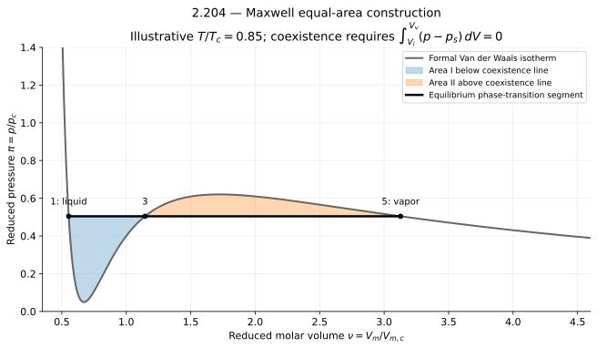

# 2.6 Phase Transformations

[Chapter index](../README.md#chapters) · [Structured solutions](2.6.json) · [Answer audit](../audit/README.md)

## 2.185

**Solved · high confidence.** Use constant saturation pressure during slow isothermal condensation and ideal-vapour volume loss.

**Assumptions**

- Interpret the stated100°C as the condensation temperature maintained during the slow displacement. Saturation pressure is constant along this two-phase isotherm.
- The vapour is ideal as stipulated and liquid volume is neglected as stipulated. Appendix15 water molar mass is.018 kg/mol; R=8.314. Work over the gas means positive work done on it.

Condensing mass Delta m removes its ideal-vapour volume at the saturation temperature and pressure.

$$
\Delta V_{\rm loss}=\frac{\Delta m RT_b}{Mp_s},\qquad T_b=373.15\ {\rm K}.
$$

Compression work is saturation pressure times this positive volume loss, so the pressure cancels.

$$
W_{\rm on}=p_s\Delta V_{\rm loss}=\frac{\Delta m RT_b}{M}.
$$

Evaluate with the stated condensed mass.

$$
W_{\rm on}=\frac{0.00070(8.314)(373.15)}{0.018}=120.647687\ {\rm J}.
$$

**Results**

Work performed on the saturated vapour

$$
W_{\rm on}\simeq120.648\ {\rm J}
$$

**Limitations**

- Without a maintained temperature or an equivalent fixed saturation pressure, slow piston displacement alone would not specify an isothermal condensation path.

## 2.186

**Provisional · low confidence.** Solve the mass and volume balances, retaining the missing liquid specific volume as an input.

**Assumptions**

- The stated vapour specific volume is vv=.050 m³/kg. Let vl denote the liquid-water specific volume at250°C and40 atm; it is not provided and no temperature-specific value occurs in the digitized Appendices.
- An explicitly approximate numerical illustration uses Appendix11 standard-density water rho_l=1000 kg/m³, hence vl=.001 m³/kg. This is not claimed to be a measured250°C liquid property.
- Use the supplied vapour specific volume directly rather than an ideal-gas substitution at this dense saturated state.
- After the Appendix lookup found no250°C liquid density, the primary NIST saturation-water table was consulted. At250°C it prints rho_l=798.89 kg/m³ and vl=1.25173 cm³/g, so the stated mass and vessel volume do not form a physically possible saturated mixture.

Write the total mass and volume constraints.

$$
m_l+m_v=m,\qquad m_lv_l+m_vv_v=V.
$$

Eliminate liquid mass to retain the exact dependence on its missing specific volume.

$$
m_v=\frac{V-mv_l}{v_v-v_l},\qquad V_v=v_v\frac{V-mv_l}{v_v-v_l}.
$$

The data require a physically admissible liquid density for positive saturated vapour mass.

$$
m_v>0\iff v_l<V/m=0.00120\ {\rm m^3/kg}\iff\rho_l>833.333\ {\rm kg/m^3}.
$$

Evaluate only under the declared constant-density approximation.

$$
v_l=0.001:\quad m_v=\frac{0.0060-5.0(0.001)}{0.050-0.001}=0.0204081633\ {\rm kg},\qquad V_v=0.00102040816\ {\rm m^3}.
$$

Test the supplied vessel against the primary temperature-specific liquid data. Even putting all5 kg into the denser liquid phase already requires more volume than available.

$$
v_l^{\rm NIST}=0.00125173\ {\rm m^3/kg},\qquad m v_l=0.00625865\ {\rm m^3}>V=0.0060\ {\rm m^3}.\quad\text{No nonnegative two-phase mass solution.}
$$

**Results**

Result using temperature-specific saturated-liquid water properties

$$
mv_l>V:\quad\text{the supplied saturated-mixture state is inconsistent}
$$

The positive20.4 g vapour illustration requires the separately assumed standard-density liquid model, not real saturated water at250°C.

Vapour mass as a function of the unspecified liquid property

$$
m_v=(V-mv_l)/(v_v-v_l)
$$

Vapour volume as a function of the unspecified liquid property

$$
V_v=v_v(V-mv_l)/(v_v-v_l)
$$

Illustration using Appendix standard-density water

$$
m_v\simeq20.4082\ {\rm g}
$$

Illustrative vapour volume under the same approximation

$$
V_v\simeq1.02041\ {\rm L}
$$

**Limitations**

- The standard-density illustration must not be mistaken for a250°C property or evidence that the stated high-temperature equilibrium is physically realizable.
- NIST temperature-specific data make the stated6 L,5 kg,250°C saturated-mixture description impossible. The source statement is preserved rather than silently changing its numbers.

## 2.187

**Solved · high confidence.** Conserve water mass along the saturated isotherm and account for the condensed liquid volume.

**Assumptions**

- The initial state is all saturated vapour at100°C and standard pressure101300 Pa. The vapour is ideal as stipulated, with M=.018 kg/mol and R=8.314.
- Let rho_l be liquid density. The negligible-liquid-volume answer is given directly; a refined illustration retains Appendix11 rho_l=1000 kg/m³ as a constant-density approximation.

The saturated vapour density remains constant on this isotherm.

$$
\rho_v=\frac{p_0M}{RT_b}=0.587744379\ {\rm kg/m^3}.
$$

The final vapour mass and liquid volume must sum to the same total water amount and final vessel volume.

$$
m_0=\rho_vV_0,\qquad m_0-m_l=\rho_v(V-m_l/\rho_l).
$$

Solve for condensed mass, including the small volume occupied by the liquid.

$$
m_l=\frac{\rho_v(V_0-V)}{1-\rho_v/\rho_l}.
$$

Evaluate the negligible-volume result and the constant-liquid-density refinement.

$$
\rho_l\to\infty:\ m_l=0.00199833089\ {\rm kg};\qquad\rho_l=1000:\ m_l=0.00199950609\ {\rm kg}.
$$

**Results**

Condensed mass including liquid displacement

$$
m_l=\rho_v(V_0-V)/(1-\rho_v/\rho_l)
$$

Condensed mass when liquid volume is neglected

$$
m_l\simeq1.99833\ {\rm g}
$$

Refinement using constant liquid density1000 kg/m³

$$
m_l\simeq1.99951\ {\rm g}
$$

## 2.188

**Solved · high confidence.** Use the two-phase lever rule and convert liquid mass fraction into final volume fraction.

**Assumptions**

- Initially all mass m is saturated vapour with specific volume vv. At the same temperature the liquid specific volume is vl=vv/N.
- The final total volume is m vv/n with1<n<N. The second case refers to the midpoint in total volume between the saturated-liquid and saturated-vapour endpoints of the horizontal coexistence plateau.

Let x be the condensed mass fraction and impose the final volume.

$$
\frac{m v_v}{n}=m[xv_l+(1-x)v_v],\qquad x=\frac{N(n-1)}{n(N-1)}.
$$

Convert the condensed mass fraction to the requested fraction of final vessel volume.

$$
\eta=\frac{mxv_l}{mv_v/n}=\frac{n-1}{N-1}.
$$

At the plateau midpoint the volume is the arithmetic average of the pure-phase endpoint volumes.

$$
V_f=\frac m2(v_l+v_v),\quad n=\frac{2N}{N+1},\quad x=\frac12,\quad\eta=\frac1{N+1}.
$$

**Results**

Liquid fraction of final total volume

$$
\eta=(n-1)/(N-1)
$$

Liquid volume fraction at the plateau midpoint

$$
\eta=1/(N+1)
$$

At the volume midpoint the liquid mass fraction is1/2, while its volume fraction is much smaller for N≫1.

## 2.189

**Solved · high confidence.** Use reversible latent heat for entropy and subtract pressure-volume work from the supplied vaporization enthalpy.

**Assumptions**

- Boiling is at standard pressure and100°C=373.15 K. Appendix16 gives latent heat L=2.250e6 J/kg, and Appendix15 gives water M=.018 kg/mol.
- The saturated vapour is ideal as stipulated. The exact internal-energy formula retains liquid specific volume vl; a numerical finite-volume illustration uses Appendix11 standard-density vl=.001 m³/kg.
- The usually negligible liquid-volume version is separately reported so no precision claim rests on the standard-condition density at boiling.

Latent heat is the isobaric enthalpy increment. Along reversible phase conversion at fixed temperature it determines entropy.

$$
Q=mL,\qquad\Delta S=\frac{mL}{T_b}=\frac{2250000}{373.15}=6029.74675\ {\rm J/K}.
$$

Subtract the expansion work from the latent heat to obtain internal energy.

$$
\Delta U=mL-p_0m(v_v-v_l),\qquad v_v=RT_b/(Mp_0).
$$

Display the negligible-liquid-volume value and the small finite-volume correction.

$$
\Delta U=m[L-RT_b/M+p_0v_l],\quad v_l\to0:\ \Delta U=2077646.16\ {\rm J};\quad v_l=.001:\ \Delta U=2077747.46\ {\rm J}.
$$

**Results**

Entropy increment on vaporizing one kilogram

$$
\Delta S\simeq6029.75\ {\rm J/K}
$$

Internal-energy increment neglecting liquid volume

$$
\Delta U\simeq2.07764616\ {\rm MJ}
$$

Internal-energy refinement using rho_l=1000 kg/m³

$$
\Delta U\simeq2.07774746\ {\rm MJ}
$$

## 2.190

**Solved · high confidence.** Separate sensible heating from partial vaporization and convert the resulting volume increase into piston displacement.

**Assumptions**

- The initial substance is liquid water at0°C, not ice. A weightless frictionless piston keeps its pressure at standard atmospheric pressure.
- The phrase insulated cylinder with absorbed heat is interpreted as prescribed controlled energy input Q to the water with no other loss, for example via an internal heater. A strictly passive insulated system could not absorb the stated20 kJ.
- Use Appendix water cp=4180 J/(kg K), latent heat2.250e6 J/kg, molar mass.018 kg/mol and density1000 kg/m³ in the constant-property model. Neglect liquid thermal expansion; the primary leading displacement neglects liquid volume against vapour volume.

Heat the whole water mass to its boiling temperature before any isobaric vaporization.

$$
Q_{\rm warm}=mc_p(100-0)=0.020(4180)(100)=8360\ {\rm J}.
$$

The remaining input evaporates only a fraction of the water.

$$
m_v=\frac{Q-Q_{\rm warm}}L=\frac{20000-8360}{2250000}=0.00517333333\ {\rm kg}<m.
$$

The final state is a water-steam mixture at100°C. Compute the piston rise from the evaporation volume.

$$
\Delta z\simeq\frac{m_vRT_b}{Mp_0S},\qquad S=410\ {\rm cm^2}=0.0410\ {\rm m^2}.
$$

Evaluate the leading value and the liquid-displacement refinement.

$$
\Delta z\simeq0.214683230\ {\rm m},\qquad\Delta z_{\rm finite\ liquid}=\frac{m_v(v_v-1/\rho_l)}S=0.214557051\ {\rm m}.
$$

**Results**

Piston rise neglecting liquid volume and thermal expansion

$$
\Delta z\simeq0.214683\ {\rm m}
$$

Refined rise at constant liquid density1000 kg/m³

$$
\Delta z\simeq0.214557\ {\rm m}
$$

Water mass vaporized

$$
m_v\simeq5.17333\ {\rm g}
$$

**Limitations**

- An exactly adiabatic closed cylinder with no energy source cannot have the stated absorbed heat. The controlled-input interpretation is essential.
- Temperature-dependent liquid heat capacity and thermal expansion would slightly change the numerical estimate.

## 2.191

**Solved · high confidence.** Conserve enthalpy during adiabatic constant-pressure mixing and find the cylinder volume lost on condensation.

**Assumptions**

- The cylinder initially contains .001 kg saturated steam at standard pressure and100°C. Added water mass .001 kg enters at22°C. A weightless frictionless piston keeps pressure constant.
- The insulated mixing system receives no heat from outside. The incoming water carries its enthalpy; the cold water warms by condensing some initial steam. There is enough initial steam that the final equilibrium is still two-phase at100°C.
- Use Appendix water cp4180 J/(kg K), L2.250e6 J/kg, M.018 kg/mol. The primary work neglects liquid volume; a separate finite-volume illustration uses constant rho_l1000 kg/m³.

The required sensible enthalpy of the introduced water fixes the condensed steam mass.

$$
\Delta m_c L=mc_p(100-22),\qquad\Delta m_c=\frac{0.001(4180)(78)}{2250000}=0.000144906667\ {\rm kg}.
$$

Only .144907 g of the original1 g steam condenses, leaving .855093 g steam. Its lost ideal-gas volume dominates the piston displacement.

$$
W_{\rm atm}=p_0(V_i-V_f)\simeq\Delta m_c RT_b/M.
$$

Evaluate positive work by atmospheric pressure during piston lowering.

$$
W_{\rm atm}\simeq0.000144906667\frac{8.314(373.15)}{0.018}=24.9752203\ {\rm J}.
$$

If liquid displacement is retained, the added liquid as well as the newly condensed mass occupies part of the final cylinder volume.

$$
W_{\rm atm}^{\rm finite}=\Delta m_c RT_b/M-p_0(m+\Delta m_c)/\rho_l=24.8592412\ {\rm J}.
$$

**Results**

Atmospheric work neglecting liquid volume

$$
W_{\rm atm}\simeq24.9752\ {\rm J}
$$

Finite-volume model at constant liquid density1000 kg/m³

$$
W_{\rm atm}\simeq24.8592\ {\rm J}
$$

Steam mass condensed while warming the injected water

$$
\Delta m_c\simeq0.144907\ {\rm g}
$$

**Limitations**

- The result assumes the water is introduced with no extra kinetic/injection work beyond the usual incoming enthalpy, and neglects liquid thermal expansion.

## 2.192

**Solved · high confidence.** Eliminate vapour pressure and density from the supplied small-curvature saturation-pressure formula.

**Assumptions**

- Use the given linearized relation Delta p/p=eta=.010. The vapour is ideal at27°C=300.15 K.
- Appendix water M=.018 kg/mol, liquid density1000 kg/m³ and surface tension.073 N/m are used as constant-property approximations. The droplet diameter is2r.

Replace saturated vapour density by its ideal-gas expression; its partial pressure cancels.

$$
\rho_v=pM/(RT),\qquad\eta=\frac{\Delta p}{p}=\frac{M}{\rho_lRT}\frac{2\alpha}{r}.
$$

Solve for diameter and evaluate.

$$
d=2r=\frac{4\alpha M}{\eta\rho_lRT}=\frac{4(0.073)(0.018)}{0.010(1000)(8.314)(300.15)}=2.10623579\times10^{-7}\ {\rm m}.
$$

**Results**

Water droplet diameter for a one-percent vapour-pressure elevation

$$
d\simeq0.210624\ {\rm micrometres}
$$

## 2.193

**Solved · high confidence.** Balance true evaporation against the retained fraction of the equilibrium molecular incidence flux.

**Assumptions**

- The saturated vapour at100°C has the standard water saturation pressure101300 Pa and a Maxwell distribution. Appendix water M=.018 kg/mol and R8.314 are used.
- Interpret molecules leaving the water as true evaporation from the liquid, excluding incident molecules immediately reflected back into the vapour. The given retained fraction eta=.036 is the condensation coefficient.
- At saturation the mass truly evaporated equals the mass retained from incoming vapour. Counting reflected molecules as well gives a different gross outgoing flux, also reported.

The mass incidence rate per unit area is mass density times mean positive normal velocity.

$$
j_{\rm in}=\rho_v\sqrt{RT/(2\pi M)}=p_s\sqrt{M/(2\pi RT)}.
$$

Only the fraction eta joins the liquid, so equilibrium true evaporation has this same retained rate.

$$
j_{\rm evap}=\eta j_{\rm in}=0.036(101300)\sqrt{\frac{0.018}{2\pi(8.314)(373.15)}}=3.50438273\ {\rm kg/(m^2\,s)}.
$$

Convert to the mass emitted by one square centimetre in one second.

$$
m_{1{\rm cm^2},1{\rm s}}=j_{\rm evap}(10^{-4}\ {\rm m^2})(1\ {\rm s})=0.000350438273\ {\rm kg}=0.350438273\ {\rm g}.
$$

If all outgoing particles including reflections are counted, detailed balance equates that gross outgoing flux to the whole incident flux.

$$
j_{\rm outgoing,total}=j_{\rm in}=j_{\rm evap}/\eta,\quad m_{\rm outgoing,total}\simeq9.73439647\ {\rm g}\ \text{per cm}^2\text{ per second}.
$$

**Results**

True evaporated water mass per square centimetre per second

$$
m\simeq0.350438\ {\rm g}
$$

Mass emitted during1 s from1 cm², excluding reflected incident vapour molecules.

Alternative gross outward mass including reflected vapour

$$
m_{\rm gross}\simeq9.73440\ {\rm g}
$$

## 2.194

**Solved · medium confidence.** Infer saturation pressure from the Hertz-Knudsen vacuum mass flux, retaining the evaporation coefficient.

**Assumptions**

- The filament and its near-surface vapour are modeled at2000 K, with negligible incoming flux from the high vacuum. Tungsten vapour is treated as monatomic ideal gas.
- Let beta_e be the evaporation coefficient. The conventional numerical estimate assumes beta_e=1; the measured vacuum flux alone does not determine pressure without this coefficient.
- The digitized book Appendices contain no tungsten atomic/molar mass. The primary CIAAW elemental reference supplies atomic weight183.84(1), used as M_W=.18384 kg/mol; this is an external property reference, not a solution source.

Convert the measured mass flux to SI units.

$$
j=1.2\times10^{-13}\ {\rm g/(s\,cm^2)}=1.2\times10^{-12}\ {\rm kg/(m^2\,s)}.
$$

The ideal Maxwell mass-flux relation includes the fraction actually evaporating into vacuum.

$$
j=\beta_e p_s\sqrt{M_W/(2\pi RT)},\qquad p_s=\frac j{\beta_e}\sqrt{2\pi RT/M_W}.
$$

Evaluate the conventional unit-coefficient estimate.

$$
\beta_e=1:\quad p_s=1.2\times10^{-12}\sqrt{\frac{2\pi(8.314)(2000)}{0.18384}}\simeq9.04630\times10^{-10}\ {\rm Pa}.
$$

**Results**

Saturation pressure as a function of evaporation coefficient

$$
p_s=\frac j{\beta_e}\sqrt{2\pi RT/M_W}
$$

Conventional estimate with evaporation coefficient one

$$
p_s\simeq9.04630\times10^{-10}\ {\rm Pa}
$$

**Limitations**

- A different evaporation coefficient, nonideal surface accommodation or vapour species distribution changes the inference.

## 2.195

**Solved · medium confidence.** Isolate the attractive pressure term in the van der Waals model at fixed density and temperature.

**Assumptions**

- Compare the same water density and temperature before and after formally deleting the attractive a term, while retaining the same excluded-volume/repulsive contribution.
- Appendix15 gives water a=5.47 atm L²/mol², M=.018 kg/mol and b=.030 L/mol. Using book1 atm=101300 Pa gives a=.554111 Pa m^6/mol². Appendix11 liquid density1000 kg/m³ is used.
- This is an extrapolated cohesive-term estimate, not a self-consistent full van der Waals liquid state: water molar volume.018 L/mol is below the printed b=.030 L/mol.

Separate the molecular attraction term from the repulsive pressure contribution.

$$
p=RT/(V_m-b)-a/V_m^2,\quad p_{a=0}-p=a/V_m^2,\quad V_m=M/\rho.
$$

The formal increase is positive and does not depend on the unchanged repulsive contribution.

$$
\Delta p=a(\rho/M)^2=0.554111(1000/0.018)^2=1.71021914\times10^9\ {\rm Pa}.
$$

Check the admissibility limit of using the complete printed equation at liquid density.

$$
V_m=1.8\times10^{-5}\ {\rm m^3/mol}<b=3.0\times10^{-5}\ {\rm m^3/mol}.
$$

**Results**

Formal cohesive-pressure increase on deleting the attractive term

$$
\Delta p\simeq1.71022\ {\rm GPa}
$$

**Limitations**

- Ordinary water is not a valid homogeneous van der Waals state with these b and density values. The numerical result is only the requested cohesive-term extrapolation, and actual removal of attraction would also change the equilibrium state.

## 2.196

**Solved · high confidence.** Integrate the volume-dependent attractive pressure over vaporization rather than treating it as a constant pressure.

**Assumptions**

- The internal pressure means the van der Waals attractive/cohesive term pi=a nu²/V², not the net mechanical pressure.
- Use exactly the exercise’s stipulated model: latent heat per mass q is identified wholly with work against attraction. Final vapour volume is much greater than initial liquid volume; a finite-volume correction is also shown.
- Appendix water density1000 kg/m³ and specific latent heat2.250e6 J/kg give the conventional water estimate.
- In the integration below v denotes specific volume V_total/m in m³/kg; integrating pressure against dv gives the specific work q in J/kg.

For one unit mass, initial volume is Vi=1/rho. The attractive pressure falls as inverse volume squared.

$$
p_i(v)=A/v^2,\qquad A=a/M^2,\qquad v_i=1/\rho.
$$

Integrate this pressure to a much larger vapour volume.

$$
q\simeq\int_{v_i}^{\infty}\frac A{v^2}dv=\frac A{v_i},\qquad p_{i,l}=\frac A{v_i^2}=q/v_i=\rho q.
$$

A finite vapour endpoint changes the integrated work slightly.

$$
q=p_{i,l}v_i(1-v_i/v_v),\qquad p_{i,l}=\rho_lq/(1-\rho_v/\rho_l).
$$

Evaluate the liquid-water cohesive-pressure scale in the large-volume limit.

$$
p_{i,l}\simeq(1000)(2.250\times10^6)=2.250\times10^9\ {\rm Pa}.
$$

**Results**

Cohesive internal pressure under the stipulated latent-work model

$$
p_{i,l}\simeq\rho q=2.25\ {\rm GPa}
$$

Finite-vapour-volume correction

$$
p_{i,l}=\rho_lq/(1-\rho_v/\rho_l)
$$

**Limitations**

- Real latent heat is an enthalpy change with thermal and external-work contributions; the exercise explicitly approximates it as cohesive work alone.

## 2.197

**Solved · high confidence.** Apply both inflection-point conditions to a one-mole van der Waals isotherm and eliminate its critical variables.

**Assumptions**

- Use molar volume v=V_M and p=RT/(v−b)−a/v² with positive constant a,b. The critical state is the horizontal inflection at v>b.
- The relations being proved are the van der Waals model results printed in chapter Eqs. 2.6a and 2.6b, not universal exact equations for all real fluids.

Differentiate the isotherm twice at fixed temperature.

$$
\left(\frac{\partial p}{\partial v}\right)_T=-\frac{RT}{(v-b)^2}+\frac{2a}{v^3}=0,\qquad\left(\frac{\partial^2p}{\partial v^2}\right)_T=\frac{2RT}{(v-b)^3}-\frac{6a}{v^4}=0.
$$

Eliminate RT between the two equations.

$$
RT_c=\frac{2a(v_c-b)^2}{v_c^3}=\frac{3a(v_c-b)^3}{v_c^4}\quad\Longrightarrow\quad2v_c=3(v_c-b),\qquad v_c=3b.
$$

Insert this volume into the derivative and the equation of state.

$$
T_c=\frac{8a}{27Rb},\qquad p_c=\frac{RT_c}{2b}-\frac{a}{9b^2}=\frac{a}{27b^2}.
$$

Form the critical pressure-volume product.

$$
p_cv_c=\frac{a}{9b}=\frac38RT_c,\qquad Z_c=\frac{p_cv_c}{RT_c}=\frac38.
$$

**Results**

Critical constants in the van der Waals model

$$
v_c=3b,\qquad p_c=\frac a{27b^2},\qquad T_c=\frac{8a}{27Rb}
$$

Critical molar relation

$$
p_cv_c=\frac38RT_c
$$

## 2.198

**Solved · high confidence.** Invert the van der Waals critical-temperature and critical-pressure formulas.

**Assumptions**

- Fit a van der Waals equation to the supplied critical data 304 K and 73 book atmospheres. Use 1 atm=101300 Pa and R=8.314.
- These fitted constants use the problem data; they need not equal separately rounded constants in Appendix Table 15 exactly.

Eliminate a between the two critical equations to find b.

$$
p_c=\frac a{27b^2},\quad T_c=\frac{8a}{27Rb}\quad\Longrightarrow\quad b=\frac{RT_c}{8p_c}.
$$

Substitute b back into the critical pressure formula.

$$
a=27p_cb^2=\frac{27R^2T_c^2}{64p_c}.
$$

Convert the given pressure and evaluate.

$$
p_c=73(101300)=7394900\ \mathrm{Pa},\quad b=4.27229577\times10^{-5}\ \mathrm{m^3/mol},\quad a=0.364433836\ \mathrm{Pa\,m^6/mol^2}.
$$

**Results**

Fitted van der Waals attraction constant

$$
a=\frac{27R^2T_c^2}{64p_c}\simeq0.3644\ \mathrm{Pa\,m^6/mol^2}
$$

Fitted van der Waals excluded-volume constant

$$
b=\frac{RT_c}{8p_c}\simeq4.2723\times10^{-5}\ \mathrm{m^3/mol}
$$

## 2.199

**Solved · high confidence.** Use the van der Waals critical compressibility relation and divide molar volume by benzene molar mass.

**Assumptions**

- The chapter-model closure is Zc=3/8, so the requested specific critical volume is a van der Waals estimate inferred from Tc and pc.
- Use an explicitly rounded benzene formula mass M=78 g/mol from C6H6. The Appendix rounded H2,O2,CO2 masses imply H≈1 and C≈12 g/mol; no separate benzene critical-density measurement is supplied.

The critical molar relation fixes molar volume in this model.

$$
v_{M,c}=\frac{3RT_c}{8p_c}.
$$

Convert to volume per unit mass and insert the supplied critical data.

$$
v_c^{\prime}=\frac{v_{M,c}}M=\frac{3RT_c}{8p_cM}=\frac{3(8.314)(562)}{8(47)(101300)(0.078)}=0.00471819295\ \mathrm{m^3/kg}.
$$

**Results**

Van der Waals estimate of benzene critical specific volume

$$
v_c^{\prime}=\frac{3RT_c}{8p_cM}\simeq4.72\times10^{-3}\ \mathrm{m^3/kg}
$$

**Limitations**

- Tc and pc alone do not determine the measured critical volume of a real fluid. A real-fluid answer needs its actual critical compressibility or density; the numerical result here explicitly uses the chapter van der Waals model.

## 2.200

**Solved · high confidence.** Substitute the van der Waals critical scales into the equation of state and evaluate the reduced temperature.

**Assumptions**

- Use reduced pressure pi=p/pc, reduced molar volume nu=v/vc and reduced temperature tau=T/Tc. The amount of gas is fixed so total-volume ratios equal molar-volume ratios.
- Use the model critical constants vc=3b, pc=a/(27b²) and Tc=8a/(27Rb). The physical excluded-volume domain is nu>1/3.

Insert the three critical scales into (p+a/v²)(v−b)=RT.

$$
\left[\frac a{27b^2}\pi+\frac a{9b^2\nu^2}\right]b(3\nu-1)=\frac{8a}{27b}\tau.
$$

Cancel the material constants to obtain the reduced equation.

$$
\boxed{\left(\pi+\frac3{\nu^2}\right)(3\nu-1)=8\tau},\qquad\pi=\frac{8\tau}{3\nu-1}-\frac3{\nu^2}.
$$

Evaluate at the specified pressure and volume ratios.

$$
\pi=12,\quad\nu=\frac12:\qquad\tau=\frac18(12+12)\left(\frac32-1\right)=\frac32.
$$

**Results**

Reduced van der Waals equation

$$
(\pi+3/\nu^2)(3\nu-1)=8\tau
$$

Temperature relative to the critical temperature

$$
T/T_c=\tau=1.50
$$

The temperature is1.5 times the critical temperature, or50 percent higher.

## 2.201

**Solved · high confidence.** Identify the critical endpoint as the limiting saturated-liquid volume and maximum saturation pressure in the van der Waals model.

**Assumptions**

- Use Appendix H2O constants a=5.47 atm L²/mol² and b=.030 L/mol, with the book atmosphere conversion and water molar mass M=.018 kg/mol.
- Liquid means the liquid branch of liquid-vapour coexistence below the critical point. Its limiting volume and saturated-vapour pressure are approached at the critical endpoint; above it the distinct phases disappear.

At the critical endpoint each mole occupies3b, giving the largest limiting liquid-branch volume for the fixed mass.

$$
V_{\rm liq,max}=\frac mM v_c=\frac{3mb}{M}=\frac{3(1.00)(3.00\times10^{-5})}{0.018}=0.00500\ \mathrm{m^3}.
$$

The maximum saturation pressure is the critical pressure.

$$
p_{\rm sat,max}=p_c=\frac a{27b^2},\qquad a=(5.47)(101300)10^{-6}=0.554111\ \mathrm{Pa\,m^6/mol^2}.
$$

Evaluate the pressure using consistent SI units.

$$
p_c=\frac{0.554111}{27(3.00\times10^{-5})^2}=2.28029218\times10^7\ \mathrm{Pa}\simeq22.8\ \mathrm{MPa}.
$$

**Results**

Limiting liquid volume for1.00 kg in the van der Waals model

$$
V_{\rm liq,max}=3mb/M=5.00\times10^{-3}\ \mathrm{m^3}=5.00\ \mathrm L
$$

Maximum saturation pressure in the same model

$$
p_{\rm sat,max}=a/(27b^2)\simeq2.28\times10^7\ \mathrm{Pa}
$$

**Limitations**

- The van der Waals model approximates real water poorly in some liquid properties. These are its critical-endpoint predictions, not measured critical data or a bound on arbitrary supercritical-fluid volume.

## 2.202

**Solved · high confidence.** Evaluate the van der Waals critical temperature and molar volume with the Appendix CO2 parameters.

**Assumptions**

- Use the printed CO2 constants a=3.62 atm L²/mol², b=.043 L/mol and M=.044 kg/mol. Convert a with1 book atmosphere=101300 Pa.
- The task explicitly assumes a van der Waals gas; density is inferred from its model critical molar volume 3b.

The model critical formulas give temperature and density.

$$
T_c=\frac{8a}{27Rb},\qquad\rho_c=\frac M{v_c}=\frac M{3b}.
$$

Insert a=.366706 Pa m6/mol2 and b=4.30e−5 m3/mol.

$$
T_c=\frac{8(0.366706)}{27(8.314)(4.30\times10^{-5})}=303.924536\ \mathrm K,\qquad\rho_c=\frac{0.044}{3(4.30\times10^{-5})}=341.085271\ \mathrm{kg/m^3}.
$$

**Results**

Van der Waals critical temperature

$$
T_c=8a/(27Rb)\simeq304\ \mathrm K
$$

Van der Waals critical density

$$
\rho_c=M/(3b)\simeq341\ \mathrm{kg/m^3}
$$

## 2.203

**Solved · high confidence.** Choose the vessel’s fixed mean ether density equal to the van der Waals critical density.

**Assumptions**

- The sealed vessel contains pure ether, and the initial vapour mass is negligible compared with liquid mass. Use Appendix ether liquid density 720 kg/m³ as a room-temperature approximation.
- Infer critical density from the supplied Tc,pc,M using the chapter van der Waals relation Zc=3/8. The mass and total vessel volume remain fixed during heating.
- Ether M=.074 kg/mol is supplied directly in the problem; no different table molar mass is substituted.

The model critical specific volume and density follow from the given critical scales.

$$
v_c^{\prime}=\frac{3RT_c}{8p_cM},\qquad\rho_c=\frac{8p_cM}{3RT_c}.
$$

If the initial liquid occupies fraction f, its mass is approximately rho_l f V. At the critical point total mass is rho_c V.

$$
\rho_l fV\simeq\rho_cV\quad\Longrightarrow\quad f\simeq\frac{\rho_c}{\rho_l}=\frac{8p_cM}{3RT_c\rho_l}.
$$

Evaluate the critical density and fraction.

$$
\rho_c=\frac{8(35.5)(101300)(0.074)}{3(8.314)(467)}=182.772709\ \mathrm{kg/m^3},\qquad f=\frac{182.772709}{720}=0.253850985.
$$

If initial vapour density is retained, simple mass balance gives the exact fill-fraction correction within this critical-density model.

$$
\rho_l f+\rho_v(1-f)=\rho_c\quad\Longrightarrow\quad f=\frac{\rho_c-\rho_v}{\rho_l-\rho_v}.
$$

**Results**

Initial ether-liquid volume fraction with negligible vapour mass

$$
f\simeq\frac{8p_cM}{3RT_c\rho_l}\simeq0.254\quad(25.4\%)
$$

**Limitations**

- A measured critical density would replace the van der Waals estimate for a real-fluid calculation. A non-negligible initial vapour density requires the displayed correction, and noncondensable headspace gas would change the pure-fluid setup.

## 2.204

**Solved · high confidence.** Use equality of phase Gibbs free energies and integrate the isothermal Helmholtz free-energy derivative.

**Assumptions**

- At fixed subcritical temperature, let vl and vg be the two coexistence volumes labeled1 and5 in Fig.2.5, with common saturation pressure ps.
- The intervening van der Waals loop is the analytic homogeneous-fluid continuation used to compute free energy; its unstable section is not a physically sustained equilibrium path.

Equality of molar Gibbs free energies at coexistence is equivalent to a common tangent of the Helmholtz free energy.

$$
g_l=g_g,\quad g=f+pv\quad\Longrightarrow\quad f_g-f_l=-p_s(v_g-v_l).
$$

On an isotherm, the equation of state gives the Helmholtz free-energy derivative.

$$
\left(\frac{\partial f}{\partial v}\right)_T=-p(v,T)\quad\Longrightarrow\quad f_g-f_l=-\int_{v_l}^{v_g}p(v,T)\,dv.
$$

Equate the free-energy differences and subtract the rectangle under the phase-transition line.

$$
\int_{v_l}^{v_g}[p(v,T)-p_s]dv=0.
$$

The signed area is negative on the region labeledI and positive on the region labeledII in the scan.

$$
-A_{\rm I}+A_{\rm II}=0\quad\Longrightarrow\quad\boxed{A_{\rm I}=A_{\rm II}}.
$$

**Results**

Maxwell equal-area condition

$$
\int_{v_l}^{v_g}[p(v,T)-p_s]dv=0,\qquad A_{\rm I}=A_{\rm II}
$$

## 2.205

**Solved · medium confidence.** Use an adiabatic recalescence enthalpy balance and separate partial freezing from the formal full-freezing threshold.

**Assumptions**

- Assume no heat is exchanged with the surroundings during equilibration, vessel heat capacity is negligible, pressure remains atmospheric, and the only mechanical work is p dV. Under those conditions total enthalpy is conserved.
- Use normal melting temperature 0°C and constant liquid-water specific heat 4180 J/(kg K) and fusion latent heat 333000 J/kg from Appendix16.
- This is a transient insulated recalescence model, not equilibrium with an externally imposed heat bath. The complete-freezing threshold is a constant-property extrapolation of the supercooled-liquid enthalpy.

Choose liquid enthalpy at the melting point as zero; ice there has specific enthalpy−L. A final ice-water mixture at atmospheric pressure is at0°C.

$$
h_l(T_m)=0,\quad h_i(T_m)=-L,\quad h_{\rm initial}=-c_w(T_m-T_i),\quad h_{\rm final}=-xL.
$$

Conserve enthalpy to determine the ice mass fraction for Ti=−20°C.

$$
xL=c_w(T_m-T_i)\quad\Longrightarrow\quad x=\frac{(4180)(20)}{333000}=0.251051051\simeq25.1\%.
$$

All the water has just frozen when the initial liquid enthalpy equals that of ice at the melting point.

$$
c_w(T_m-T_i^*)=L\quad\Longrightarrow\quad t_i^*=-\frac L{c_w}=-79.6650718\ ^\circ\mathrm C.
$$

For temperature-dependent supercooled-water heat capacity, replace the constant-capacity deficit by its enthalpy integral.

$$
x=\frac1L\int_{T_i}^{T_m}c_{p,l}(T)\,dT\quad(0\le x\le1),\qquad\int_{T_i^*}^{T_m}c_{p,l}(T)\,dT=L.
$$

**Results**

Ice mass fraction after insulated recalescence from−20°C

$$
x=c_w(20\ \mathrm K)/L\simeq0.251\quad(25.1\%)
$$

Formal constant-property initial threshold for complete freezing

$$
t_i^*=-L/c_w\simeq-79.7\ ^\circ\mathrm C
$$

At this threshold the final state is all ice at0°C; lower initial enthalpy gives all ice below0°C in the same energy model.

**Limitations**

- The statement gives no explicit thermal boundary condition. With heat exchange to a reservoir the final frozen fraction is not determined by the initial water temperature alone.
- Constant cp over nearly 80 K of supercooling is only an approximation; a reliable threshold needs the supercooled-liquid enthalpy curve.

## 2.206

**Solved · high confidence.** Use the Clapeyron slope with the negative liquid-minus-ice volume change.

**Assumptions**

- Treat the melting-point shift as infinitesimal near0°C, using constant fusion heat 333000 J/kg and the problem’s volume difference.
- The given ice excess specific volume is vi−vl=.091 cm³/g=9.1e−5 m³/kg. Pressure is raised by one book atmosphere101300 Pa.

The Clapeyron equation for melting uses heat absorbed L>0 and volume change vl−vi<0.

$$
\frac{dp}{dT}=\frac{L}{T(v_l-v_i)}=-\frac{L}{T\Delta v},\qquad\frac{dT}{dp}=-\frac{T\Delta v}{L}.
$$

Evaluate the linear shift at Tm=273.15 K.

$$
\Delta T\simeq-\frac{T_m\Delta v}{L}\Delta p=-\frac{(273.15)(9.1\times10^{-5})(101300)}{333000}=-0.00756149743\ \mathrm K.
$$

**Results**

Ice melting-temperature increment for a one-atmosphere pressure increase

$$
\Delta T\simeq-7.56\times10^{-3}\ \mathrm K
$$

## 2.207

**Solved · high confidence.** Infer the local coexistence slope from the boiling-point shift and invert the Clapeyron equation.

**Assumptions**

- At standard pressure, use the normal boiling temperature 100°C=373.15 K and Appendix water latent vaporization heat 2250000 J/kg.
- Treat the finite changes 3.2 kPa and .9 K as a first-order estimate of the local coexistence slope. Appendix liquid density 1000 kg/m³ gives vl≈.001 m³/kg; its small contribution is retained.

Both the pressure and boiling-temperature changes are negative, so their derivative ratio is positive.

$$
\frac{dp}{dT}\simeq\frac{\Delta p}{\Delta T}=\frac{3200}{0.9}\ \mathrm{Pa/K}.
$$

Solve Clapeyron for the vapour-minus-liquid specific volume.

$$
\frac{dp}{dT}=\frac q{T(v_v-v_l)}\quad\Longrightarrow\quad v_v=v_l+\frac{q\Delta T}{T\Delta p}.
$$

Insert the values in SI units.

$$
v_v\simeq0.001+\frac{(2.250\times10^6)(0.9)}{(373.15)(3200)}=1.69686627\ \mathrm{m^3/kg}\simeq1.70\ \mathrm{m^3/kg}.
$$

**Results**

Saturated-steam specific volume from the given slope

$$
v_v\simeq v_l+\frac{q\Delta T}{T\Delta p}\simeq1.70\ \mathrm{m^3/kg}
$$

**Limitations**

- This uses a local derivative approximation to a finite pressure/temperature change; extra numerical digits are not experimental precision.

## 2.208

**Solved · high confidence.** Integrate the ideal-vapour Clausius–Clapeyron equation with constant latent heat, then compare its linear approximation.

**Assumptions**

- Saturated water vapour is ideal, its specific volume RT/(Mp) dominates the liquid volume, and the latent vaporization heat q is taken constant at its Appendix normal-boiling value 2250000 J/kg.
- Use water molar mass M=.018 kg/mol, R=8.314 and the reference saturation state at 100°C: Tb=373.15 K, pb=101300 Pa. The requested 101.1°C is T=374.25 K.

Substitute ideal-vapour specific volume into the Clapeyron equation.

$$
\frac{dp}{dT}\simeq\frac q{Tv_v}=\frac{Mq}{R}\frac p{T^2}\quad\Longrightarrow\quad\frac{dp}{p}=\frac{Mq}{R}\frac{dT}{T^2}.
$$

Integrate from the normal boiling reference. This keeps the finite temperature correction within the constant-q model.

$$
\ln\frac p{p_b}=\frac{Mq}{R}\left(\frac1{T_b}-\frac1T\right),\qquad p=p_b\exp\left[\frac{Mq}{R}\left(\frac1{T_b}-\frac1T\right)\right].
$$

Evaluate the exponent and pressure.

$$
\ln(p/p_b)=0.0383700560,\qquad p=105262.4197\ \mathrm{Pa}\simeq105.3\ \mathrm{kPa}.
$$

A strictly first-order temperature increment gives a nearby but distinct result.

$$
p_{\rm lin}=p_b\left[1+\frac{Mq}{RT_b^2}(T-T_b)\right]=105198.3447\ \mathrm{Pa}\simeq105.2\ \mathrm{kPa}.
$$

**Results**

Saturation pressure in the integrated constant-latent-heat ideal-vapour model

$$
p=p_b\exp\left[\frac{Mq}{R}\left(\frac1{T_b}-\frac1T\right)\right]\simeq105.3\ \mathrm{kPa}
$$

First-order temperature-increment approximation

$$
p_{\rm lin}=p_b[1+Mq(T-T_b)/(RT_b^2)]\simeq105.2\ \mathrm{kPa}
$$

**Limitations**

- The exponential expression is exact only within constant-q, ideal-vapour and negligible-liquid-volume approximations. More accurate saturation data require temperature-dependent latent heat and real-fluid corrections.

## 2.209

**Solved · high confidence.** Combine the Clapeyron–Clausius saturation slope with the ideal-gas mass in the fixed vapour space.

**Assumptions**

- The vessel is rigid. Liquid remains present throughout heating, and its negligible volume makes the vapour volume effectively constant.
- The vapour is ideal as stated. Use Appendix 16 water vaporization heat at 100°C; the first-order result only needs its value at the initial temperature. A finite-increment comparison additionally holds q constant over 1.5 K.

Express saturated-vapour mass in the fixed volume and differentiate.

$$
m_v=\frac{Mp_sV}{RT},\qquad d\ln m_v=d\ln p_s-\frac{dT}{T}.
$$

Neglecting liquid volume in Clapeyron gives the saturation-pressure slope.

$$
\frac{d\ln p_s}{dT}=\frac{Mq(T)}{RT^2},\qquad \frac{\Delta m_v}{m_v}\simeq\left(\frac{Mq}{RT^2}-\frac1T\right)\Delta T.
$$

Evaluate the small-temperature-increment result using 373.15 K, not 100 in the denominators.

$$
100\frac{\Delta m_v}{m_v}\simeq100\left[\frac{0.018(2.250\times10^6)}{8.314(373.15)^2}-\frac1{373.15}\right]1.5=4.84572\%.
$$

Integrating with constant q gives a separate finite-increment estimate.

$$
\frac{m_v(T+\Delta T)}{m_v(T)}=\frac{T}{T+\Delta T}\exp\left[\frac{Mq}{R}\left(\frac1T-\frac1{T+\Delta T}\right)\right]=1.0494384.
$$

**Results**

First-order increase in vapour mass

$$
\Delta m_v/m_v\simeq4.85\%
$$

Finite-increment constant-latent-heat model

$$
\Delta m_v/m_v\simeq4.94\%
$$

**Limitations**

- If all liquid evaporates before the final temperature, saturation cannot be maintained and the predicted vapour-mass increase no longer applies.
- Finite-increment accuracy is limited by the temperature dependence of latent heat and nonideal vapour behaviour.

## 2.210

**Solved · high confidence.** Integrate the ideal-vapour Clapeyron–Clausius equation with constant latent heat.

**Assumptions**

- M is the substance molar mass and q the latent heat per unit mass. Both the liquid specific volume and vapour nonideality are neglected as stipulated.
- The liquid–vapour coexistence branch persists over the interval and q is approximated as constant.

Insert the ideal vapour specific volume into Clapeyron.

$$
\frac{dp_s}{dT}=\frac{q}{T(v_g-v_l)}\simeq\frac{Mq}{RT^2}p_s.
$$

Integrate between the known reference state and the required temperature.

$$
\ln\frac{p_s(T)}{p_0}=\frac{Mq}{R}\int_{T_0}^{T}\frac{d\theta}{\theta^2}=\frac{Mq}{R}\left(\frac1{T_0}-\frac1T\right).
$$

If the constant-latent-heat approximation is relaxed, the same derivation retains q inside the integral.

$$
p_s(T)=p_0\exp\left[\frac M R\int_{T_0}^{T}\frac{q(\theta)}{\theta^2}\,d\theta\right].
$$

**Results**

Saturation pressure in the stated model

$$
p_s(T)=p_0\exp\left[\frac{Mq}{R}\left(\frac1{T_0}-\frac1T\right)\right]
$$

**Limitations**

- The model requires |Delta q|/q small over the interval, v_l/v_g much smaller than 1, and small vapour equation-of-state corrections.
- Use a temperature range away from the critical point, where latent heat vanishes and liquid and vapour volumes become comparable, and away from a change to a solid–vapour coexistence branch. The constant-q expression is not a global high-temperature law.

## 2.211

**Solved · medium confidence.** Determine the pressure-depressed melting temperature and distinguish the missing thermal condition from the usual insulated estimate.

**Assumptions**

- Standard initial conditions mean ice at 273.15 K and 1 atm. Thus the pressure increment is 639 atm, rather than 640 atm.
- Use the stated linear melting-temperature shift, Appendix 16 fusion heat 333000 J/kg and ice heat capacity 2090 J/(kg K), and the supplied volume difference 9.0e-5 m³/kg.
- A melted fraction requires a thermal/mechanical path. The conventional approximate fraction below assumes thermally insulated quasistatic compression and neglects pressure-dependent caloric and elastic contributions. This condition is not specified in the statement.

Apply Clapeyron to ice melting: the liquid has smaller specific volume, so the melting slope is negative.

$$
\frac{dT_m}{dp}=\frac{T_m(v_l-v_i)}{L_f}\simeq-\frac{T_0\Delta v}{L_0}.
$$

Use the initial slope as constant as requested.

$$
\Delta T_m=\frac{T_0\Delta v(p_f-p_i)}{L_0}=4.77870019\ {\rm K},\qquad T_m(p_f)=268.37129981\ {\rm K}.
$$

For the conventional insulated leading-order estimate, ice cooling supplies the latent heat for partial melting.

$$
xL_0\simeq c_i\Delta T_m,\qquad x\simeq\frac{c_iT_0\Delta v(p_f-p_i)}{L_0^2}=0.02999244.
$$

An entropy formulation makes the required thermodynamic closure explicit: for reversible adiabatic compression, the final mixture entropy must equal the initial ice entropy.

$$
x\frac{L_f(T_f,p_f)}{T_f}=s_i(T_0,p_i)-s_i(T_f,p_f).
$$

**Results**

Melting-point depression from the supplied linear law

$$
T_0-T_m(p_f)\simeq4.78\ {\rm K}
$$

Usual insulated leading-order melted fraction

$$
x\simeq0.0300\quad(3.00\%)
$$

Conditional on the explicit insulated caloric approximation; not fixed by pressure alone.

Literal statement without thermal conditions

$$
x\ \text{is not uniquely determined by }p_f\text{ alone}
$$

**Limitations**

- Pressure-dependent entropy, thermal expansion and compression work partition require additional material data for a more precise adiabatic fraction.
- The approximate 3% value is a leading-order insulated result, not an exact finite-pressure thermodynamic solution. Other heat exchange or irreversible compression protocols change the fraction.

## 2.212

**Solved · high confidence.** Intersect the two empirical base 10 saturation-pressure lines and obtain latent heats from their slopes.

**Assumptions**

- Interpret log as log 10, with p measured relative to 1 atm. Convert 1.80 kK and 1.31 kK to 1800 K and 1310 K.
- For the latent-heat inference, treat the vapour as ideal and neglect the solid/liquid specific volumes relative to vapour near the triple point. Use the book CO 2 molar mass.044 kg/mol and preserve the empirical coefficients as printed.

At the triple point the sublimation and vaporization pressures coincide.

$$
9.05-\frac{1800}{T_{\rm tr}}=6.78-\frac{1310}{T_{\rm tr}},\qquad T_{\rm tr}=\frac{490}{2.27}=215.8590308\ {\rm K}.
$$

Substitute this temperature into either pressure law.

$$
\log_{10}\frac{p_{\rm tr}}{1\ {\rm atm}}=0.71122449,\qquad p_{\rm tr}=5.14309433\ {\rm atm}.
$$

Differentiate the logarithm and compare with Clapeyron–Clausius. A base 10 logarithm contributes ln 10.

$$
\frac{d\ln p_s}{dT}=\frac{b\ln10}{T^2}=\frac{Mq}{RT^2},\qquad q=\frac{Rb\ln10}{M}.
$$

Subtract sublimation and vaporization enthalpies at the same triple-point state to obtain fusion enthalpy.

$$
q_{\rm sub}=783151.0553\ {\rm J/kg},\quad q_{\rm vap}=569959.9347\ {\rm J/kg},\quad q_{\rm fus}=q_{\rm sub}-q_{\rm vap}=213191.1206\ {\rm J/kg}.
$$

**Results**

Triple-point temperature

$$
T_{\rm tr}\simeq215.859\ {\rm K}
$$

Triple-point pressure

$$
p_{\rm tr}\simeq5.14309\ {\rm atm}
$$

Pressure using the book atmosphere conversion

$$
p_{\rm tr}\simeq5.20995\times10^5\ {\rm Pa}
$$

Specific sublimation heat

$$
q_{\rm sub}\simeq783.151\ {\rm kJ/kg}
$$

Specific vaporization heat

$$
q_{\rm vap}\simeq569.960\ {\rm kJ/kg}
$$

Specific fusion heat

$$
q_{\rm fus}\simeq213.191\ {\rm kJ/kg}
$$

**Limitations**

- The empirical fit and ideal-vapour approximation determine these historical-model estimates; they are not modern reference measurements.
- Neglecting condensed-phase volumes is the additional approximation needed to infer latent heat from a pressure slope alone.

## 2.213

**Solved · high confidence.** Use a reversible reference path of liquid heating followed by isothermal vaporization.

**Assumptions**

- Use constant liquid-water heat capacity 4180 J/(kg K) and vaporization heat 2250000 J/kg at 100°C from Appendix 16. The 1 kg sample fully vaporizes at 373.15 K.

Entropy is a state function, so calculate it on a reversible reference path even if actual heating is irreversible.

$$
\Delta S=mc_w\int_{T_1}^{T_b}\frac{dT}{T}+\frac{mq_b}{T_b}=mc_w\ln\frac{T_b}{T_1}+\frac{mq_b}{T_b}.
$$

Use absolute temperatures in the heating and phase-change terms.

$$
\Delta S=4180\ln\frac{373.15}{283.15}+\frac{2.250\times10^6}{373.15}=7183.44218\ {\rm J/K}.
$$

**Results**

Entropy increment of the water

$$
\Delta S\simeq7.18344\ {\rm kJ/K}
$$

**Limitations**

- The numerical result uses constant liquid heat capacity and the tabulated boiling-point latent heat; it neglects pressure-dependent liquid entropy corrections.

## 2.214

**Solved · high confidence.** Add melting, liquid heating and vaporization contributions per unit mass.

**Assumptions**

- The initial ice is at its 0°C melting point. Use Appendix 16 fusion/vaporization heats at their phase-change temperatures and constant liquid-water heat capacity.

Use reversible isothermal phase changes and reversible sensible heating as a reference path.

$$
\Delta s=\frac{L_f}{T_m}+c_w\ln\frac{T_b}{T_m}+\frac{q_b}{T_b}.
$$

Evaluate all temperatures in kelvin.

$$
\Delta s=\frac{333000}{273.15}+4180\ln\frac{373.15}{273.15}+\frac{2250000}{373.15}=8552.84737\ {\rm J/(kg\,K)}.
$$

**Results**

Specific entropy increment

$$
\Delta s\simeq8.55285\ {\rm kJ/(kg\,K)}
$$

**Limitations**

- Temperature variation of the liquid heat capacity and pressure corrections are neglected.

## 2.215

**Solved · high confidence.** Check that some ice survives and then integrate the copper entropy change to the melting-point equilibrium.

**Assumptions**

- Use the conventional thermally isolated calorimeter model with negligible calorimeter heat capacity, constant copper/ice heat capacities, and negligible pressure effects.
- The statement does not give calorimeter heat capacity. The 0°C equilibrium also remains valid if a calorimeter initially at−3°C has heat capacity less than 948.5 J/K; arbitrary calorimeter thermal data would require a new energy balance.

Compare the heat released by copper cooling to 0°C with that required to warm the ice to 0°C.

$$
Q_{\rm Cu}=0.090(390)(90)=3159\ {\rm J},\qquad Q_{i,\rm warm}=0.050(2090)(3)=313.5\ {\rm J}.
$$

The remaining heat melts only part of the ice, fixing the equilibrium temperature at 273.15 K.

$$
m_{\rm melted}=\frac{3159-313.5}{333000}=0.008545045\ {\rm kg}<0.050\ {\rm kg},\qquad T_f=273.15\ {\rm K}.
$$

The question asks for the copper entropy only; its heat loss produces a negative increment.

$$
\Delta S_{\rm Cu}=m_{\rm Cu}c_{\rm Cu}\ln\frac{T_f}{T_{\rm Cu,i}}=0.090(390)\ln\frac{273.15}{363.15}=-9.99630019\ {\rm J/K}.
$$

For a calorimeter initially at the ice temperature, retaining its heat capacity gives a sufficient condition for the same ice–water endpoint.

$$
m_{\rm melted}=\frac{3159-313.5-3C_{\rm cal}}{333000},\qquad 0\leq C_{\rm cal}<948.5\ {\rm J/K}.
$$

**Results**

Entropy increment of the copper

$$
\Delta S_{\rm Cu}\simeq-10.0\ {\rm J/K}
$$

Ice melted in the negligible-calorimeter model

$$
m_{\rm melted}\simeq8.545\ {\rm g}
$$

**Limitations**

- The requested copper result is conditional on an ice–water endpoint; the unspecified calorimeter must not absorb enough heat to prevent reaching 0°C.
- Treat the copper and ice heat capacities as constant over the respective temperature intervals.

## 2.216

**Solved · high confidence.** Determine the phase endpoint separately in each case before adding entropy changes.

**Assumptions**

- The ice–water system is thermally isolated, the calorimeter heat capacity is negligible as stated, and pressure effects are neglected.
- Use constant water heat capacity and Appendix 16 fusion heat; all temperature ratios use kelvin.

Find the threshold hot-water temperature for just melting all the ice.

$$
m_wc_w(t_{\rm crit}-0)=m_iL_f,\qquad t_{\rm crit}=\frac{0.100(333000)}{0.100(4180)}=79.66507\ ^\circ{\rm C}.
$$

For 60°C, hot-water cooling cannot melt all the ice; the final temperature is 0°C.

$$
Q_a=0.100(4180)(60)=25080\ {\rm J}<33300\ {\rm J},\quad m_{i\to w}=Q_a/L_f=0.0753153153\ {\rm kg},\quad T_{f,a}=273.15\ {\rm K}.
$$

Add the entropy of the cooling water and the melting part of the ice.

$$
\Delta S_a=m_wc_w\ln\frac{T_m}{333.15}+\frac{m_{i\to w}L_f}{T_m}=8.81469353\ {\rm J/K}.
$$

For 94°C, all ice melts and the excess energy warms all the resulting water.

$$
T_{f,b}=T_m+\frac{m_wc_w(94)-m_iL_f}{(m_i+m_w)c_w}=280.3174641\ {\rm K}\quad(7.1674641\ ^\circ{\rm C}).
$$

For this branch include melting and subsequent heating of the initial ice as well as cooling of the original water.

$$
\Delta S_b=\frac{m_iL_f}{T_m}+m_ic_w\ln\frac{T_{f,b}}{T_m}+m_wc_w\ln\frac{T_{f,b}}{367.15}=19.94158644\ {\rm J/K}.
$$

**Results**

Total entropy increment for water initially 60°C

$$
\Delta S_a\simeq8.81469\ {\rm J/K}
$$

Final temperature and melted ice

$$
T_{f,a}=273.15\ {\rm K},\quad m_{i\to w}=75.3153\ {\rm g}
$$

Total entropy increment for water initially 94°C

$$
\Delta S_b\simeq19.9416\ {\rm J/K}
$$

Final temperature after all ice melts

$$
T_{f,b}=280.317464\ {\rm K}=7.167464\ ^\circ{\rm C}
$$

**Limitations**

- The constant-heat-capacity approximation is used; no mixing entropy is added for water of the same chemical species.

## 2.217

**Solved · high confidence.** Use an isothermal freezing stage and solid cooling for lead, with the released heat melting ice at 0°C.

**Assumptions**

- A sufficiently large amount of ice keeps the final equilibrium at 273.15 K; the calorimeter has no relevant net heat uptake.
- Use the problem-supplied lead fusion heat 22.5 J/g and specific heat 0.125 J/(g K), overriding different rounded Appendix lead values. Take the stated specific heat as the constant solid-lead cooling capacity.

Lead first freezes at 600.15 K and then cools to 273.15 K.

$$
Q_{\rm to\ ice}=m q+m c(T_{\rm Pb}-T_m)=5(22.5)+5(0.125)(327)=316.875\ {\rm J}.
$$

Its entropy decreases in both freezing and cooling.

$$
\Delta S_{\rm Pb}=-\frac{mq}{T_{\rm Pb}}+mc\ln\frac{T_m}{T_{\rm Pb}}=-0.6794272174\ {\rm J/K}.
$$

The ice absorbs that heat isothermally as latent heat; add the two subsystem increments.

$$
\Delta S_i=\frac{Q_{\rm to\ ice}}{T_m}=1.160076881\ {\rm J/K},\qquad \Delta S_{\rm total}=0.4806496634\ {\rm J/K}.
$$

**Results**

Entropy increment of the lead–ice system

$$
\Delta S_{\rm total}\simeq0.480650\ {\rm J/K}
$$

Lead contribution

$$
\Delta S_{\rm Pb}\simeq-0.679427\ {\rm J/K}
$$

Ice contribution

$$
\Delta S_i\simeq1.160077\ {\rm J/K}
$$

**Limitations**

- The supplied lead heat capacity is treated as constant from 0°C to 327°C.
- The large ice amount must remain partly unmelted; otherwise its final temperature and entropy would require a different energy balance.

## 2.218

**Solved · high confidence.** Evaluate the heat capacity of a fixed amount of ideal vapour along the saturation-pressure curve.

**Assumptions**

- The sample stays wholly vapour, just at the condensation boundary. Its amount is fixed; no finite liquid fraction forms as the piston follows the coexistence curve.
- Neglect liquid specific volume in Clapeyron and use ideal vapour. Let L(T)=M q(T) be molar latent heat. The general differential result allows temperature-dependent L and vapour Cp.
- For the 100°C estimate use Appendix 16 vaporization heat and Appendix 15 water-vapour gamma 1.32 as an approximate ideal-gas reference, giving Cp=gamma R/(gamma−1)=34.29525 J/(mol K).

For one mole use the first law and the ideal-gas volume on the saturation curve.

$$
\delta Q=C_V(T)\,dT+p_s\,dV,\qquad V=\frac{RT}{p_s(T)},\qquad \frac{dV}{V}=\frac{dT}{T}-d\ln p_s.
$$

Combine this with Clapeyron–Clausius to obtain the process heat capacity.

$$
\frac{d\ln p_s}{dT}=\frac{L(T)}{RT^2},\qquad C_{\rm sat}=C_V+R-RT\frac{d\ln p_s}{dT}=C_{p,v}(T)-\frac{L(T)}T.
$$

Evaluate using the explicitly approximate vapour caloric closure.

$$
C_{p,v}\simeq\frac{1.32(8.314)}{1.32-1}=34.29525,\qquad L_b=0.018(2250000)=40500\ {\rm J/mol},\qquad C_{\rm sat}(373.15)\simeq34.29525-\frac{40500}{373.15}=-74.24019151\ {\rm J/(mol\,K)}.
$$

**Results**

Molar heat capacity along the saturated-vapour boundary

$$
C_{\rm sat}(T)=C_{p,v}(T)-\frac{Mq(T)}T
$$

Approximate value at 100°C

$$
C_{\rm sat}(373.15\ {\rm K})\simeq-74.24\ {\rm J/(mol\,K)}
$$

**Limitations**

- The numerical Cp uses the rounded, approximate Appendix gamma; real steam Cp and nonideality alter the numerical estimate.
- The ideal-vapour and negligible-liquid-volume model fails near the critical point. A path with finite condensation and changing vapour amount has a different heat-capacity interpretation.

## 2.219

**Solved · high confidence.** Use two reversible reference paths between the liquid and saturated-vapour endpoints and retain consistent temperature-dependent latent heat.

**Assumptions**

- The negligible initial vapour mass contributes negligible entropy, leaving one mole of liquid initially and one mole of saturated vapour finally.
- Write L(T)=M q(T) for molar vaporization heat, c_l(T) for liquid molar heat capacity, and Cp,v(T) for ideal-vapour molar heat capacity. Neglect liquid volume and its pressure-dependent entropy correction, so the saturated-liquid entropy derivative is approximated by c_l(T)/T.
- The statement supplies no caloric functions or endpoint temperatures; retain them symbolically. Independent choices of constant latent heat and unequal liquid/vapour heat capacities cannot all be globally exact in this closure.

First heat the liquid reversibly fromT 1 toT 2 along its coexistence boundary, then vaporize it isothermally atT 2.

$$
\Delta S=\int_{T_1}^{T_2}\frac{c_l(T)}T\,dT+\frac{L(T_2)}{T_2}.
$$

Alternatively, vaporize atT 1 and move the ideal vapour between the two saturated endpoints.

$$
\Delta S=\frac{L(T_1)}{T_1}+\int_{T_1}^{T_2}\frac{C_{p,v}(T)}T\,dT-R\ln\frac{p_s(T_2)}{p_s(T_1)}.
$$

Use Clapeyron–Clausius to eliminate the pressure ratio; this is the integral of the saturated-vapour heat capacity from 2.218 divided byT.

$$
\Delta S=\frac{L(T_1)}{T_1}+\int_{T_1}^{T_2}\left[\frac{C_{p,v}(T)}T-\frac{L(T)}{T^2}\right]dT.
$$

The two paths agree under the corresponding Kirchhoff relation. It follows by differentiating the liquid-to-vapour entropy difference L/T.

$$
\frac{dL}{dT}=C_{p,v}(T)-c_l(T),\qquad \frac{d}{dT}\frac{L(T)}T=\frac{C_{p,v}(T)-c_l(T)}T-\frac{L(T)}{T^2}.
$$

With constant liquid heat capacity the first path simplifies, keeping latent heat evaluated at the actual final temperature. Appendix 16 and 15 would give cl≈75.24 J/(mol K) if that water approximation is desired.

$$
\Delta S\simeq c_l\ln\frac{T_2}{T_1}+\frac{L(T_2)}{T_2},\qquad c_l\simeq0.018(4180)=75.24\ {\rm J/(mol\,K)}.
$$

If both heat capacities are held constant, enforce the consistent latent-heat variation instead of independently holding it constant.

$$
L(T_2)=L(T_1)+(C_{p,v}-c_l)(T_2-T_1),\qquad \Delta S=c_l\ln\frac{T_2}{T_1}+\frac{L(T_1)+(C_{p,v}-c_l)(T_2-T_1)}{T_2}.
$$

A separate constant-L saturated-vapour approximation gives the following expression. It agrees with the constant-cl path only if the caloric approximations satisfy cl=Cp,v, or if discrepancies are explicitly treated as approximation errors over a short interval.

$$
L\simeq\mathrm{const},\ C_{p,v}\simeq\mathrm{const}:\qquad\Delta S\simeq C_{p,v}\ln\frac{T_2}{T_1}+\frac{L}{T_2}.
$$

**Results**

Entropy increment using final-temperature latent heat

$$
\boxed{\Delta S=\int_{T_1}^{T_2}\frac{c_l(T)}T\,dT+\frac{L(T_2)}{T_2}}
$$

Equivalent entropy increment using initial-temperature latent heat

$$
\Delta S=\frac{L(T_1)}{T_1}+\int_{T_1}^{T_2}\left[\frac{C_{p,v}(T)}T-\frac{L(T)}{T^2}\right]dT
$$

Usual constant-liquid-capacity form

$$
\Delta S\simeq c_l\ln(T_2/T_1)+L(T_2)/T_2
$$

**Limitations**

- Use endpoint states on the liquid–vapour coexistence branch; caloric functions and phase stability must apply over the interval.
- Liquid thermal-expansion entropy terms and vapour nonideality are neglected. No numerical result can be inferred from unspecified T 1,T 2 and a single boiling-point latent heat without an additional caloric approximation.
