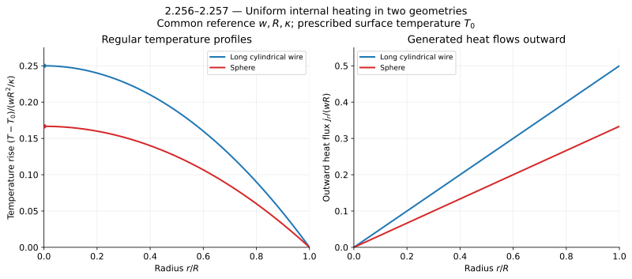

# 2.7 Transport Phenomena

[Chapter index](../README.md#chapters) · [Structured solutions](2.7.json) · [Answer audit](../audit/README.md)

## 2.220

**Problem statement**

Calculate what fraction of gas molecules (a) traverses without collisions the distances exceeding the mean free path λ; (b) has the free path values lying within the interval from λ to 2λ.

**Solved · high confidence.** Integrate the exponential free-path distribution over the requested ranges.

**Assumptions**

- Use the chapter model of a homogeneous dilute gas with independent collision losses and constant mean free path lambda. Endpoints have zero probability measure.

The survival probability beyond distance s is the given exponential attenuation law.

$$
P(L>s)=e^{-s/\lambda},\qquad f_L(s)=\lambda^{-1}e^{-s/\lambda}\quad(s\ge0).
$$

Evaluate the tail at one mean free path and subtract two tails for the bounded interval.

$$
P(L>\lambda)=e^{-1}=0.367879441,\qquad P(\lambda\le L\le2\lambda)=e^{-1}-e^{-2}=0.232544158.
$$

**Results**

Fraction traveling more than one mean free path without collision

$$
P_a=e^{-1}\simeq36.7879\%
$$

Fraction with paths between one and two mean free paths

$$
P_b=e^{-1}-e^{-2}\simeq23.2544\%
$$

## 2.221

**Problem statement**

A narrow molecular beam makes its way into a vessel filled with gas under low pressure. Find the mean free path of molecules if the beam intensity decreases η-fold over the distance Δl.

**Solved · high confidence.** Invert the exponential attenuation of unscattered beam intensity.

**Assumptions**

- The narrow beam loses counted particles when they collide, and scattered particles are excluded from the measured transmitted beam. Gas properties and attenuation length are uniform.
- The measured reduction factor eta=Iinitial/Ifinal exceeds one, and Delta l>0.

Apply exponential survival to the unscattered intensity.

$$
I(l+\Delta l)/I(l)=e^{-\Delta l/\lambda}=1/\eta.
$$

Take the logarithm to solve for the attenuation mean free path.

$$
\lambda=\Delta l/\ln\eta.
$$

**Results**

Mean attenuation free path of beam molecules

$$
\lambda=\Delta l/\ln\eta
$$

**Limitations**

- If the detector accepts scattered particles or attenuation is not single-collision exponential loss, the measured intensity needs a different transport model.

## 2.222

**Problem statement**

Let αdt be the probability of a gas molecule experiencing a collision during the time interval dt; α is a constant. Find: (a) the probability of a molecule experiencing no collisions during the time interval t; (b) the mean time interval between successive collisions.

**Solved · high confidence.** Solve the constant-hazard survival equation and compute the first moment of the waiting-time density.

**Assumptions**

- The statement alpha dt is interpreted as a constant conditional collision probability over dt for a molecule that has not yet collided. Alpha>0 gives the usual memoryless Poisson collision model.

A surviving molecule remains collision-free over the next interval with probability1−alpha dt.

$$
P_0(t+dt)=P_0(t)(1-\alpha dt),\qquad dP_0/dt=-\alpha P_0,\quad P_0(0)=1.
$$

Solve for survival and differentiate to obtain the waiting-time density.

$$
P_0(t)=e^{-\alpha t},\qquad f_\tau(t)=\alpha e^{-\alpha t}.
$$

Take the normalized density first moment.

$$
\langle\tau\rangle=\int_0^\infty t\alpha e^{-\alpha t}dt=1/\alpha.
$$

**Results**

Probability of no collisions up to time t

$$
P_0(t)=e^{-\alpha t}
$$

Mean time between successive collisions

$$
\langle\tau\rangle=1/\alpha
$$

## 2.223

**Problem statement**

Find the mean free path and the mean time interval between successive collisions of gaseous nitrogen molecules (a) under standard conditions; (b) at temperature t = 0 °C and pressure p = 1.0 nPa (such a pressure can be reached by means of contemporary vacuum pumps).

**Solved · high confidence.** Use the hard-sphere mean free path and the mean thermal speed to infer the gas-collision interval.

**Assumptions**

- Use nitrogen effective diameter .37 nm and molar mass .028 kg/mol from Appendix15. The dilute hard-sphere model gives lambda=1/(sqrt2 pi d² n) and mean collision interval lambda/mean(v).
- Standard conditions are T0=273.15 K and p0=101300 Pa. Both requested states have this temperature; the second pressure is1.0e−9 Pa.
- Use Appendix k=1.380e−23 for number density and R=8.314 for the molar-mass thermal speed. Their independently rounded values satisfy k NA=8.31174 rather than8.314, a.0272% historical discrepancy retained rather than silently repaired.

Compute number density and mean nitrogen speed at the common temperature.

$$
n=p/(kT_0),\qquad\overline v=\sqrt{8RT_0/(\pi M)}=454.461036\ {\rm m/s}.
$$

Combine the hard-sphere cross section with number density.

$$
\lambda=\frac{kT_0}{\sqrt2\pi d^2p},\qquad\tau=\lambda/\overline v.
$$

Evaluate the standard state.

$$
n_0=2.68738045\times10^{25}\ {\rm m^{-3}},\quad\lambda_0=6.11790216\times10^{-8}\ {\rm m},\quad\tau_0=1.34618849\times10^{-10}\ {\rm s}.
$$

At the same temperature both mean free path and collision interval scale as inverse pressure.

$$
p=10^{-9}\ {\rm Pa}:\quad\lambda=6.19743489\times10^6\ {\rm m},\qquad\tau=1.36368894\times10^4\ {\rm s}.
$$

**Results**

Nitrogen mean gas-collision free path at standard conditions

$$
\lambda_0\simeq6.11790\times10^{-8}\ {\rm m}
$$

Mean gas-collision interval at standard conditions

$$
\tau_0\simeq1.34619\times10^{-10}\ {\rm s}
$$

Formal mean gas-collision free path at1 nPa

$$
\lambda\simeq6.19743\times10^6\ {\rm m}
$$

Formal mean gas-collision interval at1 nPa

$$
\tau\simeq13636.9\ {\rm s}
$$

**Limitations**

- The very-low-pressure result is a formal gas-gas mean free path. In a laboratory-size vessel, wall collisions occur long before a molecule traverses this distance.
- Tabulated effective diameters are approximate mean collision sizes; real scattering can depend on collision energy.

## 2.224

**Problem statement**

How many times does the mean free path of nitrogen molecules exceed the mean distance between the molecules under standard conditions?

**Solved · high confidence.** Compare the hard-sphere collision length with the characteristic volume-per-particle spacing.

**Assumptions**

- Use the conventional spacing ell=n^(−1/3), not a statistical nearest-neighbour mean. Nitrogen diameter is .37 nm and number density is p0/(kT0) at273.15 K and101300 Pa.

Write the two lengths in terms of number density.

$$
\ell=n^{-1/3},\qquad\lambda=(\sqrt2\pi d^2n)^{-1},\qquad\frac\lambda\ell=\frac{n^{-2/3}}{\sqrt2\pi d^2}.
$$

Evaluate each length and their ratio.

$$
\ell=3.33854280\times10^{-9}\ {\rm m},\quad\lambda=6.11790216\times10^{-8}\ {\rm m},\quad\lambda/\ell=18.3250673.
$$

**Results**

Mean-free-path to characteristic-spacing ratio

$$
\lambda/\ell\simeq18.3251
$$

## 2.225

**Problem statement**

Find the mean free path of gas molecules under standard conditions if the Van der Waals constant of this gas is equal to b = 40 ml/mol.

**Solved · high confidence.** Infer a hard-sphere diameter from the van der Waals excluded volume, then use the dilute-gas mean-free-path formula.

**Assumptions**

- In the hard-sphere interpretation, molar b equals four times the total geometric molecular volume: b=4 NA(pi d³/6). This is a model relation, not an exact identity between every empirical b and kinetic diameter.
- Use the supplied b=40 mL/mol=4.0e−5 m³/mol, Appendix NA=6.023e23 mol−1, standard p0=101300 Pa and T0=273.15 K with k=1.380e−23.

Solve the excluded-volume relation for molecular diameter.

$$
b=\frac{2\pi}{3}N_Ad^3,\qquad d=\left(\frac{3b}{2\pi N_A}\right)^{1/3}=3.16516366\times10^{-10}\ {\rm m}.
$$

Insert this model diameter and the standard number density into the collision-length formula.

$$
\lambda=\frac{kT_0}{\sqrt2\pi d^2p_0}=8.36014158\times10^{-8}\ {\rm m}.
$$

**Results**

Model mean free path inferred from b

$$
\lambda\simeq8.36014\times10^{-8}\ {\rm m}
$$

Hard-sphere diameter corresponding to the supplied b

$$
d\simeq0.316516\ {\rm nm}
$$

**Limitations**

- Real effective diameters inferred from viscosity or scattering can differ from those inferred from b, as the Appendix gas-table note cautions.

## 2.226

**Problem statement**

An acoustic wave propagates through nitrogen under standard conditions. At what frequency will the wavelength be equal to the mean free path of the gas molecules?

**Solved · medium confidence.** Formally extrapolate the continuum sound speed to a wavelength equal to the molecular mean free path and assess its validity.

**Assumptions**

- Use Appendix nitrogen gamma=1.40, M=.028 kg/mol and hard-sphere diameter.37 nm at standard conditions. The continuum adiabatic sound speed is sqrt(gamma RT/M).
- The equation wavelength=lambda_mean is solved only as a formal scale estimate. Ordinary hydrodynamic sound requires wavelengths much greater than the mean free path, which this equality violates.

Evaluate the continuum sound speed and standard molecular free path.

$$
c_s=\sqrt{\gamma RT_0/M}=336.969516\ {\rm m/s},\qquad\lambda_m=6.11790216\times10^{-8}\ {\rm m}.
$$

Set the acoustic wavelength c_s/f equal to the molecular collision length.

$$
f_{\rm formal}=c_s/\lambda_m=5.50792588\times10^9\ {\rm Hz}.
$$

Check the collision timescale rather than asserting a physically valid continuum wave at this frequency.

$$
\tau=1.34618849\times10^{-10}\ {\rm s},\qquad f_{\rm formal}\tau=c_s/\overline v=\sqrt{\pi\gamma/8}\simeq0.741,\qquad2\pi f_{\rm formal}\tau\not\ll1.
$$

**Results**

Formal frequency at equality of acoustic wavelength and mean free path

$$
f_{\rm formal}\simeq5.50793\ {\rm GHz}
$$

**Limitations**

- A kinetic dispersion/attenuation model would be required to determine actual propagating or overdamped modes at this scale. The result is not a prediction of ordinary undamped sound.

## 2.227

**Problem statement**

Oxygen is enclosed at the temperature 0 °C in a vessel with the characteristic dimension l = 10 mm (this is the linear dimension determining the character of a physical process in question). Find: (a) the gas pressure below which the mean free path of the molecules λ > l; (b) the corresponding molecular concentration and the mean distance between the molecules.

**Solved · high confidence.** Solve the mean-free-path equality for the threshold, then state the strict rarefied-side inequalities.

**Assumptions**

- Use the dilute hard-sphere oxygen diameter.35 nm from Appendix15, T=273.15 K and characteristic length l=.010 m.
- The phrase below which lambda>l defines a range of pressures, not one pressure or one number density. Threshold concentration and spacing are reported alongside the strict inequalities.
- The conventional characteristic intermolecular spacing is ell=n^(−1/3).

At equality of molecular free path and characteristic vessel size, the pressure is determined by the collision cross section.

$$
\lambda=\frac{kT}{\sqrt2\pi d^2p},\qquad p_* =\frac{kT}{\sqrt2\pi d^2l}=0.692594968\ {\rm Pa}.
$$

The corresponding threshold number density is fixed without an atmospheric-pressure conversion.

$$
n_*=p_*/(kT)=\frac1{\sqrt2\pi d^2l}=1.83738024\times10^{20}\ {\rm m^{-3}},\qquad\ell_*=n_*^{-1/3}=1.75900465\times10^{-7}\ {\rm m}.
$$

The requested inequality is strict, so its boundary values are not interior points of the range.

$$
\lambda>l\iff p<p_*\iff n<n_*,\qquad\ell>\ell_*.
$$

**Results**

Pressure threshold for molecular free paths exceeding10 mm

$$
p<p_*\simeq0.692595\ {\rm Pa}
$$

The numeric value is the equality threshold, not a unique pressure below it.

Molecular concentration threshold

$$
n<n_*\simeq1.83738\times10^{20}\ {\rm m^{-3}}
$$

Characteristic spacing lower threshold

$$
\ell>\ell_*\simeq0.175900\ {\rm micrometres}
$$

## 2.228

**Problem statement**

For the case of nitrogen under standard conditions find: (a) the mean number of collisions experienced by each molecule per second; (b) the total number of collisions occurring between the molecules within 1 cm³ of nitrogen per second.

**Solved · high confidence.** Use mean speed divided by free path for molecular collision rate and divide participant counts by two for collision pairs.

**Assumptions**

- Use the chapter hard-sphere nitrogen model at273.15 K and101300 Pa, with Appendix d=.37 nm and M=.028 kg/mol.
- Number density uses k and mean speed uses R; the independently rounded R versus k NA convention is preserved. Count binary molecular collisions and exclude walls.

The per-molecule collision frequency follows from the mean thermal speed and mean free path.

$$
\overline v=454.461036\ {\rm m/s},\quad\lambda=6.11790216\times10^{-8}\ {\rm m},\quad z=\overline v/\lambda=7.42838025\times10^9\ {\rm s^{-1}}.
$$

Summing over molecules counts each collision twice, once for each participant.

$$
\mathcal R_{\rm pairs}=\frac12nz,\qquad n=2.68738045\times10^{25}\ {\rm m^{-3}}.
$$

Multiply by one cubic centimetre to obtain the requested event rate.

$$
\dot N_{1{\rm cm^3}}=\frac12nz(10^{-6}\ {\rm m^3})=9.98144195\times10^{28}\ {\rm s^{-1}}.
$$

**Results**

Mean number of gas collisions per molecule per second

$$
z\simeq7.42838\times10^9\ {\rm s^{-1}}
$$

Distinct molecular collisions occurring in1 cm³ per second

$$
\dot N\simeq9.98144\times10^{28}\ {\rm s^{-1}}
$$

For the specified1 cm³ volume; each binary event is counted once.

## 2.229

**Problem statement**

How does the mean free path λ and the number of collisions of each molecule per unit time ν depend on the absolute temperature of an ideal gas undergoing (a) an isochoric process; (b) an isobaric process?

**Solved · high confidence.** Combine collision length inverse density with mean molecular speed proportional to square root of temperature.

**Assumptions**

- The gas amount and molecular mass are fixed. Effective hard-sphere diameter is assumed independent of temperature, so changes in cross section are excluded.
- Let c denote molecular number concentration and z the per-molecule collision frequency, avoiding confusion with gas mole number.

State the two kinetic scalings before imposing the thermodynamic path.

$$
\lambda\propto1/c,\qquad\overline v\propto T^{1/2},\qquad z=\overline v/\lambda\propto cT^{1/2}.
$$

At fixed volume the concentration is constant.

$$
\text{Isochoric:}\qquad\lambda=\text{constant},\qquad z\propto T^{1/2}.
$$

At fixed pressure the ideal-gas concentration is proportional to inverse temperature.

$$
\text{Isobaric:}\qquad c\propto T^{-1},\qquad\lambda\propto T,\qquad z\propto T^{-1/2}.
$$

**Results**

Isochoric mean-free-path dependence

$$
\lambda=\mathrm{constant}
$$

Isochoric molecular collision-frequency dependence

$$
z\propto T^{1/2}
$$

Isobaric mean-free-path dependence

$$
\lambda\propto T
$$

Isobaric molecular collision-frequency dependence

$$
z\propto T^{-1/2}
$$

**Limitations**

- Real energy-dependent scattering diameters can change these ideal hard-sphere exponents.

## 2.230

**Problem statement**

As a result of some process the pressure of an ideal gas increases n-fold. How many times have the mean free path λ and the number of collisions of each molecule per unit time ν changed and how, if the process is (a) isochoric; (b) isothermal?

**Solved · high confidence.** Track density and temperature ratios separately for the two ways of raising pressure.

**Assumptions**

- The pressure ratio n=pf/pi exceeds one. Fixed gas amount and constant effective collision diameter are assumed.
- Use z=mean(v)/lambda, with mean(v) proportional to sqrtT and lambda inversely proportional to molecular number concentration.

At fixed volume pressure proportionality raises temperature by n while leaving molecular concentration unchanged.

$$
V_f=V_i:\quad T_f/T_i=n,\quad\lambda_f/\lambda_i=1,\quad z_f/z_i=\sqrt n.
$$

At fixed temperature raising pressure raises concentration by n without changing thermal speed.

$$
T_f=T_i:\quad c_f/c_i=n,\quad\lambda_f/\lambda_i=1/n,\quad z_f/z_i=n.
$$

**Results**

Isochoric pressure increase

$$
\lambda_f/\lambda_i=1,\qquad z_f/z_i=\sqrt n
$$

Isothermal pressure increase

$$
\lambda_f/\lambda_i=1/n,\qquad z_f/z_i=n
$$

## 2.231

**Problem statement**

An ideal gas consisting of rigid diatomic molecules goes through an adiabatic process. How do the mean free path λ and the number of collisions of each molecule per second ν depend in this process on (a) the volume V; (b) the pressure p; (c) the temperature T?

**Solved · high confidence.** Apply the reversible rigid-diatomic adiabat to the density and thermal-speed collision scalings.

**Assumptions**

- The fixed amount of gas follows a reversible quasistatic ideal-gas adiabat with rigid-diatomic gamma=7/5. Vibrational excitation is frozen and collision diameter is constant.
- z denotes the question’s per-molecule collision count per second nu.

Express the molecular concentration and temperature through volume.

$$
c\propto V^{-1},\quad TV^{\gamma-1}=\mathrm{constant},\quad\lambda\propto V,\quad z\propto V^{-1}T^{1/2}\propto V^{-(\gamma+1)/2}=V^{-6/5}.
$$

Eliminate volume in favour of pressure with the adiabatic pressure-volume law.

$$
pV^\gamma=\mathrm{constant}:\qquad\lambda\propto p^{-1/\gamma}=p^{-5/7},\qquad z\propto p^{(\gamma+1)/(2\gamma)}=p^{6/7}.
$$

Eliminate volume in favour of temperature.

$$
V\propto T^{-1/(\gamma-1)}:\qquad\lambda\propto T^{-5/2},\qquad z\propto T^3.
$$

**Results**

Volume dependencies on the rigid-diatomic adiabat

$$
\lambda\propto V,\qquad z\propto V^{-6/5}
$$

Pressure dependencies

$$
\lambda\propto p^{-5/7},\qquad z\propto p^{6/7}
$$

Temperature dependencies

$$
\lambda\propto T^{-5/2},\qquad z\propto T^3
$$

**Limitations**

- An irreversible heat-insulated path need not obey the reversible adiabat; changing collision cross sections or activated vibration also changes the exponents.

## 2.232

**Problem statement**

An ideal gas goes through a polytropic process with exponent n. Find the mean free path λ and the number of collisions of each molecule per second ν as a function of (a) the volume V; (b) the pressure p; (c) the temperature T.

**Solved · high confidence.** Parameterize a general polytrope by volume and identify when pressure or temperature ceases to be a valid path parameter.

**Assumptions**

- The fixed gas amount follows pV^n=constant with finite real exponent n, positive p,V,T and constant molecular collision diameter. Number concentration is denoted c, not n.
- Choose a reference state(V0,p0,T0,lambda0,z0). The quantity z is the question’s molecular collision frequency nu.

The ideal-gas law and polytropic relation give temperature as a power of volume.

$$
T/T_0=(V/V_0)^{1-n},\qquad\lambda/\lambda_0=V/V_0,\qquad z/z_0=(V/V_0)^{-(n+1)/2}.
$$

For nonzero n, pressure can be inverted to recover volume.

$$
n\ne0:\qquad\lambda/\lambda_0=(p/p_0)^{-1/n},\qquad z/z_0=(p/p_0)^{(n+1)/(2n)}.
$$

For n different from one, temperature can be inverted to recover volume.

$$
n\ne1:\qquad\lambda/\lambda_0=(T/T_0)^{1/(1-n)},\qquad z/z_0=(T/T_0)^{(n+1)/[2(n-1)]}.
$$

For n=0 the pressure is constant, so its single value cannot label the changing collision scales.

$$
n=0:\quad p=p_0,\quad\lambda\propto V\propto T,\quad z\propto V^{-1/2}\propto T^{-1/2};\quad\lambda(p),z(p)\ \text{not single-valued along a nontrivial path}.
$$

For n=1 the temperature is constant, so it cannot label the changing scales.

$$
n=1:\quad T=T_0,\quad\lambda\propto V\propto p^{-1},\quad z\propto V^{-1}\propto p;\quad\lambda(T),z(T)\ \text{not single-valued along a nontrivial path}.
$$

Two useful checks are a finite exponent with constant collision rate and the separate isochoric limit.

$$
n=-1:\quad z=\mathrm{constant};\qquad\text{isochoric limiting path: }\lambda=\mathrm{constant},\quad z\propto T^{1/2}.
$$

**Results**

Volume-relative transport laws, all finite n

$$
\lambda/\lambda_0=V/V_0,\qquad z/z_0=(V/V_0)^{-(n+1)/2}
$$

Pressure-relative laws for n not zero

$$
\lambda/\lambda_0=(p/p_0)^{-1/n},\qquad z/z_0=(p/p_0)^{(n+1)/(2n)}
$$

Temperature-relative laws for n not one

$$
\lambda/\lambda_0=(T/T_0)^{1/(1-n)},\qquad z/z_0=(T/T_0)^{(n+1)/[2(n-1)]}
$$

n=0 degeneracy

$$
p=p_0,\quad\lambda\propto T,\quad z\propto T^{-1/2}
$$

No unique pressure-only value for varying lambda or z along this isobar.

n=1 degeneracy

$$
T=T_0,\quad\lambda\propto p^{-1},\quad z\propto p
$$

No unique temperature-only value for varying lambda or z along this isotherm.

**Limitations**

- An exact isochore is a separate limiting constraint rather than a nontrivial finite-n pV^n path; its transport laws are supplied independently.

## 2.233

**Problem statement**

Determine the molar heat capacity of a polytropic process through which an ideal gas consisting of rigid diatomic molecules goes and in which the number of collisions between the molecules remains constant (a) in a unit volume; (b) in the total volume of the gas.

**Solved · high confidence.** Keep the collision rate per volume or per whole gas fixed, then determine the polytropic heat capacity.

**Assumptions**

- Use the chapter hard-sphere approximation with fixed effective molecular diameter: mean speed is proportional to sqrt(T), mean free path is inversely proportional to molecular concentration, D=mean_speed*lambda/3 and eta=rho*D. Molecular number is fixed unless escape is specified.
- Rigid diatomic molecules have molar Cv=5R/2. The number of collisions remaining constant means collision count per fixed time interval, not the cumulative count since the process began. Distinguish molecular concentration c from the polytropic exponent s.

The event rate per unit volume contains two molecular concentrations and a relative speed; the factor one-half avoids counting each pair twice.

$$
Z_V=\tfrac12 c^2\sigma\overline{v_{\rm rel}}\propto V^{-2}T^{1/2},\qquad Z_{\rm total}=VZ_V\propto V^{-1}T^{1/2}.
$$

A polytrope pV^s=constant obeys TV^(s−1)=constant. Fixed per-volume collision rate requires T proportional to V^4.

$$
Z_V=\mathrm{const}:\quad T\propto V^4,\ s=-3,\qquad C=C_V+\frac{R}{1-s}=\frac{11R}{4}.
$$

Fixed whole-gas collision rate instead requires T proportional to V².

$$
Z_{\rm total}=\mathrm{const}:\quad T\propto V^2,\ s=-1,\qquad C=\frac{5R}{2}+\frac R2=3R.
$$

**Results**

Constant collision count per unit volume and time

$$
C=11R/4=22.8635\ \mathrm{J/(mol\,K)}
$$

Constant total collision count per time

$$
C=3R=24.942\ \mathrm{J/(mol\,K)}
$$

## 2.234

**Problem statement**

An ideal gas of molar mass M is enclosed in a vessel of volume V whose thin walls are kept at a constant temperature T. At a moment t = 0 a small hole of area S is opened, and the gas starts escaping into vacuum. Find the gas concentration n as a function of time t if at the initial moment n (0) = n_0 .

**Solved · high confidence.** Balance the effusive molecular loss from an isothermal vessel.

**Assumptions**

- The hole is much smaller than the gas mean free path and sufficiently thin for molecular effusion; the gas is well mixed and Maxwellian. Wall heat exchange maintains gas temperature T during escape. Outside pressure is negligible.

Integrating positive normal velocities gives molecular flux c times mean speed divided by four.

$$
J=\frac14 n\bar v,\qquad\bar v=\sqrt{\frac{8RT}{\pi M}},\qquad N=nV.
$$

The fixed-volume concentration decays at a rate proportional to itself.

$$
V\frac{dn}{dt}=-\frac14 S\bar v n,\qquad\frac{dn}{n}=-\frac{S\bar v}{4V}dt.
$$

Integrate using the supplied initial concentration.

$$
n(t)=n_0e^{-t/\tau},\qquad\tau=\frac{4V}{S\bar v}=\frac VS\sqrt{\frac{2\pi M}{RT}}.
$$

**Results**

Molecular concentration after the hole is opened

$$
n(t)=n_0\exp\left[-\frac{S}{V}\sqrt{\frac{RT}{2\pi M}}\,t\right]
$$

**Limitations**

- If escape is hydrodynamic rather than molecular, or the gas cools because thermal equilibration is too slow, this exponential is not applicable.

## 2.235

**Problem statement**

A vessel filled with gas is divided into two equal parts 1 and 2 by a thin heat-insulating partition with two holes. One hole has a small diameter, and the other has a very large diameter (in comparison with the mean free path of molecules). In part 2 the gas is kept at a temperature η times higher than that of part 1. How will the concentration of molecules in part 2 change and how many times after the large hole is closed?

**Solved · high confidence.** Compare initial continuum pressure balance with final effusive flux balance.

**Assumptions**

- The two compartment volumes are equal. Their temperatures remain fixed at T1 and T2=eta*T1 during the subsequent redistribution, with eta>1. The large hole initially makes the pressures equal to continuum accuracy; the remaining small hole is in the effusive regime. Total molecule number is conserved.

Before closure the large opening maintains equal pressures rather than equal concentrations.

$$
n_{1i}T_1=n_{2i}T_2,\qquad n_{1i}=\eta n_{2i}.
$$

After closing the large opening, equal opposing effusion fluxes require concentrations times mean speed to match.

$$
n_{1f}\bar v_1=n_{2f}\bar v_2,\qquad n_{1f}=\sqrt\eta\,n_{2f}.
$$

Equal volumes turn total-number conservation into a concentration sum.

$$
n_{1f}+n_{2f}=n_{1i}+n_{2i},\qquad\frac{n_{2f}}{n_{2i}}=\frac{1+\eta}{1+\sqrt\eta}>1.
$$

**Results**

Increase factor of concentration in the hotter part

$$
\displaystyle n_{2f}/n_{2i}=(1+\eta)/(1+\sqrt\eta)
$$

It increases for eta>1. At the final stationary state p2/p1=sqrt(eta), although initially p2/p1=1.

**Limitations**

- Thermal reservoirs maintaining both temperatures are implicit. With freely evolving compartment temperatures, particle conservation alone would not give this fixed-temperature factor.

## 2.236

**Problem statement**

As a result of a certain process the viscosity coefficient of an ideal gas increases α = 2.0 times and its diffusion coefficient β = 4.0 times. How does the gas pressure change and how many times?

**Solved · high confidence.** Use the temperature and concentration scalings of viscosity and self-diffusion.

**Assumptions**

- Use the chapter hard-sphere approximation with fixed effective molecular diameter: mean speed is proportional to sqrt(T), mean free path is inversely proportional to molecular concentration, D=mean_speed*lambda/3 and eta=rho*D. Molecular number is fixed unless escape is specified.

Viscosity fixes the temperature ratio, while diffusion also fixes the number-density ratio.

$$
\eta\propto T^{1/2},\quad D\propto T^{1/2}/c,\qquad T_2/T_1=\alpha^2,\quad c_2/c_1=\alpha/\beta.
$$

The ideal-gas pressure ratio follows from p proportional to cT.

$$
\frac{p_2}{p_1}=\frac{c_2T_2}{c_1T_1}=\frac{\alpha^3}{\beta}=\frac{2^3}{4}=2.
$$

**Results**

Pressure increase factor

$$
p_2/p_1=\alpha^3/\beta=2
$$

## 2.237

**Problem statement**

How will a diffusion coefficient D and the viscosity coefficient η of an ideal gas change if its volume increases n times: (a) isothermally; (b) isobarically?

**Solved · high confidence.** Apply the fixed-number transport scalings to the two expansion paths.

**Assumptions**

- Use the chapter hard-sphere approximation with fixed effective molecular diameter: mean speed is proportional to sqrt(T), mean free path is inversely proportional to molecular concentration, D=mean_speed*lambda/3 and eta=rho*D. Molecular number is fixed unless escape is specified.
- The expansion factor n denotes V2/V1, not molecular concentration.

For fixed molecule number, mean free path scales as volume.

$$
D\propto V\sqrt T,\qquad\eta\propto\sqrt T.
$$

Isothermal expansion leaves the mean molecular speed and viscosity unchanged.

$$
T_2=T_1:\qquad D_2/D_1=n,\quad\eta_2/\eta_1=1.
$$

Isobaric expansion raises temperature in the same ratio as volume.

$$
T_2/T_1=V_2/V_1=n:\qquad D_2/D_1=n^{3/2},\quad\eta_2/\eta_1=n^{1/2}.
$$

**Results**

Isothermal expansion

$$
D_2=nD_1,\quad\eta_2=\eta_1
$$

Isobaric expansion

$$
D_2=n^{3/2}D_1,\quad\eta_2=\sqrt n\,\eta_1
$$

## 2.238

**Problem statement**

An ideal gas consists of rigid diatomic molecules. How will a diffusion coefficient D and viscosity coefficient η change and how many times if the gas volume is decreased adiabatically n =10 times?

**Solved · high confidence.** Combine the rigid-diatomic adiabat with kinetic-transport scalings.

**Assumptions**

- Use the chapter hard-sphere approximation with fixed effective molecular diameter: mean speed is proportional to sqrt(T), mean free path is inversely proportional to molecular concentration, D=mean_speed*lambda/3 and eta=rho*D. Molecular number is fixed unless escape is specified.
- A quasistatic reversible ideal-gas adiabat is assumed; rigid diatomic gamma=7/5, and compression factor n=V1/V2=10.

Adiabatic compression raises temperature while shortening mean free path.

$$
TV^{\gamma-1}=\mathrm{const},\qquad T_2/T_1=n^{2/5},\quad\lambda_2/\lambda_1=1/n.
$$

Multiply the appropriate powers to obtain diffusion and viscosity ratios.

$$
D_2/D_1=n^{-1}n^{1/5}=n^{-4/5},\qquad\eta_2/\eta_1=n^{1/5}.
$$

**Results**

Diffusion coefficient after compression

$$
D_2/D_1=10^{-4/5}\simeq0.158489
$$

The diffusion coefficient decreases by a factor6.30957.

Viscosity coefficient after compression

$$
\eta_2/\eta_1=10^{1/5}\simeq1.58489
$$

**Limitations**

- Adiabatic alone does not imply the reversible relation if substantial viscous heating or free expansion occurs; the ordinary quasistatic adiabatic compression is intended.

## 2.239

**Problem statement**

An ideal gas goes through a polytropic process. Find the polytropic exponent n if in this process the coefficient (a) of diffusion; (b) of viscosity; (c) of heat conductivity remains constant.

**Solved · high confidence.** Express each coefficient as a power of volume along a polytrope.

**Assumptions**

- Use the chapter hard-sphere approximation with fixed effective molecular diameter: mean speed is proportional to sqrt(T), mean free path is inversely proportional to molecular concentration, D=mean_speed*lambda/3 and eta=rho*D. Molecular number is fixed unless escape is specified.
- The gas has temperature-independent specific Cv and fixed molecular diameter; all paths are nontrivial changes of volume.

A polytrope pV^n=constant gives T proportional to V^(1−n).

$$
T\propto V^{1-n},\qquad D\propto V\sqrt T\propto V^{(3-n)/2}.
$$

Viscosity and conductivity have the same temperature scaling for fixed Cv.

$$
\eta\propto\sqrt T\propto V^{(1-n)/2},\qquad\kappa=\eta c_V\propto V^{(1-n)/2}.
$$

Set each exponent to zero.

$$
D=\mathrm{const}\Rightarrow n=3;\qquad\eta=\mathrm{const}\Rightarrow n=1;\qquad\kappa=\mathrm{const}\Rightarrow n=1.
$$

**Results**

Constant diffusion coefficient

$$
n=3
$$

Constant viscosity coefficient

$$
n=1
$$

Constant thermal conductivity

$$
n=1
$$

**Limitations**

- Temperature-dependent effective collision diameter or activated molecular heat capacity changes these simple exponents.

## 2.240

**Problem statement**

Knowing the viscosity coefficient of helium under standard conditions, calculate the effective diameter of the helium atom.

**Solved · high confidence.** Infer the effective diameter from the chapter viscosity and mean-free-path approximations.

**Assumptions**

- Appendix15 gives helium viscosity18.9 microPa s and molar mass.004kg/mol under standard conditions, taken as0°C=273.15K. Use Avogadro constant6.023e23/mol and R8.314.
- The requested diameter is inferred from the approximate viscosity relation, not substituted from the separate mean molecular-diameter column.

Substitute the molecular mean free path into the viscosity formula.

$$
\eta=\frac13\rho\bar v\lambda,\quad\lambda=\frac1{\sqrt2\pi d^2c},\quad\rho=cm,\qquad\eta=\frac{m\bar v}{3\sqrt2\pi d^2}.
$$

Use molar mass for mean speed and molecular mass M/NA for momentum transfer.

$$
\bar v=\sqrt{8RT/(\pi M)}=1202.39088\ \mathrm{m/s},\quad m=M/N_A,\qquad d=\sqrt{\frac{(M/N_A)\bar v}{3\sqrt2\pi\eta}}.
$$

Evaluate with the printed viscosity.

$$
d=1.78041989\times10^{-10}\ \mathrm m\simeq0.178\ \mathrm{nm}.
$$

**Results**

Viscosity-inferred effective helium diameter

$$
d\simeq1.78\times10^{-10}\ \mathrm m
$$

**Limitations**

- The1/3 kinetic formula is an approximate hard-sphere transport model, not an exact kinetic-theory prefactor. The independently rounded constants R and k*NA need not agree exactly; the calculation consistently uses R for the molar-speed formula.

## 2.241

**Problem statement**

The heat conductivity of helium is 8.7 times that of argon (under standard conditions). Find the ratio of effective diameters of argon and helium atoms.

**Solved · high confidence.** Compare monatomic-gas heat conductivities within the hard-sphere transport model.

**Assumptions**

- Helium and argon are monatomic ideal gases, so their molecular translational heat capacities are equal. Compare both gases at the same standard temperature and use the stated conductivity ratio8.7 rather than substituting a slightly different ratio from rounded table entries.

Conductivity is proportional to molecular heat capacity times molecular speed divided by collision cross section.

$$
\kappa=\frac13\rho c_V\bar v\lambda\propto\frac{\bar v}{d^2}\propto\frac1{d^2\sqrt M}.
$$

Form the ratio and solve for the diameter ratio.

$$
\frac{\kappa_{\rm He}}{\kappa_{\rm Ar}}=\sqrt{\frac{M_{\rm Ar}}{M_{\rm He}}}\left(\frac{d_{\rm Ar}}{d_{\rm He}}\right)^2,\qquad\frac{d_{\rm Ar}}{d_{\rm He}}=\sqrt{\frac{8.7}{\sqrt{40/4}}}=1.65866861.
$$

**Results**

Argon-to-helium effective diameter ratio

$$
d_{\rm Ar}/d_{\rm He}\simeq1.66
$$

**Limitations**

- As in Appendix15, effective diameters depend on which approximate transport measurement is used.

## 2.242

**Problem statement**

Under standard conditions helium fills up the space between two long coaxial cylinders. The mean radius of the cylinders is equal to R, the gap between them is equal to ΔR, with ΔR ≪ R. The outer cylinder rotates with a fairly low angular velocity ω about the stationary inner cylinder. Find the moment of friction forces acting on a unit length of the inner cylinder. Down to what magnitude should the helium pressure be lowered (keeping the temperature constant) to decrease the sought moment of friction forces n = 10 times if ΔR = 6 mm?

**Solved · medium confidence.** Match continuum Couette torque to the given highly rarefied shear model at reduced pressure.

**Assumptions**

- The gap h=Delta R is much smaller than mean radius R. At standard pressure helium is in steady laminar continuum flow with no slip and viscosity eta0=18.9microPa s.
- Use the chapter Eq2.7d rarefied shear sigma=rho*mean_speed*Delta u/6 at the final low pressure. Temperature remains273.15K, mean speed is1202.39088m/s, and the target torque is one tenth of its original value.
- The requested low-pressure number uses measured Appendix viscosity consistently. A separately labeled mean-diameter model uses Appendix d=.20nm in the hard-sphere formulas.

For a narrow gap the tangential speed difference is omega R and the velocity gradient is approximately omega R/h.

$$
\sigma_0=\eta_0\omega R/h,\qquad N_0^{\prime}=2\pi R^2\sigma_0=\frac{2\pi\eta_0\omega R^3}{h}.
$$

The rarefied chapter formula gives torque proportional to gas density, hence pressure at fixed temperature.

$$
\sigma_{\rm fm}=\frac16\rho\bar v\omega R,\quad N_{\rm fm}^{\prime}=\frac\pi3\rho\bar v\omega R^3,\quad\frac{N_{\rm fm}^{\prime}}{N_0^{\prime}}=\frac{\rho\bar v h}{6\eta_0}.
$$

Set this ratio to1/n and use the ideal-gas density.

$$
p_* =\frac{6\eta_0RT}{nM\bar v h}=0.89241603\ \mathrm{Pa}\quad(n=10,\ h=.006\ \mathrm m).
$$

The mean free path inferred from the same measured viscosity is n h/2; this also identifies the final rarefaction scale.

$$
\lambda_{\eta}=\frac{3\eta_0}{\rho\bar v}=\frac{nh}{2}=.030\ \mathrm m,\qquad\mathrm{Kn}=\lambda/h=5.
$$

If the separate tabulated mean diameter is used to define the whole hard-sphere model, rather than measured viscosity, the pressure estimate differs.

$$
p_{*,d}=\frac{kT}{\sqrt2\pi d^2(nh/2)}=0.70702403\ \mathrm{Pa}\quad(d=.20\ \mathrm{nm}).
$$

For an alternative Maxwell distribution with complete tangential momentum accommodation, exact incident flux gives coefficient1/4 instead of the chapter1/6.

$$
\sigma_{\rm diffuse}=\frac14\rho\bar v\Delta u\quad\Rightarrow\quad p_{*,\rm diffuse}=\frac{4\eta_0RT}{nM\bar v h}=0.59494402\ \mathrm{Pa}.
$$

**Results**

Continuum torque on unit axial length of the inner cylinder

$$
N_0^{\prime}=2\pi\eta_0\omega R^3/\Delta R
$$

In the direction of outer-cylinder rotation; N prime has units N, i.e. torque N m per axial metre.

Pressure for tenfold reduction using measured viscosity and the chapter1/6 rarefied law

$$
p_*\simeq0.892\ \mathrm{Pa}
$$

Alternative fully hard-sphere model based on the tabulated mean diameter

$$
p_{*,d}\simeq0.707\ \mathrm{Pa}
$$

Alternative exact Maxwell-flux coefficient with full tangential accommodation

$$
p_{*,\rm diffuse}\simeq0.595\ \mathrm{Pa}
$$

**Limitations**

- The chapter continuum and rarefied expressions are asymptotic models; no unique interpolation through the transition or wall accommodation coefficient is supplied.
- The printed mean diameter is not exactly consistent with the diameter inferred from viscosity. The separate estimates must not be mixed into one supposedly exact calculation.

## 2.243

**Problem statement**

A gas fills up the space between two long coaxial cylinders of radii R_1 and R_2 , with R_1 < R_2 . The outer cylinder rotates with a fairly low angular velocity ω about the stationary inner cylinder. The moment of friction forces acting on a unit length of the inner cylinder is equal to N_1 . Find the viscosity coefficient η of the gas taking into account that the friction force acting on a unit area of the cylindrical surface of radius r is determined by the formula $\sigma=\eta r(\partial\omega/\partial r)$.

**Solved · high confidence.** Conserve torque through concentric cylindrical shells and integrate angular shear.

**Assumptions**

- Steady axisymmetric laminar Couette flow has no end effects, no slip at either cylinder and constant viscosity. Positive torque is in the direction of outer-cylinder rotation.

The same torque crosses every cylindrical surface per unit axial length.

$$
N_1=2\pi r^2\sigma=2\pi\eta r^3\frac{d\Omega}{dr}.
$$

Integrate from stationary inner boundary to outer angular velocity omega.

$$
\omega=\int_{R_1}^{R_2}\frac{N_1}{2\pi\eta r^3}dr=\frac{N_1}{4\pi\eta}\left(\frac1{R_1^2}-\frac1{R_2^2}\right).
$$

Invert the relation for viscosity.

$$
\eta=\frac{N_1(R_2^2-R_1^2)}{4\pi\omega R_1^2R_2^2}.
$$

**Results**

Gas viscosity from the measured torque per axial length

$$
\displaystyle\eta=\frac{N_1}{4\pi\omega}\left(\frac1{R_1^2}-\frac1{R_2^2}\right)
$$

## 2.244

**Problem statement**

Two identical parallel discs have a common axis and are located at a distance h from each other. The radius of each disc is equal to a, with a ≫ h. One disc is rotated with a low angular velocity ω relative to the other, stationary, disc. Find the moment of friction forces acting on the stationary disc if the viscosity coefficient of the gas between the discs is equal to η.

**Solved · high confidence.** Integrate the continuum viscous traction on concentric annuli of the stationary disc.

**Assumptions**

- The low-speed gas flow in a thin gap h is steady laminar Couette flow. Both opposing disc faces obey no slip; edge effects, radial pumping and torques on the exterior faces are neglected. The requested torque is due to gas between the discs only.

At radius r the tangential velocity difference is omega r, giving approximately uniform axial shear.

$$
\sigma(r)=\eta\frac{\omega r}{h},\qquad dA=2\pi r\,dr.
$$

Multiply each tangential force by its lever arm and integrate over the one gap-facing stationary surface.

$$
N=\int_0^a r\sigma(r)2\pi r\,dr=\frac{2\pi\eta\omega}{h}\int_0^a r^3dr=\frac{\pi\eta\omega a^4}{2h}.
$$

**Results**

Torque exerted by gap gas on the stationary disc

$$
N=\pi\eta\omega a^4/(2h)
$$

It acts in the rotating-disc direction. The torque opposing the rotating disc is equal and opposite.

## 2.245

**Problem statement**

Solve the foregoing problem, assuming that the discs are located in an ultra-rarefied gas of molar mass M, at temperature T and under pressure p.

**Solved · medium confidence.** Integrate the chapter free-molecular shear law and distinguish its prefactor from exact Maxwell incidence.

**Assumptions**

- The gas mean free path greatly exceeds h. Disc radius is much larger than h, edge escape is neglected, and omega a is small relative to thermal speed. Both surfaces are at the stated gas temperature T.
- For the primary answer apply the chapter Eq2.7d coefficient1/6 exactly as printed. Specular tangential reflection would give a different or vanishing torque; a momentum-exchange model is therefore essential.

Replace the continuum velocity gradient by the free-molecular relative surface velocity.

$$
\sigma_{\rm book}(r)=\frac16\rho\bar v\omega r,\quad\rho=\frac{pM}{RT},\quad\bar v=\sqrt{\frac{8RT}{\pi M}}.
$$

Integrate torque over the annular area of the stationary gap-facing disc.

$$
N_{\rm book}=\frac{2\pi\rho\bar v\omega}{6}\int_0^a r^3dr=\frac{\pi\rho\bar v\omega a^4}{12}=\frac{p\omega a^4}{3}\sqrt{\frac{\pi M}{2RT}}.
$$

For comparison, a fully tangentially accommodating Maxwell boundary gives incident molecular flux c*vbar/4. Each incident molecule transfers mean tangential momentum m*Delta u.

$$
\sigma_{\rm diffuse}=\frac14\rho\bar v\Delta u,\qquad N_{\rm diffuse}=\frac{\pi\rho\bar v\omega a^4}{8}=\frac{p\omega a^4}{2}\sqrt{\frac{\pi M}{2RT}}=\frac32N_{\rm book}.
$$

**Results**

Torque from the printed chapter rarefied-gas law

$$
\displaystyle N_{\rm book}=\frac{p\omega a^4}{3}\sqrt{\frac{\pi M}{2RT}}
$$

Alternative exact Maxwell-incidence result with full tangential momentum accommodation

$$
\displaystyle N_{\rm diffuse}=\frac{p\omega a^4}{2}\sqrt{\frac{\pi M}{2RT}}
$$

**Limitations**

- An arbitrary surface-accommodation law does not have a unique torque determined by p,M,T alone. Exterior-face drag, if requested for an immersed complete disc, would require additional surrounding geometry and flow information.

## 2.246

**Problem statement**

Making use of Poiseuille's equation (1.7d), find the mass μ of gas flowing per unit time through the pipe of length l and radius a if constant pressures p_1 and p_2 are maintained at its ends.

**Solved · medium confidence.** Apply Poiseuille locally to an ideal gas and integrate the pressure-dependent mass density.

**Assumptions**

- Take positive mass flow from end 1 to end 2 and let x run along the pipe. The conventional closed formula assumes steady isothermal ideal gas at a known uniform temperature T, with constant dynamic viscosity eta and molar mass M.
- Use a long circular pipe, fully developed laminar low-Mach flow, negligible inertia and entrance effects, and continuum no-slip walls. These are the conditions for applying Poiseuille locally to a compressible gas.
- The statement does not specify a thermal law. A nonisothermal flow requires a temperature/viscosity profile or an energy balance in addition to endpoint pressures.

The local Poiseuille rate is a local volume flow; its product with local gas density is the spatially constant mass flow.

$$
Q(x)=-\frac{\pi a^4}{8\eta}\frac{dp}{dx},\qquad\mu=\rho(x)Q(x),\qquad\rho(x)=\frac{Mp(x)}{RT}.
$$

Multiply by pressure and integrate along the pipe.

$$
p\frac{dp}{dx}=-\frac{8\eta RT\mu}{\pi a^4M},\qquad\frac{p_1^2-p_2^2}{2}=\frac{8\eta RT\mu l}{\pi a^4M}.
$$

Solve for mass flow and note the associated pressure profile.

$$
\boxed{\mu=\frac{\pi a^4M}{16\eta lRT}(p_1^2-p_2^2)},\qquad p^2(x)=p_1^2-\frac{p_1^2-p_2^2}{l}x.
$$

If a nonisothermal ideal-gas profile and its local viscosity are independently known, the same local momentum model gives the more general integral.

$$
\mu=\frac{\pi a^4M(p_1^2-p_2^2)}{16R\displaystyle\int_0^l\eta(x)T(x)\,dx}.
$$

**Results**

Mass flow in the conventional uniform-temperature model

$$
\mu=\frac{\pi a^4M(p_1^2-p_2^2)}{16\eta lRT}
$$

Mass flow for a specified temperature/viscosity profile

$$
\mu=\frac{\pi a^4M(p_1^2-p_2^2)}{16R\int_0^l\eta(x)T(x)\,dx}
$$

**Limitations**

- Without a temperature/viscosity closure the pressure endpoints do not determine a unique numerical mass flow.
- Large pressure ratios can invalidate negligible inertia/low Mach assumptions near the outlet; rarefaction introduces slip or molecular flow.

## 2.247

**Problem statement**

One end of a rod, enclosed in a thermally insulating sheath, is kept at a temperature T_1 while the other, at T_2. The rod is composed of two sections whose lengths are l_1 and l_2 and heat conductivity coefficients κ_1 and κ_2 . Find the temperature of the interface.

**Solved · high confidence.** Match the steady heat current through two serial thermal resistances.

**Assumptions**

- The rod has a common constant cross-sectional area S, negligible interface thermal resistance, constant positive section conductivities and no internal heat generation.
- The side sheath prevents heat loss and the result is the steady state. For unequal section areas use resistances li/(kappai Si) instead.

With interface temperature Ti the two section currents must be equal.

$$
\dot Q=\frac{\kappa_1S}{l_1}(T_1-T_i)=\frac{\kappa_2S}{l_2}(T_i-T_2).
$$

Solve the linear balance for the interface temperature.

$$
T_i=\frac{(\kappa_1/l_1)T_1+(\kappa_2/l_2)T_2}{\kappa_1/l_1+\kappa_2/l_2}=\frac{\kappa_1l_2T_1+\kappa_2l_1T_2}{\kappa_1l_2+\kappa_2l_1}.
$$

**Results**

Steady interface temperature

$$
T_i=\frac{\kappa_1l_2T_1+\kappa_2l_1T_2}{\kappa_1l_2+\kappa_2l_1}
$$

**Limitations**

- Thermal contact resistance, lateral leakage, variable area or temperature-dependent conductivity require modified resistances.

## 2.248

**Problem statement**

Two rods whose lengths are l_1 and l_2 and heat conductivity coefficients κ_1 and κ_2 are placed end to end. Find the heat conductivity coefficient of a uniform rod of length l_1 + l_2 whose conductivity is the same as that of the system of these two rods. The lateral surfaces of the rods are assumed to be thermally insulated.

**Solved · high confidence.** Equate the serial thermal resistance to that of a uniform rod.

**Assumptions**

- The two rods and the equivalent rod have identical cross-sectional area S, constant positive conductivities, perfect contact and no internal heat generation.
- The common area is implicit in the textbook rod comparison. Without it the data determine a thermal conductance only after all cross-sectional areas are specified.

At steady state thermal resistance adds in series.

$$
\mathcal R=\frac{l_1}{\kappa_1S}+\frac{l_2}{\kappa_2S},\qquad\dot Q=\frac{T_1-T_2}{\mathcal R}.
$$

Match this to the uniform rod of total length.

$$
\frac{l_1+l_2}{\kappa_{\rm eff}S}=\frac{l_1}{\kappa_1S}+\frac{l_2}{\kappa_2S}\quad\Longrightarrow\quad\kappa_{\rm eff}=\frac{l_1+l_2}{l_1/\kappa_1+l_2/\kappa_2}.
$$

**Results**

Effective conductivity for equal cross sections

$$
\boxed{\kappa_{\rm eff}=\frac{l_1+l_2}{l_1/\kappa_1+l_2/\kappa_2}}
$$

General comparison when areas are supplied

$$
\kappa_{\rm eff}=\frac{l_1+l_2}{S_{\rm eff}[l_1/(\kappa_1S_1)+l_2/(\kappa_2S_2)]}
$$

**Limitations**

- An effective material conductivity is not uniquely specified by lengths and conductivities alone if the cross-sectional areas or interface resistance differ.

## 2.249

**Problem statement**

A rod of length l with thermally insulated lateral surface consists of material whose heat conductivity coefficient varies with temperature as κ = α/T, where α is a constant. The ends of the rod are kept at temperatures T_1 and T_2. Find the function T (x), where x is the distance from the end whose temperature is T_1 , and the heat flow density.

**Solved · high confidence.** Integrate constant steady heat flux with conductivity inversely proportional to absolute temperature.

**Assumptions**

- Use a uniform rod with no internal heating, insulated sides, steady one-dimensional conduction, positive absolute endpoint temperatures and alpha>0.
- The conductivity law kappa=alpha/T is assumed valid over the whole endpoint interval. Heat flux j is signed positive from x=0 at T1 toward x=l at T2.

Conservation makes the heat flux independent of x; Fourier law then makes lnT linear.

$$
j=-\kappa(T)\frac{dT}{dx}=-\alpha\frac{d\ln T}{dx},\qquad\ln\frac{T(x)}{T_1}=-\frac j\alpha x.
$$

Impose the second endpoint temperature and substitute back.

$$
j=\frac\alpha l\ln\frac{T_1}{T_2},\qquad\boxed{T(x)=T_1\exp\left[\frac xl\ln\frac{T_2}{T_1}\right]=T_1\left(\frac{T_2}{T_1}\right)^{x/l}}.
$$

**Results**

Steady temperature distribution

$$
T(x)=T_1(T_2/T_1)^{x/l},\quad0\leq x\leq l
$$

Signed heat flow density from end 1 toward end 2

$$
j=\frac\alpha l\ln(T_1/T_2)
$$

**Limitations**

- The 1/T law is singular at zero absolute temperature, outside this model.

## 2.250

**Problem statement**

Two chunks of metal with heat capacities C_1 and C_2 are interconnected by a rod of length l and cross-sectional area S and fairly low heat conductivity κ. The whole system is thermally insulated from the environment. At a moment t = 0 the temperature difference between the two chunks of metal equals (ΔT)_0 . Assuming the heat capacity of the rod to be negligible, find the temperature difference between the chunks as a function of time.

**Solved · high confidence.** Combine the quasisteady rod conductance with two finite heat-capacity balances.

**Assumptions**

- Each metal chunk is spatially isothermal and has constant positive heat capacity Ci. The rod has negligible heat capacity as stipulated, insulated sides and constant kappa.
- The rod establishes its instantaneous linear profile much faster than the chunks equilibrate. Contacts have negligible resistance and the environment exchanges no heat with the system.

The heat current is proportional to the instantaneous signed temperature difference.

$$
G=\frac{\kappa S}{l},\qquad\dot Q=G(T_1-T_2),\qquad C_1\dot T_1=-G(T_1-T_2),\quad C_2\dot T_2=G(T_1-T_2).
$$

Subtract the temperature derivatives and integrate.

$$
\frac{d\Delta T}{dt}=-G\left(\frac1{C_1}+\frac1{C_2}\right)\Delta T,\qquad\boxed{\Delta T(t)=(\Delta T)_0e^{-t/\tau}},\quad\tau=\frac{lC_1C_2}{\kappa S(C_1+C_2)}.
$$

The weighted temperature is conserved, fixing the limiting temperature if the two initial temperatures are supplied.

$$
T_f=\frac{C_1T_1(0)+C_2T_2(0)}{C_1+C_2},\quad T_1(t)=T_f+\frac{C_2}{C_1+C_2}\Delta T(t),\quad T_2(t)=T_f-\frac{C_1}{C_1+C_2}\Delta T(t).
$$

**Results**

Time-dependent signed temperature difference

$$
\Delta T(t)=(\Delta T)_0\exp\left[-\frac{\kappa S}{l}\left(\frac1{C_1}+\frac1{C_2}\right)t\right]
$$

Thermal relaxation time

$$
\tau=\frac{lC_1C_2}{\kappa S(C_1+C_2)}
$$

**Limitations**

- Finite rod heat storage, internal chunk temperature gradients or temperature-dependent transport coefficients generally replace the single exponential by a more complicated transient.

## 2.251

**Problem statement**

Find the temperature distribution in a substance placed between two parallel plates kept at temperatures T_1 and T_2. The plate separation is equal to l, the heat conductivity coefficient of the substance $\kappa\propto\sqrt{T}$.

**Solved · high confidence.** Integrate Fourier law with conductivity proportional to the square root of absolute temperature.

**Assumptions**

- Use steady one-dimensional conduction between large plates, no internal heat generation, no convection or radiation, and negligible contact resistance.
- Write kappa=A sqrt(T) with A constant and positive, and place x=0 at the T1 plate and x=l at the T2 plate. Both temperatures are positive.

The heat flux is constant and is proportional to the derivative of T to the power 3/2.

$$
j=-A\sqrt T\frac{dT}{dx}=-\frac{2A}{3}\frac{d(T^{3/2})}{dx}.
$$

Thus T to the power 3/2 interpolates linearly between plate values.

$$
T^{3/2}(x)=T_1^{3/2}+\frac xl(T_2^{3/2}-T_1^{3/2}),\qquad\boxed{T(x)=\left[T_1^{3/2}+\frac xl(T_2^{3/2}-T_1^{3/2})\right]^{2/3}}.
$$

The associated signed heat current density follows directly.

$$
j=\frac{2A}{3l}(T_1^{3/2}-T_2^{3/2}).
$$

**Results**

Steady temperature distribution

$$
T(x)=\left[(1-x/l)T_1^{3/2}+(x/l)T_2^{3/2}\right]^{2/3}
$$

Signed heat flux

$$
j=\frac{2A}{3l}(T_1^{3/2}-T_2^{3/2})
$$

**Limitations**

- The square-root law is an assumed constitutive model; other heat-transfer mechanisms or boundary temperature jumps change the profile.

## 2.252

**Problem statement**

The space between two large horizontal plates is filled with helium. The plate separation equals l = 50 mm. The lower plate is kept at a temperature T_1 = 290 K, the upper, at T_2 = 330 K. Find the heat flow density if the gas pressure is close to standard.

**Solved · high confidence.** Integrate the dilute-gas square-root conductivity law with the historical helium reference value.

**Assumptions**

- Helium is in the continuum dilute-gas regime at near-standard pressure. Use steady vertical conduction with plate temperatures equal to adjacent gas temperatures and negligible radiation/edge losses.
- For the hard-sphere transport approximation, kappa is proportional to sqrt(T). Normalize it with Appendix 15 helium kappa 0=.1415 W/(m K) at standard temperature Tref=273.15 K, rather than using that standard-state value unchanged at 310 K.
- The hotter plate is above the colder one, so the thermal density stratification is stable and ordinary buoyancy convection is suppressed.

Use the standard-temperature normalization and integrate constant flux over the gap.

$$
\kappa(T)=\kappa_0\sqrt{T/T_{\rm ref}},\qquad |j|=\frac1l\int_{290}^{330}\kappa(T)\,dT=\frac{2\kappa_0}{3l\sqrt{T_{\rm ref}}}(330^{3/2}-290^{3/2}).
$$

Evaluate with the 50 mm plate separation.

$$
|j|=\frac{2(0.1415)}{3(0.050)\sqrt{273.15}}(330^{3/2}-290^{3/2})=120.5733385\ {\rm W/m^2}.
$$

If z is measured upward from the lower plate, the temperature profile and signed flux are as follows.

$$
T(z)=\left[290^{3/2}+\frac z{0.050}(330^{3/2}-290^{3/2})\right]^{2/3},\qquad j_z=-120.5733385\ {\rm W/m^2}.
$$

**Results**

Heat-flow density magnitude

$$
|j|\simeq1.206\times10^2\ {\rm W/m^2}
$$

Heat-flow direction

$$
\text{Downward, from the upper hotter plate to the lower colder plate}
$$

If temperature dependence is deliberately neglected

$$
|j|_{\kappa=\kappa_0}=\kappa_0(330-290)/l=113.2\ {\rm W/m^2}
$$

This separate coarser approximation holds the standard-state conductivity constant instead of using the chapter gas scaling.

**Limitations**

- The square-root gas law and the rounded standard-state conductivity are approximate, so the numerical digits do not represent measurement precision.
- Radiation, edge losses or imposed gas circulation are excluded.

## 2.253

**Problem statement**

The space between two large parallel plates separated by a distance l = 5.0 mm is filled with helium under a pressure p = 1.0 Pa. One plate is kept at a temperature t_1 = 17 °C and the other, at a temperature t_2 = 37 °C. Find the mean free path of helium atoms and the heat flow density.

**Solved · medium confidence.** Estimate the mean free path and apply the chapter rarefied-gas heat-flux model with explicit regime and accommodation limitations.

**Assumptions**

- Use mean gas temperature Tbar=(290.15+310.15)/2=300.15 K for the mean-free-path and linearized heat-flux estimates. Helium effective diameter d=.20 nm and molar mass M=.004 kg/mol come from Appendix 15.
- Use the chapter header 107 Eq.2.7e, q=(1/6) vbar rho cv |DeltaT|, as the conventional approximate rarefied-gas model. For ideal monatomic helium use the exact caloric model cv=3R/(2M), rather than treating rounded table gamma 1.67 as exact.
- This header law assumes wall-controlled molecular energy exchange. Thermal accommodation coefficients and detailed wall scattering are not supplied; finite interatomic collisions cannot be neglected asymptotically since the calculated Knudsen number is only about 4.7.

Use the hard-sphere mean free path and ideal-gas number density.

$$
n=\frac p{k_BT},\qquad\lambda=\frac1{\sqrt2\pi d^2n}=\frac{k_BT}{\sqrt2\pi d^2p}=0.0233073325\ {\rm m}=23.3073\ {\rm mm}.
$$

Compare the mean free path with the 5 mm gap before choosing the heat-transfer model.

$$
\mathrm{Kn}=\lambda/l=4.66147,\qquad\bar v=\sqrt{\frac{8R\bar T}{\pi M}}=1260.41698\ {\rm m/s},\qquad\rho c_v=\frac{3p}{2\bar T}.
$$

Insert these quantities into the printed chapter rarefied-gas law.

$$
|j|_{\rm book}=\frac16\bar v\rho c_v\Delta T=\frac{p\bar v}{4\bar T}\Delta T=20.99645145\ {\rm W/m^2}.
$$

Continuum Fourier conduction across the full gap would give the following much larger value; it is not justified at this Knudsen number.

$$
|j|_{\rm continuum}=\frac{2\kappa_0}{3l\sqrt{273.15}}(310.15^{3/2}-290.15^{3/2})=593.287109\ {\rm W/m^2}.
$$

For comparison, a different, fully diffuse and fully accommodating collisionless Maxwell model has one-way particle flux J≈n vbar/4 and 2kBT energy per incident/escaping monatomic particle. It predicts a different asymptotic coefficient from the elementary header law.

$$
|j|_{\rm Maxwell}\simeq\frac{n\bar v}{4}(2k_B\Delta T)=\frac{p\bar v}{2\bar T}\Delta T\simeq41.99\ {\rm W/m^2}.
$$

The coefficient in such a more detailed model depends on wall accommodation, and finite Kn corrections require a transition-regime transport solution. Therefore the Maxwell comparison is not an exact replacement answer at the supplied pressure.

$$
|j|_{\rm Maxwell,linear}=2|j|_{\rm book}\qquad\text{only for the stated fully accommodating collisionless model}.
$$

**Results**

Mean free path near the mean temperature

$$
\lambda\simeq23.3\ {\rm mm}
$$

Conventional heat flux using printed Eq.2.7e

$$
|j|_{\rm book}\simeq21.0\ {\rm W/m^2}
$$

Heat flows from 37°C toward 17°C; this is an approximate rarefied-gas model estimate.

Gap-based Knudsen number

$$
\mathrm{Kn}\simeq4.66
$$

Comparison under full diffuse thermal accommodation and the collisionless limit

$$
|j|_{\rm Maxwell,linear}\simeq42.0\ {\rm W/m^2}
$$

This uses a different microscopic angular/energy-flux model from the printed 1/6 law; neither is an exact finite-Kn prediction with unspecified wall properties.

**Limitations**

- At Kn≈4.66 the gas is rarefied but not in an infinitely collisionless limit; exact finite-Kn heat transfer requires a kinetic model and wall thermal accommodation data.
- Mean free path uses a representative equilibrium temperature; nonisothermal rarefied gas has a spatial/velocity-distribution-dependent effective collision rate.
- The factor-of-two Maxwell comparison deliberately exposes the elementary printed coefficient as a model choice, rather than claiming unspecified wall physics uniquely fixes the calorimetric flux.

## 2.254

**Problem statement**

Find the temperature distribution in the space between two coaxial cylinders of radii R_1 and R_2 filled with a uniform heat conducting substance if the temperatures of the cylinders are constant and are equal to T_1 and T_2 respectively.

**Solved · high confidence.** Solve the source-free radial cylindrical conduction equation and impose both boundary temperatures.

**Assumptions**

- The cylinders are coaxial and sufficiently long for axial/end effects to be negligible, with 0<R1<R2. The uniform intervening material has constant positive conductivity kappa.
- Use steady pure conduction without internal heat generation or interface temperature jumps. Temperature therefore depends only on radius r.

In a cylindrical annulus the conserved radial current per unit length implies a logarithmic solution.

$$
\frac1r\frac d{dr}\left(r\frac{dT}{dr}\right)=0,\qquad T(r)=A\ln r+B.
$$

Impose T(R1)=T1 and T(R2)=T2.

$$
\boxed{T(r)=T_1+(T_2-T_1)\frac{\ln(r/R_1)}{\ln(R_2/R_1)}},\qquad R_1\leq r\leq R_2.
$$

Check constant total radial current through cylinders of different radii.

$$
j_r(r)=-\kappa\frac{dT}{dr}=\frac{\kappa(T_1-T_2)}{r\ln(R_2/R_1)},\qquad\frac{\dot Q}{L_z}=2\pi rj_r=\frac{2\pi\kappa(T_1-T_2)}{\ln(R_2/R_1)}.
$$

**Results**

Temperature distribution between coaxial cylinders

$$
T(r)=T_1+(T_2-T_1)\frac{\ln(r/R_1)}{\ln(R_2/R_1)}
$$

**Limitations**

- Finite cylinder ends, anisotropic/temperature-dependent conductivity or convection require a different boundary-value model.

## 2.255

**Problem statement**

Solve the foregoing problem for the case of two concentric spheres of radii R_1 and R_2 and temperatures T_1 and T_2.

**Solved · high confidence.** Solve the source-free spherical conduction equation between concentric isothermal surfaces.

**Assumptions**

- The shell has 0<R1<R2, constant isotropic conductivity, no internal sources and steady spherically symmetric conduction.
- The shell temperature equals the specified surface temperatures at both interfaces.

Conservation of the radial heat current gives the spherical Laplace equation.

$$
\frac1{r^2}\frac d{dr}\left(r^2\frac{dT}{dr}\right)=0,\qquad T(r)=A+\frac Br.
$$

Apply the two surface temperatures.

$$
\boxed{T(r)=T_1+(T_2-T_1)\frac{1/R_1-1/r}{1/R_1-1/R_2}},\qquad R_1\leq r\leq R_2.
$$

The area increase balances the inverse-square heat-flux decrease.

$$
j_r=\frac{\kappa(T_1-T_2)}{(1/R_1-1/R_2)r^2},\qquad\dot Q=4\pi r^2j_r=\frac{4\pi\kappa(T_1-T_2)}{1/R_1-1/R_2}.
$$

**Results**

Temperature distribution between concentric spheres

$$
T(r)=T_1+(T_2-T_1)\frac{1/R_1-1/r}{1/R_1-1/R_2}
$$

**Limitations**

- The result excludes internal heat sources, anisotropy, temperature-dependent conductivity and interface temperature jumps.

## 2.256

**Problem statement**

A constant electric current flows along a uniform wire with cross-sectional radius R and heat conductivity coefficient κ. A unit volume of the wire generates a thermal power w. Find the temperature distribution across the wire provided the steady-state temperature at the wire surface is equal to T_0 .

**Solved · high confidence.** Integrate the radial Poisson heat equation in a long uniformly heated cylindrical wire.

**Assumptions**

- The wire is long and uniform, with no axial temperature variation or end losses. Conductivity kappa and volumetric generation w are constant and isotropic.
- Use the stated fixed surface temperature T0 at r=R and demand finite differentiable temperature and zero radial gradient at the axis.

Local heat conservation with generation gives the cylindrical Poisson equation.

$$
\kappa\frac1r\frac d{dr}\left(r\frac{dT}{dr}\right)+w=0,\qquad r\frac{dT}{dr}=-\frac{w r^2}{2\kappa}+C.
$$

A nonzero integration constant would give a logarithmic singularity, so regularity requires C=0. Apply the surface boundary value.

$$
\frac{dT}{dr}=-\frac{wr}{2\kappa},\qquad\boxed{T(r)=T_0+\frac{w}{4\kappa}(R^2-r^2)},\quad0\leq r\leq R.
$$

The outward flux through every cylindrical surface carries exactly the power generated inside it.

$$
j_r(r)=\frac{wr}{2},\qquad\frac{\dot Q(r)}{L_z}=2\pi rj_r=\pi r^2w,\qquad T(0)-T_0=\frac{wR^2}{4\kappa}.
$$

**Results**

Wire temperature across the cross section

$$
T(r)=T_0+\frac{w(R^2-r^2)}{4\kappa}
$$

Central temperature

$$
T_{\rm max}=T(0)=T_0+\frac{wR^2}{4\kappa}
$$

**Limitations**

- The prescribed uniform w omits feedback from temperature-dependent electrical resistivity; short-wire axial conduction or variable conductivity changes the profile.

## 2.257

**Problem statement**

The thermal power of density w is generated uniformly inside a uniform sphere of radius R and heat conductivity coefficient κ. Find the temperature distribution in the sphere provided the steady-state temperature at its surface is equal to T_0.

**Solved · high confidence.** Integrate the spherically symmetric Poisson heat equation with a regular centre and fixed surface temperature.

**Assumptions**

- The sphere is uniform and isotropic, with constant conductivity kappa, steady uniform volumetric generation w and an isothermal surface T0.
- No central point source is present, so temperature is finite and its radial derivative vanishes at r=0.

Use spherical heat conservation including the volume source.

$$
\kappa\frac1{r^2}\frac d{dr}\left(r^2\frac{dT}{dr}\right)+w=0,\qquad r^2\frac{dT}{dr}=-\frac{wr^3}{3\kappa}+C.
$$

Regularity sets C=0; integrate once more and impose T(R)=T0.

$$
\frac{dT}{dr}=-\frac{wr}{3\kappa},\qquad\boxed{T(r)=T_0+\frac{w}{6\kappa}(R^2-r^2)},\quad0\leq r\leq R.
$$

Verify the total heat current at any radius equals the power generated within that sphere.

$$
j_r(r)=\frac{wr}{3},\qquad\dot Q(r)=4\pi r^2j_r=\frac{4\pi r^3}{3}w,\qquad T(0)-T_0=\frac{wR^2}{6\kappa}.
$$

**Results**

Temperature distribution inside the sphere

$$
T(r)=T_0+\frac{w(R^2-r^2)}{6\kappa}
$$

Central temperature

$$
T_{\rm max}=T_0+\frac{wR^2}{6\kappa}
$$

**Limitations**

- Temperature-dependent generation/conductivity or a convective boundary specified instead of T0 requires a different closure.
