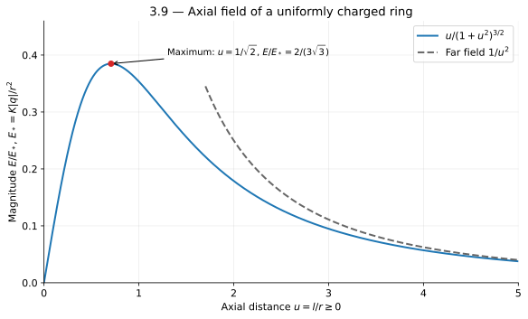
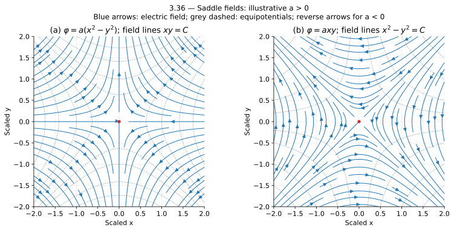
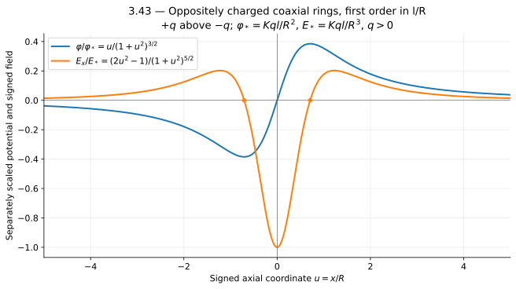
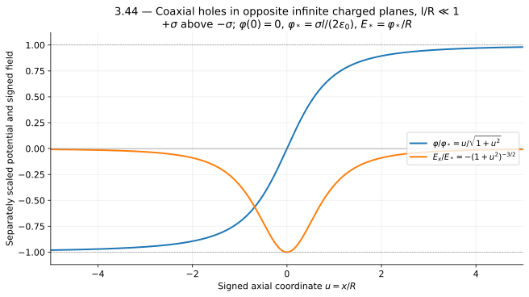

# 3.1 Constant Electric Field in Vacuum

[Chapter index](../README.md#chapters) · [Structured solutions](3.1.json) · [Answer audit](../audit/README.md)

## 3.1

**Problem statement**

Calculate the ratio of the electrostatic to gravitational interaction forces between two electrons, between two protons. At what value of the specific charge q/m of a particle would these forces become equal (in their absolute values) in the case of interaction of identical particles?

**Solved · high confidence.** Divide Coulomb repulsion by Newtonian gravitational attraction; cancel the common inverse-square distance.

**Assumptions**

- Identical point particles in vacuum, separated sufficiently for classical static force laws to apply. Only electromagnetic and gravitational forces are compared.
- Use historical Appendix30 values, with K=1/(4 pi epsilon0) computed from epsilon0=8.85e−12F/m; the independently printed rounded K=9e9 is not imposed simultaneously.

Both force magnitudes vary as inverse separation squared, so their ratio depends only on specific charge.

$$
F_e=Kq^2/r^2,\quad F_g=Gm^2/r^2,\quad F_e/F_g=(K/G)(q/m)^2.
$$

Insert electron and proton masses and the elementary-charge magnitude from Appendix30.

$$
\frac{F_e}{F_g}\bigg|_e=4.168783113e+42,\qquad \frac{F_e}{F_g}\bigg|_p=1.237580645e+36.
$$

Equality of magnitudes fixes the absolute value of the specific charge, allowing either charge sign.

$$
|q/m|=\sqrt{G/K}=\sqrt{4\pi\varepsilon_0G}=8.61270\times10^{-11}\ \mathrm{C/kg}.
$$

**Results**

Electron electrostatic-to-gravitational force ratio

$$
K e^2/(Gm_e^2)\simeq4.16878\times10^{42}
$$

Proton electrostatic-to-gravitational force ratio

$$
K e^2/(Gm_p^2)\simeq1.23758\times10^{36}
$$

Specific-charge magnitude giving equal forces

$$
|q/m|=\sqrt{4\pi\varepsilon_0G}\simeq8.61270\times10^{-11}\ \mathrm{C/kg}
$$

**Limitations**

- At microscopic scales the comparison is a classical force-scale estimate; nuclear and quantum effects are outside the requested two-force comparison.

## 3.2

**Problem statement**

What would be the interaction force between two copper spheres, each of mass 1 g, separated by the distance 1 m, if the total electronic charge in them differed from the total charge of the nuclei by one per cent?

**Solved · high confidence.** Count the copper nuclei and electrons, take a one-percent net charge imbalance, and apply Coulomb law.

**Assumptions**

- Interpret one percent relative to the total nuclear charge (equivalently the neutral electronic-charge magnitude).
- Each sphere is small compared with the1m separation, and the hypothetical net charges are prescribed and retained.
- Use natural copper nominal molar mass M_Cu=.063546kg/mol from the separately documented CIAAW property reference, consulted after Appendix lookup; Appendix23 supplies Z=29.

The number of atoms in one sphere is mass divided by molar mass, times Avogadro constant.

$$
N=(m/M_{\rm Cu})N_A,\quad Q_{\rm nuclei}=NZe.
$$

A one-percent imbalance produces a macroscopic net charge.

$$
|Q|=0.01\frac{m}{M_{\rm Cu}}N_AZe=440.3369748\ \mathrm{C}.
$$

For a separation d the force magnitude follows directly; equal imbalance signs repel and opposite signs attract.

$$
|F|=K\frac{|Q_1Q_2|}{d^2}=K\left(0.01\frac{m}{M_{\rm Cu}}N_AZe\right)^2/d^2=1.74348082e+15\ \mathrm{N},\quad d=1\ \mathrm{m}.
$$

**Results**

Hypothetical force magnitude

$$
|F|=K[0.01(m/M_{\rm Cu})N_AZe]^2/d^2\simeq1.74348\times10^{15}\ \mathrm{N}
$$

Repulsive for matching excesses/deficits; attractive for opposite imbalances. It scales as M_Cu^−2.

Net charge magnitude on each sphere

$$
|Q|\simeq440.337\ \mathrm{C}
$$

**Limitations**

- Such a huge retained charge is not physically sustainable on ordinary gram-sized copper spheres: emission, discharge and mechanical disruption invalidate a literal experiment.
- Polarization and finite-size corrections are neglected in this formal point-sphere estimate.

## 3.3

**Problem statement**

Two small equally charged spheres, each of mass m, are suspended from the same point by silk threads of length l. The distance between the spheres x ≪ l. Find the rate dq/dt with which the charge leaks off each sphere if their approach velocity varies as v = a/√x, where a is a constant.

**Solved · medium confidence.** Differentiate the small-angle quasistatic balance between electrostatic repulsion and the horizontal component of thread tension.

**Assumptions**

- Treat the spheres as point charges with equal charge magnitude q; the threads are massless and x is much smaller than l.
- Assume slow leakage and quasistatic mechanical equilibrium, so inertial corrections to the force balance can be neglected over the range considered.
- Interpret approach velocity as the rate of decrease of their mutual separation, v=−dx/dt=a/sqrt(x), with a>0.

Each sphere is displaced horizontally by x/2; eliminate thread tension from vertical and horizontal equilibrium.

$$
T\cos\theta=mg,\quad T\sin\theta=Kq^2/x^2,\quad \tan\theta\simeq x/(2l).
$$

The charge magnitude is proportional to the three-halves power of the separation.

$$
Kq^2/x^2\simeq mgx/(2l),\qquad q=\sqrt{\frac{mg}{2Kl}}x^{3/2}.
$$

Use the given separation speed to obtain a constant loss rate.

$$
\frac{dq}{dt}=\frac32\sqrt{\frac{mg}{2Kl}}\sqrt{x}\frac{dx}{dt}=-\frac{3a}{2}\sqrt{\frac{mg}{2Kl}}=-\frac{3a}{2}\sqrt{\frac{2\pi\varepsilon_0mg}{l}}.
$$

**Results**

Rate of change of charge magnitude on either sphere

$$
\dot q=-\frac{3a}{2}\sqrt{\frac{mg}{2Kl}}
$$

If the quoted v is instead each sphere speed toward the midpoint

$$
\dot q=-3a\sqrt{\frac{mg}{2Kl}}
$$

Then −dx/dt=2v. For a signed negative charge, the signed derivative reverses; the displayed q is its magnitude.

**Limitations**

- The prescribed speed grows without bound as x tends to zero, so the quasistatic approximation must fail before contact; the formula is not a complete dynamical solution.
- Finite sphere size and exact finite-angle corrections are excluded.

## 3.4

**Problem statement**

Two positive charges q_1 and q_2 are located at the points with radius vectors r_1 and r_2 . Find a negative charge q_3 and a radius vector r_3 of the point at which it has to be placed for the force acting on each of the three charges to be equal to zero.

**Solved · high confidence.** Use collinearity, cancel the field at the negative charge, and then cancel the force on an outer positive charge.

**Assumptions**

- Distinct positions r1 and r2, positive q1,q2 and an unconstrained third point charge in vacuum.
- Force-free means an equilibrium configuration, not stability under perturbations.

The two forces on either outer charge can cancel only if all three charges lie on one line, with the negative charge between the positives. Let distances to the negative charge be a,b and total separation d=a+b.

$$
\frac{q_1}{a^2}=\frac{q_2}{b^2},\qquad \frac{a}{b}=\sqrt{\frac{q_1}{q_2}},\qquad a=\frac{\sqrt{q_1}}{\sqrt{q_1}+\sqrt{q_2}}d.
$$

Cancellation of the force on q1 fixes the negative charge.

$$
Kq_1q_2/d^2=Kq_1|q_3|/a^2,\qquad q_3=-\frac{q_1q_2}{(\sqrt{q_1}+\sqrt{q_2})^2}.
$$

Interpolate the position using the fraction a/d along the segment from r1 to r2.

$$
\mathbf r_3=\mathbf r_1+\frac{a}{d}(\mathbf r_2-\mathbf r_1)=\frac{\sqrt{q_2}\mathbf r_1+\sqrt{q_1}\mathbf r_2}{\sqrt{q_1}+\sqrt{q_2}}.
$$

**Results**

Third charge

$$
q_3=-\frac{q_1q_2}{(\sqrt{q_1}+\sqrt{q_2})^2}
$$

Location of the third charge

$$
\mathbf r_3=\frac{\sqrt{q_2}\mathbf r_1+\sqrt{q_1}\mathbf r_2}{\sqrt{q_1}+\sqrt{q_2}}
$$

**Limitations**

- This electrostatic equilibrium is unstable; no claim of passive trapping is made.

## 3.5

**Problem statement**

A thin wire ring of radius r has an electric charge q. What will be the increment of the force stretching the wire if a point charge q_0 is placed at the ring's centre?

**Solved · high confidence.** Balance the incremental outward radial electric load on an infinitesimal wire arc against the increment of circumferential tension.

**Assumptions**

- The ring remains circular with fixed radius r; its charge is uniform before and after insertion (also enforced by rotational symmetry for a conducting ring).
- Neglect deformation and compute only the tension increment due to the central point charge, without changing the original self-force contribution.

An arc subtending dphi carries charge q dphi/(2pi), so the central charge adds a signed outward force.

$$
dF_r=\frac{Kq_0}{r^2}\frac{q}{2\pi}d\phi.
$$

For tension increment DeltaT the two end tensions have an inward resultant DeltaT dphi.

$$
\Delta T\,d\phi=dF_r,\qquad \Delta T=\frac{Kqq_0}{2\pi r^2}=\frac{qq_0}{8\pi^2\varepsilon_0r^2}.
$$

**Results**

Signed increment of the force stretching the wire

$$
\Delta T=\frac{Kqq_0}{2\pi r^2}
$$

**Limitations**

- If the computed negative increment exceeds the initial tension, buckling or loss of a circular shape would require a separate mechanical treatment.

## 3.6

**Problem statement**

A positive point charge 50 μC is located in the plane xy at the point with radius vector $\mathbf{r}_0 = 2\mathbf{i} + 3\mathbf{j}$, where i and j are the unit vectors of the x and y axes. Find the vector of the electric field strength E and its magnitude at the point with radius vector $\mathbf{r} = 8\mathbf{i} - 5\mathbf{j}$. Here r_0 and r are expressed in metres.

**Solved · high confidence.** Subtract the source position from the observation position and apply the vector Coulomb field.

**Assumptions**

- Point charge q=+50microC in vacuum; the two printed radius vectors are in metres.

The displacement has components6 and−8m and length10m.

$$
\mathbf d=\mathbf r-\mathbf r_0=6\mathbf i-8\mathbf j\ \mathrm{m},\qquad d=10\ \mathrm{m}.
$$

Insert the displacement into the inverse-square field law.

$$
\mathbf E=Kq\frac{\mathbf d}{d^3}=(2697.541408\mathbf i-3596.721878\mathbf j)\ \mathrm{N/C},\quad E=Kq/d^2=4495.902347\ \mathrm{N/C}.
$$

**Results**

Electric field vector

$$
\mathbf E=(2697.5414\mathbf i-3596.7219\mathbf j)\ \mathrm{N/C}
$$

Electric field magnitude

$$
E\simeq4495.90235\ \mathrm{N/C}
$$

## 3.7

**Problem statement**

Point charges q and −q are located at the vertices of a square with diagonals 2l as shown in Fig. 3.1. Find the magnitude of the electric field strength at a point located symmetrically with respect to the vertices of the square at a distance x from its centre.

**Solved · high confidence.** Sum the four equal-denominator vector Coulomb fields on the normal axis of the square.

**Assumptions**

- As visually shown in Fig.3.1, both upper vertices carry+q and both lower vertices carry−q, with q>0.
- The observation point is on the perpendicular through the square centre, at axial distance x; each diagonal is2l. Define ey in the square plane pointing from the negative row to the positive row.

The half-side is l/sqrt2 and every charge is at distance sqrt(l²+x²) from the point. The signed total charge is zero, cancelling the normal field.

$$
b=l/\sqrt2,\quad \mathbf r_i=(\pm b,\pm b,0),\quad D=\sqrt{l^2+x^2},\quad \sum_iq_i=0.
$$

The horizontal pair components cancel, while all four in-plane vertical components point toward the negative row.

$$
\mathbf E=\frac{K}{D^3}\sum_iq_i(\mathbf r-\mathbf r_i)=-\frac{4Kqb}{D^3}\mathbf e_y=-\frac{2\sqrt2Kql}{(l^2+x^2)^{3/2}}\mathbf e_y.
$$

**Results**

Field magnitude on the square normal

$$
E(x)=\frac{2\sqrt2Kql}{(l^2+x^2)^{3/2}}
$$

The vector is parallel to the square plane, from its positive row toward its negative row.

## 3.8

**Problem statement**

A thin half-ring of radius R = 20 cm is uniformly charged with a total charge q = 0.70 nC. Find the magnitude of the electric field strength at the curvature centre of this half-ring.

**Solved · high confidence.** Integrate the radial point-charge field over a uniformly charged semicircle.

**Assumptions**

- Thin half-ring of radius R=.20m with total charge q=.70nC uniformly distributed along arc length piR.
- Let the arc occupy0<=phi<=pi above the centre; its positive charge produces a field along the downward bisector.

The linear charge density is q/(piR). Horizontal components cancel by reflection symmetry.

$$
\lambda=\frac{q}{\pi R},\quad d\mathbf E=-\frac{K\lambda}{R}(\cos\phi\,\mathbf e_x+\sin\phi\,\mathbf e_y)d\phi.
$$

Integrate the surviving bisector component.

$$
E=\frac{K|\lambda|}{R}\int_0^\pi\sin\phi\,d\phi=\frac{2K|q|}{\pi R^2}=100.1763115\ \mathrm{N/C}.
$$

**Results**

Field magnitude at the semicircle centre

$$
E=\frac{2K|q|}{\pi R^2}\simeq100.17631\ \mathrm{N/C}
$$

## 3.9

**Problem statement**

A thin wire ring of radius r carries a charge q. Find the magnitude of the electric field strength on the axis of the ring as a function of distance l from its centre. Investigate the obtained function at l ≫ r. Find the maximum strength magnitude and the corresponding distance l. Draw the approximate plot of the function E(l).

**Solved · high confidence.** Exploit rotational symmetry, integrate the axial component, and differentiate the resulting one-dimensional field.

**Assumptions**

- Thin ring with uniform charge q and fixed radius r>0 in vacuum.
- The requested l is a nonnegative distance on the ring axis; the field magnitude uses |q|.

Transverse components of opposite elements cancel, while all axial projections have the same distance and angle.

$$
E(l)=\int\frac{K\,|dq|}{r^2+l^2}\frac{l}{\sqrt{r^2+l^2}}=\frac{K|q|l}{(r^2+l^2)^{3/2}},\qquad l\ge0.
$$

Expand far from the ring; the leading term is the field of its total charge.

$$
E(l)=\frac{K|q|}{l^2}\left(1-\frac{3r^2}{2l^2}+O(r^4/l^4)\right),\qquad l\gg r.
$$

Differentiate to locate the unique positive maximum.

$$
\frac{dE}{dl}=K|q|\frac{r^2-2l^2}{(r^2+l^2)^{5/2}}=0\ \Longrightarrow\ l_{\max}=r/\sqrt2,\qquad E_{\max}=\frac{2K|q|}{3\sqrt3r^2}.
$$

**Results**

Field magnitude as a function of axial distance

$$
E(l)=\frac{K|q|l}{(r^2+l^2)^{3/2}}
$$

Large-distance field

$$
E(l)\sim K|q|/l^2\quad(l\gg r)
$$

Location and magnitude of the maximum

$$
l_{\max}=r/\sqrt2,\qquad E_{\max}=\frac{2K|q|}{3\sqrt3r^2}
$$

Dimensionless plot and its shape

$$
u=l/r,\quad \frac{Er^2}{K|q|}=\frac{u}{(1+u^2)^{3/2}}
$$

The curve starts at0 with slope1, reaches2/(3sqrt3) at u=1/sqrt2, then decays to0 as u^−2. For q=0 the entire curve vanishes.

**Limitations**

- The curve for signed axial coordinate is odd; the magnitude shown uses a nonnegative distance.

## 3.10

**Problem statement**

A point charge q is located at the centre of a thin ring of radius R with uniformly distributed charge —q. Find the magnitude of the electric field strength vector at the point lying on the axis of the ring at a distance x from its centre, if x » R.

**Solved · high confidence.** Superpose the central point-charge field with the opposite ring field and expand their cancellation at large axial distance.

**Assumptions**

- Ring charge−q is uniformly distributed at radius R, and the point chargeq is fixed at its centre.
- Take x>0 along the axis; the requested approximation assumes x much larger than R.

The exact signed axial field is the difference of the point and ring contributions.

$$
\mathbf E=Kq\left[\frac1{x^2}-\frac{x}{(x^2+R^2)^{3/2}}\right]\mathbf e_x.
$$

The net charge and dipole moment vanish, so expand through the first surviving term.

$$
\frac{x}{(x^2+R^2)^{3/2}}=\frac1{x^2}\left[1-\frac{3R^2}{2x^2}+\frac{15R^4}{8x^4}+O(R^6/x^6)\right].
$$

Subtract and take the magnitude.

$$
E=\frac{3K|q|R^2}{2x^4}\left[1-\frac{5R^2}{4x^2}+O(R^4/x^4)\right]\sim\frac{3K|q|R^2}{2x^4}.
$$

**Results**

Leading far-field magnitude

$$
E\simeq\frac{3K|q|R^2}{2x^4}=\frac{3|q|R^2}{8\pi\varepsilon_0x^4}\quad(x\gg R)
$$

## 3.11

**Problem statement**

A system consists of a thin charged wire ring of radius R and a very long uniformly charged thread oriented along the axis of the ring, with one of its ends coinciding with the centre of the ring. The total charge of the ring is equal to q. The charge of the thread (per unit length) is equal to λ. Find the interaction force between the ring and the thread.

**Solved · high confidence.** Integrate the axial ring field over the semi-infinite charged thread and use the equal and opposite force on the ring.

**Assumptions**

- The thin ring has uniform total chargeq and radius R. The straight thread extends from z=0 at the ring centre to z=+infinity with constant linear densitylambda.
- The stated very long thread is approximated as semi-infinite; charges remain prescribed.

A thread segment dz experiences the known ring-axis field.

$$
d\mathbf F_{\rm thread}=\lambda\,dz\frac{Kqz}{(R^2+z^2)^{3/2}}\mathbf e_z.
$$

Integrate from the centre to infinity.

$$
\mathbf F_{\rm thread}=Kq\lambda\left[-\frac1{\sqrt{R^2+z^2}}\right]_0^\infty\mathbf e_z=\frac{Kq\lambda}{R}\mathbf e_z,\qquad \mathbf F_{\rm ring}=-\mathbf F_{\rm thread}.
$$

For a finite length L, the same primitive supplies the correction.

$$
\mathbf F_{\rm thread}(L)=Kq\lambda\left(\frac1R-\frac1{\sqrt{R^2+L^2}}\right)\mathbf e_z.
$$

**Results**

Interaction force magnitude

$$
F=K|q\lambda|/R
$$

Force directions

$$
\mathbf F_{\rm thread}=\frac{Kq\lambda}{R}\mathbf e_z,\qquad\mathbf F_{\rm ring}=-\frac{Kq\lambda}{R}\mathbf e_z
$$

For like signs the thread is pushed away from the ring plane and the ring oppositely; signs reverse for attraction.

**Limitations**

- The ring self-force and thread self-force are excluded, as the question asks their mutual force.

## 3.12

**Problem statement**

A thin nonconducting ring of radius R has a linear charge density λ = λ_0 cos φ, where λ_0 is a constant, φ is the azimuthal angle. Find the magnitude of the electric field strength (a) at the centre of the ring; (b) on the axis of the ring as a function of the distance x from its centre. Investigate the obtained function at x >> R.

**Solved · high confidence.** Integrate the signed cos(phi) charge density around the ring; only its transverse first angular harmonic survives.

**Assumptions**

- The ring is nonconducting so the specified nonuniform signed density remains fixed.
- Let ez be the ring axis and ex point radially toward phi=0 in its plane; the observation point is x ez.

An element carries lambda0 R cos(phi)dphi; the distance from every element to the observation point is the same.

$$
dq=\lambda_0R\cos\phi\,d\phi,\qquad D=\sqrt{R^2+x^2},\qquad \mathbf E=\frac{K}{D^3}\int_0^{2\pi}(x\mathbf e_z-R\cos\phi\mathbf e_x-R\sin\phi\mathbf e_y)dq.
$$

The integrals of cos(phi) and cos(phi)sin(phi) vanish, whereas the integral of cos²(phi) is pi.

$$
\mathbf E(x)=-\frac{\pi K\lambda_0R^2}{(R^2+x^2)^{3/2}}\mathbf e_x.
$$

Evaluate at the centre and expand far along the axis.

$$
E(0)=\frac{\pi K|\lambda_0|}{R}=\frac{|\lambda_0|}{4\varepsilon_0R},\qquad E(x)\sim\frac{\pi K|\lambda_0|R^2}{|x|^3}\quad(|x|\gg R).
$$

**Results**

Field magnitude at the centre

$$
E(0)=\pi K|\lambda_0|/R
$$

Field magnitude along the ring axis

$$
E(x)=\frac{\pi K|\lambda_0|R^2}{(R^2+x^2)^{3/2}}
$$

Large-distance field

$$
E(x)\sim\pi K|\lambda_0|R^2/|x|^3
$$

The field vector is transverse to the ring axis and opposite lambda0 ex.

## 3.13

**Problem statement**

A thin straight rod of length 2a carrying a uniformly distributed charge q is located in vacuum. Find the magnitude of the electric field strength as a function of the distance r from the rod's centre along the straight line (a) perpendicular to the rod and passing through its centre; (b) coinciding with the rod's direction (at the points lying outside the rod). Investigate the obtained expressions at r >> a.

**Solved · high confidence.** Integrate the axial and transverse components of the field of a uniformly charged finite line segment.

**Assumptions**

- Rod coordinate s runs from−a to+a, with constant linear charge densitylambda=q/(2a).
- r is a nonnegative distance; the perpendicular formula applies for r>0 and the along-rod formula only for exterior points r>a.

At a perpendicular-bisector point, opposite elements cancel their components parallel to the rod.

$$
E_\perp=K|\lambda|r\int_{-a}^{a}\frac{ds}{(r^2+s^2)^{3/2}}=K|\lambda|r\left[\frac{s}{r^2\sqrt{r^2+s^2}}\right]_{-a}^a=\frac{K|q|}{r\sqrt{r^2+a^2}}.
$$

At an exterior point on the rod axis every element points in the same axial direction.

$$
E_\parallel=K|\lambda|\int_{-a}^{a}\frac{ds}{(r-s)^2}=K|\lambda|\left(\frac1{r-a}-\frac1{r+a}\right)=\frac{K|q|}{r^2-a^2},\qquad r>a.
$$

Expand the two geometrical factors for r much larger than a.

$$
E_\perp=\frac{K|q|}{r^2}\left[1-\frac{a^2}{2r^2}+O(a^4/r^4)\right],\qquad E_\parallel=\frac{K|q|}{r^2}\left[1+\frac{a^2}{r^2}+O(a^4/r^4)\right].
$$

**Results**

Perpendicular-bisector field magnitude

$$
E_\perp(r)=\frac{K|q|}{r\sqrt{r^2+a^2}}
$$

Exterior axial field magnitude

$$
E_\parallel(r)=\frac{K|q|}{r^2-a^2}\quad(r>a)
$$

Both large-distance limits

$$
E_\perp,E_\parallel\sim K|q|/r^2\quad(r\gg a)
$$

For q>0 each field points away from the rod; for q<0 it reverses.

**Limitations**

- The singular near-line and endpoint fields would be regularized by a finite rod radius.

## 3.14

**Problem statement**

A very long straight uniformly charged thread carries a charge λ per unit length. Find the magnitude and direction of the electric field strength at a point which is at a distance y from the thread and lies on the perpendicular passing through one of the thread's ends.

**Solved · high confidence.** Resolve and integrate the field of a semi-infinite straight line from its endpoint.

**Assumptions**

- Place the charged thread on the positive x-axis from0 to infinity and the observation point at(0,y), y>0.
- The finite but very long thread is approximated by this semi-infinite line;lambda is signed.

Each element contributes a component away from its own position to the observation point.

$$
d\mathbf E=K\lambda\frac{-s\mathbf e_x+y\mathbf e_y}{(s^2+y^2)^{3/2}}ds.
$$

Integrate both components over the half-line.

$$
E_x=-K\lambda\int_0^\infty\frac{s\,ds}{(s^2+y^2)^{3/2}}=-\frac{K\lambda}{y},\qquad E_y=K\lambda y\int_0^\infty\frac{ds}{(s^2+y^2)^{3/2}}=\frac{K\lambda}{y}.
$$

The equal component magnitudes fix the field angle.

$$
\mathbf E=\frac{K\lambda}{y}(-\mathbf e_x+\mathbf e_y),\qquad E=\frac{\sqrt2K|\lambda|}{y}.
$$

**Results**

Electric field magnitude

$$
E=\sqrt2K|\lambda|/y
$$

Electric field direction

$$
\mathbf E=\frac{K\lambda}{y}(-\mathbf e_x+\mathbf e_y)
$$

For positive lambda, the vector points45degrees from the outward perpendicular, away from the part of the axis occupied by the thread. It reverses for negative lambda.

**Limitations**

- End effects from the remote end are neglected; they vanish as the observation distance divided by thread length tends to zero.

## 3.15

**Problem statement**

A thread carrying a uniform charge λ per unit length has the configurations shown in Fig. 3.2 a and b. Assuming a curvature radius R to be considerably less than the length of the thread, find the magnitude of the electric field strength at the point O.

**Solved · high confidence.** Superpose the fields of the circular bend and its tangent straight arms, using the geometry visible in Fig.3.2.

**Assumptions**

- Uniform signed line densitylambda on a thin fixed thread. PointO is the centre of curvature.
- Approximate each long straight arm as semi-infinite, with R much smaller than both arm lengths.
- For(a), choose O as origin: the quarter-circle is in the lower-left quadrant, joining(−R,0) to(0,−R); the vertical arm extends upward from(−R,0), and the horizontal arm rightward from(0,−R). For(b), the lower semicircle joins(−R,0) to(R,0), with both arms upward.

At the centre, an arc element at anglephi contributes opposite to its radius. Integrate the lower-left quarter-circle.

$$
d\mathbf E=-\frac{K\lambda}{R}(\cos\phi\mathbf e_x+\sin\phi\mathbf e_y)d\phi,\qquad \mathbf E_{{\rm arc},a}=\frac{K\lambda}{R}(\mathbf e_x+\mathbf e_y).
$$

The two semi-infinite tangent arms in(a) have equal opposite vector fields atO, leaving the quarter-circle field.

$$
\mathbf E_{{\rm vert},a}=\frac{K\lambda}{R}(\mathbf e_x-\mathbf e_y),\quad\mathbf E_{{\rm horiz},a}=\frac{K\lambda}{R}(-\mathbf e_x+\mathbf e_y),\quad E_a=\frac{\sqrt2K|\lambda|}{R}.
$$

For(b) the lower semicircle field is upward, while the two straight arms sum to an equal downward field.

$$
\mathbf E_{{\rm arc},b}=\frac{2K\lambda}{R}\mathbf e_y,\quad\mathbf E_{{\rm arms},b}=-\frac{2K\lambda}{R}\mathbf e_y,\quad\mathbf E_b=\mathbf0.
$$

The cancellation in(b) is exact only for infinite arms. If the two arms each have finite length L measured from their tangencies, direct integration gives the residual.

$$
\mathbf E_b(L)=\frac{2K\lambda}{\sqrt{R^2+L^2}}\mathbf e_y\ \longrightarrow\ \mathbf0\quad(L/R\to\infty).
$$

**Results**

Field magnitude for the rounded right angle

$$
E_a\simeq\sqrt2K|\lambda|/R
$$

For positive lambda it points diagonally upward/right, away from the quarter-circle.

Leading infinite-arm field for the U-shaped thread

$$
\mathbf E_b\simeq\mathbf0
$$

The leading order K|lambda|/R terms cancel. Finite-arm residuals depend on the unspecified arm lengths; for equal lengthsL the residual is2K|lambda|/sqrt(R²+L²).

**Limitations**

- No exact nonzero finite-thread field can be inferred without the remote endpoint positions. In(b), the quoted zero is the semi-infinite approximation, not exact cancellation for arbitrary finite arms.

## 3.16

**Problem statement**

A sphere of radius r carries a surface charge of density $σ = \mathbf{a}\cdot\mathbf{r}$, where a is a constant vector, and r is the radius vector of a point of the sphere relative to its centre. Find the electric field strength vector at the centre of the sphere.

**Solved · high confidence.** Integrate the centre field over the spherical surface and use the isotropic angular second moment.

**Assumptions**

- The given signed surface charge distribution is fixed on a sphere of radius r; use n as its outward unit normal, so each source position is r n.
- The constant vectora has units C/m³ because sigma=a dot r.

A source element on the sphere produces a field at the centre opposite to its outward radius.

$$
\sigma=r\,\mathbf a\cdot\mathbf n,\quad dS=r^2d\Omega,\quad d\mathbf E=-\frac{K\sigma\,dS}{r^2}\mathbf n=-Kr(\mathbf a\cdot\mathbf n)\mathbf n\,d\Omega.
$$

Rotational symmetry makes the angular dyadic average proportional to the identity; taking its trace fixes the coefficient.

$$
\int n_i n_j\,d\Omega=\frac{4\pi}{3}\delta_{ij},\qquad \mathbf E(0)=-\frac{4\pi Kr}{3}\mathbf a=-\frac{r}{3\varepsilon_0}\mathbf a.
$$

**Results**

Electric field vector at the sphere centre

$$
\mathbf E(0)=-\frac{r}{3\varepsilon_0}\mathbf a
$$

## 3.17

**Problem statement**

Suppose the surface charge density over a sphere of radius R depends on a polar angle θ as σ = σ_0 cos θ, where σ_0 is a positive constant. Show that such a charge distribution can be represented as a result of a small relative shift of two uniformly charged balls of radius R whose charges are equal in magnitude and opposite in sign. Resorting to this representation, find the electric field strength vector inside the given sphere.

**Solved · high confidence.** Represent the dipolar surface layer as the limiting difference of two slightly displaced uniformly charged balls and add their uniform-density interior fields.

**Assumptions**

- Use the polar axis ez for the stated sigma=sigma0 cos(theta), sigma0>0. The surface distribution is prescribed and does not redistribute.
- The shifted-ball construction is an infinitesimal-displacement representation: volume density magnitude rho and centre separation d obey rho d=sigma0 in the limiting surface layer.
- The requested field is at interior points r<R; the electric field jumps across the charged surface.

Shift the positive ball centre by+d/2 along the polar axis and the negative one by−d/2. At polar angle theta their boundaries differ radially by d cos(theta), creating the required effective surface charge.

$$
\sigma(\theta)=\rho d\cos\theta,\qquad \rho d=\sigma_0.
$$

Inside their common overlap, each uniform ball has a linear field relative to its own centre. Subtract the two fields.

$$
\mathbf E_+=\frac{\rho}{3\varepsilon_0}(\mathbf r-\tfrac12d\mathbf e_z),\qquad \mathbf E_-=-\frac{\rho}{3\varepsilon_0}(\mathbf r+\tfrac12d\mathbf e_z).
$$

The position-dependent parts cancel. Taking the infinitesimal-shift limit makes the common-overlap result valid at every fixed interior point.

$$
\mathbf E_{\rm inside}=-\frac{\rho d}{3\varepsilon_0}\mathbf e_z=-\frac{\sigma_0}{3\varepsilon_0}\mathbf e_z.\qquad r<R
$$

**Results**

Effective surface-charge relation

$$
\rho d=\sigma_0,\quad\mathbf d=d\mathbf e_z\text{ directed from negative-ball centre to positive-ball centre}
$$

Uniform field throughout the interior

$$
\mathbf E=-\frac{\sigma_0}{3\varepsilon_0}\mathbf e_z\quad(r<R)
$$

**Limitations**

- A finite shift gives a thin volume-charge layer, not precisely a mathematical surface distribution; the representation is exact in the infinitesimal-shift limit.
- At r=R the one-sided fields differ; the stated interior vector is the limit from inside.

## 3.18

**Problem statement**

Find the electric field strength vector at the centre of a ball of radius R with volume charge density  $ρ = \mathbf{a}\cdot\mathbf{r}$, where a is a constant vector, and r is a radius vector drawn from the ball's centre.

**Solved · high confidence.** Integrate the signed charge-density contribution shell by shell, using the angular second moment at the ball centre.

**Assumptions**

- The volume charge distributionrho=a dot r is fixed inside a ball of radiusR; it changes sign across the plane perpendicular toa.
- The vectora has units C/m⁴. Use s for source radius andn for its unit direction.

At the centre the field of a source volume element is opposite to its source radius; insertrho=s a dotn.

$$
\rho=s\,\mathbf a\cdot\mathbf n,\quad dV=s^2ds\,d\Omega,\quad d\mathbf E=-\frac{K\rho\,dV}{s^2}\mathbf n=-Ks(\mathbf a\cdot\mathbf n)\mathbf n\,ds\,d\Omega.
$$

Perform the same isotropic angular integral as for a spherical surface, then integrate the remaining radial factor.

$$
\mathbf E(0)=-K\frac{4\pi}{3}\mathbf a\int_0^R s\,ds=-\frac{2\pi K R^2}{3}\mathbf a=-\frac{R^2}{6\varepsilon_0}\mathbf a.
$$

**Results**

Electric field vector at the ball centre

$$
\mathbf E(0)=-\frac{R^2}{6\varepsilon_0}\mathbf a
$$

## 3.19

**Problem statement**

A very long uniformly charged thread oriented along the axis of a circle of radius R rests on its centre with one of the ends. The charge of the thread per unit length is equal to λ. Find the flux of the vector E across the circle area.

**Solved · high confidence.** Integrate the axial field of a semi-infinite line over the perpendicular disk.

**Assumptions**

- Place the thread on z>=0, with its endpoint at the disk centre in z=0. Approximate the very long thread by a semi-infinite uniform line. Define the disk normal as +z, pointing toward the thread. K=1/(4pi epsilon0).
- The endpoint carries no additional point charge. Its field singularity is treated as an improper surface integral; reverse the sign if the disk normal is reversed.

At a disk point at cylindrical radius s>0, source elements above the plane give a negative normal component.

$$
E_z(s)=-K\lambda\int_0^\infty\frac{z\,dz}{(s^2+z^2)^{3/2}}=-\frac{K\lambda}{s}.
$$

Integrate over annuli. The area factor cancels the1/s singularity.

$$
\Phi_{+z}=\lim_{\delta\to0^+}\int_\delta^R E_z(s)2\pi s\,ds=-2\pi K\lambda R=-\frac{\lambda R}{2\epsilon_0}.
$$

A finite thread of length L supplies a direct convergence check.

$$
\Phi_{+z}(L)=-\frac{\lambda}{2\epsilon_0}\left[L+R-\sqrt{L^2+R^2}\right]\longrightarrow-\frac{\lambda R}{2\epsilon_0}.
$$

**Results**

Flux for a normal pointing into the thread

$$
\Phi_{+z}=-\lambda R/(2\epsilon_0)
$$

Unsigned flux

$$
|\Phi|=|\lambda|R/(2\epsilon_0)
$$

**Limitations**

- A finite thread has the displayed length correction. Absolute line-charge potential at infinity is not required for this field calculation.

## 3.20

**Problem statement**

Two point charges q and −q are separated by the distance 2l (Fig. 3.3). Find the flux of the electric field strength vector across a circle of radius R.

**Solved · high confidence.** Integrate the two equal normal field contributions in the median plane.

**Assumptions**

- Figure3.3 places+q and−q at z=−l and z=+l, respectively, with the circle centred at z=0 and its plane perpendicular to their joining line. Choose the normal+z from the positive charge toward the negative charge.

The transverse components cancel, while the normal components add at each radius s.

$$
E_z(s)=\frac{2Kql}{(l^2+s^2)^{3/2}}.
$$

Integrate the normal field over the circular disk.

$$
\Phi=4\pi Kql\int_0^R\frac{s\,ds}{(l^2+s^2)^{3/2}}=\frac q{\epsilon_0}\left(1-\frac l{\sqrt{l^2+R^2}}\right).
$$

**Results**

Flux toward the negative charge

$$
\displaystyle\Phi=\frac q{\epsilon_0}\left(1-\frac l{\sqrt{l^2+R^2}}\right)
$$

Reverse the sign for the opposite normal; q denotes the signed charge at the left-hand source.

## 3.21

**Problem statement**

A ball of radius R is uniformly charged with the volume density ρ. Find the flux of the electric field strength vector across the ball's section formed by the plane located at a distance r_0 < R from the centre of the ball.

**Solved · high confidence.** Use the constant normal component of the uniformly charged ball field over the planar section.

**Assumptions**

- Let unit normal n point from the ball centre toward the section, whose plane is r dot n=r0>=0. The circle radius is sqrt(R²−r0²). Relative permittivity is unity and charge density rho may be signed.

Inside a uniformly charged ball Gauss law gives a field linear in position.

$$
\mathbf E(\mathbf r)=\frac{\rho}{3\epsilon_0}\mathbf r,\qquad\mathbf E\cdot\hat{\mathbf n}=\frac{\rho r_0}{3\epsilon_0}.
$$

Multiply the constant normal field by the section area.

$$
\Phi=\frac{\rho r_0}{3\epsilon_0}\pi(R^2-r_0^2).
$$

**Results**

Flux oriented away from the centre toward the plane

$$
\Phi=\pi\rho r_0(R^2-r_0^2)/(3\epsilon_0)
$$

Unsigned section flux

$$
|\Phi|=\pi|\rho|r_0(R^2-r_0^2)/(3\epsilon_0)
$$

## 3.22

**Problem statement**

Each of the two long parallel threads carries a uniform charge λ per unit length. The threads are separated by a distance l. Find the maximum magnitude of the electric field strength in the symmetry plane of this system located between the threads.

**Solved · high confidence.** Add the two infinite-line fields in their middle plane and maximize the remaining component.

**Assumptions**

- Place the parallel threads along z at x=±l/2,y=0. Their middle symmetry plane is x=0. Both carry the same signed linear density lambda; end effects are neglected.

In the middle plane the x components cancel, leaving an in-plane transverse field.

$$
\mathbf E(0,y,z)=\frac{\lambda}{\pi\epsilon_0}\frac{y}{y^2+(l/2)^2}\,\hat{\mathbf y}.
$$

Maximize its magnitude with respect to absolute y.

$$
\frac{d}{dy}\frac{y}{y^2+(l/2)^2}=\frac{(l/2)^2-y^2}{[y^2+(l/2)^2]^2},\qquad |y|=l/2.
$$

Evaluate at either maximizing line parallel to the threads.

$$
E_{\max}=\frac{|\lambda|}{\pi\epsilon_0l}.
$$

**Results**

Maximum field magnitude in the middle symmetry plane

$$
E_{\max}=|\lambda|/(\pi\epsilon_0l)
$$

Where the maximum occurs

$$
x=0,\quad y=\pm l/2,\quad z\ \text{arbitrary}
$$

## 3.23

**Problem statement**

An infinitely long cylindrical surface of circular cross-section is uniformly charged lengthwise with the surface density σ = σ_0 cos φ, where φ is the polar angle of the cylindrical coordinate system whose z axis coincides with the axis of the given surface. Find the magnitude and direction of the electric field strength vector on the z axis.

**Solved · high confidence.** Sum the fields of parallel charged generator strips of the cylindrical surface.

**Assumptions**

- Define phi=0 along+x and denote the cylinder radius by b. A strip of angular width dphi is an infinite line of charge per length sigma0*cos(phi)*b*dphi. Charge is fixed and invariant along z.

Each strip produces a field directed from its generator toward the axis, with signed charge density.

$$
d\mathbf E=-\frac{\sigma_0\cos\phi}{2\pi\epsilon_0}(\cos\phi\,\hat{\mathbf x}+\sin\phi\,\hat{\mathbf y})d\phi.
$$

Integrate one full circumference.

$$
\int_0^{2\pi}\cos^2\phi\,d\phi=\pi,\quad\int_0^{2\pi}\sin\phi\cos\phi\,d\phi=0,\qquad\mathbf E_{\rm axis}=-\frac{\sigma_0}{2\epsilon_0}\hat{\mathbf x}.
$$

**Results**

Field everywhere on the cylinder axis

$$
\mathbf E=-\sigma_0\hat{\mathbf x}/(2\epsilon_0)
$$

Axis field magnitude

$$
E=|\sigma_0|/(2\epsilon_0)
$$

For positive sigma0 the field points from the positive phi=0 side toward the negative phi=pi side.

## 3.24

**Problem statement**

The electric field strength depends only on the x and y coordinates according to the law $\mathbf{E} = a(x\mathbf{i}+y\mathbf{j})/(x^2+y^2)$, where a is a constant, i and j are the unit vectors of the x and y axes. Find the flux of the vector E through a sphere of radius R with its centre at the origin of coordinates.

**Solved · high confidence.** Evaluate the normal field directly on the sphere, treating the polar singularities as an improper integral.

**Assumptions**

- The prescribed field is defined away from the z axis. The flux is the limit obtained by removing infinitesimal polar caps; the normal is outward. The constant a is signed.

On the sphere, the outward normal is r/R and the numerator simplifies.

$$
\mathbf E\cdot\hat{\mathbf n}=a\frac{x^2+y^2}{R(x^2+y^2)}=a/R\quad(x^2+y^2>0).
$$

The two omitted polar points have zero limiting area.

$$
\Phi=\frac aR(4\pi R^2)=4\pi aR.
$$

Gauss law supplies an independent interpretation: the field is that of an infinite line charge on the z axis.

$$
\lambda=2\pi\epsilon_0a,\quad Q_{\rm enclosed}=2R\lambda,\quad Q_{\rm enclosed}/\epsilon_0=4\pi aR.
$$

**Results**

Outward flux through the sphere

$$
\Phi=4\pi aR
$$

## 3.25

**Problem statement**

A ball of radius R carries a positive charge whose volume density depends only on a separation r from the ball's centre as ρ = ρ_0 (1 − r/R), where ρ_0 is a constant. Assuming the permittivities of the ball and the environment to be equal to unity, find: (a) the magnitude of the electric field strength as a function of the distance r both inside and outside the ball; (b) the maximum intensity E_max and the corresponding distance r_m.

**Solved · high confidence.** Integrate enclosed charge, apply spherical Gauss law and maximize the interior field.

**Assumptions**

- The relative permittivity is one throughout. The given positive charge means rho0>0; r denotes distance from the centre.

Integrate the radial density to any interior radius.

$$
Q(r)=4\pi\rho_0\int_0^r(1-s/R)s^2ds=4\pi\rho_0\left(\frac{r^3}{3}-\frac{r^4}{4R}\right).
$$

Gauss law gives the interior and exterior radial magnitudes.

$$
E(r)=\begin{cases}\dfrac{\rho_0}{\epsilon_0}\left(\dfrac r3-\dfrac{r^2}{4R}\right),&0\le r\le R,\\[3pt]\dfrac{\rho_0R^3}{12\epsilon_0r^2},&r\ge R.\end{cases}\qquad Q_{\rm total}=\pi\rho_0R^3/3.
$$

The interior derivative changes sign at2R/3, while the exterior field decreases monotonically.

$$
\frac{dE}{dr}=\frac{\rho_0}{\epsilon_0}\left(\frac13-\frac r{2R}\right)=0\quad\Rightarrow\quad r_m=\frac{2R}{3},\qquad E_{\max}=\frac{\rho_0R}{9\epsilon_0}.
$$

**Results**

Interior field magnitude

$$
E=\rho_0(r/3-r^2/(4R))/\epsilon_0,\quad0\le r\le R
$$

Exterior field magnitude

$$
E=\rho_0R^3/(12\epsilon_0r^2),\quad r\ge R
$$

Global maximum field magnitude

$$
E_{\max}=\rho_0R/(9\epsilon_0)
$$

Radius of maximum field

$$
r_m=2R/3
$$

## 3.26

**Problem statement**

A system consists of a ball of radius R carrying a spherically symmetric charge and the surrounding space filled with a charge of volume density ρ = α/r, where α is a constant, r is the distance from the centre of the ball. Find the ball's charge at which the magnitude of the electric field strength vector is independent of r outside the ball. How high is this strength? The permittivities of the ball and the surrounding space are assumed to be equal to unity.

**Solved · high confidence.** Tune the central ball charge to cancel the exterior inverse-square field term.

**Assumptions**

- The charge density alpha/r fills all r>R; the ball charge is spherically symmetric. Relative permittivities are one. Alpha may be signed; a constant field magnitude is sought over the entire exterior.

Integrate the exterior shell charge from R to r.

$$
Q_{\rm enc}(r)=Q+4\pi\alpha\int_R^r s\,ds=Q+2\pi\alpha(r^2-R^2).
$$

Divide by the spherical Gaussian area to separate the constant and varying terms.

$$
E_r(r)=\frac{\alpha}{2\epsilon_0}+\frac{Q-2\pi\alpha R^2}{4\pi\epsilon_0r^2}.
$$

A constant magnitude on a continuous whole exterior requires the inverse-square coefficient to vanish.

$$
Q=2\pi\alpha R^2,\qquad\mathbf E=\frac{\alpha}{2\epsilon_0}\hat{\mathbf r},\qquad E=\frac{|\alpha|}{2\epsilon_0}.
$$

**Results**

Required ball charge

$$
Q=2\pi\alpha R^2
$$

Constant exterior field magnitude

$$
E=|\alpha|/(2\epsilon_0)
$$

Outward for alpha>0 and inward for alpha<0.

**Limitations**

- The infinite exterior density carries infinite total charge and its potential cannot be normalized to zero at infinity. The local exterior field is nevertheless determined by spherical Gauss law.

## 3.27

**Problem statement**

A space is filled up with a charge with volume density $ρ = ρ_0 e^{-αr^3}$, where ρ_0 and α are positive constants, r is the distance from the centre of this system. Find the magnitude of the electric field strength vector as a function of r. Investigate the obtained expression for the small and large values of r, i.e. at αr³ ≪ 1 and αr³ ≫ 1.

**Solved · high confidence.** Integrate the exponentially decaying spherical density and expand the resulting field.

**Assumptions**

- The volume density fills all space, with rho0>0 and alpha>0; alpha has units inverse length cubed. Relative permittivity is one.

Use u=alpha*s³ in the spherical charge integral.

$$
Q(r)=4\pi\rho_0\int_0^r s^2e^{-\alpha s^3}ds=\frac{4\pi\rho_0}{3\alpha}(1-e^{-\alpha r^3}).
$$

Apply spherical Gauss law.

$$
E(r)=\frac{\rho_0}{3\epsilon_0\alpha r^2}(1-e^{-\alpha r^3}),\quad r>0;\qquad E(0)=0.
$$

For small radius expand the exponential before cancelling the apparent inverse-square factor.

$$
\alpha r^3\ll1:\quad E(r)=\frac{\rho_0r}{3\epsilon_0}\left[1-\frac{\alpha r^3}{2}+O(\alpha^2r^6)\right].
$$

At large radius the enclosed charge approaches a finite total.

$$
\alpha r^3\gg1:\quad E(r)\simeq\frac{\rho_0}{3\epsilon_0\alpha r^2}=\frac{KQ_{\rm total}}{r^2},\qquad Q_{\rm total}=\frac{4\pi\rho_0}{3\alpha}.
$$

**Results**

Field magnitude at any radius

$$
E(r)=\rho_0(1-e^{-\alpha r^3})/(3\epsilon_0\alpha r^2),\quad E(0)=0
$$

Small-radius leading behaviour

$$
E\simeq\rho_0r/(3\epsilon_0)
$$

Large-radius leading behaviour

$$
E\simeq\rho_0/(3\epsilon_0\alpha r^2)
$$

## 3.28

**Problem statement**

Inside a ball charged uniformly with volume density ρ there is a spherical cavity. The centre of the cavity is displaced with respect to the centre of the ball by a distance a. Find the field strength E inside the cavity, assuming the permittivity equal to unity.

**Solved · high confidence.** Represent the cavity by superposing a negative-density sphere on a full charged ball.

**Assumptions**

- Let vector a point from the original ball centre O to the cavity centre C. The entire spherical cavity lies within the ball. The remaining charge density is fixed and uniform; relative permittivity is one.

Inside a uniform ball the field is proportional to the displacement from its own centre.

$$
\mathbf E_{+}=\frac{\rho\mathbf r}{3\epsilon_0},\qquad\mathbf E_{-}=-\frac{\rho(\mathbf r-\mathbf a)}{3\epsilon_0}.
$$

Both interior formulas apply everywhere in the cavity, and the position terms cancel.

$$
\mathbf E_{\rm cavity}=\mathbf E_++\mathbf E_-=\frac{\rho\mathbf a}{3\epsilon_0}.
$$

**Results**

Uniform field inside the spherical cavity

$$
\mathbf E=\rho\mathbf a/(3\epsilon_0)
$$

Cavity field magnitude

$$
E=|\rho|a/(3\epsilon_0)
$$

For positive rho it points from the ball centre toward the cavity centre.

**Limitations**

- This is a cavity in a fixed volume-charge distribution, not an electrostatic cavity inside a conductor with mobile charges.

## 3.29

**Problem statement**

Inside an infinitely long circular cylinder charged uniformly with volume density ρ there is a circular cylindrical cavity. The distance between the axes of the cylinder and the cavity is equal to a. Find the electric field strength E inside the cavity. The permittivity is assumed to be equal to unity.

**Solved · high confidence.** Subtract a displaced negative-density cylinder from the full uniformly charged cylinder.

**Assumptions**

- The original cylinder and the cylindrical cavity are infinitely long with parallel axes, and the cavity cross-section lies wholly inside the original cylinder. Vector a is the perpendicular displacement from the original axis to the cavity axis. Relative permittivity is one.

Cylindrical Gauss law gives the interior field of either uniform cylinder.

$$
\mathbf E_+=\frac{\rho\mathbf r_\perp}{2\epsilon_0},\qquad\mathbf E_-=-\frac{\rho(\mathbf r_\perp-\mathbf a)}{2\epsilon_0}.
$$

Adding the two fields leaves a constant transverse vector.

$$
\mathbf E_{\rm cavity}=\frac{\rho\mathbf a}{2\epsilon_0}.
$$

**Results**

Uniform field inside the cylindrical cavity

$$
\mathbf E=\rho\mathbf a/(2\epsilon_0)
$$

Cavity field magnitude

$$
E=|\rho|a/(2\epsilon_0)
$$

For positive rho the direction is from the original cylinder axis toward the cavity axis.

**Limitations**

- Nonparallel, finite or intersecting-boundary cavities do not obey the simple two-interior-cylinder construction.

## 3.30

**Problem statement**

There are two thin wire rings, each of radius R, whose axes coincide. The charges of the rings are q and —q. Find the potential difference between the centres of the rings separated by a distance a.

**Solved · high confidence.** Superpose the axial potentials of the two charged rings at their centres.

**Assumptions**

- Call the+q-ring centre A and the−q-ring centre B. Their separation is a. Every element of either ring is at distance R from its own centre and sqrt(R²+a²) from the other centre; angular charge uniformity is not needed for these axial potentials. Take potential zero at infinity.

Add own-ring and other-ring contributions at each centre.

$$
\varphi_A=Kq\left(\frac1R-\frac1{\sqrt{R^2+a^2}}\right),\qquad\varphi_B=-\varphi_A.
$$

Subtract in the declared order.

$$
\varphi_A-\varphi_B=2Kq\left(\frac1R-\frac1{\sqrt{R^2+a^2}}\right).
$$

**Results**

Potential of the positive-ring centre minus that of the negative-ring centre

$$
\displaystyle\Delta\varphi=\frac{q}{2\pi\epsilon_0}\left(\frac1R-\frac1{\sqrt{R^2+a^2}}\right)
$$

## 3.31

**Problem statement**

There is an infinitely long straight thread carrying a charge with linear density λ = 0.40 μC/m. Calculate the potential difference between points 1 and 2 if point 2 is removed η = 2.0 times farther from the thread than point 1.

**Solved · high confidence.** Integrate the infinite-line field between the two finite radial positions.

**Assumptions**

- The line density is positive lambda=.40microC/m=4.0e−7C/m, and r2=eta*r1 with eta=2. Potential difference means phi1−phi2. An infinite charged line has no finite zero-at-infinity potential.
- Appendix30 prints epsilon0=.885e−11F/m and also a separately rounded K=9e9. Use K=1/(4pi epsilon0)=8.991804694e9 consistently rather than replacing it by the separately rounded number.

The radial field decreases as inverse radius.

$$
E_r=\frac{\lambda}{2\pi\epsilon_0r},\qquad\varphi_2-\varphi_1=-\int_{r_1}^{r_2}E_r\,dr=-\frac{\lambda}{2\pi\epsilon_0}\ln\eta.
$$

Evaluate the positive drop in potential while moving away from the positive thread.

$$
\varphi_1-\varphi_2=\frac{4.0\times10^{-7}}{2\pi(8.85\times10^{-12})}\ln2=4986.11526\ \mathrm V\simeq5.0\ \mathrm{kV}.
$$

**Results**

Potential at point1 minus potential at point2

$$
\varphi_1-\varphi_2=\lambda\ln\eta/(2\pi\epsilon_0)\simeq4.986\ \mathrm{kV}
$$

## 3.32

**Problem statement**

Find the electric field potential and strength at the centre of a hemisphere of radius R charged uniformly with the surface density σ.

**Solved · high confidence.** Integrate the scalar potential and the axial component of the shell field.

**Assumptions**

- Place the charged hemisphere at z>=0 with its centre of curvature at the origin and its open equatorial plane z=0. Surface density sigma is signed and the finite-source potential is zero at infinity.

Every source element is the same distance R from the origin.

$$
\varphi(0)=K\frac{\sigma(2\pi R^2)}R=\frac{\sigma R}{2\epsilon_0}.
$$

Transverse field components cancel. Positive charges above the origin give a negative z component.

$$
E_z=-K\sigma\int_0^{2\pi}d\phi\int_0^{\pi/2}\cos\theta\sin\theta\,d\theta=-\pi K\sigma=-\frac{\sigma}{4\epsilon_0}.
$$

**Results**

Potential at the hemisphere centre

$$
\varphi=\sigma R/(2\epsilon_0)
$$

Field at the hemisphere centre

$$
\mathbf E=-\sigma\hat{\mathbf z}/(4\epsilon_0)
$$

Field magnitude

$$
E=|\sigma|/(4\epsilon_0)
$$

For positive sigma the field points away from the charged half toward the open half.

## 3.33

**Problem statement**

A very thin round plate of radius R carrying a uniform surface charge density σ is located in vacuum. Find the electric field potential and strength along the plate's axis as a function of a distance l from its centre. Investigate the obtained expression at l → 0 and l ≫ R.

**Solved · high confidence.** Integrate charged annuli to obtain the disk-axis potential, then differentiate on either side.

**Assumptions**

- The disk lies in z=0 and has fixed uniform signed surface density sigma. The potential of this finite source is zero at infinity. Use l=|z| for the requested nonnegative distance.
- At the ideal charged sheet itself the normal field has a jump. State one-sided limits rather than assigning the same axial field value at z=0 from both sides.

A ring of radius s has charge2pi sigma s ds and common source distance sqrt(s²+z²).

$$
\varphi(z)=2\pi K\sigma\int_0^R\frac{s\,ds}{\sqrt{s^2+z^2}}=\frac{\sigma}{2\epsilon_0}\left(\sqrt{R^2+z^2}-|z|\right).
$$

Differentiate separately for positive and negative z.

$$
\mathbf E(z)=\frac{\sigma}{2\epsilon_0}\left[\operatorname{sgn}(z)-\frac z{\sqrt{R^2+z^2}}\right]\hat{\mathbf z},\quad z\ne0.
$$

At a nonnegative distance l on the positive side, potential and outward field are as follows.

$$
\varphi(l)=\frac{\sigma}{2\epsilon_0}(\sqrt{R^2+l^2}-l),\qquad E_z(l)=\frac{\sigma}{2\epsilon_0}\left(1-\frac l{\sqrt{R^2+l^2}}\right),\ l>0.
$$

The potential is continuous at the disk, while its derivative has the surface-charge discontinuity.

$$
\varphi(0)=\frac{\sigma R}{2\epsilon_0},\qquad E_z(0^+)=\frac{\sigma}{2\epsilon_0},\quad E_z(0^-)=-\frac{\sigma}{2\epsilon_0}.
$$

At distances much greater than the radius, expand the square root to recover a point charge of total charge pi R² sigma.

$$
l\gg R:\quad\varphi\simeq\frac{\sigma R^2}{4\epsilon_0l}=\frac{KQ}{l},\qquad E\simeq\frac{|\sigma|R^2}{4\epsilon_0l^2}=\frac{K|Q|}{l^2},\quad Q=\pi R^2\sigma.
$$

**Results**

Potential at any axial distance

$$
\varphi(l)=\sigma(\sqrt{R^2+l^2}-l)/(2\epsilon_0),\quad l\ge0
$$

Axial field vector off the sheet

$$
\mathbf E(z)=\frac{\sigma}{2\epsilon_0}\left[\operatorname{sgn}(z)-\frac z{\sqrt{R^2+z^2}}\right]\hat{\mathbf z},\ z\ne0
$$

Near-disk potential and one-sided fields

$$
\varphi(0)=\sigma R/(2\epsilon_0),\quad E_z(0^\pm)=\pm\sigma/(2\epsilon_0)
$$

Far-disk limits

$$
\varphi\sim KQ/l,\quad E\sim K|Q|/l^2
$$

**Limitations**

- The ideal sheet has no unique total field exactly on its charge layer. A symmetric principal-value average is zero at the disk centre, but is a convention for excluding self-field, not a common one-sided limit.

## 3.34

**Problem statement**

Find the potential φ at the edge of a thin disc of radius R carrying the uniformly distributed charge with surface density σ.

**Solved · high confidence.** Use polar coordinates centred at the observation point on the edge of the disk.

**Assumptions**

- The disk has fixed uniform signed surface density sigma, radius R and zero potential at infinity. Choose local polar angle theta from the inward radial direction at the edge observation point.

A ray from the edge remains inside the disk up to chord distance2R cos(theta).

$$
-\pi/2\le\theta\le\pi/2,\qquad0\le s\le2R\cos\theta,\qquad dA=s\,ds\,d\theta.
$$

The Coulomb1/s denominator cancels the area Jacobian.

$$
\varphi_{\rm edge}=K\sigma\int_{-\pi/2}^{\pi/2}\int_0^{2R\cos\theta}\frac{s\,ds\,d\theta}{s}=4K\sigma R=\frac{\sigma R}{\pi\epsilon_0}.
$$

**Results**

Potential at any edge point

$$
\varphi_{\rm edge}=\sigma R/(\pi\epsilon_0)
$$

**Limitations**

- A conducting equilibrium disk would have nonuniform surface charge and is a different source distribution.

## 3.35

**Problem statement**

Find the electric field strength vector if the potential of this field has the form $φ = \mathbf{a}\cdot\mathbf{r}$, where a is a constant vector, and r is the radius vector of a point of the field.

**Solved · high confidence.** Take the negative gradient of the given linear potential.

**Assumptions**

- The vector a is spatially constant. The supplied potential fixes its own arbitrary additive reference; a uniform field cannot have a finite zero potential at infinity over all space.

Differentiate the scalar product component by component.

$$
\varphi=a_xx+a_yy+a_zz,\qquad\mathbf E=-\nabla\varphi=-a_x\hat{\mathbf x}-a_y\hat{\mathbf y}-a_z\hat{\mathbf z}=-\mathbf a.
$$

**Results**

Uniform electric field vector

$$
\mathbf E=-\mathbf a
$$

## 3.36

**Problem statement**

Determine the electric field strength vector if the potential of this field depends on x, y coordinates as (a) φ = a(x² − y²); (b) φ = axy, where a is a constant. Draw the approximate shape of these fields using lines of force (in the x, y plane).

**Solved · high confidence.** Differentiate each quadratic potential and integrate the field-line differential equations.

**Assumptions**

- The constant a is real; the displayed arrow directions assume a>0. If a<0 every arrow reverses while the geometric curves remain the same. The potentials have no z dependence, hence Ez=0. For a=0 the field vanishes everywhere and there is no preferred field-line pattern.

For part(a), the potential gradient gives a saddle field with invariant xy along a line.

$$
\varphi_a=a(x^2-y^2):\quad\mathbf E_a=(-2ax,\,2ay,\,0),\qquad\frac{dy}{dx}=-\frac yx\Rightarrow xy=C.
$$

The coordinate axes are the separatrices; their orientation follows directly from the two vector components.

$$
a>0:\quad y=0:\ E_x=-2ax\ \text{points toward the origin};\qquad x=0:\ E_y=2ay\ \text{points away from it}.
$$

For part(b), integrate the alternative slope equation.

$$
\varphi_b=axy:\quad\mathbf E_b=(-ay,\,-ax,\,0),\qquad\frac{dy}{dx}=\frac xy\Rightarrow x^2-y^2=C.
$$

Rotating the axes by45degrees displays its incoming and outgoing diagonals.

$$
u=(x+y)/\sqrt2,\quad v=(x-y)/\sqrt2:\qquad E_u=-au,\quad E_v=av;\quad y=x\ \text{incoming},\quad y=-x\ \text{outgoing}\ (a>0).
$$

**Results**

Field vector in part(a)

$$
\mathbf E_a=-2ax\hat{\mathbf x}+2ay\hat{\mathbf y}
$$

Field-line curves in part(a)

$$
xy=C
$$

Rectangular hyperbolas asymptotic to the axes. On the x axis arrows approach the origin; on the y axis they recede, for a>0.

Field vector in part(b)

$$
\mathbf E_b=-ay\hat{\mathbf x}-ax\hat{\mathbf y}
$$

Field-line curves in part(b)

$$
x^2-y^2=C
$$

Rectangular hyperbolas with diagonal asymptotes. The y=x separatrix approaches the origin, and y=−x recedes, for a>0.

**Limitations**

- These ideal quadratic potentials grow without bound and cannot be normalized to zero at infinity. They describe a local imposed field or an ideal boundary-potential model.

## 3.37

**Problem statement**

The potential of a certain electrostatic field has the form φ = a(x² + y²) + bz² , where a and b are constants. Find the magnitude and direction of the electric field strength vector. What shape have the equipotential surfaces in the following cases: (a) a > 0, b> 0; (b) a > 0, b < 0?

**Solved · high confidence.** Take the negative gradient and classify each real level set of the quadratic potential.

**Assumptions**

- Use Cartesian coordinates and the stated potential exactly. The direction of the electric field is defined only where its magnitude is nonzero.
- Write rho=sqrt(x²+y²) and label an equipotential by its value phi_c. The requested cases have a>0 and nonzero b.

Differentiate every coordinate contribution.

$$
\mathbf E=-\nabla\varphi=-2ax\,\mathbf e_x-2ay\,\mathbf e_y-2bz\,\mathbf e_z,\qquad |\mathbf E|=2\sqrt{a^2(x^2+y^2)+b^2z^2}.
$$

The field points along this vector, perpendicular to the equipotential. Normalize it when a direction unit vector is wanted.

$$
\widehat{\mathbf E}=-\frac{(ax,ay,bz)}{\sqrt{a^2(x^2+y^2)+b^2z^2}}\qquad(|\mathbf E|\ne0).
$$

For both positive coefficients the positive-potential surfaces are ellipsoids of revolution.

$$
a>0,\ b>0:\quad\frac{x^2+y^2}{\varphi_c/a}+\frac{z^2}{\varphi_c/b}=1\quad(\varphi_c>0).
$$

For opposite signs the sign of the level value selects the hyperboloid type.

$$
a>0,\ b<0:\quad a\rho^2-|b|z^2=\varphi_c;\quad\varphi_c>0:\ \text{one-sheet hyperboloid};\quad\varphi_c<0:\ \text{two-sheet hyperboloid};\quad\varphi_c=0:\ \rho^2=(|b|/a)z^2.
$$

**Results**

Electric field vector and magnitude

$$
\mathbf E=-2(ax,ay,bz),\qquad E=2\sqrt{a^2(x^2+y^2)+b^2z^2}
$$

Equipotentials for a>0,b>0

$$
\text{Ellipsoids of revolution about }z\text{ for }\varphi_c>0
$$

Equipotentials for a>0,b<0

$$
\varphi_c>0:\text{ one sheet};\quad\varphi_c<0:\text{ two sheets};\quad\varphi_c=0:\text{ double cone}
$$

**Limitations**

- Degenerate zero coefficients give planes or cylinders and are not among the requested sign cases.

## 3.38

**Problem statement**

A charge q is uniformly distributed over the volume of a sphere of radius R. Assuming the permittivity to be equal to unity throughout, find the potential (a) at the centre of the sphere; (b) inside the sphere as a function of the distance r from its centre.

**Solved · high confidence.** Find the interior field by Gauss law and integrate inward from the known surface potential.

**Assumptions**

- The charge density is uniform in the sphere and the relative permittivity is one everywhere, so the absolute permittivity is epsilon0.
- Set phi(infinity)=0 and write K=1/(4 pi epsilon0). The formulas retain the sign of q.

A Gaussian sphere inside the charge contains the corresponding volume fraction.

$$
q_{\rm enc}(r)=q\frac{r^3}{R^3},\qquad E_r(r)=\frac{Kqr}{R^3}\quad(0\leq r\leq R),\qquad\varphi(R)=\frac{Kq}{R}.
$$

Integrate the field inward from the surface.

$$
\varphi(r)=\varphi(R)+\int_r^R E_r(s)\,ds=\frac{Kq}{2R}\left(3-\frac{r^2}{R^2}\right).
$$

Set r=0 for the central value.

$$
\varphi(0)=\frac{3Kq}{2R}=\frac{3q}{8\pi\varepsilon_0R}.
$$

**Results**

Potential at the centre

$$
\varphi(0)=3q/(8\pi\varepsilon_0R)
$$

Potential inside the sphere

$$
\varphi(r)=\frac{q}{8\pi\varepsilon_0R}\left(3-\frac{r^2}{R^2}\right),\quad0\leq r\leq R
$$

**Limitations**

- A surface shell or nonuniform volume density has a different interior potential.

## 3.39

**Problem statement**

Demonstrate that the potential of the field generated by a dipole with the electric moment p (Fig. 3.4) may be represented as $φ = \mathbf{p}\cdot\mathbf{r}/(4πε_0 r^3)$, where r is the radius vector. Using this expression, find the magnitude of the electric field strength vector as a function of r and θ.

**Solved · high confidence.** Expand the two-charge potential to dipole order and differentiate in spherical coordinates.

**Assumptions**

- The dipole moment vector points from negative to positive charge. For a finite pair let the charges be±q at±d/2 and p=q d; the asserted dipole potential is the leading term when r is much larger than the charge separation.
- For an ideal point dipole the potential is exact for r>0. Set its additive constant by phi(infinity)=0 and let theta be the angle between p and r as in Fig.3.4.

Expand each inverse distance about the midpoint. The monopole terms cancel.

$$
\varphi=Kq\left(\frac1{|\mathbf r-\mathbf d/2|}-\frac1{|\mathbf r+\mathbf d/2|}\right)=K\frac{\mathbf p\cdot\mathbf r}{r^3}+O\!\left(\frac{Kqd^3}{r^4}\right).
$$

Write the ideal dipole potential in spherical coordinates and take its negative gradient.

$$
\varphi=\frac{Kp\cos\theta}{r^2},\qquad E_r=-\partial_r\varphi=\frac{2Kp\cos\theta}{r^3},\qquad E_\theta=-\frac1r\partial_\theta\varphi=\frac{Kp\sin\theta}{r^3}.
$$

Combine orthogonal components for the requested magnitude.

$$
\boxed{E(r,\theta)=\frac{Kp}{r^3}\sqrt{1+3\cos^2\theta}},\qquad\mathbf E=\frac K{r^3}\left[3(\mathbf p\cdot\widehat{\mathbf r})\widehat{\mathbf r}-\mathbf p\right].
$$

**Results**

Dipole potential

$$
\varphi=\frac{\mathbf p\cdot\mathbf r}{4\pi\varepsilon_0r^3}
$$

Magnitude of the dipole field

$$
E=\frac p{4\pi\varepsilon_0r^3}\sqrt{1+3\cos^2\theta}
$$

**Limitations**

- The point-dipole formula is singular at the origin; a finite dipole requires r much larger than its separation.

## 3.40

**Problem statement**

A point dipole with an electric moment p oriented in the positive direction of the z axis is located at the origin of coordinates. Find the projections E_z and E_⊥ of the electric field strength vector (on the plane perpendicular to the z axis at the point S (see Fig. 3.4)). At which points is E perpendicular to p?

**Solved · high confidence.** Resolve the dipole vector field along the moment and the transverse cylindrical direction.

**Assumptions**

- The point dipole is p ez with p>0, r>0, and theta is measured from+z. Let e_rho denote the outward cylindrical radial unit vector in the plane perpendicular to z.
- E_perp is given as a signed component along e_rho, plus its nonnegative magnitude; this distinguishes the hemispheres.

Project the standard dipole field onto z.

$$
E_z=\frac{Kp}{r^3}(3\cos^2\theta-1)=\frac{Kp(2z^2-\rho^2)}{(\rho^2+z^2)^{5/2}}.
$$

Project onto the transverse plane.

$$
\mathbf E_\perp=\frac{3Kp\sin\theta\cos\theta}{r^3}\mathbf e_\rho=\frac{3Kpz}{(\rho^2+z^2)^{5/2}}(x\mathbf e_x+y\mathbf e_y),\qquad |\mathbf E_\perp|=\frac{3Kp|\sin\theta\cos\theta|}{r^3}.
$$

The field is perpendicular to p exactly when its z component vanishes.

$$
3\cos^2\theta-1=0\quad\Longleftrightarrow\quad\cos\theta=\pm\frac1{\sqrt3}\quad\Longleftrightarrow\quad\rho^2=2z^2\quad(r>0).
$$

**Results**

Longitudinal field component

$$
E_z=Kp(3\cos^2\theta-1)/r^3
$$

Signed outward transverse component

$$
E_\rho=3Kp\sin\theta\cos\theta/r^3
$$

Points with electric field perpendicular to p

$$
\theta=\arccos(1/\sqrt3)\ \text{or}\ \pi-\arccos(1/\sqrt3),\quad x^2+y^2=2z^2
$$

**Limitations**

- At a finite dipole separation these cone surfaces acquire higher-multipole corrections.

## 3.41

**Problem statement**

A point electric dipole with a moment p is placed in the external uniform electric field whose strength equals E_0, with p ↑↑ E_0 . In this case one of the equipotential surfaces enclosing the dipole forms a sphere. Find the radius of this sphere.

**Solved · high confidence.** Superpose the point-dipole potential with the signed uniform-field potential.

**Assumptions**

- Choose+z along both p and the external uniform field E0. Both magnitudes are positive, and the dipole approximation applies on the required sphere.
- A uniform field has no finite potential limit at infinity; use an arbitrary additive constant C instead of an infinity reference.

The uniform-field potential has a minus sign when the field points along+z.

$$
\varphi(r,\theta)=\frac{Kp\cos\theta}{r^2}-E_0r\cos\theta+C=\left(\frac{Kp}{r^2}-E_0r\right)\cos\theta+C.
$$

A sphere has every theta, so its angular coefficient must vanish.

$$
\frac{Kp}{r_s^2}-E_0r_s=0\quad\Longrightarrow\quad\boxed{r_s=\left(\frac{Kp}{E_0}\right)^{1/3}}.
$$

The tangential field vanishes on this sphere, confirming its equipotential character.

$$
E_\theta=\left(\frac{Kp}{r^3}-E_0\right)\sin\theta=0\quad(r=r_s),\qquad\varphi(r_s,\theta)=C.
$$

**Results**

Radius of the spherical equipotential component

$$
r_s=\left(\frac p{4\pi\varepsilon_0E_0}\right)^{1/3}
$$

**Limitations**

- The uniform field is assumed prescribed and unperturbed; a finite dipole must be much smaller than the calculated radius.

## 3.42

**Problem statement**

Two thin parallel threads carry a uniform charge with linear densities λ and −λ. The distance between the threads is equal to l. Find the potential of the electric field and the magnitude of its strength vector at the distance r ≫ l at the angle θ to the vector l (Fig. 3.5).

**Solved · high confidence.** Subtract the two logarithmic line-charge potentials and expand at large transverse distance.

**Assumptions**

- The threads are infinite, with+lambda and−lambda. Vector l points from the negative thread to the positive thread as shown in Fig.3.5.
- For the exact check take r from the positive thread, as in the figure. The requested leading far field r≫l is independent of shifting that reference to the midpoint at the retained order.
- Take the pair potential to tend to zero at large transverse distance; the separate single-thread infinity potentials are not used.

The net-neutral pair admits a finite logarithmic potential difference.

$$
\varphi(\mathbf r)=\frac{\lambda}{2\pi\varepsilon_0}\ln\frac{|\mathbf r+\mathbf l|}{r}.
$$

Expand the logarithm for r much larger than l.

$$
\ln\frac{|\mathbf r+\mathbf l|}{r}=\frac{\mathbf l\cdot\widehat{\mathbf r}}r+O(l^2/r^2),\qquad\boxed{\varphi\simeq\frac{\lambda l\cos\theta}{2\pi\varepsilon_0r}}.
$$

Differentiate the leading two-dimensional dipole potential.

$$
E_r\simeq\frac{\lambda l\cos\theta}{2\pi\varepsilon_0r^2},\qquad E_\theta\simeq\frac{\lambda l\sin\theta}{2\pi\varepsilon_0r^2},\qquad\boxed{E\simeq\frac{|\lambda|l}{2\pi\varepsilon_0r^2}}.
$$

**Results**

Leading far potential of the thread pair

$$
\varphi(r,\theta)\simeq\lambda l\cos\theta/(2\pi\varepsilon_0r)
$$

Leading far-field magnitude

$$
E\simeq|\lambda|l/(2\pi\varepsilon_0r^2)
$$

**Limitations**

- These are transverse far-field formulas for infinitely long threads; finite thread ends change the distant scaling.
- Corrections depend on the origin choice and are negligible only for r≫l.

## 3.43

**Problem statement**

Two coaxial rings, each of radius R, made of thin wire are separated by a small distance l (l ≪ R) and carry the charges q and —q. Find the electric field potential and strength at the axis of the system as a function of the x coordinate (Fig. 3.6). Show in the same drawing the approximate plots of the functions obtained. Investigate these functions at |x| ≫ R.

**Solved · high confidence.** Superpose exact axial ring potentials, expand to first order in the separation and differentiate with signed x.

**Assumptions**

- As Fig.3.6 shows,+q is above−q and+x points upward. Put the midplane at x=0 and the ring centres at x=±l/2, with+q at+l/2.
- The rings have prescribed uniform total charges and common radius R. Set phi(infinity)=0. Keep the leading term for l≪R, while retaining an exact finite-separation check.
- The signed axial field is Ex; the requested nonnegative strength is|Ex|.

Write the exact superposed axial potential.

$$
\varphi_{\rm exact}(x)=Kq\left[\frac1{\sqrt{R^2+(x-l/2)^2}}-\frac1{\sqrt{R^2+(x+l/2)^2}}\right].
$$

Taylor expansion in l about the midplane gives the leading potential and signed field.

$$
\boxed{\varphi(x)\simeq\frac{Kqlx}{(R^2+x^2)^{3/2}}},\qquad\boxed{E_x(x)=-\frac{d\varphi}{dx}\simeq\frac{Kql(2x^2-R^2)}{(R^2+x^2)^{5/2}}}.
$$

The exact signed field independently checks the derivative and its central sign.

$$
E_{x,\rm exact}=Kq\left[\frac{x-l/2}{[R^2+(x-l/2)^2]^{3/2}}-\frac{x+l/2}{[R^2+(x+l/2)^2]^{3/2}}\right].
$$

For plotting, normalize the potential and field. The potential is odd; the field is even and negative near the midplane.

$$
u=x/R,\quad\frac{\varphi}{Kql/R^2}=\frac{u}{(1+u^2)^{3/2}},\quad\frac{E_x}{Kql/R^3}=\frac{2u^2-1}{(1+u^2)^{5/2}},\quad E_x=0\text{ at }x=\pm R/\sqrt2.
$$

At distances large relative to R the pair becomes a point dipole p=ql ex.

$$
\varphi(x)\simeq\frac{Kqlx}{|x|^3},\qquad E_x(x)\simeq\frac{2Kql}{|x|^3}\quad(|x|\gg R).
$$

**Results**

Leading signed axial potential

$$
\varphi\simeq Kqlx/(R^2+x^2)^{3/2}
$$

Signed axial field

$$
E_x\simeq Kql(2x^2-R^2)/(R^2+x^2)^{5/2}
$$

Nonnegative field strength

$$
E\simeq\frac{|Kql(2x^2-R^2)|}{(R^2+x^2)^{5/2}}
$$

Point-dipole limit on both sides

$$
\varphi\sim Kql\,\operatorname{sgn}(x)/x^2,\quad E_x\sim2Kql/|x|^3
$$

**Limitations**

- Near zeros, compare absolute errors rather than relative errors; exact zero locations shift at finite l.
- The leading formulas use l≪R; the exact superposition is supplied for other separations.

## 3.44

**Problem statement**

Two infinite planes separated by a distance l carry a uniform surface charge of densities σ and −σ (Fig. 3.7). The planes have round coaxial holes of radius R, with l ≪ R. Taking the origin O and the x coordinate axis as shown in the figure, find the potential of the electric field and the projection of its strength vector E_x on the axes of the system as functions of the x coordinate. Draw the approximate plot φ(x).

**Solved · high confidence.** Represent the perforated infinite planes by annular charge elements, then expand their exact axial potential.

**Assumptions**

- In Fig.3.7 the upper plane has+sigma, the lower plane−sigma, and+x points upward. Put the origin in the midplane; the planes are at x=±l/2 and their coaxial hole radius is R.
- The prescribed plane densities are uniform outside the holes. Choose the symmetric gauge phi(0)=0; the two axial limits at infinity are different constants, so both cannot be set to zero.
- Retain the leading expression for l≪R. There is no charged surface on the axis inside either hole, so these axial functions are smooth through the plane positions.

Integrate rings from radius R to infinity. The divergent individual-plane constants cancel in the oppositely charged pair.

$$
\varphi_{\rm exact}(x)=\frac{\sigma}{2\varepsilon_0}\int_R^\infty s\left[\frac1{\sqrt{s^2+(x-l/2)^2}}-\frac1{\sqrt{s^2+(x+l/2)^2}}\right]ds=\frac{\sigma}{2\varepsilon_0}\left[\sqrt{R^2+(x+l/2)^2}-\sqrt{R^2+(x-l/2)^2}\right].
$$

Expand the square-root difference to first order in l and differentiate.

$$
\boxed{\varphi(x)\simeq\frac{\sigma l}{2\varepsilon_0}\frac{x}{\sqrt{R^2+x^2}}},\qquad\boxed{E_x(x)\simeq-\frac{\sigma lR^2}{2\varepsilon_0(R^2+x^2)^{3/2}}}.
$$

The exact derivative provides a signed check valid for finite l.

$$
E_{x,\rm exact}=\frac{\sigma}{2\varepsilon_0}\left[\frac{x-l/2}{\sqrt{R^2+(x-l/2)^2}}-\frac{x+l/2}{\sqrt{R^2+(x+l/2)^2}}\right].
$$

The potential curve is odd and increasing for positive sigma, with horizontal limits rather than a common zero at infinity.

$$
\varphi(0)=0,\qquad\varphi(+\infty)=+\frac{\sigma l}{2\varepsilon_0},\quad\varphi(-\infty)=-\frac{\sigma l}{2\varepsilon_0},\quad E_x(0)\simeq-\frac{\sigma l}{2\varepsilon_0R}.
$$

State normalized functions for the requested plot.

$$
u=x/R,\qquad\frac{\varphi}{\sigma l/(2\varepsilon_0)}=\frac{u}{\sqrt{1+u^2}},\qquad\frac{E_x}{\sigma l/(2\varepsilon_0R)}=-\frac1{(1+u^2)^{3/2}}.
$$

**Results**

Leading potential in the symmetric gauge

$$
\varphi(x)\simeq\frac{\sigma lx}{2\varepsilon_0\sqrt{R^2+x^2}}
$$

Signed projection on the upward x axis

$$
E_x(x)\simeq-\frac{\sigma lR^2}{2\varepsilon_0(R^2+x^2)^{3/2}}
$$

**Limitations**

- Only an additive constant may be changed; imposing zero potential at both axial infinities would be inconsistent with the finite potential step.
- The surfaces have prescribed uniform densities; conductor edge redistribution is excluded.

## 3.45

**Problem statement**

An electric capacitor consists of thin round parallel plates, each of radius R, separated by a distance l (l ≪ R) and uniformly charged with surface densities σ and −σ. Find the potential of the electric field and the magnitude of its strength vector at the axes of the capacitor as functions of a distance x from the plates if x ≫ l. Investigate the obtained expressions at x » R.

**Solved · high confidence.** Subtract the two uniformly charged disc potentials and keep the leading exterior small-separation term.

**Assumptions**

- Choose the capacitor axis+x from the negative plate toward the positive plate, with the midplane origin and plate positions±l/2. Set phi(infinity)=0 because the charged plates have finite extent.
- The requested x is an exterior distance with x≫l. The main formulas below use x>l/2 on the positive-plate side; shifting the distance reference from the midplane to either nearby plate changes only neglected terms when x≫l.
- Densities are prescribed and uniform, not the redistributed densities of ideal finite conducting discs. Assume l≪R.

Use the finite-disc axial potential and superpose the signed pair.

$$
\varphi_{\rm exact}(x)=\frac{\sigma}{2\varepsilon_0}\left[\sqrt{R^2+(x-l/2)^2}-|x-l/2|-\sqrt{R^2+(x+l/2)^2}+|x+l/2|\right].
$$

For x>l/2 the absolute-value difference is l. Expand the square roots in l.

$$
\boxed{\varphi(x)\simeq\frac{\sigma l}{2\varepsilon_0}\left(1-\frac{x}{\sqrt{R^2+x^2}}\right)},\qquad\boxed{E(x)=E_x\simeq\frac{\sigma lR^2}{2\varepsilon_0(R^2+x^2)^{3/2}}}\quad(\sigma>0,\ x\gg l).
$$

For either exterior side the potential is odd and the signed field is even; the nonnegative strength uses the absolute density.

$$
\varphi(x)\simeq\frac{\sigma l}{2\varepsilon_0}\left[\operatorname{sgn}(x)-\frac{x}{\sqrt{R^2+x^2}}\right],\qquad E=\frac{|\sigma|lR^2}{2\varepsilon_0(R^2+x^2)^{3/2}}\quad(|x|\gg l).
$$

At distances large relative to R recover the localized dipole with p=pi R² sigma l.

$$
x\gg R:\quad\varphi(x)\simeq\frac{\sigma lR^2}{4\varepsilon_0x^2}=\frac{Kp}{x^2},\qquad E\simeq\frac{\sigma lR^2}{2\varepsilon_0x^3}=\frac{2Kp}{x^3},\quad p=\pi R^2\sigma l.
$$

**Results**

Exterior potential on the positive-plate side

$$
\varphi(x)\simeq\frac{\sigma l}{2\varepsilon_0}\left(1-\frac{x}{\sqrt{R^2+x^2}}\right),\quad x\gg l
$$

Exterior field strength

$$
E(x)\simeq\frac{|\sigma|lR^2}{2\varepsilon_0(R^2+x^2)^{3/2}}
$$

Far exterior dipole limit for x>0

$$
\varphi\sim K(\pi R^2\sigma l)/x^2,\quad E\sim2K|\pi R^2\sigma l|/x^3
$$

**Limitations**

- The exterior small-l approximation is nonuniform in the gap; it must not be extrapolated through x=0, where it has an artificial step. The exact finite-l potential is continuous.
- The signed potential depends on which plate faces the observation side; the field magnitude is independent of reversing both plate charges.

## 3.46

**Problem statement**

A dipole with an electric moment p is located at a distance r from a long thread charged uniformly with a linear density λ. Find the force F acting on the dipole if the vector p is oriented (a) along the thread; (b) along the radius vector r; (c) at right angles to the thread and the radius vector r.

**Solved · high confidence.** Differentiate the nonuniform line-charge field while holding the dipole moment vector fixed.

**Assumptions**

- The thread is effectively infinite along z. Write r for distance from it, er for the outward transverse radial unit vector, and etheta for the azimuthal direction.
- Use a point dipole or a finite dipole much smaller than r. Its stated orientation is maintained during the force evaluation; p denotes its moment magnitude. The local force is F=(p·grad)E, not a derivative that artificially rotates p with the field point.

Write the line-charge field in Cartesian transverse coordinates and differentiate its tensor.

$$
\mathbf E=\frac{\lambda}{2\pi\varepsilon_0}\frac{\mathbf r_\perp}{r^2},\qquad\mathbf F=(\mathbf p\cdot\nabla)\mathbf E=\frac{\lambda}{2\pi\varepsilon_0r^2}\left[\mathbf p_\perp-2(\mathbf p\cdot\mathbf e_r)\mathbf e_r\right].
$$

A moment along the thread samples no field variation in that direction.

$$
\text{(a)}\quad\mathbf p=p\mathbf e_z:\qquad\mathbf F=0.
$$

For an outward radial moment the field weakens in the moment direction.

$$
\text{(b)}\quad\mathbf p=p\mathbf e_r:\qquad\mathbf F=-\frac{\lambda p}{2\pi\varepsilon_0r^2}\mathbf e_r.
$$

For an azimuthal moment the radial field direction varies transversely, producing an azimuthal force.

$$
\text{(c)}\quad\mathbf p=p\mathbf e_\theta:\qquad\mathbf F=+\frac{\lambda p}{2\pi\varepsilon_0r^2}\mathbf e_\theta.
$$

**Results**

Moment along the thread

$$
\mathbf F=0
$$

Moment along the outward radius vector

$$
\mathbf F=-\lambda p\mathbf e_r/(2\pi\varepsilon_0r^2)
$$

Moment perpendicular to both thread and radius

$$
\mathbf F=\lambda\mathbf p/(2\pi\varepsilon_0r^2)
$$

**Limitations**

- If freely rotating, the dipole orientation generally evolves under torque; these are instantaneous forces for the specified orientations.
- Finite-size and end corrections are neglected.

## 3.47

**Problem statement**

Find the interaction force between two water molecules separated by a distance l = 10 nm if their electric moments are oriented along the same straight line. The moment of each molecule equals p = 0.62·10⁻²⁹ C·m.

**Solved · high confidence.** Differentiate the collinear dipole interaction energy and retain the alignment sign separately from the magnitude.

**Assumptions**

- Treat each water molecule as a fixed point electric dipole, separated by10 nm much larger than its molecular size. Ignore medium screening, induced polarization and thermal orientational averaging.
- Both moments lie along the line joining the molecules. Equal directions are attractive; opposite collinear directions are repulsive. The requested force magnitude is the same in either case.
- Use Appendix epsilon0=8.85e−12 F/m and derive K=1/(4 pi epsilon0), rather than replacing it by the separately printed rounded9e9.

The interaction energy of two dipoles is the second dipole energy in the first field.

$$
U=\frac K{l^3}\left[\mathbf p_1\cdot\mathbf p_2-3(\mathbf p_1\cdot\widehat{\mathbf l})(\mathbf p_2\cdot\widehat{\mathbf l})\right].
$$

For equal parallel collinear moments U=−2Kp²/l³. Differentiating gives attraction and its magnitude.

$$
F_l=-\frac{dU}{dl}=-\frac{6Kp^2}{l^4},\qquad |F|=\frac{6Kp^2}{l^4}.
$$

Insert the supplied moment and separation using the derived historical Coulomb constant.

$$
K=8.991804694\times10^9\ {\rm N\,m^2/C^2},\qquad |F|=\frac{6(8.991804694\times10^9)(0.62\times10^{-29})^2}{(10\times10^{-9})^4}=2.073869835\times10^{-16}\ {\rm N}.
$$

**Results**

Interaction-force magnitude

$$
|F|\simeq2.07\times10^{-16}\ {\rm N}
$$

Direction for the two possible collinear alignments

$$
\text{Parallel moments: attraction; antiparallel moments: repulsion}
$$

**Limitations**

- Real freely rotating molecules have an orientationally averaged interaction distinct from this fixed-collinear configuration.

## 3.48

**Problem statement**

Find the potential φ(x, y) of an electrostatic field $\mathbf{E} = a(y\mathbf{i}+x\mathbf{j})$, where a is a constant, i and j are the unit vectors of the x and y axes.

**Solved · high confidence.** Integrate the two Cartesian gradient conditions and identify the arbitrary gauge constant.

**Assumptions**

- The field is defined on an ordinary simply connected Cartesian region. The potential is determined up to an additive constant C.

Integrate the x component of E=−grad phi.

$$
\partial_x\varphi=-ay\quad\Longrightarrow\quad\varphi=-axy+f(y).
$$

Match the y component; no additional y-dependent term remains.

$$
\partial_y\varphi=-ax+f\prime(y)=-ax\quad\Longrightarrow\quad f=C.
$$

**Results**

Scalar potential

$$
\varphi(x,y)=-axy+C
$$

**Limitations**

- No infinity gauge is implied for this polynomial potential.

## 3.49

**Problem statement**

Find the potential φ(x, y) of an electrostatic field $\mathbf{E} = 2axy\mathbf{i}+a(x^2-y^2)\mathbf{j}$, where a is a constant, i and j are the unit vectors of the x and y axes.

**Solved · high confidence.** Integrate one component of the polynomial field and match the second component.

**Assumptions**

- Use a simply connected Cartesian region and an arbitrary additive potential constant C.

Integrate the negative x component.

$$
\partial_x\varphi=-2axy\quad\Longrightarrow\quad\varphi=-ax^2y+f(y).
$$

Match the y derivative to determine the remaining polynomial.

$$
\partial_y\varphi=-ax^2+f\prime(y)=-a(x^2-y^2)\quad\Longrightarrow\quad f\prime(y)=ay^2,\quad f=ay^3/3+C.
$$

**Results**

Scalar potential

$$
\varphi(x,y)=-ax^2y+\frac a3y^3+C
$$

**Limitations**

- No boundary value is supplied to fix the gauge constant.

## 3.50

**Problem statement**

Determine the potential φ(x, y, z) of an electrostatic field $\mathbf{E} = ay\mathbf{i}+(ax+bz)\mathbf{j}+by\mathbf{k}$, where a and b are constants, i, j, k are the unit vectors of the axes x, y, z.

**Solved · high confidence.** Construct the scalar potential by integrating and matching all three Cartesian field components.

**Assumptions**

- Take a simply connected Cartesian region and permit an arbitrary additive constant C.

The x and z components suggest the two bilinear terms.

$$
\partial_x\varphi=-ay,\qquad\partial_z\varphi=-by\quad\Longrightarrow\quad\varphi=-axy-byz+f(y).
$$

The y component fixes the remaining function to a constant.

$$
\partial_y\varphi=-ax-bz+f\prime(y)=-(ax+bz)\quad\Longrightarrow\quad f=C.
$$

**Results**

Scalar potential

$$
\varphi(x,y,z)=-axy-byz+C
$$

**Limitations**

- The gauge is not fixed without a reference potential.

## 3.51

**Problem statement**

The field potential in a certain region of space depends only on the x coordinate as φ = −ax³ + b, where a and b are constants. Find the distribution of the space charge ρ(x).

**Solved · high confidence.** Apply the one-dimensional Poisson equation or equivalently differentiate the electric field.

**Assumptions**

- Use vacuum permittivity epsilon0 in the region and assume the stated cubic potential is smooth there.

Compute the field and its divergence.

$$
E_x=-\frac{d\varphi}{dx}=3ax^2,\qquad\rho=\varepsilon_0\nabla\cdot\mathbf E=\varepsilon_0\frac{dE_x}{dx}=6\varepsilon_0ax.
$$

This is the same result as direct use of Poisson.

$$
\rho=-\varepsilon_0\nabla^2\varphi=-\varepsilon_0\frac{d^2}{dx^2}(-ax^3+b)=6\varepsilon_0ax.
$$

**Results**

Space-charge density

$$
\rho(x)=6\varepsilon_0ax
$$

**Limitations**

- Charges at boundaries of the specified region require matching conditions and are not determined by this interior formula.

## 3.52

**Problem statement**

A uniformly distributed space charge fills up the space between two large parallel plates separated by a distance d. The potential difference between the plates is equal to Δφ. At what value of charge density ρ is the field strength in the vicinity of one of the plates equal to zero? What will then be the field strength near the other plate?

**Solved · high confidence.** Integrate planar Poisson with uniform charge and distinguish the plate chosen to have zero field.

**Assumptions**

- Neglect edge effects and set x=0 and x=d at the plates. Define the signed voltage Delta phi=phi(d)−phi(0), rather than leaving its sign implicit.
- The space charge rho is uniform and the medium is vacuum. Plate surface charges may supply the boundary field; the question does not prescribe their individual values.

Uniform charge makes the normal field linear and potential quadratic.

$$
\frac{dE_x}{dx}=\frac{\rho}{\varepsilon_0},\qquad E_x(x)=E_x(0)+\frac{\rho x}{\varepsilon_0},\qquad\Delta\varphi=-\int_0^dE_x(x)\,dx.
$$

If the field vanishes at the left plate, solve the voltage integral.

$$
E_x(0)=0:\qquad\Delta\varphi=-\frac{\rho d^2}{2\varepsilon_0},\quad\boxed{\rho=-\frac{2\varepsilon_0\Delta\varphi}{d^2}},\quad\boxed{E_x(d)=-\frac{2\Delta\varphi}{d}}.
$$

If instead it vanishes at the right plate, the required charge sign reverses.

$$
E_x(d)=0:\qquad E_x(x)=\frac{\rho}{\varepsilon_0}(x-d),\quad\boxed{\rho=+\frac{2\varepsilon_0\Delta\varphi}{d^2}},\quad\boxed{E_x(0)=-\frac{2\Delta\varphi}{d}}.
$$

State the convention-independent magnitudes.

$$
\boxed{|\rho|=\frac{2\varepsilon_0|\Delta\varphi|}{d^2}},\qquad\boxed{E_{\rm other}=\frac{2|\Delta\varphi|}{d}}.
$$

**Results**

Required density magnitude and field strength at the opposite plate

$$
|\rho|=2\varepsilon_0|\Delta\varphi|/d^2,\qquad E_{\rm other}=2|\Delta\varphi|/d
$$

Signed result for E at x=0 equal to zero

$$
\rho=-2\varepsilon_0\Delta\varphi/d^2,\quad E_x(d)=-2\Delta\varphi/d
$$

Signed result for E at x=d equal to zero

$$
\rho=+2\varepsilon_0\Delta\varphi/d^2,\quad E_x(0)=-2\Delta\varphi/d
$$

**Limitations**

- The result assumes a uniform prescribed volume charge and ignores finite-plate edge fields.

## 3.53

**Problem statement**

The field potential inside a charged ball depends only on the distance from its centre as φ = ar² + b, where a and b are constants. Find the space charge distribution ρ(r) inside the ball.

**Solved · high confidence.** Apply the spherical Laplacian with a regular centre.

**Assumptions**

- The smooth interior potential is a r²+b and the ball is in vacuum. Only the volume charge inside is requested; exterior matching and surface charge are not prescribed.

Use the radial field and its spherical divergence.

$$
E_r=-\frac{d\varphi}{dr}=-2ar,\qquad\rho(r)=\varepsilon_0\frac1{r^2}\frac d{dr}(r^2E_r)=-6\varepsilon_0a.
$$

The apparent r denominator in the spherical formula has a finite limit at the centre; no point singularity occurs.

$$
\nabla^2(ar^2+b)=6a,\qquad\boxed{\rho(r)=-6\varepsilon_0a}\quad(0\leq r<R).
$$

Gauss law gives the same enclosed charge and checks the factor6.

$$
q_{\rm enc}(r)=\rho\frac{4\pi r^3}{3}=-8\pi\varepsilon_0ar^3=4\pi\varepsilon_0r^2E_r.
$$

**Results**

Uniform interior space-charge density

$$
\rho(r)=-6\varepsilon_0a,\quad0\leq r<R
$$

**Limitations**

- The formula does not determine a separate surface charge or the additive potential reference; those require exterior/boundary data.
