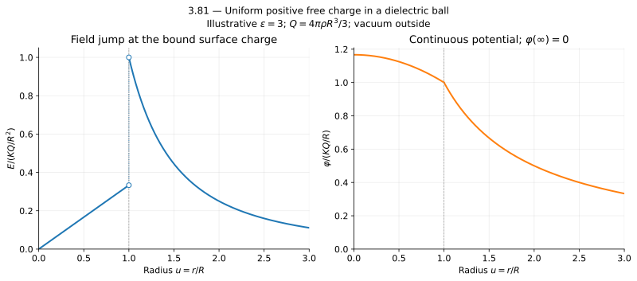

# 3.2 Conductors and Dielectrics in an Electric Field

[Chapter index](../README.md#chapters) · [Structured solutions](3.2.json) · [Answer audit](../audit/README.md)

## 3.54

**Solved · high confidence.** Subtract the initial mechanical equilibrium and balance the extra elastic force against image attraction.

**Assumptions**

- Use an ideal conducting plane with no imposed background field; take its potential as zero. Its local image-charge field is the usual grounded-plane solution, also the local large-plane limit when compensating charge can reside remotely.
- The ball is small compared with its final centre-to-plane distance l and acts as a point charge; its height change is delta.
- The printed x is in centimetres: delta=(0.01m)*x when x is the numerical centimetre value. k must be in N/m and l in m.
- The elastic thread remains in its linear Hooke-law range. Initial and final vertical equilibria are compared; gravity cancels.

The plane is replaced by image−q at the reflected position, a distance2l from the real charge.

$$
F_{\rm image}=Kq^2/(2l)^2=Kq^2/(4l^2).
$$

Relative to the uncharged equilibrium, the additional downward force is balanced by the extra elastic tension.

$$
k\delta=\frac{Kq^2}{4l^2},\qquad |q|=2l\sqrt{\frac{k\delta}{K}}=4l\sqrt{\pi\varepsilon_0 k\delta}.
$$

The sign of the original charge cannot be inferred from its descent, since the induced attraction is quadratic in q.

$$
\delta=(0.01\ \mathrm m)\,x_{\rm cm},\qquad q=\pm2l\sqrt{k\delta/K}.
$$

**Results**

Charge magnitude inferred from the equilibrium displacement

$$
|q|=2l\sqrt{k\delta/K},\qquad\delta=(0.01\ \mathrm m)x_{\rm cm}
$$

Either charge sign gives the same displacement. If x denotes an already dimensional length in SI, use delta=x directly.

**Limitations**

- The formula assumes the charged ball has reached a stable equilibrium; transients and charge loss are excluded.

## 3.55

**Solved · high confidence.** Integrate the external force required to oppose image attraction while moving the point charge away quasistatically.

**Assumptions**

- Use an ideal conducting plane with no imposed background field; take its potential as zero. Its local image-charge field is the usual grounded-plane solution, also the local large-plane limit when compensating charge can reside remotely.
- Hold q fixed during removal and neglect kinetic energy. The plane is otherwise isolated from imposed external fields.

At heightz the downward image force has magnitudeKq²/(4z²), so the slow external pull equals this magnitude upward.

$$
F_{{\rm ext},z}=Kq^2/(4z^2),\qquad W_{\rm ext}=\int_l^\infty\frac{Kq^2}{4z^2}\,dz=\frac{Kq^2}{4l}.
$$

The electrostatic energy relative to infinite separation is half the real-charge times its image potential; the image is induced rather than an independently fixed charge.

$$
\varphi_{\rm image}(l)=-\frac{Kq}{2l},\qquad U(l)=\frac12q\varphi_{\rm image}=-\frac{Kq^2}{4l},\qquad W_{\rm ext}=U(\infty)-U(l).
$$

**Results**

Work needed for slow removal

$$
W_{\rm ext}=\frac{Kq^2}{4l}=\frac{q^2}{16\pi\varepsilon_0l}
$$

## 3.56

**Solved · high confidence.** Use the real opposite charge and two mirror charges to compute force and midpoint field by vector superposition.

**Assumptions**

- Use an ideal conducting plane with no imposed background field; take its potential as zero. Its local image-charge field is the usual grounded-plane solution, also the local large-plane limit when compensating charge can reside remotely.
- Let the plane be z=0, the real+q be at(−l/2,0,l/2), and real−q at(l/2,0,l/2), with q>0.
- The two images have the opposite signs at the reflected positions below the plane. The point-charge self-field is excluded when calculating its force.

At the positive charge, its opposite real charge gives a rightward force, its own image a downward force, and the other image a diagonal repulsion.

$$
A=Kq^2/l^2,\qquad \mathbf F_+=A(\mathbf e_x-\mathbf e_z)+\frac{A}{2\sqrt2}(-\mathbf e_x+\mathbf e_z)=A\left(1-\frac1{2\sqrt2}\right)(\mathbf e_x-\mathbf e_z).
$$

By symmetry the negative charge has the same force magnitude, with reversed horizontal component.

$$
\mathbf F_-=A\left(1-\frac1{2\sqrt2}\right)(-\mathbf e_x-\mathbf e_z),\qquad |\mathbf F_\pm|=\left(\sqrt2-\frac12\right)\frac{Kq^2}{l^2}.
$$

At the real-charge midpoint, the real pair contributes8Kq/l² along+x. The two images are at distance sqrt5*l/2 and their vertical components cancel.

$$
\mathbf E_{\rm real}=\frac{8Kq}{l^2}\mathbf e_x,\qquad\mathbf E_{\rm images}=-\frac{8Kq}{5\sqrt5l^2}\mathbf e_x,\qquad E_{\rm mid}=\frac{8Kq}{l^2}\left(1-\frac1{5\sqrt5}\right).
$$

**Results**

Force magnitude on each real charge

$$
F=\left(\sqrt2-\frac12\right)Kq^2/l^2
$$

Electric field magnitude at their midpoint

$$
E=\frac{8K|q|}{l^2}\left(1-\frac1{5\sqrt5}\right)
$$

The midpoint field points from the positive real charge toward the negative real charge.

## 3.57

**Solved · high confidence.** Use three image charges to satisfy both mutually perpendicular conductor boundaries.

**Assumptions**

- Treat the two perpendicular conducting half-planes as the faces x=0 and y=0 of a right-angle conducting wedge, at a common potential and with no imposed background field.
- Choose the coordinate along the wedge edge so the real point charge at(l,l) and its three images share that coordinate. The boundary planes are invariant under translations along the edge; the point-source field itself is not.

Opposite images across each face and a same-sign image across both faces make the potential vanish on both conductors.

$$
q_1=-q\text{ at }(-l,l),\quad q_2=-q\text{ at }(l,-l),\quad q_3=+q\text{ at }(-l,-l).
$$

The first two images attract toward their faces, while the diagonal image gives a smaller outward component in both directions.

$$
\mathbf F=-\frac{Kq^2}{4l^2}(\mathbf e_x+\mathbf e_y)+\frac{Kq^2}{8\sqrt2l^2}(\mathbf e_x+\mathbf e_y)=-\frac{Kq^2}{4l^2}\left(1-\frac1{2\sqrt2}\right)(\mathbf e_x+\mathbf e_y).
$$

Take the magnitude of the two equal components.

$$
F=\frac{Kq^2}{4l^2}\left(\sqrt2-\frac12\right)=\frac{Kq^2(2\sqrt2-1)}{8l^2}.
$$

**Results**

Force magnitude

$$
F=\frac{Kq^2(2\sqrt2-1)}{8l^2}
$$

The vector points along the wedge bisector toward its edge.

**Limitations**

- Two independently biased half-planes would add an external field and require a different boundary-value problem.

## 3.58

**Solved · high confidence.** Represent the perpendicular dipole by its parallel reflected image and evaluate their axial dipole force.

**Assumptions**

- Use an ideal conducting plane with no imposed background field; take its potential as zero. Its local image-charge field is the usual grounded-plane solution, also the local large-plane limit when compensating charge can reside remotely.
- The point dipole is atz=l with momentp ez normal to the plane; p is fixed. Its physical size is negligible relative to l.

Reflection reverses both charge signs and their normal positions, so the image dipole is parallel to the real dipole, a distance2l away.

$$
\mathbf p_{\rm image}=\mathbf p,\qquad \mathbf E_{\rm image}(l)=\frac{2Kp}{(2l)^3}\mathbf e_z=\frac{Kp}{4l^3}\mathbf e_z.
$$

For two collinear parallel dipoles at a fixed separationD, the force magnitude is6Kp²/D⁴. The conductor force is therefore attractive.

$$
\mathbf F=-\frac{6Kp^2}{(2l)^4}\mathbf e_z=-\frac{3Kp^2}{8l^4}\mathbf e_z.
$$

The induced-boundary interaction energy is half the ordinary two-dipole energy, and gives the same force as the image position follows the real dipole.

$$
U(l)=-\frac12\mathbf p\cdot\mathbf E_{\rm image}=-\frac{Kp^2}{8l^3},\qquad F_z=-\frac{dU}{dl}=-\frac{3Kp^2}{8l^4}.
$$

**Results**

Attractive force magnitude for a perpendicular dipole

$$
F=\frac{3Kp^2}{8l^4}=\frac{3p^2}{32\pi\varepsilon_0l^4}
$$

## 3.59

**Solved · high confidence.** Take the normal field on the conducting plane from the charge and its reflected image, then use the conductor boundary condition.

**Assumptions**

- Use an ideal conducting plane with no imposed background field; take its potential as zero. Its local image-charge field is the usual grounded-plane solution, also the local large-plane limit when compensating charge can reside remotely.
- Use cylindrical radiusr in the plane and upward normal ez into the charge-containing half-space; the real chargeq is atz=l.

Both real and image fields have equal downward normal components on the plane and cancelling tangential components.

$$
E_z(r,0^+)=-\frac{2Kql}{(r^2+l^2)^{3/2}},\qquad \sigma(r)=\varepsilon_0E_z(r,0^+).
$$

SubstituteK=1/(4pi epsilon0) and simplify.

$$
\sigma(r)=-\frac{ql}{2\pi(r^2+l^2)^{3/2}}.
$$

**Results**

Induced surface charge density

$$
\sigma(r)=-\frac{ql}{2\pi(r^2+l^2)^{3/2}}
$$

**Limitations**

- For a finite isolated neutral plate, compensating charge on other faces or remote edges is additional to this local infinite-plane induced distribution.

## 3.60

**Solved · high confidence.** Replace the charged thread with an opposite parallel image thread and apply the line-charge field and conductor normal-field boundary condition.

**Assumptions**

- Ideal conducting plane with no imposed background field, taken at zero potential; use the usual image solution in the charge-containing half-space.
- Place the real infinite thread along y atx=0,z=l and its image−lambda atz=−l. Letx be the signed transverse coordinate in the planez=0.
- The phrase distance from the perpendicular plane through the thread means|x|; the density is even inx.

At the real thread the field of the opposite image line is normal to the plane, at separation2l.

$$
\frac{\mathbf F}{L}=\lambda\mathbf E_{\rm image}=-\frac{\lambda^2}{2\pi\varepsilon_0(2l)}\mathbf e_z=-\frac{K\lambda^2}{l}\mathbf e_z.
$$

At a surface point, add the two line-field normal components; tangential components cancel.

$$
E_z(x,0^+)=-\frac{\lambda l}{\pi\varepsilon_0(x^2+l^2)},\qquad\sigma(x)=\varepsilon_0E_z=-\frac{\lambda l}{\pi(x^2+l^2)}.
$$

**Results**

Attractive force per unit thread length

$$
F/L=K\lambda^2/l=\lambda^2/(4\pi\varepsilon_0l)
$$

Surface density as a function of transverse offset

$$
\sigma(x)=-\frac{\lambda l}{\pi(x^2+l^2)}
$$

## 3.61

**Solved · high confidence.** Superpose the known plane-induced density of each point element of a semi-infinite normal thread.

**Assumptions**

- Ideal conducting plane with no imposed background field, taken at zero potential; use the usual image solution in the charge-containing half-space.
- The thread occupies the axisz>=l and has signed constant linear densitylambda; take its remote end to infinity. r is the radial distance on the plane from its axis.

An elementlambda dz at heightz contributes the plane density of a point charge.

$$
d\sigma(r)=-\frac{\lambda z\,dz}{2\pi(r^2+z^2)^{3/2}}.
$$

Integrate the normal coordinate from the thread endpoint to infinity.

$$
\sigma(r)=-\frac{\lambda}{2\pi}\int_l^\infty\frac{z\,dz}{(r^2+z^2)^{3/2}}=-\frac{\lambda}{2\pi\sqrt{r^2+l^2}},\qquad\sigma(0)=-\frac{\lambda}{2\pi l}.
$$

The finite-thread expression identifies the size of the omitted remote-end term.

$$
\sigma_L(r)=-\frac{\lambda}{2\pi}\left[\frac1{\sqrt{r^2+l^2}}-\frac1{\sqrt{r^2+(l+L)^2}}\right].
$$

**Results**

Surface density at the foot pointO

$$
\sigma(0)=-\lambda/(2\pi l)
$$

Surface density at radial distancer

$$
\sigma(r)=-\frac{\lambda}{2\pi\sqrt{r^2+l^2}}
$$

**Limitations**

- For finite thread length, the semi-infinite formula requires the remote endpoint to be far compared with bothl and the observation radius.

## 3.62

**Solved · high confidence.** Introduce an opposite image ring and use its axial field, while retaining the real ring self-potential at its centre.

**Assumptions**

- Ideal conducting plane with no imposed background field, taken at zero potential; use the usual image solution in the charge-containing half-space.
- The real ring is a thin circle of radiusR atheightl with uniform total chargeq. The image is an identical ring atheight−l with total charge−q.
- The ring centre is not on the wire, so the real-ring field there is zero and its potentialKq/R is finite.

At the axis foot on the plane, every real element is at the same distance; adding the image doubles the normal field.

$$
E_z(O,0^+)=-\frac{2Kql}{(R^2+l^2)^{3/2}},\qquad\sigma(O)=-\frac{ql}{2\pi(R^2+l^2)^{3/2}}.
$$

At the real-ring centre the image is at axial distance2l, whereas the real ring gives no field.

$$
\mathbf E_{\rm centre}=-\frac{2Kql}{(R^2+4l^2)^{3/2}}\mathbf e_z,\qquad E_{\rm centre}=\frac{2K|q|l}{(R^2+4l^2)^{3/2}}.
$$

Add the real and image potentials using the plane as the zero reference.

$$
\varphi_{\rm centre}=Kq\left[\frac1R-\frac1{\sqrt{R^2+4l^2}}\right].
$$

**Results**

Surface density at the symmetry point on the plane

$$
\sigma(O)=-\frac{ql}{2\pi(R^2+l^2)^{3/2}}
$$

Field strength at the ring centre

$$
E=\frac{2K|q|l}{(R^2+4l^2)^{3/2}}
$$

Forq>0 the vector points toward the plane; it reverses ifq<0.

Potential at the ring centre relative to the plane

$$
\varphi=Kq\left(\frac1R-\frac1{\sqrt{R^2+4l^2}}\right)
$$

## 3.63

**Solved · high confidence.** Use the grounded-sphere image and add a central compensating image to enforce the sphere neutral rather than grounded.

**Assumptions**

- The conducting sphere is isolated with net charge zero, radiusR<l, and external point chargeq is the only external source.
- Set the potential at infinity to zero; the sphere radius need not be given because the final neutral-sphere potential is independent ofR.

For a grounded sphere, the image has charge−qR/l atdistanceR²/l from the centre along the line toq, and cancels the external source potential on the surface.

$$
q_g=-qR/l,\qquad r_g=R^2/l,\qquad\varphi_q+\varphi_g=0\quad\text{on }r=R.
$$

A neutral sphere requires zero total interior image charge; add the opposite charge at the centre, which changes the entire surface potential by a constant.

$$
q_c=+qR/l,\qquad q_g+q_c=0,\qquad\varphi_{\rm sphere}=Kq_c/R=Kq/l.
$$

**Results**

Potential of the neutral isolated sphere

$$
\varphi_{\rm sphere}=Kq/l=q/(4\pi\varepsilon_0l)
$$

**Limitations**

- If the sphere were grounded its potential would instead be zero and its net induced charge nonzero.

## 3.64

**Solved · high confidence.** Separate the neutral shell exterior potential from the grounded-cavity solution, then evaluate at the cavity centre.

**Assumptions**

- Isolated conducting shell with net charge zero and concentric spherical inner/outer radiiR1<R2. The point chargeq lies atdistance0<r<R1 from the common centre.
- Set the potential at infinity to zero. The observation atO excludes the case whereq itself occupiesO; that point-charge self-potential would diverge.

Gauss law demands−q on the cavity wall. Neutrality then leaves+q on the outer surface, whose spherical equipotential field is equivalent to a centralq outside.

$$
Q_{\rm inner}=-q,\quad Q_{\rm outer}=+q,\qquad\varphi_{\rm metal}=Kq/R_2.
$$

The grounded spherical cavity has an external image−qR1/r atdistanceR1²/r fromO. AtO its image contribution is−Kq/R1.

$$
q_{\rm im}=-qR_1/r,\quad r_{\rm im}=R_1^2/r,\qquad\varphi_{{\rm cavity},0}(O)=K\left(\frac qr+\frac{q_{\rm im}}{r_{\rm im}}\right)=Kq\left(\frac1r-\frac1{R_1}\right).
$$

Shift the whole cavity solution by the constant metal potential.

$$
\varphi(O)=Kq\left(\frac1r-\frac1{R_1}+\frac1{R_2}\right).
$$

**Results**

Potential at the shell centre

$$
\varphi(O)=Kq\left(\frac1r-\frac1{R_1}+\frac1{R_2}\right),\quad0<r<R_1
$$

**Limitations**

- For a grounded shell the+Kq/R2 term is absent, because the conductor potential is then fixed tozero.

## 3.65

**Solved · high confidence.** Write the inner-sphere potential as a sum of its own charge and the outer shell constant, then use concentric symmetry in each radial region.

**Assumptions**

- Concentric conducting spheres are represented by an inner solid conductor of radiusa and a thin outer conducting shell of radiusb>a, in vacuum.
- q2 denotes the net deposited charge on the entire outer conductor, including both its faces. The reference potential iszero at infinity.

At the inner sphere surface, each charge on the outer sphere contributes a constantKq2/b.

$$
\varphi(a)=K\left(\frac{q_1}{a}+\frac{q_2}{b}\right)=0\quad\Longrightarrow\quad q_2=-\frac baq_1.
$$

Inside the inner conductor the potential is constantzero; between conductors only the inner charge produces field.

$$
\varphi(r)=0\quad(0\le r\le a),\qquad\varphi(r)=Kq_1\left(\frac1r-\frac1a\right)\quad(a\le r\le b).
$$

Outside both conductors the net charge isq1+q2, which is negative sinceb>a.

$$
\varphi(r)=\frac{K(q_1+q_2)}r=\frac{Kq_1(1-b/a)}r\quad(r\ge b).
$$

The potential is continuous, reaches its negative minimum at the outer shell and tends tozero from below at infinity.

$$
\varphi_{\min}=\varphi(b)=Kq_1\left(\frac1b-\frac1a\right)<0,\qquad\varphi(\infty)=0^-.
$$

**Results**

Required net outer-sphere charge

$$
q_2=-(b/a)q_1
$$

Complete radial potential

$$
\varphi(r)=\begin{cases}0,&0\le r\le a,\\Kq_1(1/r-1/a),&a\le r\le b,\\Kq_1(1-b/a)/r,&r\ge b.\end{cases}
$$

Potential-curve features

$$
\varphi(a)=0,\quad\varphi(b)=Kq_1(1/b-1/a)<0,\quad\varphi(r)\to0^-\ (r\to\infty)
$$

Flatzero insidea, decreasing as1/r in the gap, a negative minimum atb, then increasing towardzero.

**Limitations**

- A thick outer shell would require distinct inner and outer radii; only the thin-shell radiusb is specified.

## 3.66

**Solved · medium confidence.** Combine the equal outer-plate potentials with the specified inner voltage, and expose the remaining net-charge or common-potential degree of freedom.

**Assumptions**

- Fig.3.8 numbers the plates fromtop1 tobottom4. All three gaps haved; choose positivez downward and defineDelta=V2−V3>0 according to the printed plus/minus signs.
- Neglect edge effects, plate thickness and the charge per area on the thin connecting wire; the outer plates are at a common potentialV0.
- For the conventional numerical coefficients, additionally assume the connected outer pair is initially neutral and there is no imposed exterior field. These conditions are not explicitly stated, so the more general family is retained.

Write the three gap fields from their potential drops. The connection fixes only their sum, leaving one undetermined common-mode parameter.

$$
E_{12}=(V_0-V_2)/d,\quad E_{23}=\Delta/d,\quad E_{34}=(V_3-V_0)/d,\qquad E_{12}+E_{34}=-\Delta/d.
$$

In the general planar solution, letEt andEb be the signed exterior fields aboveplate1 and belowplate4. Jumps across each conductor give its net charge per area.

$$
\sigma_1=\varepsilon_0(E_{12}-E_t),\quad\sigma_2=\varepsilon_0(E_{23}-E_{12}),\quad\sigma_3=\varepsilon_0(E_{34}-E_{23}),\quad\sigma_4=\varepsilon_0(E_b-E_{34}).
$$

If the exterior fields vanish, defineSigma as the net charge per area of the connected outer pair. This supplies the extra condition and yields a one-parameter family.

$$
\Sigma=\sigma_1+\sigma_4=\varepsilon_0(E_{12}-E_{34}),\qquad E_{12}=-\frac\Delta{2d}+\frac\Sigma{2\varepsilon_0},\quad E_{34}=-\frac\Delta{2d}-\frac\Sigma{2\varepsilon_0}.
$$

Substitute these fields into the jump equations.

$$
(\sigma_1,\sigma_2,\sigma_3,\sigma_4)=\left(\frac\Sigma2-\frac{\varepsilon_0\Delta}{2d},\frac{3\varepsilon_0\Delta}{2d}-\frac\Sigma2,-\frac{3\varepsilon_0\Delta}{2d}-\frac\Sigma2,\frac\Sigma2+\frac{\varepsilon_0\Delta}{2d}\right).
$$

For an initially neutral connected outer pair,Sigma=0. The outer gap fields point upward, opposite to the central downward field.

$$
(E_{12},E_{23},E_{34})=\frac\Delta{2d}(-1,2,-1),\qquad (\sigma_1,\sigma_2,\sigma_3,\sigma_4)=\frac{\varepsilon_0\Delta}{2d}(-1,3,-3,1).
$$

**Results**

Gap field magnitudes for neutral connected outer plates and zero exterior field

$$
|E_{12}|=|E_{34}|=|\Delta|/(2d),\quad |E_{23}|=|\Delta|/d
$$

ForDelta=V2−V3>0, fields in gaps12 and34 point upward; gap23 points downward.

Net charge per area of plates1 through4 under the same conditions

$$
(\sigma_1,\sigma_2,\sigma_3,\sigma_4)=\frac{\varepsilon_0\Delta}{2d}(-1,3,-3,1)
$$

Family if connected outer pair has net densitySigma

$$
E_{12}=-\Delta/(2d)+\Sigma/(2\varepsilon_0),\quad E_{23}=\Delta/d,\quad E_{34}=-\Delta/(2d)-\Sigma/(2\varepsilon_0)
$$

The four corresponding net densities are given explicitly in the derivation. Nonzero exterior fields require the more general field-jump expressions.

**Limitations**

- Without a neutrality, specified outer-pair charge or common-potential condition plus exterior-field data, the field and charge values are not unique.
- For finite plates, edge fields and wire charge restore a full capacitance problem beyond the planar approximation.

## 3.67

**Solved · medium confidence.** Integrate the grounded parallel-plate Green-function potential over the transverse plane, then distinguish induced face charge from unspecified conductor net charge.

**Assumptions**

- Let plate1 bez=0,plate2 bez=l, and the real point chargeq bez=x with0<x<l.
- The standard finite induced-charge result assumes both plates grounded, or refers to the localized change from any prescribed fixed-potential background. The statement does not explicitly specify grounding or initial net charges.
- For the fixed-potential perturbation, subtract any background potential so the perturbation iszero on both plates and decays transversely at infinity.

DefineH(z) as the integral of the charge-induced potential over the infinite transverse plane. Integrated Poisson reduces to a one-dimensional delta-source equation; transverse boundary terms vanish for the grounded-slab solution.

$$
H(z)=\int_{\mathbb R^2}\varphi(\mathbf r_\perp,z)\,d^2r_\perp,\quad -\varepsilon_0H\prime\prime(z)=q\delta(z-x),\quad H(0)=H(l)=0.
$$

Continuity atz=x and the derivative jump fix the two linear branches.

$$
H(z)=\frac q{\varepsilon_0l}\begin{cases}(l-x)z,&0\le z\le x,\\x(l-z),&x\le z\le l.\end{cases}
$$

Use the conductor normals into the gap: +ez atplate1 and−ez atplate2.

$$
Q_1=-\varepsilon_0H\prime(0)=-q\frac{l-x}{l},\qquad Q_2=+\varepsilon_0H\prime(l)=-q\frac{x}{l}.
$$

For electrically isolated initially neutral plates, no charge can be supplied or removed: their net charges stayzero. The negative induced gap-face distributions must be compensated on other faces, at remote edges or through the finite-system limit.

$$
Q_{1,\rm net}=Q_{2,\rm net}=0\quad\text{for separate initially neutral isolated plates},\qquad Q_1+Q_2=-q\quad\text{for the grounded perturbation}.
$$

**Results**

Finite charge induced byq on each fixed-potential plate

$$
Q_1=-q(1-x/l),\qquad Q_2=-qx/l
$$

These are the standard grounded-plate charges, or changes relative to a fixed-voltage background. A nonzero uniform background itself has infinite total charge on an infinite plate.

Alternative conductor net charges for isolated initially neutral plates

$$
Q_{1,\rm net}=Q_{2,\rm net}=0
$$

The boundary/initial-charge condition must be supplied to decide which quantity the problem intends. Local induced negative charge and total conductor charge are different.

**Limitations**

- Literal total charges of infinite plates with a prescribed nonzero voltage background diverge; only localized changes are finite.
- An isolated finite-plate problem also needs outer boundary geometry to determine its complete surface-charge distribution.

## 3.68

**Solved · high confidence.** Remove the infinitesimal surface patch self-field or equivalently use the Maxwell normal stress just outside a conductor.

**Assumptions**

- Smooth conducting surface in vacuum and electrostatic equilibrium. The given densitysigma is the signed surface charge density; the conductor interior field iszero.
- The requested force per area is the net electromagnetic traction on the surface charge, notsigma times the full one-sided field including its own sheet field.

The one-sided field just outside is normal and equals sigma/epsilon0; inside it vanishes. The field acting on the sheet excludes its own discontinuous contribution and equals the average of these limits.

$$
\mathbf E_{\rm out}=\frac\sigma{\varepsilon_0}\mathbf n,\quad\mathbf E_{\rm in}=\mathbf0,\qquad \mathbf E_{\rm acting}=\frac{\mathbf E_{\rm out}+\mathbf E_{\rm in}}2=\frac\sigma{2\varepsilon_0}\mathbf n.
$$

Multiply by the signed charge per area; the direction is outward for either charge sign.

$$
\frac{d\mathbf F}{dS}=\sigma\mathbf E_{\rm acting}=\frac{\sigma^2}{2\varepsilon_0}\mathbf n,\qquad P_e=\frac{\sigma^2}{2\varepsilon_0}=\frac12\varepsilon_0E_{\rm out}^2.
$$

**Results**

Electrostatic force per unit area

$$
P_e=\sigma^2/(2\varepsilon_0)
$$

Traction direction

$$
d\mathbf F/dS=(\sigma^2/(2\varepsilon_0))\mathbf n
$$

The force points outward along the normal into the adjacent vacuum.

**Limitations**

- The formula uses vacuum permittivity and a smooth ideal conductor boundary; other media require the corresponding stress and constitutive assumptions.

## 3.69

**Solved · high confidence.** Integrate the uniform conductor electrostatic pressure over one hemisphere and use its projected area.

**Assumptions**

- Isolated spherical metal ball with no external field, radiusR=.015m and total chargeq=10e−6C, so its equilibrium surface density is uniform.
- The requested resultant is the electromagnetic force on the charge of one hemisphere from the rest of the system, with internal pair forces cancelling in the resultant. Mechanical stresses or rupture are not modeled.

The uniform surface charge and the local outward pressure follow from the conductor boundary law.

$$
\sigma=\frac q{4\pi R^2},\qquad P_e=\frac{\sigma^2}{2\varepsilon_0}.
$$

Transverse forces cancel; the axial projection of a hemisphere surface integrates to its disk area.

$$
F=P_e\int_{\rm hemisphere}\cos\theta\,dS=P_e\,2\pi R^2\int_0^{\pi/2}\cos\theta\sin\theta\,d\theta=P_e\pi R^2.
$$

Substitute the density and the historical epsilon0-derivedK.

$$
F=\frac{q^2}{32\pi\varepsilon_0R^2}=\frac{Kq^2}{8R^2}=499.5447052\ \mathrm{N}.
$$

**Results**

Resultant force on one hemisphere charge

$$
F=Kq^2/(8R^2)\simeq4.99545\times10^2\ \mathrm{N}
$$

Directed outward along that hemisphere axis, tending to separate the two halves.

## 3.70

**Solved · high confidence.** Integrate the electrostatic surface pressure over either hemisphere of induced charge.

**Assumptions**

- The conductor is in static equilibrium, with sigma=sigma0*cos(theta), and theta is measured from the applied-field axis. A same-sign induced-charge group occupies one hemisphere. Force includes the applied field and all other charges, while excluding each surface element self-field.

The field inside the conductor is zero and the field just outside is normal with magnitude|sigma|/epsilon0. The nonsingular field acting on a surface charge is their average.

$$
\mathbf f_s=\sigma\frac{\mathbf E_{\rm out}+\mathbf E_{\rm in}}2=\frac{\sigma^2}{2\epsilon_0}\hat{\mathbf n}.
$$

Transverse components cancel on either hemisphere. Integrate the axial projection over the positive-charge hemisphere.

$$
F=\frac{\sigma_0^2}{2\epsilon_0}2\pi R^2\int_0^{\pi/2}\cos^3\theta\sin\theta\,d\theta=\frac{\pi R^2\sigma_0^2}{4\epsilon_0}.
$$

**Results**

Resultant force magnitude on either same-sign induced-charge group

$$
F=\pi R^2\sigma_0^2/(4\epsilon_0)
$$

The two hemispheres have equal and opposite axial resultant forces; the whole neutral sphere has zero net force in the uniform applied field.

## 3.71

**Solved · high confidence.** Equate the dielectric polarization to the permanent dipole moment of one aligned molecule out of N.

**Assumptions**

- Use Appendix17 water relative permittivity81, density1000kg/m³, molar mass.018kg/mol and Avogadro constant6.023e23/mol. E=1.0kV/cm=1.0e5V/m.
- The statement asks an equivalent perfectly aligned fraction, not the literal count of molecules with exactly one orientation. Use the macroscopic linear polarization P=epsilon0(epsilon−1)E.

Compute molecular number concentration and polarization.

$$
n=\frac{\rho N_A}{M},\qquad P=\epsilon_0(\epsilon-1)E.
$$

The equivalent aligned fraction1/N produces polarization np/N.

$$
\frac{np}{N}=P,\qquad N=\frac{\rho N_Ap}{M\epsilon_0(\epsilon-1)E}\simeq2930.21030.
$$

**Results**

Molecules per one equivalently aligned molecule

$$
N\simeq2.93\times10^3
$$

**Limitations**

- Real water polarization includes collective, local-field and induced contributions. The question defines an equivalent orientation estimate, not a microscopic orientational distribution.

## 3.72

**Solved · high confidence.** Use the gradient of the squared permanent-dipole field to obtain the induced-dipole attraction.

**Assumptions**

- The separation l greatly exceeds molecular dimensions. The permanent dipole moment p is fixed along the joining line, the nonpolar molecule responds linearly and isotropically, and higher multipoles and mutual deformation are neglected.
- Define SI polarizability alpha_SI by p_ind=alpha_SI*E. If the book symbol beta denotes the volume convention p_ind=epsilon0*beta*E, then alpha_SI=epsilon0*beta. Both conventions are displayed because beta units are not specified.

The permanent dipole field on its axis has magnitude2Kp/l³.

$$
E(l)=\frac{2Kp}{l^3},\qquad K=\frac1{4\pi\epsilon_0}.
$$

An induced rather than permanently fixed dipole has energy−alpha E²/2. Its derivative gives the force toward the stronger field.

$$
U(l)=-\frac12\alpha_{\rm SI}E(l)^2=-\frac{2\alpha_{\rm SI}K^2p^2}{l^6},\quad F_l=-\frac{dU}{dl}=-\frac{12\alpha_{\rm SI}K^2p^2}{l^7}.
$$

Convert to the polarizability-volume convention if beta is so defined.

$$
|F|=\frac{3\alpha_{\rm SI}p^2}{4\pi^2\epsilon_0^2l^7}=\frac{3\beta p^2}{4\pi^2\epsilon_0l^7}\quad(\alpha_{\rm SI}=\epsilon_0\beta).
$$

**Results**

Attractive force magnitude for p_ind=alpha_SI E

$$
|F|=12\alpha_{\rm SI}K^2p^2/l^7
$$

Force when beta is defined by p_ind=epsilon0 beta E

$$
|F|=3\beta p^2/(4\pi^2\epsilon_0l^7)
$$

If the given beta is itself SI polarizability

$$
|F|=3\beta p^2/(4\pi^2\epsilon_0^2l^7)
$$

This last formula uses p_ind=beta E, a different definition from the preceding beta_volume answer.

## 3.73

**Solved · high confidence.** Differentiate the squared axial ring field and locate all finite force zeros and extrema.

**Assumptions**

- Let the ring have fixed uniform total charge q and let alpha_SI>0 satisfy p_ind=alpha_SI E. The molecular size is negligible, with weak linear induction. Use a signed axial coordinate x and define u=x/R.
- Only the locations and normalized shape are requested; they do not depend on q or alpha_SI when both are nonzero. If beta is the volume polarizability, substitute alpha_SI=epsilon0*beta.

Use the axial ring field and the induced-dipole force law.

$$
E_x=\frac{Kqx}{(R^2+x^2)^{3/2}},\qquad F_x=\alpha_{\rm SI}E_x\frac{dE_x}{dx}=\alpha_{\rm SI}K^2q^2\frac{x(R^2-2x^2)}{(R^2+x^2)^4}.
$$

Normalize and find all finite zeros.

$$
F_* =\frac{\alpha_{\rm SI}K^2q^2}{R^5},\quad\frac{F_x}{F_*}=f(u)=\frac{u(1-2u^2)}{(1+u^2)^4},\qquad x=0,\ \pm R/\sqrt2.
$$

Differentiate the normalized force; two positive-radius extrema must be compared for the maximum magnitude.

$$
f\prime(u)=\frac{1-13u^2+10u^4}{(1+u^2)^5},\qquad u_\pm^2=\frac{13\pm\sqrt{129}}{20}.
$$

The smaller radius produces the global maximum absolute force; the larger produces a smaller outer lobe.

$$
|x|_{\max}=R\sqrt{\frac{13-\sqrt{129}}{20}}\simeq0.286546969R,\quad |F|_{\max}\simeq0.174664385F_*;\qquad u_+=1.103580914,\ f(u_+)=-0.065483506.
$$

Describe the signed graph, including its far-field tail.

$$
f(-u)=-f(u),\quad f(u)>0\ (0<u<1/\sqrt2),\quad f(u)<0\ (u>1/\sqrt2),\quad f(u)\sim-2u^{-5}\ (u\to+\infty).
$$

**Results**

Finite distances where force magnitude vanishes

$$
|x|=0,\ R/\sqrt2
$$

Distance of global maximum force magnitude

$$
|x|=R\sqrt{(13-\sqrt{129})/20}\simeq0.286547R
$$

Global maximum magnitude in normalized units

$$
|F|_{\max}\simeq0.174664385\,\alpha_{\rm SI}K^2q^2/R^5
$$

Smaller local maximum of the outer-lobe magnitude

$$
|x|=R\sqrt{(13+\sqrt{129})/20}\simeq1.10358R
$$

Signed force curve

$$
F_x/F_*=u(1-2u^2)/(1+u^2)^4
$$

**Limitations**

- If q=0 or polarizability is zero, the force vanishes for every position and there is no distinct maximum location.

## 3.74

**Solved · high confidence.** Apply spherical Gauss law to D, then separate free, bound and total enclosed charge.

**Assumptions**

- The ball has relative permittivity epsilon, with vacuum outside. The point free charge q is at the centre, and0<r<R. The ideal continuum polarization is interpreted distributionally at the point source.
- The prime notation commonly denotes bound charge; because the phrase charge inside could also mean total charge, both are explicitly identified.

Only the free point charge is the source of D, so E is screened by epsilon.

$$
\mathbf D=\frac{q}{4\pi r^2}\hat{\mathbf r},\quad\mathbf E=\frac{q}{4\pi\epsilon_0\epsilon r^2}\hat{\mathbf r},\quad\mathbf P=\epsilon_0(\epsilon-1)\mathbf E=\frac{\epsilon-1}{\epsilon}\frac{q\mathbf r}{4\pi r^3}.
$$

The flux of P through any internal sphere fixes its enclosed bound charge.

$$
q_b^{\rm enc}=-\oint\mathbf P\cdot d\mathbf S=-q\frac{\epsilon-1}{\epsilon},\qquad q_{\rm total}^{\rm enc}=q+q_b^{\rm enc}=q/\epsilon.
$$

Away from the centre the volume bound density is zero. The singular centre bound charge is balanced by the outer surface charge.

$$
\rho_b=-q\frac{\epsilon-1}{\epsilon}\delta^{(3)}(\mathbf r),\qquad\sigma_b(R)=\frac{q(\epsilon-1)}{4\pi\epsilon R^2},\qquad Q_{b,\rm total}=0.
$$

**Results**

Interior polarization vector

$$
\mathbf P=\frac{\epsilon-1}{\epsilon}\frac{q\mathbf r}{4\pi r^3},\quad0<r<R
$$

Bound charge enclosed by a smaller concentric sphere

$$
q\prime=q_b=-q(\epsilon-1)/\epsilon
$$

Enclosed free charge

$$
q_{\rm free}=q
$$

Total enclosed charge

$$
q_{\rm total}=q/\epsilon
$$

**Limitations**

- The point singularity idealizes the microscopic molecular environment. A finite empty cavity would place the compensating inner bound charge on that cavity wall instead.

## 3.75

**Solved · high confidence.** Apply the conductor boundary condition and use the outward normal of the dielectric.

**Assumptions**

- Let n point from the conductor into the dielectric. The conductor free surface density is sigma. In electrostatics the conductor field and tangential boundary field vanish; there is no additional free interface charge.

Gauss law for D determines the dielectric field immediately outside the conductor.

$$
\mathbf D\cdot\hat{\mathbf n}=\sigma,\quad\mathbf E=\frac{\sigma}{\epsilon_0\epsilon}\hat{\mathbf n},\quad\mathbf P=\frac{\epsilon-1}{\epsilon}\sigma\hat{\mathbf n}.
$$

At this inner dielectric face its own outward normal is−n.

$$
\sigma\prime=\sigma_b=\mathbf P\cdot(-\hat{\mathbf n})=-\sigma\frac{\epsilon-1}{\epsilon}.
$$

**Results**

Dielectric bound surface charge next to the conductor

$$
\sigma\prime=-\sigma(\epsilon-1)/\epsilon
$$

## 3.76

**Solved · high confidence.** Integrate the inner bound-charge relation and use zero net polarization charge of the finite coating.

**Assumptions**

- The finite coating in Figure3.9 is a homogeneous linear dielectric of relative permittivity epsilon, with no free charge of its own. The conductor has total free charge q; no special symmetry is needed.

Integrate the local conductor-dielectric relation over the entire inner interface.

$$
Q_{b,\rm inner}=-\frac{\epsilon-1}{\epsilon}\int\sigma\,dS=-q\frac{\epsilon-1}{\epsilon}.
$$

In the uniform dielectric bulk, divergence of P is proportional to the free bulk density, which vanishes.

$$
\nabla\cdot\mathbf P=\frac{\epsilon-1}{\epsilon}\nabla\cdot\mathbf D=0,\qquad\rho_b=0.
$$

The total bound charge of a finite polarized body is zero, including every boundary.

$$
Q_{b,\rm outer}=-Q_{b,\rm inner}=q\frac{\epsilon-1}{\epsilon}.
$$

**Results**

Total bound charge at inner surface

$$
Q_{b,\rm inner}=-q(\epsilon-1)/\epsilon
$$

Total bound charge at outer surface

$$
Q_{b,\rm outer}=+q(\epsilon-1)/\epsilon
$$

## 3.77

**Solved · high confidence.** Obtain the radial field from enclosed free charge and integrate inward from infinity for the potential.

**Assumptions**

- The dielectric occupies a<r<b, while the cavity and exterior are vacuum. Its relative permittivity is epsilon. Let Q>0 denote total extraneous/free charge in either requested distribution. Set potential zero at infinity.
- In case(a), free charge is uniform on r=a. In case(b), it is uniform in the shell volume, with rho_f=3Q/[4pi(b³−a³)].

For inner-surface charge, the enclosed free charge is zero in the cavity and Q elsewhere.

$$
E_a(r)=\begin{cases}0,&r<a,\\KQ/(\epsilon r^2),&a<r<b,\\KQ/r^2,&r>b.\end{cases}
$$

Integrate each segment with continuous potential at both interfaces.

$$
\varphi_a(r)=\begin{cases}KQ[1/(\epsilon a)+(1-1/\epsilon)/b],&r\le a,\\KQ[1/(\epsilon r)+(1-1/\epsilon)/b],&a\le r\le b,\\KQ/r,&r\ge b.\end{cases}
$$

For free volume charge use the fraction of shell volume enclosed by radius r.

$$
Q_{\rm enc}(r)=Q\frac{r^3-a^3}{b^3-a^3},\qquad E_b(r)=\begin{cases}0,&r<a,\\\dfrac{KQ}{\epsilon(b^3-a^3)}\left(r-\dfrac{a^3}{r^2}\right),&a<r<b,\\KQ/r^2,&r>b.\end{cases}
$$

The volume-charge shell potential follows from integrating its interior field from r to b.

$$
\varphi_b(r)=\begin{cases}\varphi_b(a),&r\le a,\\\dfrac{KQ}{b}+\dfrac{KQ}{\epsilon(b^3-a^3)}\left[\dfrac{b^2-r^2}{2}+a^3\left(\dfrac1b-\dfrac1r\right)\right],&a\le r\le b,\\KQ/r,&r\ge b.\end{cases}
$$

State the plot geometry and interface jumps explicitly.

$$
E_a(a^-)=0,\quad E_a(a^+)=KQ/(\epsilon a^2);\qquad E_b(a)=0;\qquad E_{a,b}(b^+)=\epsilon E_{a,b}(b^-)=KQ/b^2.
$$

**Results**

Inner-surface free charge: field magnitude

$$
E_a=0\ (r<a),\quad KQ/(\epsilon r^2)\ (a<r<b),\quad KQ/r^2\ (r>b)
$$

Inner-surface free charge: potential

$$
\varphi_a=KQ[1/(\epsilon r)+(1-1/\epsilon)/b]\quad(a\le r\le b)
$$

Constant at its r=a value in the cavity; KQ/r outside.

Uniform shell-volume free charge: field magnitude

$$
E_b=\frac{KQ(r-a^3/r^2)}{\epsilon(b^3-a^3)}\quad(a<r<b)
$$

Zero in the cavity and KQ/r² outside.

Uniform shell-volume free charge: potential

$$
\varphi_b=\frac{KQ}{b}+\frac{KQ}{\epsilon(b^3-a^3)}\left[\frac{b^2-r^2}{2}+a^3\left(\frac1b-\frac1r\right)\right]\quad(a\le r\le b)
$$

Constant at its r=a value in the cavity; KQ/r outside.

## 3.78

**Solved · high confidence.** Match tangential E and normal D across the charge-free glass-vacuum boundary.

**Assumptions**

- The normal n in Figure3.10 points outward from glass into vacuum. E0 has positive normal component E0*cos(alpha0), with E0=10V/m and alpha0=30degrees. Appendix17 glass relative permittivity is6. There is no free interface charge.

Tangential E is continuous and normal D is continuous.

$$
E_t=E_0\sin\alpha_0=5\ \mathrm{V/m},\qquad E_n=\frac{E_0\cos\alpha_0}{\epsilon}=1.44337567\ \mathrm{V/m}.
$$

Compute the glass field and its angle to the same outward normal.

$$
E=E_0\sqrt{\sin^2\alpha_0+\cos^2\alpha_0/\epsilon^2}=5.20416500\ \mathrm{V/m},\qquad\tan\alpha=\epsilon\tan\alpha_0,\quad\alpha=73.8978862^\circ.
$$

The bound surface charge uses the outward dielectric normal.

$$
\sigma_b=\mathbf P\cdot\hat{\mathbf n}=\epsilon_0(\epsilon-1)E_n=\epsilon_0\frac{\epsilon-1}{\epsilon}E_0\cos\alpha_0=6.38693735\times10^{-11}\ \mathrm{C/m^2}.
$$

**Results**

Electric field magnitude in glass

$$
E\simeq5.20416\ \mathrm{V/m}
$$

Glass field angle to the outward normal

$$
\alpha\simeq73.8979^\circ
$$

Bound surface density at A

$$
\sigma_b\simeq+6.38694\times10^{-11}\ \mathrm{C/m^2}
$$

## 3.79

**Solved · medium confidence.** Use projected hemispherical areas for the E flux and the two tangential D values for the loop circulation.

**Assumptions**

- Choose n outward from dielectric into vacuum and t along the tangential component of E0. Figure3.11 has E0n=E0*cos(theta)>0 and E0t=E0*sin(theta)>0. There is no free interface charge.
- For Gamma choose the drawn traversal: top vacuum leg along+t, bottom dielectric leg along−t. Let L_parallel be the length of each parallel horizontal leg and h the complete rectangle height.
- The text calls l the closed-path length, but the figure prints l over the horizontal span. These two readings are not identical; retain an exact expression in L_parallel and label both conventions.

Normal and tangential boundary conditions determine the interior components.

$$
E_{dn}=E_0\cos\theta/\epsilon,\quad E_{dt}=E_0\sin\theta,\quad D_{0t}=\epsilon_0E_0\sin\theta,\quad D_{dt}=\epsilon\epsilon_0E_0\sin\theta.
$$

The integrated normal of each hemisphere is its signed projected disk area.

$$
\Phi_E=\pi R^2(E_{0n}-E_{dn})=\pi R^2E_0\cos\theta\left(1-\frac1\epsilon\right).
$$

Normal contributions cancel on the two opposite transverse legs. Tangential contributions have opposite traversal directions.

$$
\oint_\Gamma\mathbf D\cdot d\mathbf l=(D_{0t}-D_{dt})L_\parallel=-\epsilon_0(\epsilon-1)E_0\sin\theta\,L_\parallel.
$$

Specify the two incompatible length readings rather than silently choosing a perimeter-to-span conversion.

$$
\text{Figure span }l=L_\parallel:\quad\mathcal C_D=-\epsilon_0(\epsilon-1)E_0l\sin\theta.\qquad\text{Literal perimeter }l=2(L_\parallel+h):\quad\mathcal C_D=-\epsilon_0(\epsilon-1)E_0\sin\theta\,(l/2-h).
$$

Only a thin-loop limit permits replacing the horizontal leg by half a literal perimeter.

$$
h\ll L_\parallel,\ l=\text{perimeter}:\quad\mathcal C_D\simeq-\tfrac12\epsilon_0(\epsilon-1)E_0l\sin\theta.
$$

**Results**

Outward E flux through the sphere

$$
\Phi_E=\pi R^2E_0\cos\theta\,(1-1/\epsilon)
$$

Clockwise D circulation using the actual parallel-leg length

$$
\mathcal C_D=-\epsilon_0(\epsilon-1)E_0\sin\theta\,L_\parallel
$$

If the figure label l is the horizontal span

$$
\mathcal C_D=-\epsilon_0(\epsilon-1)E_0l\sin\theta
$$

If l literally denotes the whole rectangular perimeter

$$
\mathcal C_D=-\epsilon_0(\epsilon-1)E_0\sin\theta\,(l/2-h)
$$

Requires the additional height h; only for a negligibly thin loop does this reduce to the one-half coefficient.

**Limitations**

- A unique circulation in terms of a literal full-perimeter l alone is not determined without the loop height or an explicit thin-loop approximation.

## 3.80

**Solved · high confidence.** Use planar Gauss law for D, integrate E from the midplane, and differentiate the polarization.

**Assumptions**

- The infinite slab occupies|x|<d and vacuum surrounds it. Rho is the signed uniform free/extraneous volume charge density, not the total charge density. No applied uniform field is superposed, so the self-field is antisymmetric.
- Set phi(0)=0 as requested. The potential cannot be zero at infinity for this infinitely extended nonneutral source.

Reflection symmetry and Gauss law give the signed displacement and field.

$$
D_x=\begin{cases}\rho x,&|x|<d,\\\rho d\,\operatorname{sgn}x,&|x|>d,\end{cases}\qquad E_x=\begin{cases}\rho x/(\epsilon_0\epsilon),&|x|<d,\\\rho d\,\operatorname{sgn}x/\epsilon_0,&|x|>d.\end{cases}
$$

The magnitude depends on distance l=|x|.

$$
E(l)=\begin{cases}|\rho|l/(\epsilon_0\epsilon),&0\le l<d,\\|\rho|d/\epsilon_0,&l>d.\end{cases}
$$

Integrate−E with the midplane reference and continuous boundary potential.

$$
\varphi(x)=\begin{cases}-\rho x^2/(2\epsilon_0\epsilon),&|x|\le d,\\-\rho d^2/(2\epsilon_0\epsilon)-\rho d(|x|-d)/\epsilon_0,&|x|\ge d.\end{cases}
$$

Inside the material P is linear in x; its bulk divergence gives the bound volume charge.

$$
P_x=\rho\frac{\epsilon-1}{\epsilon}x,\qquad\rho_b=-\nabla\cdot\mathbf P=-\rho\frac{\epsilon-1}{\epsilon}.
$$

Use the opposite outward normals at the two faces.

$$
\sigma_b(+d)=\sigma_b(-d)=\rho d\frac{\epsilon-1}{\epsilon}.
$$

**Results**

Field magnitude versus distance from the middle plane

$$
E(l)=|\rho|l/(\epsilon_0\epsilon)\ (l<d),\quad E(l)=|\rho|d/\epsilon_0\ (l>d)
$$

Potential relative to the midplane

$$
\varphi(l)=-\rho l^2/(2\epsilon_0\epsilon)\ (l\le d);\quad\varphi(l)=-\rho d^2/(2\epsilon_0\epsilon)-\rho d(l-d)/\epsilon_0\ (l\ge d)
$$

Uniform bound volume density

$$
\rho_b=-\rho(\epsilon-1)/\epsilon
$$

Bound density on each face

$$
\sigma_b=\rho d(\epsilon-1)/\epsilon
$$

## 3.81

**Solved · high confidence.** Apply spherical Gauss law to the free volume density, then integrate the piecewise field and polarization.

**Assumptions**

- The ball has fixed uniform positive free/extraneous density rho and relative permittivity epsilon, with vacuum outside. Set potential zero at infinity; no imposed exterior field is added.

The enclosed free charge is4pi rho r³/3 inside the ball.

$$
E(r)=\begin{cases}\rho r/(3\epsilon_0\epsilon),&0\le r<R,\\\rho R^3/(3\epsilon_0r^2),&r>R.\end{cases}
$$

Outside potential is Coulombic; integrate inward continuously from R.

$$
\varphi(r)=\begin{cases}\dfrac{\rho R^2}{3\epsilon_0}+\dfrac{\rho(R^2-r^2)}{6\epsilon_0\epsilon},&r\le R,\\\dfrac{\rho R^3}{3\epsilon_0r},&r\ge R.\end{cases}
$$

The interior polarization has constant divergence.

$$
\mathbf P=\frac{\epsilon-1}{\epsilon}\frac{\rho\mathbf r}{3},\qquad\rho_b=-\rho\frac{\epsilon-1}{\epsilon},\qquad\sigma_b=\mathbf P(R)\cdot\hat{\mathbf r}=\frac{\rho R}{3}\frac{\epsilon-1}{\epsilon}.
$$

**Results**

Radial field magnitude

$$
E=\rho r/(3\epsilon_0\epsilon)\ (r<R),\quad E=\rho R^3/(3\epsilon_0r^2)\ (r>R)
$$

Continuous potential with zero at infinity

$$
\varphi=\rho R^2/(3\epsilon_0)+\rho(R^2-r^2)/(6\epsilon_0\epsilon)\ (r\le R),\quad\varphi=\rho R^3/(3\epsilon_0r)\ (r\ge R)
$$

Bound volume density

$$
\rho_b=-\rho(\epsilon-1)/\epsilon
$$

Bound surface density

$$
\sigma_b=\rho R(\epsilon-1)/(3\epsilon)
$$

## 3.82

**Solved · high confidence.** Compute the field of the bound charge on the cylindrical rim of the prescribed polarized disk.

**Assumptions**

- Polarization P is prescribed, uniform and parallel to the disk plane. It is not inferred self-consistently from an unknown local field. Thus use its bound charges directly without dividing the resulting field by a further relative permittivity.
- Centre the disk at z=0, put P along+x, and let its thickness extend from−d/2 to+d/2.

The uniform bulk has no volume bound charge and the flat faces have no bound surface charge. Only the rim contributes.

$$
\rho_b=-\nabla\cdot\mathbf P=0,\quad\sigma_{b,\rm flat}=0,\qquad\sigma_{b,\rm rim}=P\cos\phi.
$$

Integrate the rim field at the centre; transverse and axial terms cancel.

$$
\mathbf E=-K\mathbf P\,R^2\int_0^{2\pi}\cos^2\phi\,d\phi\int_{-d/2}^{d/2}\frac{dz}{(R^2+z^2)^{3/2}}=-\frac{d\mathbf P}{4\epsilon_0\sqrt{R^2+d^2/4}}.
$$

Expand for the stated thin-disk limit.

$$
d\ll R:\qquad\mathbf E\simeq-\frac{d}{4\epsilon_0R}\mathbf P,\qquad E\simeq\frac{Pd}{4\epsilon_0R}.
$$

**Results**

Leading thin-disk field magnitude

$$
E\simeq Pd/(4\epsilon_0R)
$$

Field vector

$$
\mathbf E\simeq-d\mathbf P/(4\epsilon_0R)
$$

Exact rim field for a uniformly polarized finite cylinder

$$
\mathbf E=-d\mathbf P/[4\epsilon_0\sqrt{R^2+d^2/4}]
$$

## 3.83

**Solved · high confidence.** Use zero displacement for the isolated bound-charge self-field and integrate the prescribed polarization.

**Assumptions**

- Choose+x in the direction of vector P0, with magnitude P0>0. The plate occupies−d<x<d. There is no free charge and no imposed external uniform field; the requested field is that produced by the prescribed polarization.
- P is given independently of a constitutive law. Do not substitute a linear induced-dielectric relation that would contradict the prescribed profile.

Planar Gauss law makes Dx constant. For the isolated polarization charge distribution the exterior field vanishes, so the constant is zero.

$$
D_x=\epsilon_0E_x+P_x=0,\qquad\mathbf E(x)=-\frac{\mathbf P_0}{\epsilon_0}\left(1-\frac{x^2}{d^2}\right),\quad |x|<d.
$$

Integrate the field with any convenient midplane potential reference.

$$
\varphi(x)-\varphi(0)=\frac{P_0}{\epsilon_0}\left(x-\frac{x^3}{3d^2}\right).
$$

Subtract the two surface potentials in the declared order.

$$
\varphi(+d)-\varphi(-d)=\frac{P_0}{\epsilon_0}\int_{-d}^{d}\left(1-\frac{x^2}{d^2}\right)dx=\frac{4P_0d}{3\epsilon_0}.
$$

**Results**

Interior self-field vector

$$
\mathbf E(x)=-\mathbf P_0(1-x^2/d^2)/\epsilon_0
$$

Interior self-field magnitude

$$
E=P_0(1-x^2/d^2)/\epsilon_0
$$

Surface potential on the+P0 side minus the other surface

$$
\Delta\varphi=4P_0d/(3\epsilon_0)
$$

**Limitations**

- A homogeneous applied field could be superposed without changing the prescribed bound charges. If such an external field Eext is allowed, replace E by Eext−P/epsilon0 and the surface potential difference by4P0d/(3epsilon0)−2d*Eext,x. The isolated self-field assumption is therefore explicit.

## 3.84

**Solved · high confidence.** Use series-capacitor normal-D continuity across the two equal-thickness layers in Figure3.12.

**Assumptions**

- Figure3.12 has region1 as air and region2 as dielectric, each occupying half the full plate separation H. Fringing is neglected, and the interface carries no free charge. Vectors are parallel to the plate normal.
- Primary expressions use the conventional air≈vacuum approximation. Appendix17 actually gives air relative permittivity epsilon_a=1.00058; a complete finite-air correction is separately included. E0 is the initial field when the whole gap is air.

Normal displacement is the same in both layers, while the average of their fields fixes the voltage.

$$
D_1=D_2,\quad E_1=\epsilon E_2,\qquad U=\tfrac12H(E_1+E_2)\quad(\epsilon_a\simeq1).
$$

For fixed voltage U=E0H solve the two equations.

$$
\text{(a)}\quad E_1=\frac{2\epsilon E_0}{1+\epsilon},\quad E_2=\frac{2E_0}{1+\epsilon},\quad D_1=D_2=\frac{2\epsilon_0\epsilon E_0}{1+\epsilon}.
$$

For fixed free plate charge, common D remains at its initial value.

$$
\text{(b)}\quad D_1=D_2=\epsilon_0E_0,\quad E_1=E_0,\quad E_2=E_0/\epsilon.
$$

Retain Appendix air permittivity if the small correction is desired.

$$
\text{General air: (a)}\quad E_1=\frac{2\epsilon E_0}{\epsilon+\epsilon_a},\ E_2=\frac{2\epsilon_aE_0}{\epsilon+\epsilon_a},\ D_1=D_2=\frac{2\epsilon_0\epsilon_a\epsilon E_0}{\epsilon+\epsilon_a};\qquad\text{(b)}\quad E_1=E_0,\ E_2=\frac{\epsilon_a}{\epsilon}E_0,\ D_1=D_2=\epsilon_0\epsilon_aE_0.
$$

**Results**

Fixed voltage: both region fields and displacements

$$
E_1=2\epsilon E_0/(1+\epsilon),\quad E_2=2E_0/(1+\epsilon),\quad D_1=D_2=2\epsilon_0\epsilon E_0/(1+\epsilon)
$$

Fixed plate charges: both region fields and displacements

$$
E_1=E_0,\quad E_2=E_0/\epsilon,\quad D_1=D_2=\epsilon_0E_0
$$

Correction using epsilon_a=1.00058

$$
\text{(a)}\ E_1=\frac{2\epsilon E_0}{\epsilon+\epsilon_a},\ E_2=\frac{2\epsilon_aE_0}{\epsilon+\epsilon_a},\ D_{1,2}=\frac{2\epsilon_0\epsilon_a\epsilon E_0}{\epsilon+\epsilon_a};\quad\text{(b)}\ E_1=E_0,\ E_2=\frac{\epsilon_a}{\epsilon}E_0,\ D_{1,2}=\epsilon_0\epsilon_aE_0
$$

## 3.85

**Solved · high confidence.** Use parallel-capacitor common voltage for the equal-area side-by-side dielectric in Figure3.13.

**Assumptions**

- In Figure3.13 both regions span the full plate separation H, while each occupies half the plate area A. Region1 is air and region2 is dielectric. Neglect edge and interface fringing; electric field is tangential to their mutual interface.
- Primary expressions use air≈vacuum. The separately sourced Appendix air value epsilon_a=1.00058 gives the displayed correction. Unlike the series arrangement of3.84, only the sum of charges on the two regions is fixed in part(b); plate charge can redistribute.

The common conductor voltage gives equal field magnitudes in both regions.

$$
E_1=E_2=U/H,\qquad Q=\tfrac12 A(D_1+D_2),\quad D_1=\epsilon_0E_1,\quad D_2=\epsilon_0\epsilon E_2.
$$

At fixed voltage the common field stays E0 while displacement differs in the two media.

$$
\text{(a)}\quad E_1=E_2=E_0,\qquad D_1=\epsilon_0E_0,\quad D_2=\epsilon_0\epsilon E_0.
$$

At fixed total plate charge Q0=A epsilon0 E0, solve for the reduced common field.

$$
\text{(b)}\quad E_1=E_2=\frac{2E_0}{1+\epsilon},\qquad D_1=\frac{2\epsilon_0E_0}{1+\epsilon},\quad D_2=\frac{2\epsilon_0\epsilon E_0}{1+\epsilon}.
$$

The finite-air reference follows by using initial free charge A epsilon0 epsilon_a E0.

$$
\text{General air: (a)}\quad E_{1,2}=E_0,\ D_1=\epsilon_0\epsilon_aE_0,\ D_2=\epsilon_0\epsilon E_0;\qquad\text{(b)}\quad E_{1,2}=\frac{2\epsilon_aE_0}{\epsilon+\epsilon_a},\ D_1=\frac{2\epsilon_0\epsilon_a^2E_0}{\epsilon+\epsilon_a},\ D_2=\frac{2\epsilon_0\epsilon_a\epsilon E_0}{\epsilon+\epsilon_a}.
$$

**Results**

Fixed voltage: both region fields and displacements

$$
E_1=E_2=E_0,\quad D_1=\epsilon_0E_0,\quad D_2=\epsilon_0\epsilon E_0
$$

Fixed plate charges: both region fields and displacements

$$
E_1=E_2=2E_0/(1+\epsilon),\quad D_1=2\epsilon_0E_0/(1+\epsilon),\quad D_2=2\epsilon_0\epsilon E_0/(1+\epsilon)
$$

Correction using epsilon_a=1.00058

$$
\text{(a)}\ E_{1,2}=E_0,\ D_1=\epsilon_0\epsilon_aE_0,\ D_2=\epsilon_0\epsilon E_0;\quad\text{(b)}\ E_{1,2}=\frac{2\epsilon_aE_0}{\epsilon+\epsilon_a},\ D_1=\frac{2\epsilon_0\epsilon_a^2E_0}{\epsilon+\epsilon_a},\ D_2=\frac{2\epsilon_0\epsilon_a\epsilon E_0}{\epsilon+\epsilon_a}
$$

## 3.86

**Solved · high confidence.** Use a common radial potential in the two hemispheres and fix its amplitude with total free-charge flux.

**Assumptions**

- Figure3.14 divides the spherical annulus into a vacuum hemisphere and a dielectric hemisphere, separated by an equatorial plane through the common centre. Epsilon is relative permittivity, positive and constant.
- The inner electrode has charge q and the outer electrode−q. Let their radii be a and b; the requested range is a<r<b. Conductors are concentric equipotentials.

A radial potential has zero normal field across the equatorial material interface. Its tangential field is common to both media, so the interface conditions are satisfied exactly.

$$
\mathbf E=E_r(r)\widehat{\mathbf r},\qquad\mathbf D_{\rm vac}=\varepsilon_0\mathbf E,\quad\mathbf D_{\rm diel}=\varepsilon\varepsilon_0\mathbf E.
$$

Each hemisphere has area2pi r²; Gauss law for D counts the total enclosed free charge.

$$
q=2\pi r^2\varepsilon_0E_r+2\pi r^2\varepsilon\varepsilon_0E_r=2\pi\varepsilon_0(1+\varepsilon)r^2E_r.
$$

Solve for the field, which is the same in both hemispheres.

$$
\boxed{\mathbf E(r)=\frac{q}{2\pi\varepsilon_0(1+\varepsilon)r^2}\widehat{\mathbf r}},\qquad\boxed{E(r)=\frac{|q|}{2\pi\varepsilon_0(1+\varepsilon)r^2}}.
$$

**Results**

Field magnitude in either hemisphere

$$
E(r)=|q|/[2\pi\varepsilon_0(1+\varepsilon)r^2],\quad a<r<b
$$

**Limitations**

- The geometry is an angular half-fill as drawn, not two concentric radial dielectric layers.

## 3.87

**Solved · high confidence.** Balance the same thread angle before and after immersion, including buoyancy and dielectric screening.

**Assumptions**

- The small balls retain their charges, positions and thread angles. Treat their electrostatic force as the point-charge Coulomb force in the surrounding homogeneous medium.
- Neglect air buoyancy and take its relative permittivity as one. Use Appendix11 kerosene density800 kg/m³ and Appendix17 relative permittivity2.0.
- The balls are fully submerged and denser than kerosene; thread buoyancy and changes in charge leakage are neglected.

For either ball, tan(theta) equals electric repulsion divided by effective weight. Denote its volume by V and material density by rho_b.

$$
\tan\theta=\frac{F_0}{\rho_bVg}\quad\text{in air},\qquad\tan\theta=\frac{F_0/\varepsilon_k}{(\rho_b-\rho_k)Vg}\quad\text{in kerosene}.
$$

Equate the two expressions because the separation and angle remain unchanged.

$$
\varepsilon_k(\rho_b-\rho_k)=\rho_b\quad\Longrightarrow\quad\boxed{\rho_b=\frac{\varepsilon_k\rho_k}{\varepsilon_k-1}}.
$$

Evaluate the density with the historical Appendix values.

$$
\rho_b=\frac{2.0(800)}{2.0-1}=1600\ {\rm kg/m^3}=1.60\ {\rm g/cm^3}.
$$

**Results**

Ball material density

$$
\rho_b\simeq1.60\times10^3\ {\rm kg/m^3}
$$

Optional formula retaining an initial surrounding medium

$$
\rho_b=\frac{\varepsilon_k\rho_k-\varepsilon_a\rho_a}{\varepsilon_k-\varepsilon_a}
$$

With the separately tabulated air permittivity and standard-condition density, rho_b≈1599.634 kg/m³; the correction is negligible at the material-data precision.

**Limitations**

- Finite-size induced multipoles, charge leakage or incomplete immersion change the force comparison.

## 3.88

**Solved · high confidence.** Convert the specified internal field into uniform polarization and integrate its surface-normal component.

**Assumptions**

- The supplied100 V/m is the field inside the ball. Use linear isotropic P=epsilon0(epsilon−1)E with epsilon5; no external-to-internal depolarization correction is needed.
- Let theta be measured from P. Uniform polarization has no volume bound charge, and its surface density is P cos(theta).

Find the polarization and the maximum absolute surface density.

$$
P=\varepsilon_0(\varepsilon-1)E=(8.85\times10^{-12})(4)(100)=3.54\times10^{-9}\ {\rm C/m^2},\qquad\sigma_b(\theta)=P\cos\theta.
$$

Integrate over the hemisphere with positive bound charge.

$$
Q_+=\int_0^{2\pi}\int_0^{\pi/2}P\cos\theta\,R^2\sin\theta\,d\theta d\phi=\pi R^2P=1.000911419\times10^{-11}\ {\rm C}.
$$

**Results**

Maximum absolute bound surface-charge density

$$
|\sigma_b|_{\max}=3.54\times10^{-9}\ {\rm C/m^2}
$$

Total bound charge of either sign in magnitude

$$
Q_+=|Q_-|=\pi R^2P\simeq1.00\times10^{-11}\ {\rm C}
$$

**Limitations**

- Linear local polarization and a uniform prescribed internal field are assumed.

## 3.89

**Solved · high confidence.** Use the dielectric-interface image solution, take P dot the outward normal and integrate the resulting surface kernel.

**Assumptions**

- Put vacuum at z>0 and dielectric at z<0, with the free point charge q at z=l>0. The outward normal from the dielectric is+ez. Epsilon is a positive relative permittivity.
- The problem variable r is the distance from the source charge to a surface point, not its in-plane radius. Write s for the latter, so r=sqrt(s²+l²) and r≥l.
- The dielectric is linear, homogeneous and isotropic, with no free charge on the interface. Set potential zero at infinity.

The image charge in the vacuum-region potential is q_i=q(1−epsilon)/(1+epsilon). The transmitted potential in the dielectric fixes its normal electric field.

$$
\eta=\frac{\varepsilon-1}{\varepsilon+1},\qquad\varphi_{\rm vac}=Kq\left(\frac1{|\mathbf r-\mathbf r_q|}-\frac{\eta}{|\mathbf r-\mathbf r_i|}\right),\qquad\varphi_{\rm diel}=\frac{2Kq}{1+\varepsilon}\frac1{|\mathbf r-\mathbf r_q|}.
$$

Evaluate the dielectric-side normal field and bound charge.

$$
E_{z,\rm diel}(s,0)=-\frac{2Kql}{(1+\varepsilon)(s^2+l^2)^{3/2}},\qquad\boxed{\sigma_b(s)=-\eta\frac{ql}{2\pi(s^2+l^2)^{3/2}}},\quad\boxed{\sigma_b(r)=-\eta\frac{ql}{2\pi r^3}}.
$$

Integrate over the entire plane.

$$
Q_b=2\pi\int_0^\infty\sigma_b(s)s\,ds=-\eta q\,l\int_0^\infty\frac{s\,ds}{(s^2+l^2)^{3/2}}=\boxed{-\eta q}.
$$

The zero-distance limit is nonuniform: charge concentrates near the projection of q rather than disappearing.

$$
l\to0^+:\quad\sigma_b(s)\to0\ (s>0),\quad\sigma_b(0)=-\frac{\eta q}{2\pi l^2},\qquad\sigma_b\ \rightharpoonup\ -\eta q\,\delta^{(2)}(\mathbf s).
$$

**Results**

Bound density as a function of the stated source distance r

$$
\sigma_b(r)=-\frac{\varepsilon-1}{\varepsilon+1}\frac{ql}{2\pi r^3},\quad r\geq l
$$

Distributional limit as the charge approaches the plane

$$
\sigma_b\rightharpoonup-\frac{\varepsilon-1}{\varepsilon+1}q\delta^{(2)}(\mathbf s)
$$

Total bound charge on the dielectric surface

$$
Q_b=-q(\varepsilon-1)/(\varepsilon+1)
$$

**Limitations**

- The delta limit is a continuum point-source idealization; microscopic interface structure limits the diverging density near contact.

## 3.90

**Solved · high confidence.** Evaluate the reflected image field at the real charge, excluding its self-field.

**Assumptions**

- Use the same geometry and linear dielectric as3.89: q is in vacuum a distance l from a planar interface. Let eta=(epsilon−1)/(epsilon+1).
- The image charge is−eta q and is2l from q. It reproduces the physical bound-charge field only in the vacuum region.

The image field at the free charge gives the physical force.

$$
\mathbf F=q\mathbf E_{\rm image}=-\frac{K\eta q^2}{(2l)^2}\mathbf e_z=-\frac{\eta q^2}{16\pi\varepsilon_0l^2}\mathbf e_z.
$$

State magnitude and direction, allowing for either sign of the dielectric contrast.

$$
\boxed{F=\frac{|\varepsilon-1|}{\varepsilon+1}\frac{q^2}{16\pi\varepsilon_0l^2}}\quad(\varepsilon>0).
$$

**Results**

Force magnitude due to bound charges

$$
F=\frac{|\varepsilon-1|}{\varepsilon+1}\frac{q^2}{16\pi\varepsilon_0l^2}
$$

Direction for ordinary epsilon>1

$$
\text{Toward the dielectric, independently of the sign of }q
$$

**Limitations**

- The result uses a point source, infinite plane and local linear response; finite-size or nonlinear effects matter near contact.

## 3.91

**Solved · high confidence.** Use the radial interface solution and split a Gaussian sphere into its vacuum and dielectric hemispheres.

**Assumptions**

- The point free charge lies exactly on the flat interface between vacuum and a linear dielectric of relative permittivity epsilon. Only r>0 is considered.
- Potential is continuous and zero at infinity. Its spherically radial form has a tangential electric field at the flat interface away from the source; E has the same magnitude on both sides but D need not.

A radial E satisfies the source-free interface conditions away from the charge. Sum D flux over both hemispheres.

$$
2\pi r^2\varepsilon_0E_r+2\pi r^2\varepsilon\varepsilon_0E_r=q\quad\Longrightarrow\quad E_r=\frac{q}{2\pi\varepsilon_0(1+\varepsilon)r^2}.
$$

Integrate the radial field to get the common potential, and apply each constitutive relation for D.

$$
\boxed{\varphi(r)=\frac{q}{2\pi\varepsilon_0(1+\varepsilon)r}},\qquad |\mathbf E|=\frac{|q|}{2\pi\varepsilon_0(1+\varepsilon)r^2},\qquad |\mathbf D|_{\rm vac}=\frac{|q|}{2\pi(1+\varepsilon)r^2},\quad |\mathbf D|_{\rm diel}=\frac{\varepsilon|q|}{2\pi(1+\varepsilon)r^2}.
$$

**Results**

Potential in both media

$$
\varphi(r)=q/[2\pi\varepsilon_0(1+\varepsilon)r]
$$

Electric field magnitude in either medium

$$
E(r)=|q|/[2\pi\varepsilon_0(1+\varepsilon)r^2]
$$

Displacement magnitude in vacuum

$$
D_{\rm vac}=|q|/[2\pi(1+\varepsilon)r^2]
$$

Displacement magnitude in dielectric

$$
D_{\rm diel}=\varepsilon|q|/[2\pi(1+\varepsilon)r^2]
$$

**Limitations**

- At the source the continuum point-charge model is singular; microscopic contact placement requires a physical regularization.

## 3.92

**Solved · high confidence.** Use the dielectric-side image coefficient, distinguish plane bound charge from ball bound charge and analyze the contact limit.

**Assumptions**

- Put dielectric at z>0, vacuum at z<0 and the small charged conducting ball at z=l. Its radius a is much smaller than l, so its fixed free charge q is represented by a monopole. The dielectric outward normal on the plane is−ez.
- Use r for the distance from the ball centre to the surface point, with r=sqrt(s²+l²); s is in-plane distance. Let eta=(epsilon−1)/(epsilon+1).
- The ball is a conductor inside the dielectric, so bound charge exists on its dielectric-facing surface in addition to the requested plane charge.

In the dielectric the reflected image has the same sign as q for ordinary epsilon>1.

$$
\varphi_{\rm diel}=\frac K\varepsilon\left[\frac q{|\mathbf r-\mathbf r_q|}+\frac{\eta q}{|\mathbf r-\mathbf r_i|}\right],\qquad q_i=\eta q.
$$

Evaluate the normal polarization at the plane. The outward normal is opposite to the z direction.

$$
E_{z,\rm diel}(s,0)=-\frac{2Kql}{\varepsilon(1+\varepsilon)(s^2+l^2)^{3/2}},\qquad\boxed{\sigma_{b,\rm plane}(r)=\frac{\varepsilon-1}{\varepsilon(\varepsilon+1)}\frac{ql}{2\pi r^3}}.
$$

Integrate the plane charge and state its nonuniform contact limit.

$$
Q_{b,\rm plane}=\frac{\eta q}{\varepsilon},\qquad\sigma_{b,\rm plane}\rightharpoonup\frac{\eta q}{\varepsilon}\delta^{(2)}(\mathbf s)\quad(l\to0^+);\qquad\sigma_{b,\rm plane}(s)\to0\quad(s>0).
$$

Gauss law around the conducting ball fixes its separate negative bound charge. The bound normal points into the conductor there.

$$
Q_{b,\rm ball}=-\frac{\varepsilon-1}{\varepsilon}q,\qquad Q_{b,\rm ball}+Q_{b,\rm plane}=-\eta q.
$$

When both localized contributions merge at the interface, their sum produces the same effective external source as the charge-on-interface solution.

$$
q+Q_{b,\rm ball}+Q_{b,\rm plane}=\frac{2q}{1+\varepsilon}.
$$

**Results**

Requested bound density on the dielectric–vacuum plane

$$
\sigma_{b,\rm plane}(r)=\frac{\varepsilon-1}{\varepsilon(\varepsilon+1)}\frac{ql}{2\pi r^3},\quad r\geq l
$$

Plane-only distributional limit

$$
\sigma_{b,\rm plane}\rightharpoonup\frac{q(\varepsilon-1)}{\varepsilon(\varepsilon+1)}\delta^{(2)}(\mathbf s)
$$

Separate bound charge on the small-ball interface

$$
Q_{b,\rm ball}=-(\varepsilon-1)q/\varepsilon
$$

**Limitations**

- A finite ball cannot approach l=0 while remaining wholly inside the dielectric. The stated contact analysis first takes the small-ball/point limit, or uses a joint limit a/l→0.
- Finite ball image multipoles change the local density when a is not negligible compared with l.

## 3.93

**Solved · high confidence.** Use an opposite image across a conducting plane and distinguish the dielectric bound charge from the conductor free charge.

**Assumptions**

- The dielectric fills z>0 and the conducting boundary is z=0. Its potential may be set to zero without affecting fields. The small ball at z=l has fixed free charge q and radius negligible compared with l.
- The dielectric is linear with relative permittivity epsilon and outward normal−ez at the plane. The stated r is source-to-plane-point distance, r=sqrt(s²+l²).

An opposite image makes the dielectric potential constant on the conductor.

$$
\varphi(z>0)=\frac{Kq}{\varepsilon}\left(\frac1{|\mathbf r-\mathbf r_q|}-\frac1{|\mathbf r-\mathbf r_i|}\right),\qquad q_i=-q.
$$

Evaluate the dielectric-side field and multiply its outward normal component by epsilon0(epsilon−1).

$$
E_z(s,0)=-\frac{2Kql}{\varepsilon r^3},\qquad\boxed{\sigma_b(r)=\frac{\varepsilon-1}{\varepsilon}\frac{ql}{2\pi r^3}}.
$$

For comparison the conductor free surface charge has the opposite sign; the sum produces the field discontinuity.

$$
\sigma_f=\varepsilon\varepsilon_0E_z=-\frac{ql}{2\pi r^3},\qquad\sigma_f+\sigma_b=-\frac{ql}{2\pi\varepsilon r^3}.
$$

**Results**

Bound surface-charge density on the dielectric side of the conductor boundary

$$
\sigma_b(r)=\frac{\varepsilon-1}{\varepsilon}\frac{ql}{2\pi r^3},\quad r\geq l
$$

**Limitations**

- The result is the small-ball monopole approximation with an infinite equipotential plane; finite ball size or finite conductor edges require further images or boundary solving.

## 3.94

**Solved · high confidence.** Impose constant displacement in the layered gap and zero voltage between the interconnected conducting electrodes.

**Assumptions**

- Figure3.15 shows a slab of prescribed static uniform polarization P normal to the capacitor plates. Write+z along P, slab thickness h and electrode separation d, with0<h<d.
- Here polarization is supplied independently; no unspecified extra induced susceptibility is added. Treat the plates as large, the lateral edge fields negligible, and vacuum in the remaining gap.
- Interpret the requested inside/outside fields as those inside the dielectric slab and in the surrounding gap. The conductor bulk and the exterior of the whole capacitor are also discussed explicitly.

With no free charge at the slab/vacuum interface, the normal displacement D is the same throughout the gap.

$$
\mathbf D=\varepsilon_0\mathbf E_{\rm vac}=\varepsilon_0\mathbf E_{\rm slab}+\mathbf P,\qquad\mathbf E_{\rm vac}-\mathbf E_{\rm slab}=\frac{\mathbf P}{\varepsilon_0}.
$$

Interconnecting the electrodes fixes zero potential difference and hence zero integrated normal field.

$$
h\mathbf E_{\rm slab}+(d-h)\mathbf E_{\rm vac}=0.
$$

Solve for the fields and displacement.

$$
\boxed{\mathbf E_{\rm slab}=-\frac{d-h}{\varepsilon_0d}\mathbf P},\qquad\boxed{\mathbf E_{\rm vac}=\frac{h}{\varepsilon_0d}\mathbf P},\qquad\boxed{\mathbf D_{\rm slab}=\mathbf D_{\rm vac}=\frac hd\mathbf P}.
$$

The induced inner electrode free charges screen the bound slab faces. They are consistent with a zero field inside the conductor bulk.

$$
\sigma_{f,\rm lower}=+\frac hdP,\qquad\sigma_{f,\rm upper}=-\frac hdP,\qquad\sigma_{b,\rm slab\ bottom}=-P,\quad\sigma_{b,\rm slab\ top}=+P.
$$

**Results**

Inside the statically polarized slab

$$
\mathbf E_{\rm slab}=-(d-h)\mathbf P/(\varepsilon_0d),\quad\mathbf D_{\rm slab}=h\mathbf P/d
$$

Outside the slab but between capacitor electrodes

$$
\mathbf E_{\rm vac}=h\mathbf P/(\varepsilon_0d),\quad\mathbf D_{\rm vac}=h\mathbf P/d
$$

Conducting electrode bulk

$$
\mathbf E_{\rm conductor}=0
$$

The standard macroscopic model treats conductor charges as free; D in that bulk can then be taken as epsilon0 E=0.

Exterior of the complete ideal capacitor

$$
\mathbf E_{\rm exterior}=0,\quad\mathbf D_{\rm exterior}=\varepsilon_0\mathbf E_{\rm exterior}=0\quad\text{for neutral electrodes with no imposed exterior field}
$$

Short-circuiting alone does not specify an arbitrary common exterior charge or external field; these require additional boundary data.

**Limitations**

- The phrase inside/outside the plates is ambiguous in the translation; all relevant slab, gap, conductor and exterior regions are stated.
- Finite-edge fields and any net common electrode charge are outside the ideal infinite-plate interior calculation.

## 3.95

**Solved · high confidence.** Take the cylindrical divergence of the prescribed radial polarization.

**Assumptions**

- Interpret the printed vector law as radial P=alpha r_perp=alpha r er in the cylinder cross section. This is the conventional vector reading; specifying only a scalar magnitude alpha r without a direction would not determine bound volume charge.
- The cylinder is long and end effects are ignored. Alpha is constant and positive.

Bound volume charge is minus the divergence, with the cylindrical radial Jacobian included.

$$
\rho_b=-\nabla\cdot\mathbf P=-\frac1r\frac d{dr}(rP_r)=-\frac1r\frac d{dr}(\alpha r^2)=\boxed{-2\alpha}.
$$

The regular centre and total charge can be checked by retaining the outer surface term for a cylinder of radius R.

$$
\sigma_{b,\rm side}=\mathbf P\cdot\mathbf n=\alpha R,\qquad\frac{Q_{b,\rm vol}}L=-2\alpha\pi R^2,\qquad\frac{Q_{b,\rm side}}L=2\pi\alpha R^2.
$$

**Results**

Bound volume-charge density

$$
\rho_b(r)=-2\alpha\quad(0\leq r<R)
$$

**Limitations**

- A different specified polarization direction has a different divergence; the result uses the radial vector law.

## 3.96

**Solved · high confidence.** Represent uniform polarization by oppositely charged balls with a small relative displacement, then match the dipolar surface harmonic.

**Assumptions**

- P is a prescribed uniform static polarization in a ball of radius R in vacuum, with no free charge or external applied field. It is not an induced polarization that must be solved self-consistently.
- The uniform volume polarization has zero divergence in the interior and surface charge sigma_b=P dot n. Set the finite-source potential to zero at infinity.

Displacing positive and negative uniform charge clouds by vector delta gives P=rho delta. Their linear interior fields subtract to a uniform depolarization field.

$$
\mathbf E_{\rm inside}=\frac{\rho}{3\varepsilon_0}(\mathbf r-\boldsymbol\delta/2)-\frac{\rho}{3\varepsilon_0}(\mathbf r+\boldsymbol\delta/2)=\boxed{-\frac{\mathbf P}{3\varepsilon_0}}.
$$

The total electric moment is volume times polarization.

$$
\mathbf p_0=\int\mathbf P\,dV=\frac{4\pi R^3}{3}\mathbf P.
$$

The surface distribution is a pure first spherical harmonic, so its exterior potential is exactly a central point-dipole potential for every r>R.

$$
\boxed{\varphi_{\rm out}(\mathbf r)=\frac{\mathbf p_0\cdot\mathbf r}{4\pi\varepsilon_0r^3}},\qquad\varphi_{\rm in}(\mathbf r)=\frac{\mathbf P\cdot\mathbf r}{3\varepsilon_0}.
$$

Differentiating the exterior potential gives its dipole field.

$$
\mathbf E_{\rm out}=\frac1{4\pi\varepsilon_0r^3}\left[3(\mathbf p_0\cdot\widehat{\mathbf r})\widehat{\mathbf r}-\mathbf p_0\right].
$$

**Results**

Uniform field inside the prescribed polarized ball

$$
\mathbf E=-\mathbf P/(3\varepsilon_0)
$$

Exact exterior potential

$$
\varphi_{\rm out}=\mathbf p_0\cdot\mathbf r/(4\pi\varepsilon_0r^3),\quad\mathbf p_0=(4\pi R^3/3)\mathbf P
$$

**Limitations**

- Finite externally imposed polarization variations or a self-consistent induced dielectric problem require a different calculation.

## 3.97

**Solved · high confidence.** Remove a uniformly polarized ball from the prescribed polarized continuum by superposition.

**Assumptions**

- The infinite host has the stated fixed uniform static polarization P, including near the cavity, and a far background field E. The cavity is spherical and empty.
- The removal is represented by adding a ball of polarization−P. A local induced dielectric rearrangement of P is not part of this prescribed-polarization problem.

The added negative-polarization ball has an internal field opposite to its own polarization.

$$
\Delta\mathbf E=-\frac{-\mathbf P}{3\varepsilon_0}=\frac{\mathbf P}{3\varepsilon_0}.
$$

Add this uniform correction to the original uniform field.

$$
\boxed{\mathbf E_{\rm cavity}=\mathbf E+\frac{\mathbf P}{3\varepsilon_0}}.
$$

**Results**

Field in the spherical cavity

$$
\mathbf E_0=\mathbf E+\mathbf P/(3\varepsilon_0)
$$

**Limitations**

- A cavity in a linear induced dielectric generally changes the surrounding polarization near its boundary; that is a different boundary-value problem from the stipulated fixed uniform P.

## 3.98

**Solved · high confidence.** Combine the spherical depolarization field with the linear induced-polarization constitutive law.

**Assumptions**

- The ball is homogeneous, linear and isotropic, of relative permittivity epsilon, surrounded by vacuum. E0 is the uniform applied field that would be present without the ball.
- Uniform induced P is consistent with spherical symmetry and the uniform applied field. Use the total internal E in P=epsilon0(epsilon−1)E.

The total internal field is the applied field plus the ball depolarization field.

$$
\mathbf E=\mathbf E_0-\frac{\mathbf P}{3\varepsilon_0},\qquad\mathbf P=\varepsilon_0(\varepsilon-1)\mathbf E.
$$

Solve the two equations self-consistently.

$$
\left[1+\frac{\varepsilon-1}{3}\right]\mathbf E=\mathbf E_0\quad\Longrightarrow\quad\boxed{\mathbf E=\frac3{\varepsilon+2}\mathbf E_0},\qquad\boxed{\mathbf P=\frac{3\varepsilon_0(\varepsilon-1)}{\varepsilon+2}\mathbf E_0}.
$$

**Results**

Uniform internal field

$$
\mathbf E=3\mathbf E_0/(\varepsilon+2)
$$

Uniform induced polarization

$$
\mathbf P=3\varepsilon_0(\varepsilon-1)\mathbf E_0/(\varepsilon+2)
$$

**Limitations**

- Nonlinear response or an external host with a different permittivity changes the constitutive relation and denominator.

## 3.99

**Solved · high confidence.** Subtract the linear interior fields of two oppositely charged displaced cylinders.

**Assumptions**

- The cylinder is infinite, with fixed uniform static P perpendicular to its axis, no applied field and no free charge. Its environment is vacuum.
- Represent the transverse polarization as P=rho delta for a small relative shift of positive and negative uniform charge cylinders; equivalently sigma_b=P cos(phi) on the side.

Inside either uniform charged cylinder the field is rho times transverse displacement divided by2epsilon0.

$$
\mathbf E=\frac{\rho}{2\varepsilon_0}(\mathbf r_\perp-\boldsymbol\delta/2)-\frac{\rho}{2\varepsilon_0}(\mathbf r_\perp+\boldsymbol\delta/2)=\boxed{-\frac{\mathbf P}{2\varepsilon_0}}.
$$

The same field follows from the interior potential of the first cylindrical surface harmonic.

$$
\varphi_{\rm in}=\frac{\mathbf P\cdot\mathbf r_\perp}{2\varepsilon_0}+C,\qquad-\nabla\varphi_{\rm in}=-\frac{\mathbf P}{2\varepsilon_0}.
$$

**Results**

Uniform internal depolarization field

$$
\mathbf E=-\mathbf P/(2\varepsilon_0)
$$

**Limitations**

- For a finite cylinder or an axial polarization the end surfaces change the depolarization factor.

## 3.100

**Solved · high confidence.** Solve the induced-polarization constitutive law together with the transverse-cylinder depolarization field.

**Assumptions**

- The cylinder is sufficiently long to neglect its ends. Its axis is perpendicular to the uniform vacuum applied field E0; epsilon is its linear isotropic relative permittivity.
- P is induced by the total internal E and is uniform in the ideal infinite-cylinder solution.

Use the transverse-cylinder internal self-field from3.99.

$$
\mathbf E=\mathbf E_0-\frac{\mathbf P}{2\varepsilon_0},\qquad\mathbf P=\varepsilon_0(\varepsilon-1)\mathbf E.
$$

Solve the algebraic self-consistency relation.

$$
\left[1+\frac{\varepsilon-1}{2}\right]\mathbf E=\mathbf E_0\quad\Longrightarrow\quad\boxed{\mathbf E=\frac2{\varepsilon+1}\mathbf E_0},\qquad\boxed{\mathbf P=\frac{2\varepsilon_0(\varepsilon-1)}{\varepsilon+1}\mathbf E_0}.
$$

**Results**

Uniform internal transverse field

$$
\mathbf E=2\mathbf E_0/(\varepsilon+1)
$$

Uniform induced transverse polarization

$$
\mathbf P=2\varepsilon_0(\varepsilon-1)\mathbf E_0/(\varepsilon+1)
$$

**Limitations**

- Finite aspect ratio, nonlinear material response or a non-vacuum surrounding medium changes the result.
