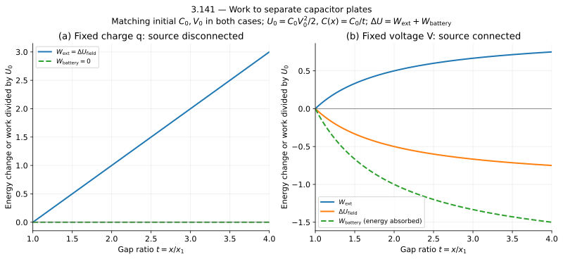

# 3.3 Electric Capacitance. Energy of an Electric Field

[Chapter index](../README.md#chapters) · [Structured solutions](3.3.json) · [Answer audit](../audit/README.md)

## 3.101

**Solved · high confidence.** Integrate the radial field through the dielectric coating and exterior vacuum to find the conductor potential relative to infinity.

**Assumptions**

- The isolated spherical conductor has radiusR1; the adjacent homogeneous linear isotropic dielectric occupiesR1<r<R2. OutsideR2 is vacuum. Epsilon is relative permittivity.
- Capacitance isQ divided by the conductor potential with infinity atzero.

Spherical Gauss law fixesD and the piecewise field.

$$
D_r=\frac{Q}{4\pi r^2},\qquad E_r=\begin{cases}Q/(4\pi\varepsilon_0\varepsilon r^2),&R_1<r<R_2,\\Q/(4\pi\varepsilon_0r^2),&r>R_2.\end{cases}
$$

Integrate outward from the conductor, then divideQ by the resulting potential.

$$
\varphi(R_1)=\frac{Q}{4\pi\varepsilon_0}\left[\frac1\varepsilon\left(\frac1{R_1}-\frac1{R_2}\right)+\frac1{R_2}\right],\qquad C=\frac{4\pi\varepsilon_0\varepsilon R_1R_2}{R_2+(\varepsilon-1)R_1}.
$$

**Results**

Capacitance of the coated isolated sphere

$$
C=\frac{4\pi\varepsilon_0\varepsilon R_1R_2}{R_2+(\varepsilon-1)R_1}
$$

## 3.102

**Solved · high confidence.** Treat filling as changing one of two series capacitances while keeping the battery connected and the intermediate conductor neutral.

**Assumptions**

- The initial capacitance of each air capacitor is the statedC. The battery remains connected atemfEcal throughout the quasistatic filling.
- Useair relative permittivity approximatelyone for the main result, so the filled capacitor becomesepsilon C. Both capacitors keep their geometry.
- The initially neutral floating series junction retainszero net charge; leakage and fringing are ignored.

Initially both capacitors have equal voltage and common charge. After filling, the new series equivalent fixes the common charge.

$$
Q_i=C\mathcal E/2,\qquad C_f=\frac{\varepsilon C}{1+\varepsilon},\qquad Q_f=\frac{\varepsilon C\mathcal E}{1+\varepsilon}.
$$

The filled capacitor voltage changes fromEcal/2 toEcal/(epsilon+1); its field changes in the same ratio because its gap is unchanged.

$$
\frac{E_f}{E_i}=\frac2{1+\varepsilon},\qquad\text{decrease factor}=\frac{E_i}{E_f}=\frac{1+\varepsilon}{2}.
$$

Charge passing through the battery is the increase of the series charge, not the sum over both capacitor plates.

$$
\Delta Q=Q_f-Q_i=\frac{C\mathcal E(\varepsilon-1)}{2(\varepsilon+1)}.
$$

If retaining the historical Appendix air permittivity, replaceepsilon by the ratio of filled to initial relative permittivities, becauseC was measured in air.

$$
\kappa=\varepsilon/\varepsilon_a,\quad\varepsilon_a=1.00058,\quad E_i/E_f=(1+\kappa)/2,\quad\Delta Q=\frac{C\mathcal E(\kappa-1)}{2(\kappa+1)}.
$$

**Results**

Factor by which the filled-capacitor field decreases

$$
E_i/E_f=(1+\varepsilon)/2
$$

Charge flowing through the battery

$$
\Delta Q=C\mathcal E(\varepsilon-1)/[2(\varepsilon+1)]
$$

For ordinaryepsilon>1 this charge is delivered by the battery. With the air correction usekappa=epsilon/epsilon_a instead ofepsilon.

**Limitations**

- Disconnecting the battery before insertion would leave charge fixed and produce a different field factor.

## 3.103

**Solved · high confidence.** Use normalD continuity across two dielectric layers, sum their voltage drops, and subtract their normal polarizations at the interface.

**Assumptions**

- Large parallel plates with negligible edges; two homogeneous linear dielectric layers in series along the field. Epsilon1,epsilon2 are relative permittivities.
- There is no free charge at the internal interface. Define the normaln fromlayer1 tolayer2 and take the stated field in that direction;V is the positive total voltage-drop magnitude.

The same normalD crosses both layers; each electric field isD divided by its absolute permittivity.

$$
E_i=D/(\varepsilon_0\varepsilon_i),\qquad V=\frac D{\varepsilon_0}\left(\frac{d_1}{\varepsilon_1}+\frac{d_2}{\varepsilon_2}\right),\qquad Q=DS.
$$

Solve for the capacitance.

$$
C=\frac{\varepsilon_0S}{d_1/\varepsilon_1+d_2/\varepsilon_2}.
$$

The two coincident bound surface layers contributeP1 dotn andP2 dot(−n), respectively.

$$
P_i=D\left(1-\frac1{\varepsilon_i}\right),\qquad\sigma_b=P_1-P_2=D\left(\frac1{\varepsilon_2}-\frac1{\varepsilon_1}\right)=\frac{\varepsilon_0V(\varepsilon_1-\varepsilon_2)}{\varepsilon_2d_1+\varepsilon_1d_2}.
$$

**Results**

Two-layer series capacitance

$$
C=\varepsilon_0S/(d_1/\varepsilon_1+d_2/\varepsilon_2)
$$

Signed total bound charge density at the interface

$$
\sigma_b=\frac{\varepsilon_0V(\varepsilon_1-\varepsilon_2)}{\varepsilon_2d_1+\varepsilon_1d_2}
$$

This is the sum of both dielectric-side surface charges. It is negative ifepsilon grows in the field direction.

## 3.104

**Solved · high confidence.** Integrate inverse relative permittivity for the voltage and differentiate the resulting polarization for the bound volume density.

**Assumptions**

- Take coordinatez in the field direction fromepsilon1 atelectrode1 toepsilon2 atelectrode2, withz in[0,d] andepsilon2>epsilon1>0.
- There is no free volume charge, so normalD=q/S is constant;q denotes the positive plate-charge magnitude. Linear local isotropic constitutive response is assumed.

Write the linear dielectric profile and integrate the field through the gap.

$$
\varepsilon(z)=\varepsilon_1+\frac{\varepsilon_2-\varepsilon_1}{d}z,\qquad V=\frac q{\varepsilon_0S}\int_0^d\frac{dz}{\varepsilon(z)}=\frac{qd}{\varepsilon_0S(\varepsilon_2-\varepsilon_1)}\ln\frac{\varepsilon_2}{\varepsilon_1}.
$$

InvertV/q to obtain the capacitance.

$$
C=\frac{\varepsilon_0S(\varepsilon_2-\varepsilon_1)}{d\ln(\varepsilon_2/\varepsilon_1)}.
$$

The polarization increases in the field direction; its negative divergence gives the requested volume charge.

$$
P(z)=\frac qS\left(1-\frac1{\varepsilon(z)}\right),\qquad\rho_b(\varepsilon)=-\frac{dP}{dz}=-\frac{q(\varepsilon_2-\varepsilon_1)}{Sd\,\varepsilon^2}.
$$

**Results**

Capacitance for a linear permittivity gradient

$$
C=\frac{\varepsilon_0S(\varepsilon_2-\varepsilon_1)}{d\ln(\varepsilon_2/\varepsilon_1)}
$$

Bound volume density as a function of local relative permittivity

$$
\rho_b(\varepsilon)=-\frac{q(\varepsilon_2-\varepsilon_1)}{Sd\,\varepsilon^2}
$$

## 3.105

**Solved · high confidence.** Use sphericalD flux with the inverse-radius permittivity, turning the radial voltage integral into a logarithm.

**Assumptions**

- The dielectric fillsR1<r<R2 and has relative permittivityepsilon(r)=a/r>0, witha a constant of length dimension.
- Concentric conducting electrodes carry opposite free charges; the medium is linear, local and isotropic.

Gauss law givesD proportional tor^−2; division byepsilon=a/r makesE proportional tor^−1.

$$
D_r=q/(4\pi r^2),\qquad E_r=\frac{q}{4\pi\varepsilon_0ar}.
$$

Integrate the radial field and divide charge by voltage.

$$
V=\frac{q}{4\pi\varepsilon_0a}\ln\frac{R_2}{R_1},\qquad C=\frac{4\pi\varepsilon_0a}{\ln(R_2/R_1)}.
$$

**Results**

Capacitance of the radially graded spherical capacitor

$$
C=4\pi\varepsilon_0a/\ln(R_2/R_1)
$$

## 3.106

**Solved · high confidence.** Compare the largest radial field in each cylindrical layer at its inner radius, using the common free charge per length.

**Assumptions**

- Two concentric homogeneous linear isotropic dielectric layers fill the annular capacitor; the first begins atR1 and the second atR2>R1.
- Ignore end effects. Each layer is linear up to its stated breakdown field; defects and statistical or time-dependent breakdown are outside this ideal threshold model.

The radialD flux depends only on the electrode charge per lengthlambda, and in each homogeneous layerE decreases withradius.

$$
D_r=\frac\lambda{2\pi r},\qquad E_i(r)=\frac\lambda{2\pi\varepsilon_0\varepsilon_i r},\qquad E_{i,\max}=\frac\lambda{2\pi\varepsilon_0\varepsilon_iR_i}.
$$

The two layers reach their maximum permissible fields at the same value oflambda only if their threshold line charges agree.

$$
\lambda_{1m}=2\pi\varepsilon_0\varepsilon_1R_1E_{1m},\quad\lambda_{2m}=2\pi\varepsilon_0\varepsilon_2R_2E_{2m},\qquad\varepsilon_1R_1E_{1m}=\varepsilon_2R_2E_{2m}.
$$

**Results**

Condition for simultaneous dielectric breakdown

$$
\varepsilon_1R_1E_{1m}=\varepsilon_2R_2E_{2m}
$$

## 3.107

**Solved · high confidence.** Select the lower breakdown charge threshold, then integrate both cylindrical layer fields to obtain the applied voltage.

**Assumptions**

- Fig.3.16 showsR1 as the inner electrode radius,R2 as the interface radius andR3 as the outer electrode radius;epsilon1 is the inner layer andepsilon2 the outer layer.
- Use the given inequalityepsilon1R1E1<epsilon2R2E2, so the inner layer breaks down first. E1 andE2 are the material threshold fields, not spatially constant operating fields.
- Neglect end effects and use the linear static fields immediately before breakdown.

The maximum permissible line charge is set by layer1 atR1.

$$
\lambda_{\rm bd}=2\pi\varepsilon_0\varepsilon_1R_1E_1.
$$

Sum the logarithmic voltage drops over both annuli.

$$
V_{\rm bd}=\frac{\lambda_{\rm bd}}{2\pi\varepsilon_0}\left[\frac1{\varepsilon_1}\ln\frac{R_2}{R_1}+\frac1{\varepsilon_2}\ln\frac{R_3}{R_2}\right]=R_1E_1\left[\ln\frac{R_2}{R_1}+\frac{\varepsilon_1}{\varepsilon_2}\ln\frac{R_3}{R_2}\right].
$$

At this operating charge, the maximum field in layer2 remains below its threshold, checking the selection.

$$
E_{2,\max}=\frac{\varepsilon_1R_1E_1}{\varepsilon_2R_2}<E_2.
$$

**Results**

Applied voltage at the first dielectric breakdown

$$
V_{\rm bd}=R_1E_1\left[\ln(R_2/R_1)+(\varepsilon_1/\varepsilon_2)\ln(R_3/R_2)\right]
$$

## 3.108

**Solved · high confidence.** Approximate the thin wires by opposite axial line charges and compute their potential difference, retaining the charge on one wire as the capacitor charge.

**Assumptions**

- Long parallel circular wires of radiusa, axis separationb much larger thana, negligible end effects. The two-terminal capacitor carries line charges+lambda and−lambda.
- For the principal air approximation use absolute permittivityepsilon0; retaining Appendix air permittivity multiplies the result byepsilon_a=1.00058.

The line-charge potential difference between the two wire surfaces is twice the single-wire self-to-other logarithmic contribution.

$$
V_+-V_-\simeq\frac\lambda{\pi\varepsilon_0}\ln\frac ba,\qquad C_L=\frac\lambda{V_+-V_-}\simeq\frac{\pi\varepsilon_0}{\ln(b/a)}.
$$

If finite-radius corrections are desired, the exact infinite-cylinder bipolar-coordinate result reduces to the requested limit.

$$
C_{L,\rm exact}=\frac{\pi\varepsilon_0\varepsilon_a}{\operatorname{arcosh}(b/(2a))},\qquad\operatorname{arcosh}(b/(2a))=\ln(b/a)+O(a^2/b^2).
$$

**Results**

Mutual capacitance per unit wire length

$$
C_L\simeq\pi\varepsilon_0/\ln(b/a)\quad(b\gg a)
$$

Multiply byepsilon_a=1.00058 if retaining the sourced air correction. The capacitor charge islambda on either wire, not the sum of their charge magnitudes.

**Limitations**

- Near contact theb≫a approximation must be replaced by the exact cylindrical solution.

## 3.109

**Solved · high confidence.** Reflect the wire in the grounded plane and use one half of the potential difference between opposite image wires.

**Assumptions**

- The wire is long, circular, radiusa, and its axis is atheightb much larger thana above a conducting plane. Neglect end effects.
- Set the plane potential tozero and assume vacuum orair approximatelyvacuum. For actualair multiply capacitance bythe Appendix relative permittivityepsilon_a.

The opposite line image is a distance2b from the real axis. The wire-to-plane potential is half the difference between the two image-related wires.

$$
V_{\rm wire}-V_{\rm plane}\simeq\frac\lambda{2\pi\varepsilon_0}\ln\frac{2b}{a},\qquad C_L\simeq\frac{2\pi\varepsilon_0}{\ln(2b/a)}.
$$

The exact infinite circular-wire/plane solution gives the corresponding controlled geometric correction.

$$
C_{L,\rm exact}=\frac{2\pi\varepsilon_0\varepsilon_a}{\operatorname{arcosh}(b/a)},\qquad\operatorname{arcosh}(b/a)=\ln(2b/a)+O(a^2/b^2).
$$

**Results**

Mutual capacitance per unit wire length

$$
C_L\simeq2\pi\varepsilon_0/\ln(2b/a)\quad(b\gg a)
$$

Multiply byepsilon_a if retaining the air correction.

**Limitations**

- The centred axial image-line approximation does not reproduce the exact circle at finitea/b; the exact expression accounts for that correction.

## 3.110

**Solved · high confidence.** Compute the difference of the two sphere potentials in the leading monopole approximation, and distinguish it from common-potential self-capacitance.

**Assumptions**

- Primary convention: the two spheres are separate electrodes carrying+Q and−Q, with mutual two-terminal capacitanceC=Q/(V1−V2).
- The spheres have equal radiusa, centre separationb≫a, and are immersed in uniform relative permittivityepsilon. Replace each other sphere field by its monopole contribution at the centre; charge-redistribution corrections are higher order.
- The alternative electrically joined pair has one potential relative to infinity and a different definition; it is stated separately because the word system alone does not specify the charge convention.

At the positive sphere its own charge contributesKQ/(epsilon a) and the other sphere contributes−KQ/(epsilon b); the negative sphere has the opposite potential.

$$
V_1\simeq\frac{KQ}{\varepsilon}\left(\frac1a-\frac1b\right),\qquad V_2=-V_1,\qquad C_{\rm mutual}\simeq\frac{\varepsilon}{2K(1/a-1/b)}=\frac{2\pi\varepsilon_0\varepsilon ab}{b-a}.
$$

At the strict leading order in a/b the two-terminal value is half the self-capacitance of either isolated sphere.

$$
C_{\rm mutual}\simeq2\pi\varepsilon_0\varepsilon a\left(1+\frac ab+\cdots\right).
$$

If the two spheres are instead connected by a negligible wire and carry totalQtot, symmetry assignsQtot/2 to each. Their common potential is a sum rather than a difference.

$$
V\simeq\frac{KQ_{\rm tot}}{2\varepsilon}\left(\frac1a+\frac1b\right),\qquad C_{\rm joined}\simeq\frac{8\pi\varepsilon_0\varepsilon ab}{a+b}.
$$

**Results**

Two-electrode capacitance for opposite equal charges

$$
C_{\rm mutual}\simeq\frac{2\pi\varepsilon_0\varepsilon ab}{b-a}
$$

Alternative self-capacitance of the electrically joined pair

$$
C_{\rm joined}\simeq\frac{8\pi\varepsilon_0\varepsilon ab}{a+b}
$$

This applies only if the spheres are joined and total charge is divided by their common potential relative to infinity; it is not the two-terminal mutual capacitance.

**Limitations**

- The displayed rational expressions are monopole approximations, not exact finite-separation two-sphere solutions.
- The connecting-wire self-capacitance is neglected in the joined alternative.

## 3.111

**Solved · high confidence.** Use an opposite image sphere monopole to estimate the sphere-to-plane voltage, retaining the first interaction correction.

**Assumptions**

- A small conducting sphere of radiusa is at centre-to-plane distancel≫a in vacuum. The plane is the second capacitor electrode, atzero potential with no imposed background field.
- Capacitance is the sphere chargeQ divided by its potential relative to the plane; induced image charge is not a second independently prescribed source.
- Use the monopole approximation for the sphere and its opposite mirror, separated by2l.

The sphere self-potential isKQ/a. The reflected monopole contributes approximately−KQ/(2l) to its constant surface potential.

$$
V_{\rm sphere}-V_{\rm plane}\simeq KQ\left(\frac1a-\frac1{2l}\right).
$$

DivideQ by the voltage and identify the accuracy of the leading correction.

$$
C\simeq\frac{4\pi\varepsilon_0a}{1-a/(2l)}=4\pi\varepsilon_0a\left[1+\frac a{2l}+O((a/l)^2)\right].
$$

**Results**

Sphere-to-plane two-electrode capacitance

$$
C\simeq\frac{4\pi\varepsilon_0a}{1-a/(2l)}\qquad(l\gg a)
$$

**Limitations**

- The rational expression resums the monopole approximation; it is not an exact sphere-plane formula at arbitrary separation.

## 3.112

**Solved · high confidence.** Read wire-connected node identities in Fig.3.17 and apply neutral-node capacitor charge balance.

**Assumptions**

- All pictured capacitors are identical with capacitanceC; connecting wires are ideal. A andB are the two external terminals.
- For equivalent capacitance apply a test potentialVA=V,VB=0. Any internal floating nodes start neutral, so the sum of charges on plates joined to each such node remainszero.
- In(a), the upper wire joinsA to the junction after the second capacitor, while the lower wire joins the junction after the first capacitor toB. In(b), the top and bottom links contain capacitors, not plain wires.

For(a), the original chainA−C1−M−C2−N−C3−B haswireN=A andwireM=B. Thus all three capacitors directly span the terminals.

$$
C_a=C_1+C_2+C_3=3C.
$$

For(b), name the two internal chain nodesM andN; there are five equal edgesAM,MN,NB,AN,MB. The neutral-node equations are symmetric.

$$
3V_M-V_N=V,\qquad3V_N-V_M=V\quad\Longrightarrow\quad V_M=V_N=V/2.
$$

The middle capacitorMN haszero voltage. The terminalA suppliescharge through its two neighbouring capacitors.

$$
Q_A=C(V-V_M)+C(V-V_N)=CV,\qquad C_b=Q_A/V=C.
$$

**Results**

Equivalent capacitance of Fig.3.17(a)

$$
C_a=3C
$$

Equivalent capacitance of Fig.3.17(b)

$$
C_b=C
$$

**Limitations**

- Trapped initial charge on a floating node can add a voltage-independent terminal-charge offset; the differential capacitance of this linear network remains unchanged.

## 3.113

**Solved · high confidence.** Model each adjacent plate gap as an elementary parallel-plate capacitor and preserve the floating shorted-conductor identities in Fig.3.18.

**Assumptions**

- Number the metal plates1through4 fromtop tobottom; gaps are alld and each plate area isS. Ignore edges, thickness and non-neighbour coupling in the large-plate approximation.
- Takeair as relative permittivityone in the main formula;C0=epsilon0S/d. For the historical air correction useC0=epsilon0epsilon_aS/d.
- In(a), plates1and3 form a floating shorted conductorX,plate2 isA andplate4 isB. In(b),plates1and4 formfloatingX,plate2 isA andplate3 isB. The floating connected conductor is initially neutral.

In(a), the two gaps betweenX andA are in parallel, giving2C0. This is in series with the remainingX-to-B gapC0.

$$
C_a=\frac{(2C_0)C_0}{2C_0+C_0}=\frac23C_0=\frac{2\varepsilon_0S}{3d}.
$$

Equivalently, charge neutrality atX gives its test potential and the terminal charge.

$$
2C_0(V_X-V_A)+C_0(V_X-V_B)=0,\quad V_A=V,\ V_B=0:\quad V_X=2V/3,\quad Q_A=2C_0(V-V_X)=\tfrac23C_0V.
$$

In(b), one directgapA-to-B is in parallel with the two equal gaps connected in series throughX.

$$
C_b=C_0+\frac{C_0C_0}{2C_0}=\frac32C_0=\frac{3\varepsilon_0S}{2d},\qquad V_X=(V_A+V_B)/2.
$$

**Results**

Capacitance for Fig.3.18(a)

$$
C_a=2\varepsilon_0S/(3d)
$$

Capacitance for Fig.3.18(b)

$$
C_b=3\varepsilon_0S/(2d)
$$

**Limitations**

- Fringing and stray capacitance to infinity are negligible only in the ideal large-plate limit.

## 3.114

**Solved · high confidence.** Limit the common series charge by the first individual capacitor to reach its rated voltage.

**Assumptions**

- Two ideal linear capacitors in series, with an initially neutral isolated junction, so the charge magnitudes on the two capacitors are equal.
- The applied voltage is increased quasistatically; leakage, balancing resistors and transient voltage redistribution are neglected. Ratings are treated as exact limits of this model.

Each capacitor imposes its own upper bound on the common charge.

$$
Q_{1m}=C_1V_1=(1.0\ \mu\mathrm F)(6.0\ \mathrm{kV})=6.0\ \mathrm{mC},\quad Q_{2m}=C_2V_2=8.0\ \mathrm{mC},\quad Q_m=6.0\ \mathrm{mC}.
$$

Capacitor1 reaches6kV first; the voltage oncapacitor2 at that same charge is only3kV.

$$
V_{1,\rm actual}=Q_m/C_1=6.0\ \mathrm{kV},\quad V_{2,\rm actual}=Q_m/C_2=3.0\ \mathrm{kV}.
$$

Sum these simultaneously attainable voltages.

$$
V_{\rm system,m}=Q_m\left(\frac1{C_1}+\frac1{C_2}\right)=9.0\ \mathrm{kV}.
$$

**Results**

Maximum total series voltage

$$
V_{\max}=9.0\ \mathrm{kV}
$$

**Limitations**

- A precharged series junction or substantial leakage can change voltage sharing; the result assumes the standard neutral ideal junction.

## 3.115

**Solved · high confidence.** Use the scanned battery polarity and imposezero net charge at both floating nodes of the two-stage capacitive ladder.

**Assumptions**

- Fig.3.19 has the long upper battery plate positive; defineVB=0 andVL=+Ecal=110V at the left upper source node.
- LetM be the central upper junction andA the right upper node. Each top series capacitor hascapacitanceC1; shunt capacitorsM-B andA-B havecapacitanceC2=eta C1,eta=2.
- The isolated conducting nodesM andA are initially neutral, and capacitor leakage is neglected. This initial-charge convention is necessary for an absolute final potential difference.

Charge neutrality atM includes its three connected capacitor plates.

$$
C_1(V_M-\mathcal E)+C_1(V_M-V_A)+C_2V_M=0\quad\Longrightarrow\quad(2+\eta)V_M-V_A=\mathcal E.
$$

Charge neutrality atA relates the two upper node potentials.

$$
C_1(V_A-V_M)+C_2V_A=0\quad\Longrightarrow\quad V_M=(1+\eta)V_A.
$$

Solve the two equations and insert the given ratio andemf.

$$
V_A-V_B=\frac{\mathcal E}{(\eta+2)(\eta+1)-1}=\frac{\mathcal E}{\eta^2+3\eta+1}=\frac{110}{11}=10\ \mathrm V,\qquad V_M=30\ \mathrm V.
$$

For nonzero trapped node chargesQM,QA, retain their contributions on the right sides; this states exactly how the implicit initial condition enters.

$$
V_A-V_B=\frac{\mathcal E+Q_M/C_1+(\eta+2)Q_A/C_1}{\eta^2+3\eta+1}.
$$

**Results**

Signed potential difference fromA toB for neutral floating nodes

$$
\varphi_A-\varphi_B=+10\ \mathrm V
$$

Intermediate node potential relative toB

$$
V_M-V_B=30\ \mathrm V
$$

**Limitations**

- Trapped initial charges alter the absolute node potentials as shown; the printed problem implicitly uses an initially uncharged network.

## 3.116

**Solved · high confidence.** Solve the fixed-point capacitance equation of the repeating series-shunt ladder.

**Assumptions**

- Figure3.20 begins with a series capacitor C, followed by a shunt capacitor C to the bottom bus, then the identical remaining infinite ladder. All internal islands are initially neutral. Take the physical limit of finite passive ladders.

If X is the input capacitance, the tail after the first shunt has the same capacitance X.

$$
X=\frac{C(C+X)}{2C+X}.
$$

Solve the quadratic and retain the positive passive root.

$$
X^2+CX-C^2=0,\qquad X=\frac{\sqrt5-1}{2}C\simeq0.618034C.
$$

**Results**

Infinite ladder capacitance

$$
C_{\rm eq}=(\sqrt5-1)C/2
$$

## 3.117

**Solved · high confidence.** Use neutrality of the floating battery-capacitor island and the signed source rise.

**Assumptions**

- High-resolution Figure3.21 confirms that the source long plate is on the RIGHT: V_Y−V_X=+E. The sequence is A,C1,X,source,Y,C2,B. Define U1 and U2 as left plate potential minus right plate potential.
- Assume the intermediate island containing the battery and the two adjacent capacitor plates has zero net initial charge. Use VA−VB=5V, E=10V, C1=1microF and C2=2microF.

The floating-island plate charges are−C1 U1 and+C2 U2.

$$
C_1U_1=C_2U_2=Q.
$$

Traverse A to B including the source potential rise.

$$
\varphi_A-\varphi_B=U_1-\mathcal E+U_2,\qquad U_1+U_2=5+10=15\ \mathrm V.
$$

Solve for the two drops.

$$
Q=\frac{C_1C_2}{C_1+C_2}(\varphi_A-\varphi_B+\mathcal E)=10\ \mathrm{\mu C},\quad U_1=10\ \mathrm V,\quad U_2=5\ \mathrm V.
$$

**Results**

Voltage across C1, left minus right

$$
U_1=10.0\ \mathrm V
$$

Voltage across C2, left minus right

$$
U_2=5.0\ \mathrm V
$$

**Limitations**

- A separately deposited net charge on the floating battery island would change the solution; the ordinary initially neutral island is explicit.

## 3.118

**Solved · high confidence.** Apply a supernode charge balance to the two oppositely driven capacitor branches.

**Assumptions**

- Figure3.22 has BOTH source long plates at the bottom: V_LB−V_LT=E1 and V_RB−V_RT=E2. Top capacitor C1 joins LT to RT; bottom capacitor C2 joins LB to RB.
- The left and right source-connected islands are initially neutral, so the sum of their capacitor-plate charges is zero. Define each requested potential difference as left plate minus right plate.

The two source relations connect the signed capacitor voltages.

$$
U_1=V_{LT}-V_{RT},\quad U_2=V_{LB}-V_{RB}=U_1+\mathcal E_1-\mathcal E_2.
$$

Neutrality of the left island fixes their weighted sum.

$$
C_1U_1+C_2U_2=0.
$$

Solve the two equations.

$$
U_1=\frac{C_2}{C_1+C_2}(\mathcal E_2-\mathcal E_1),\qquad U_2=\frac{C_1}{C_1+C_2}(\mathcal E_1-\mathcal E_2).
$$

**Results**

Top capacitor left-minus-right potential

$$
U_1=C_2(\mathcal E_2-\mathcal E_1)/(C_1+C_2)
$$

Bottom capacitor left-minus-right potential

$$
U_2=C_1(\mathcal E_1-\mathcal E_2)/(C_1+C_2)
$$

**Limitations**

- Precharged floating source islands would add a charge-balance constant.

## 3.119

**Solved · high confidence.** Use the same two-source supernode circuit and convert signed voltage to plate charge.

**Assumptions**

- Figure3.22 has BOTH source long plates at the bottom: V_LB−V_LT=E1 and V_RB−V_RT=E2. Top capacitor C1 joins LT to RT; bottom capacitor C2 joins LB to RB.
- The left and right source-connected islands are initially neutral, so the sum of their capacitor-plate charges is zero. Define each requested potential difference as left plate minus right plate.

Using the result of the independently derived circuit equations, multiply each left-minus-right drop by its capacitance.

$$
Q_{1,L}=C_1U_1=\frac{C_1C_2}{C_1+C_2}(\mathcal E_2-\mathcal E_1),\qquad Q_{2,L}=-Q_{1,L}.
$$

The customary charge of a capacitor is the magnitude of the charge on either plate.

$$
q_1=q_2=\frac{C_1C_2}{C_1+C_2}|\mathcal E_1-\mathcal E_2|.
$$

**Results**

Charge magnitude on either capacitor

$$
q_1=q_2=C_1C_2|\mathcal E_1-\mathcal E_2|/(C_1+C_2)
$$

Signed charges on the two left plates

$$
Q_{1,L}=C_1C_2(\mathcal E_2-\mathcal E_1)/(C_1+C_2),\quad Q_{2,L}=-Q_{1,L}
$$

Each right plate has the opposite signed charge.

## 3.120

**Solved · high confidence.** Find the two neutral capacitive-divider midpoint potentials.

**Assumptions**

- Figure3.23 has left bus L and right bus R, with the bottom source positive on the RIGHT: VR−VL=E. The upper branch is L,C1,A,C2,R and the middle branch L,C3,B,C4,R.
- The isolated midpoint islands A and B each have zero net charge. Choose VL=0.

Each midpoint follows from its own free-charge balance.

$$
C_1V_A+C_2(V_A-\mathcal E)=0,\quad C_3V_B+C_4(V_B-\mathcal E)=0;\qquad V_A=\frac{C_2\mathcal E}{C_1+C_2},\quad V_B=\frac{C_4\mathcal E}{C_3+C_4}.
$$

Subtract and state the balance condition.

$$
V_A-V_B=\mathcal E\frac{C_2C_3-C_1C_4}{(C_1+C_2)(C_3+C_4)},\qquad V_A=V_B\iff C_2C_3=C_1C_4\quad(\mathcal E\ne0).
$$

**Results**

Midpoint potential difference

$$
\varphi_A-\varphi_B=\mathcal E(C_2C_3-C_1C_4)/[(C_1+C_2)(C_3+C_4)]
$$

Condition for zero difference

$$
C_1/C_2=C_3/C_4
$$

Also zero trivially for zero source emf.

## 3.121

**Solved · high confidence.** Conserve terminal charge when the charged capacitor is connected to the neutral series pair.

**Assumptions**

- Initially C1=1microF has voltage110V and charge magnitude110microC. C2=2microF and C3=3microF are uncharged and connected in series, with their middle island neutral.
- Connect the positive C1 terminal P to the outer C2 terminal U and negative terminal N to outer C3 terminal V. Final equilibrium is understood after a small resistance or radiation damps the transient.

The receiving series pair has effective capacitance1.2microF.

$$
C_{23}=\frac{C_2C_3}{C_2+C_3}=1.2\ \mathrm{\mu F}.
$$

Total charge on the merged positive-terminal island is conserved.

$$
(C_1+C_{23})U_f=C_1V,\qquad U_f=\frac{1.0(110)}{1.0+1.2}=50\ \mathrm V.
$$

The charge lost by the initially positive C1 plate equals that gained by the series pair.

$$
\Delta Q=C_1(V-U_f)=C_{23}U_f=60\ \mathrm{\mu C}.
$$

**Results**

Conventional charge transferred through either connecting wire

$$
\Delta Q=60\ \mathrm{\mu C}
$$

Positive charge flows from P toward U in the positive-terminal wire and from V toward N in the negative-terminal wire.

Final parallel-terminal voltage

$$
U_f=50\ \mathrm V
$$

**Limitations**

- An ideal zero-loss capacitor-wire model alone does not specify how the oscillatory transient settles; the stated charge transfer refers to the final electrostatic state.

## 3.122

**Solved · high confidence.** Compare capacitor plate charges before and after connecting the left battery to the floating upper island.

**Assumptions**

- Figure3.24 has both batteries positive at the TOP, each with emf E. Keep separate bottom-wire geometric nodes BL,BC,BR, though their potentials are equal. C1 connects the upper island N to right top R; C2 connects N to bottom centre BC.
- Initially Sw is OPEN and the circuit has reached equilibrium; N is neutral. It is not an initially uncharged pair: the right battery has charged the two capacitors in series.
- After Sw closes, the left battery sets VN=E relative to the common bottom. Section1 arrow points BC toward BL (left); section2 points BC toward BR (right). Charge-flow signs are conventional positive charge.

Initial neutral-island balance fixes the upper potential.

$$
C_1(V_{Ni}-\mathcal E)+C_2V_{Ni}=0,\quad V_{Ni}=\frac{C_1\mathcal E}{C_1+C_2},\quad q_s=\frac{C_1C_2\mathcal E}{C_1+C_2}.
$$

Closing the switch makes the two top terminals of C1 equipotential; C2 is charged directly to E.

$$
V_{Nf}=\mathcal E,\quad Q_{C1,R}:q_s\to0,\quad Q_{C2,\rm bottom}:-q_s\to-C_2\mathcal E,\quad Q_{N,\rm total}:0\to C_2\mathcal E.
$$

The left source supplies the whole increase of net upper-island charge. Its return charge passes section1 in its drawn direction.

$$
Q_1=+C_2\mathcal E.
$$

The right branch loses its original positive C1 plate charge. Charge entering it through the rightward section2 is therefore negative.

$$
Q_2=\Delta Q_{C1,R}=-q_s=-\frac{C_1C_2\mathcal E}{C_1+C_2}.
$$

**Results**

Signed charge through the leftward section1

$$
Q_1=+C_2\mathcal E
$$

Signed charge through the rightward section2

$$
Q_2=-C_1C_2\mathcal E/(C_1+C_2)
$$

Negative means actual positive charge flows leftward through section2.

## 3.123

**Solved · high confidence.** Use the switch-open neutral midpoint and then impose the battery midpoint potential.

**Assumptions**

- Figure3.25 has both batteries positive at the TOP, so with bottom potential0 the left middle is E and the top is2E. C1 is the upper capacitor and C2 the lower.
- Before closing Sw, the isolated capacitor midpoint MR has zero net charge. All three arrows point right, from their respective left source nodes into the capacitor branches. Use E=60V,C1=2microF,C2=3microF.

The initial midpoint voltage comes from a neutral series pair across2E.

$$
V_{Mi}=\frac{2C_1\mathcal E}{C_1+C_2}=48\ \mathrm V,\qquad V_{Mf}=\mathcal E=60\ \mathrm V.
$$

Top-wire section1 carries the change of charge on the upper outer plate.

$$
Q_1=C_1[(2\mathcal E-V_{Mf})-(2\mathcal E-V_{Mi})]=\frac{C_1(C_1-C_2)}{C_1+C_2}\mathcal E=-24\ \mathrm{\mu C}.
$$

Bottom-wire section2 carries the change of charge on the lower outer plate.

$$
Q_2=-C_2V_{Mf}+C_2V_{Mi}=\frac{C_2(C_1-C_2)}{C_1+C_2}\mathcal E=-36\ \mathrm{\mu C}.
$$

The switch section3 changes the whole midpoint island charge from zero.

$$
Q_3=C_1(V_{Mf}-2\mathcal E)+C_2V_{Mf}=(C_2-C_1)\mathcal E=+60\ \mathrm{\mu C}.
$$

**Results**

Rightward section1 signed charge

$$
Q_1=-24\ \mathrm{\mu C}
$$

Rightward section2 signed charge

$$
Q_2=-36\ \mathrm{\mu C}
$$

Rightward section3 signed charge

$$
Q_3=+60\ \mathrm{\mu C}
$$

## 3.124

**Solved · high confidence.** Balance the floating central island against three source-fixed surrounding potentials.

**Assumptions**

- Figure3.26 confirms that BOTH battery long plates are on the RIGHT: VB−VL=E1 and VR−VB=E2. Set VB=0, giving VL=−E1 and VR=+E2.
- The upper midpoint A joins C1,C2,C3 and has zero initial net charge. C3 connects A directly to B.

Conservation of the isolated A-island charge determines its potential.

$$
C_1(V_A+\mathcal E_1)+C_2(V_A-\mathcal E_2)+C_3V_A=0.
$$

Solve for the requested signed difference.

$$
\varphi_A-\varphi_B=V_A=\frac{C_2\mathcal E_2-C_1\mathcal E_1}{C_1+C_2+C_3}.
$$

**Results**

Potential at A minus potential at B

$$
\varphi_A-\varphi_B=(C_2\mathcal E_2-C_1\mathcal E_1)/(C_1+C_2+C_3)
$$

## 3.125

**Solved · high confidence.** Conserve charge on the floating three-source supernode relative to the common capacitor bus.

**Assumptions**

- In Figure3.27 all battery long plates are on the RIGHT: Vi−VL=Ei for i=1,2,3. Each capacitor Ci joins node i to the common right bus O, whose potential is defined as zero.
- Assume the entire floating island containing the left bus, all three batteries and their right-side plates is initially neutral. No external voltage fixes its common-mode potential.

Write all three node potentials in terms of the unknown left-bus potential.

$$
V_i=V_L+\mathcal E_i,\qquad V_O=0.
$$

The sum of capacitor charges on the supernode must vanish.

$$
\sum_{i=1}^3C_iV_i=0\quad\Rightarrow\quad V_L=-\frac{C_1\mathcal E_1+C_2\mathcal E_2+C_3\mathcal E_3}{C_1+C_2+C_3}.
$$

Subtract the weighted mean emf from each source emf.

$$
V_1=\frac{C_2(\mathcal E_1-\mathcal E_2)+C_3(\mathcal E_1-\mathcal E_3)}{C_1+C_2+C_3},\quad V_2=\frac{C_1(\mathcal E_2-\mathcal E_1)+C_3(\mathcal E_2-\mathcal E_3)}{C_1+C_2+C_3},\quad V_3=\frac{C_1(\mathcal E_3-\mathcal E_1)+C_2(\mathcal E_3-\mathcal E_2)}{C_1+C_2+C_3}.
$$

**Results**

Potential at point1 relative to O

$$
\varphi_1=[C_2(\mathcal E_1-\mathcal E_2)+C_3(\mathcal E_1-\mathcal E_3)]/(C_1+C_2+C_3)
$$

Potential at point2 relative to O

$$
\varphi_2=[C_1(\mathcal E_2-\mathcal E_1)+C_3(\mathcal E_2-\mathcal E_3)]/(C_1+C_2+C_3)
$$

Potential at point3 relative to O

$$
\varphi_3=[C_1(\mathcal E_3-\mathcal E_1)+C_2(\mathcal E_3-\mathcal E_2)]/(C_1+C_2+C_3)
$$

**Limitations**

- A nonzero initial supernode charge Q would add Q/(C1+C2+C3) to all three potentials.

## 3.126

**Solved · high confidence.** Solve the two neutral internal bridge-node potentials and calculate the terminal charge.

**Assumptions**

- Figure3.28 has top branch A,C1,U,C2,B; bottom branch A,C2,V,C1,B; bridge capacitor C3 joins U and V. Both internal islands are neutral.
- Apply a test voltage VA−VB=W with VB=0. All capacitances are positive and ideal.

The neutral internal-node equations are coupled by the bridge.

$$
(C_1+C_2+C_3)U-C_3V=C_1W,\qquad(C_1+C_2+C_3)V-C_3U=C_2W.
$$

Adding gives U+V=W; solve the remaining equation.

$$
U=\frac{C_1+C_3}{C_1+C_2+2C_3}W,\qquad V=\frac{C_2+C_3}{C_1+C_2+2C_3}W.
$$

Terminal A charge includes its two incident capacitor plates.

$$
Q_A=C_1(W-U)+C_2(W-V),\qquad C_{AB}=\frac{Q_A}{W}=\frac{2C_1C_2+C_3(C_1+C_2)}{C_1+C_2+2C_3}.
$$

**Results**

Equivalent bridge capacitance

$$
C_{AB}=[2C_1C_2+C_3(C_1+C_2)]/(C_1+C_2+2C_3)
$$

## 3.127

**Solved · high confidence.** Sum the six distinct Coulomb pairs in each square charge arrangement.

**Assumptions**

- Each point-charge self-energy is excluded. The square side is a, so four pairs are separated by a and two diagonal pairs by sqrt2*a. K=1/(4pi epsilon0).
- Figure3.29(a) has four+q; (b) alternates signs around the square with equal signs across each diagonal; (c) has+q on the two upper vertices and−q on the lower two.

For four equal signs every pair is repulsive in the energy sum.

$$
U_a=\frac{Kq^2}{a}\left(4+\frac2{\sqrt2}\right)=\frac{Kq^2}{a}(4+\sqrt2).
$$

For the alternating pattern all four edges are unlike-sign pairs and both diagonals are like-sign pairs.

$$
U_b=\frac{Kq^2}{a}(-4+\sqrt2).
$$

For the two-row pattern the edge contributions cancel and both diagonals are unlike-sign pairs.

$$
U_c=\frac{Kq^2}{a}(-\sqrt2).
$$

**Results**

All four charges positive

$$
U_a=(4+\sqrt2)Kq^2/a
$$

Alternating signs around square

$$
U_b=(\sqrt2-4)Kq^2/a
$$

Positive top row and negative bottom row

$$
U_c=-\sqrt2Kq^2/a
$$

## 3.128

**Solved · high confidence.** Sum the alternating Coulomb potential and distinguish a tagged-charge interaction from pair-counted energy per site.

**Assumptions**

- The chain is infinite in both directions with alternating charges at integer multiples of a. Exclude the chosen charge own potential and use symmetric or physically ordered alternating summation, equivalently its Abel limit.
- The interaction of one chosen charge with all the others is q_i*phi_others. Assigning an extensive total energy equally per site introduces an additional factorone-half because every pair belongs to two tagged charges. Both requested interpretations are given explicitly.

For a chosen+q site, the pair of neighbours at distances n*a contributes twice the alternating potential.

$$
\varphi_{\rm others}=\frac{2Kq}{a}\sum_{n=1}^{\infty}\frac{(-1)^n}{n}.
$$

Use the supplied logarithm expansion and take the limit from below.

$$
\ln(1+\alpha)=\sum_{n=1}^{\infty}\frac{(-1)^{n+1}\alpha^n}{n},\quad\alpha\to1^-:\qquad\sum_{n=1}^{\infty}\frac{(-1)^n}{n}=-\ln2.
$$

Multiply by the tagged charge, then state the separately pair-counted allocation.

$$
U_{\rm tagged}=q_i\varphi_{\rm others}=-\frac{2Kq^2}{a}\ln2,\qquad u_{\rm per\ site}=\frac12U_{\rm tagged}=-\frac{Kq^2}{a}\ln2.
$$

**Results**

Interaction of one charge with all the fixed other charges

$$
U_{\rm tagged}=-2Kq^2\ln2/a
$$

Energy per site allocated from the pair-counted total

$$
u=-Kq^2\ln2/a
$$

The factorone-half avoids counting each pair twice. This differs from the energy to insert a tagged charge while all other charges stay fixed.

**Limitations**

- The alternating series is not absolutely convergent. Arbitrary rearrangement of terms is not the physical distance-ordered or symmetric thermodynamic limit.

## 3.129

**Solved · high confidence.** Separate literal charge–induced-surface mutual energy from the relaxed charge–conductor interaction energy.

**Assumptions**

- Use an ideal conducting plane at zero potential with no applied background field; q remains fixed. The charge position is a distance l above it, and the induced charge adjusts quasistatically as q moves. Point-charge self-energy independent of l is excluded.
- The physical charge–conductor configuration energy includes the energy of establishing the induced distribution. The literal Coulomb cross term between q and a fixed final induced distribution is a different quantity; both are explicitly defined.

The plane field at the real charge is represented by an opposite image a distance2l away.

$$
\varphi_{\rm ind}(q)=-\frac{Kq}{2l},\qquad U_{\rm cross}=q\varphi_{\rm ind}=-\frac{Kq^2}{2l}.
$$

Charging q continuously from zero scales its induced potential in direct proportion to q. Integrating that buildup gives the physical relaxed energy.

$$
U_{\rm phys}=\int_0^q\varphi_{\rm ind}(\widetilde q)\,d\widetilde q=\frac12q\varphi_{\rm ind}(q)=-\frac{Kq^2}{4l}.
$$

The same factor follows by including the induced surface self-energy: on the grounded plane its own potential cancels the real-charge potential.

$$
U_{\rm plane,self}=\frac12\int\sigma\varphi_{\rm ind}\,dS=-\frac12\int\sigma\varphi_q\,dS=-\frac12U_{\rm cross};\qquad U_{\rm cross}+U_{\rm plane,self}=\frac12U_{\rm cross}.
$$

Differentiate only the physical relaxed energy along the quasistatic family.

$$
F_l=-\frac{dU_{\rm phys}}{dl}=-\frac{Kq^2}{4l^2},\qquad W_{\rm remove}=0-U_{\rm phys}=\frac{Kq^2}{4l}.
$$

**Results**

Physical relaxed charge–conductor interaction energy

$$
U_{\rm phys}=-Kq^2/(4l)=-q^2/(16\pi\epsilon_0l)
$$

Literal Coulomb mutual energy of q with the final induced charges

$$
U_{\rm cross}=q\varphi_{\rm ind}=-Kq^2/(2l)=-q^2/(8\pi\epsilon_0l)
$$

This is the cross term only. Its derivative along a family in which the induced distribution also changes double counts the response unless the induced-distribution energy is included.

## 3.130

**Solved · high confidence.** Apply the spherical-shell mean-value property to each radial charge layer of the second ball.

**Assumptions**

- The charge densities are fixed and spherically symmetric about their respective centres. Let their support radii be R1,R2 and assume the physical balls do not overlap: l>=R1+R2. Any self-energies are excluded.
- If conductors are allowed to redistribute their charges in each other field, exact spherical symmetry is generally lost; the prescribed-distribution result does not include that polarization.

Outside the first sphere every spherical shell produces the point-charge potential.

$$
\varphi_1(\mathbf r)=Kq_1/|\mathbf r-\mathbf O_1|\qquad(|\mathbf r-\mathbf O_1|\ge R_1).
$$

For a thin spherical charge layer dq2 centred at O2, the potential of sphere1 is harmonic throughout that layer interior. Its angular mean equals the value at O2.

$$
dU=\varphi_1(\mathbf O_2)\,dq_2=\frac{Kq_1}{l}\,dq_2.
$$

Integrate all layers of the second sphere.

$$
U=\frac{Kq_1}{l}\int dq_2=\frac{Kq_1q_2}{l}.
$$

State what must be supplied if the charge supports are allowed to overlap.

$$
U=\int\rho_2(\mathbf s)\varphi_1(|\mathbf l+\mathbf s|)\,d^3s,\qquad\varphi_1(t)=K\left[\frac{Q_1(<t)}t+\int_t^{R_1}\frac{dq_1(s)}s\right]\quad(t<R_1).
$$

**Results**

Interaction energy of nonoverlapping spherically symmetric balls

$$
U=Kq_1q_2/l=q_1q_2/(4\pi\epsilon_0l)
$$

If overlapping charge clouds are admitted

$$
U=\int\rho_2\varphi_1\,d^3s
$$

The totals q1,q2 and centre distance alone then do not determine the answer; radial profiles are required.

**Limitations**

- Nonoverlap is essential for the profile-independent formula. The problem gives no radii or radial profiles for an overlapping-cloud generalization.

## 3.131

**Solved · high confidence.** Conserve the total parallel-node charge, then compare the capacitor energies.

**Assumptions**

- The capacitors are isolated from batteries during connection, with C1 initially at300 V and C2 initially uncharged. Small wire resistance permits eventual equilibration.
- Neglect parasitic capacitance. In an ideal perfectly lossless circuit the final static equilibrium would not follow without a damping mechanism.

Charge conservation fixes the common final voltage.

$$
Q=C_1V,\qquad V_f=\frac{C_1V}{C_1+C_2}=100\ {\rm V}.
$$

Subtract initial from final electric energy.

$$
\Delta U=\frac12(C_1+C_2)V_f^2-\frac12C_1V^2=-\frac{C_1C_2}{2(C_1+C_2)}V^2=-0.0300\ {\rm J}.
$$

The missing field energy is dissipated during redistribution.

$$
U_i=0.0450\ {\rm J},\qquad U_f=0.0150\ {\rm J},\qquad Q_{\rm diss}=U_i-U_f=0.0300\ {\rm J}.
$$

**Results**

Electric-energy increment

$$
\Delta U=-3.00\times10^{-2}\ {\rm J}
$$

Energy converted into heat or other damping losses

$$
Q_{\rm diss}=3.00\times10^{-2}\ {\rm J}
$$

**Limitations**

- If radiation or inductive oscillations matter, the energy can initially enter those channels before eventual damping.

## 3.132

**Solved · high confidence.** Solve the floating top-node charge in each switch state and account for battery work during the charged-plate transfer.

**Assumptions**

- Fig.3.30 has two outer capacitors C sharing the floating top node T. Their bottom nodes are L and R. The central C0 lower plate B switches from L(position1) to R(position2).
- The battery long line is on the right, so V_R−V_L=emf E. Set V_L=0. Initially the circuit is equilibrated in position1; take the top conductor net charge as zero, the conventional uncharged preparation.
- The capacitor values are positive, switching is ideal apart from dissipative relaxation, and no mechanical work is assigned to the switch. The final heat also remains the same for a fixed arbitrary conserved top-node charge.

Conserve the charge of the isolated top node in both states.

$$
D=2C+C_0,\qquad C V_T+C(V_T-E)+C_0(V_T-V_B)=0;\qquad V_{T,i}=\frac{CE}{D},\quad V_{T,f}=\frac{(C+C_0)E}{D}.
$$

Compute the three-capacitor energy. The two switch states exchange the aggregate capacitances on the battery sides and have equal stored energy.

$$
U_i=U_f=\frac12\frac{C(C+C_0)}D E^2,\qquad\Delta U=0.
$$

The switching plate initially carries negative charge. Its charge must be included when computing the positive charge delivered by the battery to node R.

$$
Q_{B,i}=-\frac{CC_0E}{D},\qquad Q_{R,i}=\frac{C(C+C_0)E}{D},\quad Q_{R,f}=\frac{C(C+C_0)E}{D},\qquad\Delta Q_{\rm bat}=Q_{R,f}-Q_{R,i}-Q_{B,i}=\frac{CC_0E}{D}.
$$

Use battery work minus field-energy increase to obtain heat.

$$
W_{\rm bat}=E\Delta Q_{\rm bat}=\frac{CC_0E^2}{D},\qquad\boxed{Q_{\rm heat}=W_{\rm bat}-\Delta U=\frac{CC_0E^2}{2C+C_0}}.
$$

An independent switched-terminal equivalent capacitance gives the same heat for the imposed voltage step E.

$$
C_{\rm seen}=\frac{2CC_0}{2C+C_0},\qquad Q_{\rm heat}=\frac12C_{\rm seen}E^2.
$$

**Results**

Heat generated after switching1 to2

$$
Q_{\rm heat}=CC_0\mathcal E^2/(2C+C_0)
$$

**Limitations**

- The initial state must be equilibrated at contact1. Small resistance or another damping mechanism is needed for heat and final static equilibrium.

## 3.133

**Solved · high confidence.** Read both battery polarities, calculate the capacitor voltage step and include the remaining battery work.

**Assumptions**

- Fig.3.31 has lower nodes L,M,R. Both battery positive terminals face the middle node M: V_M−V_L=E1 and V_M−V_R=E2. Set V_M=0.
- Capacitor C is between L and switched terminal B. Position1 connects B to R; position2 connects B to M. The initial state is equilibrated in position1.
- After switching, the E2 branch is open at its outer end, while source E1 remains in the relaxation loop. Heat assumes dissipative settling.

The initial and final capacitor voltages use the same left-minus-right-terminal convention.

$$
V_L=-E_1,\quad V_R=-E_2,\qquad V_{C,i}=E_2-E_1,\qquad V_{C,f}=-E_1,\qquad\Delta V_C=-E_2.
$$

The field-energy change depends on both emfs.

$$
\Delta U=\frac C2\left[E_1^2-(E_2-E_1)^2\right]=CE_1E_2-\frac12CE_2^2.
$$

Battery1 delivers charge CE2 through its positive terminal and performs work CE1E2. The disconnected battery2 performs no work during this transient.

$$
W_1=CE_1E_2,\quad W_2=0,\qquad\boxed{Q_{\rm heat}=W_1-\Delta U=\frac12CE_2^2}.
$$

The result also follows directly from dissipative relaxation through a voltage change of magnitude E2.

$$
Q_{\rm heat}=\frac12C(V_{C,f}-V_{C,i})^2.
$$

**Results**

Heat generated after switching1 to2

$$
Q_{\rm heat}=C\mathcal E_2^2/2
$$

**Limitations**

- The polarity and switch wiring are essential. A different contact2 node would give a different voltage step.

## 3.134

**Solved · high confidence.** Separate isolated-shell self-energies from the cross term and verify by the total field energy.

**Assumptions**

- Let R1<R2. The concentric thin shells carry fixed signed total charges q1,q2 and are in vacuum. Self-energy means the energy each shell would have in isolation.
- Set potential zero at infinity. Symmetry keeps charge uniform on each shell.

Each isolated shell has constant surface potential Kq/R.

$$
W_1=\frac{Kq_1^2}{2R_1},\qquad W_2=\frac{Kq_2^2}{2R_2}.
$$

The outer shell potential is constant everywhere inside it, so integrate its potential over the inner charge.

$$
W_{12}=q_1\varphi_2=\frac{Kq_1q_2}{R_2}.
$$

Add the terms and rewrite in the manifest field-energy form.

$$
\boxed{W=\frac K2\left[\frac{q_1^2}{R_1}+\frac{q_2^2+2q_1q_2}{R_2}\right]}=\frac K2\left[q_1^2\left(\frac1{R_1}-\frac1{R_2}\right)+\frac{(q_1+q_2)^2}{R_2}\right].
$$

**Results**

Self-energies

$$
W_1=Kq_1^2/(2R_1),\quad W_2=Kq_2^2/(2R_2)
$$

Interaction energy

$$
W_{12}=Kq_1q_2/R_2
$$

Total energy

$$
W=W_1+W_2+W_{12}
$$

**Limitations**

- If the radius labels are reversed, the interaction denominator is the larger radius.

## 3.135

**Solved · high confidence.** Integrate electric-field energy separately inside and outside the uniformly charged ball.

**Assumptions**

- The specified volume charge is fixed and uniform, with relative permittivity one. The field energy density is epsilon0 E²/2.

Gauss law gives the two radial fields.

$$
E_{\rm in}=Kqr/R^3,\qquad E_{\rm out}=Kq/r^2.
$$

Integrate over spherical shells in both domains.

$$
W_1=\frac{\varepsilon_0}{2}4\pi\int_0^R\frac{K^2q^2r^2}{R^6}r^2dr=\frac{Kq^2}{10R},\qquad W_2=\frac{\varepsilon_0}{2}4\pi\int_R^\infty\frac{K^2q^2}{r^4}r^2dr=\frac{Kq^2}{2R}.
$$

Add the parts and form the requested ratio.

$$
\boxed{W=\frac{3Kq^2}{5R}=\frac{3q^2}{20\pi\varepsilon_0R}},\qquad\boxed{W_1/W_2=1/5}.
$$

**Results**

Electrostatic self-energy

$$
W=3q^2/(20\pi\varepsilon_0R)
$$

Inside-to-outside field-energy ratio

$$
W_1/W_2=1/5
$$

**Limitations**

- A conducting shell with the same total charge has a different self-energy because its interior field is zero.

## 3.136

**Solved · high confidence.** Integrate the dielectric energy density only over the specified spherical layer.

**Assumptions**

- Use a linear homogeneous dielectric of relative permittivity3 between a=.250 m and b=.500 m. The central free charge is3.0 microC.
- Only the energy within a<r<b is requested; the divergent point-charge self-energy near r=0 is outside this integration.

Radial D is fixed by free charge and E=D/(epsilon0 epsilon).

$$
D_r=\frac q{4\pi r^2},\qquad E_r=\frac{Kq}{\varepsilon r^2},\qquad w=\frac12\mathbf E\cdot\mathbf D.
$$

Integrate the layer.

$$
W_{a<r<b}=\frac{Kq^2}{2\varepsilon}\left(\frac1a-\frac1b\right)=0.02697541408\ {\rm J}.
$$

**Results**

Field energy inside the dielectric layer

$$
W\simeq2.70\times10^{-2}\ {\rm J}
$$

**Limitations**

- The linear nondispersive electrostatic energy density is assumed.

## 3.137

**Solved · high confidence.** Use the decrease of the fixed-charge spherical-shell self-energy.

**Assumptions**

- The shell keeps the same total charge q during uniform quasistatic expansion, while its surface density decreases. The environment is vacuum.

The shell energy is Kq²/(2R); electric work is minus its change.

$$
\boxed{A_{\rm electric}=\frac{Kq^2}{2}\left(\frac1{R_1}-\frac1{R_2}\right)}.
$$

**Results**

Work performed by electric forces

$$
A_{\rm electric}=q^2(1/R_1-1/R_2)/(8\pi\varepsilon_0)
$$

**Limitations**

- Holding surface density constant instead would add charge and require source-work accounting.

## 3.138

**Solved · high confidence.** Include both shell self-energy and its interaction with the fixed central charge.

**Assumptions**

- The shell total charge q and central point charge q0 remain fixed, with the point charge at the centre. Uniform shell charge and vacuum are assumed.
- The unchanged divergent self-energy of the ideal point charge cancels from energy differences.

Write only the radius-dependent energy.

$$
U(R)=\frac{Kq^2}{2R}+\frac{Kqq_0}{R}+\text{constant}.
$$

Take its decrease during expansion.

$$
\boxed{A_{\rm electric}=K\left(\frac{q^2}{2}+qq_0\right)\left(\frac1{R_1}-\frac1{R_2}\right)}.
$$

**Results**

Signed work performed by electric forces

$$
A_{\rm electric}=\frac{q(q+2q_0)}{8\pi\varepsilon_0}(1/R_1-1/R_2)
$$

**Limitations**

- The point charge stays centred; deformation or off-centre motion changes the interaction.

## 3.139

**Solved · high confidence.** Vary the shell radius at fixed total charge and equate energy loss to pressure work.

**Assumptions**

- The quoted sigma is the instantaneous uniform surface charge density. During a virtual expansion total charge q=4piR²sigma is fixed, not sigma.
- The force per unit area is the local outward normal traction; the net vector force on the complete symmetric shell is zero.

Differentiate the fixed-charge shell energy.

$$
U=\frac{q^2}{8\pi\varepsilon_0R},\qquad-dU=\frac{q^2}{8\pi\varepsilon_0R^2}\,dR=p\,4\pi R^2dR.
$$

Express the resulting pressure through instantaneous surface density.

$$
p=\frac{q^2}{32\pi^2\varepsilon_0R^4}=\boxed{\frac{\sigma^2}{2\varepsilon_0}}.
$$

**Results**

Electric force magnitude per unit area

$$
p=\sigma^2/(2\varepsilon_0)
$$

**Limitations**

- A derivative at fixed sigma would include unaccounted charge transfer and give the wrong mechanical pressure.

## 3.140

**Solved · high confidence.** Compute the induced-conductor contribution to the energy and compare the initial and final isolated states.

**Assumptions**

- The conducting shell is isolated and initially neutral, with inner radius a and outer radius b. The small orifice is neglected in the leading spherical electrostatic energies.
- The charge is carried quasistatically through the hole without touching the conductor, keeping its net charge zero. Identical bare point-charge self-energies cancel between endpoints.

At the centre q induces−q uniformly on the inner shell and+q on the outer shell.

$$
\varphi_{\rm induced}(O)=Kq\left(-\frac1a+\frac1b\right).
$$

For induced charges the reversible interaction contribution is half q times the induced potential.

$$
U_i^{\rm induced}=\frac12q\varphi_{\rm induced}(O)=-\frac{Kq^2}{2}\left(\frac1a-\frac1b\right),\qquad U_f^{\rm induced}=0.
$$

External quasistatic work is the energy increase.

$$
\boxed{A_{\rm ext}=\frac{Kq^2}{2}\left(\frac1a-\frac1b\right)}.
$$

**Results**

Work required to transfer q to infinity

$$
A_{\rm ext}=q^2(1/a-1/b)/(8\pi\varepsilon_0)
$$

**Limitations**

- A grounded shell is a different boundary condition and lacks the positive outer induced charge contribution.
- A finite orifice changes the initial field and can produce corrections depending on its geometry.

## 3.141

**Solved · medium confidence.** Resolve the printed dimensional error and compute fixed-charge versus fixed-voltage mechanical work.

**Assumptions**

- The scan genuinely says capacitance equal to q. With fixed plate area and variable separation, a literal constant capacitance is impossible in the ideal parallel-plate model, and q has charge units. Interpret part(a) as the intended constant charge q; preserve this as a source wording correction.
- Use air approximately vacuum, plate area S, separations x2>x1, negligible fringe fields and quasistatic separation. Part(b) remains connected to an ideal constant-voltage source.

At fixed charge, external mechanical work equals the field-energy increase.

$$
C(x)=\frac{\varepsilon_0S}{x},\qquad U_Q=\frac{q^2x}{2\varepsilon_0S},\qquad\boxed{A_Q=\frac{q^2(x_2-x_1)}{2\varepsilon_0S}}.
$$

At fixed voltage, integrate the attractive pressure force; field energy alone is not the mechanical potential.

$$
F_{\rm ext}=\frac{\varepsilon_0SV^2}{2x^2},\qquad\boxed{A_V=\frac{\varepsilon_0SV^2}{2}\left(\frac1{x_1}-\frac1{x_2}\right)}.
$$

Show the battery-work balance at fixed voltage.

$$
\Delta U=\frac{\varepsilon_0SV^2}{2}\left(\frac1{x_2}-\frac1{x_1}\right)=-A_V,\qquad W_{\rm battery}=V\Delta Q=\varepsilon_0SV^2\left(\frac1{x_2}-\frac1{x_1}\right)=-2A_V,\quad\Delta U=A_V+W_{\rm battery}.
$$

**Results**

Work for the intended fixed-charge condition

$$
A_Q=q^2(x_2-x_1)/(2\varepsilon_0S)
$$

Work for fixed voltage

$$
A_V=\varepsilon_0SV^2(1/x_1-1/x_2)/2
$$

**Limitations**

- Literal fixed capacitance with fixed S and changing x cannot be satisfied; the physical solution depends on the explicit fixed-charge correction.
- Fringe capacitance and finite-plate force corrections are omitted.

## 3.142

**Solved · high confidence.** Find the capacitance with the inserted slab, freeze the charge after disconnection and compare final field energy.

**Assumptions**

- The unfilled air capacitance is c=20 nF, the slab fills fraction eta=.60 of the gap and spans the full plate area. It is not connected electrically to either electrode.
- The capacitor is charged at200 V with the slab already inserted, then disconnected. Its total plate charge therefore remains Q=Ci V during removal.
- Use negligible fringe fields and glass relative permittivity6 from Appendix17. Removal is quasistatic without charge leakage.
- Approximate the air relative permittivity as1; the Appendix glass permittivity6 is relative to vacuum, so the stated loading factor uses this approximation explicitly.

A metal slab removes its thickness from the active voltage gap; a dielectric slab contributes its thickness divided by epsilon.

$$
f_m=1-\eta=0.40,\quad C_{i,m}=c/f_m;\qquad f_g=1-\eta+\eta/\varepsilon_g=0.50,\quad C_{i,g}=c/f_g.
$$

The final capacitance after complete removal is c. Because charge is fixed, external work is the energy increase.

$$
A=\frac{Q^2}{2}\left(\frac1c-\frac1{C_i}\right)=\frac{cV^2}{2}\frac{1-f}{f^2}.
$$

Evaluate each material case.

$$
A_m=1.50\times10^{-3}\ {\rm J},\qquad A_g=8.00\times10^{-4}\ {\rm J}.
$$

**Results**

Work to remove the metal slab

$$
A_m=1.50\ {\rm mJ}
$$

Work to remove the glass slab

$$
A_g=0.800\ {\rm mJ}
$$

**Limitations**

- A finite-thickness dielectric or metal slab does not generally fill a half-area parallel geometry; this is a thickness-series arrangement.

## 3.143

**Solved · medium confidence.** State the conventional dielectric-uptake pressure estimate and separate it from a material-dependent electrostrictive pressure.

**Assumptions**

- The gap field in the fully water-filled capacitor is E=V/d=5e5 V/m. Use the historical water relative permittivity81 and ideal parallel plates.
- The conventional elementary estimate treats water as an incompressible linear dielectric with prescribed constant permittivity and assigns the uptake stress difference epsilon0(epsilon−1)E²/2.
- A literal thermodynamic pressure increment in a liquid can depend on density variation of permittivity, electrostriction and mechanical constraints. The problem supplies none of these extra material derivatives; distinguish that more general pressure model from the conventional estimate.

Compute the field and elementary dielectric pressure scale.

$$
E=\frac Vd=5.00\times10^5\ {\rm V/m},\qquad\boxed{\Delta p_{\rm uptake}\simeq\frac{\varepsilon_0(\varepsilon-1)}2E^2=88.5\ {\rm Pa}}.
$$

For example, a compressible isothermal fluid at chemical equilibrium with a field-free reservoir has a leading electrostrictive thermodynamic pressure contribution requiring a density derivative.

$$
\Delta p_{\rm therm}\simeq\frac{\varepsilon_0}2\rho\left(\frac{\partial\varepsilon}{\partial\rho}\right)_T E^2.
$$

The two expressions coincide only under an additional constitutive approximation, rather than from epsilon alone.

$$
\rho\left(\frac{\partial\varepsilon}{\partial\rho}\right)_T\simeq\varepsilon-1\quad\Longrightarrow\quad\Delta p_{\rm therm}\simeq\Delta p_{\rm uptake}.
$$

**Results**

Conventional incompressible dielectric-uptake estimate

$$
\Delta p_{\rm uptake}\simeq88.5\ {\rm Pa}
$$

Material-dependent electrostrictive pressure example

$$
\Delta p_{\rm therm}\simeq\tfrac12\varepsilon_0\rho(\partial\varepsilon/\partial\rho)_T(V/d)^2
$$

**Limitations**

- The microscopic thermodynamic liquid pressure is not uniquely fixed by epsilon,V,d alone without a constitutive and mechanical model.
- Fringing drives liquid uptake but is excluded from the uniform-gap field estimate.

## 3.144

**Solved · high confidence.** Differentiate fixed-charge capacitor energy with respect to liquid height and balance gravitational head.

**Assumptions**

- Fig.3.33 has horizontal electrodes with a horizontal liquid–vacuum interface between them. The lower plate is submerged and the upper plate remains above the final surface.
- Treat the liquid as incompressible with constant relative permittivity epsilon and density rho, neglect electrostriction, capillarity and meniscus curvature. The external reservoir is broad, maintaining its reference level.
- The free plate density sigma is fixed, giving normal displacement magnitude D=|sigma| in both the liquid and vacuum portions of the gap.

Replacing a unit volume of vacuum gap by liquid lowers fixed-D field energy by the following pressure scale.

$$
w_{\rm vac}=\frac{\sigma^2}{2\varepsilon_0},\qquad w_{\rm liq}=\frac{\sigma^2}{2\varepsilon_0\varepsilon},\qquad p_{\rm lift}=w_{\rm vac}-w_{\rm liq}=\frac{\sigma^2}{2\varepsilon_0}\left(1-\frac1\varepsilon\right).
$$

An incremental rise dh increases gravitational energy by rho g h per added volume; balance the derivative of total energy.

$$
\rho gh=p_{\rm lift}\quad\Longrightarrow\quad\boxed{h=\frac{\sigma^2(\varepsilon-1)}{2\varepsilon_0\varepsilon\rho g}}.
$$

**Results**

Rise above the external reservoir level

$$
h=\sigma^2(\varepsilon-1)/(2\varepsilon_0\varepsilon\rho g)
$$

**Limitations**

- The predicted surface must stay between the electrodes; if it reaches the upper plate, a free-interface rise formula no longer determines the subsequent state.
- Electrostriction, capillary forces or a non-negligible reservoir-level change require additional terms.

## 3.145

**Solved · high confidence.** Use fixed-voltage source work and the capacitance gained per axial insertion length.

**Assumptions**

- The dielectric layer fills the annular gap over the inserted axial overlap. Let x be that overlap, with one insertion edge and enough remaining length that changing x increases the filled capacitor length.
- The coaxial radii are a=R−d/2 and b=R+d/2, with d≪R. Ignore edge corrections in capacitance and use constant linear relative permittivity epsilon.
- At fixed V the pulling force is+V²(dC/dx)/2; the battery contribution is included in this mechanical energy relation.

The annular capacitance per unit length is2pi epsilon0/ln(b/a), multiplied by epsilon in the dielectric-filled part.

$$
\frac{dC}{dx}=\frac{2\pi\varepsilon_0(\varepsilon-1)}{\ln(b/a)}.
$$

Convert its gradient to the axial pulling force and then use the narrow-gap limit.

$$
\boxed{F=\frac{\pi\varepsilon_0(\varepsilon-1)V^2}{\ln[(R+d/2)/(R-d/2)]}\simeq\frac{\pi\varepsilon_0(\varepsilon-1)RV^2}{d}}.
$$

**Results**

Leading narrow-gap pulling-force magnitude

$$
F\simeq\pi\varepsilon_0(\varepsilon-1)RV^2/d
$$

Coaxial finite-gap expression under the overlap model

$$
F=\pi\varepsilon_0(\varepsilon-1)V^2/\ln(b/a)
$$

**Limitations**

- Near complete insertion or a second overlapping end, dC/dx can change; the constant force describes an active single insertion front.
- Fringe fields supply the local axial force although their small contribution to total capacitance is omitted.

## 3.146

**Solved · high confidence.** Compute the semicircular overlap area and differentiate capacitance at fixed voltage.

**Assumptions**

- Fig.3.34 places the rotation axis O at the common circle centre. Both stationary electrode faces are semicircles of radius R; the movable dielectric is a semicircle of the same radius and fills essentially the plate separation d.
- Let phi be the shown angular misalignment from full overlap, with0<phi<pi. Increasing phi decreases the overlap. Use prescribed constant V, relative permittivity epsilon and negligible fringe/clearance corrections.

A sector angle pi−phi is common to the dielectric and stationary semicircle.

$$
A_{\rm plate}=\frac{\pi R^2}{2},\qquad A_{\rm overlap}=\frac{R^2}{2}(\pi-\phi).
$$

The air and dielectric-covered patches are parallel capacitors.

$$
C(\phi)=\frac{\varepsilon_0}{d}\left[A_{\rm plate}+(\varepsilon-1)A_{\rm overlap}\right]=\frac{\varepsilon_0R^2}{2d}\left[\pi+(\varepsilon-1)(\pi-\phi)\right].
$$

At fixed voltage use the mechanical coenergy gradient, not minus the field-energy gradient alone.

$$
M_\phi=\frac{V^2}{2}\frac{dC}{d\phi}=-\frac{\varepsilon_0(\varepsilon-1)R^2V^2}{4d},\qquad\boxed{|M|=\frac{\varepsilon_0(\varepsilon-1)R^2V^2}{4d}}\quad(\varepsilon>1).
$$

**Results**

Torque magnitude at the shown partial-overlap position

$$
|M|=\varepsilon_0(\varepsilon-1)R^2V^2/(4d)
$$

Direction of torque

$$
\text{Toward increasing overlap, decreasing the shown misalignment }\phi
$$

**Limitations**

- Near full alignment or zero overlap, fringe fields smooth the ideal sharp-edge torque changes.
- A rotation about a different axis or a dielectric with another shape requires a different overlap derivative.
