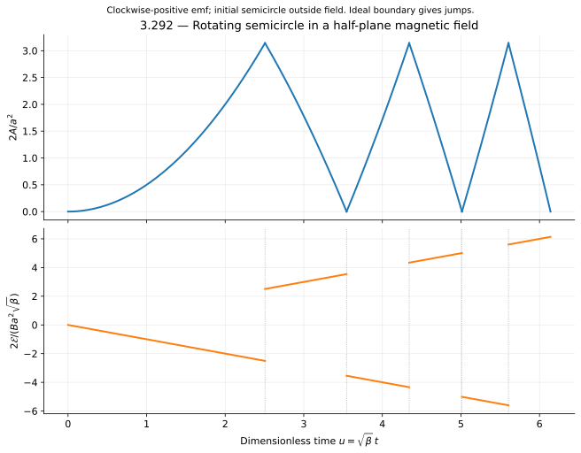
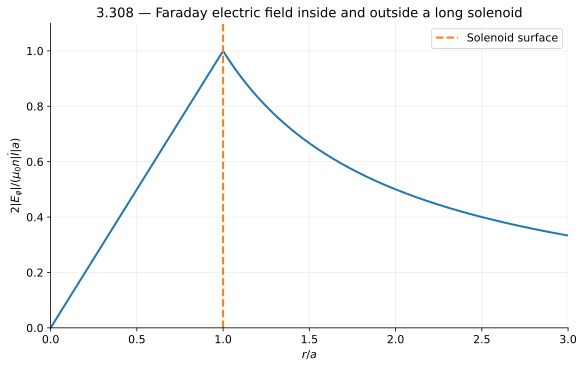
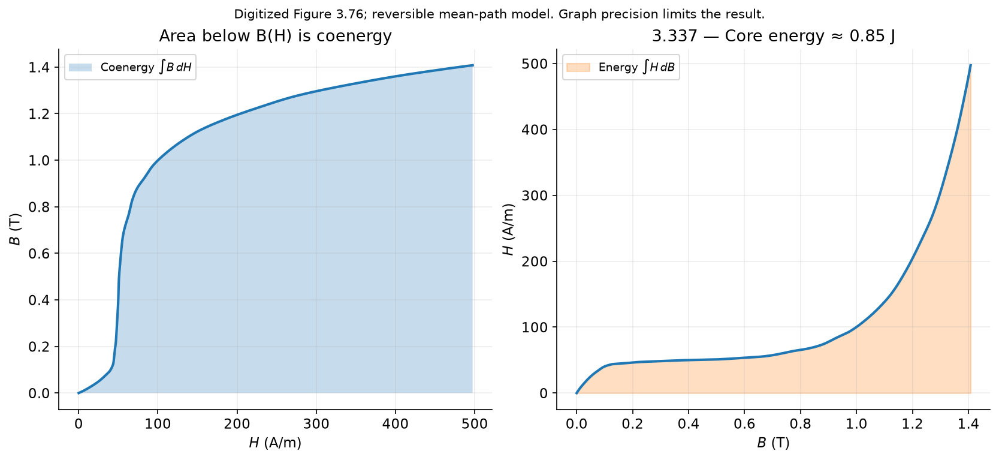
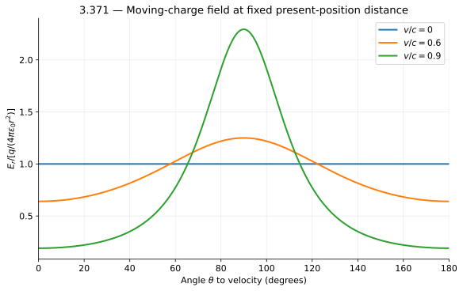

# 3.6 Electromagnetic Induction. Maxwell's Equations

[Chapter index](../README.md#chapters) · [Structured solutions](3.6.json) · [Answer audit](../audit/README.md)

## 3.288

**Problem statement**

A wire bent as a parabola y = ax² is located in a uniform magnetic field of induction B, the vector B being perpendicular to the plane x, y. At the moment t = 0 a connector starts sliding translationwise from the parabola apex with a constant acceleration w (Fig. 3.78). Find the emf of electromagnetic induction in the loop thus formed as a function of y.

**Solved · high confidence.** Differentiate the area swept out by the accelerating horizontal connector.

**Assumptions**

- Take a>0, y>=0 and acceleration w>0. The connector starts from rest at the parabola apex. Choose +z out of the page and B=-B*e_z as drawn.

The connector length and enclosed area follow from the parabola intersections.

$$
\ell(y)=2\sqrt{y/a},\qquad S(y)=\int_0^y2\sqrt{u/a}\,du=\frac{4y^{3/2}}{3\sqrt a}.
$$

Constant acceleration from rest gives v=sqrt(2wy). The magnitude of emf is B times the area growth rate.

$$
|\mathcal E|=B\frac{dS}{dy}\dot y=2By\sqrt{\frac{2w}{a}}.
$$

**Results**

Emf as a function of connector height

$$
|\mathcal E(y)|=2By\sqrt{2w/a}
$$

## 3.289

**Problem statement**

A rectangular loop with a sliding connector of length l is located in a uniform magnetic field perpendicular to the loop plane (Fig. 3.79). The magnetic induction is equal to B. The connector has an electric resistance R, the sides AB and CD have resistances R_1 and R_2 respectively. Neglecting the self-inductance of the loop, find the current flowing in the connector during its motion with a constant velocity v.

**Solved · high confidence.** Treat the moving connector as an emf source with internal resistance, loaded by two parallel branches.

**Assumptions**

- Top and bottom rails have negligible resistance. Connector length l is perpendicular to its rightward speed v. Choose B into the page. Self-inductance is neglected.

The motional emf drives positive charges from the bottom of the connector to its top.

$$
\mathcal E=Blv,\qquad R_p=\frac{R_1R_2}{R_1+R_2}.
$$

The two end resistors are parallel loads between the common rail nodes.

$$
I_{\rm connector}=\frac{\mathcal E}{R+R_p}=\frac{Blv(R_1+R_2)}{R(R_1+R_2)+R_1R_2}.
$$

**Results**

Connector current

$$
I=\frac{Blv(R_1+R_2)}{R(R_1+R_2)+R_1R_2}\quad\text{upwards in the connector for inward B}
$$

## 3.290

**Problem statement**

A metal disc of radius a = 25 cm rotates with a constant angular velocity ω = 130 rad/s about its axis. Find the potential difference between the centre and the rim of the disc if (a) the external magnetic field is absent; (b) the external uniform magnetic field of induction B = 5.0 mT is directed perpendicular to the disc.

**Solved · high confidence.** Balance radial forces on conduction electrons corotating with the disc.

**Assumptions**

- The disc rotates rigidly with angular velocity +omega*e_z. Let Bz be the signed applied axial field and define DeltaPhi=phi_rim-phi_centre.
- Use the elementary free-electron equilibrium model, omitting pressure gradients, work-function effects and the tiny magnetic field produced by charge separation.

An electron must have inward centripetal acceleration; retain its mass even without an applied field.

$$
-e(E_r+\omega rB_z)=-m_e\omega^2r,\qquad E_r=\left(\frac{m_e\omega^2}{e}-\omega B_z\right)r.
$$

Integrate minus the radial electric field from the axis to the rim.

$$
\Delta\varphi=\frac{a^2}{2}\left(\omega B_z-\frac{m_e\omega^2}{e}\right).
$$

The field direction was not specified relative to rotation, so give both signed branches.

$$
B_z=0:\ \Delta\varphi=-3.003257647\,\mathrm{nV};\quad B_z=+5.0\,\mathrm{mT}:\ \Delta\varphi=20.312496997\,\mathrm{mV};\quad B_z=-5.0\,\mathrm{mT}:\ \Delta\varphi=-20.312503003\,\mathrm{mV}.
$$

**Results**

Rim minus centre without external field

$$
\Delta\varphi=-m_e\omega^2a^2/(2e)
$$

Applied field parallel to rotation

$$
\Delta\varphi=\omega Ba^2/2-m_e\omega^2a^2/(2e)
$$

Applied field opposite to rotation

$$
\Delta\varphi=-\omega Ba^2/2-m_e\omega^2a^2/(2e)
$$

## 3.291

**Problem statement**

A thin wire AC shaped as a semi-circle of diameter d = 20 cm rotates with a constant angular velocity ω = 100 rad/s in a uniform magnetic field of induction B = 5.0 mT, with ω ↑↑ B. The rotation axis passes through the end A of the wire and is perpendicular to the diameter AC. Find the value of a line integral $\int \mathbf{E}\cdot d\mathbf{r}$ along the wire from point A to point C. Generalize the obtained result.

**Solved · high confidence.** Separate the electric-field line integral from the motional emf.

**Assumptions**

- The wire is open-circuit and in quasistatic conductor equilibrium, so its tangential electric force balances v cross B. Neglect the much smaller electron-inertia correction discussed in 3.290.
- Take omega and B along the rotation axis through A; A is on the axis and C is at perpendicular radius d.

For rotation about B, the magnetic force per unit positive charge is a radial gradient.

$$
\mathbf v\times\mathbf B=\omega B\,r_\perp\mathbf e_r=\nabla\left(\frac{\omega B r_\perp^2}{2}\right).
$$

The tangential electric field is its negative. Integrate along the semicircle from A to C.

$$
\int_A^C\mathbf E\cdot d\mathbf r=-\frac{\omega B}{2}(r_C^2-r_A^2)=-\frac{\omega Bd^2}{2}=-0.0100\ \mathrm V.
$$

The result depends only on the endpoint distances from the axis and therefore applies to any thin wire path with the same endpoint radii.

$$
\int_1^2\mathbf E\cdot d\mathbf r=-\frac{\omega B}{2}(r_2^2-r_1^2),\qquad \int_1^2(\mathbf v\times\mathbf B)\cdot d\mathbf r=-\int_1^2\mathbf E\cdot d\mathbf r.
$$

**Results**

Requested electric-field integral from A to C

$$
\int_A^C\mathbf E\cdot d\mathbf r=-B\omega d^2/2=-10.0\,\mathrm{mV}
$$

Endpoint-radius rule

$$
\int_1^2\mathbf E\cdot d\mathbf r=-B\omega(r_2^2-r_1^2)/2
$$

## 3.292

**Problem statement**

A wire loop enclosing a semi-circle of radius a is located on the boundary of a uniform magnetic field of induction B (Fig. 3.80). At the moment t = 0 the loop is set into rotation with a constant angular acceleration β about an axis O coinciding with a line of vector B on the boundary. Find the emf induced in the loop as a function of time t. Draw the approximate plot of this function. The arrow in the figure shows the emf direction taken to be positive.

**Solved · high confidence.** Track the angular overlap of the rotating semicircle with the magnetic half-plane.

**Assumptions**

- The field is inward on the right of the boundary and zero on the left. At t=0 the semicircular area is wholly on the left, with its diameter on the boundary.
- The loop rotates clockwise from rest about the normal axis through O, with beta>0. The printed clockwise emf orientation is positive. The field edge is ideal and sharp.

Rotation leaves the normal parallel to B but changes the overlap area; there is no cosine projection factor.

$$
\varphi(t)=\frac12\beta t^2,\quad u=\varphi\bmod2\pi,\quad S_B=\frac{a^2}{2}\begin{cases}u,&0\le u\le\pi,\\2\pi-u,&\pi\le u<2\pi.\end{cases}
$$

Differentiate the inward flux in the positive clockwise loop orientation.

$$
\mathcal E(t)=\begin{cases}-Ba^2\beta t/2,&2k\pi<\varphi<(2k+1)\pi,\\+Ba^2\beta t/2,&(2k+1)\pi<\varphi<(2k+2)\pi,\end{cases}\qquad k=0,1,\ldots
$$

The ideal emf switches sign at the full-entry/full-exit orientations; each branch grows linearly in t.

$$
\mathcal E(t)=-\frac{Ba^2\beta t}{2}\operatorname{sgn}(\sin(\beta t^2/2)),\quad t_k=\sqrt{\frac{2k\pi}{\beta}},\quad \mathcal E(0)=0.
$$

**Results**

Piecewise induced emf

$$
\mathcal E(t)=-\frac12Ba^2\beta t\,\operatorname{sgn}[\sin(\beta t^2/2)]\quad(t\ne t_k)
$$

Ideal sign-reversal times

$$
t_k=\sqrt{2k\pi/\beta},\quad k=1,2,\ldots
$$

**Limitations**

- At the exact switching instants the one-sided ideal emf limits differ; a physical field transition smooths the jump.

## 3.293

**Problem statement**

A long straight wire carrying a current I and a Π-shaped conductor with sliding connector are located in the same plane as shown in Fig. 3.81. The connector of length l and resistance R slides to the right with a constant velocity v. Find the current induced in the loop as a function of separation r between the connector and the straight wire. The resistance of the Π-shaped conductor and the self-inductance of the loop are assumed to be negligible.

**Solved · high confidence.** Use the motional emf of the translating connector in the straight-wire field.

**Assumptions**

- The long wire current points upwards. The loop is to its right, where the field is inward. Only the connector resistance R is retained.

The field is constant along the connector at distance r from the wire.

$$
B(r)=\frac{\mu_0I}{2\pi r},\qquad \mathcal E_{\rm connector}=B(r)\ell v.
$$

The magnetic force on positive charges in the rightward-moving connector points upwards.

$$
I_{\rm ind}(r)=\frac{\mu_0I\ell v}{2\pi Rr}\quad\text{upwards in the connector, counterclockwise around the loop}.
$$

**Results**

Induced connector current

$$
I_{\rm ind}(r)=\mu_0I\ell v/(2\pi Rr)
$$

## 3.294

**Problem statement**

A square frame with side a and a long straight wire carrying a current I are located in the same plane as shown in Fig. 3.82. The frame translates to the right with a constant velocity v. Find the emf induced in the frame as a function of distance x.

**Solved · high confidence.** Differentiate the nonuniform straight-wire flux through the translating square.

**Assumptions**

- The square occupies transverse distances x to x+a from the upward-current straight wire, with x>0. Its velocity is +x.

Choose the inward normal as positive; integrate the field over the square height a.

$$
\Phi(x)=\frac{\mu_0Ia}{2\pi}\ln\frac{x+a}{x}.
$$

Differentiate at dx/dt=v. The positive emf is clockwise, maintaining the diminishing inward flux.

$$
\mathcal E=-\frac{d\Phi}{dt}=\frac{\mu_0Iav}{2\pi}\left(\frac1x-\frac1{x+a}\right)=\frac{\mu_0Ia^2v}{2\pi x(x+a)}.
$$

**Results**

Clockwise induced emf

$$
\mathcal E(x)=\frac{\mu_0Ia^2v}{2\pi x(x+a)}
$$

## 3.295

**Problem statement**

A metal rod of mass m can rotate about a horizontal axis O, sliding along a circular conductor of radius a (Fig. 3.83). The arrangement is located in a uniform magnetic field of induction B directed perpendicular to the ring plane. The axis and the ring are connected to an emf source to form a circuit of resistance R. Neglecting the friction, circuit inductance, and ring resistance, find the law according to which the source emf must vary to make the rod rotate with a constant angular velocity ω.

**Solved · high confidence.** Balance gravity and magnetic torque while including the rotating-rod motional emf.

**Assumptions**

- The rod is uniform, has length a, and rotates clockwise from the upward vertical with theta=omega*t. The field in Figure 3.83 points into the page.
- Define I positive inwards along the rod from rim to O. Define source emf E positive around the external path from O to the rim, completing that inward-current circuit. The source can supply or absorb energy.

Gravity has clockwise torque m*g*a*sin(theta)/2, while inward rod current has clockwise magnetic torque I*B*a^2/2.

$$
0=\frac{mga}{2}\sin\theta+\frac{IBa^2}{2},\qquad I(t)=-\frac{mg}{Ba}\sin(\omega t).
$$

The rotating rod produces an outward motional emf. In the defined inward-current circuit it is a back emf.

$$
\mathcal E_{\rm mot,out}=\int_0^aB\omega r\,dr=\frac{B\omega a^2}{2},\qquad RI=\mathcal E-\mathcal E_{\rm mot,out}.
$$

The required signed source law follows directly.

$$
\mathcal E(t)=\frac{B\omega a^2}{2}-\frac{mgR}{Ba}\sin(\omega t).
$$

**Results**

Required signed source emf

$$
\mathcal E(t)=B\omega a^2/2-(mgR/Ba)\sin(\omega t)
$$

**Limitations**

- Reversing the stated source voltage polarity negates the displayed law. A nonuniform rod replaces a/2 in the gravitational torque by its centre-of-mass radius.

## 3.296

**Problem statement**

A copper connector of mass m slides down two smooth copper bars, set at an angle α to the horizontal, due to gravity (Fig. 3.84). At the top the bars are interconnected through a resistance R. The separation between the bars is equal to l. The system is located in a uniform magnetic field of induction B, perpendicular to the plane in which the connector slides. The resistances of the bars, the connector and the sliding contacts, as well as the self-inductance of the loop, are assumed to be negligible. Find the steady-state velocity of the connector.

**Solved · high confidence.** Balance the downslope gravitational force with magnetic braking at terminal speed.

**Assumptions**

- The connector moves down the rails, which incline by alpha to the horizontal. The magnetic field is perpendicular to the rail plane, not necessarily vertical. Only R dissipates energy.

The induced current is Blv/R; its magnetic force opposes motion.

$$
I=\frac{B\ell v}{R},\qquad F_B=IB\ell=\frac{B^2\ell^2}{R}v.
$$

At terminal speed the downslope forces balance.

$$
mg\sin\alpha=F_B,\qquad v_\infty=\frac{mgR\sin\alpha}{B^2\ell^2}.
$$

**Results**

Terminal downslope speed

$$
v_\infty=mgR\sin\alpha/(B^2\ell^2)
$$

## 3.297

**Problem statement**

The system differs from the one examined in the foregoing problem (Fig. 3.84) by a capacitor of capacitance C replacing the resistance R. Find the acceleration of the connector.

**Solved · high confidence.** Use the capacitor charging current to determine an added electromagnetic inertia.

**Assumptions**

- Replace the resistor in Figure 3.84 by an ideal capacitor C. Initially the connector is at rest and the capacitor is uncharged. Neglect resistance, inductance and radiation.

The capacitor voltage balances the motional emf; differentiating its charge gives the circuit current.

$$
V_C=B\ell v,\quad q=CB\ell v,\quad I=CB\ell\dot v.
$$

Magnetic braking is proportional to acceleration and combines with mechanical inertia.

$$
m\dot v=mg\sin\alpha-IB\ell,\qquad (m+CB^2\ell^2)\dot v=mg\sin\alpha.
$$

**Results**

Constant downslope acceleration

$$
w=\frac{mg\sin\alpha}{m+CB^2\ell^2}
$$

**Limitations**

- Arbitrary incompatible initial capacitor voltage and connector speed would require a switching transient outside the zero-inductance, zero-resistance idealization.

## 3.298

**Problem statement**

A wire shaped as a semi-circle of radius a rotates about an axis OO′ with an angular velocity ω in a uniform magnetic field of induction B (Fig. 3.85). The rotation axis is perpendicular to the field direction. The total resistance of the circuit is equal to R. Neglecting the magnetic field of the induced current, find the mean amount of thermal power being generated in the loop during a rotation period.

**Solved · high confidence.** Differentiate the rotating semicircle area projection and average the resistor power.

**Assumptions**

- In Figure 3.85 the semicircular wire rotates about its diameter; the rest of the circuit is fixed. Any flux through the fixed return contributes only a constant. The imposed field is perpendicular to the rotation axis.

The rotating semicircle has area pi*a^2/2; its projected flux is sinusoidal.

$$
S_s=\frac{\pi a^2}{2},\quad \Phi(t)=BS_s\cos(\omega t)+\Phi_{\rm fixed},\quad \mathcal E(t)=BS_s\omega\sin(\omega t).
$$

Average E^2/R over a period, using mean(sin^2)=1/2.

$$
\overline P=\frac{B^2S_s^2\omega^2}{2R}=\frac{\pi^2B^2\omega^2a^4}{8R}.
$$

**Results**

Mean thermal power

$$
\overline P=\pi^2B^2\omega^2a^4/(8R)
$$

## 3.299

**Problem statement**

A small coil is introduced between the poles of an electromagnet so that its axis coincides with the magnetic field direction. The cross-sectional area of the coil is equal to S = 3.0 mm² , the number of turns is N = 60. When the coil turns through 180° about its diameter, a ballistic galvanometer connected to the coil indicates a charge q = 4.5 μC flowing through it. Find the magnetic induction magnitude between the poles provided the total resistance of the electric circuit equals R = 40 Ω.

**Solved · high confidence.** Integrate the circuit emf during the half-turn.

**Assumptions**

- The field is uniform over each of the N turns. Initial and final circuit currents are zero, so any inductive transient has fully relaxed before interpreting the ballistic charge.

A 180-degree turn reverses the linked flux from NBS to -NBS.

$$
Rq=-\Delta(N\Phi)=2NBS.
$$

Convert S=3.0 mm^2 to 3.0e-6 m^2 and solve for B.

$$
B=\frac{qR}{2NS}=\frac{(4.5\times10^{-6})(40)}{2(60)(3.0\times10^{-6})}=0.500\ \mathrm T.
$$

**Results**

Magnetic induction between the poles

$$
B=qR/(2NS)=0.500\ \mathrm T
$$

## 3.300

**Problem statement**

A square wire frame with side a and a straight conductor carrying a constant current I are located in the same plane (Fig. 3.86). The inductance and the resistance of the frame are equal to L and R respectively. The frame was turned through 180° about the axis OO′ separated from the current-carrying conductor by a distance b. Find the electric charge having flown through the frame.

**Solved · high confidence.** Integrate the RL equation over the complete turning and relaxation process.

**Assumptions**

- Figure 3.86 has the rotation axis through the initial right edge of the square, a distance b from the straight wire. Assume b>a so the frame never intersects the wire.
- Choose positive material-loop orientation with the initial normal into the page. The initial and final currents are zero for the total transported charge.

The initial interval is [b-a,b], while after the flip it is [b,b+a] with reversed material normal.

$$
\Phi_i=\frac{\mu_0Ia}{2\pi}\ln\frac b{b-a},\quad\Phi_f=-\frac{\mu_0Ia}{2\pi}\ln\frac{b+a}b.
$$

Integrate L*di/dt+R*i=-dPhi_ext/dt; self-inductance cancels only for equal endpoint currents.

$$
Rq=-\Delta\Phi_{\rm ext}-L(i_f-i_i),\qquad q=\frac{\mu_0Ia}{2\pi R}\ln\frac{b+a}{b-a}\quad(i_i=i_f=0).
$$

**Results**

Total charge including final relaxation

$$
q=\frac{\mu_0Ia}{2\pi R}\ln\frac{b+a}{b-a}
$$

Charge for arbitrary integration endpoints

$$
q=[\Phi_i-\Phi_f-L(i_f-i_i)]/R
$$

## 3.301

**Problem statement**

A long straight wire carries a current I_0. At distances a and b from it there are two other wires, parallel to the former one, which are interconnected by a resistance R (Fig. 3.87). A connector slides without friction along the wires with a constant velocity v. Assuming the resistances of the wires, the connector, the sliding contacts, and the self-inductance of the frame to be negligible, find: (a) the magnitude and the direction of the current induced in the connector; (b) the force required to maintain the connector's velocity constant.

**Solved · high confidence.** Integrate the straight-wire field along the moving connector, then compute its magnetic drag.

**Assumptions**

- The source wire current points left in Figure 3.87. The rails are parallel to that wire at perpendicular distances a and b, with 0<a<b. The connector moves right at constant v.

Above the source wire the field points inward. Motional emf drives connector current from the lower rail to the upper rail.

$$
\mathcal E=v\int_a^b\frac{\mu_0I_0}{2\pi y}\,dy=\frac{\mu_0I_0v}{2\pi}\ln\frac ba,\quad I_{\rm ind}=\frac{\mathcal E}{R}.
$$

The magnetic force opposes translation; the applied force balances its magnitude.

$$
F_{\rm ext}=I_{\rm ind}\int_a^bB(y)\,dy=\frac{v}{R}\left(\frac{\mu_0I_0}{2\pi}\ln\frac ba\right)^2.
$$

**Results**

Connector current magnitude and direction

$$
I_{\rm ind}=\frac{\mu_0I_0v}{2\pi R}\ln(b/a)\quad\text{from lower to upper rail}
$$

Maintaining force

$$
\mathbf F_{\rm ext}=\frac vR\left[\frac{\mu_0I_0}{2\pi}\ln(b/a)\right]^2\mathbf e_x
$$

## 3.302

**Problem statement**

A conducting rod AB of mass m slides without friction over two long conducting rails separated by a distance l (Fig. 3.88). At the left end the rails are interconnected by a resistance R. The system is located in a uniform magnetic field perpendicular to the plane of the loop. At the moment t = 0 the rod AB starts moving to the right with an initial velocity v_0 . Neglecting the resistances of the rails and the rod AB, as well as the self-inductance, find: (a) the distance covered by the rod until it comes to a standstill; (b) the amount of heat generated in the resistance R during this process.

**Solved · high confidence.** Solve the velocity-proportional magnetic braking equation and use energy conservation.

**Assumptions**

- The rod starts at speed v0>0 to the right, with no external driving force after release. Only R dissipates energy; self-inductance is neglected.

The induced current and magnetic drag are proportional to velocity.

$$
I=\frac{B\ell v}{R},\quad m\dot v=-\frac{B^2\ell^2}{R}v,\quad \tau_m=\frac{mR}{B^2\ell^2},\quad v(t)=v_0e^{-t/\tau_m}.
$$

Integrate the speed to infinite time. All initial kinetic energy becomes resistor heat.

$$
s_\infty=\int_0^\infty v(t)\,dt=\frac{mRv_0}{B^2\ell^2},\qquad Q=\int_0^\infty I^2R\,dt=\frac12mv_0^2.
$$

**Results**

Total stopping distance

$$
s_\infty=mRv_0/(B^2\ell^2)
$$

Heat generated in R

$$
Q=mv_0^2/2
$$

## 3.303

**Problem statement**

A connector AB can slide without friction along a Π-shaped conductor located in a horizontal plane (Fig. 3.89). The connector has a length l, mass m, and resistance R. The whole system is located in a uniform magnetic field of induction B directed vertically. At the moment t = 0 a constant horizontal force F starts acting on the connector shifting it translationwise to the right. Find how the velocity of the connector varies with time t. The inductance of the loop and the resistance of the Π-shaped conductor are assumed to be negligible.

**Solved · high confidence.** Solve the driven magnetic-drag equation.

**Assumptions**

- The connector is initially at rest, as implied by the start of the applied force. The force F>0 is constant and points right.

The opposing magnetic force has coefficient k=B^2*l^2/R.

$$
m\dot v=F-\frac{B^2\ell^2}{R}v,\quad v_\infty=\frac{FR}{B^2\ell^2},\quad\tau_m=\frac{mR}{B^2\ell^2}.
$$

Apply the initial condition v(0)=0.

$$
v(t)=\frac{FR}{B^2\ell^2}\left(1-e^{-B^2\ell^2t/(mR)}\right).
$$

**Results**

Connector velocity from rest

$$
v(t)=\frac{FR}{B^2\ell^2}[1-\exp(-B^2\ell^2t/(mR))]
$$

## 3.304

**Problem statement**

Fig. 3.90 illustrates plane figures made of thin conductors which are located in a uniform magnetic field directed away from a reader beyond the plane of the drawing. The magnetic induction starts diminishing. Find how the currents induced in these loops are directed.

**Solved · high confidence.** Identify the independent conducting cycles before applying Lenz law.

**Assumptions**

- The imposed field points into the drawing and decreases in magnitude. All directions below are viewed by the reader.
- The conductors are uniform and the symmetric semicircles in a have equal resistance. In d the drawn crossover is an insulated crossing, forming a single figure-eight wire, rather than an electrical junction.

In a the two semicircular branches carry a clockwise outer current; symmetry makes the diameter current zero.

$$
(a):\quad I_{\rm upper}:L\to R,\quad I_{\rm lower}:R\to L,\quad I_{\rm diameter}=0.
$$

The slit annulus b is one cycle with opposite inner and outer winding senses. The larger outer area fixes the net emf direction.

$$
(b):\quad\text{outer clockwise, inner counterclockwise}.
$$

In c the circles are separately closed and joined by a single bridge, which carries no steady current.

$$
(c):\quad\text{both circles clockwise},\qquad I_{\rm bridge}=0.
$$

The figure-eight d has opposite signed lobe areas. The larger lobe determines the net induced circulation.

$$
(d):\quad\text{large lobe clockwise, small lobe counterclockwise}.
$$

**Results**

Bisected circle

$$
\text{Outer circle clockwise; diameter current zero}
$$

Slit annular loop

$$
\text{Outer clockwise; inner counterclockwise}
$$

Two circles with one bridge

$$
\text{Both clockwise; bridge current zero}
$$

Single figure-eight loop

$$
\text{Large lobe clockwise; small lobe counterclockwise}
$$

**Limitations**

- Connecting the crossover in d as a true junction would create independently closed lobes; then both would carry clockwise currents.

## 3.305

**Problem statement**

A plane loop shown in Fig. 3.91 is shaped as two squares with sides a = 20 cm and b = 10 cm and is introduced into a uniform magnetic field at right angles to the loop's plane. The magnetic induction varies with time as B = B_0 sin ωt, where B_0 = 10 mT and ω = 100 s⁻¹ . Find the amplitude of the current induced in the loop if its resistance per unit length is equal to ρ = 50 mΩ/m. The inductance of the loop is to be neglected.

**Solved · high confidence.** Use the difference of the two signed square areas and the full wire resistance.

**Assumptions**

- Figure 3.91 is a single figure-eight path with an insulated crossover. Its squares are oppositely wound. The quoted rho is resistance per unit wire length, not bulk resistivity.

The signed flux and the emf amplitude use a^2-b^2.

$$
\Phi=B(t)(a^2-b^2),\quad\mathcal E_0=B_0\omega(a^2-b^2).
$$

The two square perimeters are in series. Convert 50 milliohm/metre to 0.050 ohm/metre.

$$
R=4\rho(a+b)=0.0600\ \Omega,\quad I_0=\frac{B_0\omega(a^2-b^2)}{4\rho(a+b)}=\frac{B_0\omega(a-b)}{4\rho}=0.500\ \mathrm A.
$$

**Results**

Induced-current amplitude

$$
I_0=B_0\omega(a-b)/(4\rho)=0.500\ \mathrm A
$$

## 3.306

**Problem statement**

A plane spiral with a great number N of turns wound tightly to one another is located in a uniform magnetic field perpendicular to the spiral's plane. The outside radius of the spiral's turns is equal to a. The magnetic induction varies with time as B = B_0 sin ωt, where B_0 and ω are constants. Find the amplitude of emf induced in the spiral.

**Solved · high confidence.** Sum the areas of tightly packed turns using their radial density.

**Assumptions**

- Approximate the many-turn spiral as uniform radial pitch from a negligible inner radius to outer radius a. Neglect small end-lead areas; define the terminal emf with a radial return path.

The radial turn density is dN/dr=N/a, so the linked area is an integral of pi*r^2.

$$
A_{\rm linked}=\int_0^a\pi r^2\frac Na\,dr=\frac{\pi Na^2}{3}.
$$

Differentiate the sinusoidal magnetic field.

$$
\mathcal E(t)=-\frac{\pi Na^2B_0\omega}{3}\cos(\omega t),\qquad\mathcal E_0=\frac{\pi Na^2B_0\omega}{3}.
$$

**Results**

Spiral emf amplitude

$$
\mathcal E_0=\pi Na^2B_0\omega/3
$$

**Limitations**

- The result assumes uniform radial packing; a different turn distribution requires its actual sum of enclosed areas.

## 3.307

**Problem statement**

A Π-shaped conductor is located in a uniform magnetic field perpendicular to the plane of the conductor and varying with time at the rate $\dot B = 0.10$ T/s. A conducting connector starts moving with an acceleration w = 10 cm/s² along the parallel bars of the conductor. The length of the connector is equal to l = 20 cm. Find the emf induced in the loop t = 2.0 s after the beginning of the motion, if at the moment t = 0 the loop area and the magnetic induction are equal to zero. The inductance of the loop is to be neglected.

**Solved · high confidence.** Differentiate the product of the growing field and the growing area.

**Assumptions**

- The connector starts from rest and moves away from the closed end. Initially both the area and B are zero. Choose the loop normal along the growing magnetic field.

Both the field and the area depend on time.

$$
B=\dot Bt,\quad x=\frac12wt^2,\quad S=\frac12\ell wt^2,\quad\Phi=\frac12\dot B\ell wt^3.
$$

Include both transformer and motional emf terms.

$$
|\mathcal E|=S\dot B+B\dot S=\frac32\dot B\ell wt^2=0.0120\ \mathrm V.
$$

**Results**

Emf magnitude after 2.0 s

$$
|\mathcal E|=\frac32\dot B\ell wt^2=12.0\ \mathrm{mV}
$$

## 3.308

**Problem statement**

In a long straight solenoid with cross-sectional radius a and number of turns per unit length n a current varies with a constant velocity $\dot I$ A/s. Find the magnitude of the eddy current field strength as a function of the distance r from the solenoid axis. Draw the approximate plot of this function.

**Solved · high confidence.** Apply Faraday circulation to concentric circles inside and outside the solenoid.

**Assumptions**

- Use an ideal long vacuum-core solenoid with negligible external magnetic induction. Cylindrical symmetry fixes an azimuthal induced electric field; additional electrostatic fields are excluded.

Inside, the changing linked flux is pi*r^2 times mu0*n*Idot.

$$
2\pi rE_\phi=-\mu_0n\dot I\pi r^2,\quad E_\phi=-\frac{\mu_0n\dot I}{2}r\quad(r\le a).
$$

Outside, the linked magnetic area is fixed at pi*a^2.

$$
E_\phi=-\frac{\mu_0n\dot I\,a^2}{2r}\quad(r\ge a).
$$

**Results**

Interior eddy-field magnitude

$$
E(r)=\mu_0n|\dot I|r/2,\quad r\le a
$$

Exterior eddy-field magnitude

$$
E(r)=\mu_0n|\dot I|a^2/(2r),\quad r\ge a
$$

## 3.309

**Problem statement**

A long straight solenoid of cross-sectional diameter d = 5 cm and with n = 20 turns per one cm of its length has a round turn of copper wire of cross-sectional area S = 1.0 mm² tightly put on its winding. Find the current flowing in the turn if the current in the solenoid winding is increased with a constant velocity $\dot I = 100$ A/s. The inductance of the turn is to be neglected.

**Solved · high confidence.** Divide the induced single-turn emf by the copper-ring resistance.

**Assumptions**

- The ring radius equals the solenoid radius d/2 to thin-wire accuracy. Use the Appendix copper resistivity at 20 degrees Celsius and neglect thermal changes.

The solenoid produces a changing flux through the ring.

$$
\mathcal E=\mu_0n\dot I\frac{\pi d^2}{4},\qquad R_{\rm ring}=\rho_{\rm Cu}\frac{\pi d}{S}.
$$

Convert the turn density and wire cross section, then divide.

$$
n=2000\ \mathrm{m^{-1}},\quad S=10^{-6}\ \mathrm{m^2},\quad I_{\rm ring}=\frac{\mu_0n\dot I\,dS}{4\rho_{\rm Cu}}=0.1963495408\ \mathrm A.
$$

**Results**

Induced ring-current magnitude

$$
I_{\rm ring}=\mu_0n\dot I\,dS/(4\rho_{\rm Cu})\simeq0.19635\ \mathrm A
$$

**Limitations**

- At another wire temperature use the corresponding copper resistivity rather than the tabulated 20-degree value.

## 3.310

**Problem statement**

A long solenoid of cross-sectional radius a has a thin insulated wire ring tightly put on its winding; one half of the ring has the resistance η times that of the other half. The magnetic induction produced by the solenoid varies with time as B = bt, where b is a constant. Find the magnitude of the electric field strength in the ring.

**Solved · high confidence.** Use the common series current to find the total local tangential electric field in each semicircle.

**Assumptions**

- The two equal-length semicircles have resistances R0 and eta*R0. Each half has uniform resistance per unit length; the wire is thin and stationary. Neglect self-inductance.
- The field requested in the wire is its total tangential electric field, including charge redistribution. The purely nonconservative azimuthal eddy field alone has equal magnitude |b|a/2 on both halves.

Faraday law fixes the total emf and hence the common ring current.

$$
\mathcal E=-\pi a^2b,\qquad I=-\frac{\pi a^2b}{(1+\eta)R_0}.
$$

Ohm law on each length pi*a determines its local total tangential field.

$$
|E_{R_0}|=\frac{|I|R_0}{\pi a}=\frac{|b|a}{1+\eta},\qquad |E_{\eta R_0}|=\frac{|I|\eta R_0}{\pi a}=\frac{\eta|b|a}{1+\eta}.
$$

The electrostatic correction redistributes the uniform eddy field without changing its full-loop circulation.

$$
|E_{\rm eddy}|=\frac{|b|a}{2},\qquad \oint\mathbf E_{\rm conservative}\cdot d\mathbf l=0.
$$

**Results**

Total tangential field in the R0 half

$$
|E_1|=|b|a/(1+\eta)
$$

Total tangential field in the eta R0 half

$$
|E_2|=\eta|b|a/(1+\eta)
$$

Nonconservative field alone

$$
|E_{\rm eddy}|=|b|a/2
$$

**Limitations**

- These are the macroscopic tangential fields inside the thin wire. Detailed normal surface fields depend on its cross section and charge distribution.

## 3.311

**Problem statement**

A thin non-conducting ring of mass m carrying a charge q can freely rotate about its axis. At the initial moment the ring was at rest and no magnetic field was present. Then a practically uniform magnetic field was switched on, which was perpendicular to the plane of the ring and increased with time according to a certain law B (t). Find the angular velocity ω of the ring as a function of the induction B (t).

**Solved · high confidence.** Integrate the torque exerted by the Faraday electric field.

**Assumptions**

- The thin nonconducting ring has fixed total charge q, mass m and radius a. It starts at rest with B=0. B(t) is signed along +z. Neglect its own electromagnetic field and radiation.

Faraday law gives the azimuthal electric field and its torque.

$$
E_\phi=-\frac a2\dot B,\qquad\tau_z=qaE_\phi=-\frac{qa^2}{2}\dot B.
$$

The moment of inertia is m*a^2; integrate from the stated initial conditions.

$$
ma^2\dot\omega=-\frac{qa^2}{2}\dot B,\qquad \omega(t)=-\frac{qB(t)}{2m}.
$$

**Results**

Signed angular velocity

$$
\boldsymbol\omega(t)=-\frac{q}{2m}\mathbf B(t)
$$

## 3.312

**Problem statement**

A thin wire ring of radius a and resistance r is located inside a long solenoid so that their axes coincide. The length of the solenoid is equal to l, its cross-sectional radius, to b. At a certain moment the solenoid was connected to a source of a constant voltage V. The total resistance of the circuit is equal to R. Assuming the inductance of the ring to be negligible, find the maximum value of the radial force acting per unit length of the ring.

**Solved · high confidence.** Combine the solenoid RL step response with the induced ring current and radial Lorentz force.

**Assumptions**

- The ring lies fully within the uniform solenoid field, a<=b. The solenoid has turn density n, vacuum core and negligible end effects. Initially both currents are zero.
- Treat the ring as having negligible inductance and negligible magnetic loading of the prescribed solenoid RL response. The applied voltage V is a step and R is the solenoid circuit resistance.

The solenoid field approaches its final value exponentially.

$$
L_s=\mu_0n^2\pi b^2l,\quad\tau=L_s/R,\quad B(t)=\frac{\mu_0nV}{R}(1-e^{-t/\tau}),\quad \dot B=\frac{\mu_0nV}{L_s}e^{-t/\tau}.
$$

The induced current opposes B; its radial magnetic force per unit wire length is inward.

$$
I_r=-\frac{\pi a^2}{r}\dot B,\qquad f_{\rm inward}=|I_r|B=\frac{\pi a^2}{r}B\dot B.
$$

The product e^(-t/tau)*(1-e^(-t/tau)) peaks at one quarter. Substitute the solenoid inductance to eliminate n.

$$
t_{\max}=\tau\ln2,\qquad f_{\max}=\frac{\pi a^2}{4r}\frac{\mu_0nV}{R}\frac{\mu_0nV}{L_s}=\frac{\mu_0a^2V^2}{4rRb^2l}.
$$

**Results**

Maximum inward radial force per unit ring length

$$
f_{\max}=\mu_0a^2V^2/(4rRb^2l)
$$

Time of the maximum

$$
t_{\max}=(L_s/R)\ln2
$$

**Limitations**

- A strongly coupled shorted turn with appreciable inductance would require the coupled-circuit transient rather than the unloaded solenoid RL response.

## 3.313

**Problem statement**

A magnetic flux through a stationary loop with a resistance R varies during the time interval τ as Φ = at (τ − t). Find the amount of heat generated in the loop during that time. The inductance of the loop is to be neglected.

**Solved · high confidence.** Square the flux-derivative emf and integrate the resistor power.

**Assumptions**

- The loop is stationary, has resistance R and negligible self-inductance. Only the interval 0<=t<=tau is included.

Differentiate the specified flux and use Ohm law.

$$
\mathcal E(t)=-\frac{d\Phi}{dt}=-a(\tau-2t),\qquad I=\mathcal E/R.
$$

Integrate the thermal power; the changing current sign causes no negative heat.

$$
Q=\frac{a^2}{R}\int_0^\tau(\tau-2t)^2dt=\frac{a^2\tau^3}{3R}.
$$

**Results**

Heat generated during the interval

$$
Q=a^2\tau^3/(3R)
$$

## 3.314

**Problem statement**

In the middle of a long solenoid there is a coaxial ring of square cross-section, made of conducting material with resistivity ρ. The thickness of the ring is equal to h, its inside and outside radii are equal to a and b respectively. Find the current induced in the ring if the magnetic induction produced by the solenoid varies with time as B = βt, where β is a constant. The inductance of the ring is to be neglected.

**Solved · high confidence.** Resolve the solid ring into parallel coaxial conducting strips.

**Assumptions**

- The axial thickness is h and the radial interval is a<=s<=b. The imposed axial B=beta*t is uniform over each enclosed disk. Neglect self-inductance and magnetic back reaction.
- The requested total current is the current through a radial-axial cut, summed over all radial strips. If square cross section is imposed literally, h=b-a.

A strip of radial width ds has circumference 2*pi*s and conducting cross section h*ds.

$$
dR=\frac{2\pi\rho s}{h\,ds},\qquad \mathcal E(s)=-\pi s^2\beta.
$$

All strips circulate in parallel. Sum their currents, not their resistances in series.

$$
dI=-\frac{\beta h}{2\rho}s\,ds,\qquad I=-\frac{\beta h}{4\rho}(b^2-a^2).
$$

**Results**

Signed total azimuthal current

$$
I=-\beta h(b^2-a^2)/(4\rho)
$$

Local azimuthal current density

$$
j_\phi(s)=-\beta s/(2\rho)
$$

## 3.315

**Problem statement**

How many metres of a thin wire are required to manufacture a solenoid of length l_0 = 100 cm and inductance L = 1.0 mH if the solenoid's cross-sectional diameter is considerably less than its length?

**Solved · high confidence.** Eliminate the number of turns and coil radius from the long-solenoid inductance.

**Assumptions**

- Use a vacuum-core long solenoid, with diameter much smaller than length l0. Neglect lead length, wire internal inductance, winding thickness and the small axial-pitch correction to each turn length.

The wire length and inductance contain the same product N*R.

$$
\ell_w\simeq2\pi RN,\qquad L=\frac{\mu_0N^2\pi R^2}{l_0}=\frac{\mu_0\ell_w^2}{4\pi l_0}.
$$

Solve for wire length using l0=1.00 m and L=0.00100 H.

$$
\ell_w=\sqrt{\frac{4\pi l_0L}{\mu_0}}=\sqrt{\frac{4\pi(1.00)(0.00100)}{4\pi\times10^{-7}}}=100\ \mathrm m.
$$

**Results**

Required winding wire length

$$
\ell_w=\sqrt{4\pi l_0L/\mu_0}=100\ \mathrm m
$$

**Limitations**

- The 100 m value is the leading ideal winding length; leads and finite pitch require additional wire.

## 3.316

**Problem statement**

Find the inductance of a solenoid of length l whose winding is made of copper wire of mass m. The winding resistance is equal to R. The solenoid diameter is considerably less than its length.

**Solved · high confidence.** Eliminate winding length and wire cross section between its mass, resistance and long-solenoid inductance.

**Assumptions**

- The long solenoid is air-cored or nonmagnetic. Its total turn length dominates any leads, the turns have a common radius a, and end effects are negligible.
- Use uniform copper wire with material resistivity rho_e=16 nOhm metre at 20 degrees Celsius and mass density rho_m=8900 kg/m cubed, from the Appendices. The winding temperature is held at the tabulated reference temperature.

Let ell_w be total winding-wire length and S_w its cross-sectional area. Eliminate S_w from mass and resistance.

$$
m=\rho_mS_w\ell_w,\quad R=\rho_e\ell_w/S_w,\quad \ell_w^2=\frac{mR}{\rho_m\rho_e}.
$$

The long-solenoid expression depends on total winding length, not separately on radius and turn count.

$$
\ell_w\simeq2\pi aN,\quad L=\frac{\mu_0N^2\pi a^2}{l}=\frac{\mu_0\ell_w^2}{4\pi l}=\frac{\mu_0mR}{4\pi\rho_m\rho_e l}.
$$

With the historical copper constants, the coefficient multiplying mR/l in SI units is fixed.

$$
L=7.022471910\times10^{-4}\frac{m\,[\mathrm{kg}]\,R\,[\Omega]}{l\,[\mathrm m]}\ \mathrm H.
$$

**Results**

Long-solenoid inductance from winding mass and resistance

$$
L=\mu_0mR/(4\pi\rho_m\rho_e l)
$$

**Limitations**

- Lead resistance, lead mass, winding pitch, heating and significant end effects would spoil the elimination unless modeled separately.

## 3.317

**Problem statement**

A coil of inductance L = 300 mH and resistance R = 140 mΩ is connected to a constant voltage source. How soon will the coil current reach η = 50% of the steady-state value?

**Solved · high confidence.** Invert the exponential rise of a series RL current after connection.

**Assumptions**

- The coil is initially unenergized. Its stated 140 mOhm is the total series resistance, and source voltage is constant.

The standard initial-value equation gives current as a fraction of its steady value.

$$
L\dot I+RI=\mathcal E,\quad I(0)=0,\quad I/I_\infty=1-e^{-Rt/L},\quad I_\infty=\mathcal E/R.
$$

Solve for the time at fraction eta, then insert eta=0.50.

$$
t=-\frac LR\ln(1-\eta)=\frac{0.300}{0.140}\ln2=1.485315387\ \mathrm s.
$$

**Results**

Time to reach half the steady current

$$
t=-(L/R)\ln(1-\eta)\simeq1.48532\ \mathrm s
$$

## 3.318

**Problem statement**

Calculate the time constant τ of a straight solenoid of length l = 1.0 m having a single-layer winding of copper wire whose total mass is equal to m = 1.0 kg. The cross-sectional diameter of the solenoid is assumed to be considerably less than its length. Note. The time constant τ is the ratio L/R, where L is inductance and R is active resistance.

**Solved · high confidence.** Use winding mass to eliminate wire geometry from L/R.

**Assumptions**

- Use a long, single-layer nonmagnetic solenoid and neglect leads, end effects and small helical pitch corrections.
- Copper resistivity is held at the Appendix 20-degree-Celsius value 16 nOhm metre and density 8900 kg/m cubed.

The same mass-resistance elimination as for a long solenoid gives a geometry-independent ratio at fixed mass and axial length.

$$
\tau=\frac LR=\frac{\mu_0m}{4\pi\rho_m\rho_e l}.
$$

Insert the specified 1 kg mass and 1 m solenoid length.

$$
\tau=\frac{10^{-7}(1.0)}{(8900)(16\times10^{-9})(1.0)}=7.022471910\times10^{-4}\ \mathrm s.
$$

**Results**

Winding electrical time constant

$$
\tau\simeq0.702247\ \mathrm{ms}
$$

## 3.319

**Problem statement**

Find the inductance of a unit length of a cable consisting of two thin-walled coaxial metallic cylinders if the radius of the outside cylinder is η = 3.6 times that of the inside one. The permeability of a medium between the cylinders is assumed to be equal to unity.

**Solved · high confidence.** Integrate the annular coaxial field energy per unit cable length.

**Assumptions**

- The coaxial thin metallic shells carry equal opposite currents, so the field vanishes both in the hollow inner region and outside the return cylinder. Internal metal-field energy is neglected.
- The interelectrode relative permeability is unity.

For inner radius a and outer radius b, Ampere law fixes the annular field.

$$
B(r)=\frac{\mu_0I}{2\pi r}\quad(a<r<b),\qquad U^\prime=\int_a^b\frac{B^2}{2\mu_0}2\pi r\,dr=\frac{\mu_0I^2}{4\pi}\ln\frac ba.
$$

Equate this energy per length to one half L-prime I squared.

$$
L^\prime=\frac{\mu_0}{2\pi}\ln\eta=2.561867691\times10^{-7}\ \mathrm{H/m}.
$$

**Results**

Coaxial cable inductance per length

$$
L^\prime=\mu_0\ln\eta/(2\pi)\simeq0.256187\ \mu\mathrm{H/m}
$$

## 3.320

**Problem statement**

Calculate the inductance of a doughnut solenoid whose inside radius is equal to b and cross-section has the form of a square with side a. The solenoid winding consists of N turns. The space inside the solenoid is filled up with uniform paramagnetic having permeability μ.

**Solved · high confidence.** Integrate the radial toroidal field and multiply the flux by the turn count.

**Assumptions**

- The densely wound toroid has nonhysteretic uniform relative permeability mu. The square cross section extends from radius b to b+a and has axial height a.
- Ignore discrete turns, field leakage, wire internal inductance and the small azimuthal lead component.

Use Ampere law and integrate over the square meridional section.

$$
B(r)=\frac{\mu_0\mu NI}{2\pi r},\quad\Phi=a\int_b^{b+a}B(r)dr=\frac{\mu_0\mu NIa}{2\pi}\ln\frac{b+a}{b}.
$$

The winding flux linkage is N times the single-section flux.

$$
L=\frac{N\Phi}{I}=\frac{\mu_0\mu N^2a}{2\pi}\ln\frac{b+a}{b}.
$$

**Results**

Inductance of the square-section toroid

$$
L=\mu_0\mu N^2a\ln[(b+a)/b]/(2\pi)
$$

## 3.321

**Problem statement**

Calculate the inductance of a unit length of a double tape line (Fig. 3.92) if the tapes are separated by a distance h which is considerably less than their width b, namely, b/h = 50.

**Solved · high confidence.** Calculate the field energy between the broad parallel current tapes.

**Assumptions**

- The two tapes carry equal opposite uniform longitudinal currents. Their width b is much larger than their separation h, so edge and thickness effects are neglected.
- The space is nonmagnetic. Use one complete two-conductor line inductance, not an assigned half per tape.

A tape has surface-current magnitude I/b. The two sheets give field mu0*I/b in the gap and zero outside.

$$
B=\mu_0I/b,\quad U^\prime=\frac{B^2}{2\mu_0}bh=\frac{\mu_0I^2h}{2b}.
$$

Identify the line inductance per length from its energy.

$$
L^\prime=\mu_0h/b=\mu_0/50=2.513274123\times10^{-8}\ \mathrm{H/m}.
$$

**Results**

Double-tape line inductance per length

$$
L^\prime=\mu_0h/b\simeq25.1327\ \mathrm{nH/m}
$$

## 3.322

**Problem statement**

Find the inductance of a unit length of a double line if the radius of each wire is η times less than the distance between the axes of the wires. The field inside the wires is to be neglected, the permeability is assumed to be equal to unity throughout, and η ≫ 1.

**Solved · high confidence.** Use the two-wire external flux or its geometric dual to the two-wire capacitance.

**Assumptions**

- The two long parallel wires carry equal opposite currents. Let their radius be a and their axis separation d=eta*a, with eta much greater than one.
- Exclude the wire interior field energy as instructed and use relative permeability one.

The external line inductance is the two-wire logarithmic geometric factor. With d much larger than a its leading value is twice the single annular logarithmic coefficient.

$$
L^\prime\simeq\frac{\mu_0}{\pi}\ln\frac da=\frac{\mu_0}{\pi}\ln\eta.
$$

For circular equipotential-like current sheets in the external-field idealization, the familiar bipolar geometric refinement replaces the logarithm by acosh(d/(2a)). The leading result is the requested large-separation limit.

$$
\operatorname{arcosh}(\eta/2)=\ln\eta+O(\eta^{-2}).
$$

**Results**

Leading external inductance of the double line

$$
L^\prime\simeq\mu_0\ln\eta/\pi
$$

**Limitations**

- Finite-radius and current-distribution corrections lie beyond the stated eta much greater than one approximation.

## 3.323

**Problem statement**

A superconducting round ring of radius a and inductance L was located in a uniform magnetic field of induction B. The ring plane was parallel to the vector B, and the current in the ring was equal to zero. Then the ring was turned through 90° so that its plane became perpendicular to the field. Find: (a) the current induced in the ring after the turn; (b) the work performed during the turn.

**Solved · high confidence.** Conserve total flux linkage in the superconducting ring and integrate the resisting magnetic torque.

**Assumptions**

- Initially the ring plane is parallel to B, so its external flux is zero and its current is zero. Ring self-inductance L is constant during rigid rotation.
- Use ideal flux conservation, neglect kinetic inductance, flux jumps and resistance. Let theta be the angle from the initial plane so external flux is Phi0*sin(theta), with Phi0=pi*a squared*B.

The total flux linkage stays at zero as the external flux grows.

$$
LI+\Phi_{\rm ext}=0,\quad I(\theta)=-\frac{\Phi_0}{L}\sin\theta,\quad I_f=-\frac{\pi a^2B}{L}.
$$

The induced current opposes the increase of flux. The external torque must do work minus I times dPhi_ext.

$$
W_{\rm ext}=-\int_0^{\Phi_0}I\,d\Phi_{\rm ext}=\frac{\Phi_0^2}{2L}=\frac{\pi^2a^4B^2}{2L}=\frac12LI_f^2.
$$

**Results**

Signed final persistent current

$$
I_f=-\pi a^2B/L
$$

Positive current is the sense that would produce flux parallel to the final applied B; the induced current is opposite.

Positive external mechanical turning work

$$
W_{\rm ext}=\pi^2a^4B^2/(2L)
$$

## 3.324

**Problem statement**

A current I_0 = 1.9 A flows in a long closed solenoid. The wire it is wound of is in a superconducting state. Find the current flowing in the solenoid when the length of the solenoid is increased by η = 5%.

**Solved · medium confidence.** Conserve the superconducting winding flux linkage while tracking both length and cross-sectional area.

**Assumptions**

- The turn count N is fixed, the solenoid remains long, and the magnetic environment is unchanged. Let S_i and S_f be its initial and final enclosed cross-sectional areas.
- The problem states the length increase but does not explicitly constrain transverse deformation. Give the general area-dependent answer and the usual fixed-cross-section branch.
- Treat the geometry change as lossless and maintain the original fluxoid sector, ignoring kinetic inductance and flux jumps.

For a long solenoid L=mu0*N squared*S/l. Constant flux linkage L*I fixes the current ratio.

$$
\frac{I_f}{I_0}=\frac{L_i}{L_f}=\frac{l_f}{l_i}\frac{S_i}{S_f}=(1+\delta)\frac{S_i}{S_f},\qquad\delta=0.05.
$$

If the transverse cross section is held fixed, the current rises in proportion to solenoid length.

$$
S_f=S_i\quad\Longrightarrow\quad I_f=1.9(1.05)=1.995\ \mathrm A.
$$

A different geometric constraint gives a different result. For example, constant enclosed volume S*l gives a square length-ratio dependence.

$$
S_fl_f=S_il_i\quad\Longrightarrow\quad I_f=I_0(1+\delta)^2=2.09475\ \mathrm A.
$$

**Results**

Persistent current with explicit transverse-area change

$$
I_f=I_0(1+\delta)S_i/S_f
$$

Usual fixed-cross-section interpretation

$$
I_f=1.995\ \mathrm A\quad(S_f=S_i)
$$

Conditional constant-enclosed-volume branch

$$
I_f=2.09475\ \mathrm A\quad(S_fl_f=S_il_i)
$$

**Limitations**

- Wire material-volume conservation is not by itself a specification of the enclosed solenoid area. Different supports or strain constraints can give different current changes.

## 3.325

**Problem statement**

A ring of radius a = 50 mm made of thin wire of radius b = 1.0 mm was located in a uniform magnetic field with induction B = 0.50 mT so that the ring plane was perpendicular to the vector B. Then the ring was cooled down to a superconducting state, and the magnetic field was switched off. Find the ring current after that. Note that the inductance of a thin ring along which the surface current flows is equal to $L = μ_0a[\ln(8a/b)-2]$ .

**Solved · high confidence.** Conserve the initial linked magnetic flux as the external field is removed.

**Assumptions**

- Take the initial ring current to be zero after cooling in the applied field. The trapped total ring flux is then B*pi*a squared.
- Use the supplied surface-current ring inductance and ideal superconducting flux conservation, neglecting flux quantization corrections and any change of inductance.

When the applied field has fallen to zero, the persistent self-flux must reproduce its initial value.

$$
LI_f=\Phi_i=\pi a^2B,\qquad I_f=\frac{\pi aB}{\mu_0[\ln(8a/b)-2]}.
$$

Evaluate the stated thin-ring inductance and resulting current.

$$
L=2.5079\times10^{-7}\ \mathrm H\ \text{approximately},\qquad I_f=15.65841291\ \mathrm A.
$$

**Results**

Final current retaining the original field flux

$$
I_f=\pi aB/\{\mu_0[\ln(8a/b)-2]\}\simeq15.6584\ \mathrm A
$$

## 3.326

**Problem statement**

A closed circuit consists of a source of constant emf ℰ and a choke coil of inductance L connected in series. The active resistance of the whole circuit is equal to R. At the moment t = 0 the choke coil inductance was decreased abruptly η times. Find the current in the circuit as a function of time t. Instruction. During a stepwise change of inductance the total magnetic flux (flux linkage) remains constant.

**Solved · high confidence.** Integrate the flux-linkage equation across the abrupt inductance change, then solve the new RL relaxation.

**Assumptions**

- The circuit has reached dc equilibrium before time zero, so I(0-)=emf/R. Source emf and total active resistance remain constant.
- Only inductance changes abruptly from L to L/eta. Source emf and resistive voltage remain finite through the short transition, so the inductor flux linkage is continuous.

Write the correct variable-inductance circuit law and integrate through the step.

$$
\frac d{dt}(L(t)I)+RI=\mathcal E,\quad L I(0^-)=\frac L\eta I(0^+),\quad I(0^+)=\eta\mathcal E/R.
$$

For positive time, the inductance is constant at L/eta and current relaxes to the same dc value.

$$
I(t)=\frac{\mathcal E}{R}\left[1+(\eta-1)e^{-\eta Rt/L}\right],\qquad t\ge0.
$$

If pre-step equilibrium is not assumed, retain its initial current as an extra parameter.

$$
I(t)=\frac{\mathcal E}{R}+\left[\eta I(0^-)-\frac{\mathcal E}{R}\right]e^{-\eta Rt/L}.
$$

**Results**

Post-step current for initial dc equilibrium

$$
I(t)=(\mathcal E/R)[1+(\eta-1)e^{-\eta Rt/L}],\quad t\ge0
$$

Flux-conserving current jump

$$
I(0^+)=\eta I(0^-)
$$

## 3.327

**Problem statement**

Find the time dependence of the current flowing through the inductance L of the circuit shown in Fig. 3.93 after the switch Sw is shorted at the moment t = 0.

**Solved · high confidence.** Replace the source-resistor network seen by the inductor with its Thevenin equivalent.

**Assumptions**

- In Figure 3.93 the upper plate of the source symbol is positive. The switch is initially open long enough that any inductor current has decayed through the parallel resistor.
- The two resistors are both R. The inductor is ideal and its inductance does not change on closing the switch.

With the inductor removed, the two resistors form an equal divider. With the ideal source suppressed, they are in parallel.

$$
\mathcal E_{\rm Th}=\mathcal E/2,\quad R_{\rm Th}=R/2,\quad I_L(0^+)=0.
$$

Solve the resulting first-order inductor equation, taking positive current downward through the right coil.

$$
L\dot I_L+\frac R2I_L=\frac{\mathcal E}{2},\qquad I_L(t)=\frac{\mathcal E}{R}\left(1-e^{-Rt/(2L)}\right).
$$

**Results**

Current through L after switch closure

$$
I_L(t)=(\mathcal E/R)[1-e^{-Rt/(2L)}],\quad t\ge0
$$

Positive downward from the top junction to the lower junction through L, for the printed source polarity.

## 3.328

**Problem statement**

In the circuit shown in Fig. 3.94 an emf ℰ, a resistance R, and coil inductances L_1 and L_2 are known. The internal resistance of the source and the coil resistances are negligible. Find the steady-state currents in the coils after the switch Sw was shorted.

**Solved · high confidence.** Use the common inductor voltage to conserve the difference of their flux linkages, then apply the steady source-current condition.

**Assumptions**

- Figure 3.94 has the source positive on its left, connected to the common left inductor node. The switch closes the source-resistor branch to the common right node.
- The coil resistances and source internal resistance are zero, mutual inductance is neglected, and both coils are initially unenergized for the main answer.
- Because the coils are ideal, a pre-existing circulating current would not decay while the switch is open. Supply that more general branch explicitly.

Both ideal coils have the same left-to-right voltage. Their linkage difference is invariant.

$$
L_1\dot I_1=L_2\dot I_2,\qquad L_1I_1-L_2I_2=C,\quad C=L_1I_{1i}-L_2I_{2i}.
$$

In the steady state the inductors have zero voltage, so the source current is emf/R.

$$
I_1+I_2=\mathcal E/R,\quad I_{1f}=\frac{L_2\mathcal E/R+C}{L_1+L_2},\quad I_{2f}=\frac{L_1\mathcal E/R-C}{L_1+L_2}.
$$

For zero initial currents, C=0 and the currents divide inversely to inductance.

$$
I_{1f}=\frac{\mathcal E L_2}{R(L_1+L_2)},\qquad I_{2f}=\frac{\mathcal E L_1}{R(L_1+L_2)}.
$$

The corresponding transient has parallel inductance L_eq=L1*L2/(L1+L2), providing a consistency check.

$$
I_{\rm tot}(t)=\frac{\mathcal E}{R}(1-e^{-Rt/L_{\rm eq}}),\quad I_1=\frac{L_2}{L_1+L_2}I_{\rm tot},\quad I_2=\frac{L_1}{L_1+L_2}I_{\rm tot}\quad(C=0).
$$

**Results**

Steady current in L1 for unenergized initial coils

$$
I_{1f}=\mathcal E L_2/[R(L_1+L_2)]
$$

Steady current in L2 for unenergized initial coils

$$
I_{2f}=\mathcal E L_1/[R(L_1+L_2)]
$$

Steady currents for an initial linkage difference C

$$
I_{1f}=[L_2\mathcal E/R+C]/(L_1+L_2),\quad I_{2f}=[L_1\mathcal E/R-C]/(L_1+L_2)
$$

Both reported coil currents are positive from the left bus to the right bus. A nonzero C depends on the unspecified persistent initial circulation.

**Limitations**

- The zero-initial-current convention is needed for the simple inverse-inductance split. The general C formula records the remaining initial-condition freedom.

## 3.329

**Problem statement**

Calculate the mutual inductance of a long straight wire and a rectangular frame with sides a and b. The frame and the wire lie in the same plane, with the side b being closest to the wire, separated by a distance l from it and oriented parallel to it.

**Solved · high confidence.** Integrate the straight-wire field over the rectangular frame.

**Assumptions**

- The source wire is long and straight in a nonmagnetic medium. The rectangular frame is coplanar with it; its side b is parallel to the wire, from transverse distance l to l+a.
- Choose positive source current along +z and the frame normal along its positive azimuthal source field, so mutual inductance is positive.

The field is mu0*I/(2*pi*r), and an area strip has width dr and height b.

$$
\Phi_{\rm frame}=b\int_l^{l+a}\frac{\mu_0I}{2\pi r}dr=\frac{\mu_0Ib}{2\pi}\ln\frac{l+a}{l}.
$$

Divide by source current to obtain mutual inductance.

$$
M=\frac{\mu_0b}{2\pi}\ln\left(1+\frac al\right).
$$

**Results**

Signed mutual inductance for the stated orientation

$$
M=\mu_0b\ln[(l+a)/l]/(2\pi)
$$

Reversing one circuit orientation changes the sign. The magnitude is the displayed positive expression.

## 3.330

**Problem statement**

Determine the mutual inductance of a doughnut coil and an infinite straight wire passing along its axis. The coil has a rectangular cross-section, its inside radius is equal to a and the outside one, to b. The length of the doughnut's cross-sectional side parallel to the wire is equal to h. The coil has N turns. The system is located in a uniform magnetic with permeability μ.

**Solved · high confidence.** Integrate the axial wire field across each toroidal winding turn.

**Assumptions**

- The straight source wire lies on the toroid symmetry axis and carries positive current along +z. The toroidal winding has N identical meridional turns.
- The entire system lies in a homogeneous linear medium of relative permeability mu, as stated; no field leakage or wire-pitch contribution is included.
- Choose positive toroidal turn normals in the +azimuthal direction of the source field.

The axial wire produces an azimuthal field at radial distance r. Integrate over a turn rectangle of axial height h and radii a to b.

$$
B_\phi(r)=\frac{\mu_0\mu I}{2\pi r},\quad\Phi_{\rm one}=h\int_a^b B_\phi(r)dr=\frac{\mu_0\mu Ih}{2\pi}\ln\frac ba.
$$

There are N linked turns, so the mutual inductance is N times the single-turn flux divided by source current.

$$
M=\frac{N\Phi_{\rm one}}I=\frac{\mu_0\mu Nh}{2\pi}\ln\frac ba.
$$

**Results**

Mutual inductance for positive co-linked orientations

$$
M=\mu_0\mu Nh\ln(b/a)/(2\pi)
$$

## 3.331

**Problem statement**

Two thin concentric wires shaped as circles with radii a and b lie in the same plane. Allowing for a ≪ b, find: (a) their mutual inductance; (b) the magnetic flux through the surface enclosed by the outside wire, when the inside wire carries a current I.

**Solved · high confidence.** Compute the small-loop flux from the large-loop field, then use mutual-inductance reciprocity.

**Assumptions**

- The concentric coplanar circular loops are in a nonmagnetic medium with a much smaller than b. Their positive normals are the same.
- The larger loop field is nearly uniform over the smaller loop. Neglect relative corrections of order a squared/b squared.

Compute the flux through the inner loop when the outer loop carries a test current.

$$
B_{\rm outer}(0)=\frac{\mu_0I_b}{2b},\quad\Phi_a\simeq\frac{\mu_0I_b}{2b}\pi a^2,\quad M=\frac{\mu_0\pi a^2}{2b}.
$$

Reciprocity gives the flux through the outer loop due to the inner current, even though its field is far from uniform over that surface.

$$
M_{ba}=M_{ab},\qquad\Phi_b=MI\simeq\frac{\mu_0\pi a^2I}{2b}.
$$

**Results**

Leading mutual inductance

$$
M\simeq\mu_0\pi a^2/(2b)
$$

Outer-loop flux due to inner-loop current

$$
\Phi_b\simeq\mu_0\pi a^2I/(2b)
$$

Positive for the same chosen normal orientations. Use reciprocity or a nonsingular flux surface; a uniform inner-dipole field over the large disk is not justified.

## 3.332

**Problem statement**

A small cylindrical magnet M (Fig. 3.95) is placed in the centre of a thin coil of radius a consisting of N turns. The coil is connected to a ballistic galvanometer. The active resistance of the whole circuit is equal to R. Find the magnetic moment of the magnet if its removal from the coil results in a charge q flowing through the galvanometer.

**Solved · high confidence.** Relate the magnet-coil flux linkage by reciprocity and integrate the galvanometer circuit equation over the complete removal event.

**Assumptions**

- The small cylindrical magnet is an axial dipole at the centre of the N-turn coil. Its magnetic moment is aligned with the coil axis as in Figure 3.95.
- After removal the magnet is far enough that its linkage is negligible. The initial and final circuit currents are zero, and q is the magnitude of total charge after transient decay.
- Any coil self-inductance is allowed: its integrated voltage term vanishes because the endpoint currents are equal.

A test coil current I produces centre field mu0*N*I/(2a). Reciprocity gives the magnet linkage as its moment times field per test current.

$$
\Psi_m=\mathbf m\cdot\frac{\mathbf B_{\rm coil}}I=\frac{\mu_0Nm}{2a}.
$$

Integrate the circuit equation from initial equilibrium to final decay.

$$
L\dot i+Ri=-\dot\Psi_m,\quad R\int i\,dt=-\Delta\Psi_m=\Psi_{m,i},\quad m=\frac{2aRq}{\mu_0N}.
$$

**Results**

Magnetic dipole moment magnitude of the magnet

$$
m=2aRq/(\mu_0N)
$$

**Limitations**

- A finite-size magnet comparable to a or incomplete removal needs a spatial field calculation rather than the small central-dipole approximation.

## 3.333

**Problem statement**

Find the approximate formula expressing the mutual inductance of two thin coaxial loops of the same radius a if their centres are separated by a distance l, with l ≫ a.

**Solved · high confidence.** Use the remote axial field of one loop across the area of the other.

**Assumptions**

- The two thin equal-radius loops are coaxial, with same positive axis direction. Their centre separation l is much larger than radius a.
- The source field is nearly uniform over the receiving loop at this separation.

The exact field on the source axis, evaluated at the other centre, determines the leading flux.

$$
B_z(l)=\frac{\mu_0Ia^2}{2(a^2+l^2)^{3/2}}\simeq\frac{\mu_0Ia^2}{2l^3},\quad\Phi_2\simeq B_z(l)\pi a^2.
$$

Divide by current and retain the leading large-separation term.

$$
M\simeq\frac{\mu_0\pi a^4}{2l^3}.
$$

**Results**

Leading mutual inductance of distant equal loops

$$
M\simeq\mu_0\pi a^4/(2l^3)
$$

The sign is positive for co-directed chosen normals and negative if one circuit orientation is reversed.

## 3.334

**Problem statement**

There are two stationary loops with mutual inductance L_12 . The current in one of the loops starts to be varied as I_1 = αt, where α is a constant, t is time. Find the time dependence I_2(t) of the current in the other loop whose inductance is L_2 and resistance R.

**Solved · high confidence.** Solve the secondary RL equation driven by the constant mutual-induction emf.

**Assumptions**

- The primary current is externally prescribed as alpha*t for t>=0. Both circuits are stationary and M=L12 is a signed constant.
- The secondary is initially unenergized for the main answer; source backreaction is absorbed by the device imposing the primary current.

The primary produces a constant secondary emf opposite the increasing linked flux.

$$
\mathcal E_2=-M\frac{dI_1}{dt}=-M\alpha,\qquad L_2\dot I_2+RI_2=-M\alpha.
$$

Solve with zero initial secondary current, and record the initial-current generalization.

$$
I_2(t)=-\frac{M\alpha}{R}(1-e^{-Rt/L_2}),\qquad I_2(t)=I_{2i}e^{-Rt/L_2}-\frac{M\alpha}{R}(1-e^{-Rt/L_2})\ \text{in general}.
$$

**Results**

Secondary current after the primary ramp begins

$$
I_2(t)=-(L_{12}\alpha/R)[1-e^{-Rt/L_2}],\quad t\ge0
$$

## 3.335

**Problem statement**

A coil of inductance L = 2.0 µH and resistance R = 1.0 Ω is connected to a source of constant emf ℰ = 3.0 V (Fig. 3.96). A resistance R_0 = 2.0 Ω is connected in parallel with the coil. Find the amount of heat generated in the coil after the switch Sw is disconnected. The internal resistance of the source is negligible.

**Solved · high confidence.** Find the initial coil energy and divide the post-switch dissipation between the coil and parallel return resistor.

**Assumptions**

- The switch has been closed long enough for dc equilibrium before opening. In Figure 3.96 the right source plate is positive, so initial coil current runs from the right bus to the left.
- After the switch opens, the source branch is disconnected but the coil remains in a closed loop with R0. Ignore switching arcs and parasitic storage.
- R is the coil active resistance; the requested heat is in that coil alone.

At dc the ideal source fixes the coil voltage, independent of its parallel shunt current. Thus initial coil current is emf/R.

$$
I_0=\mathcal E/R=3.0\ \mathrm A,\qquad U_0=\frac12LI_0^2=9.0\ \mu\mathrm J.
$$

The decay loop contains both resistors in series, so their instantaneous powers share a constant ratio.

$$
I(t)=I_0e^{-(R+R_0)t/L},\quad Q_{\rm coil}=\int_0^\infty RI^2dt=\frac{R}{R+R_0}\frac12LI_0^2.
$$

Evaluate the requested coil heat and the complementary heat for a conservation check.

$$
Q_{\rm coil}=3.0\ \mu\mathrm J,\qquad Q_{R_0}=6.0\ \mu\mathrm J,\qquad Q_{\rm total}=9.0\ \mu\mathrm J.
$$

**Results**

Heat generated in the coil after disconnection

$$
Q_{\rm coil}=L\mathcal E^2/[2R(R+R_0)]=3.0\ \mu\mathrm J
$$

## 3.336

**Problem statement**

An iron tore supports N = 500 turns. Find the magnetic field energy if a current I = 2.0 A produces a magnetic flux across the tore's cross-section equal to Φ = 1.0 mWb.

**Solved · medium confidence.** Distinguish the general magnetization work from the conditional linear-inductor energy.

**Assumptions**

- The stated iron operating point gives current 2 A and single-section flux 1 mWb in 500 turns. It does not specify the full constitutive curve or magnetic history.
- For a reversible single-valued magnetization path starting at zero, magnetic energy is the integral of current against flux linkage. The common half-product is used only for an explicitly linear, nonhysteretic approximation.

The endpoint flux linkage and current determine their product and the secant inductance, but not the integral area.

$$
\Psi_f=N\Phi_f=0.500\ \mathrm{Wb},\quad L_{\rm sec}=\Psi_f/I_f=0.250\ \mathrm H,\quad I_f\Psi_f=1.00\ \mathrm J.
$$

The general reversible energy depends on all intermediate points.

$$
U=\int_0^{\Psi_f}I(\Psi)\,d\Psi=N\int_0^{\Phi_f}I(\Phi)\,d\Phi.
$$

If linkage is proportional to current throughout the magnetization process, the integral becomes a triangle.

$$
\Psi=LI\quad\Longrightarrow\quad U=\frac12I_f\Psi_f=\frac12NI_f\Phi_f=0.500\ \mathrm J.
$$

The complementary coenergy is a different area except in the linear case.

$$
U^\prime=\int_0^{I_f}\Psi(I)dI,\quad U+U^\prime=I_f\Psi_f=1.00\ \mathrm J.
$$

**Results**

Energy requiring the constitutive magnetization path

$$
U=\int_0^{N\Phi_f}I(\Psi)d\Psi
$$

The exact iron energy is not uniquely fixed by the single supplied operating point.

Conditional linear, nonhysteretic estimate

$$
U_{\rm linear}=\tfrac12NI\Phi=0.500\ \mathrm J
$$

**Limitations**

- Hysteresis can make magnetizing work path-dependent and prevent identifying all supplied work with recoverable stored energy. A complete curve or magnetic history is additional data.

## 3.337

**Problem statement**

An iron core shaped as a doughnut with round cross-section of radius a = 3.0 cm carries a winding of N = 1000 turns through which a current I = 1.0 A flows. The mean radius of the doughnut is b = 32 cm. Using the plot in Fig. 3.76, find the magnetic energy stored up in the core. A field strength H is supposed to be the same throughout the cross-section and equal to its magnitude in the centre of the cross-section.

**Solved · medium confidence.** Integrate H dB along the digitized nonlinear iron magnetization curve.

**Assumptions**

- Use the prescribed uniform-core-field approximation H=NI/(2*pi*b), with b the mean toroidal radius and circular cross-sectional radius a.
- Use only the source Figure 3.76 digitization. Treat that basic magnetization curve as a single-valued reversible approximation, so integrating H dB is assigned to magnetic stored energy. Real hysteretic recoverable energy is not fixed by this one curve.
- Use monotone forward PCHIP interpolation B(H), with no extrapolation, on the existing digitized samples. Evaluate the energy by integration by parts to avoid numerical differentiation of the steep knee.

The winding sets the operating field, and the graph gives its induction.

$$
H_f=\frac{NI}{2\pi b}=497.3591972\ \mathrm{A/m},\qquad B_f\simeq1.407792711\ \mathrm T.
$$

For nonlinear material the energy density is the area to the left of the H(B) curve, not half its endpoint rectangle.

$$
u=\int_0^{B_f}H(B)\,dB=H_fB_f-\int_0^{H_f}B(H)\,dH.
$$

The source interpolation gives the two areas and the core volume.

$$
\int_0^{H_f}B(H)dH=549.9327396\ \mathrm{J/m^3},\quad u=150.2459131\ \mathrm{J/m^3},\quad V=2\pi^2a^2b=0.005684892135\ \mathrm{m^3}.
$$

Multiply density by volume, preserving only graphical precision in the reported result.

$$
U=Vu=0.8541318097\ \mathrm J\simeq0.85\ \mathrm J.\qquad\frac12H_fB_fV=1.99022\ \mathrm J\ \text{is not the nonlinear energy}.
$$

**Results**

Nonlinear iron energy under the reversible source-curve model

$$
U=2\pi^2a^2b\int_0^{B_f}H\,dB\simeq0.85\ \mathrm J
$$

The extra digits store reproducible numerical integration of an approximate graph, not experimental precision.

**Limitations**

- The source curve does not provide a return branch, so irreversible heating and recoverable field energy cannot be separated for real iron.
- The uniform-field approximation is imposed by the statement; radial variation over the finite cross section is not additionally modeled.

## 3.338

**Problem statement**

A thin ring made of a magnetic has a mean diameter d = 30 cm and supports a winding of N = 800 turns. The cross-sectional area of the ring is equal to S = 5.0 cm² . The ring has a cross-cut of width b = 2.0 mm. When the winding carries a certain current, the permeability of the magnetic equals μ = 1400. Neglecting the dissipation of magnetic flux at the gap edges, find: (a) the ratio of magnetic energies in the gap and in the magnetic; (b) the inductance of the system; do it in two ways: using the flux and using the energy of the field.

**Solved · medium confidence.** Use the magnetic-circuit flux relation and separately state the constitutive assumption required by the energy method.

**Assumptions**

- Neglect gap fringing and leakage, so the same flux B*S passes through the core and the gap. Use the iron path length l_m=pi*d-b, subtracting the physical cut width.
- The supplied permeability is interpreted as the secant relative permeability B/(mu0*H_m) at the operating point. It suffices for the secant flux-linkage/current ratio.
- For the numerical gap/core ENERGY ratio and the derivation from energy, additionally assume a linear, reversible core with constant relative permeability 1400 over the entire magnetization path. Without that assumption the one-point permeability is insufficient.

Ampere law around the core-gap circuit gives the relation between B and the specified current.

$$
H_ml_m+H_gb=NI,\quad H_m=\frac{B}{\mu_0\mu},\quad H_g=\frac{B}{\mu_0},\quad B=\frac{\mu_0NI}{b+l_m/\mu}.
$$

Flux linkage directly gives a secant inductance at this operating point.

$$
L_{\rm sec}=\frac{NBS}{I}=\frac{\mu_0N^2S}{b+l_m/\mu}=0.1505084201\ \mathrm H.
$$

Under the additional constant-permeability model, calculate the energy in each region.

$$
U_g=\frac{B^2}{2\mu_0}Sb,\qquad U_m=\frac{B^2}{2\mu_0\mu}Sl_m,\qquad\frac{U_g}{U_m}=\frac{\mu b}{l_m}=2.977210107.
$$

In that same linear model, substitute B(I) into total energy and identify its coefficient.

$$
U_g+U_m=\frac{B^2S}{2\mu_0}(b+l_m/\mu)=\frac12\frac{\mu_0N^2S}{b+l_m/\mu}I^2=\frac12LI^2.
$$

For a nonlinear core, retain its actual magnetization integral; no half-product follows merely from a secant permeability.

$$
U_m=Sl_m\int_0^B H_m(B^\prime)dB^\prime,\quad\frac{U_g}{U_m}=\frac{bB^2/(2\mu_0)}{l_m\int_0^B H_m(B^\prime)dB^\prime},\quad L_{\rm diff}=\frac{\mu_0N^2S}{b+l_m/\mu_{\rm diff}}.
$$

**Results**

Conditional linear-core gap-to-core energy ratio

$$
U_g/U_m=\mu b/(\pi d-b)\simeq2.97721
$$

Secant inductance from flux linkage

$$
L_{\rm sec}=\mu_0N^2S/[b+(\pi d-b)/\mu]\simeq0.150508\ \mathrm H
$$

Inductance from field energy under constant permeability

$$
U=\tfrac12LI^2\quad\Longrightarrow\quad L=\mu_0N^2S/[b+(\pi d-b)/\mu]
$$

Equality of this energy coefficient with the secant inductance requires the explicitly stated linear model; for a nonlinear core distinguish secant, differential and energy-defined quantities.

**Limitations**

- No nonlinear magnetization curve or hysteresis data are supplied for this core, so an exact physical energy ratio is underdetermined beyond the stated linear approximation.

## 3.339

**Problem statement**

A long cylinder of radius a carrying a uniform surface charge rotates about its axis with an angular velocity ω. Find the magnetic field energy per unit length of the cylinder if the linear charge density equals λ and μ = 1.

**Solved · high confidence.** Treat the rotating surface charge as a solenoidal current sheet and integrate its interior magnetic energy.

**Assumptions**

- The charge is fixed to the long rotating cylinder surface and total charge per length is signed lambda. Rotation is nonrelativistic, and relative permeability is one.
- Neglect cylinder ends; the steady surface current is azimuthal, with no axial component.

Surface charge and rotation give a uniform azimuthal current sheet and the usual long-solenoid field.

$$
\sigma=\lambda/(2\pi a),\quad K_\phi=\sigma\omega a=\lambda\omega/(2\pi),\quad B_{\rm in}=\mu_0\lambda\omega/(2\pi),\quad B_{\rm out}=0.
$$

Multiply the interior magnetic energy density by cross-sectional area.

$$
\frac UL=\frac{B_{\rm in}^2}{2\mu_0}\pi a^2=\frac{\mu_0\lambda^2\omega^2a^2}{8\pi}.
$$

**Results**

Magnetic field energy per cylinder length

$$
U/L=\mu_0\lambda^2\omega^2a^2/(8\pi)
$$

## 3.340

**Problem statement**

At what magnitude of the electric field strength in vacuum the volume energy density of this field is the same as that of the magnetic field with induction B = 1.0 T (also in vacuum).

**Solved · high confidence.** Equate the two vacuum field-energy densities using a consistent electromagnetic constant pair.

**Assumptions**

- Use historical Appendix epsilon0 and mu0 consistently. The independently rounded book speed of light is an approximate equivalent representation.

Equal electric and magnetic energy densities relate their field magnitudes.

$$
\frac{\varepsilon_0E^2}{2}=\frac{B^2}{2\mu_0},\qquad E=\frac{B}{\sqrt{\mu_0\varepsilon_0}}.
$$

Insert B=1 T and the chosen historical constants.

$$
E=2.998633805\times10^8\ \mathrm{V/m}\simeq3.00\times10^8\ \mathrm{V/m}.
$$

**Results**

Vacuum electric field with equal energy density

$$
E=B/\sqrt{\mu_0\varepsilon_0}\simeq2.99863\times10^8\ \mathrm{V/m}
$$

## 3.341

**Problem statement**

A thin uniformly charged ring of radius a = 10 cm rotates about its axis with an angular velocity ω = 100 rad/s. Find the ratio of volume energy densities of magnetic and electric fields on the axis of the ring at a point removed from its centre by a distance l = a.

**Solved · high confidence.** Form the magnetic-to-electric axial field ratio of a rotating charged ring, then convert to energy-density ratio.

**Assumptions**

- The nonzero ring charge q is fixed to the rotating thin ring. Use nonrelativistic rotation in vacuum.
- The requested ratio is at axial distance l=a, not at the centre where the electric field vanishes.

The rotating charge produces current q*omega/(2*pi). Write both exact axial field magnitudes.

$$
I=\frac{q\omega}{2\pi},\quad B(l)=\frac{\mu_0q\omega a^2}{4\pi(a^2+l^2)^{3/2}},\quad E(l)=\frac{ql}{4\pi\varepsilon_0(a^2+l^2)^{3/2}}.
$$

The charge and common distance factor cancel in the energy-density ratio.

$$
\frac{u_B}{u_E}=\frac{B^2}{\mu_0\varepsilon_0E^2}=\mu_0\varepsilon_0\frac{\omega^2a^4}{l^2}.
$$

At l=a, substitute a=.10 m and omega=100 rad/s.

$$
\frac{u_B}{u_E}=\mu_0\varepsilon_0(\omega a)^2=1.112123799\times10^{-15}.
$$

**Results**

Magnetic-to-electric energy-density ratio at l=a

$$
u_B/u_E=\mu_0\varepsilon_0\omega^2a^2\simeq1.11212\times10^{-15}
$$

## 3.342

**Problem statement**

Using the expression for volume density of magnetic energy, demonstrate that the amount of work contributed to magnetization of a unit volume of para- or diamagnetic, is equal to $A = -\mathbf{J}\cdot\mathbf{B}/2$.

**Solved · high confidence.** Subtract the vacuum energy density at the same total induction and identify the magnetization contribution.

**Assumptions**

- J denotes magnetic polarization in the book notation: magnetization in A/m, satisfying B=mu0*(H+J). It is not electrical current density here.
- Use linear, reversible para- or diamagnetic response so magnetic energy density is one half H dot B. Compare equal volumes at the same prescribed total B; this is the fixed-induction energy convention behind the signed expression.
- A is the signed field-energy change, or corresponding reversible external mechanical work in a fixed-flux replacement process. It is not a claim that every magnetization process has this same source work or that irreversible heating is negative.

Write the material energy density in terms of B and magnetization.

$$
w=\frac12\mathbf H\cdot\mathbf B=\frac12\left(\frac{\mathbf B}{\mu_0}-\mathbf J\right)\cdot\mathbf B=\frac{B^2}{2\mu_0}-\frac12\mathbf J\cdot\mathbf B.
$$

The vacuum reference at the same B has density B squared/(2mu0). Subtract it.

$$
A=w-w_{\rm vac}\big|_{\mathbf B}=-\frac12\mathbf J\cdot\mathbf B.
$$

The sign follows the response of the material; the factor one half reflects induction of the moment as the field is built.

$$
\mathbf J\parallel\mathbf B\ \text{(paramagnetic)}\Rightarrow A<0;\qquad\mathbf J\mathbin{\uparrow\!\downarrow}\mathbf B\ \text{(diamagnetic)}\Rightarrow A>0.
$$

**Results**

Signed magnetization contribution at fixed total B

$$
A=-\mathbf J\cdot\mathbf B/2
$$

**Limitations**

- The identity w=H dot B/2 assumes a linear reversible material. Nonlinear response requires integration, and hysteresis introduces path-dependent dissipation.

## 3.343

**Problem statement**

Two identical coils, each of inductance L, are interconnected (a) in series, (b) in parallel. Assuming the mutual inductance of the coils to be negligible, find the inductance of the system in both cases.

**Solved · high confidence.** Apply the inductor voltage law to the sum of series currents or parallel branch currents.

**Assumptions**

- The two identical coils have inductance L and negligible mutual inductance. Their inductances are constant and linear.
- Define the equivalent inductance for the two-terminal incremental voltage-current law; trapped circulating current in ideal parallel branches does not change this coefficient.

Series coils carry the same current, so their voltages add.

$$
V=L\dot I+L\dot I=2L\dot I,\qquad L_{\rm series}=2L.
$$

Parallel coils have the same voltage. Their current derivatives add to the total current derivative.

$$
\dot I_{\rm total}=\dot I_1+\dot I_2=V/L+V/L=2V/L,\qquad L_{\rm parallel}=L/2.
$$

**Results**

Series equivalent inductance

$$
L_{\rm series}=2L
$$

Parallel equivalent inductance

$$
L_{\rm parallel}=L/2
$$

## 3.344

**Problem statement**

Two solenoids of equal length and almost equal cross-sectional area are fully inserted into one another. Find their mutual inductance if their inductances are equal to L_1 and L_2 .

**Solved · high confidence.** Compare the self and mutual flux linkages of the fully overlapping long coaxial solenoids.

**Assumptions**

- Use ideal long coaxial solenoids of equal length l, with almost equal cross sections approximated by a common area S. They share the same linear magnetic medium, and leakage/end fields are negligible.
- The sign of mutual inductance depends on the terminal/winding orientation; its requested magnitude is positive.

The same field-filling factor appears in both self inductances and the mutual inductance.

$$
L_1=\mu\mu_0N_1^2S/l,\quad L_2=\mu\mu_0N_2^2S/l,\quad |M|=\mu\mu_0N_1N_2S/l.
$$

Eliminate turns, length and area.

$$
\boxed{|M|\simeq\sqrt{L_1L_2}},\qquad M=\pm\sqrt{L_1L_2}\quad\text{for ideal full coupling}.
$$

If the small difference of areas is retained, the smaller cross section is the linked overlap area.

$$
|M|=\sqrt{L_1L_2}\frac{S_{\rm overlap}}{\sqrt{S_1S_2}}=\sqrt{L_1L_2}\sqrt{\frac{S_{\min}}{S_{\max}}}\le\sqrt{L_1L_2}.
$$

**Results**

Mutual inductance magnitude in the stated nearly equal-area limit

$$
|M|\simeq\sqrt{L_1L_2}
$$

Signed terminal convention

$$
M=+\sqrt{L_1L_2}\ \text{for aiding references; reverse one reference for a minus sign}
$$

**Limitations**

- The two self inductances alone do not determine a nonideal coupling coefficient without the stated overlap idealization.

## 3.345

**Problem statement**

Demonstrate that the magnetic energy of interaction of two current-carrying loops located in vacuum can be represented as $W_{ia} = (1/μ_0)\int \mathbf{B}_1\cdot\mathbf{B}_2\,dV$, where B_1 and B_2 are the magnetic inductions within a volume element dV, produced individually by the currents of the first and the second loop respectively.

**Solved · high confidence.** Expand the total vacuum magnetic energy and subtract the two separate self energies.

**Assumptions**

- The source currents are prescribed and magnetic fields superpose in vacuum. Integrate over all space, including regions outside the wires. Finite wire cross sections regularize self energy; the two loops are distinct.
- The requested interaction is the cross term in stored magnetic field energy, not the mechanical potential for loops moved while ideal sources maintain their currents.

The energy density is quadratic in the sum of the fields.

$$
W=\frac1{2\mu_0}\int|\mathbf B_1+\mathbf B_2|^2dV=\frac1{2\mu_0}\int(B_1^2+B_2^2+2\mathbf B_1\cdot\mathbf B_2)dV.
$$

Subtract W1 and W2 to isolate the cross term.

$$
\boxed{W_{\rm ia}=W-W_1-W_2=\frac1{\mu_0}\int\mathbf B_1\cdot\mathbf B_2\,dV}=MI_1I_2.
$$

**Results**

Magnetic field interaction energy

$$
W_{\rm ia}=\mu_0^{-1}\int\mathbf B_1\cdot\mathbf B_2\,dV
$$

**Limitations**

- At fixed source currents the mechanical interaction potential is −MI1I2; source work accounts for the difference in sign.

## 3.346

**Problem statement**

Find the interaction energy of two loops carrying currents I_1 and I_2 if both loops are shaped as circles of radii a and b, with a << b. The loops' centres are located at the same point and their planes form an angle θ between them.

**Solved · high confidence.** Evaluate the large-loop field over the small loop and use the mutual flux interaction term.

**Assumptions**

- Let the current-reference normals of the two loops form the oriented angle theta. If only the unoriented plane angle is specified, current circulation also fixes the sign of cos(theta).
- The small radius a is much less than b, so the large-loop field is approximately its central uniform field across the small loop. Keep the leading order in a/b.

The large loop has central induction mu0*I2/(2b); the small loop has area pi*a².

$$
\Phi_{21}\simeq\frac{\mu_0I_2}{2b}\pi a^2\cos\theta,\qquad M\simeq\frac{\mu_0\pi a^2}{2b}\cos\theta.
$$

The stored magnetic cross energy is I1 times the external linked flux.

$$
\boxed{W_{\rm ia}\simeq\frac{\mu_0\pi a^2I_1I_2}{2b}\cos\theta}.
$$

**Results**

Magnetic interaction energy to leading small-loop order

$$
W_{\rm ia}=\mu_0\pi a^2I_1I_2\cos\theta/(2b)
$$

Distinct mechanical potential for maintained currents

$$
U_{\rm mech}=-W_{\rm ia}
$$

**Limitations**

- The approximation must be replaced by an actual mutual-flux integral if the loop radii are comparable.

## 3.347

**Problem statement**

The space between two concentric metallic spheres is filled up with a uniform poorly conducting medium of resistivity ρ and permittivity ε. At the moment t = 0 the inside sphere obtains a certain charge. Find: (a) the relation between the vectors of displacement current density and conduction current density at an arbitrary point of the medium at the same moment of time; (b) the displacement current across an arbitrary closed surface wholly located in the medium and enclosing the internal sphere, if at the given moment of time the charge of that sphere is equal to q.

**Solved · high confidence.** Use radial Ohmic charge relaxation and differentiate the electric displacement.

**Assumptions**

- The homogeneous linear filler has relative permittivity epsilon and absolute permittivity epsilon_a=epsilon0*epsilon. Its resistivity rho is constant. Consider relaxation after the initial charging disturbance, with no external magnetic field or continuing source.
- Use the spherically symmetric electroquasistatic mode: free volume charge in the filler is zero, and the free inner-electrode charge determines its radial D field. The quoted displacement current is signed outward through the enclosing surface.

Gauss law and Ohm law determine both D and the conduction density.

$$
\mathbf D(r,t)=\frac{q(t)}{4\pi r^2}\mathbf e_r,\quad\mathbf E=\mathbf D/\varepsilon_a,\quad\mathbf j_c=\mathbf E/\rho=\frac{q(t)}{4\pi\rho\varepsilon_a r^2}\mathbf e_r.
$$

Current leaving the inner electrode decreases its charge with Maxwell relaxation time rho*epsilon_a.

$$
\dot q=-\frac q{\rho\varepsilon_a},\qquad\mathbf j_d=\frac{\partial\mathbf D}{\partial t}=\frac{\dot q}{4\pi r^2}\mathbf e_r=\boxed{-\mathbf j_c}.
$$

For any enclosing surface wholly in the filler, differentiate its Gauss flux.

$$
\boxed{I_d=\oint\mathbf j_d\cdot d\mathbf S=\dot q=-\frac q{\rho\varepsilon_0\varepsilon}}.
$$

**Results**

Local relation between displacement and conduction current densities

$$
\mathbf j_d=-\mathbf j_c
$$

Outward displacement current through any enclosing surface

$$
I_d=-q/(\rho\varepsilon_0\varepsilon)
$$

**Limitations**

- Arbitrary imposed fields, nonspherical charging transients, material dispersion or nonuniform filler can invalidate the simple pointwise relaxation relation.

## 3.348

**Problem statement**

A parallel-plate capacitor is formed by two discs with a uniform poorly conducting medium between them. The capacitor was initially charged and then disconnected from a voltage source. Neglecting the edge effects, show that there is no magnetic field between capacitor plates.

**Solved · high confidence.** Show local conduction and displacement cancellation, then use symmetry and the zero-background boundary condition.

**Assumptions**

- Use the uniform-field, edge-free capacitor discharge mode after disconnection. The material has constant conductivity sigma and absolute permittivity epsilon_a; there is no externally imposed or independently persistent magnetic field.
- The gap field and free plate charge are uniform across the discs. Ignore the initial source-switching/radiation transient and external return-lead fields.

Charge continuity on either electrode gives the local relaxation equation.

$$
\varepsilon_a\dot E+\sigma E=0,\qquad E(t)=E(0)e^{-\sigma t/\varepsilon_a}.
$$

The Ampere–Maxwell source of H therefore vanishes.

$$
\mathbf j_c+\mathbf j_d=(\sigma E+\varepsilon_a\dot E)\mathbf e_z=0,\qquad\nabla\times\mathbf H=0.
$$

For the azimuthal field that could be generated by this axial discharge, regularity on the axis and zero external/background circulation select zero field.

$$
2\pi rH_\phi=\pi r^2(\sigma E+\varepsilon_a\dot E)=0\quad\Longrightarrow\quad\boxed{\mathbf B=0\ \text{for this discharge mode}}.
$$

**Results**

Magnetic field generated in the ideal uniform isolated-discharge gap

$$
\mathbf B=0
$$

**Limitations**

- Finite edges, source-switching radiation, external currents or an added curl-free background field are not excluded by the cancellation argument alone.

## 3.349

**Problem statement**

A parallel-plate air condenser whose each plate has an area S = 100 cm² is connected in series to an ac circuit. Find the electric field strength amplitude in the capacitor if the sinusoidal current amplitude in lead wires is equal to I_m = 1.0 mA and the current frequency equals ω = 1.6·10⁷ s⁻¹ .

**Solved · high confidence.** Relate lead-current amplitude to the time derivative of uniform capacitor displacement flux.

**Assumptions**

- Treat air as vacuum, neglect fringing and conduction, and take omega as angular frequency, not frequency in cycles per second. The requested amplitude is unaffected by an unspecified static bias field.

The charge and current of the ideal gap are linked by q=epsilon0*S*E.

$$
I(t)=\varepsilon_0S\frac{dE}{dt},\qquad I_m=\omega\varepsilon_0SE_m.
$$

Convert the plate area and solve for the field amplitude.

$$
S=100\ {\rm cm^2}=.0100\ {\rm m^2},\qquad\boxed{E_m=\frac{I_m}{\omega\varepsilon_0S}=706.2146893\ {\rm V/m}}.
$$

**Results**

Alternating electric-field amplitude

$$
E_m\simeq7.06\times10^2\ {\rm V/m}
$$

## 3.350

**Problem statement**

The space between the electrodes of a parallel-plate capacitor is filled with a uniform poorly conducting medium of conductivity σ and permittivity ε. The capacitor plates shaped as round discs are separated by a distance d. Neglecting the edge effects, find the magnetic field strength between the plates at a distance r from their axis if an ac voltage V = V_m cos ωt is applied to the capacitor.

**Solved · high confidence.** Add conduction and displacement currents before applying circular Ampere–Maxwell circulation.

**Assumptions**

- The gap is filled with a homogeneous linear Ohmic medium of conductivity sigma and relative permittivity epsilon; epsilon_a=epsilon0*epsilon. Let V=phi_lower−phi_upper so E=V/d along +z.
- Use the spatially uniform-field capacitor approximation for radii r within the plate radius. External magnetic fields are absent; regularity on the axis removes a free 1/r circulation term. Frequency and dimensions permit the quasistatic gap approximation.

Both axial current densities enter Ampere–Maxwell law.

$$
E_z=\frac{V_m}d\cos\omega t,\quad j_{c,z}=\frac{\sigma V_m}d\cos\omega t,\quad j_{d,z}=-\frac{\omega\varepsilon_aV_m}d\sin\omega t.
$$

Integrate the total current over a circular disc of radius r.

$$
2\pi rH_\phi=\pi r^2(j_c+j_d),\qquad\boxed{\mathbf H(r,t)=\frac{rV_m}{2d}\left(\sigma\cos\omega t-\omega\varepsilon_0\varepsilon\sin\omega t\right)\mathbf e_\phi}.
$$

The amplitude and phase offer an independent interpretation.

$$
H_m=\frac{rV_m}{2d}\sqrt{\sigma^2+\omega^2\varepsilon_a^2},\qquad H_\phi=H_m\cos(\omega t+\delta),\quad\tan\delta=\omega\varepsilon_a/\sigma.
$$

**Results**

Azimuthal magnetic field strength in the plate-overlap region

$$
\mathbf H=\frac{rV_m}{2d}[\sigma\cos\omega t-\omega\varepsilon_0\varepsilon\sin\omega t]\mathbf e_\phi
$$

Field-strength amplitude

$$
H_m=(rV_m/2d)\sqrt{\sigma^2+(\omega\varepsilon_0\varepsilon)^2}
$$

**Limitations**

- At radii outside the discs, or where radiation and fringe fields matter, the uniform-gap model cannot determine the full field.

## 3.351

**Problem statement**

A long straight solenoid has n turns per unit length. An alternating current I = I_m sin ωt flows through it. Find the displacement current density as a function of the distance r from the solenoid axis. The cross-sectional radius of the solenoid equals R.

**Solved · high confidence.** Find the solenoidal Faraday electric field, then differentiate it to obtain its displacement-current density.

**Assumptions**

- Use an ideal long solenoid in vacuum with B_z approximately mu0*n*I inside radius R and negligible induction outside. This is a magnetoquasistatic near-zone model, requiring omega*R/c much less than 1 and observation radius small compared with c/omega.
- The answer is the Faraday-driven azimuthal component. Assume no independently imposed electric field and a neutral symmetric winding arrangement. The current alone does not specify any additional curl-free electric field from winding charges or lead potentials.

Circular Faraday circulation determines the regular azimuthal electric field.

$$
E_\phi(r,t)=-\frac{\mu_0n\dot I(t)}2 f(r),\qquad f(r)=\begin{cases}r,&r\le R,\\R^2/r,&r\ge R.\end{cases}
$$

Differentiate electric displacement, using I=Im*sin(omega*t).

$$
\mathbf j_d^{\rm eddy}=\varepsilon_0\frac{\partial\mathbf E_{\rm eddy}}{\partial t}=-\frac{\varepsilon_0\mu_0n\ddot I}2f(r)\mathbf e_\phi=\boxed{\frac{\varepsilon_0\mu_0n\omega^2I_m}{2}\sin\omega t\ f(r)\mathbf e_\phi}.
$$

A time-dependent electrostatic component must be added if the winding or surroundings supply one.

$$
\mathbf E=\mathbf E_{\rm eddy}-\nabla\varphi,\qquad\mathbf j_d=\mathbf j_d^{\rm eddy}-\varepsilon_0\nabla\dot\varphi.
$$

**Results**

Azimuthal displacement-current density for r≤R

$$
\mathbf j_d^{\rm eddy}=(\varepsilon_0\mu_0n\omega^2I_m r/2)\sin\omega t\,\mathbf e_\phi
$$

Azimuthal displacement-current density for r≥R in the near zone

$$
\mathbf j_d^{\rm eddy}=(\varepsilon_0\mu_0n\omega^2I_mR^2/(2r))\sin\omega t\,\mathbf e_\phi
$$

**Limitations**

- A complete arbitrary-frequency radiating solenoid field, or a total displacement current including unspecified winding-charge fields, needs additional boundary/source information.

## 3.352

**Problem statement**

A point charge q moves with a non-relativistic velocity v = const. Find the displacement current density j_d at a point located at a distance r from the charge on a straight line (a) coinciding with the charge path; (b) perpendicular to the path and passing through the charge.

**Solved · high confidence.** Differentiate the instantaneous nonrelativistic Coulomb field at a fixed observation point.

**Assumptions**

- The point charge moves uniformly with v much smaller than c. Use its leading Coulomb electric field and r from its simultaneous position to the observation point. Partial time derivatives hold the observation point fixed, so r_dot=−v.
- The observation point is not on the charge itself; singular charge-supported distributions are excluded from these pointwise formulas.

Differentiate the vector Coulomb field before specializing the geometry.

$$
\mathbf E=\frac q{4\pi\varepsilon_0}\frac{\mathbf r}{r^3},\qquad\boxed{\mathbf j_d=\frac q{4\pi r^3}\left[3\widehat{\mathbf r}(\mathbf v\cdot\widehat{\mathbf r})-\mathbf v\right]}.
$$

On either extension of the charge path the first term equals 3v; on its perpendicular bisector it vanishes.

$$
\boxed{(a)\ \mathbf j_d=\frac{q}{2\pi r^3}\mathbf v;\qquad(b)\ \mathbf j_d=-\frac{q}{4\pi r^3}\mathbf v}.
$$

**Results**

Displacement-current density on the path line away from the charge

$$
\mathbf j_d=q\mathbf v/(2\pi r^3)
$$

Displacement-current density perpendicular to the path through the charge

$$
\mathbf j_d=-q\mathbf v/(4\pi r^3)
$$

**Limitations**

- Relativistic field distortion introduces corrections of order(v/c)².

## 3.353

**Problem statement**

A thin wire ring of radius a carrying a charge q approaches the observation point P so that its centre moves rectilinearly with a constant velocity v. The plane of the ring remains perpendicular to the motion direction. At what distance x_m from the point P will the ring be located at the moment when the displacement current density at the point P becomes maximum? What is the magnitude of this maximum density?

**Solved · medium confidence.** Differentiate the on-axis ring field and separate the largest signed component from the largest magnitude.

**Assumptions**

- Let u point along the motion toward P and let x>0 be the remaining axial distance from ring centre to P, so x_dot=−v. The ring charge is uniform. Begin with the conventional nonrelativistic/quasistatic field.
- A vector current has no intrinsic ordering. For the signed maximum take q>0 and the component along u; for the largest magnitude use |q|. Both interpretations of the printed maximum are displayed.
- The ring itself never passes through P: at x=0 the observation point is at its centre, a finite distance a from every charge. If approach excludes arrival, the endpoint magnitude is a supremum.

The on-axis field and its time derivative are finite even at arrival.

$$
\mathbf E(P)=\frac{qx}{4\pi\varepsilon_0(a^2+x^2)^{3/2}}\mathbf u,\qquad\mathbf j_d(P)=\frac{qv}{4\pi}\frac{2x^2-a^2}{(a^2+x^2)^{5/2}}\mathbf u.
$$

The positive signed component has its interior maximum where the derivative with respect to distance vanishes.

$$
\frac d{dx}\frac{2x^2-a^2}{(a^2+x^2)^{5/2}}=\frac{3x(3a^2-2x^2)}{(a^2+x^2)^{7/2}},\quad\boxed{x_{\rm signed}=a\sqrt{3/2}},\quad\boxed{j_{\rm signed,max}=\frac{2qv}{25\pi a^3}\sqrt{\frac25}}.
$$

The endpoint has a negative component whose magnitude is larger than the positive interior peak.

$$
\boxed{x_{|j|\max}=0,\qquad |\mathbf j_d|_{\max}=\frac{|q|v}{4\pi a^3}},\qquad\mathbf j_d(0)=-\frac{qv}{4\pi a^3}\mathbf u.
$$

If the unspecified translation speed is relativistic, transform the rest-frame ring field. Its transverse radius is unchanged.

$$
\gamma=(1-v^2/c^2)^{-1/2},\quad\mathbf E=\frac{q\gamma x}{4\pi\varepsilon_0(a^2+\gamma^2x^2)^{3/2}}\mathbf u,\quad\mathbf j_d=\frac{q\gamma v}{4\pi}\frac{2\gamma^2x^2-a^2}{(a^2+\gamma^2x^2)^{5/2}}\mathbf u.\quad x_{\rm signed}=a\sqrt{3/2}/\gamma;\quad j_{\rm signed,max}\text{ and }|j|_{\max}\text{ acquire a factor }\gamma.
$$

**Results**

Distance of the positive signed-density maximum

$$
x_{\rm signed}=a\sqrt{3/2}
$$

Positive signed-density maximum for q>0

$$
j_{\rm signed,max}=(2qv/(25\pi a^3))\sqrt{2/5}
$$

Distance of largest displacement-current magnitude

$$
x_{|j|\max}=0
$$

Largest displacement-current magnitude

$$
|j_d|_{\max}=|q|v/(4\pi a^3)
$$

Exact uniform-translation correction

$$
x_{\rm signed,rel}=x_{\rm signed}/\gamma,\qquad j_{\rm extrema,rel}=\gamma j_{\rm extrema,nonrel}
$$

**Limitations**

- The printed word maximum does not distinguish signed density from magnitude, and no speed regime is stated. Those ambiguities are retained explicitly rather than suppressing the endpoint or a relativistic correction.

## 3.354

**Problem statement**

A point charge q moves with a non-relativistic velocity v = const. Applying the theorem for the circulation of the vector H around the dotted circle shown in Fig. 3.97, find H at the point A as a function of a radius vector r and velocity v of the charge.

**Solved · high confidence.** Evaluate displacement flux through the circle in Figure3.97, then apply Ampere–Maxwell circulation.

**Assumptions**

- Use the leading nonrelativistic Coulomb field of a uniformly moving charge. Let the charge be instantaneously at the origin with velocity+v*e_z; the dotted circle has radius s and lies in a plane z ahead of it.
- The circle normal is+e_z and its positive circulation is the right-hand-rule sense. PointA lies at cylindrical coordinates(s,0,z), with r=sqrt(s²+z²). Away from the charge-crossing instant there is no conduction current through this fixed disc.

The electric flux through the circle is the solid-angle fraction of the charge field.

$$
\Phi_E=\frac q{2\varepsilon_0}\left(1-\frac z{\sqrt{z^2+s^2}}\right),\quad \dot z=-v,\qquad I_d=\varepsilon_0\dot\Phi_E=\frac{qvs^2}{2(z^2+s^2)^{3/2}}.
$$

Use axial symmetry around the charge path.

$$
2\pi sH_\phi=I_d,\qquad H_\phi=\frac{qvs}{4\pi r^3}=\frac{qv\sin\theta}{4\pi r^2}.
$$

The right-hand-rule direction converts this magnitude to the requested vector formula.

$$
\boxed{\mathbf H=\frac q{4\pi}\frac{\mathbf v\times\mathbf r}{r^3}}.
$$

**Results**

Magnetic field strength of the nonrelativistic moving point charge

$$
\mathbf H=q(\mathbf v\times\mathbf r)/(4\pi r^3)
$$

**Limitations**

- The instantaneous Coulomb approximation omits relativistic field distortion.

## 3.355

**Problem statement**

Using Maxwell's equations, show that (a) a time-dependent magnetic field cannot exist without an electric field; (b) a uniform electric field cannot exist in the presence of a time-dependent magnetic field; (c) inside an empty cavity a uniform electric (or magnetic) field can be time-dependent.

**Solved · high confidence.** Use both curl equations, and construct explicit source-free examples for the printed CAN statement.

**Assumptions**

- Uniform means spatially uniform within the region, not necessarily time independent. Empty cavity means a source-free vacuum region; boundary fields may be supplied by outside charges/currents.
- Part(c) was checked against the scan and genuinely says CAN be time-dependent. A uniform field cannot have arbitrary time dependence in source-free vacuum: the other curl equation imposes an additional constraint.

Part(a): nonzero partial B/partial t requires nonzero curl E. Part(b): spatially uniform E has zero curl and thus forbids time variation of B there.

$$
\nabla\times\mathbf E=-\dot{\mathbf B};\quad\dot{\mathbf B}\ne0\Rightarrow\nabla\times\mathbf E\ne0.\qquad\nabla\mathbf E=0\Rightarrow\dot{\mathbf B}=0.
$$

For spatially uniform E(t), B is static. Differentiating the source-free Ampere equation therefore gives E_double_dot=0. A linear time dependence is possible.

$$
\nabla\times\mathbf B=\mu_0\varepsilon_0\dot{\mathbf E},\quad\dot{\mathbf B}=0\Rightarrow\ddot{\mathbf E}=0.\qquad\mathbf E(t)=\mathbf E_0+\mathbf a t,\quad\mathbf B(\mathbf r)=\mathbf B_0+\frac{\mu_0\varepsilon_0}{2}\mathbf a\times\mathbf r.
$$

The dual example has a spatially uniform linearly changing B and a static spatially varying E.

$$
\mathbf B(t)=\mathbf B_0+\mathbf b t,\qquad\mathbf E(\mathbf r)=\mathbf E_0-\frac12\mathbf b\times\mathbf r.\quad\nabla\times(\mathbf a\times\mathbf r)=2\mathbf a,\quad\nabla\cdot(\mathbf a\times\mathbf r)=0.
$$

**Results**

A changing magnetic field requires a nonzero electric-field curl

$$
\dot{\mathbf B}\ne0\Rightarrow\nabla\times\mathbf E=-\dot{\mathbf B}\ne0
$$

A spatially uniform electric field precludes changing magnetic induction in that region

$$
\nabla\mathbf E=0\Rightarrow\dot{\mathbf B}=0
$$

Source-free example with spatially uniform time-dependent E

$$
\mathbf E=\mathbf E_0+\mathbf a t,\quad\mathbf B=\mathbf B_0+(\mu_0\varepsilon_0/2)\mathbf a\times\mathbf r
$$

Source-free example with spatially uniform time-dependent B

$$
\mathbf B=\mathbf B_0+\mathbf b t,\quad\mathbf E=\mathbf E_0-\tfrac12\mathbf b\times\mathbf r
$$

**Limitations**

- The examples are local fields with compatible external boundary driving, not globally finite-energy solutions or guaranteed modes of a specified closed perfectly conducting cavity.

## 3.356

**Problem statement**

Demonstrate that the law of electric charge conservation, i.e. $\nabla\cdot\mathbf{j} = -\partial ρ/\partial t$, follows from Maxwell's equations.

**Solved · high confidence.** Take the divergence of Ampere–Maxwell law and use electric Gauss law.

**Assumptions**

- Use free charge density rho and free conduction current j in the macroscopic Maxwell equations. Derivatives commute where fields are smooth; the result also holds distributionally across interfaces.

The divergence of any curl is zero.

$$
0=\nabla\cdot(\nabla\times\mathbf H)=\nabla\cdot\mathbf j+\frac\partial{\partial t}(\nabla\cdot\mathbf D).
$$

Gauss law identifies div D with charge density.

$$
\nabla\cdot\mathbf D=\rho\quad\Longrightarrow\quad\boxed{\nabla\cdot\mathbf j=-\frac{\partial\rho}{\partial t}}.
$$

The integral version is the usual closed-volume charge balance.

$$
\frac d{dt}\int_V\rho\,dV=-\oint_{\partial V}\mathbf j\cdot d\mathbf S.
$$

**Results**

Local electric-charge conservation law

$$
\partial_t\rho+\nabla\cdot\mathbf j=0
$$

## 3.357

**Problem statement**

Demonstrate that Maxwell's equations $\nabla\times\mathbf{E} = -\partial\mathbf{B}/\partial t$ and $\nabla\cdot\mathbf{B}=0$ are compatible, i.e. the first one does not contradict the second one.

**Solved · high confidence.** Take the divergence of Faraday law to show preservation of the magnetic Gauss constraint.

**Assumptions**

- The initial data satisfy div B=0. The compatibility assertion is constraint preservation; Faraday law alone does not establish the initial Gauss condition.

The divergence of curl E vanishes identically.

$$
0=\nabla\cdot(\nabla\times\mathbf E)=-\frac\partial{\partial t}(\nabla\cdot\mathbf B).
$$

Hence div B is constant in time and initial zero remains zero.

$$
\nabla\cdot\mathbf B(\mathbf r,t)=\nabla\cdot\mathbf B(\mathbf r,0)=0.
$$

Equivalently the flux through any closed surface is conserved under the curl equation.

$$
\frac d{dt}\oint_S\mathbf B\cdot d\mathbf S=-\oint_S(\nabla\times\mathbf E)\cdot d\mathbf S=0.
$$

**Results**

Preservation of magnetic Gauss law

$$
\partial_t(\nabla\cdot\mathbf B)=0;\quad(\nabla\cdot\mathbf B)_{t=0}=0\Rightarrow\nabla\cdot\mathbf B=0
$$

## 3.358

**Problem statement**

In a certain region of the inertial reference frame there is magnetic field with induction B rotating with angular velocity ω. Find $\nabla\times\mathbf{E}$ in this region as a function of vectors ω and B.

**Solved · high confidence.** Differentiate the rotating magnetic-induction vector at a fixed point and apply Faraday law.

**Assumptions**

- The stated rotation means the local induction vector rotates with angular velocity omega, so partial_t B=omega cross B at fixed spatial coordinates. It does not mean merely advecting a nonuniform spatial pattern.

The time derivative of a rigidly rotating vector is its angular velocity cross the vector.

$$
\dot{\mathbf B}=\boldsymbol\omega\times\mathbf B.
$$

Faraday law determines the required electric curl.

$$
\boxed{\nabla\times\mathbf E=-\boldsymbol\omega\times\mathbf B=\mathbf B\times\boldsymbol\omega}.
$$

**Results**

Electric-field curl in the rotating-vector field

$$
\nabla\times\mathbf E=\mathbf B\times\boldsymbol\omega
$$

**Limitations**

- If rotation instead describes an entire spatially varying pattern, its partial time derivative also contains the spatial advection term.

## 3.359

**Problem statement**

In the inertial reference frame K there is a uniform magnetic field with induction B. Find the electric field strength in the frame K' which moves relative to the frame K with a non-relativistic velocity v, with v ⊥ B. To solve this problem, consider the forces acting on an imaginary charge in both reference frames at the moment when the velocity of the charge in the frame K' is equal to zero.

**Solved · high confidence.** Compare the force on a test charge instantaneously at rest in the moving frame.

**Assumptions**

- Kprime moves with velocity v relative to K, where E=0 and v is perpendicular to B. Work to first order in v/c, so the test charge forces agree to the required nonrelativistic order.

A test charge at rest in Kprime has instantaneous velocity v in K.

$$
\mathbf F_K=q\mathbf v\times\mathbf B,\qquad\mathbf F_{K^{\prime}}=q\mathbf E^{\prime}.
$$

Equate the leading force and identify the transformed field.

$$
\boxed{\mathbf E^{\prime}=\mathbf v\times\mathbf B},\qquad E^{\prime}=vB\quad(\mathbf v\perp\mathbf B).
$$

**Results**

Induced electric field in Kprime

$$
\mathbf E^{\prime}=\mathbf v\times\mathbf B
$$

## 3.360

**Problem statement**

A large plate of non-ferromagnetic material moves with a constant velocity v = 90 cm/s in a uniform magnetic field with induction B = 50 mT as shown in Fig. 3.98. Find the surface density of electric charges appearing on the plate as a result of its motion.

**Solved · medium confidence.** Apply transverse charge equilibrium in the standard conducting-plate interpretation of the scan.

**Assumptions**

- Treat the non-ferromagnetic plate as a conductor with mobile charges and approximately vacuum magnetic response, initially neutral. This electrical-conductor property is the conventional intended interpretation but is not stated explicitly by the word non-ferromagnetic alone.
- The broad plate faces are perpendicular to v cross B as in Figure 3.98. Neglect edge fields and order(v/c)² magnetic corrections from the separated moving charge. Let n point along v cross B from the negative face toward the positive face.

Mobile charges come to rest relative to the plate when the internal electric force cancels the motional magnetic force.

$$
\mathbf E_{\rm inside}+\mathbf v\times\mathbf B=0.
$$

Two oppositely charged broad faces have interior field −sigma*n/epsilon0 and approximately zero exterior field.

$$
\sigma_+=\varepsilon_0vB,\quad\sigma_-=-\varepsilon_0vB,\qquad\sigma(\mathbf n)=\varepsilon_0(\mathbf v\times\mathbf B)\cdot\mathbf n.
$$

Convert centimetres per second and millitesla.

$$
v=.900\ {\rm m/s},\quad B=.0500\ {\rm T}:\qquad\boxed{|\sigma|=3.9825\times10^{-13}\ {\rm C/m^2}}.
$$

**Results**

Face-charge density magnitude for a conductor

$$
|\sigma|\simeq3.98\times10^{-13}\ {\rm C/m^2}
$$

Positive and negative face assignment

$$
\sigma=+\varepsilon_0vB\ \text{on the face with outward normal along }\mathbf v\times\mathbf B;\quad\sigma=-\varepsilon_0vB\ \text{on the opposite face}
$$

**Limitations**

- A nonconducting non-ferromagnet need not satisfy the conducting equilibrium. Its dielectric constitutive response and preparation would be needed for a unique charge-density answer.

## 3.361

**Problem statement**

A long solid aluminum cylinder of radius a = 5.0 cm rotates about its axis in a uniform magnetic field with induction B = 10 mT. The angular velocity of rotation equals ω = 45 rad/s, with ω ↑↑ B. Neglecting the magnetic field of appearing charges, find their space and surface densities.

**Solved · high confidence.** Use radial motional equilibrium, electric Gauss law and total neutrality of the rotating conductor.

**Assumptions**

- The long aluminum cylinder is initially neutral and conducts. Work in the leading electromagnetic equilibrium approximation, neglecting the magnetic field of the separated co-rotating charges as requested, and negligible electronic inertial/chemical-potential corrections.
- Take omega and B along +z, so local material velocity is omega*s*e_phi. End effects are negligible; the exterior radial electric field of the neutral cylinder is zero.

The radial motional term is outward, so the electric field is inward.

$$
\mathbf v\times\mathbf B=\omega Bs\mathbf e_s,\qquad\mathbf E=-\omega Bs\mathbf e_s.
$$

Apply cylindrical divergence to the electric field.

$$
\boxed{\rho_q=\varepsilon_0\frac1s\frac d{ds}(sE_s)=-2\varepsilon_0\omega B=-7.9650\times10^{-12}\ {\rm C/m^3}}.
$$

Use either the surface normal-field jump or neutrality per unit length.

$$
\rho_q\pi a^2+\sigma_s2\pi a=0,\qquad\boxed{\sigma_s=\varepsilon_0\omega Ba=+1.99125\times10^{-13}\ {\rm C/m^2}}.
$$

**Results**

Uniform volume charge density

$$
\rho_q\simeq-7.97\times10^{-12}\ {\rm C/m^3}
$$

Lateral surface charge density

$$
\sigma_s\simeq+1.99\times10^{-13}\ {\rm C/m^2}
$$

**Limitations**

- At the supplied speed, electron centrifugal inertia is a relative correction about m_e*omega/(e*B)=2.56e−8 to this simple electromagnetic balance; the textbook leading result neglects it. Finite ends and nonneutral initial charge add other fields.

## 3.362

**Problem statement**

A non-relativistic point charge q moves with a constant velocity v. Using the field transformation formulas, find the magnetic induction B produced by this charge at the point whose position relative to the charge is determined by the radius vector r.

**Solved · high confidence.** Transform the rest-frame Coulomb field to the frame in which the charge moves.

**Assumptions**

- The charge moves uniformly with v much smaller than c, and r is measured from its simultaneous position. To leading order, longitudinal separation differs from the rest-frame one only at order(v/c)².
- Use the physical symbolic identity c^−2=mu0*epsilon0 when writing equivalent SI forms. Independently rounded historical mu0, epsilon0 and c are not silently redefined to satisfy this identity numerically.

The charge rest frame has only its Coulomb field. The inverse low-speed boost into K gives the magnetic field with a positive v cross E.

$$
\mathbf E_{\rm rest}=\frac q{4\pi\varepsilon_0}\frac{\mathbf r}{r^3}+O(v^2/c^2),\qquad\mathbf B_K=\frac{\mathbf v\times\mathbf E_{\rm rest}}{c^2}.
$$

Substitute the rest field and use the SI theoretical identity.

$$
\boxed{\mathbf B=\frac q{4\pi\varepsilon_0c^2}\frac{\mathbf v\times\mathbf r}{r^3}=\frac{\mu_0q}{4\pi}\frac{\mathbf v\times\mathbf r}{r^3}}\quad\text{to leading nonrelativistic order}.
$$

**Results**

Magnetic induction of the uniformly moving nonrelativistic charge

$$
\mathbf B=(\mu_0q/4\pi)(\mathbf v\times\mathbf r)/r^3
$$

**Limitations**

- The exact relativistic field uses the distorted electric field; its instantaneous Coulomb approximation is sufficient only at small v/c.

## 3.363

**Problem statement**

Using Eqs. (3.6h), demonstrate that if in the inertial reference frame K there is only electric or only magnetic field, in any other inertial frame K' both electric and magnetic fields will coexist simultaneously, with E′ ⊥ B′.

**Solved · medium confidence.** Apply the low-speed field transformations and expose the exception to the printed ANY-frame assertion.

**Assumptions**

- The scan genuinely says any other inertial frame. A boost parallel to the sole initial field is a counterexample to coexistence of two nonzero fields, even in the exact Lorentz transformations.
- Take the initial sole field as nonzero. The frame velocity has magnitude much smaller than c for Eqs. 3.6h; the perpendicularity result also follows exactly from the invariant E dot B.

For a purely electric initial field, the transformed magnetic field is a cross product.

$$
\mathbf B=0:\quad\mathbf E^{\prime}\simeq\mathbf E,\quad\mathbf B^{\prime}\simeq-\frac{\mathbf v\times\mathbf E}{c^2},\quad\mathbf E^{\prime}\cdot\mathbf B^{\prime}=0.
$$

For a purely magnetic initial field the transformed electric field is the other cross product.

$$
\mathbf E=0:\quad\mathbf B^{\prime}\simeq\mathbf B,\quad\mathbf E^{\prime}\simeq\mathbf v\times\mathbf B,\quad\mathbf E^{\prime}\cdot\mathbf B^{\prime}=0.
$$

Both transformed fields are nonzero only when the boost has a component perpendicular to the original field. The parallel boost leaves the generated cross field zero.

$$
\mathbf v\parallel\mathbf E,\ \mathbf B=0\Rightarrow\mathbf B^{\prime}=0;\qquad\mathbf v\parallel\mathbf B,\ \mathbf E=0\Rightarrow\mathbf E^{\prime}=0.
$$

**Results**

Both fields coexist for a nonzero transverse boost component

$$
\mathbf v\times\mathbf E\ne0\ \text{or}\ \mathbf v\times\mathbf B\ne0\Rightarrow\text{two nonzero perpendicular transformed fields}
$$

Counterexample to ANY other frame

$$
\text{A boost parallel to the sole field preserves a pure-field configuration}
$$

**Limitations**

- The literal printed coexistence statement is false without excluding parallel boosts and zero relative velocity. The corrected conditional statement is proved instead.

## 3.364

**Problem statement**

In an inertial reference frame K there is only magnetic field with induction $\mathbf{B}=b(y\mathbf{i}-x\mathbf{j})/(x^2+y^2)$, where b is a constant, i and j are the unit vectors of the x and y axes. Find the electric field strength E' in the frame K' moving relative to the frame K with a constant non-relativistic velocity v = vk; k is the unit vector of the z axis. The z' axis is assumed to coincide with the z axis. What is the shape of the field E'?

**Solved · high confidence.** Take v cross the given azimuthal magnetic field and retain the unchanged transverse coordinates.

**Assumptions**

- Kprime moves along +z with small speed v, and its x,y axes are parallel to those of K. The field is independent of z and time; xprime=x,yprime=y to the needed order. Exclude the singular axis.

Use the low-speed electric-field boost because E=0 in K.

$$
\mathbf E^{\prime}=\mathbf v\times\mathbf B=v\mathbf e_z\times\frac{b(y\mathbf e_x-x\mathbf e_y)}{x^2+y^2}.
$$

Evaluate the cross product and identify its field lines.

$$
\boxed{\mathbf E^{\prime}=\frac{bv(x^{\prime}\mathbf e_{x^{\prime}}+y^{\prime}\mathbf e_{y^{\prime}})}{x^{\prime2}+y^{\prime2}}=\frac{bv}{s}\mathbf e_s}.\qquad\varphi^{\prime}=-bv\ln(s/s_0).
$$

**Results**

Transformed radial electric field

$$
\mathbf E^{\prime}=bv(x^{\prime}\mathbf e_{x^{\prime}}+y^{\prime}\mathbf e_{y^{\prime}})/(x^{\prime2}+y^{\prime2})
$$

Electric-field line geometry

$$
\text{Radial straight lines perpendicular to the common axis; outward for }bv>0
$$

**Limitations**

- The infinite-axis source is singular; a finite wire core would regularize its interior field.

## 3.365

**Problem statement**

In an inertial reference frame K there is only electric field of strength $\mathbf{E}=a(x\mathbf{i}+y\mathbf{j})/(x^2+y^2)$, where a is a constant, i and j are the unit vectors of the x and y axes. Find the magnetic induction B' in the frame K' moving relative to the frame K with a constant non-relativistic velocity v = vk; k is the unit vector of the z axis. The z' axis is assumed to coincide with the z axis. What is the shape of the magnetic induction B'?

**Solved · high confidence.** Take minus v cross the radial electric field divided by c squared.

**Assumptions**

- Kprime moves along +z at nonrelativistic speed; transverse coordinates coincide to leading order. The singular source axis is excluded.

The original magnetic field is zero, so only the electric-to-magnetic boost term contributes.

$$
\mathbf B^{\prime}=-\frac{\mathbf v\times\mathbf E}{c^2}=-\frac{av}{c^2}\frac{\mathbf e_z\times(x\mathbf e_x+y\mathbf e_y)}{x^2+y^2}.
$$

Write the result in Cartesian and cylindrical form.

$$
\boxed{\mathbf B^{\prime}=\frac{av(y^{\prime}\mathbf e_{x^{\prime}}-x^{\prime}\mathbf e_{y^{\prime}})}{c^2(x^{\prime2}+y^{\prime2})}=-\frac{av}{c^2s}\mathbf e_\phi}.
$$

**Results**

Transformed azimuthal induction

$$
\mathbf B^{\prime}=av(y^{\prime}\mathbf e_{x^{\prime}}-x^{\prime}\mathbf e_{y^{\prime}})/[c^2(x^{\prime2}+y^{\prime2})]
$$

Induction-line geometry

$$
\text{Circles about the common axis, clockwise viewed from +z for }av>0
$$

## 3.366

**Problem statement**

Demonstrate that the transformation formulas (3.6h) follow from the formulas (3.6i) at v_0 ≪ c.

**Solved · high confidence.** Expand the Lorentz factor while keeping the first-order cross-field terms.

**Assumptions**

- The boost velocity is v0 and beta=v0/c is much smaller than 1. Decompose vectors parallel and perpendicular to v0 as in the printed exact transformation equations.

Expand the Lorentz factor and retain the exact unchanged parallel components.

$$
\gamma=(1-\beta^2)^{-1/2}=1+\tfrac12\beta^2+O(\beta^4),\quad\mathbf E^{\prime}_\parallel=\mathbf E_\parallel,\quad\mathbf B^{\prime}_\parallel=\mathbf B_\parallel.
$$

The perpendicular cross terms are already first order in the boost speed.

$$
\mathbf E^{\prime}_\perp=\gamma(\mathbf E_\perp+\mathbf v_0\times\mathbf B)=\mathbf E_\perp+\mathbf v_0\times\mathbf B+O(\beta^2),\quad\mathbf B^{\prime}_\perp=\gamma(\mathbf B_\perp-\mathbf v_0\times\mathbf E/c^2)=\mathbf B_\perp-\mathbf v_0\times\mathbf E/c^2+O(\beta^2).
$$

Restore the parallel components to obtain Eqs. 3.6h.

$$
\boxed{\mathbf E^{\prime}=\mathbf E+\mathbf v_0\times\mathbf B},\qquad\boxed{\mathbf B^{\prime}=\mathbf B-\mathbf v_0\times\mathbf E/c^2}\quad\text{to first order in }v_0/c.
$$

**Results**

Nonrelativistic electric-field transformation

$$
\mathbf E^{\prime}=\mathbf E+\mathbf v_0\times\mathbf B+O(\beta^2)
$$

Nonrelativistic induction transformation

$$
\mathbf B^{\prime}=\mathbf B-\mathbf v_0\times\mathbf E/c^2+O(\beta^2)
$$

**Limitations**

- The big-O notation refers to field-scale-weighted components; fields with a vanishing leading term can have a different relative error order.

## 3.367

**Problem statement**

In an inertial reference frame K there is only a uniform electric field E = 8 kV/m in strength. Find the modulus and direction (a) of the vector E', (b) of the vector B' in the inertial reference frame K' moving with a constant velocity v relative to the frame K at an angle α = 45° to the vector E. The velocity of the frame K' is equal to a β = 0.60 fraction of the velocity of light.

**Solved · high confidence.** Resolve the initial electric field along the boost and apply the exact transverse Lorentz factor.

**Assumptions**

- Use printed c=2.998e8 m/s and beta=.60, hence gamma=1.25. Set e1 along v, e2 along the component of E perpendicular to v, and e3=e1 cross e2. These orthonormal directions define all signs.
- The initial E is 8.0 kV/m at alpha=45° to v and initial B=0. Primed axes are parallel to these coordinate directions.

Parallel electric field is unchanged and the transverse component is multiplied by gamma.

$$
\mathbf E^{\prime}=E\cos\alpha\,\mathbf e_1+\gamma E\sin\alpha\,\mathbf e_2,\quad E^{\prime}=E\sqrt{\cos^2\alpha+\gamma^2\sin^2\alpha}=9055.38514\ {\rm V/m}.
$$

The primed electric field tilts farther from the boost direction.

$$
\tan\alpha_E^{\prime}=\gamma\tan\alpha,\qquad\boxed{\alpha_E^{\prime}=51.3402^\circ}\quad\text{from+v toward}\ \mathbf e_2.
$$

The transformed induction is perpendicular to the E-v plane with the minus cross-product sense.

$$
\mathbf B^{\prime}=-\gamma\frac{\mathbf v\times\mathbf E}{c^2}=-\frac{\gamma\beta E\sin\alpha}{c}\mathbf e_3,\qquad\boxed{B^{\prime}=1.41515700\times10^{-5}\ {\rm T}}.
$$

**Results**

Transformed electric-field magnitude

$$
E^{\prime}\simeq9.05539\ {\rm kV/m}
$$

Angle from the boost direction toward the original electric transverse component

$$
\alpha_E^{\prime}=\arctan(1.25)=51.3402^\circ
$$

Transformed induction magnitude

$$
B^{\prime}\simeq14.1516\ {\rm \mu T}
$$

Induction direction

$$
\mathbf B^{\prime}\parallel-\mathbf v\times\mathbf E
$$

## 3.368

**Problem statement**

Solve a problem differing from the foregoing one by a magnetic field with induction B = 0.8 T replacing the electric field.

**Solved · high confidence.** Repeat the exact boost with an initial pure magnetic field and track the opposite cross-field sign.

**Assumptions**

- Use B=.80 T, beta=.60, gamma=1.25 and alpha=45° between v and B. Set e1 along v, e2 along the original B component perpendicular to v, and e3=e1 cross e2.
- The electric field vanishes initially. Use printed c=2.998e8 m/s for the generated electric-field magnitude.

The induction parallel to the boost is unchanged and its transverse component is multiplied by gamma.

$$
\mathbf B^{\prime}=B\cos\alpha\,\mathbf e_1+\gamma B\sin\alpha\,\mathbf e_2,\quad\boxed{B^{\prime}=B\sqrt{\cos^2\alpha+\gamma^2\sin^2\alpha}=.905538514\ {\rm T}}.
$$

The transformed induction tilts to the same boosted angle as in the previous electric problem.

$$
\tan\alpha_B^{\prime}=\gamma\tan\alpha,\qquad\boxed{\alpha_B^{\prime}=51.3402^\circ}.
$$

The electric field now points in the positive v cross B direction.

$$
\mathbf E^{\prime}=\gamma\mathbf v\times\mathbf B=\gamma\beta cB\sin\alpha\,\mathbf e_3,\qquad\boxed{E^{\prime}=1.271943678\times10^8\ {\rm V/m}}.
$$

**Results**

Transformed electric-field magnitude

$$
E^{\prime}\simeq1.27194\times10^8\ {\rm V/m}
$$

Electric-field direction

$$
\mathbf E^{\prime}\parallel\mathbf v\times\mathbf B
$$

Transformed induction magnitude

$$
B^{\prime}\simeq.905539\ {\rm T}
$$

Induction angle from the boost direction toward its original transverse component

$$
\alpha_B^{\prime}=51.3402^\circ
$$

## 3.369

**Problem statement**

Electromagnetic field has two invariant quantities. Using the transformation formulas (3.6i), demonstrate that these quantities are (a) $\mathbf{E}\cdot\mathbf{B}$; (b) $E^2-c^2B^2$ .

**Solved · high confidence.** Expand the exact parallel/perpendicular transformations and cancel their mixed cross terms.

**Assumptions**

- Choose the boost velocity along +z without loss of generality, with primed axes parallel to the unprimed ones. Use the exact Lorentz factor gamma; the proof is algebraic and applies to arbitrary local field directions.

Write the four transverse components explicitly.

$$
E_x^{\prime}=\gamma(E_x-vB_y),\quad E_y^{\prime}=\gamma(E_y+vB_x),\quad B_x^{\prime}=\gamma(B_x+vE_y/c^2),\quad B_y^{\prime}=\gamma(B_y-vE_x/c^2),\quad E_z^{\prime}=E_z,\ B_z^{\prime}=B_z.
$$

In the scalar product the electric-electric and magnetic-magnetic mixed products cancel.

$$
E_x^{\prime}B_x^{\prime}+E_y^{\prime}B_y^{\prime}=\gamma^2(1-v^2/c^2)(E_xB_x+E_yB_y)=E_xB_x+E_yB_y;\quad\boxed{\mathbf E^{\prime}\cdot\mathbf B^{\prime}=\mathbf E\cdot\mathbf B}.
$$

In the difference of squared magnitudes the cross terms also cancel, and the remaining transverse quadratic has the same Lorentz prefactor.

$$
E_\perp^{\prime2}-c^2B_\perp^{\prime2}=\gamma^2(1-v^2/c^2)(E_\perp^2-c^2B_\perp^2)=E_\perp^2-c^2B_\perp^2;\quad\boxed{E^{\prime2}-c^2B^{\prime2}=E^2-c^2B^2}.
$$

**Results**

Invariant scalar product

$$
\mathbf E^{\prime}\cdot\mathbf B^{\prime}=\mathbf E\cdot\mathbf B
$$

Invariant field-strength difference

$$
E^{\prime2}-c^2B^{\prime2}=E^2-c^2B^2
$$

## 3.370

**Problem statement**

In an inertial reference frame K there are two uniform mutually perpendicular fields: an electric field of strength E = 40 kV/m and a magnetic field induction B = 0.20 mT. Find the electric strength E' (or the magnetic induction B') in the reference frame K' where only one field, electric or magnetic, is observed. Instruction. Make use of the field invariants cited in the foregoing problem.

**Solved · high confidence.** Use the two invariants to identify magnetic domination, then exhibit a subluminal frame with Eprime zero.

**Assumptions**

- Initial E and B are perpendicular, with E=4.00e4 V/m and B=2.00e−4 T. Use printed c=2.998e8 m/s. The field invariants apply at corresponding spacetime events.

The vanishing scalar product allows a pure-field frame, and the negative quadratic invariant identifies it as magnetic.

$$
\mathbf E\cdot\mathbf B=0,\qquad cB=59960\ {\rm V/m}>E,\quad E^2-c^2B^2<0.
$$

In that frame Eprime=0, so the remaining induction follows directly from the invariant.

$$
\boxed{E^{\prime}=0,\qquad B^{\prime}=\sqrt{B^2-E^2/c^2}=1.489915930\times10^{-4}\ {\rm T}}.
$$

A concrete minimal transverse boost is in the E cross B direction.

$$
\boxed{\mathbf v=\frac{\mathbf E\times\mathbf B}{B^2}},\quad v=E/B=2.00\times10^8\ {\rm m/s},\quad\beta=.6671114<1;\quad\mathbf v\times\mathbf B=-\mathbf E.\quad\mathbf B^{\prime}\parallel\mathbf B.
$$

**Results**

Induction in a pure-magnetic frame

$$
B^{\prime}\simeq.148992\ {\rm mT}
$$

Electric field in that frame

$$
E^{\prime}=0
$$

One allowed boost speed along E cross B

$$
v=2.00\times10^8\ {\rm m/s}
$$

**Limitations**

- The pure-field frame is not unique: subsequent boosts along its surviving magnetic field leave the electric field zero.

## 3.371

**Problem statement**

A point charge q moves uniformly and rectilinearly with a relativistic velocity equal to a β fraction of the velocity of light (β = v/c). Find the electric field strength E produced by the charge at the point whose radius vector relative to the charge is equal to r and forms an angle θ with its velocity vector.

**Solved · high confidence.** Transform the charge-rest-frame Coulomb field while keeping the simultaneous laboratory source separation explicit.

**Assumptions**

- The charge moves uniformly and rectilinearly with speed beta*c; no acceleration or radiation field is present. The radius vector r is from the charge position at the same laboratory time as the field event, not from its retarded position.
- Let r_parallel and r_perp denote components relative to v. The rest-frame source is at the origin for all times; field components parallel to v are unchanged and laboratory transverse E is gamma times rest-frame transverse E.

Transform the field-event separation to the charge rest frame.

$$
r_\parallel^{\prime}=\gamma r_\parallel,\quad\mathbf r_\perp^{\prime}=\mathbf r_\perp,\quad r^{\prime2}=r_\perp^2+\gamma^2r_\parallel^2=\gamma^2r^2(1-\beta^2\sin^2\theta).
$$

The rest field is Coulombic; its transformed components combine to a vector parallel to the simultaneous laboratory separation.

$$
\mathbf E_{\rm rest}=\frac{q\mathbf r^{\prime}}{4\pi\varepsilon_0r^{\prime3}},\qquad\mathbf E_K=\frac{q\gamma\mathbf r}{4\pi\varepsilon_0r^{\prime3}}.
$$

Substitute the rest separation and gamma.

$$
\boxed{\mathbf E(\mathbf r,t)=\frac{q(1-\beta^2)}{4\pi\varepsilon_0r^3(1-\beta^2\sin^2\theta)^{3/2}}\mathbf r},\qquad E=\frac{|q|(1-\beta^2)}{4\pi\varepsilon_0r^2(1-\beta^2\sin^2\theta)^{3/2}}.
$$

**Results**

Electric field referenced to the simultaneous laboratory charge position

$$
\mathbf E=q(1-\beta^2)\mathbf r/[4\pi\varepsilon_0r^3(1-\beta^2\sin^2\theta)^{3/2}]
$$

Field direction

$$
\text{Along }\mathbf r\text{ for }q>0;\quad\text{opposite }\mathbf r\text{ for }q<0
$$

**Limitations**

- The expression is singular at the point charge. Accelerated motion requires the retarded velocity and radiation fields rather than this uniform-motion formula.
