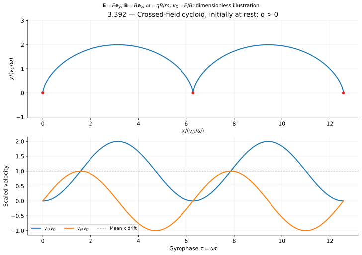

# 3.7 Motion of Charged Particles in Electric and Magnetic Fields

[Chapter index](../README.md#chapters) · [Structured solutions](3.7.json) · [Answer audit](../audit/README.md)

## 3.372

**Solved · high confidence.** Integrate the time-ramped electric acceleration and impose the plate separation.

**Assumptions**

- The electron starts from rest at x=0 and the accelerating force points towards the opposite plate at x=l. Neglect fringing, radiation and the negligible relativistic correction at the resulting speed.
- The voltage is prescribed by the source; its time dependence means energy gain is not simply e times the final voltage.

The uniform gap field grows linearly, so acceleration is proportional to time.

$$
E(t)=at/l,\quad \ddot x=\frac{ea}{m_el}t,\quad v(t)=\frac{ea}{2m_el}t^2,\quad x(t)=\frac{ea}{6m_el}t^3.
$$

Set x(tf)=l, then substitute the flight time into the speed.

$$
t_f=\left(\frac{6m_el^2}{ea}\right)^{1/3}=9.483799738\,\mu\mathrm s,\quad v_f=\left(\frac{9eal}{2m_e}\right)^{1/3}=1.581644532\times10^4\ \mathrm{m/s}.
$$

**Results**

Speed at the opposite plate

$$
v_f=(9eal/2m_e)^{1/3}\simeq1.58\times10^4\ \mathrm{m/s}
$$

Flight time

$$
t_f=(6m_el^2/ea)^{1/3}
$$

## 3.373

**Solved · high confidence.** Integrate the transverse force during the constant longitudinal flight time.

**Assumptions**

- Choose the initial proton velocity along +x and the capacitor field along +y. V>0 is the accelerating voltage magnitude, so the incident kinetic energy is eV.
- The proton is nonrelativistic throughout and traverses the full length l without hitting a plate. The field is spatially uniform inside the capacitor and E=a*t begins at entry.

The longitudinal speed is constant because there is no longitudinal force.

$$
v_x=v_0=\sqrt{\frac{2eV}{m_p}},\qquad t_f=l/v_0.
$$

Integrate the transverse acceleration from rest in y.

$$
v_y(t_f)=\int_0^{t_f}\frac{ea}{m_p}t\,dt=\frac{eal^2}{2m_pv_0^2}.
$$

Velocity components determine the exit direction.

$$
\tan\theta=\frac{v_y}{v_0}=\frac{eal^2}{2m_pv_0^3}=\frac{al^2}{4Vv_0},\quad \theta=\arctan\left[\frac{al^2}{4V}\sqrt{\frac{m_p}{2eV}}\right].
$$

**Results**

Signed exit angle towards the field

$$
\theta=\arctan\left[\frac{al^2}{4V}\sqrt{\frac{m_p}{2eV}}\right]
$$

**Limitations**

- The plate separation was not supplied; the result assumes the transverse displacement stays within the gap.

## 3.374

**Solved · high confidence.** Solve the signed one-dimensional force equation and distinguish stable from unstable charge signs.

**Assumptions**

- Take E(x)=E0-a*x along a signed +x axis, with a>0 and E0>0. The particle starts at x=0 with zero velocity. m>0 and q may have either sign.
- The requested later standstill means a new turning point after release, rather than the initial rest event.

For q>0 the equation is a harmonic oscillator about x_eq=E0/a.

$$
\Omega=\sqrt{qa/m},\quad x(t)=\frac{E_0}{a}(1-\cos\Omega t),\quad \dot x(t)=\frac{E_0\Omega}{a}\sin\Omega t.
$$

The first subsequent rest event is at half a period; evaluate the field there.

$$
t_*=\pi/\Omega,\quad x_*=\frac{2E_0}{a},\quad s_*=\frac{2E_0}{a},\quad \ddot x_*=\frac qm(E_0-ax_*)=-\frac{qE_0}{m}.
$$

For q<0 the equilibrium is unstable and the trajectory is hyperbolic.

$$
\kappa=\sqrt{|q|a/m},\quad x(t)=\frac{E_0}{a}(1-\cosh\kappa t),\quad \dot x(t)=-\frac{E_0\kappa}{a}\sinh\kappa t<0\quad(t>0).
$$

**Results**

Distance to the next standstill for q>0

$$
s_*=2E_0/a
$$

Signed acceleration there for q>0

$$
\ddot x_*=-qE_0/m
$$

For q<0

$$
\text{No subsequent standstill exists; motion runs towards negative }x
$$

**Limitations**

- If E0 is allowed to be negative, the signed turning coordinate changes sign and the positive-charge travelled distance is 2*abs(E0)/a.

## 3.375

**Solved · high confidence.** Use the relativistic momentum gained under a constant electric force.

**Assumptions**

- The electron starts from rest. E=10 kV/cm=1.0e6 V/m is constant and uniform. Neglect radiation.

Kinetic energy equal to rest energy means gamma=2.

$$
T=(\gamma-1)m_ec^2=m_ec^2\Rightarrow\gamma=2,\quad p=m_ec\sqrt{\gamma^2-1}=\sqrt3\,m_ec.
$$

The momentum magnitude grows at the constant rate eE.

$$
p=eEt,\qquad t=\frac{\sqrt3\,m_ec}{eE}=2.952895793\times10^{-9}\ \mathrm s.
$$

**Results**

Time to reach rest-energy kinetic energy

$$
t=\sqrt3\,m_ec/(eE)\simeq2.95\ \mathrm{ns}
$$

## 3.376

**Solved · high confidence.** Use the longitudinal relativistic momentum derivative.

**Assumptions**

- The velocity and electric force lie on the same straight line. T is the instantaneous kinetic energy and E is the applied field vector. Radiation and other forces are neglected.

The momentum derivative for acceleration parallel to velocity contains gamma cubed.

$$
\frac{d\mathbf p}{dt}=m_e\gamma^3\mathbf a=-e\mathbf E,\quad\gamma=1+\frac{T}{m_ec^2}.
$$

Eliminate gamma using the energy.

$$
\mathbf a=-\frac{e\mathbf E}{m_e}\left(1+\frac{T}{m_ec^2}\right)^{-3},\quad |\mathbf a|=\frac{eE}{m_e(1+T/m_ec^2)^3}.
$$

**Results**

Coordinate acceleration vector

$$
\mathbf a=-\frac{e\mathbf E}{m_e}(1+T/m_ec^2)^{-3}
$$

## 3.377

**Solved · high confidence.** Integrate the force into momentum components before converting back to velocity.

**Assumptions**

- The proton enters at t=0 with velocity v0 along +x; the uniform electric field is +E*e_y. The field persists for the time interval considered and radiation is neglected.

The longitudinal momentum is conserved while the transverse momentum grows linearly.

$$
\gamma_0=(1-v_0^2/c^2)^{-1/2},\quad p_x=p_0=\gamma_0m_pv_0,\quad p_y=eEt.
$$

The velocity direction is the momentum direction, giving the angle immediately.

$$
\tan\theta(t)=\frac{eEt}{p_0},\quad\theta(t)=\arctan\frac{eEt}{\gamma_0m_pv_0}.
$$

The growing transverse momentum increases total energy and gamma, so longitudinal speed falls despite constant px.

$$
\gamma(t)=\gamma_0\sqrt{1+\left(\frac{eEt}{\gamma_0m_pc}\right)^2},\quad v_x(t)=\frac{v_0}{\sqrt{1+(eEt/\gamma_0m_pc)^2}}.
$$

**Results**

Deflection angle versus time

$$
\theta(t)=\arctan[eEt/(\gamma_0m_pv_0)]
$$

Initial-direction velocity component

$$
v_x(t)=v_0[1+(eEt/\gamma_0m_pc)^2]^{-1/2}
$$

## 3.378

**Solved · high confidence.** Use magnetic momentum curvature and the actual finite-slab exit geometry.

**Assumptions**

- The proton is accelerated from rest through the positive voltage magnitude V=500 kV. In Figure 3.99 it enters the slab at x=0 with velocity +x; B points into the page.
- The slab occupies 0<x<d and extends transversely far enough to reach the first far-boundary exit. Magnetic forces change direction but not energy.

The kinetic energy fixes momentum; retaining the small relativistic correction costs no additional geometric approximation.

$$
K=eV,\quad p=\sqrt{2m_pK+K^2/c^2},\quad r=\frac{p}{eB}=0.2003431820\ \mathrm m.
$$

Choose the orbit centre at (0,r). At deflection angle alpha its coordinates are x=r*sin(alpha), y=r*(1-cos(alpha)).

$$
d=r\sin\alpha,\quad\alpha=\arcsin\frac{eBd}{\sqrt{2m_peV+(eV/c)^2}}=29.94335154^\circ.
$$

The classical momentum gives essentially the same requested precision, but the slab width is still a sine projection.

$$
r_{\rm nr}=\frac1B\sqrt{\frac{2m_pV}{e}}=0.2003164913\ \mathrm m,\quad\alpha_{\rm nr}=29.94774922^\circ\simeq30^\circ.
$$

**Results**

Deflection angle with relativistic momentum

$$
\alpha=\arcsin(eBd/p)\simeq29.94335^\circ
$$

Classical approximation

$$
\alpha_{\rm nr}=\arcsin[Bd\sqrt{e/(2m_pV)}]\simeq29.94775^\circ
$$

Momentum curvature radius

$$
r=p/(eB)
$$

**Limitations**

- The first transmitted-exit formula requires d<r. If d>r, the particle turns back and exits the entry face instead; the equality case is a grazing ideal boundary.

## 3.379

**Solved · high confidence.** Infer the common momentum from magnetic rigidity and use the appropriate energy relation for each particle.

**Assumptions**

- The circular orbit lies perpendicular to B. Use classical proton motion as explicitly requested and exact relativistic electron kinematics. The radius is 0.100 m and B=0.0100 T.

Both singly charged particles have the same momentum magnitude at fixed B and radius.

$$
p=eBr=1.602\times10^{-22}\ \mathrm{kg\,m/s}.
$$

The nonrelativistic proton has speed p/mp and cyclotron period 2*pi*mp/(eB).

$$
v_p=9.581339713\times10^4\ \mathrm{m/s},\quad \mathcal T_p=6.557731482\times10^{-6}\ \mathrm s.
$$

For the electron compute gamma from momentum, then its speed and revolution period.

$$
\gamma_e=\sqrt{1+(p/m_ec)^2}=1.159332883,\quad v_e=\frac p{\gamma_em_e}=1.516826755\times10^8\ \mathrm{m/s},\quad\mathcal T_e=\frac{2\pi\gamma_em_e}{eB}=4.142322309\times10^{-9}\ \mathrm s.
$$

**Results**

Nonrelativistic proton speed

$$
v_p=eBr/m_p
$$

Nonrelativistic proton period

$$
\mathcal T_p=2\pi m_p/(eB)
$$

Relativistic electron speed

$$
v_e=\frac{eBr}{m_e\sqrt{1+(eBr/m_ec)^2}}
$$

Relativistic electron period

$$
\mathcal T_e=\frac{2\pi m_e}{eB}\sqrt{1+(eBr/m_ec)^2}
$$

## 3.380

**Solved · high confidence.** Combine transverse magnetic curvature with relativistic energy and coordinate acceleration.

**Assumptions**

- The charge q is nonzero, m0 is the rest mass, and B>0 is the field magnitude. The motion is circular with velocity perpendicular to B; radiation is neglected.
- Acceleration means laboratory coordinate acceleration, not proper acceleration.

The transverse momentum turns without changing magnitude. Magnetic rigidity gives p independently of the speed.

$$
\frac{pv}{r}=|q|vB,\qquad p=|q|Br.
$$

Use the relativistic energy-momentum relation to obtain kinetic energy.

$$
T=\sqrt{m_0^2c^4+q^2B^2r^2c^2}-m_0c^2=m_0c^2\left[\sqrt{1+\left(\frac{|q|Br}{m_0c}\right)^2}-1\right].
$$

The speed is pc^2 divided by total energy, and coordinate acceleration is v^2/r.

$$
v=\frac{|q|Br/m_0}{\sqrt{1+(qBr/m_0c)^2}},\quad a=\frac{v^2}{r}=\frac{q^2B^2r}{m_0^2+q^2B^2r^2/c^2}.
$$

**Results**

Momentum magnitude

$$
p=|q|Br
$$

Kinetic energy

$$
T=\sqrt{m_0^2c^4+q^2B^2r^2c^2}-m_0c^2
$$

Inward coordinate-acceleration magnitude

$$
a=\frac{q^2B^2r}{m_0^2+q^2B^2r^2/c^2}
$$

## 3.381

**Solved · high confidence.** Use the exact proportionality between revolution period and relativistic gamma.

**Assumptions**

- Compare each particle with its own nonrelativistic period in the same uniform magnetic field. The stated one-percent excess is relative to that nonrelativistic period.

The relativistic period and kinetic energy contain the same gamma factor.

$$
\mathcal T=\frac{2\pi\gamma m_0}{|q|B},\quad \mathcal T_0=\frac{2\pi m_0}{|q|B},\quad \frac{\mathcal T-\mathcal T_0}{\mathcal T_0}=\gamma-1=\frac{K}{m_0c^2}.
$$

Set the relative excess to eta=0.0100 and convert joules to electronvolts using the Appendix elementary charge.

$$
K_{\max}=\eta m_0c^2,\quad K_{e,\max}=5.111155833\ \mathrm{keV},\quad K_{p,\max}=9.380738257\ \mathrm{MeV}.
$$

**Results**

Electron one-percent threshold

$$
K_{e,\max}=0.01m_ec^2\simeq5.11\ \mathrm{keV}
$$

Proton one-percent threshold

$$
K_{p,\max}=0.01m_pc^2\simeq9.38\ \mathrm{MeV}
$$

## 3.382

**Solved · high confidence.** Multiply the field-parallel velocity by the relativistic gyroperiod.

**Assumptions**

- The electron is accelerated from rest through 1.0 kV and enters at alpha=30 degrees to B. The field is uniform, with B=0.0290 T; radiation is neglected.
- Pitch is the positive advance along B in one complete gyration, since the given acute angle has positive parallel velocity.

The total momentum follows from the kinetic energy. Its parallel component is conserved in the magnetic field.

$$
K=eV,\quad p=\sqrt{2m_eK+K^2/c^2},\qquad p_\parallel=p\cos\alpha.
$$

The gamma factors in parallel speed and gyroperiod cancel.

$$
h=v_\parallel\mathcal T=\frac{p_\parallel}{\gamma m_e}\frac{2\pi\gamma m_e}{eB}=\frac{2\pi p\cos\alpha}{eB}=0.02002016966\ \mathrm m.
$$

The usual classical approximation differs by less than one part in a thousand here.

$$
h_{\rm nr}=\frac{2\pi\cos\alpha}{B}\sqrt{\frac{2m_eV}{e}}=0.02001038445\ \mathrm m\simeq2.0\ \mathrm{cm}.
$$

**Results**

Helical pitch with relativistic momentum

$$
h=2\pi\sqrt{2m_eeV+(eV/c)^2}\cos\alpha/(eB)
$$

Classical approximation

$$
h_{\rm nr}=(2\pi\cos\alpha/B)\sqrt{2m_eV/e}
$$

## 3.383

**Solved · high confidence.** Subtract successive full-gyration focusing conditions.

**Assumptions**

- The source point A and focus are within the ideal uniform axial solenoid field. The beam is paraxial, so longitudinal velocity is approximately the common total speed.
- V>0 is the accelerating voltage magnitude, giving kinetic energy |q|V. B1 and B2 are successive positive field magnitudes with B2>B1.

A ray starting at A returns to the axis after an integer number of gyroperiods.

$$
v=\sqrt{\frac{2|q|V}{m}},\quad \mathcal T=\frac{2\pi m}{|q|B},\quad l=n v\mathcal T\quad(n=1,2,\ldots).
$$

Thus focusing field magnitudes form an arithmetic progression.

$$
B_n=\frac{2\pi n}{l}\sqrt{\frac{2mV}{|q|}},\qquad B_{n+1}-B_n=\frac{2\pi}{l}\sqrt{\frac{2mV}{|q|}}.
$$

Subtract the two measured successive fields to eliminate the unknown focusing order.

$$
\frac{|q|}{m}=\frac{8\pi^2V}{l^2(B_2-B_1)^2}.
$$

**Results**

Specific-charge magnitude from successive focusing fields

$$
\frac{|q|}{m}=\frac{8\pi^2V}{l^2(B_2-B_1)^2}
$$

Sign information

$$
q/m=\pm\,8\pi^2V/[l^2(B_2-B_1)^2]\quad\text{until a gyration sense or charge sign is supplied}
$$

**Limitations**

- Finite beam divergence, field fringes or a source outside the uniform field require the appropriate lens/entry geometry rather than the stated uniform-field paraxial condition.

## 3.384

**Solved · high confidence.** Use the transverse chord of the electron helix at its screen transit time.

**Assumptions**

- The magnetic induction is uniform throughout the trajectory to the screen. Choose the solenoid axis as +z, the screen as z=l>0, and v_parallel=v*cos(alpha)>0.
- The electron is explicitly nonrelativistic. The initial transverse velocity has magnitude v*sin(alpha). Neglect fringe fields and collisions.

The electron speed components are constant in magnitude. Its transverse cyclotron frequency and radius are determined by the absolute electron charge.

$$
\Omega=\frac{eB}{m_e},\quad R_L=\frac{v\sin\alpha}{\Omega},\quad t_S=\frac{l}{v\cos\alpha}.
$$

The electron starts on the axis, so its distance from that starting transverse point is a chord of the Larmor circle, not the Larmor radius itself.

$$
r=2R_L\left|\sin\frac{\Omega t_S}{2}\right|=\frac{2m_ev\sin\alpha}{eB}\left|\sin\frac{eBl}{2m_ev\cos\alpha}\right|.
$$

**Results**

Distance of the impact from the solenoid axis

$$
r=\frac{2m_ev\sin\alpha}{eB}\left|\sin\frac{eBl}{2m_ev\cos\alpha}\right|
$$

**Limitations**

- If v*cos(alpha)<=0, the electron does not reach the stated forward screen; the case alpha=pi/2 has no finite transit time.

## 3.385

**Solved · high confidence.** Use conserved axial canonical momentum and constant total mechanical momentum in the wire field.

**Assumptions**

- The long wire is neutral for this idealization and contributes only its steady external magnetic field. Ignore any electric field, radiation and finite-length effects.
- The electron leaves radially outward from r=a, with initial axial and azimuthal velocities zero. Take the wire current along +z; reverse its sign if needed.
- No nonrelativistic speed assumption is necessary for the exact result: use the relativistic initial momentum p0=gamma0*m_e*v0. The familiar exponential containing m_e*v0 is its nonrelativistic limit.

The external wire field has an axial vector potential whose logarithm vanishes at the emission surface.

$$
B_\phi(r)=\frac{C_I}{r},\quad C_I=\frac{\mu_0I}{2\pi},\quad A_z(r)=-C_I\ln(r/a).
$$

Conservation of pz+q*Az, initially zero, gives the axial mechanical momentum generated as the electron moves outward.

$$
p_z+qA_z=0,\quad q=-e,\qquad p_z=-eC_I\ln(r/a).
$$

The magnetic field does no work, so total momentum magnitude remains p0. At the radial turning point p_r=0 and |pz|=p0.

$$
p_r^2+p_z^2=p_0^2,\qquad\ln\frac{r_{\max}}a=\frac{2\pi p_0}{e\mu_0|I|},\qquad r_{\max}=a\exp\!\left(\frac{2\pi p_0}{e\mu_0|I|}\right).
$$

Substitute the relativistic momentum, or retain its leading low-speed value.

$$
p_0=\frac{m_ev_0}{\sqrt{1-v_0^2/c^2}},\qquad r_{\max}^{\rm nonrel}=a\exp\!\left(\frac{2\pi m_ev_0}{e\mu_0|I|}\right).
$$

**Results**

Exact turning distance from the wire axis in the ideal magnetic field

$$
r_{\max}=a\exp[2\pi\gamma_0m_ev_0/(e\mu_0|I|)]
$$

Nonrelativistic turning radius

$$
r_{\max}\simeq a\exp[2\pi m_ev_0/(e\mu_0|I|)]
$$

The requested distance is from the axis. The distance travelled away from the initial surface is r_max-a.

**Limitations**

- For a very large predicted radius, a finite wire, return-current geometry, collisions or radiation can invalidate the infinite-wire idealization.

## 3.386

**Solved · high confidence.** Eliminate the orbit speed between the cylindrical electric-force balance and magnetic curvature.

**Assumptions**

- Use nonrelativistic motion. Let V be the magnitude of the electrode potential difference, B the magnetic-field magnitude, and r the magnetic semicircle radius.
- The particle moves tangentially to a circular equipotential inside the cylindrical capacitor, so its speed does not change there. Neglect fringe fields and any subsequent acceleration before the magnetic arc.
- The source figure does not label the electrode voltage polarity or the out-of-page sign of B. Magnitudes determine |q|/m; its sign requires one of those polarities.

At any orbit radius rho in the capacitor, the electric field magnitude is V/[rho*ln(b/a)]. The orbit radius cancels from radial force balance.

$$
\frac{mv^2}{\rho}=\frac{|q|V}{\rho\ln(b/a)},\qquad v^2=\frac{|q|}{m}\frac{V}{\ln(b/a)}.
$$

The magnetic semicircle provides a second relation.

$$
r=\frac{mv}{|q|B},\quad v=\frac{|q|}{m}Br.
$$

Eliminate either unknown to obtain speed and specific-charge magnitude.

$$
v=\frac{V}{Br\ln(b/a)},\qquad\frac{|q|}{m}=\frac{V}{B^2r^2\ln(b/a)}.
$$

**Results**

Particle speed after the cylindrical electric bend

$$
v=V/[Br\ln(b/a)]
$$

Specific-charge magnitude

$$
|q|/m=V/[B^2r^2\ln(b/a)]
$$

The signed q/m is not determined by unsigned V and B alone. For +z out of the picture, the drawn lower semicircle requires (q/m)*B_z<0.

## 3.387

**Solved · high confidence.** Resolve cyclotron motion perpendicular to the parallel fields and uniform electric acceleration along them.

**Assumptions**

- Use Figure 3.101 axes with E=E*e_y and B=B*e_y, E,B>0. Define signed kappa=q/m and omega=kappa*B.
- Initially position is zero and velocity is v0*e_x. Count n=1 as the first return to the y axis after departure. The particle is nonrelativistic throughout the interval considered.

Integrate the Lorentz equations in the xz plane and the independent electric acceleration along y.

$$
x=\frac{v_0}{\omega}\sin\omega t,\quad z=\frac{v_0}{\omega}(1-\cos\omega t),\quad y=\frac{\kappa E}{2}t^2.
$$

A y-axis crossing requires both x and z to vanish, so it occurs after full gyroperiods, not half-periods.

$$
t_n=\frac{2\pi n}{|\omega|},\qquad y_n=\frac{\kappa E}{2}t_n^2=\frac{2\pi^2n^2E}{\kappa B^2}.
$$

At such a crossing the perpendicular velocity is again v0 along x, while the parallel velocity has grown to kappa*E*tn.

$$
\mathbf v(t_n)=v_0\mathbf e_x+\kappa Et_n\mathbf e_y,\quad\cos\alpha_n=\frac{\kappa Et_n}{\sqrt{v_0^2+(\kappa Et_n)^2}}.
$$

For positive ions the acute angle obeys the simple tangent relation. For signed charges, atan2 gives the angle with the positive y direction.

$$
\alpha_n=\operatorname{atan2}(v_0,\kappa Et_n),\qquad\tan\alpha_n=\frac{v_0B}{2\pi nE}\quad(\kappa>0).
$$

**Results**

Signed y coordinate of the nth y-axis return

$$
y_n=2\pi^2n^2E/(\kappa B^2),\quad n=1,2,\ldots
$$

Angle to the positive y axis

$$
\alpha_n=\operatorname{atan2}(v_0,\kappa Et_n),\quad t_n=2\pi n/(|\kappa|B)
$$

If the axis is treated as an unoriented line, use its acute angle with tan(alpha)=v0*B/(2*pi*n*E). For negative q, the directed angle to +y is obtuse.

## 3.388

**Solved · high confidence.** Eliminate flight time and beam speed from the parallel-field trajectory, selecting the first physical screen intersection.

**Assumptions**

- Use Figure 3.101 coordinates: E and B along +y, injection at O along +x, and screen at x=l>0. The signed specific charge is kappa=q/m and omega=kappa*B.
- The screen is initially treated as absorbing, so only the first encounter of each ion is recorded. The field fills the trajectory up to the screen, and the nonrelativistic approximation must remain valid.
- A later-crossing formula is given separately for a mathematical transparent plane; those intersections are not additional marks from an ion already absorbed.

For a particle of initial speed v0, use the exact xz cyclotron coordinates and electric y acceleration.

$$
x=\frac{v_0}{\omega}\sin\theta,\quad z=\frac{v_0}{\omega}(1-\cos\theta),\quad y=\frac{E}{2\kappa B^2}\theta^2,\quad\theta=\omega t.
$$

At the screen, the ratio z/l eliminates v0 and fixes the first-intersection phase.

$$
\frac zl=\tan\frac\theta2,\quad\theta=2\arctan(z/l),\quad y=\frac{2E}{\kappa B^2}\arctan^2(z/l).
$$

Reachability and selection of the first encounter restrict the trace. At lower speed the ion turns back in x before reaching the screen.

$$
v_0\ge|\omega|l,\quad0<|z|\le l,\quad\kappa z>0,\quad v_0=\frac{|\omega|(l^2+z^2)}{2|z|}.
$$

For small transverse deflection, expand the arctangent and obtain the Thomson-parabola form.

$$
|z|\ll l:\quad y\simeq\frac{2E}{\kappa B^2l^2}z^2\left[1-\frac{2z^2}{3l^2}+\cdots\right].
$$

If the plane is transparent, later positive-time crossings lie on additional branches. The allowed integer n and sign must give positive time and positive incident v0.

$$
\theta_n=2\arctan(z/l)+2\pi n,\quad y_n=\frac{E\theta_n^2}{2\kappa B^2},\quad t_n=\theta_n/\omega>0,\quad v_0=\omega l/\sin\theta_n>0.
$$

**Results**

Exact first-hit screen trace

$$
y=\frac{2E}{\kappa B^2}\arctan^2(z/l),\quad0<|z|\le l,\ \kappa z>0
$$

Minimum initial speed to reach the screen

$$
v_0\ge|\kappa|Bl
$$

Small-deflection parabola

$$
y\simeq2Ez^2/(\kappa B^2l^2),\quad|z|\ll l
$$

Conditional transparent-plane branches

$$
y_n=E[2\arctan(z/l)+2\pi n]^2/(2\kappa B^2)
$$

Use only integers satisfying t>0 and v0>0. The n=0 branch with |z|>l is a later return crossing during the first gyroperiod, excluded by an absorbing screen.

**Limitations**

- Only speeds and flight times for which both perpendicular and electric-accelerated parallel velocities remain nonrelativistic are included.

## 3.389

**Solved · high confidence.** Infer proton speed from crossed-field force cancellation and multiply momentum by the incident particle rate.

**Assumptions**

- The selected proton beam is perpendicular to both fields and has no parallel-to-B velocity. The grounded target fully absorbs and stops the beam.
- Ignore reflected particles, secondary emission, radiation and target charging. The nonrelativistic approximation is explicitly part of the statement.

The transverse electric and magnetic forces cancel in the selector.

$$
eE=evB,\qquad v=E/B=2.40\times10^6\ \mathrm{m/s}.
$$

The proton arrival rate is I/e and each delivers longitudinal momentum m_p*v.

$$
F=\frac Ie m_pv=\frac{m_pIE}{eB}=2.003895131\times10^{-5}\ \mathrm N.
$$

**Results**

Absorption force on the target

$$
F=m_pIE/(eB)\simeq20.0390\ \mu\mathrm N
$$

The force points along the incident beam momentum.

## 3.390

**Solved · high confidence.** Separate the crossed-field drift component from motion parallel to B, then retain both velocities when E is removed.

**Assumptions**

- Use Figure 3.102: E along +y, B along +z, and the undeflected proton velocity in the xz plane with angle phi=30 degrees from +x toward +z.
- Switching E off leaves the instantaneous velocity continuous; B remains uniform. Treat the switch as not imparting any additional impulse.

Force cancellation fixes only the velocity perpendicular to B, not the full speed.

$$
v_x=E/B,\qquad v_z=v_x\tan\varphi=(E/B)\tan\varphi.
$$

After E vanishes, v_x becomes the transverse circular velocity, while v_z remains the axial helical velocity.

$$
T=\frac{2\pi m_p}{eB},\qquad h=v_zT=\frac{2\pi m_pE\tan\varphi}{eB^2}.
$$

Insert E=4000 V/m and B=.050 T.

$$
h=0.06057772858\ \mathrm m\simeq6.05777\ \mathrm{cm}.
$$

**Results**

Forward axial distance per helical turn after E is removed

$$
h=2\pi m_pE\tan\varphi/(eB^2)\simeq0.0605777\ \mathrm m
$$

## 3.391

**Solved · high confidence.** Use velocity selection before switching and sum the electric deflections inside and after the field region.

**Assumptions**

- Initially the fields cancel for the beam velocity v=E/B, perpendicular to both fields. After B is removed, only the transverse electric field acts within the marked field length a.
- Treat a as the longitudinal extent of the uniform-field region with a fixed exit plane, and b as the distance from that plane to the screen. If the drawn rounded patch is a literal curved boundary, this is the paraxial fixed-exit approximation.
- Let the signed screen displacement Delta x be positive along E. An unsigned measured displacement determines only the magnitude of specific charge.

The longitudinal velocity is unchanged by a transverse nonrelativistic electric force, so transit times are a/v and b/v.

$$
t_a=a/v,\quad t_b=b/v,\quad a_\perp=\kappa E,\quad v_{\perp,\rm exit}=\kappa Ea/v.
$$

Add the acceleration-region deflection and the field-free drift deflection.

$$
\Delta x=\frac12\kappa E(a/v)^2+\frac{\kappa Ea}{v}\frac bv=\frac{\kappa Ea(a+2b)}{2v^2}.
$$

Eliminate v=E/B and solve for the signed specific charge.

$$
\kappa=\frac qm=\frac{2E\Delta x}{B^2a(a+2b)}.
$$

**Results**

Specific charge from the signed screen shift

$$
q/m=2E\Delta x/[B^2a(a+2b)]
$$

For Delta x supplied only as a positive shift magnitude, read this as |q|/m; the field/deflection direction supplies the sign.

**Limitations**

- A strongly deflected beam leaving a physically curved field boundary needs its actual exit condition instead of a fixed longitudinal transit length a.

## 3.392

**Solved · high confidence.** Solve the perpendicular Lorentz equations from rest and identify the resulting cycloid.

**Assumptions**

- Use Figure 3.104 axes with E=E*e_y and B=B*e_z, E,B>0. Let kappa=q/m be signed and omega=kappa*B.
- Initial position and velocity are zero. The nonrelativistic fields are ideal and uniform; z remains zero. Define the charge-independent drift speed u=E/B.

The component equations have a constant-drift particular solution. Apply the zero initial velocity.

$$
\dot v_x=\omega v_y,\quad\dot v_y=\kappa E-\omega v_x,\qquad v_x=u(1-\cos\omega t),\quad v_y=u\sin\omega t.
$$

Integrate once more for position.

$$
x=u\left(t-\frac{\sin\omega t}{\omega}\right),\qquad y=\frac u\omega(1-\cos\omega t),\qquad z=0.
$$

The trajectory is a cycloid with consecutive zero-speed cusps one positive gyroperiod apart. Its speed determines the arc length between cusps.

$$
|\mathbf v|=2u|\sin(\omega t/2)|,\quad T=2\pi/|\omega|,\quad s=\int_0^T|\mathbf v|dt=\frac{8u}{|\omega|}=\frac{8mE}{|q|B^2}.
$$

The sine term averages to zero over a period, leaving the usual crossed-field drift.

$$
\overline{v_x}=u=E/B,\qquad\mathbf v_D=\frac{\mathbf E\times\mathbf B}{B^2}=\frac EB\mathbf e_x.
$$

**Results**

Parametric cycloid from the rest position

$$
x=(E/B)[t-\sin(\omega t)/\omega],\quad y=E[1-\cos(\omega t)]/(B\omega)
$$

Arc length between nearest zero-speed points

$$
s=8E/(B|\omega|)=8mE/(|q|B^2)
$$

Mean x velocity and drift direction

$$
\overline{v_x}=E/B,\qquad\mathbf v_D=(E/B)\mathbf e_x
$$

## 3.393

**Solved · high confidence.** Conserve axial canonical momentum in the filament field and impose zero radial momentum at the anode threshold.

**Assumptions**

- The cathode radius is b and anode radius is a>b. The anode is positive by V relative to the cathode. Electrons start at r=b with zero velocity.
- The heating filament produces B_phi=C_I/r with C_I=mu0*I/(2*pi). Ignore its electric field, space charge, collisions and finite-cylinder end effects.
- Give both the conventional nonrelativistic voltage and a relativistic threshold, since no upper accelerating voltage is specified.

Use a vector potential vanishing at the cathode. Its axial translational symmetry fixes the electron axial momentum.

$$
A_z=-C_I\ln(r/b),\quad p_z+qA_z=0,\quad p_z=-eC_I\ln(r/b).
$$

The cathode-anode electric potential grows logarithmically. In the nonrelativistic model, the available radial kinetic energy stays nonnegative up to the anode precisely when the endpoint condition holds.

$$
\varphi(r)=V\frac{\ln(r/b)}{\ln(a/b)},\quad\frac{p_r^2}{2m_e}=e\varphi(r)-\frac{e^2C_I^2}{2m_e}\ln^2(r/b).
$$

At the least voltage the radial momentum vanishes just at r=a.

$$
V_{\min}^{\rm nonrel}=\frac{eC_I^2}{2m_e}\ln^2(a/b)=\frac{e\mu_0^2I^2}{8\pi^2m_e}\ln^2\frac ab.
$$

With relativistic kinetic energy, the required anode axial momentum is the same canonical value, but its energy-momentum relation changes.

$$
P_a=e|C_I|\ln(a/b),\qquad V_{\min}^{\rm rel}=\frac{\sqrt{m_e^2c^4+P_a^2c^2}-m_ec^2}{e}.
$$

**Results**

Conventional minimum accelerating voltage

$$
V_{\min}=e\mu_0^2I^2\ln^2(a/b)/(8\pi^2m_e)
$$

Threshold without the low-energy approximation

$$
V_{\min}^{\rm rel}=[\sqrt{m_e^2c^4+e^2(\mu_0I/2\pi)^2c^2\ln^2(a/b)}-m_ec^2]/e
$$

Electrons reach the anode for V>=V_min in the ideal coaxial model. Equality is the grazing radial-turning threshold.

## 3.394

**Solved · high confidence.** Use conserved canonical angular momentum in the uniform axial field and the anode energy condition.

**Assumptions**

- The emitting filament radius is a and the anode radius b>a. The anode accelerates initially stationary electrons through voltage V>0.
- Choose B along +z and electron charge -e. Ignore space charge, collisions, radiation and end fields.
- The requested induction is the critical upper magnitude for reaching the anode; smaller fields also allow impact in this ideal model. State the nonrelativistic threshold and its relativistic extension.

An axisymmetric vector potential A_phi=B*r/2 makes canonical angular momentum invariant from the emission point.

$$
m_er^2\dot\phi-\frac{eBr^2}{2}=-\frac{eBa^2}{2},\quad p_\phi(r)=\frac{eB(r^2-a^2)}{2r}.
$$

At the critical field the electron reaches r=b with zero radial momentum; all gained kinetic energy is azimuthal.

$$
\frac{p_\phi(b)^2}{2m_e}=eV,\qquad B_c^{\rm nonrel}=\frac{b}{b^2-a^2}\sqrt{\frac{8m_eV}{e}}.
$$

For arbitrary voltage, replace the nonrelativistic momentum at kinetic energy eV by its exact value.

$$
p_V=\sqrt{2m_eeV+(eV/c)^2},\qquad B_c^{\rm rel}=\frac{2b\,p_V}{e(b^2-a^2)}.
$$

The critical value separates reaching trajectories from magnetic insulation.

$$
|B|\le B_c:\ \text{anode reachable};\qquad |B|>B_c:\ \text{electrons turn before the anode}.
$$

**Results**

Nonrelativistic magnetron cutoff induction

$$
B_c=\frac{b}{b^2-a^2}\sqrt{8m_eV/e}
$$

Critical induction for exact electron momentum

$$
B_c=\frac{2b}{e(b^2-a^2)}\sqrt{2m_eeV+(eV/c)^2}
$$

Field-magnitude range permitting anode contact

$$
|B|\le B_c
$$

## 3.395

**Solved · medium confidence.** Solve the resonantly forced Lorentz equations with arbitrary initial transverse velocity before specializing to release from rest.

**Assumptions**

- Use Figure 3.104 axes: B=B*e_z and E(t)=E_m*cos(omega*t)*e_y, with signed omega=(q/m)*B and B>0. Define u=E_m/B.
- The statement specifies the initial position O but does not explicitly specify initial velocity. Retain vx0 and vy0 in the general result; a separate zero-velocity branch states the conventional release-from-rest interpretation.
- The equations and long-time shape apply only while all speeds remain nonrelativistic. Resonant acceleration eventually leaves that regime.

The velocity equations have resonant frequency omega. Their homogeneous part carries the unspecified initial velocity.

$$
\dot v_x=\omega v_y,\quad\dot v_y=\omega u\cos\omega t-\omega v_x,\quad \ddot v_x+\omega^2v_x=\omega^2u\cos\omega t.
$$

Integrate the exact resonant particular solution and the free cyclotron solution, with x(0)=y(0)=0.

$$
\begin{aligned}x(t)&=\frac{v_{x0}}\omega\sin\omega t+\frac{v_{y0}}\omega(1-\cos\omega t)+\frac u2\left(\frac{\sin\omega t}\omega-t\cos\omega t\right),\\y(t)&=\frac{v_{y0}}\omega\sin\omega t+\frac{v_{x0}}\omega(\cos\omega t-1)+\frac u2t\sin\omega t.\end{aligned}
$$

For release from rest, drop the two homogeneous terms. The corresponding velocity grows linearly in its resonant envelope.

$$
x=\frac{u}{2\omega}(\sin\omega t-\omega t\cos\omega t),\quad y=\frac u2t\sin\omega t,\quad v_x=\frac{u\omega t}{2}\sin\omega t,\quad v_y=\frac u2(\sin\omega t+\omega t\cos\omega t).
$$

After many gyroperiods the bounded sinusoidal displacement is small compared with the t-dependent term. This gives an expanding near-Archimedean spiral, not an exact circle or an exact spiral at the start.

$$
|\omega|t\gg1:\quad(x,y)\simeq\frac{ut}{2}(-\cos\omega t,\sin\omega t),\quad r\simeq\frac{|u|t}{2},\quad r\simeq\frac{|u|}{2|\omega|}|\Delta\phi|.
$$

**Results**

x coordinate with explicit initial-velocity freedom

$$
x=\frac{v_{x0}}\omega\sin\omega t+\frac{v_{y0}}\omega(1-\cos\omega t)+\frac u{2\omega}(\sin\omega t-\omega t\cos\omega t)
$$

y coordinate with explicit initial-velocity freedom

$$
y=\frac{v_{y0}}\omega\sin\omega t+\frac{v_{x0}}\omega(\cos\omega t-1)+\frac u2t\sin\omega t
$$

Conditional release-from-rest solution

$$
x=u(\sin\omega t-\omega t\cos\omega t)/(2\omega),\quad y=ut\sin\omega t/2
$$

Late-time nonrelativistic trajectory shape

$$
r\simeq|u|t/2,\quad\text{approximately an Archimedean spiral for }|\omega|t\gg1
$$

For positive omega the dominant rotation is clockwise in the xy plane; negative charge reverses it. Initial transverse velocity adds a bounded free cyclotron displacement. A free initial vz0 additionally gives z=vz0*t.

**Limitations**

- The spiral is an asymptotic shape, and the resonant speed grows without bound in the nonrelativistic model. Relativistic corrections eventually change the resonance and trajectory.

## 3.396

**Solved · medium confidence.** Relate the energy change between adjacent same-dee semicircles to two accelerating gap crossings.

**Assumptions**

- Use the conventional nonrelativistic synchronous cyclotron: angular frequency omega=2*pi*nu=|q|B/m. The effective voltage V is the energy gained per favorable gap crossing divided by e, not an unspecified RMS voltage.
- Primary convention: neighboring semicircle traces visible within the same dee are one full revolution apart, with two gap crossings between them. Take r as the inner of the two radii for the finite-spacing expression.

Energy is quadratic in orbit radius at fixed synchronous frequency.

$$
K(r)=\tfrac12m_p\omega^2r^2,\qquad \omega=2\pi\nu.
$$

Two voltage impulses separate successive traces in the same dee. The finite-spacing condition gives the threshold voltage.

$$
2eV_{\min}=K(r+\Delta r)-K(r),\quad V_{\min}=\frac{m_p\omega^2}{4e}(2r\Delta r+\Delta r^2).
$$

For small spacing, retain the first-order term. If neighboring means consecutive half-orbit radii on opposite sides instead, only one crossing separates them and the voltage doubles.

$$
V_{\min}\simeq\frac{m_p(2\pi\nu)^2r\Delta r}{2e};\qquad V_{\min,\,half-turn}=2V_{\min,\,same-dee}.
$$

**Results**

Minimum effective voltage, first order in spacing

$$
V\ge m_p(2\pi\nu)^2r\Delta r/(2e)
$$

Finite outward-spacing threshold, inner radius r

$$
V\ge m_p(2\pi\nu)^2(2r\Delta r+\Delta r^2)/(4e)
$$

Consecutive half-turn radius convention, first order

$$
V\ge m_p(2\pi\nu)^2r\Delta r/e
$$

**Limitations**

- Spacing is not labeled by dee or turn in the statement; both conventions are exposed. If r is the midpoint radius, the symmetric finite difference equals the first-order result exactly.
- At these speeds the fixed-frequency classical model is approximate. Exact relativistic resonance requires frequency modulation; the problem does not specify that protocol.

## 3.397

**Solved · medium confidence.** Use magnetic rigidity to find the final energy and the radius constraint to bound the synchronous frequency.

**Assumptions**

- The primary answers use the ordinary nonrelativistic cyclotron model. r is the maximum permitted orbit radius; the minimum required frequency corresponds to reaching that radius at extraction.
- The relativistic endpoint comparisons use p=eBr and W_total^2=m_p^2*c^4+p^2*c^2. They do not assert that one fixed oscillator remains resonant throughout relativistic acceleration.

For part (a), magnetic force supplies centripetal acceleration.

$$
p=eBr,\quad K_{\rm nr}=\frac{e^2B^2r^2}{2m_p}.\qquad K_{\rm rel}=\sqrt{m_p^2c^4+e^2B^2r^2c^2}-m_pc^2.
$$

For part (b), the extraction radius cannot exceed the available radius. The smallest synchronous frequency uses the largest radius.

$$
v=\sqrt{2K/m_p},\quad \nu=\frac{v}{2\pi r_{\rm orbit}},\quad \nu_{\min}=\frac1{2\pi r}\sqrt{\frac{2K}{m_p}}.
$$

For a relativistically modulated device, the corresponding final revolution frequency and initial synchronous frequency differ.

$$
p_f=\frac{\sqrt{K(K+2m_pc^2)}}c,\quad B_{\min}=\frac{p_f}{er},\quad \nu_f=\frac{p_f}{2\pi r(m_p+K/c^2)},\quad \nu_i=\frac{p_f}{2\pi rm_p}.
$$

**Results**

Classical final proton kinetic energy

$$
K=e^2B^2r^2/(2m_p)
$$

Classical minimum oscillator frequency

$$
\nu_{\min}=\sqrt{2K/m_p}/(2\pi r)
$$

Relativistic endpoint energy at the stated B and radius

$$
K=\sqrt{m_p^2c^4+e^2B^2r^2c^2}-m_pc^2
$$

Final frequency if relativistic modulation is allowed

$$
\nu_f=p_f/[2\pi r(m_p+K/c^2)]
$$

Initial frequency for that same minimum field

$$
\nu_i=p_f/(2\pi rm_p)
$$

**Limitations**

- The requested ordinary cyclotron estimates neglect the few-percent relativistic frequency change. A perfectly resonant fixed-frequency accelerator cannot attain the exact relativistic endpoint without phase slip or modulation.

## 3.398

**Solved · high confidence.** Count two energy impulses per revolution and integrate the growing speed over the classical acceleration history.

**Assumptions**

- Interpret the unspecified helium isotope as the usual 4 He+. Appendix 26 gives neutral atomic mass 4.00260 u; remove one electron to obtain the ion mass. Nuclear binding is already included in the atomic mass.
- Use negligible injection kinetic energy, a constant effective energy gain eV at each gap crossing, negligible gap length, and the classical constant revolution period 1/nu. Replace many small energy steps by a continuous envelope.
- Use m(4 He+)≈4.00260 u−m_e. Appendix 25, Ionization Potentials of Atoms, He row (PDF 387, printed page 380), gives 24.58 V. Adding its first-ionization mass equivalent 24.58 e/c^2 changes the mass by only about 6.6 e−9 relative, far below the tabulated atomic-mass precision.

The final speed is fixed by synchronism. There are two crossings per revolution.

$$
v_f=2\pi\nu r,\quad K_f=\tfrac12m_{\rm He^+}(2\pi\nu r)^2,\quad N_{\rm cross}=\frac{K_f}{eV},\quad \frac{dK}{dt}=2eV\nu.
$$

Integrate energy gain to obtain the acceleration time.

$$
t_a=\frac{K_f}{2eV\nu}=\frac{\pi^2m_{\rm He^+}\nu r^2}{eV}.
$$

The energy envelope is linear in time, so speed grows as its square root. The mean speed is two thirds of the final speed.

$$
v(t)=v_f\sqrt{t/t_a},\quad \ell=\int_0^{t_a}v(t)dt=\frac23v_ft_a=\frac{4\pi^3m_{\rm He^+}\nu^2r^3}{3eV}.
$$

A discrete injection/exit convention replaces the integral by a sum of half-circle lengths. If the first crossing is at time zero and extraction is immediately after crossing N, use N−1 arcs.

$$
r_k=\frac1{2\pi\nu}\sqrt{\frac{2keV}{m_{\rm He^+}}},\quad t_N=\frac{N-1}{2\nu},\quad \ell_N=\pi\sum_{k=1}^{N-1}r_k.\quad N\simeq589.37\ \text{in the continuous model}.
$$

**Results**

Classical continuum acceleration time

$$
t_a=\pi^2m_{\rm He^+}\nu r^2/(eV)
$$

Approximate path length

$$
\ell=(2/3)(2\pi\nu r)t_a
$$

Appendix-derived 4 He+ mass neglecting the tiny ionization correction

$$
m_{\rm He^+}\simeq4.00260u-m_e
$$

Continuous equivalent number of gap crossings

$$
N_{\rm cross}=K_f/(eV)
$$

Classical final kinetic energy

$$
K_f=\tfrac12m_{\rm He^+}(2\pi\nu r)^2
$$

**Limitations**

- The ordinary cyclotron model neglects phase slip, gap transit time, isotope alternatives and injection energy. The requested approximate distance is not an exact integer-step flight history.

## 3.399

**Solved · medium confidence.** Use the relativistic revolution period, which is linear in total electron energy, to determine the microtron energy increment.

**Assumptions**

- The electron returns to the same localized accelerating gap once per full magnetic revolution. The period increment between successive orbits equals one RF period, Delta T=1/nu.
- The primary reading of acquire an energy W is acquired kinetic energy from negligible injection kinetic energy. The statement does not explicitly distinguish kinetic from total energy; the alternative is retained.
- Each accelerating encounter has the same synchronous energy increment; injection phasing and capture dynamics are idealized.

Relativistic magnetic rigidity determines the period without a nonrelativistic approximation.

$$
T_{\rm rev}=\frac{2\pi\gamma m_e}{eB}=\frac{2\pi\mathcal E}{eBc^2},\qquad \mathcal E=K+m_ec^2.
$$

The stipulated period increment fixes the energy gain at one crossing.

$$
\Delta\mathcal E=\frac{eBc^2}{2\pi}\Delta T=\frac{eBc^2}{2\pi\nu}=0.5102064\ {\rm MeV}.
$$

Subtract the injection energy before dividing by the gain. Rounded supplied data give integers 9 or 8 for the two meanings of W.

$$
N=\frac{\mathcal E_f-\mathcal E_i}{\Delta\mathcal E};\quad N_{K=W}=\frac{W}{\Delta\mathcal E}\simeq9.016\longrightarrow9,\quad N_{\mathcal E_f=W}=\frac{W-m_ec^2}{\Delta\mathcal E}\simeq8.014\longrightarrow8.
$$

**Results**

Crossings for acquired kinetic energy 4.6 MeV

$$
N\simeq W/\Delta\mathcal E\simeq9
$$

Nine steps give kinetic energy 4.59186 MeV, consistent with 4.6 MeV rounded to two significant figures. If 4.600 MeV were an exact lower bound, ten steps would be necessary.

Crossings if W is final total relativistic energy

$$
N\simeq(W-m_ec^2)/\Delta\mathcal E\simeq8
$$

Energy per synchronous gap crossing

$$
\Delta\mathcal E=eBc^2/(2\pi\nu)
$$

**Limitations**

- Rounded data cannot specify an exact integer energy threshold. Nonzero injection kinetic energy would change the crossing count.

## 3.400

**Solved · high confidence.** Average the fixed energy increment per revolution and integrate the resulting relativistic energy equation.

**Assumptions**

- Let the constant magnetic field magnitude be B, charge magnitude |q|, rest mass m, and positive energy gain per full revolution Delta W. The RF angular frequency follows the fundamental revolution frequency.
- The modulation is slow compared with one revolution, so a discrete energy staircase may be replaced by a continuous energy evolution. Retain the initial total energy E_i=m*c^2+K_i; initial rest is a special case.

The orbital period and energy-gain rate both depend on the instantaneous total energy.

$$
T(\mathcal E)=\frac{2\pi\mathcal E}{|q|Bc^2},\qquad \frac{d\mathcal E}{dt}=\frac{\Delta W}{T}=\frac{|q|Bc^2\Delta W}{2\pi\mathcal E}.
$$

Integration gives a total energy whose square is affine in time.

$$
\mathcal E(t)^2=\mathcal E_i^2+\frac{|q|Bc^2\Delta W}{\pi}t.
$$

Set the oscillator frequency equal to the instantaneous revolution frequency.

$$
\boxed{\omega(t)=\frac{|q|Bc^2}{\sqrt{\mathcal E_i^2+|q|Bc^2\Delta Wt/\pi}}}.\quad \mathcal E_i=mc^2:\quad \omega(t)=\frac{\omega_0}{\sqrt{1+\omega_0\Delta Wt/(\pi mc^2)}},\quad\omega_0=|q|B/m.
$$

**Results**

Fundamental synchronous angular frequency with arbitrary injection energy

$$
\omega(t)=|q|Bc^2[\mathcal E_i^2+|q|Bc^2\Delta Wt/\pi]^{-1/2}
$$

Specialization to initially negligible kinetic energy

$$
\omega(t)=\omega_0[1+\omega_0\Delta Wt/(\pi mc^2)]^{-1/2}
$$

**Limitations**

- A higher RF harmonic multiplies the synchronous angular frequency by that harmonic. Fast phase dynamics, capture and finite gap transit are outside the slow-modulation approximation.

## 3.401

**Solved · high confidence.** Integrate the azimuthal Faraday electric impulse at the nearly fixed particle position.

**Assumptions**

- The particle is initially at rest; the long round solenoid produces a spatially uniform axial interior field. Its final field is B*z_hat, the initial field is zero, and position change during switch-on is negligible.
- The requested velocity is immediately after switching. In the nonrelativistic answer q/m is signed. Choose positive azimuth e_phi according to the right-hand rule about +z.

Faraday induction gives an electric field around each circular contour inside the solenoid.

$$
2\pi r E_\phi=-\pi r^2\dot B,\qquad E_\phi=-\tfrac12r\dot B.
$$

Integrate the impulse with r held fixed. In the short-switch limit the magnetic impulse is negligible compared with the induced electric impulse.

$$
p_\phi=\int qE_\phi dt=-\frac{qrB}{2};\quad v_\phi\simeq-\frac{qBr}{2m}.
$$

After switching, the magnetic field bends the trajectory without changing its energy. Magnetic rigidity gives the curvature radius.

$$
R=\frac{|p_\phi|}{|q|B}=\boxed{r/2}.\qquad v_\phi=\frac{p_\phi c^2}{\sqrt{m^2c^4+p_\phi^2c^2}}\quad\text{if relativistic momentum is retained}.
$$

**Results**

Immediate post-switch nonrelativistic azimuthal velocity

$$
\mathbf v=-\frac{qBr}{2m}\mathbf e_\phi
$$

Post-switch magnetic curvature radius

$$
R=r/2
$$

Optional relativistic velocity for the same fixed-position impulse

$$
v_\phi=-\frac{qBr}{2m}\left[1+\left(\frac{qBr}{2mc}\right)^2\right]^{-1/2}
$$

**Limitations**

- A sufficiently slow ramp lets the particle move and invalidates the fixed-position impulse. Nonzero initial momentum must be added vectorially. The relativistic extension assumes the same negligible-displacement switch limit.

## 3.402

**Solved · high confidence.** Use Faraday work per unit angle, which fixes the path length without treating the electron speed as constant.

**Assumptions**

- Use a fixed circular equilibrium orbit of radius r, axial magnetic flux Phi, constant positive accelerating flux-rate magnitude Phi_dot, and negligible initial kinetic energy. W is acquired kinetic energy.
- The electron follows the accelerating circulation direction. Quantities below are positive work and revolution-count magnitudes.

The azimuthal field and work per arc length are constant even while the speed changes.

$$
|E_\phi|=\frac{\dot\Phi}{2\pi r},\qquad dK=e|E_\phi|ds=\frac{e\dot\Phi}{2\pi}d\theta.
$$

Integrate over all traversed angles. A revolution need not be completed at exactly constant speed.

$$
K_f-K_i=e\dot\Phi N,\qquad N=\frac{W}{e\dot\Phi},\qquad\ell=2\pi rN.
$$

Convert 25 MeV to 25 million electron-volts so e cancels in the count.

$$
N=\frac{25\times10^6}{5.0}=5.0\times10^6,\qquad\ell=2\pi(0.25)N=7.85398\times10^6\ {\rm m}.
$$

**Results**

Total number of revolutions, including any fractional final turn

$$
N=W/(e\dot\Phi)
$$

Total path length

$$
\ell=2\pi rW/(e\dot\Phi)
$$

**Limitations**

- If W denotes final total relativistic energy instead of energy acquired, replace it by W−E_initial. Flux-rate variations would require integrating e*Phi_dot along the actual angle history.

## 3.403

**Solved · high confidence.** Combine relativistic magnetic rigidity with the tangential momentum gained from the induction field.

**Assumptions**

- Use an axisymmetric, predominantly axial magnetic field and a fixed candidate orbit radius r. B_o(t) is the field on the orbit and Phi(r,t) its enclosed flux.
- For the usual betatron condition, flux and momentum start with compatible zero-field injection data, or are otherwise matched initially. The condition must persist throughout acceleration.

Radial magnetic force supplies circular motion, with p=gamma*m_e*v.

$$
\frac{pv}{r}=evB_o,\qquad p=e r B_o.
$$

Faraday induction supplies the tangential momentum change. Choose the accelerating circulation direction and consistent increasing positive flux.

$$
\frac{dp}{dt}=e|E_\phi|=\frac{e\dot\Phi}{2\pi r}.\quad r=\text{constant}\ \Longrightarrow\ \dot\Phi=2\pi r^2\dot B_o.
$$

Integrate with the initial compatibility condition. Express the result through the area-averaged field.

$$
\Phi=2\pi r^2B_o+C,\quad C=0\ \Longrightarrow\ \overline B=\frac{\Phi}{\pi r^2}=2B_o,\qquad \boxed{B_o=\overline B/2}.
$$

Conversely, differentiating a time-persistent betatron condition makes the tangential force reproduce the momentum required for circular motion at the same radius.

$$
\Phi=2\pi r^2B_o\ \Longrightarrow\ \dot p=e r\dot B_o,\quad p(t_i)=erB_o(t_i)\ \Longrightarrow\ p(t)=erB_o(t).
$$

**Results**

Usual betatron condition for a constant-radius equilibrium orbit

$$
B_o(t)=\tfrac12\overline B(t),\qquad\overline B=\Phi/(\pi r^2)
$$

Integrated form allowing a constant flux offset

$$
\Phi(t)-\Phi(t_i)=2\pi r^2[B_o(t)-B_o(t_i)]
$$

**Limitations**

- This establishes the equilibrium orbit, not its radial or vertical stability. Matching at a single instant does not enforce the subsequent fixed-radius evolution.

## 3.404

**Solved · high confidence.** Solve the integral betatron condition for the selected radius and then evaluate the quadratic field profile.

**Assumptions**

- B(s,t) is axisymmetric and axial over the disk enclosed by the orbit. Use the zero-offset betatron condition derived in 3.403.
- A fixed-radius accelerating orbit requires time compatibility as well as a spatial profile. A sufficient condition is B(s,t)=g(t)*f(s); for the stated quadratic profile the ratio B 0(t)/a(t) must remain constant.

Compute the area average inside a trial radius r and impose half of that average on the orbit.

$$
\overline B(r,t)=\frac2{r^2}\int_0^rB(s,t)s\,ds,\qquad \boxed{r^2B(r,t)=\int_0^rB(s,t)s\,ds}.
$$

For the quadratic profile, perform the radial integral.

$$
B=B_0-ar^2:\quad r^2(B_0-ar^2)=\frac{B_0r^2}{2}-\frac{ar^4}{4}.
$$

Discard the zero-area solution and solve for a finite orbit. The local and mean fields are then positive.

$$
\boxed{r_0=\sqrt{\frac{2B_0}{3a}}},\qquad B(r_0)=\frac{B_0}{3},\qquad\overline B(r_0)=\frac{2B_0}{3}.
$$

**Results**

Integral equation selecting a candidate betatron orbit

$$
r_0^2B(r_0,t)=\int_0^{r_0}B(s,t)s\,ds
$$

Nonzero formal equilibrium radius

$$
r_0=\sqrt{2B_0/(3a)}
$$

Magnetic field on that radius

$$
B(r_0)=B_0/3
$$

**Limitations**

- A static B profile alone does not accelerate electrons; the amplitude must vary and generate an induction field. Arbitrarily varying B 0 and a need not sustain the selected radius.
- The integral condition supplies a formal equilibrium, not stability. For this profile the field index n=−r*B_prime/B equals 4 on the selected radius; it is outside the usual 0<n<1 weak-focusing stability range.

## 3.405

**Solved · medium confidence.** Differentiate the radial Faraday field and apply the time-differentiated fixed-radius betatron condition.

**Assumptions**

- Use a smooth axisymmetric axial field, a fixed equilibrium radius r 0, and the betatron condition holding throughout the relevant time interval. The flux and orbit field must therefore obey its time derivative.
- Strength means the magnitude of the azimuthal induction electric field. A stationary magnitude need not be a strict maximum; degenerate or minimum cases depend on the radial field profile.

Write Faraday induction at an arbitrary radius r.

$$
E_\phi(r,t)=-\frac1r\int_0^r\partial_tB(s,t)s\,ds=-\frac{\dot\Phi(r,t)}{2\pi r}.
$$

Differentiate with respect to radius at fixed time.

$$
\partial_rE_\phi=-\partial_tB(r,t)+\frac1{r^2}\int_0^r\partial_tB(s,t)s\,ds.
$$

At a fixed equilibrium radius, differentiating the betatron condition supplies exactly the integral identity needed to cancel the derivative.

$$
\int_0^{r_0}B(s,t)s\,ds=r_0^2B(r_0,t)\ \Longrightarrow\ \int_0^{r_0}\partial_tB(s,t)s\,ds=r_0^2\partial_tB(r_0,t),\quad\boxed{\partial_rE_\phi(r_0,t)=0}.
$$

When E_phi is nonzero, its magnitude has the same stationary radius. For a simple nondegenerate stationary point, the second derivative decides whether it is a maximum or minimum.

$$
\left.\partial_r|E_\phi|\right|_{r_0}=0,\qquad \left.\partial_r^2E_\phi\right|_{r_0}=-\partial_r\partial_tB(r_0,t)-\frac{\partial_tB(r_0,t)}{r_0}.
$$

A normalized smooth counterexample shows why stationarity need not mean a strict extremum. With x=r/R, choose the induction-field magnitude proportional to F(x) and a separable ramp whose B_dot is proportional to F_prime+F/x. At x=1 the betatron condition holds but F remains increasing on both sides.

$$
F(x)=x-\frac23x^3+\frac15x^5,\quad F'(x)=(1-x^2)^2\ge0,\quad \dot B\propto F'+F/x=2-\frac83x^2+\frac65x^4>0.\quad F(1)=\dot B_{\rm normalized}(1)=8/15,\quad F'(1)=F''(1)=0.
$$

**Results**

Radial stationary value of induction-field magnitude on the fixed equilibrium orbit

$$
\left.\partial_r|E_\phi|\right|_{r_0}=0\quad(E_\phi\ne0)
$$

**Limitations**

- Strictly, the general condition proves stationarity. A nondegenerate extremum follows if the second radial derivative is nonzero; the supplied information does not fix its sign. If no flux changes, the induction field is identically zero.
- The example is a stationary inflection of |E_phi|; because the magnetic profile is polynomial in r^2 it is smooth at the axis. Usual simple betatron profiles, including the quadratic example in 3.404, do give an ordinary extremum.

## 3.406

**Solved · high confidence.** Convert the linear ramp of the orbit field to enclosed-flux rate using the betatron condition.

**Assumptions**

- Use a constant-radius equilibrium orbit obeying the betatron condition throughout the linear field ramp. Neglect radiation and noninductive accelerating fields.
- The requested energy is the work gained over one full revolution, rather than the total final kinetic energy.

The orbit field changes at constant rate and the betatron condition determines the flux rate.

$$
\dot B=\frac{B}{\Delta t}=400\ {\rm T/s},\quad\Phi=2\pi r^2B,\quad\dot\Phi=2\pi r^2\dot B.
$$

Integrate the electric work around one orbit; its magnitude is independent of speed.

$$
\Delta K_{\rm rev}=e\dot\Phi=\frac{2\pi er^2B}{\Delta t}=100.53096\ {\rm eV}.
$$

**Results**

Electron energy acquired per full turn

$$
\Delta K_{\rm rev}=2\pi er^2B/\Delta t
$$

The same energy in SI

$$
\Delta K_{\rm rev}=e\dot\Phi
$$

**Limitations**

- At the exact zero-field instant an electron at rest has no completed circular orbit. The work-per-turn formula describes the ideal fixed-radius accelerating limit, or any completed turn within it.

## 3.407

**Solved · high confidence.** Use relativistic magnetic rigidity and integrate the speed for a linearly growing momentum.

**Assumptions**

- Assume the ideal betatron condition holds on a fixed radius r and that B(t)=B*t/Delta t for 0≤t≤Delta t. The electron starts at rest in the limiting zero-field sense; neglect radiation and other losses.
- W is acquired kinetic energy. Define p_f=eBr and u_f=p_f/(m_e*c). The formulas below retain relativity for arbitrary final momentum.

The fixed-radius force condition makes momentum proportional to field, hence linear in time.

$$
p(t)=erB(t)=p_f\frac{t}{\Delta t},\quad p_f=erB,\quad \mathcal E(t)=\sqrt{m_e^2c^4+p(t)^2c^2}.
$$

Subtract the rest energy to obtain the energy acquired.

$$
\boxed{W=\sqrt{m_e^2c^4+e^2B^2r^2c^2}-m_ec^2}=m_ec^2(\sqrt{1+u_f^2}-1).
$$

Integrate the changing relativistic speed, rather than assuming it always equals its final value.

$$
v(t)=\frac{p(t)c^2}{\mathcal E(t)},\quad\ell=\int_0^{\Delta t}v(t)dt=\boxed{\frac{c\Delta t}{u_f}(\sqrt{1+u_f^2}-1)}=\boxed{\frac{W\Delta t}{eBr}}.
$$

The endpoint expressions are continuous at zero final momentum and give the expected limiting distances.

$$
u_f\ll1:\ W\simeq\frac{e^2B^2r^2}{2m_e},\quad\ell\simeq\frac{eBr\Delta t}{2m_e}=\frac12v_f\Delta t.\qquad u_f\gg1:\ \ell\to c\Delta t.
$$

For finite injection momentum compatible with the initial orbit field, the same derivation replaces endpoint kinetic energies and momenta by their differences.

$$
p(t)=p_i+(p_f-p_i)t/\Delta t:\quad\ell=\Delta t\frac{K_f-K_i}{p_f-p_i}.
$$

**Results**

Relativistic kinetic energy acquired

$$
W=\sqrt{m_e^2c^4+e^2B^2r^2c^2}-m_ec^2
$$

Path length during the linear ramp

$$
\ell=\frac{\Delta t}{eBr}\left(\sqrt{m_e^2c^4+e^2B^2r^2c^2}-m_ec^2\right)
$$

Nonrelativistic energy and path-length limits

$$
W\simeq e^2B^2r^2/(2m_e),\qquad\ell\simeq eBr\Delta t/(2m_e)
$$

**Limitations**

- An electron at exact rest and zero field has no defined instantaneous orbit curvature. Starting at a chosen point of the limiting circle and evolving into the fixed-radius solution is a mathematical injection idealization; real devices inject finite momentum and require focusing.
- A constant field-ramp rate alone does not ensure a fixed radius; the spatial flux profile must satisfy the betatron condition through time.
