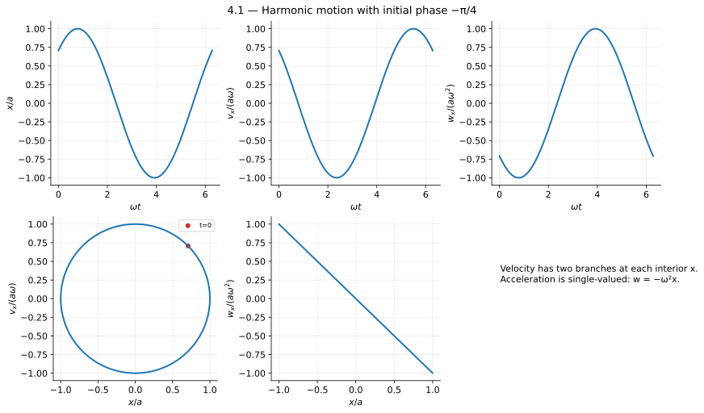
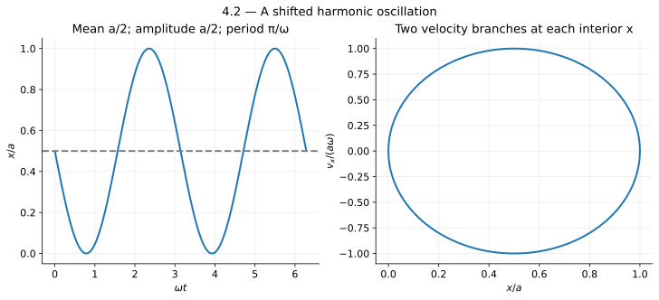
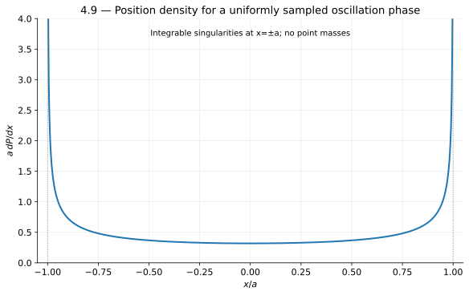
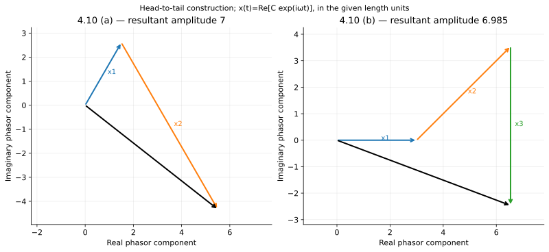
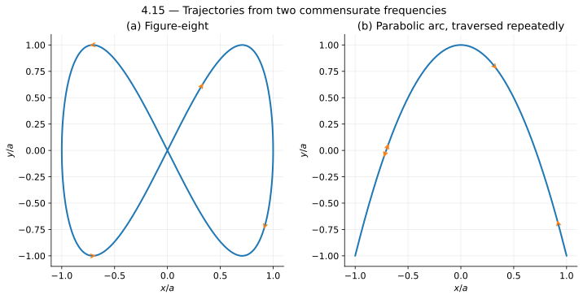
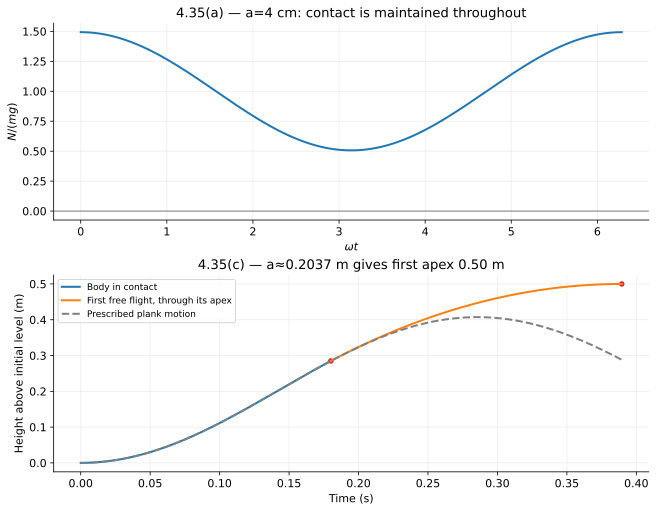
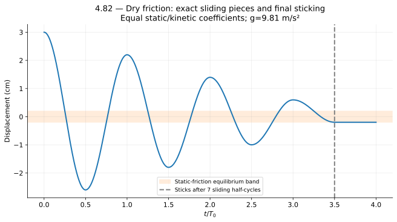
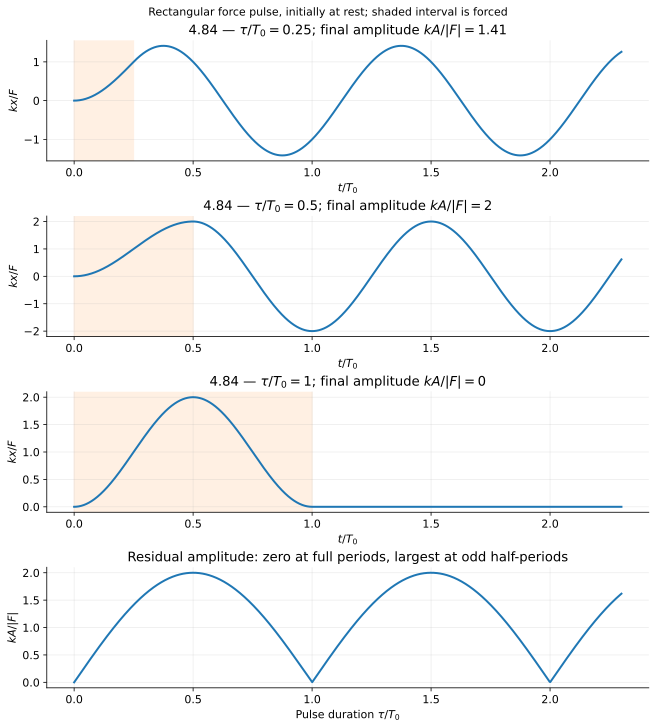
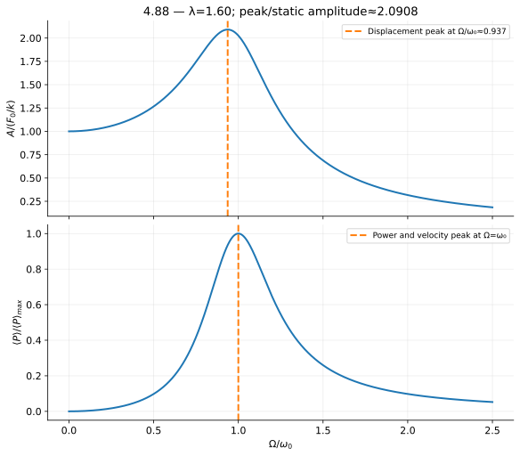

# 4.1 Mechanical Oscillations

[Chapter index](../README.md#chapters) · [Structured solutions](4.1.json) · [Answer audit](../audit/README.md)

## 4.1

**Problem statement**

A point oscillates along the x axis according to the law $x = a\cos(\omega t-\pi/4)$. Draw the approximate plots (a) of displacement x, velocity projection $v_x$ , and acceleration projection $w_x$ as functions of time t; (b) velocity projection $v_x$ and acceleration projection $w_x$ as functions of the coordinate x.

**Solved · high confidence.** Differentiate the motion and eliminate time.

**Assumptions**

- Take a>0 and omega>0; x is measured from equilibrium.

The velocity and acceleration are phase-shifted sinusoids.

$$
u=\omega t-\pi/4,\quad x=a\cos u,\quad v_x=-a\omega\sin u,\quad w_x=-a\omega^2\cos u.
$$

Eliminate u to obtain a two-branched velocity curve and a straight acceleration line.

$$
\frac{x^2}{a^2}+\frac{v_x^2}{a^2\omega^2}=1,\quad v_x=\pm\omega\sqrt{a^2-x^2},\quad w_x=-\omega^2x.
$$

**Results**

Time traces

$$
x=a\cos(\omega t-\pi/4),\ v_x=-a\omega\sin(\omega t-\pi/4),\ w_x=-\omega^2x
$$

Coordinate plots

$$
v_x=\pm\omega\sqrt{a^2-x^2},\quad w_x=-\omega^2x,\quad |x|\le a
$$

## 4.2

**Problem statement**

A point moves along the x axis according to the law $x = a\sin^2(\omega t-\pi/4)$. Find: (a) the amplitude and period of oscillations; draw the plot x (t); (b) the velocity projection $v_x$ as a function of the coordinate x; draw the plot $v_x$ (x).

**Solved · high confidence.** Rewrite the squared sine as a shifted simple harmonic oscillation.

**Assumptions**

- Take a>0 and omega>0. Amplitude is measured about the actual mean position a/2, not the coordinate origin.

The coordinate is a sinusoid at twice the written angular frequency.

$$
x=\frac a2[1-\cos(2\omega t-\pi/2)]=\frac a2[1-\sin(2\omega t)],\quad A=\frac a2,\quad T=\frac{\pi}{\omega}.
$$

Differentiate and eliminate the phase.

$$
v_x=a\omega\sin(2\omega t-\pi/2),\quad v_x^2=4\omega^2x(a-x).
$$

**Results**

Oscillation amplitude

$$
A=a/2
$$

Period

$$
T=\pi/\omega
$$

Velocity-coordinate curve

$$
v_x=\pm2\omega\sqrt{x(a-x)},\quad0\le x\le a
$$

## 4.3

**Problem statement**

A particle performs harmonic oscillations along the x axis about the equilibrium position x = 0. The oscillation frequency is $\omega = 4.00$ s⁻¹. At a certain moment of time the particle has a coordinate $x_0$ = 25.0 cm and its velocity is equal to $v_{x0}$ = 100 cm/s. Find the coordinate x and the velocity $v_x$ of the particle t = 2.40 s after that moment.

**Solved · high confidence.** Propagate the harmonic oscillator from the supplied initial coordinate and velocity.

**Assumptions**

- The given omega=4.00 s^-1 is angular frequency. Convert the coordinate and velocity to SI.

The initial-value solution follows directly from the two independent sinusoidal solutions.

$$
x(t)=x_0\cos\omega t+\frac{v_{x0}}{\omega}\sin\omega t,\quad v_x(t)=-\omega x_0\sin\omega t+v_{x0}\cos\omega t.
$$

Use x0=0.250 m, vx0=1.00 m/s and omega*t=9.60 radians.

$$
x(2.40\,\mathrm s)=-0.2897536593\ \mathrm m,\quad v_x(2.40\,\mathrm s)=-0.8103610746\ \mathrm{m/s}.
$$

**Results**

Coordinate after 2.40 s

$$
x=-0.2897536593\ \mathrm m
$$

Velocity after 2.40 s

$$
v_x=-0.8103610746\ \mathrm{m/s}
$$

## 4.4

**Problem statement**

Find the angular frequency and the amplitude of harmonic oscillations of a particle if at distances $x_1$ and $x_2$ from the equilibrium position its velocity equals $v_1$ and $v_2$ respectively.

**Solved · high confidence.** Use the harmonic-oscillator energy identity at two positions.

**Assumptions**

- The supplied x1 and x2 are distances from equilibrium and v1,v2 may be speed magnitudes; only their squares enter. The data must describe one nontrivial oscillator.

Subtract the two velocity-position identities to eliminate amplitude.

$$
v_1^2=\omega^2(A^2-x_1^2),\quad v_2^2=\omega^2(A^2-x_2^2),\quad \omega^2=\frac{v_1^2-v_2^2}{x_2^2-x_1^2}.
$$

Substitute back to determine amplitude.

$$
A^2=x_1^2+\frac{v_1^2}{\omega^2}=\frac{v_1^2x_2^2-v_2^2x_1^2}{v_1^2-v_2^2}.
$$

**Results**

Positive angular frequency

$$
\omega=\sqrt{(v_1^2-v_2^2)/(x_2^2-x_1^2)}
$$

Amplitude

$$
A=\sqrt{(v_1^2x_2^2-v_2^2x_1^2)/(v_1^2-v_2^2)}
$$

**Limitations**

- If x1^2=x2^2 and v1^2=v2^2, the two observations are redundant and cannot determine a unique oscillator. Nonmatching speeds at equal distances, or omega^2<=0 for distinct distances, are inconsistent with the stated nontrivial harmonic motion.

## 4.5

**Problem statement**

A point performs harmonic oscillations along a straight line with a period T = 0.60 s and an amplitude a = 10.0 cm. Find the mean velocity of the point averaged over the time interval during which it travels a distance a/2, starting from (a) the extreme position; (b) the equilibrium position.

**Solved · high confidence.** Find the first travel time for the stated distance, then divide displacement by time.

**Assumptions**

- For signed answers choose the starting extreme x=+a in part a and the initial direction +x from equilibrium in part b. Both paths are monotone over the specified first distance a/2.

From the positive extreme, x=a*cos(omega*t) reaches a/2 at phase pi/3.

$$
\Delta t_a=T/6=0.100\ \mathrm s,\quad\langle v_x\rangle_a=\frac{-a/2}{T/6}=-\frac{3a}{T}=-0.500\ \mathrm{m/s}.
$$

From equilibrium moving right, x=a*sin(omega*t) reaches a/2 at phase pi/6.

$$
\Delta t_b=T/12=0.0500\ \mathrm s,\quad\langle v_x\rangle_b=\frac{a/2}{T/12}=\frac{6a}{T}=1.00\ \mathrm{m/s}.
$$

**Results**

Signed mean velocity from x=+a

$$
\langle v_x\rangle=-3a/T=-0.500\ \mathrm{m/s}
$$

Signed mean velocity from equilibrium towards +x

$$
\langle v_x\rangle=6a/T=1.00\ \mathrm{m/s}
$$

## 4.6

**Problem statement**

At the moment t = 0 a point starts oscillating along the x axis according to the law $x = a\sin\omega t$. Find: (a) the mean value of its velocity vector projection $\langle v_x\rangle$; (b) the modulus of the mean velocity vector $|\langle\mathbf{v}\rangle|$ ; (c) the mean value of the velocity modulus $\langle v\rangle$ averaged over 3/8 of the period after the start.

**Solved · high confidence.** Keep displacement-based and path-length-based averages separate.

**Assumptions**

- Take a>0 and omega>0. The elapsed interval is 3*T/8=3*pi/(4*omega).

The net displacement is a/sqrt(2), giving the mean projection and the modulus of mean velocity.

$$
\Delta x=a\sin(3\pi/4)=a/\sqrt2,\quad\langle v_x\rangle=\frac{2\sqrt2}{3\pi}a\omega,\quad|\langle\mathbf v\rangle|=\frac{2\sqrt2}{3\pi}a\omega.
$$

The particle first reaches +a and then returns to a/sqrt(2), so the travelled distance exceeds the displacement.

$$
s=a+(a-a/\sqrt2),\quad\langle v\rangle=\frac{s}{3\pi/(4\omega)}=\frac{8-2\sqrt2}{3\pi}a\omega.
$$

**Results**

Mean signed velocity projection

$$
\langle v_x\rangle=2\sqrt2\,a\omega/(3\pi)
$$

Modulus of mean velocity vector

$$
|\langle\mathbf v\rangle|=2\sqrt2\,a\omega/(3\pi)
$$

Mean speed

$$
\langle v\rangle=(8-2\sqrt2)a\omega/(3\pi)
$$

## 4.7

**Problem statement**

A particle moves along the x axis according to the law $x = a\cos\omega t$. Find the distance that the particle covers during the time interval from t = 0 to t.

**Solved · high confidence.** Count complete half-periods and add the residual monotone arc.

**Assumptions**

- Take t>=0, a>0 and omega>0. The motion begins at its positive extreme.

Each completed half-period contributes distance 2a.

$$
u=\omega t,\quad n=\left\lfloor\frac u\pi\right\rfloor,\quad\delta=u-n\pi,\quad0\le\delta<\pi.
$$

Within the remaining half-period the additional distance is a*(1-cos(delta)), regardless of parity.

$$
s(t)=2an+a(1-\cos\delta).
$$

**Results**

Distance for arbitrary elapsed time

$$
s(t)=2a\lfloor\omega t/\pi\rfloor+a\{1-\cos[\omega t-\pi\lfloor\omega t/\pi\rfloor]\}
$$

## 4.8

**Problem statement**

At the moment t = 0 a particle starts moving along the x axis so that its velocity projection varies as $v_x = 35\cos\pi t$ cm/s, where t is expressed in seconds. Find the distance that this particle covers during t = 2.80 s after the start.

**Solved · high confidence.** Split the speed integral at all velocity reversals.

**Assumptions**

- The velocity is 0.350*cos(pi*t) m/s. Distance is the integral of its absolute value.

Velocity reverses at t=0.5,1.5 and 2.5 s within the interval.

$$
s=\int_0^{2.80}0.350|\cos\pi t|\,dt.
$$

The first three pieces contribute five units of 0.350/pi; the last contributes 1-sin(2.8*pi).

$$
s=\frac{0.350}{\pi}[6-\sin(2.80\pi)]=0.6029665111\ \mathrm m.
$$

**Results**

Travelled distance in 2.80 s

$$
s=0.6029665111\ \mathrm m
$$

## 4.9

**Problem statement**

A particle performs harmonic oscillations along the x axis according to the law $x = a\cos\omega t$. Assuming the probability P of the particle to fall within an interval from —a to +a to be equal to unity, find how the probability density dP/dx depends on x. Here dP denotes the probability of the particle falling within an interval from $x$ to $x + dx$. Plot dP/dx as a function of x.

**Solved · medium confidence.** Transform a uniformly sampled phase into the position density.

**Assumptions**

- Assume uniform observation time over a period, equivalently a uniform random phase. Normalization alone would not specify the sampling distribution.

An interior coordinate is visited twice per period, with local speed omega*sqrt(a^2-x^2).

$$
p(x)\,dx=\frac{2\,dx}{T\omega\sqrt{a^2-x^2}}.
$$

Use T=2*pi/omega and set density to zero outside the allowed interval.

$$
p(x)=\frac1{\pi\sqrt{a^2-x^2}}\quad(|x|<a),\quad p=0\quad(|x|>a),\quad\int_{-a}^ap(x)\,dx=1.
$$

**Results**

Uniform-phase position density

$$
p(x)=1/[\pi\sqrt{a^2-x^2}],\quad |x|<a
$$

**Limitations**

- A nonuniform time or phase sampling rule changes the density.

## 4.10

**Problem statement**

Using graphical means, find an amplitude a of oscillations resulting from the superposition of the following oscillations of the same direction: (a) $x_1 = 3.0\cos(\omega t+\pi/3)$, $x_2 = 8.0\sin(\omega t+\pi/6)$; (b) $x_1 = 3.0\cos\omega t$, $x_2 = 5.0\cos(\omega t+\pi/4)$, $x_3 = 6.0\sin\omega t$.

**Solved · high confidence.** Add cosine-reference phasors geometrically.

**Assumptions**

- Use x=Re(Z*exp(i*omega*t)). The coefficients share an unspecified displacement unit; no SI length unit is printed.

Convert the sine to a cosine and add the two vectors in a.

$$
Z_a=3e^{i\pi/3}+8e^{-i\pi/3}=\frac{11}{2}-i\frac{5\sqrt3}{2},\quad A_a=7.00.
$$

The three phasors in b are 3, 5*exp(i*pi/4), and -6i.

$$
Z_b=3+\frac5{\sqrt2}+i\left(\frac5{\sqrt2}-6\right),\quad A_b=|Z_b|=\sqrt{70-15\sqrt2}=6.984754582.
$$

**Results**

Amplitude in the coefficient unit

$$
A_a=7.00
$$

Amplitude in the coefficient unit

$$
A_b=\sqrt{70-15\sqrt2}
$$

## 4.11

**Problem statement**

A point participates simultaneously in two harmonic oscillations of the same direction: $x_1 = a\cos\omega t$ and $x_2 = a\cos 2\omega t$. Find the maximum velocity of the point.

**Solved · high confidence.** Maximize the squared total velocity over all phases.

**Assumptions**

- Take a,omega>0. The largest positive velocity equals the maximum speed by time-reversal symmetry.

Differentiate the sum before maximizing.

$$
v_x=-a\omega\sin u(1+4\cos u),\quad u=\omega t.
$$

Set c=cos(u). Nonzero stationary magnitudes satisfy a quadratic.

$$
f(c)=(1-c^2)(1+4c)^2,\quad f_c=2(1+4c)(4-c-8c^2),\quad c_\pm=\frac{-1\pm\sqrt{129}}{16}.
$$

Compare both quadratic roots and the zero-speed boundaries. The positive root gives the global maximum.

$$
v_{\max}=a\omega\sqrt{\frac{2367+129\sqrt{129}}{512}}=2.735815104\,a\omega.
$$

**Results**

Global maximum speed

$$
v_{\max}=a\omega\sqrt{(2367+129\sqrt{129})/512}
$$

## 4.12

**Problem statement**

The superposition of two harmonic oscillations of the same direction results in the oscillation of a point according to the law x = a cos 2.1t cos 50.0t, where t is expressed in seconds. Find the angular frequencies of the constituent oscillations and the period with which they beat.

**Solved · high confidence.** Resolve the product and use the absolute beat envelope.

**Assumptions**

- Time is in seconds and the written coefficients are angular frequencies.

Apply the product-to-sum identity.

$$
x=\frac a2[\cos(52.1t)+\cos(47.9t)],\quad\omega_1=47.9,\quad\omega_2=52.1\ \mathrm{rad/s}.
$$

The beat amplitude is abs(a*cos(2.1*t)), with consecutive maxima separated by pi/2.1.

$$
T_{\rm beat}=\frac{2\pi}{|\omega_2-\omega_1|}=\frac{\pi}{2.1}=1.495996502\ \mathrm s.
$$

**Results**

Constituent angular frequencies

$$
\omega_1=47.9\ \mathrm{rad/s},\quad\omega_2=52.1\ \mathrm{rad/s}
$$

Beat period

$$
T_{\rm beat}=\pi/2.1
$$

## 4.13

**Problem statement**

A point A oscillates according to a certain harmonic law in the reference frame K' which in its turn performs harmonic oscillations relative to the reference frame K. Both oscillations occur along the same direction. When the K' frame oscillates at the frequency 20 or 24 Hz, the beat frequency of the point A in the K frame turns out to be equal to $\nu$. At what frequency of oscillation of the frame K' will the beat frequency of the point A become equal to $2\nu$?

**Solved · high confidence.** Use equal absolute frequency differences to find the intrinsic frequency.

**Assumptions**

- The intrinsic frequency in Kprime is fixed; beat frequency is the absolute frequency difference.

Equal beats at frame frequencies 20 and 24 Hz put the intrinsic frequency at their midpoint.

$$
|\nu_A-20|=|\nu_A-24|\Rightarrow\nu_A=22\ \mathrm{Hz},\quad\nu=2\ \mathrm{Hz}.
$$

Twice the original beat difference can occur on either side.

$$
|\nu_{\rm frame}-22|=4\ \mathrm{Hz}\Rightarrow\nu_{\rm frame}=18\ \mathrm{Hz}\ \text{or}\ 26\ \mathrm{Hz}.
$$

**Results**

Lower solution

$$
\nu_{\rm frame}=18\ \mathrm{Hz}
$$

Upper solution

$$
\nu_{\rm frame}=26\ \mathrm{Hz}
$$

## 4.14

**Problem statement**

A point moves in the plane xy according to the law $x = a\sin\omega t$, $y = b\cos\omega t$, where $a$, $b$, and $\omega$ are positive constants. Find: (a) the trajectory equation y (x) of the point and the direction of its motion along this trajectory; (b) the acceleration $\mathbf{w}$ of the point as a function of its radius vector $\mathbf{r}$ relative to the origin of coordinates.

**Solved · high confidence.** Eliminate the common phase and differentiate the position twice.

**Assumptions**

- The positive parameters a,b are the coordinate amplitudes. View the xy plane from +z.

The sine and cosine identity gives an ellipse.

$$
\frac{x^2}{a^2}+\frac{y^2}{b^2}=1,\quad y=\pm b\sqrt{1-x^2/a^2}.
$$

At t=0 the point is at the top and moves right, fixing clockwise motion. Both acceleration components are proportional to the coordinates.

$$
(x,y)=(0,b),\quad(v_x,v_y)=(a\omega,0)\quad(t=0),\qquad\mathbf w=-\omega^2\mathbf r.
$$

**Results**

Trajectory and direction

$$
x^2/a^2+y^2/b^2=1,\quad\text{clockwise from }+z
$$

Acceleration vector

$$
\mathbf w=-\omega^2\mathbf r
$$

## 4.15

**Problem statement**

Find the trajectory equation y (x) of a point if it moves according to the following laws: (a) $x = a\sin\omega t$, $y = a\sin 2\omega t$; (b) $x = a\sin\omega t$, $y = a\cos 2\omega t$. Plot these trajectories.

**Solved · high confidence.** Eliminate the phase without losing its sign branches.

**Assumptions**

- Take a,omega>0 and include the full trajectory over a period.

In a use y=2*x*cos(omega*t), retaining both possible signs of cosine.

$$
y^2=4x^2(1-x^2/a^2),\quad |x|\le a,\quad y=\pm2x\sqrt{1-x^2/a^2}.
$$

In b use cos(2u)=1-2*sin^2(u).

$$
y=a-\frac{2x^2}{a},\quad |x|\le a.
$$

**Results**

Figure-eight trajectory

$$
y^2=4x^2(1-x^2/a^2),\quad|x|\le a
$$

Parabolic segment

$$
y=a-2x^2/a,\quad|x|\le a
$$

## 4.16

**Problem statement**

A particle of mass m is located in a unidimensional potential field where the potential energy of the particle depends on the coordinate x as $U(x) = U_0(1-\cos ax)$; $U_0$ and a are constants. Find the period of small oscillations that the particle performs about the equilibrium position.

**Solved · high confidence.** Evaluate the potential curvature at a stable minimum.

**Assumptions**

- The parameters a and U0 are nonzero. The displacement is small compared with 1/abs(a).

Stable minima have a*x0=2*pi*k for U0>0, and a*x0=(2*k+1)*pi for U0<0.

$$
U_{xx}(x_0)=|U_0|a^2,\quad U(x)\simeq U(x_0)+\frac12|U_0|a^2(x-x_0)^2.
$$

The local curvature is the spring constant.

$$
\omega_0^2=|U_0|a^2/m,\quad T=2\pi\sqrt{\frac{m}{|U_0|a^2}}.
$$

**Results**

Period about a stable minimum

$$
T=2\pi\sqrt{m/(|U_0|a^2)}
$$

## 4.17

**Problem statement**

Solve the foregoing problem if the potential energy has the form $U(x) = a/x^2-b/x$, where a and b are positive constants.

**Solved · high confidence.** Find the minimum and its second derivative.

**Assumptions**

- The constants a,b are positive. The bound equilibrium is on x>0, and excursions are small compared with its distance to the singularity.

The equilibrium is determined by the first derivative.

$$
U_x=-2a/x^3+b/x^2=0\Rightarrow x_0=2a/b,\quad U(x_0)=-b^2/(4a).
$$

The positive curvature determines the period.

$$
U_{xx}(x_0)=6a/x_0^4-2b/x_0^3=\frac{b^4}{8a^3},\quad T=2\pi\sqrt{\frac{8ma^3}{b^4}}.
$$

**Results**

Small-oscillation period

$$
T=4\pi\sqrt{2ma^3}/b^2
$$

Equilibrium coordinate

$$
x_0=2a/b
$$

## 4.18

**Problem statement**

Find the period of small oscillations in a vertical plane performed by a ball of mass m = 40 g fixed at the middle of a horizontally stretched string $l = 1.0$ m in length. The tension of the string is assumed to be constant and equal to F = 10 N.

**Solved · high confidence.** Linearize the two constant-tension transverse components.

**Assumptions**

- The stated l is the total string length, so each half has reference length l/2. The string is massless and the tension F is maintained constant.
- Use the small-slope limit; gravity shifts the equilibrium slightly. Here mg/(2F)=0.01962, so its correction to the leading transverse stiffness is negligible.

For vertical displacement y, the two tension components give the restoring term.

$$
F_y\simeq-2F\frac{y}{l/2}=-\frac{4F}{l}y,\quad k_{\rm eff}=4F/l.
$$

Linearize about the gravity-shifted equilibrium and evaluate the period.

$$
T=2\pi\sqrt{\frac{ml}{4F}}=\pi\sqrt{\frac{ml}{F}}=0.1986917653\ \mathrm s.
$$

**Results**

Leading small-slope period

$$
T=\pi\sqrt{ml/F}
$$

**Limitations**

- Finite equilibrium sag and nonconstant tension give higher-order corrections to this small-slope model.

## 4.19

**Problem statement**

Determine the period of small oscillations of a mathematical pendulum, that is a ball suspended by a thread $l = 20$ cm in length, if it is located in a liquid whose density is $\eta = 3.0$ times less than that of the ball. The resistance of the liquid is to be neglected.

**Solved · medium confidence.** Replace gravity by the net weight per ball mass, keeping the inertia assumption explicit.

**Assumptions**

- The liquid density is rho_ball/eta with eta=3. The ball is fully immersed; the thread is massless and the motion is small.
- Primary textbook model neglects both drag and hydrodynamic added mass. Neglecting resistance alone does not in general eliminate fluid inertia.

Buoyancy reduces the restoring weight but not the ball inertia in the primary model.

$$
F_{\rm weight,net}=mg(1-1/\eta),\quad \ddot\theta+\frac{g(1-1/\eta)}{l}\theta=0.
$$

The primary period and the general added-mass extension are therefore different.

$$
T_0=2\pi\sqrt{\frac{l}{g(1-1/\eta)}}=1.098767973\ \mathrm s,\quad T=T_0\sqrt{1+C_A/\eta}.
$$

For an isolated sphere in an unbounded inviscid liquid the added-mass coefficient is one half.

$$
C_A=\frac12:\quad T=1.186805053\ \mathrm s.
$$

**Results**

Period neglecting fluid inertia

$$
T_0=2\pi\sqrt{l/[g(1-1/\eta)]}
$$

Unbounded ideal-fluid sphere alternative

$$
T=T_0\sqrt{1+1/(2\eta)}
$$

**Limitations**

- Fluid added mass depends on geometry and nearby boundaries; the statement only excludes resistance and does not fully specify that hydrodynamic model.

## 4.20

**Problem statement**

A ball is suspended by a thread of length l at the point O on the wall, forming a small angle $\alpha$ with the vertical (Fig. 4.1). Then the thread with the ball was deviated through a small angle $\beta$ ($\beta > \alpha$) and set free. Assuming the collision of the ball against the wall to be perfectly elastic, find the oscillation period of such a pendulum.

**Solved · high confidence.** Clip a small-angle pendulum orbit at the elastic wall.

**Assumptions**

- Let theta be the signed thread angle from downward vertical, positive to the right. Figure 4.1 puts the wall at theta=-alpha; the allowed side contains theta=0.
- The bob is released at theta=beta>alpha>0. The angles are small and an impact reverses angular velocity without energy loss.

The free trajectory from release is beta*cos(Omega*t), with Omega=sqrt(g/l). It first hits the wall at theta=-alpha.

$$
t_{\rm hit}=\sqrt{\frac lg}\arccos(-\alpha/\beta).
$$

After the elastic reversal it retraces the same segment to the release turning point.

$$
T_{\rm wall}=2t_{\rm hit}=2\sqrt{\frac lg}\arccos(-\alpha/\beta).
$$

**Results**

Period including one elastic wall reflection

$$
T=2\sqrt{l/g}\arccos(-\alpha/\beta)
$$

## 4.21

**Problem statement**

A pendulum clock is mounted in an elevator car which starts going up with a constant acceleration w, with w < g. At a height h the acceleration of the car reverses, its magnitude remaining constant. How soon after the start of the motion will the clock show the right time again?

**Solved · medium confidence.** Balance accumulated fast-clock and slow-clock readings in the cycle-rate model.

**Assumptions**

- The clock is initially correct and calibrated for stationary gravity g. The elevator starts from rest with upward acceleration w until its height is h, then acceleration becomes downward with the same magnitude w<g.
- Use the standard clock approximation in which the indicated time rate follows sqrt(g_eff/g). It describes cycle-averaged or adiabatically established pendulum rates, not an exact phase-resolved oscillator at an instantaneous acceleration jump.

The upward-acceleration interval ends at t1, with clock rate rplus; after reversal the rate is rminus.

$$
t_1=\sqrt{2h/w},\quad r_+=\sqrt{1+w/g},\quad r_-=\sqrt{1-w/g}.
$$

After the reversal, set the accumulated indicated time equal to elapsed true time.

$$
C(t)=r_+t_1+r_-(t-t_1),\quad C(t)=t\Rightarrow t=t_1\frac{r_+-r_-}{1-r_-}.
$$

**Results**

Resynchronization time in the standard cycle-rate approximation

$$
t=\sqrt{2h/w}\frac{\sqrt{1+w/g}-\sqrt{1-w/g}}{1-\sqrt{1-w/g}}
$$

**Limitations**

- For an exact undriven pendulum with abrupt switching, theta and theta_dot must remain continuous in theta_ddot+(g+a_elevator)*theta/l=0. The resulting phase and clock tick history depend on initial phase and the clock mechanism, which were not specified.

## 4.22

**Problem statement**

Calculate the period of small oscillations of a hydrometer (Fig. 4.2) which was slightly pushed down in the vertical direction. The mass of the hydrometer is m = 50 g, the radius of its tube is r = 3.2 mm, the density of the liquid is $\rho = 1.00$ g/cm³ . The resistance of the liquid is assumed to be negligible.

**Solved · high confidence.** Linearize the incremental buoyant force on the cylindrical stem.

**Assumptions**

- The waterline remains on a uniform stem of radius r. The liquid surface is effectively fixed; neglect drag, fluid added inertia and capillary-force changes.

A downward displacement z adds displaced volume pi*r^2*z.

$$
m\ddot z=-\rho g\pi r^2z,\qquad k_{\rm eff}=\rho g\pi r^2.
$$

Convert mass, stem radius and density to SI.

$$
T=2\pi\sqrt{\frac{m}{\rho g\pi r^2}}=2.500952551\ \mathrm s,\quad m=0.0500\ \mathrm{kg},\quad r=0.00320\ \mathrm m,\quad\rho=1000\ \mathrm{kg/m^3}.
$$

**Results**

Hydrometer small-oscillation period

$$
T=2\pi\sqrt{m/(\rho g\pi r^2)}
$$

## 4.23

**Problem statement**

A non-deformed spring whose ends are fixed has a stiffness $\varkappa = 13$ N/m. A small body of mass m = 25 g is attached at the point removed from one of the ends by $\eta = 1/3$ of the spring's length. Neglecting the mass of the spring, find the period of small longitudinal oscillations of the body. The force of gravity is assumed to be absent.

**Solved · high confidence.** Replace the two portions of a uniform spring by their individual stiffnesses.

**Assumptions**

- The original spring is uniform and massless, so stiffness is inversely proportional to segment length. Both outer ends are fixed.

The two portions act on the mass in parallel for a displacement from its attachment point.

$$
k_1=\varkappa/\eta,\quad k_2=\varkappa/(1-\eta),\quad k_{\rm eff}=k_1+k_2=\frac{\varkappa}{\eta(1-\eta)}.
$$

Use the effective stiffness in the oscillator period.

$$
T=2\pi\sqrt{\frac{m\eta(1-\eta)}{\varkappa}}=0.1298888703\ \mathrm s.
$$

**Results**

Longitudinal period

$$
T=2\pi\sqrt{m\eta(1-\eta)/\varkappa}
$$

## 4.24

**Problem statement**

Determine the period of small longitudinal oscillations of a body with mass m in the system shown in Fig. 4.3. The stiffness values of the springs are $\varkappa_1$ and $\varkappa_2$ . The friction and the masses of the springs are negligible.

**Solved · high confidence.** Add the restoring forces of the springs on opposite sides of the body.

**Assumptions**

- Figure 4.3 has one spring from each fixed wall to the body. A displacement stretches one and compresses the other; both forces restore equilibrium.

Measure x from the equilibrium position.

$$
F_x=-(\varkappa_1+\varkappa_2)x,\quad m\ddot x+(\varkappa_1+\varkappa_2)x=0.
$$

The period follows from the summed stiffness.

$$
T=2\pi\sqrt{\frac{m}{\varkappa_1+\varkappa_2}}.
$$

**Results**

Longitudinal period

$$
T=2\pi\sqrt{m/(\varkappa_1+\varkappa_2)}
$$

## 4.25

**Problem statement**

Find the period of small vertical oscillations of a body with mass m in the system illustrated in Fig. 4.4. The stiffness values of the springs are $\varkappa_1$ and $\varkappa_2$ , their masses are negligible.

**Solved · high confidence.** Combine the two massless vertical springs in series.

**Assumptions**

- Figure 4.4 is a vertical series chain, with the body below both springs. The intermediate connection is massless; gravity determines only equilibrium extension.

Both springs carry the same small incremental force and their extensions add.

$$
\delta x=\delta F(1/\varkappa_1+1/\varkappa_2),\quad k_{\rm eff}=\frac{\varkappa_1\varkappa_2}{\varkappa_1+\varkappa_2}.
$$

Linearize about the gravity-shifted static position.

$$
T=2\pi\sqrt{\frac{m(\varkappa_1+\varkappa_2)}{\varkappa_1\varkappa_2}}.
$$

**Results**

Vertical period

$$
T=2\pi\sqrt{m(\varkappa_1+\varkappa_2)/(\varkappa_1\varkappa_2)}
$$

## 4.26

**Problem statement**

A small body of mass $m$ is fixed to the middle of a stretched string of length $2l$. In the equilibrium position the string tension is equal to $T_0$ . Find the angular frequency of small oscillations of the body in the transverse direction. The mass of the string is negligible, the gravitational field is absent.

**Solved · high confidence.** Linearize the transverse components of the two string tensions.

**Assumptions**

- Each half of the massless string has equilibrium length l. The transverse displacement y is small; its induced length change is second order, so tension is T0 to linear order.

Each half contributes restoring force approximately -T0*y/l.

$$
m\ddot y=-\frac{2T_0}{l}y.
$$

Read off the angular frequency.

$$
\omega_0=\sqrt{\frac{2T_0}{ml}}.
$$

**Results**

Transverse angular frequency

$$
\omega_0=\sqrt{2T_0/(ml)}
$$

## 4.27

**Problem statement**

Determine the period of oscillations of mercury of mass $m = 200$ g poured into a bent tube (Fig. 4.5) whose right arm forms an angle $\theta = 30^\circ$ with the vertical. The cross-sectional area of the tube is S = 0.50 cm² . The viscosity of mercury is to be neglected.

**Solved · high confidence.** Use equal volume displacements and the gravitational height difference between free surfaces.

**Assumptions**

- The tube has uniform cross-sectional area S, both arms are long enough for the motion considered, and the entire mercury column moves at the same speed along the tube. Neglect viscosity and end corrections.
- One arm is vertical and the other makes angle theta with the vertical, as drawn in Figure 4.5.

If one surface advances a distance x along its arm, the other retreats the same distance. The vertical level difference is x*(1+cos(theta)).

$$
\Delta h=x(1+\cos\theta),\quad F_{\rm restore}=-\rho gS(1+\cos\theta)x.
$$

The full mercury mass m supplies the inertia.

$$
T=2\pi\sqrt{\frac{m}{\rho gS(1+\cos\theta)}}=0.7964291188\ \mathrm s.
$$

**Results**

Mercury oscillation period

$$
T=2\pi\sqrt{m/[\rho gS(1+\cos\theta)]}
$$

## 4.28

**Problem statement**

A uniform rod is placed on two spinning wheels as shown in Fig. 4.6. The axes of the wheels are separated by a distance $l = 20$ cm, the coefficient of friction between the rod and the wheels is k = 0.18. Demonstrate that in this case the rod performs harmonic oscillations. Find the period of these oscillations.

**Solved · high confidence.** Express the normal reactions through the centre-of-mass position, then subtract the two kinetic-friction forces.

**Assumptions**

- Take x as the rod centre displacement from the midpoint between wheel axes. Both contacts remain loaded, so abs(x)<l/2.
- The left wheel top moves right and the right wheel top moves left, as drawn. Assume sliding friction with coefficient k and that the rod speed remains between the two top-surface velocities; their friction directions then remain fixed.

Vertical force and torque balance determine the two normal reactions.

$$
N_L=mg\left(\frac12-\frac{x}{l}\right),\quad N_R=mg\left(\frac12+\frac{x}{l}\right).
$$

The left contact pushes right and the right contact pushes left, giving a linear net restoring force.

$$
m\ddot x=k(N_L-N_R)=-\frac{2kmg}{l}x,\quad T=2\pi\sqrt{\frac{l}{2kg}}=1.495233822\ \mathrm s.
$$

**Results**

Harmonic centre-of-mass equation

$$
\ddot x+(2kg/l)x=0
$$

Oscillation period in the maintained-slip regime

$$
T=2\pi\sqrt{l/(2kg)}
$$

**Limitations**

- If the rod matches or overtakes a wheel surface, friction direction or sticking can change. The simple harmonic law applies while both contacts and the stated slip directions persist.

## 4.29

**Problem statement**

Imagine a shaft going all the way through the Earth from pole to pole along its rotation axis. Assuming the Earth to be a homogeneous ball and neglecting the air drag, find: (a) the equation of motion of a body falling down into the shaft; (b) how long does it take the body to reach the other end of the shaft; (c) the velocity of the body at the Earth's centre.

**Solved · high confidence.** Apply the interior field of a homogeneous sphere on the rotation axis.

**Assumptions**

- The body starts from rest at the north-pole surface. The Earth is homogeneous and spherical; ignore air drag, tunnel perturbations and external gravitational fields.
- Use Appendix Earth mass and radius through GM. Motion is along the rotation axis, so centrifugal acceleration and Coriolis force vanish.

Only the mass within radius abs(x) contributes to the interior field.

$$
\ddot x=-\frac{GM}{R^3}x,\quad\Omega=\sqrt{\frac{GM}{R^3}},\quad x(t)=R\cos(\Omega t).
$$

The opposite surface is first reached after half a period; the speed is largest at the centre.

$$
t_{\rm other}=\pi\sqrt{\frac{R^3}{GM}}=2533.220386\ \mathrm s,\quad v_{\rm centre}=\sqrt{\frac{GM}{R}}=7899.804262\ \mathrm{m/s}.
$$

**Results**

Signed coordinate from Earth centre

$$
x(t)=R\cos[\sqrt{GM/R^3}\,t]
$$

Time to the opposite pole

$$
t_{\rm other}=\pi\sqrt{R^3/(GM)}
$$

Speed at the centre

$$
v_{\rm centre}=\sqrt{GM/R}
$$

## 4.30

**Problem statement**

Find the period of small oscillations of a mathematical pendulum of length $l$ if its point of suspension O moves relative to the Earth's surface in an arbitrary direction with a constant acceleration $\mathbf{w}$ (Fig. 4.7). Calculate that period if $l = 21$ cm, $w = g/2$, and the angle between the vectors $\mathbf{w}$ and $\mathbf{g}$ equals $\beta = 120^\circ$.

**Solved · high confidence.** Use the vector effective gravity in the accelerating support frame.

**Assumptions**

- The support has constant translational acceleration w and does not rotate. The pendulum is small-angle about its new equilibrium, and local gravitational acceleration g is uniform.

The fictitious acceleration is -w, so the string aligns with g-w.

$$
\mathbf g_{\rm eff}=\mathbf g-\mathbf w,\quad g_{\rm eff}=\sqrt{g^2+w^2-2gw\cos\beta}.
$$

The small-oscillation frequency is set by the magnitude of effective gravity.

$$
T=2\pi\sqrt{\frac{l}{|\mathbf g-\mathbf w|}},\quad w=g/2,\ \beta=120^\circ:\quad g_{\rm eff}=g\sqrt7/2,\quad T=0.7992736578\ \mathrm s.
$$

**Results**

Period in an arbitrary accelerating direction

$$
T=2\pi\sqrt{l/|\mathbf g-\mathbf w|}
$$

Period for the supplied vectors

$$
T\simeq0.7992736578\ \mathrm s
$$

**Limitations**

- If g_eff=0 there is no gravity-selected equilibrium or finite pendulum period.

## 4.31

**Problem statement**

In the arrangement shown in Fig. 4.8 the sleeve M of mass $m = 0.20$ kg is fixed between two identical springs whose combined stiffness is equal to $\varkappa = 20$ N/m. The sleeve can slide without friction over a horizontal bar AB. The arrangement rotates with a constant angular velocity $\omega = 4.4$ rad/s about a vertical axis passing through the middle of the bar. Find the period of small oscillations of the sleeve. At what values of $\omega$ will there be no oscillations of the sleeve?

**Solved · high confidence.** Project the rotating-frame equation along the radial bar.

**Assumptions**

- Measure sleeve displacement x from the middle of AB. The two identical springs have combined stiffness kappa, already equal to 20 N/m. The imposed rotation rate is constant.
- The bar constrains Coriolis motion perpendicular to itself; Coriolis force therefore contributes no along-bar restoring term.

Spring force is -kappa*x, while centrifugal force is m*omega^2*x.

$$
m\ddot x=-(\varkappa-m\omega^2)x,\quad\Omega^2=\varkappa/m-\omega^2.
$$

For positive effective stiffness use the harmonic period; examine the zero and negative stiffness cases separately.

$$
T=\frac{2\pi}{\sqrt{\varkappa/m-\omega^2}}=0.6996882952\ \mathrm s,\quad |\omega|_{\rm crit}=\sqrt{\varkappa/m}=10.0\ \mathrm{rad/s}.
$$

**Results**

Stable small-oscillation period

$$
T=2\pi/\sqrt{\varkappa/m-\omega^2}
$$

Rotation rates without a restoring oscillation

$$
|\omega|\ge\sqrt{\varkappa/m}=10.0\ \mathrm{rad/s}
$$

## 4.32

**Problem statement**

A plank with a bar placed on it performs horizontal harmonic oscillations with amplitude a = 10 cm. Find the coefficient of friction between the bar and the plank if the former starts sliding along the plank when the amplitude of oscillation of the plank becomes less than T = 1.0 s.

**Solved · medium confidence.** Compare the maximum acceleration required for sticking with static friction.

**Assumptions**

- The scan itself prints amplitude where a period T with units of seconds is required. The numerical result is conditional on replacing the second amplitude by period.
- The plank remains horizontal; the relevant coefficient is the limiting static coefficient.

A stuck bar must share the plank acceleration. Its required horizontal force is greatest at the displacement extrema.

$$
x=a\cos\Omega t,\quad \max|\ddot x|=a\Omega^2,\quad |F_f|\leq\mu_s mg.
$$

The threshold period separates sticking from slipping because acceleration increases as the period decreases.

$$
\mu_s g=a(2\pi/T)^2,\qquad \mu_s=\frac{4\pi^2a}{gT^2}.
$$

**Results**

Static friction coefficient under the corrected-period interpretation

$$
\mu_s=4\pi^2a/(gT^2)
$$

**Limitations**

- No literal solution follows from the defective amplitude-versus-time wording; the stated correction is an interpretation, not an OCR repair.
- The kinetic friction coefficient is not determined.

## 4.33

**Problem statement**

Find the time dependence of the angle of deviation of a mathematical pendulum 80 cm in length if at the initial moment the pendulum (a) was deviated through the angle 3.0° and then set free without push; (b) was in the equilibrium position and its lower end was imparted the horizontal velocity 0.22 m/s; (c) was deviated through the angle 3.0° and its lower end was imparted the velocity 0.22 m/s directed toward the equilibrium position.

**Solved · high confidence.** Solve the linear pendulum initial-value problem in each case.

**Assumptions**

- The angle is in radians and is small. Positive angle is the initial deflection direction in (a) and (c), and the initial velocity direction in (b).
- The specified lower-end velocity in (c) is the tangential velocity toward equilibrium.

The tangential equation linearizes to the harmonic oscillator equation.

$$
\ddot\theta+\Omega^2\theta=0,\quad\Omega=\sqrt{g/l}=3.501785259\ {\rm s^{-1}}.
$$

The general solution imposes the angular displacement and angular velocity independently.

$$
\theta(t)=\theta(0)\cos\Omega t+\frac{\dot\theta(0)}{\Omega}\sin\Omega t,\quad\theta_0=\pi/60,\quad v_0/l=0.275\ {\rm s^{-1}}.
$$

In (c), motion initially opposes the positive deflection.

$$
\theta_c(t)=\theta_0\cos\Omega t-\frac{v_0}{l\Omega}\sin\Omega t.
$$

**Results**

Released deflection

$$
\theta(t)=0.05235987756\cos(3.501785259t)\ {\rm rad}
$$

Release from equilibrium with velocity

$$
\theta(t)=0.07853137176\sin(3.501785259t)\ {\rm rad}
$$

Deflected and moving toward equilibrium

$$
\theta(t)=0.05235987756\cos(3.501785259t)-0.07853137176\sin(3.501785259t)\ {\rm rad}
$$

Angular frequency

$$
\Omega=\sqrt{g/l}
$$

**Limitations**

- These sinusoidal formulas neglect the finite-angle pendulum correction.

## 4.34

**Problem statement**

A body A of mass $m_1$ = 1.00 kg and a body B of mass $m_2$ = 4.10 kg are interconnected by a spring as shown in Fig. 4.9. The body A performs free vertical harmonic oscillations with amplitude a = 1.6 cm and frequency $\omega = 25$ s⁻¹ . Neglecting the mass of the spring, find the maximum and minimum values of force that this system exerts on the bearing surface.

**Solved · high confidence.** Apply vertical momentum balance to both bodies and test floor contact.

**Assumptions**

- The lower body remains at rest on the floor, provided its normal reaction remains nonnegative. Both ends of the spring are attached, so it can transmit tension as well as compression.
- Choose the upper body displacement y=a*cos(omega*t) upward from its equilibrium.

The only external vertical forces on the two-body system are the floor reaction and total weight.

$$
N-(m_1+m_2)g=m_1\ddot y=-m_1a\omega^2\cos\omega t.
$$

The force exerted on the floor is opposite to N, with the same magnitude.

$$
N_{\max,\min}=(m_1+m_2)g\pm m_1a\omega^2=50.031\pm10.000\ {\rm N}.
$$

**Results**

Maximum downward force on the support

$$
N_{\max}=(m_1+m_2)g+m_1a\omega^2
$$

Minimum downward force on the support

$$
N_{\min}=(m_1+m_2)g-m_1a\omega^2
$$

**Limitations**

- If parameters made the trial floor reaction negative, the lower body would lift and this one-coordinate harmonic model would cease to apply.

## 4.35

**Problem statement**

A plank with a body of mass m placed on it starts moving straight up according to the law $y = a(1-\cos\omega t)$, where y is the displacement from the initial position, $\omega = 11$ s⁻¹ . Find: (a) the time dependence of the force that the body exerts on the plank if a = 4.0 cm; plot this dependence; (b) the minimum amplitude of oscillation of the plank at which the body starts falling behind the plank; (c) the amplitude of oscillation of the plank at which the body springs up to a height h = 50 cm relative to the initial position (at the moment t = 0).

**Solved · high confidence.** Use the unilateral contact force, then a ballistic trajectory after detachment.

**Assumptions**

- The body and plank start together at rest at y=0. The plank executes the prescribed motion regardless of contact.
- The plank can push the body upward but cannot pull it downward; air resistance is neglected.

While they move together the reaction required on the body follows from its prescribed acceleration.

$$
N=m(g+\ddot y)=m(g+a\omega^2\cos\omega t).
$$

For (a), the reaction remains positive throughout every cycle. The body pushes the plank downward by this magnitude.

$$
\frac{N(t)}m=9.81+4.84\cos(11t)\ {\rm m\,s^{-2}},\quad 4.97\leq N/m\leq14.65.
$$

Let c=g/omega^2. Genuine detachment on the first ascent occurs only for a>c, at the first zero of N.

$$
c=\frac{g}{\omega^2},\quad t_d=\omega^{-1}\arccos(-c/a),\quad y_d=a+c,\quad v_d=\omega\sqrt{a^2-c^2}.
$$

After detachment, the first free-flight apex follows from constant downward acceleration. It is reached before any possible recollision.

$$
y_b(t)=y_d+v_d(t-t_d)-\frac g2(t-t_d)^2,\qquad H=y_d+\frac{v_d^2}{2g}=\frac{(a+c)^2}{2c}.
$$

Invert the apex height on the detachment branch. For smaller amplitudes the body stays on the plank and its maximum height is 2a.

$$
H(a)=\begin{cases}2a,&0\leq a\leq c,\\ (a+c)^2/(2c),&a>c,\end{cases}\quad a(h)=\begin{cases}h/2,&h\leq2c,\\\sqrt{2ch}-c,&h>2c.\end{cases}
$$

**Results**

Force on the plank, directed downward

$$
F(t)=m[9.81+4.84\cos(11t)]\ {\rm m\,s^{-2}}
$$

Threshold amplitude (infimum for actual detachment)

$$
a_c=g/\omega^2
$$

At equality contact force only touches zero at the top; a finite separation requires a>a_c.

Amplitude for a 0.50 m apex height

$$
a=\sqrt{2gh/\omega^2}-g/\omega^2
$$

**Limitations**

- The full force after later impacts for a>c requires an impact/restitution law; part (a) does not enter that regime.

## 4.36

**Problem statement**

A body of mass $m$ was suspended by a non-stretched spring, and then set free without push. The stiffness of the spring is $\varkappa$. Neglecting the mass of the spring, find: (a) the law of motion y (t) , where y is the displacement of the body from the equilibrium position; (b) the maximum and minimum tensions of the spring in the process of motion.

**Solved · high confidence.** Shift the vertical oscillator coordinate to its static equilibrium.

**Assumptions**

- The body is released at rest where the spring is unstrained. Choose y positive downward from the loaded static equilibrium.

If x is the downward spring extension, its static value is mg/kappa.

$$
m\ddot x=mg-\varkappa x,\quad x_{\rm eq}=mg/\varkappa,\quad\Omega=\sqrt{\varkappa/m}.
$$

The initial displacement from that equilibrium is negative, with zero velocity.

$$
y=x-x_{\rm eq},\quad y(0)=-mg/\varkappa,\quad\dot y(0)=0,\quad y(t)=-\frac{mg}{\varkappa}\cos\Omega t.
$$

The spring extension never becomes negative, so its tension has zero as its minimum.

$$
\mathcal T(t)=\varkappa x=mg(1-\cos\Omega t),\quad \mathcal T_{\min}=0,\quad\mathcal T_{\max}=2mg.
$$

**Results**

Displacement downward from equilibrium

$$
y(t)=-\frac{mg}{\varkappa}\cos\!\left(\sqrt{\varkappa/m}\,t\right)
$$

Minimum tension

$$
\mathcal T_{\min}=0
$$

Maximum tension

$$
\mathcal T_{\max}=2mg
$$

## 4.37

**Problem statement**

A particle of mass $m$ moves due to the force $\mathbf{F} = -\alpha m\mathbf{r}$, where $\alpha$ is a positive constant, $\mathbf{r}$ is the radius vector of the particle relative to the origin of coordinates. Find the trajectory of its motion if at the initial moment $\mathbf{r} = r_0\mathbf{i}$ and the velocity $\mathbf{v} = v_0\mathbf{j}$, where $\mathbf{i}$ and $\mathbf{j}$ are the unit vectors of the x and y axes.

**Solved · high confidence.** Solve the two independent Cartesian oscillator equations and eliminate time.

**Assumptions**

- The given central linear force acts throughout the trajectory; alpha>0 and r0,v0 are the specified initial coordinate and velocity components.

Both components have the same angular frequency.

$$
\ddot x+\alpha x=0,\quad\ddot y+\alpha y=0,\quad\Omega=\sqrt\alpha.
$$

The initial conditions put the two components in quadrature.

$$
x(t)=r_0\cos\Omega t,\quad y(t)=\frac{v_0}{\Omega}\sin\Omega t,\quad z(t)=0.
$$

For nonzero semiaxes the path is an ellipse centered at the force center.

$$
\frac{x^2}{r_0^2}+\frac{\alpha y^2}{v_0^2}=1.
$$

**Results**

Ellipse in the xy plane

$$
\frac{x^2}{r_0^2}+\frac{\alpha y^2}{v_0^2}=1
$$

Time-parametrized trajectory

$$
(x,y)=(r_0\cos\sqrt\alpha t,\ v_0\sin\sqrt\alpha t/\sqrt\alpha)
$$

**Limitations**

- If either semiaxis vanishes use the parametric formula: the path is then a segment, or a point if both vanish.

## 4.38

**Problem statement**

A body of mass m is suspended from a spring fixed to the ceiling of an elevator car. The stiffness of the spring is $\varkappa$. At the moment t = 0 the car starts going up with an acceleration w. Neglecting the mass of the spring, find the law of motion y (t) of the body relative to the elevator car if $y(0) = 0$ and $\dot y(0) = 0$. Consider the following two cases: (a) w = const; (b) $w = \alpha t$, where $\alpha$ is a constant.

**Solved · high confidence.** Solve a forced oscillator in the accelerating elevator frame.

**Assumptions**

- Before t=0 the elevator and mass are at rest in their loaded static equilibrium. Set y=0 at this initial position and take y positive downward relative to the car.
- The prescribed upward acceleration produces a downward inertial force m*w(t).

The initial gravity-induced spring extension removes the constant gravity term from the displacement equation.

$$
\Omega=\sqrt{\varkappa/m},\quad\ddot y+\Omega^2y=w(t),\quad y(0)=\dot y(0)=0.
$$

For constant car acceleration the new static displacement is w/Omega^2; an oscillation about it satisfies the initial conditions.

$$
y_a(t)=\frac{w}{\Omega^2}(1-\cos\Omega t).
$$

For a ramp acceleration a linear particular solution plus the homogeneous term gives the required zero initial velocity.

$$
y_b(t)=\frac{\alpha}{\Omega^2}\left(t-\frac{\sin\Omega t}{\Omega}\right).
$$

**Results**

Constant upward car acceleration, downward displacement

$$
y(t)=\frac{mw}{\varkappa}\left[1-\cos\!\left(\sqrt{\varkappa/m}\,t\right)\right]
$$

Linearly increasing upward car acceleration

$$
y(t)=\frac{m\alpha}{\varkappa}\left[t-\sqrt{m/\varkappa}\sin\!\left(\sqrt{\varkappa/m}\,t\right)\right]
$$

**Limitations**

- With an initially non-equilibrated spring, an extra free-oscillation term must be supplied. An upward-positive coordinate reverses both signs.

## 4.39

**Problem statement**

A body of mass m = 0.50 kg is suspended from a rubber cord with elasticity coefficient k = 50 N/m. Find the maximum distance over which the body can be pulled down for the body's oscillations to remain harmonic. What is the energy of oscillation in this case?

**Solved · high confidence.** Require the rubber cord to remain stretched throughout the oscillation.

**Assumptions**

- The rubber is modeled as a massless Hookean cord under tension, with zero compressive force. The pull-down distance is measured from the suspended static equilibrium and release is from rest.

The static extension is mg/k, and the upper turning point has extension mg/k-A.

$$
x_{\rm eq}=mg/k,\quad x(t)=x_{\rm eq}+A\cos\Omega t,\quad\Omega=\sqrt{k/m}.
$$

Harmonic motion is possible throughout the cycle exactly when no finite interval has a slack cord.

$$
A\leq x_{\rm eq},\quad A_{\max}=mg/k=0.0981\ {\rm m}.
$$

The oscillation energy includes the shifted gravitational potential and is measured from the loaded equilibrium.

$$
E_{\rm osc}=\frac12kA^2,\quad E_{\max}=\frac{m^2g^2}{2k}=0.24059025\ {\rm J}.
$$

**Results**

Maximum downward pull from equilibrium

$$
A_{\max}=mg/k
$$

Oscillation energy at that amplitude

$$
E_{\max}=m^2g^2/(2k)
$$

## 4.40

**Problem statement**

A body of mass m fell from a height h onto the pan of a spring balance (Fig. 4.10). The masses of the pan and the spring are negligible, the stiffness of the latter is $\varkappa$. Having stuck to the pan, the body starts performing harmonic oscillations in the vertical direction. Find the amplitude and the energy of these oscillations.

**Solved · high confidence.** Conserve the post-capture oscillator energy about its new static equilibrium.

**Assumptions**

- The massless pan initially rests at the unstrained spring position; h is measured to that position. The ideal massless pan introduces no finite impact energy loss.
- After sticking, the body remains attached to the pan and the spring obeys Hooke law.

The body reaches the pan with the free-fall velocity; the loaded static equilibrium is mg/kappa below the initial pan position.

$$
v_+=\sqrt{2gh},\quad x_{\rm eq}=mg/\varkappa,\quad\Omega=\sqrt{\varkappa/m}.
$$

Immediately after capture its displacement from the new equilibrium is -mg/kappa. Displacement and velocity both contribute to the amplitude.

$$
A^2=(mg/\varkappa)^2+v_+^2/\Omega^2=(mg/\varkappa)^2+2mgh/\varkappa.
$$

The energy of oscillation is the mechanical energy above the loaded equilibrium, not simply the original free-fall energy.

$$
E_{\rm osc}=\frac12\varkappa A^2=mgh+\frac{m^2g^2}{2\varkappa}.
$$

**Results**

Amplitude about loaded equilibrium

$$
A=\sqrt{(mg/\varkappa)^2+2mgh/\varkappa}
$$

Oscillation energy above loaded equilibrium

$$
E_{\rm osc}=mgh+m^2g^2/(2\varkappa)
$$

**Limitations**

- For a nonzero pan mass an inelastic collision loses energy; that is handled separately in 4.41.

## 4.41

**Problem statement**

Solve the foregoing problem for the case of the pan having a mass M. Find the oscillation amplitude in this case.

**Solved · high confidence.** Use momentum conservation at impact, then the combined-mass oscillator.

**Assumptions**

- Before impact the pan of mass M rests in static equilibrium at extension M*g/kappa. Height h is measured above that initial pan position.
- The collision is perfectly inelastic, with negligible spring impulse during the short impact; body and pan then move together.

Only the falling body has incident momentum; impact changes both the speed and the subsequent equilibrium.

$$
v_+=\frac{m}{M+m}\sqrt{2gh},\quad x_{\rm old}=Mg/\varkappa,\quad x_{\rm new}=(M+m)g/\varkappa.
$$

The initial displacement from the new equilibrium is -mg/kappa, while the new frequency uses the full moving mass.

$$
\Omega^2=\frac{\varkappa}{M+m},\quad A^2=(mg/\varkappa)^2+\frac{v_+^2}{\Omega^2}.
$$

Combining these contributions gives the amplitude and, if desired, the remaining oscillation energy.

$$
A=\sqrt{(mg/\varkappa)^2+\frac{2m^2gh}{(M+m)\varkappa}},\quad E_{\rm osc}=\frac{m^2g^2}{2\varkappa}+\frac{m^2gh}{M+m}.
$$

**Results**

Amplitude after sticking to a massive pan

$$
A=\sqrt{(mg/\varkappa)^2+2m^2gh/[(M+m)\varkappa]}
$$

**Limitations**

- A finite collision duration or rebound requires a different impact model.

## 4.42

**Problem statement**

A particle of mass m moves in the plane xy due to the force varying with velocity as $\mathbf{F} = a(\dot y\mathbf{i}-\dot x\mathbf{j})$, where a is a positive constant, $\mathbf{i}$ and $\mathbf{j}$ are the unit vectors of the x and y axes. At the initial moment t = 0 the particle was located at the point x = y = 0 and possessed a velocity $\mathbf{v}_0$ directed along the unit vector $\mathbf{j}$. Find the law of motion x (t) , y (t) of the particle, and also the equation of its trajectory.

**Solved · high confidence.** Integrate the velocity rotation and identify the circular trajectory.

**Assumptions**

- The force is exactly the prescribed velocity-dependent force, with a>0. The initial speed v0 is nonnegative and along +y.

The force is perpendicular to the velocity, rotating it without changing its magnitude.

$$
\dot v_x=\Omega v_y,\quad\dot v_y=-\Omega v_x,\quad\Omega=a/m,\quad v_x=v_0\sin\Omega t,\quad v_y=v_0\cos\Omega t.
$$

Integrate with the specified starting position.

$$
x(t)=R(1-\cos\Omega t),\quad y(t)=R\sin\Omega t,\quad R=mv_0/a.
$$

Eliminating time gives a circle centered on the positive x axis.

$$
(x-R)^2+y^2=R^2.
$$

**Results**

Cartesian motion

$$
x=\frac{mv_0}{a}[1-\cos(at/m)],\quad y=\frac{mv_0}{a}\sin(at/m)
$$

Circle, traversed clockwise as seen from +z

$$
(x-mv_0/a)^2+y^2=(mv_0/a)^2
$$

## 4.43

**Problem statement**

A pendulum is constructed as a light thin-walled sphere of radius R filled up with water and suspended at the point O from a light rigid rod (Fig. 4.11). The distance between the point O and the centre of the sphere is equal to $l$. How many times will the small oscillations of such a pendulum change after the water freezes? The viscosity of water and the change of its volume on freezing are to be neglected.

**Solved · high confidence.** Compare the irrotational liquid inertia with the rigid frozen sphere inertia.

**Assumptions**

- The sphere is completely full, its shell and rod are massless, and water starts without internal circulation. For the inviscid liquid take the irrotational motion compatible with the moving spherical boundary.
- Neglect the stated volume change on freezing and treat the frozen mass as a uniform solid sphere fixed to the shell.

Rotation of a spherical shell about its center has only tangential boundary velocity. An ideal liquid is not forced to spin with it; uniform translation of the liquid is the irrotational solution for the moving sphere.

$$
K_{\rm liquid}=\tfrac12m l^2\dot\theta^2,\quad U=mgl(1-\cos\theta),\quad T_{\rm liquid}=2\pi\sqrt{l/g}.
$$

When frozen, the same mass rotates rigidly and adds its intrinsic moment of inertia.

$$
I_{O,\rm ice}=m l^2+\frac25mR^2,\qquad T_{\rm ice}=2\pi\sqrt{\frac{l^2+2R^2/5}{gl}}.
$$

The restoring torque is unchanged, so the period increases and the frequency decreases by reciprocal factors.

$$
\frac{T_{\rm ice}}{T_{\rm liquid}}=\sqrt{1+\frac{2R^2}{5l^2}},\qquad\frac{\Omega_{\rm ice}}{\Omega_{\rm liquid}}=\left(1+\frac{2R^2}{5l^2}\right)^{-1/2}.
$$

**Results**

Factor by which the period increases after freezing

$$
T_{\rm ice}/T_{\rm liquid}=\sqrt{1+2R^2/(5l^2)}
$$

Factor by which the angular frequency changes

$$
\Omega_{\rm ice}/\Omega_{\rm liquid}=[1+2R^2/(5l^2)]^{-1/2}
$$

**Limitations**

- The printed question omits the quantity that changes; both period and frequency ratios are given. A partly filled sphere, initial internal circulation, or viscous entrainment changes the liquid model.

## 4.44

**Problem statement**

Find the frequency of small oscillations of a thin uniform vertical rod of mass m and length $l$ hinged at the point O (Fig. 4.12). The combined stiffness of the springs is equal to $\varkappa$. The mass of the springs is negligible.

**Solved · high confidence.** Sum the gravitational and spring restoring torques about the upper hinge.

**Assumptions**

- The rod hangs downward from its upper hinge as drawn. Both horizontal springs act at its lower end, and kappa denotes their combined incremental stiffness.
- The equilibrium horizontal spring forces balance; the angular displacement theta is small.

The free end shifts horizontally by l*theta to first order, producing a spring restoring torque kappa*l^2*theta.

$$
I_O=\frac{ml^2}{3},\quad U_g\simeq\frac{mgl}{4}\theta^2,\quad U_s\simeq\frac12\varkappa l^2\theta^2.
$$

The quadratic potential determines the linearized equation.

$$
\frac{ml^2}{3}\ddot\theta+\left(\frac{mgl}{2}+\varkappa l^2\right)\theta=0.
$$

**Results**

Angular frequency of the rod

$$
\Omega=\sqrt{\frac{3g}{2l}+\frac{3\varkappa}{m}}
$$

Frequency in cycles per second

$$
f=\frac1{2\pi}\sqrt{3g/(2l)+3\varkappa/m}
$$

**Limitations**

- The formula depends on attachment at the rod end; another attachment height changes the spring lever arm.

## 4.45

**Problem statement**

A uniform rod of mass m = 1.5 kg suspended by two identical threads $l = 90$ cm in length (Fig. 4.13) was turned through a small angle about the vertical axis passing through its middle point C. The threads deviated in the process through an angle $\alpha = 5.0^\circ$. Then the rod was released to start performing small oscillations. Find: (a) the oscillation period; (b) the rod's oscillation energy.

**Solved · high confidence.** Use the rise of the bifilar suspension and the rod inertia for yaw.

**Assumptions**

- The two equal threads are vertical at rest and attached to the rod endpoints, with fixed upper supports directly above those points. The rod is uniform and horizontal.
- The rod yaw is small. The specified alpha is the inclination of either thread from vertical, not the yaw angle of the rod.

Let L be the rod length and phi its small yaw. Each end shifts horizontally by L*phi/2, raising the rod center by L^2*phi^2/(8*l).

$$
\Delta z\simeq\frac{L^2\varphi^2}{8l},\quad U\simeq\frac{mgL^2}{8l}\varphi^2,\quad I_C=\frac{mL^2}{12}.
$$

The unknown rod length cancels from the small-oscillation period.

$$
\Omega^2=\frac{mgL^2/(4l)}{mL^2/12}=\frac{3g}{l},\quad T=2\pi\sqrt{\frac l{3g}}.
$$

Release from rest stores exactly the gravitational rise energy associated with the stated thread inclination.

$$
E=mg l(1-\cos\alpha)\simeq\frac12mg l\alpha^2.
$$

**Results**

Small-oscillation period

$$
T=2\pi\sqrt{l/(3g)}
$$

Release energy from the thread inclination

$$
E=mg l(1-\cos\alpha)
$$

Using the exact geometrical rise; the consistent quadratic small-angle value is 0.05042751 J.

**Limitations**

- The reported period is the leading small-yaw result, rather than a finite-amplitude period correction.

## 4.46

**Problem statement**

An arrangement illustrated in Fig. 4.14 consists of a horizontal uniform disc D of mass m and radius R and a thin rod AO whose torsional coefficient is equal to k. Find the amplitude and the energy of small torsional oscillations if at the initial moment the disc was deviated through an angle $\varphi_0$ from the equilibrium position and then imparted an angular velocity $\dot\varphi_0$ .

**Solved · high confidence.** Combine the initial elastic and rotational kinetic energies of a torsional oscillator.

**Assumptions**

- The rod provides a linear torsional restoring torque -k*phi, with negligible inertia. The disc axis is vertical through its center, so gravity supplies no torsional restoring torque.

The disc inertia and restoring coefficient give the angular frequency.

$$
I=\frac12mR^2,\quad I\ddot\varphi+k\varphi=0,\quad\Omega=\sqrt{k/I}.
$$

The initial angle and angular speed are the two quadrature components of the oscillation.

$$
\varphi(t)=\varphi_0\cos\Omega t+\frac{\dot\varphi_0}{\Omega}\sin\Omega t,\quad A_\varphi=\sqrt{\varphi_0^2+\frac{I}{k}\dot\varphi_0^2}.
$$

The conserved energy can be expressed at the initial state or at a turning point.

$$
E=\frac12k\varphi_0^2+\frac12I\dot\varphi_0^2=\frac12k A_\varphi^2.
$$

**Results**

Angular amplitude

$$
A_\varphi=\sqrt{\varphi_0^2+\frac{mR^2\dot\varphi_0^2}{2k}}
$$

Torsional oscillation energy

$$
E=\frac12k\varphi_0^2+\frac14mR^2\dot\varphi_0^2
$$

## 4.47

**Problem statement**

A uniform rod of mass m and length $l$ performs small oscillations about the horizontal axis passing through its upper end. Find the mean kinetic energy of the rod averaged over one oscillation period if at the initial moment it was deflected from the vertical by an angle $\theta_0$ and then imparted an angular velocity $\dot\theta_0$ .

**Solved · high confidence.** Use harmonic energy partition for the hanging rod.

**Assumptions**

- The rod hangs from its upper end and theta0 and the resulting amplitude are small. The specified angular velocity is about the fixed horizontal pivot axis.

The uniform rod has pivot inertia ml^2/3 and linear gravitational restoring stiffness mgl/2.

$$
I_O=\frac{ml^2}{3},\quad\Omega^2=\frac{3g}{2l},\quad E=\frac12I_O\dot\theta_0^2+\frac14mgl\theta_0^2.
$$

For a harmonic oscillator the average kinetic and potential energies are equal over a period.

$$
\langle K\rangle=\frac E2=\frac{ml^2\dot\theta_0^2}{12}+\frac{mgl\theta_0^2}{8}.
$$

**Results**

Mean kinetic energy over one small-oscillation period

$$
\langle K\rangle=ml^2\dot\theta_0^2/12+mgl\theta_0^2/8
$$

**Limitations**

- For finite-amplitude pendulum motion, replacing theta0^2/2 by 1-cos(theta0) in E alone does not preserve the equality <K>=E/2.

## 4.48

**Problem statement**

A physical pendulum is positioned so that its centre of gravity is above the suspension point. From that position the pendulum started moving toward the stable equilibrium and passed it with an angular velocity $\omega$. Neglecting the friction find the period of small oscillations of the pendulum.

**Solved · medium confidence.** Relate the unstable-to-stable gravitational drop to the linearized pendulum frequency.

**Assumptions**

- Interpret the start as release with vanishing kinetic energy arbitrarily close to the exactly inverted equilibrium. A pendulum placed exactly inverted and exactly at rest remains there without a perturbation.
- The center of mass is distance d>0 from the pivot, and the bottom angular speed is the stated omega.

The small-oscillation frequency is set by the same gravity coefficient that determines the top-to-bottom energy drop.

$$
\Omega_0^2=\frac{Mgd}{I},\quad U_{\rm top}-U_{\rm bottom}=2Mgd.
$$

In the limiting release-from-rest interpretation, all this energy becomes kinetic energy at the bottom.

$$
\frac12I\omega^2=2Mgd,\quad\Omega_0=\omega/2,\quad T_0=\frac{4\pi}{\omega}.
$$

If the inverted pendulum is instead given a finite initial angular speed u, the measured bottom speed cannot by itself give the same result.

$$
\omega^2=u^2+4\Omega_0^2,\quad T_0=\frac{4\pi}{\sqrt{\omega^2-u^2}}.
$$

**Results**

Small-oscillation period for the limiting zero-energy release

$$
T_0=4\pi/\omega
$$

Period if an initial inverted-state angular speed u is supplied

$$
T_0=4\pi/\sqrt{\omega^2-u^2}
$$

**Limitations**

- The statement does not explicitly specify the initial kinetic energy. Without the customary limiting release-from-rest interpretation the period is underdetermined from the bottom speed alone.

## 4.49

**Problem statement**

A physical pendulum performs small oscillations about the horizontal axis with frequency $\omega_1 = 15.0$ s⁻¹ . When a small body of mass m = 50 g is fixed to the pendulum at a distance $l = 20$ cm below the axis, the oscillation frequency becomes equal to $\omega_2 = 10.0$ s⁻¹ . Find the moment of inertia of the pendulum relative to the oscillation axis.

**Solved · high confidence.** Compare the restoring coefficient and moment of inertia before and after adding the point mass.

**Assumptions**

- The small body is fixed a distance l vertically below the pivot in the common stable equilibrium. The quoted omega values are angular frequencies.

Write the original gravitational restoring coefficient as I*omega1^2. The added body changes both that coefficient and the inertia.

$$
C=I\omega_1^2,\quad I_2=I+ml^2,\quad C_2=C+mgl,\quad\omega_2^2=\frac{I\omega_1^2+mgl}{I+ml^2}.
$$

Solving this single equation determines the original inertia.

$$
I=\frac{ml(\omega_2^2l-g)}{\omega_1^2-\omega_2^2}=8.152\times10^{-4}\ {\rm kg\,m^2}.
$$

**Results**

Original pendulum inertia about the pivot

$$
I=ml(\omega_2^2l-g)/(\omega_1^2-\omega_2^2)
$$

## 4.50

**Problem statement**

Two physical pendulums perform small oscillations about the same horizontal axis with frequencies $\omega_1$ and $\omega_2$ . Their moments of inertia relative to the given axis are equal to $I_1$ and $I_2$ respectively. In a state of stable equilibrium the pendulums were fastened rigidly together. What will be the frequency of small oscillations of the compound pendulum?

**Solved · high confidence.** Add the quadratic kinetic and restoring energies of the rigidly joined pendulums.

**Assumptions**

- The pendulums are fastened in their respective stable equilibria and thereafter share a single small angular displacement. Their individual pivot axes coincide.

Each uncoupled pendulum has restoring stiffness Ii*omegai^2. Both stiffnesses and inertias add under a rigid connection.

$$
I_{\rm tot}=I_1+I_2,\quad C_{\rm tot}=I_1\omega_1^2+I_2\omega_2^2.
$$

The joined equation gives the requested angular frequency.

$$
(I_1+I_2)\ddot\theta+(I_1\omega_1^2+I_2\omega_2^2)\theta=0.
$$

**Results**

Compound pendulum angular frequency

$$
\Omega=\sqrt{\frac{I_1\omega_1^2+I_2\omega_2^2}{I_1+I_2}}
$$

## 4.51

**Problem statement**

A uniform rod of length $l$ performs small oscillations about the horizontal axis OO' perpendicular to the rod and passing through one of its points. Find the distance between the centre of inertia of the rod and the axis OO' at which the oscillation period is the shortest. What is it equal to?

**Solved · high confidence.** Minimize the physical pendulum reduced length with respect to pivot offset.

**Assumptions**

- The rod is thin and uniform. Its center of mass is distance d>0 below a transverse horizontal pivot passing through the rod.

The parallel-axis theorem gives the period as a function of d.

$$
I_O=m(l^2/12+d^2),\quad T(d)=2\pi\sqrt{\frac{d+l^2/(12d)}g}.
$$

Differentiation gives a minimum within the allowed interval 0<d<=l/2.

$$
\frac{d}{dd}\left(d+\frac{l^2}{12d}\right)=1-\frac{l^2}{12d^2}=0,\quad d_*=\frac{l}{2\sqrt3}.
$$

At the optimum the reduced length is l/sqrt(3).

$$
\ell_{\rm red,min}=\frac{l}{\sqrt3},\quad T_{\min}=2\pi\sqrt{\frac{l}{\sqrt3\,g}}.
$$

**Results**

Optimal distance from rod center to pivot

$$
d_*=l/(2\sqrt3)
$$

Shortest small-oscillation period

$$
T_{\min}=2\pi\sqrt{l/(\sqrt3\,g)}
$$

## 4.52

**Problem statement**

A thin uniform plate shaped as an equilateral triangle with a height h performs small oscillations about the horizontal axis coinciding with one of its sides. Find the oscillation period and the reduced length of the given pendulum.

**Solved · high confidence.** Compute the triangle inertia directly about its hinged side.

**Assumptions**

- The thin uniform equilateral plate hangs with its center below the horizontal pivot side. Height h is measured perpendicular to that side.

Strips parallel to the side have width proportional to 1-y/h, so the center distance and pivot inertia follow by integration.

$$
d=\frac{\int_0^h y(1-y/h)\,dy}{\int_0^h(1-y/h)\,dy}=\frac h3,\quad I_O=m\frac{\int_0^h y^2(1-y/h)\,dy}{\int_0^h(1-y/h)\,dy}=\frac{mh^2}{6}.
$$

The reduced length equals the ratio of inertia to mass times center distance.

$$
\ell_{\rm red}=\frac{I_O}{md}=\frac h2,\quad T=2\pi\sqrt{\frac{\ell_{\rm red}}g}=2\pi\sqrt{\frac h{2g}}.
$$

**Results**

Small-oscillation period

$$
T=2\pi\sqrt{h/(2g)}
$$

Equivalent simple-pendulum length

$$
\ell_{\rm red}=h/2
$$

## 4.53

**Problem statement**

A smooth horizontal disc rotates about the vertical axis O (Fig. 4.15) with a constant angular velocity $\omega$. A thin uniform rod AB of length $l$ performs small oscillations about the vertical axis A fixed to the disc at a distance a from the axis of the disc. Find the frequency $\omega_0$ of these oscillations.

**Solved · high confidence.** Derive the rod equation with its pivot carried around the rotating disk.

**Assumptions**

- The disk angular speed omega is prescribed and constant. The rod rotates frictionlessly about the vertical hinge A; horizontal support prevents vertical motion.
- Let phi be the small angle of AB relative to the outward radial line OA. Stable equilibrium points outward, as drawn.

In inertial coordinates the rod rotates with angular speed omega+phidot while A moves on its circle. Keep the translation-rotation cross term.

$$
I_A=ml^2/3,\quad L=\tfrac12 I_A(\omega+\dot\varphi)^2+\tfrac12m\omega a l(\omega+\dot\varphi)\cos\varphi+\mathrm{constant}.
$$

The velocity-dependent cross terms cancel from the one-coordinate Euler-Lagrange equation. The acceleration of the moving hinge supplies the restoring torque.

$$
I_A\ddot\varphi+\tfrac12m\omega^2a l\sin\varphi=0.
$$

Linearizing gives the frequency relative to the disk radial direction.

$$
\omega_0^2=\frac{m\omega^2a l/2}{ml^2/3}=\frac{3a}{2l}\omega^2.
$$

**Results**

Angular frequency of yaw relative to the disk

$$
\omega_0=|\omega|\sqrt{3a/(2l)}
$$

**Limitations**

- This frequency describes the small relative yaw; the laboratory orientation also contains the prescribed uniform rotation omega*t.

## 4.54

**Problem statement**

Find the frequency of small oscillations of the arrangement illustrated in Fig. 4.16. The radius of the pulley is R, its moment of inertia relative to the rotation axis is I, the mass of the body is m, and the spring stiffness is $\varkappa$. The mass of the thread and the spring is negligible, the thread does not slide over the pulley, there is no friction in the axis of the pulley.

**Solved · high confidence.** Include the no-slip pulley rotational inertia in the mass coordinate.

**Assumptions**

- The axis is fixed, the thread is taut and inextensible, and the spring and thread are massless. The spring lower end is fixed to the floor.
- Take x positive downward for the mass; the right thread endpoint rises by the same amount and increases the spring extension by x.

Both the mass and the pulley store kinetic energy in the same generalized coordinate.

$$
\dot\theta=\dot x/R,\quad K=\tfrac12(m+I/R^2)\dot x^2,\quad U=\tfrac12\varkappa s^2-mgx,\quad s=s_0+x.
$$

The static spring tension is mg. Subtracting its equilibrium extension removes the constant gravitational force.

$$
(m+I/R^2)\ddot\xi+\varkappa\xi=0,\quad s_{\rm eq}=mg/\varkappa.
$$

**Results**

Angular frequency

$$
\Omega=\sqrt{\frac{\varkappa}{m+I/R^2}}
$$

Frequency in cycles per second

$$
f=\frac1{2\pi}\sqrt{\frac{\varkappa}{m+I/R^2}}
$$

**Limitations**

- No-slip and a taut thread are required; the small amplitude must not make either thread tension negative.

## 4.55

**Problem statement**

A uniform cylindrical pulley of mass M and radius R can freely rotate about the horizontal axis O (Fig. 4.17). The free end of a thread tightly wound on the pulley carries a deadweight A. At a certain angle $\alpha$ it counterbalances a point mass $m$ fixed at the rim of the pulley. Find the frequency of small oscillations of the arrangement.

**Solved · high confidence.** Eliminate the deadweight mass using static torque balance and retain all moving inertia.

**Assumptions**

- The point mass m is fixed to the pulley rim. Alpha is the angle between its radius and the downward vertical on the left, as drawn. The hanging deadweight is on the right tangent.
- The thread does not slip; its tension stays positive. The stable branch has cos(alpha)>0.

Let m_A be the hanging mass. Its equilibrium torque balances the gravitational torque of the rim mass.

$$
m_AgR=mgR\sin\alpha,\quad m_A=m\sin\alpha.
$$

A pulley angular displacement changes the deadweight height linearly, so only the rim mass contributes potential curvature. The deadweight still contributes kinetic inertia.

$$
I_{\rm eff}=\tfrac12MR^2+mR^2+m_AR^2,\quad \left.\frac{d^2U}{d\theta^2}\right|_{\alpha}=mgR\cos\alpha.
$$

Divide the restoring torque coefficient by the full effective inertia.

$$
\Omega^2=\frac{mgR\cos\alpha}{R^2(M/2+m+m\sin\alpha)}.
$$

**Results**

Angular frequency about the shown stable equilibrium

$$
\Omega=\sqrt{\frac{mg\cos\alpha}{R(M/2+m+m\sin\alpha)}}
$$

Deadweight mass inferred from equilibrium

$$
m_A=m\sin\alpha
$$

**Limitations**

- For cos(alpha)<0 the shown equilibrium is unstable. At cos(alpha)=0 the linear restoring coefficient vanishes; the harmonic formula does not give a finite period.

## 4.56

**Problem statement**

A solid uniform cylinder of radius r rolls without sliding along the inside surface of a cylinder of radius R, performing small oscillations. Find their period.

**Solved · high confidence.** Use rolling kinetic energy and the gravity rise of the cylinder center.

**Assumptions**

- The outer cylinder is fixed, both axes are parallel, and the inner cylinder is uniform and solid, with r<R. Static friction enforces rolling without dissipating energy.
- The angular displacement theta of the center about the bottom is small.

The center moves on radius d=R-r, and no slip relates its translation to the inner cylinder spin.

$$
d=R-r,\quad v_C=d\dot\theta,\quad |\omega_{\rm spin}|=v_C/r,\quad I_C=\tfrac12mr^2.
$$

The translational and rotational kinetic energies add, while gravity depends only on the center height.

$$
K=\tfrac12md^2\dot\theta^2+\tfrac12I_C(d\dot\theta/r)^2=\tfrac34md^2\dot\theta^2,\quad U=mgd(1-\cos\theta).
$$

Linearization gives the period.

$$
\ddot\theta+\frac{2g}{3(R-r)}\theta=0,\quad T=2\pi\sqrt{\frac{3(R-r)}{2g}}.
$$

**Results**

Small-oscillation period

$$
T=2\pi\sqrt{3(R-r)/(2g)}
$$

**Limitations**

- The limit R=r is geometrically degenerate; the formula assumes a nonzero center path and enough friction for rolling.

## 4.57

**Problem statement**

A solid uniform cylinder of mass m performs small oscillations due to the action of two springs whose combined stiffness is equal to $\varkappa$ (Fig. 4.18). Find the period of these oscillations in the absence of sliding.

**Solved · high confidence.** Use the top attachment displacement rather than the center displacement in spring energy.

**Assumptions**

- As drawn, both horizontal springs act at the top of the cylinder, not at its center; kappa is their combined stiffness. The equilibrium spring forces balance.
- The uniform solid cylinder rolls on the horizontal plane without sliding, and oscillations are small.

Let x be the horizontal center displacement. The material point initially at the top moves horizontally by twice x to first order under rolling.

$$
\theta=-x/R,\quad u=x+R\sin(x/R)=2x+O(x^3/R^2),\quad I_C=\tfrac12mR^2.
$$

The effective translating inertia is 3m/2, while the spring potential has stiffness 4*kappa in x.

$$
K=\tfrac12(m+I_C/R^2)\dot x^2=\tfrac34m\dot x^2,\quad U_s\simeq\tfrac12\varkappa(2x)^2.
$$

The resulting linear equation determines the period.

$$
\tfrac32m\ddot x+4\varkappa x=0,\quad\Omega^2=\frac{8\varkappa}{3m}.
$$

**Results**

Period for the upper-rim spring attachment in the figure

$$
T=2\pi\sqrt{3m/(8\varkappa)}=\pi\sqrt{3m/(2\varkappa)}
$$

**Limitations**

- The formula is a leading small-displacement result for the upper-rim attachment and assumes sufficient static friction.

## 4.58

**Problem statement**

Two cubes with masses $m_1$ and $m_2$ were interconnected by a weightless spring of stiffness $\varkappa$ and placed on a smooth horizontal surface. Then the cubes were drawn closer to each other and released simultaneously. Find the natural oscillation frequency of the system.

**Solved · high confidence.** Separate center-of-mass translation from the relative spring mode.

**Assumptions**

- The cubes move on a frictionless horizontal plane, the spring is massless and Hookean, and no external horizontal force acts.

Only the relative extension xi enters the spring force. The two Newton equations subtract to give a single oscillator.

$$
\xi=x_2-x_1-l_0,\quad m_1\ddot x_1=\varkappa\xi,\quad m_2\ddot x_2=-\varkappa\xi,\quad\ddot\xi+\varkappa(1/m_1+1/m_2)\xi=0.
$$

The reduced mass contains all of the internal-mode kinetic energy.

$$
\mu=\frac{m_1m_2}{m_1+m_2},\quad\Omega=\sqrt{\varkappa/\mu}.
$$

**Results**

Nonzero natural angular frequency

$$
\Omega=\sqrt{\varkappa(1/m_1+1/m_2)}
$$

Natural frequency in cycles per second

$$
f=\frac1{2\pi}\sqrt{\varkappa(1/m_1+1/m_2)}
$$

**Limitations**

- The other translational normal mode has zero frequency; the simultaneous rest release makes its velocity zero.

## 4.59

**Problem statement**

Two balls with masses $m_1$ = 1.0 kg and $m_2$ = 2.0 kg are slipped on a thin smooth horizontal rod (Fig. 4.19). The balls are interconnected by a light spring of stiffness $\varkappa = 24$ N/m. The lefthand ball is imparted the initial velocity $v_1$ = 12 cm/s. Find: (a) the oscillation frequency of the system in the process of motion; (b) the energy and the amplitude of oscillations.

**Solved · medium confidence.** Separate the free center of mass from the internal oscillator and retain the unspecified initial strain.

**Assumptions**

- The right ball is initially at rest and the left ball receives the stated rightward velocity. Let xi0 be the initial spring extension relative to its natural length.
- The text does not explicitly say that the spring is initially unstrained. Numerical amplitudes below are conditional on the usual xi0=0 preparation; general formulas are supplied.

The reduced mass gives the internal angular frequency, independently of initial strain or center-of-mass motion.

$$
\mu=\frac{m_1m_2}{m_1+m_2}=\frac23\ {\rm kg},\quad\Omega=\sqrt{\varkappa/\mu}=6\ {\rm s^{-1}}.
$$

The relative initial velocity is -v1, while the center of mass moves uniformly.

$$
V_C=\frac{m_1v_1}{m_1+m_2}=0.04\ {\rm m\,s^{-1}},\quad\xi(t)=\xi_0\cos\Omega t-\frac{v_1}{\Omega}\sin\Omega t.
$$

The spring extension amplitude determines the internal energy and each ball amplitude about the moving center of mass.

$$
A_\xi=\sqrt{\xi_0^2+(v_1/\Omega)^2},\quad E_{\rm osc}=\tfrac12\varkappa A_\xi^2,\quad A_1=\frac{m_2}{m_1+m_2}A_\xi,\quad A_2=\frac{m_1}{m_1+m_2}A_\xi.
$$

For an initially unstrained spring the total initial kinetic energy splits between internal oscillation and steady translation.

$$
A_\xi=0.020\ {\rm m},\quad A_1=0.0133333\ {\rm m},\quad A_2=0.00666667\ {\rm m},\quad E_{\rm osc}=0.0048\ {\rm J},\quad K_C=0.0024\ {\rm J}.
$$

**Results**

Internal angular frequency

$$
\Omega=6\ {\rm s^{-1}}
$$

Internal frequency in cycles per second

$$
f=\Omega/(2\pi)=3/\pi
$$

Relative extension amplitude with arbitrary initial strain

$$
A_\xi=\sqrt{\xi_0^2+0.0004\ {\rm m^2}}
$$

Internal energy with arbitrary initial strain

$$
E_{\rm osc}=\tfrac12\varkappa\xi_0^2+0.0048\ {\rm J}
$$

Oscillation energy for initially unstrained spring

$$
E_{\rm osc}=\tfrac12\mu v_1^2
$$

Spring-extension amplitude for initially unstrained spring

$$
A_\xi=v_1/\Omega
$$

Left ball amplitude about its uniformly moving mean position

$$
A_1=\frac{m_2}{m_1+m_2}A_\xi
$$

Right ball amplitude about its uniformly moving mean position

$$
A_2=\frac{m_1}{m_1+m_2}A_\xi
$$

**Limitations**

- The individual laboratory trajectories are not periodic because the center of mass drifts. The text alone does not determine the numerical amplitude and energy without an initial-strain assumption.

## 4.60

**Problem statement**

Find the period of small torsional oscillations of a system consisting of two discs slipped on a thin rod with torsional coefficient k. The moments of inertia of the discs relative to the rod's axis are equal to $I_1$ and $I_2$ .

**Solved · high confidence.** Use the reduced moment of inertia for the relative torsional mode.

**Assumptions**

- The two discs rotate freely about their common axis and are linked by the torsionally elastic rod of coefficient k; no end is fixed to an external support. The rod inertia is neglected.

The rod stores energy only in the relative twist; its torques on the discs are equal and opposite.

$$
I_1\ddot\varphi_1=-k(\varphi_1-\varphi_2),\quad I_2\ddot\varphi_2=k(\varphi_1-\varphi_2).
$$

Subtracting the equations isolates the oscillatory mode, alongside a free common-rotation mode.

$$
\psi=\varphi_1-\varphi_2,\quad\ddot\psi+k(1/I_1+1/I_2)\psi=0,\quad I_{\rm red}=\frac{I_1I_2}{I_1+I_2}.
$$

**Results**

Period of relative torsional oscillation

$$
T=2\pi\sqrt{\frac{I_1I_2}{k(I_1+I_2)}}
$$

## 4.61

**Problem statement**

A mock-up of a CO₂ molecule consists of three balls interconnected by identical light springs and placed along a straight line in the state of equilibrium. Such a system can freely perform oscillations of two types, as shown by the arrows in Fig. 4.20. Knowing the masses of the atoms, find the ratio of frequencies of these oscillations.

**Solved · high confidence.** Solve the two longitudinal normal modes shown in the molecular mock-up.

**Assumptions**

- Both springs have the same stiffness kappa and negligible mass. The mock-up is a linear O-C-O chain with oxygen mass mo and carbon mass mc.
- Use rounded atomic mass ratios derived from Appendix Table 15: M(O2)=0.032 kg/mol and M(CO2)=0.044 kg/mol imply mo:mc=16:12. The common atomic-mass scale cancels.

For mode (1), the two oxygen atoms move oppositely and carbon stays fixed. Each oxygen has one restoring spring.

$$
(x_L,x_C,x_R)=(u,0,-u),\quad\omega_1^2=\varkappa/m_O.
$$

For mode (2), the oxygen atoms move together. Center-of-mass conservation fixes the opposite carbon displacement.

$$
(x_L,x_C,x_R)=(u,-2m_Ou/m_C,u),\quad\omega_2^2=\frac{\varkappa}{m_O}\left(1+\frac{2m_O}{m_C}\right).
$$

The ratio depends only on the mass ratio, not on the spring stiffness.

$$
\frac{\omega_2}{\omega_1}=\sqrt{1+\frac{2m_O}{m_C}}=\sqrt{\frac{11}{3}}=1.914854216.
$$

**Results**

Frequency of mode (2) divided by mode (1)

$$
\omega_2/\omega_1=\sqrt{1+2m_O/m_C}=\sqrt{11/3}
$$

Frequency of mode (1) divided by mode (2)

$$
\omega_1/\omega_2=\sqrt{3/11}
$$

**Limitations**

- This is the specified identical-spring mechanical mock-up, rather than a complete molecular vibration model with bending modes or unequal chemical force constants.

## 4.62

**Problem statement**

In a cylinder filled up with ideal gas and closed from both ends there is a piston of mass m, and cross-sectional area S (Fig. 4.21). In equilibrium the piston divides the cylinder into two equal parts, each with volume $V_0$ . The gas pressure is $p_0$ . The piston was slightly displaced from the equilibrium position and released. Find its oscillation frequency, assuming the processes in the gas to be adiabatic and the friction negligible.

**Solved · high confidence.** Linearize the two adiabatic gas pressures about equal volumes.

**Assumptions**

- Each side initially contains ideal gas at pressure p0 and volume V0, with the same specified but otherwise arbitrary adiabatic exponent gamma. The piston is frictionless and seals the two gas quantities.
- The cylinder is horizontal, the piston has area S and mass m, and gas motion is treated quasistatically within each compartment. Assume |S*x|<<V0.

For a displacement x to the right, the left gas expands and the right gas compresses independently and adiabatically.

$$
V_L=V_0+Sx,\quad V_R=V_0-Sx,\quad p_L=p_0\left(\frac{V_0}{V_0+Sx}\right)^\gamma,\quad p_R=p_0\left(\frac{V_0}{V_0-Sx}\right)^\gamma.
$$

Subtracting the pressure forces cancels the common pressure and leaves a linear restoring force.

$$
m\ddot x=S(p_L-p_R)=-\frac{2\gamma p_0S^2}{V_0}x+O(x^3).
$$

The gas pair therefore has the effective spring stiffness 2*gamma*p0*S^2/V0.

$$
\Omega=\sqrt{\frac{2\gamma p_0S^2}{mV_0}},\quad f=\frac{1}{2\pi}\sqrt{\frac{2\gamma p_0S^2}{mV_0}}.
$$

**Results**

Piston angular frequency

$$
\Omega=\sqrt{2\gamma p_0S^2/(mV_0)}
$$

Piston frequency in cycles per second

$$
f=(2\pi)^{-1}\sqrt{2\gamma p_0S^2/(mV_0)}
$$

**Limitations**

- No gas species or gamma value is stated, so no unique numerical frequency follows. Acoustic gas inertia and nonadiabatic heat exchange lie outside the quasistatic model.

## 4.63

**Problem statement**

A small ball of mass m = 21 g suspended by an insulating thread at a height h = 12 cm from a large horizontal conducting plane performs small oscillations (Fig. 4.22). After a charge q had been imparted to the ball, the oscillation period changed $\eta = 2.0$ times. Find q.

**Solved · high confidence.** Use the image-charge attraction as an additional vertical restoring force for a small-angle pendulum.

**Assumptions**

- Approximate the ball as a point charge above a large equipotential conducting plane. Its equilibrium height is h and the insulating thread length is unchanged. Neglect air forces and finite-plane/finite-ball corrections.
- The image attraction increases the restoring torque and therefore decreases the period. Interpret the stated factor as T_before/T_after=eta; only the magnitude of the charge can be determined.

The opposite image charge lies a distance 2 h below the ball, giving a downward attraction.

$$
F_e=\frac{q^2}{16\pi\epsilon_0h^2}.
$$

The ball rises only quadratically in its small swing angle, so evaluate this force at equilibrium in the linear restoring torque.

$$
\omega_q^2=\frac{g+F_e/m}{l},\quad\omega_u^2=\frac gl,\quad\eta^2=\frac{\omega_q^2}{\omega_u^2}=1+\frac{F_e}{mg}.
$$

Solve for the charge magnitude; either sign attracts its induced image.

$$
\boxed{|q|=4h\sqrt{\pi\epsilon_0mg(\eta^2-1)}}.
$$

**Results**

Charge magnitude; either sign is possible

$$
|q|=4h\sqrt{\pi\epsilon_0mg(\eta^2-1)}
$$

**Limitations**

- A grounded plane, or a sufficiently large isolated plane whose local response approximates the image solution, is required. The height dependence of the image force contributes only beyond the linear small-angle torque.

## 4.64

**Problem statement**

A small magnetic needle performs small oscillations about an axis perpendicular to the magnetic induction vector. On changing the magnetic induction the needle's oscillation period decreased $\eta = 5.0$ times. How much and in what way was the magnetic induction changed? The oscillation damping is assumed to be negligible.

**Solved · high confidence.** Use the small-angle magnetic-dipole torque to compare periods.

**Assumptions**

- The magnetic moment magnitude and rotational inertia of the needle remain unchanged, and each period refers to oscillation about the stable aligned equilibrium. Damping is negligible.

Expand the dipole torque about alignment.

$$
I\ddot\theta=-\mu B\sin\theta\simeq-\mu B\theta,\quad T=2\pi\sqrt{I/(\mu B)}.
$$

A fivefold period reduction requires the induction to increase by its square.

$$
T_2=T_1/\eta\ \Longrightarrow\ \boxed{B_2/B_1=\eta^2=25}.
$$

**Results**

Magnetic induction must increase 25 fold

$$
B_2=25B_1
$$

Increase relative to the original induction

$$
\Delta B=24B_1
$$

## 4.65

**Problem statement**

A loop (Fig. 4.23) is formed by two parallel conductors connected by a solenoid with inductance L and a conducting rod of mass m which can freely (without friction) slide over the conductors. The conductors are located in a horizontal plane in a uniform vertical magnetic field with induction B. The distance between the conductors is equal to $l$. At the moment t = 0 the rod is imparted an initial velocity $v_0$ directed to the right. Find the law of its motion x (t) if the electric resistance of the loop is negligible.

**Solved · high confidence.** Combine flux conservation with the magnetic force on the sliding rod.

**Assumptions**

- Use the figure with positive x to the right and B into the page. The solenoid dominates a constant loop inductance L; loop resistance and mechanical friction vanish.
- Set x(0)=0 and v(0)=v 0. The conventional unenergized initial loop has I(0)=0; an initial persistent current I 0 is treated separately.

Choose positive current upward in the rod; it creates a force to the left.

$$
L\dot I=Bl\dot x,\quad m\ddot x=-BlI,\quad I=I_0+Blx/L.
$$

The rod consequently behaves as an oscillator with an electromagnetic restoring stiffness.

$$
\ddot x+\Omega^2x=-BlI_0/m,\quad\Omega=\frac{|B|l}{\sqrt{mL}}.
$$

Apply the initial velocity and position.

$$
\boxed{x(t)=\frac{v_0}{\Omega}\sin\Omega t}\quad(I_0=0),\qquad x(t)=\frac{v_0}{\Omega}\sin\Omega t-\frac{LI_0}{Bl}(1-\cos\Omega t).
$$

**Results**

Rod displacement for an initially unenergized loop

$$
x(t)=v_0\sin(\Omega t)/\Omega,\quad\Omega=|B|l/\sqrt{mL}
$$

Generalization to a specified initial current

$$
x(t)=v_0\sin(\Omega t)/\Omega-[LI_0/(Bl)](1-\cos\Omega t)
$$

**Limitations**

- A finite resistance damps the exchange of mechanical and magnetic energy. Finite rails and a position-dependent total inductance would change the ideal sinusoidal law.

## 4.66

**Problem statement**

A coil of inductance L connects the upper ends of two vertical copper bars separated by a distance $l$. A horizontal conducting connector of mass m starts falling with zero initial velocity along the bars without losing contact with them. The whole system is located in a uniform magnetic field with induction B perpendicular to the plane of the bars. Find the law of motion x (t) of the connector.

**Solved · medium confidence.** Use gravity and induction to derive the connector motion, exposing the omitted electrical resistance.

**Assumptions**

- Measure x downward from the release position and suppose the initially unenergized coil has I(0)=0. Treat B and the dominant coil inductance L as constant.
- Primary idealization: mechanical friction and electrical resistance are negligible. Unlike 4.65, this statement does not explicitly set the electrical resistance to zero; a copper circuit generally has a finite value.

With the current reference chosen to oppose downward motion, the coupled equations are

$$
m\ddot x=mg-BlI,\qquad L\dot I=Bl\dot x\quad(R=0).
$$

Starting with x=I=0 gives I=Blx/L and a gravity-driven oscillator.

$$
\ddot x+\Omega^2x=g,\quad\Omega=|B|l/\sqrt{mL},\quad x(0)=\dot x(0)=0.
$$

Apply release from rest.

$$
\boxed{x(t)=\frac g{\Omega^2}(1-\cos\Omega t)}.
$$

A nonzero resistance changes the law. The velocity obeys a damped driven equation rather than an unbounded sequence of identical position oscillations.

$$
L\dot I+RI=Bl\dot x,\quad\ddot v+\frac RL\dot v+\Omega^2v=\frac{Rg}{L},\quad v(0)=0,\quad\dot v(0)=g,\quad v_{\infty}=\frac{mgR}{B^2l^2}.
$$

**Results**

Downward displacement in the zero-resistance idealization

$$
x(t)=g(1-\cos\Omega t)/\Omega^2,\quad\Omega=|B|l/\sqrt{mL}
$$

Equation that determines the motion if circuit resistance R is supplied

$$
\ddot v+(R/L)\dot v+\Omega^2v=Rg/L,\quad x(t)=\int_0^t v(s)ds
$$

**Limitations**

- The printed information does not determine a unique real-circuit trajectory without resistance and initial-current assumptions. The ideal solution also requires sufficient rail length and nearly constant inductance.

## 4.67

**Problem statement**

A point performs damped oscillations according to the law $x = a_0 e^{-\beta t}\sin\omega t$. Find: (a) the oscillation amplitude and the velocity of the point at the moment t = 0; (b) the moments of time at which the point reaches the extreme positions.

**Solved · high confidence.** Differentiate the damped sinusoid and distinguish its envelope from actual turning positions.

**Assumptions**

- Take a 0>=0, beta>=0, and omega>0. The word amplitude denotes the exponential sinusoidal envelope, not the displacement at a turning point.

Read off the envelope and differentiate the supplied motion.

$$
A(t)=a_0e^{-\beta t},\quad v(t)=a_0e^{-\beta t}(\omega\cos\omega t-\beta\sin\omega t),\quad A(0)=a_0,\quad v(0)=a_0\omega.
$$

A turning position has zero velocity. Use atan 2 to retain the correct quadrant.

$$
\boxed{t_n=\frac{\operatorname{atan2}(\omega,\beta)+n\pi}{\omega}},\quad n=0,1,2,\ldots.
$$

The actual turning displacement is smaller than the envelope at that instant.

$$
x(t_n)=(-1)^n a_0e^{-\beta t_n}\frac{\omega}{\sqrt{\omega^2+\beta^2}}.
$$

**Results**

Initial envelope amplitude

$$
A(0)=a_0
$$

Initial velocity

$$
v(0)=a_0\omega
$$

Times of extreme displacement

$$
t_n=[\operatorname{atan2}(\omega,\beta)+n\pi]/\omega,\ n\ge0
$$

## 4.68

**Problem statement**

A body performs torsional oscillations according to the law $\varphi = \varphi_0 e^{-\beta t}\cos\omega t$. Find: (a) the angular velocity $\dot\varphi$ and the angular acceleration $\ddot\varphi$ of the body at the moment t = 0; (b) the moments of time at which the angular velocity becomes maximum.

**Solved · high confidence.** Differentiate the damped torsional motion and classify signed velocity maxima separately from speed maxima.

**Assumptions**

- Choose phi 0>0, beta>=0 and omega>0. The angular velocity is signed; a maximum of angular velocity is a positive local maximum, not every maximum of its magnitude.
- Define delta=atan 2(beta,omega), lying between 0 and pi/2. Retain only listed times t>=0.

Differentiate twice and evaluate the initial state.

$$
\dot\varphi=-\varphi_0e^{-\beta t}(\beta\cos\omega t+\omega\sin\omega t),\quad\dot\varphi(0)=-\beta\varphi_0,\quad\ddot\varphi(0)=(\beta^2-\omega^2)\varphi_0.
$$

Write angular acceleration in phase form. Its zeros locate extrema of angular velocity.

$$
\ddot\varphi=-\varphi_0(\omega^2+\beta^2)e^{-\beta t}\cos(\omega t+2\delta),\quad t_n=[\pi/2-2\delta+n\pi]/\omega.
$$

Odd n give positive signed maxima, and even n give negative signed minima.

$$
\boxed{t_{\max,k}=[3\pi/2-2\delta+2\pi k]/\omega},\quad k=0,1,\ldots;\qquad\dot\varphi(t_n)=(-1)^{n+1}\varphi_0\omega e^{-\beta t_n}.
$$

For global speed, compare the endpoint t=0 with the first allowed interior extremum. This gives a useful explicit distinction.

$$
\max_{t\ge0}|\dot\varphi|=\begin{cases}\varphi_0\omega\exp[-(\beta/\omega)(\pi/2-2\delta)],&0\le\beta<\omega,\\\beta\varphi_0,&\beta\ge\omega.\end{cases}
$$

**Results**

Initial angular velocity

$$
\dot\varphi(0)=-\beta\varphi_0
$$

Initial angular acceleration

$$
\ddot\varphi(0)=(\beta^2-\omega^2)\varphi_0
$$

Positive signed angular-velocity maxima

$$
t_k=[3\pi/2-2\arctan(\beta/\omega)+2\pi k]/\omega,\quad k\ge0
$$

Interior extrema of angular speed; compare also the initial endpoint

$$
t_n=[\pi/2-2\arctan(\beta/\omega)+n\pi]/\omega\ge0
$$

**Limitations**

- For phi 0<0 signed maxima and minima exchange roles. A zero initial amplitude gives identically zero motion and no distinguished peak times.

## 4.69

**Problem statement**

A point performs damped oscillations with frequency $\omega$ and damping coefficient $\beta$ according to the law (4.1b). Find the initial amplitude $a_0$ and the initial phase $\alpha$ if at the moment t = 0 the displacement of the point and its velocity projection are equal to (a) $x(0)=0$ and $v_x(0)=\dot x_0$; (b) $x(0)=x_0$ and $v_x(0)=0$.

**Solved · high confidence.** Solve the two initial-condition equations for a nonnegative envelope amplitude and a full-quadrant cosine phase.

**Assumptions**

- Use the chapter linear viscous damping equation x_ddot+2*beta*x_dot+omega 0^2*x=0. Here omega=sqrt(omega 0^2−beta^2)>0 is the damped angular frequency, T=2*pi/omega, and lambda=beta*T.
- Use the exact chapter convention x=a 0*exp(−beta*t)*cos(omega*t+alpha), with a 0>=0. Phases are modulo 2 pi; if a 0=0 the phase is arbitrary.

At t=0 the cosine and sine quadratures are fixed independently by the initial position and velocity.

$$
a_0\cos\alpha=x_i,\qquad a_0\sin\alpha=-\frac{v_i+\beta x_i}{\omega}.
$$

Solve with a Euclidean norm and atan 2, retaining signs that a single arctangent would discard.

$$
a_0=\sqrt{x_i^2+[(v_i+\beta x_i)/\omega]^2},\quad\alpha=\operatorname{atan2}[-(v_i+\beta x_i)/\omega,x_i]\pmod{2\pi}.
$$

Insert each specified initial state.

$$
(a)\quad a_0=|\dot x_0|/\omega,\quad\alpha=-\operatorname{sgn}(\dot x_0)\pi/2\pmod{2\pi};\qquad(b)\quad a_0=|x_0|\sqrt{1+\beta^2/\omega^2},\quad\alpha=\operatorname{atan2}(-\beta x_0/\omega,x_0).
$$

**Results**

Envelope for zero displacement and specified initial velocity

$$
a_0=|\dot x_0|/\omega
$$

Phase for nonzero initial velocity

$$
\alpha=-\operatorname{sgn}(\dot x_0)\pi/2\pmod{2\pi}
$$

Envelope for release from displacement x 0

$$
a_0=|x_0|\sqrt{1+(\beta/\omega)^2}
$$

Full-quadrant release phase

$$
\alpha=\operatorname{atan2}(-\beta x_0/\omega,x_0)\pmod{2\pi}
$$

## 4.70

**Problem statement**

A point performs damped oscillations with frequency $\omega = 25$ s⁻¹ . Find the damping coefficient $\beta$ if at the initial moment the velocity of the point is equal to zero and its displacement from the equilibrium position is $\eta = 1.020$ times less than the amplitude at that moment.

**Solved · high confidence.** Use the phase relation at a turning point to relate envelope amplitude to initial displacement.

**Assumptions**

- Use the chapter linear viscous damping equation x_ddot+2*beta*x_dot+omega 0^2*x=0. Here omega=sqrt(omega 0^2−beta^2)>0 is the damped angular frequency, T=2*pi/omega, and lambda=beta*T.
- Interpret eta as A(0)/|x(0)|; an oscillation amplitude and a displacement magnitude are nonnegative.

Zero velocity fixes the phase and hence the displacement-to-envelope ratio.

$$
\tan\alpha=-\beta/\omega,\quad\frac{|x(0)|}{a_0}=\frac{\omega}{\sqrt{\omega^2+\beta^2}}=\frac1\eta.
$$

Solve for the nonnegative damping coefficient.

$$
\boxed{\beta=\omega\sqrt{\eta^2-1}}=5.02494\ {\rm s}^{-1}.
$$

**Results**

Damping coefficient

$$
\beta=\omega\sqrt{\eta^2-1}
$$

## 4.71

**Problem statement**

A point performs damped oscillations with frequency $\omega$ and damping coefficient $\beta$. Find the velocity amplitude of the point as a function of time t if at the moment t = 0 (a) its displacement amplitude is equal to $a_0$ ; (b) the displacement of the point x (0) = 0 and its velocity projection $v_x(0)=\dot x_0$.

**Solved · high confidence.** Combine sine and cosine velocity quadratures to obtain the velocity envelope.

**Assumptions**

- Use the chapter linear viscous damping equation x_ddot+2*beta*x_dot+omega 0^2*x=0. Here omega=sqrt(omega 0^2−beta^2)>0 is the damped angular frequency, T=2*pi/omega, and lambda=beta*T.
- Velocity amplitude means its sinusoidal envelope, not the instantaneous speed at t=0. The phase need not be known in part(a).

Differentiate a general cosine-form damped displacement.

$$
v=-a_0e^{-\beta t}[\beta\cos(\omega t+\alpha)+\omega\sin(\omega t+\alpha)].
$$

The norm of the two velocity quadratures determines the envelope.

$$
\boxed{V(t)=a_0\sqrt{\omega^2+\beta^2}\,e^{-\beta t}}.
$$

With initial zero displacement, the initial velocity determines a 0 directly.

$$
x(0)=0:\quad a_0=|\dot x_0|/\omega,\qquad\boxed{V(t)=|\dot x_0|\sqrt{1+\beta^2/\omega^2}\,e^{-\beta t}}.
$$

**Results**

Velocity envelope for given displacement envelope

$$
V(t)=a_0\sqrt{\omega^2+\beta^2}\,e^{-\beta t}
$$

Velocity envelope for given zero-displacement initial velocity

$$
V(t)=|\dot x_0|\sqrt{1+(\beta/\omega)^2}\,e^{-\beta t}
$$

## 4.72

**Problem statement**

There are two damped oscillations with the following periods T and damping coefficients $\beta$: $T_1=0.10$ ms, $\beta_1=100$ s⁻¹ and $T_2=10$ ms, $\beta_2=10$ s⁻¹ . Which of them decays faster?

**Solved · high confidence.** Compare decay per elapsed time and decay per number of cycles separately.

**Assumptions**

- Use the chapter linear viscous damping equation x_ddot+2*beta*x_dot+omega 0^2*x=0. Here omega=sqrt(omega 0^2−beta^2)>0 is the damped angular frequency, T=2*pi/omega, and lambda=beta*T.

Elapsed-time decay is controlled directly by beta.

$$
A(t)/A(0)=e^{-\beta t},\quad\tau_1=1/100=0.010\ {\rm s},\quad\tau_2=1/10=0.100\ {\rm s}.
$$

The loss per cycle instead depends on lambda=beta*T.

$$
\lambda_1=100(0.10\times10^{-3})=0.010,\quad\lambda_2=10(10\times10^{-3})=0.100,\quad A_n/A_0=e^{-n\lambda}.
$$

**Results**

First oscillation decays faster per unit elapsed time

$$
\beta_1=10\beta_2
$$

Second oscillation decays faster per cycle

$$
\lambda_2=10\lambda_1
$$

First decrement

$$
\lambda_1=0.010
$$

Second decrement

$$
\lambda_2=0.100
$$

## 4.73

**Problem statement**

A mathematical pendulum oscillates in a medium for which the logarithmic damping decrement is equal to $\lambda_0=1.50$. What will be the logarithmic damping decrement if the resistance of the medium increases $\eta=2.00$ times? How many times has the resistance of the medium to be increased for the oscillations to become impossible?

**Solved · high confidence.** Retain the damping-induced change of the period when scaling linear resistance.

**Assumptions**

- Use the chapter linear viscous damping equation x_ddot+2*beta*x_dot+omega 0^2*x=0. Here omega=sqrt(omega 0^2−beta^2)>0 is the damped angular frequency, T=2*pi/omega, and lambda=beta*T.
- The linear resistance coefficient, hence beta, is multiplied by eta while pendulum inertia and natural frequency remain fixed. There is no added-fluid-inertia change.

Invert the decrement relation to obtain the damping ratio without assuming weak damping.

$$
\lambda_0=\frac{2\pi\beta_0}{\sqrt{\omega_0^2-\beta_0^2}},\quad\frac{\beta_0}{\omega_0}=\frac{\lambda_0}{\sqrt{4\pi^2+\lambda_0^2}}.
$$

Scale beta and compute the new period and decrement together.

$$
\boxed{\lambda(\eta)=\frac{2\pi\eta\lambda_0}{\sqrt{4\pi^2+(1-\eta^2)\lambda_0^2}}}.
$$

Critical damping is reached when eta*beta 0=omega 0.

$$
\boxed{\eta_c=\frac{\sqrt{4\pi^2+\lambda_0^2}}{\lambda_0}};\qquad\eta\ge\eta_c:\ \text{no oscillatory free motion}.
$$

**Results**

Decrement when resistance doubles

$$
\lambda(2)=4\pi\lambda_0/\sqrt{4\pi^2-3\lambda_0^2}
$$

Minimum resistance multiplier eliminating oscillations

$$
\eta_c=\sqrt{4\pi^2+\lambda_0^2}/\lambda_0
$$

## 4.74

**Problem statement**

A deadweight suspended from a weightless spring extends it by $\Delta x=9.8$ cm. What will be the oscillation period of the deadweight when it is pushed slightly in the vertical direction? The logarithmic damping decrement is equal to $\lambda=3.1$.

**Solved · high confidence.** Infer the natural frequency from static extension and eliminate beta using the decrement.

**Assumptions**

- Use the chapter linear viscous damping equation x_ddot+2*beta*x_dot+omega 0^2*x=0. Here omega=sqrt(omega 0^2−beta^2)>0 is the damped angular frequency, T=2*pi/omega, and lambda=beta*T.
- Use a linear massless spring and viscous damping about its gravity-shifted equilibrium. The measured static extension fixes stiffness divided by mass.

Static force balance gives the undamped frequency.

$$
k\Delta x=mg,\quad\omega_0^2=k/m=g/\Delta x.
$$

Use omega=2 pi/T and beta=lambda/T in omega 0^2=omega^2+beta^2.

$$
\omega_0^2=\frac{4\pi^2+\lambda^2}{T^2},\qquad\boxed{T=\sqrt{\frac{\Delta x}{g}(4\pi^2+\lambda^2)}}.
$$

**Results**

Damped small-oscillation period

$$
T=\sqrt{\Delta x(4\pi^2+\lambda^2)/g}
$$

## 4.75

**Problem statement**

Find the quality factor of the oscillator whose displacement amplitude decreases $\eta=2.0$ times every n = 110 oscillations.

**Solved · high confidence.** Extract the logarithmic decrement from the measured cycle-count decay and apply the book definition.

**Assumptions**

- Use the chapter linear viscous damping equation x_ddot+2*beta*x_dot+omega 0^2*x=0. Here omega=sqrt(omega 0^2−beta^2)>0 is the damped angular frequency, T=2*pi/omega, and lambda=beta*T.
- The chapter header on PDF 173 defines Q_book=pi/lambda exactly for this notation. Also report the distinct conventional natural-frequency factor Q 0=omega 0/(2 beta).

The same-phase displacement envelope falls by eta over n full damped periods.

$$
e^{-n\lambda}=1/\eta,\quad\lambda=\ln\eta/n.
$$

Apply the two clearly separated quality-factor conventions.

$$
\boxed{Q_{\rm book}=\frac{\pi n}{\ln\eta}},\qquad Q_0=\frac{\omega_0}{2\beta}=\sqrt{Q_{\rm book}^2+\frac14}.
$$

**Results**

Quality factor in the printed chapter convention

$$
Q_{\rm book}=\pi n/\ln\eta
$$

Conventional natural-frequency factor

$$
Q_0=\sqrt{Q_{\rm book}^2+1/4}
$$

## 4.76

**Problem statement**

A particle was displaced from the equilibrium position by a distance $l=1.0$ cm and then left alone. What is the distance that the particle covers in the process of oscillations till the complete stop, if the logarithmic damping decrement is equal to $\lambda=0.020$?

**Solved · high confidence.** Sum the geometric sequence of distances between successive turning points.

**Assumptions**

- Use the chapter linear viscous damping equation x_ddot+2*beta*x_dot+omega 0^2*x=0. Here omega=sqrt(omega 0^2−beta^2)>0 is the damped angular frequency, T=2*pi/omega, and lambda=beta*T.
- Released means initial velocity zero at displacement l. Complete stop under purely viscous damping means the t→infinity limit; there is no finite stopping instant.

Successive turning positions are half a damped period apart and alternate sign.

$$
x_n=(-1)^n l\rho^n,\quad\rho=e^{-\lambda/2},\quad n=0,1,\ldots.
$$

Each interval covers the sum of the neighboring displacement magnitudes. Sum all intervals.

$$
s=\sum_{n=0}^{\infty}l\rho^n(1+\rho)=l\frac{1+\rho}{1-\rho}=\boxed{l\coth(\lambda/4)}.
$$

**Results**

Total path length up to asymptotic rest

$$
s=l\coth(\lambda/4)
$$

## 4.77

**Problem statement**

Find the quality factor of a mathematical pendulum $l=50$ cm long if during the time interval $\tau=5.2$ min its total mechanical energy decreases $\eta=4.0\cdot10^4$ times.

**Solved · medium confidence.** Infer an envelope decay rate from the energy ratio, while exposing the phase dependence of instantaneous mechanical energy.

**Assumptions**

- Use the chapter linear viscous damping equation x_ddot+2*beta*x_dot+omega 0^2*x=0. Here omega=sqrt(omega 0^2−beta^2)>0 is the damped angular frequency, T=2*pi/omega, and lambda=beta*T.
- For the primary numerical estimate interpret the stated energy decrease as the secular energy-envelope decrease, proportional to exp(−2 beta*t). This is accurate for weak damping, or exact for endpoints with identical phase modulo pi.
- The actual instantaneous total energy includes an oscillatory factor. Without the endpoint phases the printed data do not uniquely determine beta at arbitrary damping. Use the book quality factor Q_book=omega/(2 beta)=pi/lambda.

The pendulum length determines the natural angular frequency, and the envelope decay gives beta.

$$
\omega_0=\sqrt{g/l},\quad\beta\simeq\frac{\ln\eta}{2\tau},\qquad\boxed{Q_{\rm book}\simeq\sqrt{\frac{g\tau^2}{l(\ln\eta)^2}-\frac14}}.
$$

The natural-frequency quality factor differs slightly from the book convention.

$$
Q_0\simeq\frac{\tau\sqrt{g/l}}{\ln\eta},\qquad Q_{\rm book}=\sqrt{Q_0^2-1/4}.
$$

For the exact displacement law, define theta=omega*t+alpha and zeta=beta/omega 0. The phase factor remains bounded but is not constant.

$$
E(t)=\tfrac12m\omega_0^2a_0^2e^{-2\beta t}f(\theta),\quad f=\cos^2\theta+\frac{(\beta\cos\theta+\omega\sin\theta)^2}{\omega_0^2},\quad1-\zeta\le f\le1+\zeta.
$$

The literal instantaneous-energy relation contains the missing phase ratio.

$$
\ln\eta=2\beta\tau+\ln\frac{f(\alpha)}{f(\omega\tau+\alpha)},\qquad|\ln[f(\alpha)/f(\omega\tau+\alpha)]|\le\ln\frac{1+\zeta}{1-\zeta}.
$$

**Results**

Book quality factor under the secular energy-decay interpretation

$$
Q_{\rm book}\simeq\sqrt{g\tau^2/[l(\ln\eta)^2]-1/4}
$$

Natural-frequency quality factor under the same interpretation

$$
Q_0\simeq\tau\sqrt{g/l}/\ln\eta
$$

Inferred secular damping coefficient

$$
\beta\simeq\ln\eta/(2\tau)
$$

**Limitations**

- Instantaneous mechanical energy does not generally obey a pure exponential between arbitrary times. The numerical estimate requires the stated energy-envelope or equal-phase interpretation.

## 4.78

**Problem statement**

A uniform disc of radius R = 13 cm can rotate about a horizontal axis perpendicular to its plane and passing through the edge of the disc. Find the period of small oscillations of that disc if the logarithmic damping decrement is equal to $\lambda=1.00$.

**Solved · high confidence.** Use the physical-pendulum inertia and the exact damped-period/decrement relation.

**Assumptions**

- Use the chapter linear viscous damping equation x_ddot+2*beta*x_dot+omega 0^2*x=0. Here omega=sqrt(omega 0^2−beta^2)>0 is the damped angular frequency, T=2*pi/omega, and lambda=beta*T.
- The horizontal pivot passes through the rim and is perpendicular to the uniform thin disc. Linear viscous damping is summarized by the measured decrement; use small angular excursions.

The parallel-axis theorem fixes the pivot inertia and gravity restoring torque.

$$
I_O=\tfrac12mR^2+mR^2=\tfrac32mR^2,\quad\omega_0^2=mgR/I_O=2g/(3R).
$$

Eliminate beta as in the linear oscillator, without discarding lambda squared.

$$
\boxed{T=\sqrt{\frac{3R}{2g}(4\pi^2+\lambda^2)}}.
$$

**Results**

Damped physical-pendulum period

$$
T=\sqrt{3R(4\pi^2+\lambda^2)/(2g)}
$$

## 4.79

**Problem statement**

A thin uniform disc of mass m and radius R suspended by an elastic thread in the horizontal plane performs torsional oscillations in a liquid. The moment of elastic forces emerging in the thread is equal to $N=\alpha\varphi$, where $\alpha$ is a constant and $\varphi$ is the angle of rotation from the equilibrium position. The resistance force acting on a unit area of the disc is equal to $F_1=\eta v$, where $\eta$ is a constant and v is the velocity of the given element of the disc relative to the liquid. Find the frequency of small oscillation.

**Solved · high confidence.** Integrate the shear torque over both broad faces of the rotating disc.

**Assumptions**

- Use a thin rigid uniform disc with axial moment of inertia I=m*R^2/2. The elastic restoring torque is −alpha*phi; the printed N=alpha*phi denotes its magnitude.
- The resistance law F 1=eta*v applies per unit physical wetted area on each of the two faces. Edge drag, added-fluid inertia and nonlocal unsteady hydrodynamic corrections are neglected. This eta is an areal drag coefficient, with units kg/(m^2*s), not a dynamic viscosity.

At radius s the speed is s*phi_dot. The moment of shear traction has another factor of s.

$$
dN=-\eta\dot\varphi\,s^2dA,\quad N_{\rm drag}=-2\eta\dot\varphi\int_0^R s^2(2\pi s\,ds)=-\pi\eta R^4\dot\varphi.
$$

Insert inertia and identify the viscous damping coefficient.

$$
I\ddot\varphi+\pi\eta R^4\dot\varphi+\alpha\varphi=0,\quad\omega_0^2=2\alpha/(mR^2),\quad\beta=\pi\eta R^2/m.
$$

The damped angular frequency is real only in the oscillatory regime.

$$
\boxed{\omega=\sqrt{\frac{2\alpha}{mR^2}-\left(\frac{\pi\eta R^2}{m}\right)^2}},\qquad f=\omega/(2\pi),\qquad\beta<\omega_0.
$$

**Results**

Damped angular frequency

$$
\omega=\sqrt{2\alpha/(mR^2)-(\pi\eta R^2/m)^2}
$$

Frequency in cycles per unit time

$$
f=\frac1{2\pi}\sqrt{2\alpha/(mR^2)-(\pi\eta R^2/m)^2}
$$

**Limitations**

- If eta were instead defined as a combined two-face force per projected area, its numerical coefficient would already include the factor 2. The stated result treats the given law as a traction on each physical face.

## 4.80

**Problem statement**

A disc A of radius R suspended by an elastic thread between two stationary planes (Fig. 4.24) performs torsional oscillations about its axis OO'. The moment of inertia of the disc relative to that axis is equal to I, the clearance between the disc and each of the planes is equal to h, with h << R. Find the viscosity of the gas surrounding the disc A if the oscillation period of the disc equals T and the logarithmic damping decrement, $\lambda$.

**Solved · high confidence.** Infer the viscous torque from two thin Couette gas layers and use the measured decrement.

**Assumptions**

- Use continuum no-slip flow in each gap h, negligible edge effects for h<<R, and a quasi-steady linear tangential velocity profile across the gas gap. The oscillatory penetration depth should exceed h.
- I is the total mechanical inertia about the disc axis. Neglect inertia of the gas, other damping channels and any torsional response of the stationary planes.

The tangential velocity drops from s*phi_dot to zero over h on each face.

$$
\tau(s)=\eta s\dot\varphi/h,\quad N_{\rm drag}=-2\int_0^R\frac{\eta s\dot\varphi}{h}s(2\pi s\,ds)=-\frac{\pi\eta R^4}{h}\dot\varphi.
$$

Relate the measured damping to the coefficient of angular velocity.

$$
2\beta=\frac{\pi\eta R^4}{Ih},\quad\lambda=\beta T,\quad\boxed{\eta=\frac{2Ih\lambda}{\pi R^4T}}.
$$

**Results**

Dynamic viscosity of the surrounding gas

$$
\eta=2Ih\lambda/(\pi R^4T)
$$

**Limitations**

- If slip or unsteady gas inertia is important the torque is not the quasi-steady two-gap Couette torque, and the inferred coefficient needs an additional flow model.

## 4.81

**Problem statement**

A conductor in the shape of a square frame with side a suspended by an elastic thread is located in a uniform horizontal magnetic field with induction B. In equilibrium the plane of the frame is parallel to the vector $\mathbf{B}$ (Fig. 4.25). Having been displaced from the equilibrium position, the frame performs small oscillations about a vertical axis passing through its centre. The moment of inertia of the frame relative to that axis is equal to I, its electric resistance is R. Neglecting the inductance of the frame, find the time interval after which the amplitude of the frame's deviation angle decreases e-fold.

**Solved · high confidence.** Convert the small-angle motional emf into a Joule-loss torque.

**Assumptions**

- In Figure 4.25 the equilibrium frame plane contains B, so its normal is perpendicular to B and its equilibrium magnetic flux is zero. Rotate by a small angle phi about the vertical thread.
- Ignore inductance as stated; use constant loop resistance R and a linear elastic thread. The resulting motion is underdamped, as presupposed by the question.

To first order the flux changes linearly with angle. The induced current opposes its change.

$$
\Phi\simeq Ba^2\varphi,\quad\mathcal E=-Ba^2\dot\varphi,\quad I_{\rm loop}=\mathcal E/R.
$$

Joule power is the mechanical power removed by magnetic drag.

$$
P_J=\frac{B^2a^4}{R}\dot\varphi^2,\quad N_{\rm drag}=-\frac{B^2a^4}{R}\dot\varphi,\quad\beta=\frac{B^2a^4}{2IR}.
$$

The displacement envelope decreases by e in time 1/beta.

$$
\boxed{\tau=\frac1\beta=\frac{2IR}{B^2a^4}}.
$$

**Results**

Amplitude e-folding time

$$
\tau=2IR/(B^2a^4)
$$

**Limitations**

- Inductive reactance can suppress the dissipative current; the R→0 limit of this no-inductance formula is singular and cannot be used for a perfectly conducting loop.

## 4.82

**Problem statement**

A bar of mass m = 0.50 kg lying on a horizontal plane with a friction coefficient k = 0.10 is attached to the wall by means of a horizontal non-deformed spring. The stiffness of the spring is equal to $\varkappa=2.45$ N/cm, its mass is negligible. The bar was displaced so that the spring was stretched by $x_0$ = 3.0 cm, and then released. Find: (a) the period of oscillation of the bar; (b) the total number of oscillations that the bar performs until it stops completely.

**Solved · high confidence.** Solve each sliding half-cycle about its friction-shifted equilibrium, then apply the static-friction stopping condition.

**Assumptions**

- Convert the spring stiffness to 245 N/m. Use ideal Coulomb friction with the given coefficient for sliding and maximum static friction; the bar is released from rest at positive displacement x 0.
- The spring equilibrium x=0 is its unstretched position. Motion may stop permanently at any |x|<=d, where d=mu*m*g/kappa, because static friction can balance the remaining spring force.

During a sliding segment the friction force has the sign opposite velocity.

$$
m\ddot x=-\kappa x-\mu mg\,\operatorname{sgn}\dot x,\quad\omega_0=\sqrt{\kappa/m},\quad d=\mu mg/\kappa.
$$

Starting from a turning point, each nontrivial sliding segment lasts pi/omega 0. Successive turning positions follow a linear decrement while sliding can restart.

$$
T=\frac{2\pi}{\omega_0},\qquad x_n=(-1)^n(x_0-2nd),\qquad |x_n|\le d\ \Longrightarrow\ \text{stick}.
$$

Use the first turning point within the static-friction interval, not an extrapolated zero of a continuous amplitude envelope.

$$
d=0.0020020408\ {\rm m},\quad n_{1/2}=\left\lceil\frac{x_0/d-1}{2}\right\rceil=7,\quad x_7=-0.0019714286\ {\rm m}.
$$

Thus the bar makes three full oscillations and a final half-oscillation before sticking. The last interval is not followed by another reversal.

$$
N=n_{1/2}/2=3.5,\quad t_{\rm stop}=\frac{7\pi}{\omega_0}.
$$

**Results**

Period of the continuing sliding oscillations

$$
T=2\pi\sqrt{m/\kappa}
$$

Total oscillation count including the final half-cycle

$$
N=7/2=3.5
$$

Number of completed full oscillations before the final half-cycle

$$
N_{\rm full}=3
$$

Signed final spring extension

$$
x_f=-(x_0-14d)
$$

Finite stopping time in the Coulomb model

$$
t_{\rm stop}=7\pi\sqrt{m/\kappa}
$$

**Limitations**

- The result assumes a specified ideal static-friction threshold equal to the given Coulomb coefficient. A different static coefficient changes whether motion restarts at a turning point. There is no single continuing periodic waveform after the last partial overall oscillation.

## 4.83

**Problem statement**

A ball of mass m can perform undamped harmonic oscillations about the point x = 0 with natural frequency $\omega_0$ . At the moment t = 0, when the ball was in equilibrium, a force $F_x=F_0\cos\omega t$ coinciding with the x axis was applied to it. Find the law of forced oscillation x (t) for that ball.

**Solved · medium confidence.** Solve the driven oscillator as the sum of a free transient and a forced response, retaining the initial-velocity freedom.

**Assumptions**

- Use x(0)=0 and define the initial velocity v_i, which the wording at equilibrium does not explicitly specify. The conventional release-from-rest interpretation sets v_i=0.
- Assume omega 0>0, an undamped linear oscillator, and an abrupt application of F 0*cos(omega*t) at t=0. Frequency omega is nonnegative.

For unequal frequencies, add a free solution to enforce the initial position and velocity.

$$
\ddot x+\omega_0^2x=\frac{F_0}{m}\cos\omega t,\qquad\boxed{x(t)=\frac{v_i}{\omega_0}\sin\omega_0t+\frac{F_0}{m(\omega_0^2-\omega^2)}(\cos\omega t-\cos\omega_0t)}.
$$

At resonance take the continuous frequency limit, rather than substituting into the singular nonresonant expression.

$$
\omega=\omega_0:\quad\boxed{x(t)=\frac{v_i}{\omega_0}\sin\omega_0t+\frac{F_0t}{2m\omega_0}\sin\omega_0t}.
$$

**Results**

Motion including the initial free oscillation

$$
x=v_i\sin(\omega_0t)/\omega_0+F_0(\cos\omega t-\cos\omega_0t)/[m(\omega_0^2-\omega^2)]
$$

Exact resonant motion

$$
x=v_i\sin(\omega_0t)/\omega_0+F_0t\sin(\omega_0t)/(2m\omega_0)
$$

Conventional initial-rest branch

$$
v_i=0\quad\text{in the expressions above}
$$

**Limitations**

- Without damping the transient does not die away, and a finite steady-state-only formula would omit part of the requested motion. The initial velocity is needed for a unique trajectory.

## 4.84

**Problem statement**

A particle of mass m can perform undamped harmonic oscillations due to an elastic force with coefficient k. When the particle was in equilibrium, a permanent force F was applied to it for $\tau$ seconds. Find the oscillation amplitude that the particle acquired after the action of the force ceased. Draw the approximate plot x (t) of oscillations. Investigate possible cases.

**Solved · medium confidence.** Match the free response to a rectangular force pulse and classify pulse-duration interference.

**Assumptions**

- For the primary solution interpret in equilibrium as initially at rest at x=0. The force F is a constant signed force applied for 0<=t<=tau and removed abruptly; k>0 and omega 0=sqrt(k/m).
- An initial-velocity term is supplied separately because merely passing through x=0 would not fix the motion.

During the pulse, displacement oscillates about the shifted equilibrium F/k.

$$
0\le t\le\tau:\quad x(t)=\frac Fk(1-\cos\omega_0t),\quad\dot x(t)=\frac{F\omega_0}{k}\sin\omega_0t.
$$

After removal, match both displacement and velocity continuously.

$$
t\ge\tau:\quad x(t)=\frac Fk[\cos\omega_0(t-\tau)-\cos\omega_0t]=\frac{2F}{k}\sin\frac{\omega_0\tau}{2}\sin[\omega_0(t-\tau/2)].
$$

Take the post-pulse amplitude and classify the duration.

$$
\boxed{A=\frac{2|F|}{k}\left|\sin\frac{\omega_0\tau}{2}\right|};\quad\tau=nT_0:\ A=0;\quad\tau=(n+\tfrac12)T_0:\ A=2|F|/k;\quad\tau\ll T_0:\ A\simeq\frac{|F|\tau}{m\omega_0}.
$$

If x(0)=0 but v_i is not zero, add v_i*sin(omega 0*t)/omega 0 to both time branches. Its interference changes the final amplitude.

$$
A^2=\left(\frac{v_i}{\omega_0}\right)^2+\frac{4F^2}{k^2}\sin^2\frac{\omega_0\tau}{2}+\frac{2Fv_i}{k\omega_0}\sin\omega_0\tau.
$$

**Results**

Amplitude after the pulse, for initial rest

$$
A=2|F|\,|\sin(\omega_0\tau/2)|/k
$$

Displacement during the pulse

$$
x=(F/k)(1-\cos\omega_0t),\quad0\le t\le\tau
$$

Displacement after removal

$$
x=(F/k)[\cos\omega_0(t-\tau)-\cos\omega_0t],\quad t\ge\tau
$$

**Limitations**

- The exact force-pulse result assumes initial rest or an explicitly supplied initial velocity. Abrupt application/removal is an idealization.

## 4.85

**Problem statement**

A ball of mass $m$ when suspended by a spring stretches the latter by $\Delta l$. Due to external vertical force varying according to a harmonic law with amplitude $F_0$ the ball performs forced oscillations. The logarithmic damping decrement is equal to $\lambda$. Neglecting the mass of the spring, find the angular frequency of the external force at which the displacement amplitude of the ball is maximum. What is the magnitude of that amplitude?

**Solved · high confidence.** Infer damping from the decrement, then maximize the displacement response at fixed force amplitude.

**Assumptions**

- Use the chapter linear viscous damping equation x_ddot+2*beta*x_dot+omega 0^2*x=0. Here omega=sqrt(omega 0^2−beta^2)>0 is the damped angular frequency, T=2*pi/omega, and lambda=beta*T.
- Measure displacement from the gravity-shifted equilibrium, assume linear viscous damping and a constant force amplitude F 0. Static extension gives omega 0^2=g/Delta_l.
- A finite positive-frequency displacement resonance requires 0<beta<omega 0/sqrt(2), equivalent to 0<lambda<2*pi. A measured finite decrement presupposes underdamped free motion.

Express the damping coefficient through the exact decrement.

$$
\omega_0^2=g/\Delta l,\quad\beta=\frac{\omega_0\lambda}{\sqrt{4\pi^2+\lambda^2}},\quad a(\Omega)=\frac{F_0/m}{\sqrt{(\omega_0^2-\Omega^2)^2+4\beta^2\Omega^2}}.
$$

Minimize the squared response denominator over Omega>=0.

$$
\boxed{\Omega_{\rm res}=\sqrt{\frac g{\Delta l}\frac{4\pi^2-\lambda^2}{4\pi^2+\lambda^2}}}\quad(0<\lambda<2\pi).
$$

At an interior resonance the denominator is 2*beta*omega, where omega is the free damped frequency.

$$
\boxed{a_{\max}=\frac{F_0\Delta l}{mg}\frac{4\pi^2+\lambda^2}{4\pi\lambda}}.
$$

For stronger underdamped motion there is no positive-frequency displacement peak; the global maximum is the static response.

$$
\lambda\ge2\pi:\quad\Omega_{\max}=0,\quad a_{\max}=F_0\Delta l/(mg).\qquad\lambda=0:\ \text{no finite steady resonant amplitude}.
$$

**Results**

Positive-frequency displacement resonance, when it exists

$$
\Omega_{\rm res}=\sqrt{(g/\Delta l)(4\pi^2-\lambda^2)/(4\pi^2+\lambda^2)}
$$

Interior resonant displacement amplitude

$$
a_{\max}=F_0\Delta l(4\pi^2+\lambda^2)/(4\pi mg\lambda)
$$

Boundary maximum if lambda>=2 pi

$$
\Omega_{\max}=0,\quad a_{\max}=F_0\Delta l/(mg)
$$

**Limitations**

- The frequency comparison presumes the same external force amplitude at all frequencies. Linear elasticity and viscous damping must remain valid at the predicted amplitude.

## 4.86

**Problem statement**

The forced harmonic oscillations have equal displacement amplitudes at frequencies $\omega_1=400$ s⁻¹ and $\omega_2=600$ s⁻¹ . Find the resonance frequency at which the displacement amplitude is maximum.

**Solved · high confidence.** Exploit the symmetry of the squared displacement-response denominator in frequency squared.

**Assumptions**

- Both amplitudes are steady-state amplitudes of the same linear oscillator with the same applied force amplitude. Frequencies are angular frequencies, with units s^-1.

Write the response denominator as a quadratic in z=Omega^2.

$$
D(z)=(\omega_0^2-z)^2+4\beta^2z=z^2+(4\beta^2-2\omega_0^2)z+\omega_0^4.
$$

Equal values at distinct z 1 and z 2 lie symmetrically around the minimum.

$$
D(z_1)=D(z_2),\quad z_1\ne z_2\ \Longrightarrow\ z_1+z_2=2(\omega_0^2-2\beta^2)=2\Omega_{\rm res}^2.
$$

Insert the given values.

$$
\boxed{\Omega_{\rm res}=\sqrt{(\omega_1^2+\omega_2^2)/2}}=509.902\ {\rm s}^{-1}.
$$

**Results**

Angular frequency maximizing the displacement amplitude

$$
\Omega_{\rm res}=\sqrt{(\omega_1^2+\omega_2^2)/2}
$$

**Limitations**

- If the driving force amplitude changes with frequency, equal displacements alone do not imply this resonance frequency.

## 4.87

**Problem statement**

The velocity amplitude of a particle is equal to half the maximum value at the frequencies $\omega_1$ and $\omega_2$ of external harmonic force. Find: (a) the frequency corresponding to the velocity resonance; (b) the damping coefficient $\beta$ and the damped oscillation frequency $\omega$ of the particle.

**Solved · high confidence.** Use the two half-velocity-amplitude crossings of the steady response.

**Assumptions**

- Let 0<omega 1<omega 2 be the two distinct frequencies where the velocity amplitude equals half its peak. The driving-force amplitude is fixed, and beta>0.
- These are half amplitude, hence one-quarter peak power, rather than the usual half-power bandwidth points.

Velocity amplitude follows from multiplying displacement amplitude by drive frequency.

$$
V(\Omega)=\frac{(F_0/m)\Omega}{\sqrt{(\omega_0^2-\Omega^2)^2+4\beta^2\Omega^2}},\quad\Omega_{V,\max}=\omega_0,\quad V_{\max}=F_0/(2m\beta).
$$

Half the peak amplitude means a denominator condition with factor 12.

$$
V=V_{\max}/2\ \Longrightarrow\ (\omega_0^2-\Omega^2)^2=12\beta^2\Omega^2.\quad\omega_0^2-\omega_1^2=2\sqrt3\beta\omega_1,\quad\omega_2^2-\omega_0^2=2\sqrt3\beta\omega_2.
$$

Eliminate the unknowns and compute the free damped frequency only if it is real.

$$
\boxed{\omega_0=\sqrt{\omega_1\omega_2}},\quad\boxed{\beta=\frac{\omega_2-\omega_1}{2\sqrt3}},\quad\boxed{\omega=\sqrt{\omega_1\omega_2-\frac{(\omega_2-\omega_1)^2}{12}}}.
$$

**Results**

Velocity-resonance angular frequency

$$
\Omega_{V,\max}=\omega_0=\sqrt{\omega_1\omega_2}
$$

Viscous damping coefficient

$$
\beta=(\omega_2-\omega_1)/(2\sqrt3)
$$

Damped free angular frequency in the underdamped regime

$$
\omega=\sqrt{\omega_1\omega_2-(\omega_2-\omega_1)^2/12}
$$

**Limitations**

- If the squared free frequency is nonpositive, the inferred free motion is critical or overdamped and there is no real free oscillation frequency; the forced velocity peak still exists.

## 4.88

**Problem statement**

A certain resonance curve describes a mechanical oscillating system with logarithmic damping decrement $\lambda=1.60$. For this curve find the ratio of the maximum displacement amplitude to the displacement amplitude at a very low frequency.

**Solved · high confidence.** Normalize the resonant displacement response by the quasistatic compliance.

**Assumptions**

- Use the chapter linear viscous damping equation x_ddot+2*beta*x_dot+omega 0^2*x=0. Here omega=sqrt(omega 0^2−beta^2)>0 is the damped angular frequency, T=2*pi/omega, and lambda=beta*T.
- Use the same fixed force amplitude at all drive frequencies. The supplied lambda=1.60 is below 2*pi, so a positive displacement resonance exists.

The zero-frequency response is F 0/(m*omega 0^2), whereas the resonant response is F 0/(2 m*beta*omega).

$$
\frac{a_{\max}}{a(0)}=\frac{\omega_0^2}{2\beta\omega}.
$$

Use omega 0^2=omega^2+beta^2 and beta/omega=lambda/(2*pi).

$$
\boxed{\frac{a_{\max}}{a(0)}=\frac\pi\lambda+\frac\lambda{4\pi}}=2.09082.
$$

**Results**

Resonant-to-quasistatic displacement amplitude ratio

$$
a_{\max}/a(0)=\pi/\lambda+\lambda/(4\pi)
$$

## 4.89

**Problem statement**

Due to the external vertical force $F_x=F_0\cos\omega t$ a body suspended by a spring performs forced steady-state oscillations according to the law $x=a\cos(\omega t-\varphi)$. Find the work performed by the force F during one oscillation period.

**Solved · high confidence.** Integrate the instantaneous driving power over a complete steady-state period.

**Assumptions**

- Take omega>0 and use the supplied signed phase lag: x=a*cos(omega*t−phi). The work requested is the external force work, positive for a passive damped steady state.

Differentiate displacement and average the power.

$$
\dot x=-a\omega\sin(\omega t-\varphi),\quad\langle F\dot x\rangle=\tfrac12F_0a\omega\sin\varphi.
$$

Multiply by the drive period 2 pi/omega.

$$
\boxed{W_F=\pi F_0a\sin\varphi}.
$$

**Results**

Work done by the external harmonic force in one period

$$
W_F=\pi F_0a\sin\varphi
$$

## 4.90

**Problem statement**

A ball of mass $m=50$ g is suspended by a weightless spring with stiffness $\varkappa=20.0$ N/m. Due to external vertical harmonic force with frequency $\omega=25.0$ s⁻¹ the ball performs steady-state oscillations with amplitude a = 1.3 cm. In this case the displacement of the ball lags in phase behind the external force by $\varphi=\frac34\pi$. Find: (a) the quality factor of the given oscillator; (b) the work performed by the external force during one oscillation period.

**Solved · high confidence.** Use both quadratures of the measured displacement lag to infer damping, then evaluate cycle dissipation.

**Assumptions**

- Use the chapter linear viscous damping equation x_ddot+2*beta*x_dot+omega 0^2*x=0. Here omega=sqrt(omega 0^2−beta^2)>0 is the damped angular frequency, T=2*pi/omega, and lambda=beta*T.
- The spring displacement is measured from static equilibrium. Use the chapter quality convention Q_book=omega_d/(2 beta), with Q 0=omega 0/(2 beta) stated separately.
- The lag 3*pi/4 lies in the second quadrant, consistent with drive frequency above the natural frequency and positive damping.

The spring stiffness and mass determine the natural frequency. Use a full-quadrant phase relation to infer beta.

$$
\omega_0=\sqrt{\kappa/m}=20\ {\rm s}^{-1},\quad\tan\varphi=\frac{2\beta\Omega}{\omega_0^2-\Omega^2}=-1,\quad\beta=\frac{\Omega^2-\omega_0^2}{2\Omega}=4.5\ {\rm s}^{-1}.
$$

Compute the damped free frequency and both quality conventions.

$$
\omega_d=\sqrt{\omega_0^2-\beta^2},\quad\boxed{Q_{\rm book}=\frac{\omega_d}{2\beta}},\quad Q_0=\frac{\omega_0}{2\beta}.
$$

Steady external work equals the viscous loss integrated over a period.

$$
\boxed{W=2\pi m\beta\Omega a^2}=\pi F_0a\sin\varphi,\quad F_0=ma\sqrt{(\omega_0^2-\Omega^2)^2+4\beta^2\Omega^2}.
$$

**Results**

Book quality factor

$$
Q_{\rm book}=\sqrt{\kappa/m-\beta^2}/(2\beta)
$$

Natural-frequency quality factor

$$
Q_0=\omega_0/(2\beta)
$$

External work per oscillation period

$$
W=2\pi m\beta\Omega a^2
$$

Inferred viscous damping coefficient

$$
\beta=4.5\ {\rm s}^{-1}
$$

## 4.91

**Problem statement**

A ball of mass m suspended by a weightless spring can perform vertical oscillations with damping coefficient $\beta$. The natural oscillation frequency is equal to $\omega_0$ . Due to the external vertical force varying as $F=F_0\cos\omega t$ the ball performs steady-state harmonic oscillations. Find: (a) the mean power $\langle P\rangle$, developed by the force F, averaged over one oscillation period; (b) the frequency $\omega$ of the force F at which $\langle P\rangle$ is maximum; what is $\langle P\rangle_{\max}$ equal to?

**Solved · high confidence.** Maximize the mean dissipative power of a driven linear oscillator at fixed force amplitude.

**Assumptions**

- Use beta>0 and a constant force amplitude F 0. Steady state exists; damping need not be weak or even underdamped for the forced-response result.

The mean input power equals the mean viscous power loss.

$$
a(\Omega)=\frac{F_0/m}{\sqrt{(\omega_0^2-\Omega^2)^2+4\beta^2\Omega^2}},\quad\boxed{\langle P\rangle=m\beta\Omega^2a^2=\frac{F_0^2\beta\Omega^2}{m[(\omega_0^2-\Omega^2)^2+4\beta^2\Omega^2]}}.
$$

Divide the denominator by Omega squared. It is minimized at the natural frequency.

$$
\frac{D(\Omega)}{\Omega^2}=\left(\frac{\omega_0^2}{\Omega}-\Omega\right)^2+4\beta^2,\quad\boxed{\Omega_{P,\max}=\omega_0},\quad\boxed{\langle P\rangle_{\max}=\frac{F_0^2}{4m\beta}}.
$$

**Results**

Mean input power

$$
\langle P\rangle=F_0^2\beta\Omega^2/[m((\omega_0^2-\Omega^2)^2+4\beta^2\Omega^2)]
$$

Frequency of maximum mean input power

$$
\Omega_{P,\max}=\omega_0
$$

Maximum mean input power

$$
\langle P\rangle_{\max}=F_0^2/(4m\beta)
$$

**Limitations**

- For beta=0 there is no dissipative steady state at resonance; the divergent formula must not be interpreted as a finite lossless steady power.

## 4.92

**Problem statement**

An external harmonic force F whose frequency can be varied, with amplitude maintained constant, acts in a vertical direction on a ball suspended by a weightless spring. The damping coefficient is $\eta$ times less than the natural oscillation frequency $\omega_0$ of the ball. How much, in per cent, does the mean power $\langle P\rangle$ developed by the force F at the frequency of displacement resonance differ from the maximum mean power $\langle P\rangle_{\max}$? Averaging is performed over one oscillation period.

**Solved · high confidence.** Evaluate the fixed-force power response at the displacement-resonance frequency and compare with velocity resonance.

**Assumptions**

- Let beta=omega 0/eta with eta>0. A positive-frequency displacement resonance exists only when eta>sqrt(2). The external force amplitude is fixed as stated.

Normalize the power response by its maximum at drive frequency omega 0.

$$
\frac{\langle P(\Omega)\rangle}{P_{\max}}=\frac{4\beta^2\Omega^2}{(\omega_0^2-\Omega^2)^2+4\beta^2\Omega^2}.
$$

At the displacement peak, Omega_r squared equals omega 0 squared minus 2 beta squared.

$$
\Omega_r^2=\omega_0^2-2\beta^2,\quad\frac{P(\Omega_r)}{P_{\max}}=\frac{\omega_0^2-2\beta^2}{\omega_0^2-\beta^2}=\frac{\eta^2-2}{\eta^2-1}.
$$

Report the reduction relative to maximum power as a percentage.

$$
\boxed{100\frac{P_{\max}-P(\Omega_r)}{P_{\max}}=\frac{100}{\eta^2-1}\%}\qquad(\eta>\sqrt2).
$$

**Results**

How much smaller the mean power is than its maximum

$$
100/\left(\eta^2-1\right)\%\quad(\eta>\sqrt2)
$$

If no positive-frequency displacement resonance exists

$$
\eta\le\sqrt2:\ \text{no positive displacement resonance};\quad P(0)=0\ \text{at the static amplitude maximum}
$$

**Limitations**

- At eta<=sqrt(2), the literal requested positive-frequency resonance is absent. If one instead calls the zero-frequency response maximum a resonance, its power is zero and the corresponding deficit is 100%.

## 4.93

**Problem statement**

A uniform horizontal disc fixed at its centre to an elastic vertical rod performs forced torsional oscillations due to the moment of forces $N_z=N_m\cos\omega t$. The oscillations obey the law $\varphi=\varphi_m\cos(\omega t-\alpha)$. Find: (a) the work performed by friction forces acting on the disc during one oscillation period; (b) the quality factor of the given oscillator if the moment of inertia of the disc relative to the axis is equal to I.

**Solved · high confidence.** Balance cycle work and recover the free oscillator parameters from the torque-response quadratures.

**Assumptions**

- Use a linear elastic rod and linear viscous rotational damping N_friction=−b*phi_dot. The measured steady response has phi_m>0 and phase lag alpha, with a passive underdamped oscillator.
- Write the drive angular frequency as Omega in the derivation to distinguish it from the free damped frequency omega_d. Use the printed Q_book=omega_d/(2 beta) convention; a separate Q 0 uses the natural frequency.

The kinetic and elastic energies return to their initial values after one steady period, so friction work is the negative of input work.

$$
\boxed{W_{\rm friction}=-\pi N_m\varphi_m\sin\alpha}.
$$

Torque balance in phase and in quadrature determines both torsional stiffness and damping.

$$
N_m\cos\alpha=(\kappa-I\Omega^2)\varphi_m,\quad N_m\sin\alpha=b\Omega\varphi_m,\quad\beta=\frac{N_m\sin\alpha}{2I\Omega\varphi_m},\quad\omega_0^2=\Omega^2+\frac{N_m\cos\alpha}{I\varphi_m}.
$$

Use the inferred natural frequency rather than silently replacing it by the driving frequency.

$$
\omega_d=\sqrt{\omega_0^2-\beta^2},\quad\boxed{Q_{\rm book}=\frac{I\Omega\varphi_m}{N_m\sin\alpha}\sqrt{\Omega^2+\frac{N_m\cos\alpha}{I\varphi_m}-\left(\frac{N_m\sin\alpha}{2I\Omega\varphi_m}\right)^2}},\quad Q_0=\frac{\omega_0}{2\beta}=\sqrt{Q_{\rm book}^2+\tfrac14}.
$$

An equivalent compact dimensionless expression makes the two conventions easy to compare.

$$
D=I\Omega^2\varphi_m/N_m:\quad Q_{\rm book}=\frac{\sqrt{D^2+D\cos\alpha-\tfrac14\sin^2\alpha}}{\sin\alpha},\quad Q_0=\frac{\sqrt{D(D+\cos\alpha)}}{\sin\alpha}.
$$

**Results**

Work performed by friction per full period

$$
W_{\rm friction}=-\pi N_m\varphi_m\sin\alpha
$$

Quality factor in the printed book convention

$$
Q_{\rm book}=\sqrt{D^2+D\cos\alpha-\sin^2\alpha/4}/\sin\alpha,\quad D=I\omega^2\varphi_m/N_m
$$

Natural-frequency quality factor

$$
Q_0=\sqrt{D(D+\cos\alpha)}/\sin\alpha
$$

**Limitations**

- The inferred stiffness must be positive and omega 0^2>beta^2 is required for the book decrement-based quality factor. Without a linear viscous damping law, steady work is determined but a free-decay quality factor need not follow from this one driven measurement.
- When sin(alpha)=0 the dissipation vanishes and the finite-Q formulas become singular; interpret the ideal lossless limit separately.
