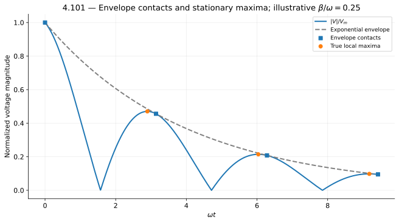
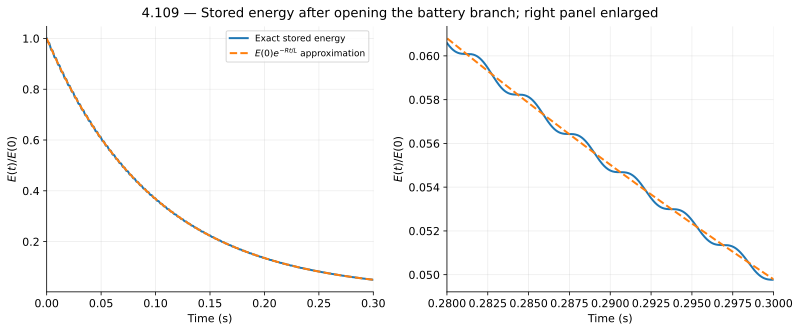
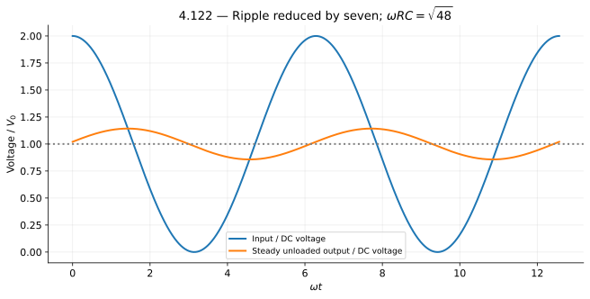
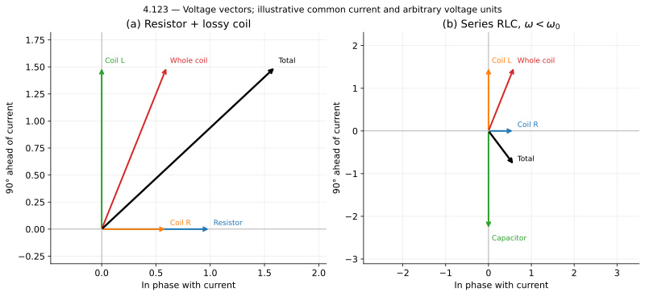
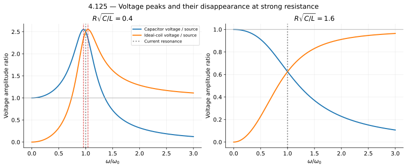
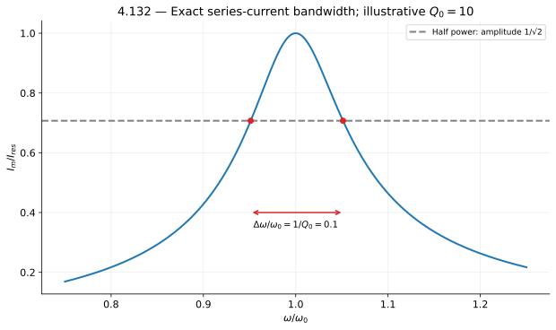
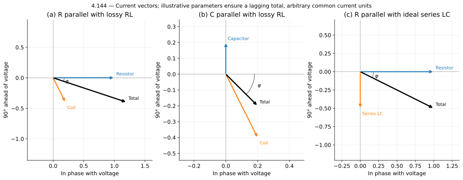

# 4.2 Electric Oscillations

[Chapter index](../README.md#chapters) · [Structured solutions](4.2.json) · [Answer audit](../audit/README.md)

## 4.94

**Problem statement**

Due to a certain cause the free electrons in a plane copper plate shifted over a small distance x at right angles to its surface. As a result, a surface charge and a corresponding restoring force emerged, giving rise to so-called plasma oscillations. Find the angular frequency of these oscillations if the free electron concentration in copper is $n=0.85·10^{29}$ m⁻¹ .

**Solved · medium confidence.** Find the planar polarization field and the force on a displaced electron.

**Assumptions**

- Treat the positive copper lattice as stationary and the conduction electrons as a rigid, collisionless fluid displaced normally through a distance x small compared with the plate thickness. Ignore edges and background dielectric polarization.
- The scan explicitly prints concentration n=0.85*10^29 m^-1. That is dimensionally incompatible with a volume electron density. Preserve the printed unit; the numerical frequency below is conditional on the intended n=0.85*10^29 m^-3.

The displacement exposes opposite sheets of charge. Their combined interior field is proportional to the displacement.

$$
\sigma=enx,\quad E_x=\frac{enx}{\epsilon_0}.
$$

An electron experiences a force opposite the displacement, giving the collective harmonic equation.

$$
m_e\ddot x=-eE_x=-\frac{ne^2}{\epsilon_0}x,\quad\omega_p=\sqrt{\frac{ne^2}{m_e\epsilon_0}}.
$$

Use the historical Appendix electron charge, mass and vacuum permittivity only after interpreting n as a volume density.

$$
\omega_p=1.6449062501\times10^{16}\ \mathrm{s}^{-1}\quad\text{if }n=0.85\times10^{29}\ \mathrm{m}^{-3}.
$$

**Results**

Planar electron-fluid angular frequency

$$
\omega_p=\sqrt{ne^2/(m_e\epsilon_0)}
$$

Value conditional on correcting the printed concentration unit

$$
\omega_p\simeq1.64\times10^{16}\ \mathrm{s}^{-1}
$$

**Limitations**

- The literal printed m^-1 does not define a physical plasma frequency. Real copper also has collisions and a nontrivial dielectric response; this is the stated elementary free-electron model.

## 4.95

**Problem statement**

An oscillating circuit consisting of a capacitor with capacitance C and a coil of inductance L maintains free undamped oscillations with voltage amplitude across the capacitor equal to $V_m$ . For an arbitrary moment of time find the relation between the current I in the circuit and the voltage V across the capacitor. Solve this problem using Ohm's law and then the energy conservation law.

**Solved · high confidence.** Derive the LC phase ellipse from the circuit law and independently from conserved field energy.

**Assumptions**

- The circuit is an ideal lossless LC loop with constant positive L and C. Let V be the voltage of the initially positive capacitor plate and I the discharge current, so I=-C*dV/dt. The voltage amplitude Vm is nonnegative.

With the discharge orientation the coil voltage equals the capacitor voltage. Eliminate time using the capacitor current law.

$$
L\dot I=V,\quad\dot V=-I/C,\quad LI\frac{dI}{dV}=-CV.
$$

Integrate, using I=0 at V=Vm.

$$
\frac12LI^2+\frac12CV^2=\frac12CV_m^2.
$$

Alternatively conservation of the sum of magnetic and electric field energies gives the same relation directly.

$$
I=\pm\sqrt{\frac CL\left(V_m^2-V^2\right)},\quad |V|\le V_m.
$$

**Results**

Current-voltage relation with both phase branches

$$
LI^2+CV^2=CV_m^2,\quad I=\pm\sqrt{(C/L)(V_m^2-V^2)}
$$

## 4.96

**Problem statement**

An oscillating circuit consists of a capacitor with capacitance C, a coil of inductance L with negligible resistance, and a switch. With the switch disconnected, the capacitor was charged to a voltage $V_m$ , and then at the moment t = 0 the switch was closed. Find: (a) the current I (t) in the circuit as a function of time; (b) the emf of self-inductance in the coil at the moments when the electric energy of the capacitor is equal to that of the current in the coil.

**Solved · high confidence.** Solve the ideal LC initial-value problem and locate equal electric and magnetic energies.

**Assumptions**

- Choose I positive in the initial capacitor-discharge direction. At switch closure V(0)=Vm and I(0)=0; assume the capacitor was charged with Vm>0 and the coil initially unenergized. Ignore switching losses and parasitic elements.

The initial conditions give a cosine capacitor voltage and sine discharge current.

$$
\omega_0=\frac1{\sqrt{LC}},\quad V(t)=V_m\cos\omega_0t,\quad I(t)=V_m\sqrt{\frac CL}\sin\omega_0t.
$$

The emf of self-inductance is opposite the increasing current.

$$
\mathcal E_L=-L\dot I=-V_m\cos\omega_0t.
$$

Equal field energies require equal squared sine and cosine. The sign of the emf alternates.

$$
\omega_0t=\frac\pi4+\frac{k\pi}{2},\ k=0,1,\ldots;\quad |\mathcal E_L|=\frac{V_m}{\sqrt2}.
$$

**Results**

Discharge current

$$
I(t)=V_m\sqrt{C/L}\sin(t/\sqrt{LC})
$$

Self-inductance emf magnitude at equal energies

$$
|\mathcal E_L|=V_m/\sqrt2
$$

Signed emf and the equal-energy times

$$
\mathcal E_L=-V_m\cos(\pi/4+k\pi/2),\quad t=(\pi/4+k\pi/2)\sqrt{LC}
$$

## 4.97

**Problem statement**

In an oscillating circuit consisting of a parallel-plate capacitor and an inductance coil with negligible active resistance the oscillations with energy W are sustained. The capacitor plates were slowly drawn apart to increase the oscillation frequency $\eta$-fold. What work was done in the process?

**Solved · high confidence.** Average the mechanical work during slow variation of a parallel-plate capacitance.

**Assumptions**

- The isolated LC oscillation has initial total energy W and fixed L. There is no external sustaining power during the slow plate displacement; resistive loss is negligible.
- The change is adiabatic in the mechanical sense: fractional parameter changes per oscillation are small. Neglect fringe fields, radiation and the mechanical kinetic energy remaining after the process.

At fixed instantaneous capacitor charge, the external differential work against attraction increases the electric energy.

$$
\delta A=-\frac{q^2}{2C^2}\,dC.
$$

During one fast cycle the mean capacitor energy is half the total oscillation energy. Average the work and integrate.

$$
\langle q^2/(2C)\rangle=W/2,\quad\frac{dW}{W}=-\frac12\frac{dC}{C}=\frac{d\omega_0}{\omega_0}.
$$

The adiabatic invariant W/omega0 is constant, so the work equals the net increase of oscillation energy.

$$
W_f=\eta W,\quad A=W_f-W=(\eta-1)W.
$$

**Results**

External work drawing the plates apart

$$
A=(\eta-1)W
$$

**Limitations**

- If a separate drive actively fixes the oscillation energy during separation, it exchanges energy and the isolated-oscillator work balance must be modified.

## 4.98

**Problem statement**

In an oscillating circuit shown in Fig. 4.27 the coil inductance is equal to L = 2.5 mH and the capacitor have capacitances $C_1=2.0$ μF and $C_2=3.0$ μF. The capacitors were charged to a voltage V = 180 V, and then the switch Sw was closed. Find: (a) the natural oscillation frequency; (b) the peak value of the current flowing through the coil.

**Solved · high confidence.** Combine the parallel capacitors in the printed circuit and conserve LC energy.

**Assumptions**

- Figure 4.27 connects C1 and C2 between the same two nodes. They have the same initial voltage V=180 V and polarity before the unenergized coil is connected. The switch and coil are ideal, and resistance is neglected.

The two capacitor charges change together because their terminal voltages are identical.

$$
C_\Sigma=C_1+C_2=5.0\times10^{-6}\ \mathrm F.
$$

The single dynamical LC mode has the combined parallel capacitance.

$$
\omega_0=\frac1{\sqrt{LC_\Sigma}}=8944.271910\ \mathrm{s}^{-1},\quad\nu_0=\frac{\omega_0}{2\pi}=1423.525087\ \mathrm{Hz}.
$$

At the maximum coil current the capacitor voltage is zero, so all the initial electric energy is magnetic.

$$
\frac12LI_{\max}^2=\frac12C_\Sigma V^2,\quad I_{\max}=V\sqrt{C_\Sigma/L}=8.049844719\ \mathrm A.
$$

**Results**

Natural angular frequency

$$
\omega_0=[L(C_1+C_2)]^{-1/2}
$$

Natural ordinary frequency

$$
\nu_0=\omega_0/(2\pi)
$$

Peak coil current

$$
I_{\max}=V\sqrt{(C_1+C_2)/L}
$$

## 4.99

**Problem statement**

An electric circuit shown in Fig. 4.28 has a negligibly small active resistance. The left-hand capacitor was charged to a voltage $V_0$ and then at the moment t = 0 the switch Sw was closed. Find the time dependence of the voltages in left and right capacitors.

**Solved · high confidence.** Separate the conserved common voltage from the oscillating voltage difference.

**Assumptions**

- Figure 4.28 has two equal capacitors C. Once the bottom switch closes, their lower plates share the reference node; their upper plates are linked only by the ideal inductor L.
- Choose the initially charged left upper plate to have voltage V0 relative to its lower plate. Initially the right capacitor voltage and inductor current are zero; reversing the initial polarity reverses both reported voltages.

The net charge of the isolated pair of upper plates is conserved.

$$
C(V_\ell+V_r)=CV_0,\quad I=-C\dot V_\ell=C\dot V_r.
$$

The inductor responds to the difference of upper-node voltages. This difference obeys a harmonic equation.

$$
L\dot I=V_\ell-V_r,\quad\ddot{(V_\ell-V_r)}+\frac2{LC}(V_\ell-V_r)=0,\quad\omega=\sqrt{\frac2{LC}}.
$$

Use the initial voltage difference and zero current to recover each capacitor voltage.

$$
V_\ell(t)=\frac{V_0}{2}(1+\cos\omega t),\quad V_r(t)=\frac{V_0}{2}(1-\cos\omega t).
$$

**Results**

Left capacitor voltage, upper minus common lower node

$$
V_\ell(t)=\tfrac12V_0[1+\cos(\sqrt{2/(LC)}\,t)]
$$

Right capacitor voltage with the same reference orientation

$$
V_r(t)=\tfrac12V_0[1-\cos(\sqrt{2/(LC)}\,t)]
$$

## 4.100

**Problem statement**

An oscillating circuit consists of an inductance coil L and a capacitor with capacitance C. The resistance of the coil and the lead wires is negligible. The coil is placed in a permanent magnetic field so that the total flux passing through all the turns of the coil is equal to $\Phi$. At the moment t = 0 the magnetic field was switched off. Assuming the switching off time to be negligible compared to the natural oscillation period of the circuit, find the circuit current as a function of time t.

**Solved · high confidence.** Integrate Faraday law across the rapid change of external flux, then solve the free LC motion.

**Assumptions**

- Phi denotes the external flux linkage summed over all turns, not a single-turn flux. Orient positive coil current so that its self-linkage L*I has the same sign as the initial positive external linkage Phi.
- Assume the circuit was initially uncharged and current-free. The removal is fast compared with sqrt(LC), but the lumped inductance model remains valid; losses and radiation are neglected.

The capacitor charge cannot change appreciably during the short switching interval. Integrate the inductive equation, including the imposed external-flux derivative.

$$
L\,\Delta I=-\Delta\Phi_{\rm ext}=\Phi,\quad I(0^+)=\Phi/L,\quad q(0^+)=0.
$$

After removal, take q_dot=I in the chosen charging orientation. The LC oscillator starts with pure magnetic energy.

$$
\dot q=I,\quad L\dot I+q/C=0,\quad\omega_0=1/\sqrt{LC}.
$$

The resulting current is a cosine with the initial direction that preserves flux linkage.

$$
I(t)=\frac{\Phi}{L}\cos\omega_0t,\quad q(t)=\frac{\Phi}{L\omega_0}\sin\omega_0t.
$$

**Results**

Current after rapid external-flux removal

$$
I(t)=(\Phi/L)\cos(t/\sqrt{LC})
$$

**Limitations**

- Pre-existing oscillations superpose: if the pre-switch current and charge are I_i and q_i, the later current is (I_i+Phi/L)*cos(omega0*t)-omega0*q_i*sin(omega0*t). The unspecified prehistory is conventionally taken as unenergized.

## 4.101

**Problem statement**

The free damped oscillations are maintained in a circuit, such that the voltage across the capacitor varies as $V=V_m e^{-\beta t}\cos\omega t$. Find the moments of time when the modulus of the voltage across the capacitor reaches (a) peak values; (b) maximum (extremum) values.

**Solved · medium confidence.** Distinguish contact with the decay envelope from the true local maxima of the voltage modulus.

**Assumptions**

- Take Vm>0, beta>=0, omega>0 and t>=0. The printed distinction between peak values and maximum (extremum) values is not standard terminology.
- Interpret peak value in part (a) as the instantaneous sinusoidal amplitude A(t)=Vm*exp(-beta*t), and actual extremum in part (b) as a local maximum of abs(V). Give both meanings explicitly rather than equating them.

The modulus reaches the envelope only when the cosine has unit magnitude.

$$
|V|=A(t)\quad\Longleftrightarrow\quad t_n^{\rm env}=n\pi/\omega,\quad n=0,1,2,\ldots.
$$

Differentiate the signed voltage away from its zeroes. The decay shifts an actual peak earlier than the corresponding envelope-contact phase.

$$
\dot V=-V_me^{-\beta t}(\beta\cos\omega t+\omega\sin\omega t),\quad\delta=\arctan(\beta/\omega),\quad t_n^{\max}=(n\pi-\delta)/\omega.
$$

For positive damping retain n>=1 for interior peaks, plus the initial endpoint. At a true peak the modulus lies below the envelope; the zero crossings are minima of the modulus.

$$
|V(t_n^{\max})|=V_me^{-\beta t_n^{\max}}\frac{\omega}{\sqrt{\omega^2+\beta^2}},\quad t_n^{\min}=(\pi/2+n\pi)/\omega.
$$

**Results**

Contacts with the instantaneous amplitude envelope

$$
t_n=n\pi/\omega,\quad n\ge0
$$

Interior local maxima of the voltage modulus for beta>0

$$
t_n=(n\pi-\arctan(\beta/\omega))/\omega,\quad n\ge1
$$

Global maximum on t>=0

$$
t=0,\quad |V|_{\rm global\ max}=V_m
$$

Zero minima if extremum includes minima

$$
t_n=(\pi/2+n\pi)/\omega,\quad n\ge0
$$

**Limitations**

- If peak is used as a synonym for an actual local maximum, parts (a) and (b) coincide. The distinct answers above follow the envelope-versus-extremum reading suggested by the adjacent problem.

## 4.102

**Problem statement**

A certain oscillating circuit consists of a capacitor with capacitance C, a coil with inductance L and active resistance R, and a switch. When the switch was disconnected, the capacitor was charged; then the switch was closed and oscillations set in. Find the ratio of the voltage across the capacitor to its peak value at the moment immediately after closing the switch.

**Solved · medium confidence.** Impose zero initial current on the underdamped capacitor-voltage solution.

**Assumptions**

- Let V_i be the capacitor voltage just after closure. Initially the coil current is zero. The circuit is a constant-parameter series RLC loop with beta=R/(2L), omega0=1/sqrt(LC), and omega_d=sqrt(omega0^2-beta^2)>0.
- Interpret peak value as the instantaneous oscillatory amplitude envelope at t=0, not the largest actual voltage subsequently attained.

The zero-current condition is V_dot(0)=0, which fixes the sine term as well as the initial voltage.

$$
V(t)=V_i e^{-\beta t}\left(\cos\omega_dt+\frac{\beta}{\omega_d}\sin\omega_dt\right).
$$

Combine the two harmonics into one cosine to identify its initial envelope amplitude.

$$
A_V(0)=|V_i|\sqrt{1+(\beta/\omega_d)^2}=|V_i|\frac{\omega_0}{\omega_d}.
$$

The ratio of voltage magnitude to the initial envelope is therefore less than unity when damping is present.

$$
\frac{|V(0)|}{A_V(0)}=\frac{\omega_d}{\omega_0}=\sqrt{1-\frac{R^2C}{4L}}.
$$

**Results**

Initial voltage magnitude divided by its instantaneous envelope amplitude

$$
|V(0)|/A_V(0)=\sqrt{1-R^2C/(4L)}
$$

Alternative literal actual maximum interpretation

$$
|V(0)|/\max_{t\ge0}|V(t)|=1
$$

**Limitations**

- The ratio to the actual attained maximum is one. The envelope result requires the stated amplitude definition and the underdamped condition R<2*sqrt(L/C).

## 4.103

**Problem statement**

A circuit with capacitance C and inductance L generates free damped oscillations with current varying with time as $I=I_m e^{-\beta t}\sin\omega t$. Find the voltage across the capacitor as a function of time, and in particular, at the moment t = 0.

**Solved · high confidence.** Recover the capacitor voltage from the coil and resistor voltage drops.

**Assumptions**

- Choose I as the capacitor discharge current, with V the corresponding initially positive capacitor voltage. The free series RLC parameters satisfy beta=R/(2L) and omega^2+beta^2=1/(LC). A reversed voltage orientation changes the overall sign.

Kirchhoff law relates the capacitor voltage to the coil and resistor drops. Differentiate the supplied current, including its exponential envelope.

$$
V=L\dot I+RI,\quad \dot I=I_me^{-\beta t}(\omega\cos\omega t-\beta\sin\omega t).
$$

Use R=2 beta L to combine terms.

$$
V(t)=LI_me^{-\beta t}(\omega\cos\omega t+\beta\sin\omega t).
$$

At t=0 the current is zero but its derivative need not vanish, so the capacitor voltage is finite.

$$
V(0)=LI_m\omega.
$$

**Results**

Capacitor voltage in the discharge orientation

$$
V(t)=LI_me^{-\beta t}(\omega\cos\omega t+\beta\sin\omega t)
$$

Initial capacitor voltage

$$
V(0)=LI_m\omega
$$

## 4.104

**Problem statement**

An oscillating circuit consists of a capacitor with capacitance C = 4.0 μF and a coil with inductance L = 2.0 mH and active resistance R = 10 Ω. Find the ratio of the energy of the coil's magnetic field to that of the capacitor's electric field at the moment when the current has the maximum value.

**Solved · high confidence.** Use zero current derivative at a nonzero current extremum.

**Assumptions**

- The active resistance R=10 ohm is the coil series resistance. Use the usual interior positive current maximum of the free oscillation; the same squared-energy ratio holds at any nonzero stationary current extremum.

At the current maximum the inductive voltage is zero, but the resistive voltage is not.

$$
\dot I=0,\quad V_C=RI.
$$

Insert this relation into the magnetic and electric field energies.

$$
\frac{W_B}{W_E}=\frac{LI^2/2}{CV_C^2/2}=\frac{L}{CR^2}.
$$

Convert the given capacitance and inductance to SI units.

$$
\frac{W_B}{W_E}=\frac{2.0\times10^{-3}}{(4.0\times10^{-6})(10)^2}=5.0.
$$

**Results**

Magnetic-to-electric energy ratio at a current maximum

$$
W_B/W_E=L/(CR^2)=5
$$

## 4.105

**Problem statement**

An oscillating circuit consists of two coils connected in series whose inductances are $L_1$ and $L_2$, active resistances are $R_1$ and $R_2$, and mutual inductance is negligible. These coils are to be replaced by one, keeping the frequency and the quality factor of the circuit constant. Find the inductance and the active resistance of such a coil.

**Solved · high confidence.** Use the equivalence of series elements and the exact damped-frequency and quality definitions.

**Assumptions**

- The capacitance remains unchanged; both initial coils have negligible mutual inductance. Use a free underdamped RLC circuit and positive inductances and resistances.

The original series pair has additive flux linkage and voltage drops.

$$
L_s=L_1+L_2,\quad R_s=R_1+R_2,\quad\beta_s=\frac{R_s}{2L_s}.
$$

Keeping the damped frequency and book quality factor keeps beta and the natural frequency fixed.

$$
Q=\frac{\omega_d}{2\beta},\quad\beta=\frac{\omega_d}{2Q},\quad\omega_0^2=\omega_d^2+\beta^2=\frac1{LC}.
$$

Since C is unchanged, the replacement inductance and then its resistance are uniquely fixed.

$$
L=L_1+L_2,\quad R=R_1+R_2.
$$

**Results**

Replacement inductance

$$
L=L_1+L_2
$$

Replacement active resistance

$$
R=R_1+R_2
$$

## 4.106

**Problem statement**

How soon does the current amplitude in an oscillating circuit with quality factor Q = 5000 decrease $\eta=2.0$ times if the oscillation frequency is $\nu=2.2$ MHz?

**Solved · high confidence.** Relate the exponential current-envelope decay to the printed quality factor.

**Assumptions**

- The stated oscillation frequency nu is the actual damped ordinary frequency, so omega_d=2*pi*nu. Current amplitude means the exponential envelope, which decays as exp(-beta*t). Use Q_book=omega_d/(2*beta) exactly.

A reduction by eta fixes the decay exponent.

$$
e^{-\beta t}=1/\eta,\quad t=\ln\eta/\beta.
$$

Eliminate beta using the book quality-factor definition and the damped frequency.

$$
\beta=\frac{\pi\nu}{Q},\quad t=\frac{Q\ln\eta}{\pi\nu}.
$$

Substitute Q=5000, eta=2 and nu=2.2 MHz.

$$
t=5.0144454580\times10^{-4}\ \mathrm s\simeq0.501\ \mathrm{ms}.
$$

**Results**

Time for a factor-two current-envelope reduction

$$
t=Q\ln\eta/(\pi\nu)
$$

## 4.107

**Problem statement**

An oscillating circuit consists of capacitance C = 10 μF, inductance L = 25 mH, and active resistance $R=1.0$ Ω. How many oscillation periods does it take for the current amplitude to decrease e-fold?

**Solved · high confidence.** Compare the current-envelope e-folding time with the actual damped period.

**Assumptions**

- The free circuit is a series RLC loop with constant R, L and C. The requested number of periods is a continuous count, not necessarily an integer. Use the actual damped period.

The envelope decay rate and actual angular frequency follow from the RLC characteristic roots.

$$
\beta=\frac{R}{2L}=20\ \mathrm{s}^{-1},\quad\omega_d=\sqrt{\frac1{LC}-\beta^2}=1999.8999975\ \mathrm{s}^{-1}.
$$

One envelope e-fold takes time 1/beta. Divide by the damped period.

$$
N=\frac{1/\beta}{2\pi/\omega_d}=\frac{\omega_d}{2\pi\beta}=\frac1{2\pi}\sqrt{\frac{4L}{R^2C}-1}.
$$

The continuous count is about 15.9 periods; a count of complete elapsed periods would first meet or exceed this at 16.

$$
N=15.914698515,\quad t_e=0.0500\ \mathrm s.
$$

**Results**

Number of actual periods for an envelope e-fold

$$
N=(2\pi)^{-1}\sqrt{4L/(R^2C)-1}
$$

Envelope e-folding time

$$
t_e=2L/R
$$

## 4.108

**Problem statement**

How much (in per cent) does the free oscillation frequency $\omega$ of a circuit with quality factor Q = 5.0 differ from the natural oscillation frequency $\omega_0$ of that circuit?

**Solved · high confidence.** Eliminate damping between the exact frequency relation and the book quality factor.

**Assumptions**

- The supplied Q is the book definition omega_d/(2*beta), as explicitly prescribed by the chapter header. Compare the frequency deficit with the natural frequency omega0.

Express beta in terms of the actual damped frequency.

$$
\beta=\frac{\omega_d}{2Q},\quad\omega_0^2=\omega_d^2+\beta^2=\omega_d^2\left(1+\frac1{4Q^2}\right).
$$

The damped frequency is smaller; calculate the fractional deficit relative to omega0.

$$
\frac{\omega_d}{\omega_0}=\left(1+\frac1{4Q^2}\right)^{-1/2},\quad100\frac{\omega_0-\omega_d}{\omega_0}=0.4962809790\%.
$$

If a different convention Q0=omega0/(2 beta) were assigned the same number 5, the result would differ slightly. This is not the primary interpretation.

$$
Q_0=5:\quad100\left[1-\sqrt{1-\frac1{4Q_0^2}}\right]=0.5012562893\%.
$$

**Results**

Frequency deficit relative to the natural frequency, book Q

$$
100[1-(1+1/(4Q^2))^{-1/2}]\%
$$

Result if the given number instead denoted natural-frequency Q0

$$
100[1-\sqrt{1-1/(4Q_0^2)}]\%
$$

## 4.109

**Problem statement**

In a circuit shown in Fig. 4.29 the battery emf is equal to $\mathcal{E}=2.0$ V, its internal resistance is r = 9.0 Ω, the capacitance of the capacitor is C = 10 μF, the coil inductance is L = 100 mH, and the resistance is R = 1.0 Ω. At a certain moment the switch Sw was disconnected. Find the energy of oscillations in the circuit (a) immediately after the switch was disconnected; (b) t = 0.30 s after the switch was disconnected.

**Solved · high confidence.** Find the pre-switch DC state from the figure, then propagate both state variables to compute exact field energy.

**Assumptions**

- The battery has been connected long enough for the DC steady state. The coil inductance is ideal; R=1 ohm is the depicted external series resistance. The capacitor is connected across the complete R-L branch.
- Figure 4.29 opens only the battery branch. After opening, the battery internal resistance r is excluded; the remaining closed loop contains C, R and L. Define V as top minus bottom capacitor voltage and I downward through R and L.

Before opening the coil is a DC short. The capacitor voltage is the voltage across R; both voltage and coil current are continuous at opening.

$$
I_0=\frac{\mathcal E}{r+R}=0.200\ \mathrm A,\quad V_0=RI_0=0.200\ \mathrm V,\quad W(0)=\frac12LI_0^2+\frac12CV_0^2=2.0002000\times10^{-3}\ \mathrm J.
$$

After disconnection solve the isolated series-loop state equations with the known initial state.

$$
C\dot V=-I,\quad L\dot I=V-RI,\quad\beta=5\ \mathrm{s}^{-1},\quad\omega_d=\sqrt{10^6-25}\ \mathrm{s}^{-1}.
$$

Both initial state components matter. The exact damped solutions include their initial derivatives.

$$
I(t)=e^{-\beta t}\left[I_0\cos\omega_dt+\frac{V_0/L-\beta I_0}{\omega_d}\sin\omega_dt\right],\quad V(t)=e^{-\beta t}\left[V_0\cos\omega_dt+\frac{\beta V_0-I_0/C}{\omega_d}\sin\omega_dt\right].
$$

Compute the physical instantaneous sum of magnetic and electric energies, without replacing it by a pure exponential.

$$
I(0.30)=-1.3764433315\times10^{-3}\ \mathrm A,\quad V(0.30)=4.4597917815\ \mathrm V,\quad W(0.30)=\tfrac12LI^2+\tfrac12CV^2=9.9543443482\times10^{-5}\ \mathrm J.
$$

For comparison the usual weak-damping energy-envelope estimate is close, but not identical.

$$
W_{\rm env}(0.30)=W(0)e^{-Rt/L}=9.9584094149\times10^{-5}\ \mathrm J.
$$

**Results**

Energy immediately after opening the battery switch

$$
W(0)=\tfrac12L[\mathcal E/(r+R)]^2+\tfrac12C[R\mathcal E/(r+R)]^2
$$

Exact instantaneous energy at 0.30 seconds

$$
W(t)=\tfrac12LI(t)^2+\tfrac12CV(t)^2
$$

Separate weak-damping envelope estimate

$$
W_{\rm env}(t)=W(0)e^{-Rt/L}
$$

**Limitations**

- Without a pre-switch DC steady-state assumption, the initial capacitor voltage and coil current are unspecified, so the numerical result would not be unique.

## 4.110

**Problem statement**

Damped oscillations are induced in a circuit whose quality factor is Q = 50 and natural oscillation frequency is $\nu_0=5.5$ kHz. How soon will the energy stored in the circuit decrease $\eta=2.0$ times?

**Solved · medium confidence.** Separate the standard energy-envelope halving time from the phase-dependent instantaneous energy.

**Assumptions**

- Use the book Q=omega_d/(2*beta)=50 and the given natural ordinary frequency nu0=5.5 kHz, so omega0=2*pi*nu0. The circuit is a linear series RLC oscillator.
- The initial oscillation phase is not specified. Give the conventional secular energy-envelope time, and retain the phase factor for the literal instantaneous energy.

The exact damping rate follows from the natural frequency and book quality factor.

$$
\omega_d^2+\beta^2=\omega_0^2,\quad\beta=\frac{\omega_0}{\sqrt{4Q^2+1}}=345.55791443\ \mathrm{s}^{-1}.
$$

For the secular energy envelope the energy falls as exp(-2 beta t).

$$
t_{\rm env}=\frac{\ln\eta}{2\beta}=\frac{\sqrt{4Q^2+1}\ln\eta}{4\pi\nu_0}=1.0029392348\times10^{-3}\ \mathrm s.
$$

The physical energy of q=A exp(-beta t) cos(theta) contains a phase factor from the current energy.

$$
\theta=\omega_dt+\alpha,\quad W(t)=\frac{A^2}{2C}e^{-2\beta t}f(\theta),\quad f(\theta)=\cos^2\theta+\frac{(\beta\cos\theta+\omega_d\sin\theta)^2}{\omega_0^2}.
$$

With alpha unknown, the exact halving event is specified only implicitly. Bound the phase factor using its quadratic-form eigenvalues.

$$
2\beta t=\ln\eta+\ln\frac{f(\omega_dt+\alpha)}{f(\alpha)},\quad1-\zeta\le f\le1+\zeta,\quad\zeta=\beta/\omega_0.
$$

This gives a rigorous outer interval for all possible phases, rather than a unique exact event time.

$$
\frac{\ln\eta-\ln[(1+\zeta)/(1-\zeta)]}{2\beta}\le t\le\frac{\ln\eta+\ln[(1+\zeta)/(1-\zeta)]}{2\beta},\quad0.9740010\ \mathrm{ms}\le t\le1.0318775\ \mathrm{ms}.
$$

**Results**

Conventional energy-envelope halving time

$$
t_{\rm env}=\sqrt{4Q^2+1}\ln\eta/(4\pi\nu_0)
$$

Phase-dependent exact energy reduction condition

$$
e^{-2\beta t}f(\omega_dt+\alpha)/f(\alpha)=1/\eta
$$

Rigorous phase-independent lower bound on the exact time

$$
t\ge[\ln\eta-\ln((1+\zeta)/(1-\zeta))]/(2\beta)
$$

Rigorous phase-independent upper bound on the exact time

$$
t\le[\ln\eta+\ln((1+\zeta)/(1-\zeta))]/(2\beta)
$$

**Limitations**

- The exact instantaneous halving time cannot be uniquely calculated without the initial phase or equivalent initial capacitor voltage and current.

## 4.111

**Problem statement**

An oscillating circuit incorporates a leaking capacitor. Its capacitance is equal to C and active resistance to R. The coil inductance is L. The resistance of the coil and the wires is negligible. Find: (a) the damped oscillation frequency of such a circuit; (b) its quality factor.

**Solved · high confidence.** Represent capacitor leakage by a shunt resistance and derive the parallel-circuit characteristic roots.

**Assumptions**

- Model leakage as a constant resistor R in parallel with the ideal capacitor C. The ideal coil L is connected across the same nodes; wire and coil resistance vanish. This is a shunt-loss model, not series resistance.

Let V be the common node voltage and I_L the coil current. Kirchhoff current law includes both displacement current and leakage current.

$$
C\dot V+V/R+I_L=0,\quad L\dot I_L=V.
$$

Differentiate the node equation and identify the characteristic damping rate.

$$
\ddot V+\frac1{RC}\dot V+\frac1{LC}V=0,\quad\beta=\frac1{2RC},\quad\omega_d=\sqrt{\frac1{LC}-\frac1{4R^2C^2}}.
$$

Use the printed quality factor for the underdamped case. The natural-frequency convention is also given explicitly.

$$
Q_{\rm book}=\omega_dRC=\sqrt{\frac{R^2C}{L}-\frac14},\quad Q_0=R\sqrt{C/L},\quad R>\frac12\sqrt{L/C}.
$$

**Results**

Damped angular frequency

$$
\omega_d=\sqrt{1/(LC)-1/(4R^2C^2)}
$$

Book quality factor

$$
Q_{\rm book}=\sqrt{R^2C/L-1/4}
$$

Natural-frequency quality convention

$$
Q_0=R\sqrt{C/L}
$$

**Limitations**

- For R at or below the stated threshold no oscillatory damped period exists, so the book decrement-based Q is not defined as a real oscillation quality factor.

## 4.112

**Problem statement**

Find the quality factor of a circuit with capacitance $C=2.0$ μF and inductance L = 5.0 mH if the maintenance of undamped oscillations in the circuit with the voltage amplitude across the capacitor being equal to $V_m$ = 1.0 V requires a power $\langle P\rangle=0.10$ mW. The damping of oscillations is sufficiently low.

**Solved · high confidence.** Use the weak-damping energy balance between stored oscillation energy and the sustaining power.

**Assumptions**

- The damping is sufficiently weak as stated. The maintenance mechanism replaces the cycle-averaged losses without materially shifting the near-natural oscillation frequency or the sinusoidal field-energy exchange.
- Use the leading-order relation between quality factor, angular frequency, stored energy and mean loss power. The book Q and Q0 differ only at relative order Q^(-2) here; an exact finite-damping refinement would require a specified maintenance mechanism and frequency.

At maximum capacitor voltage the leading-order total stored energy equals its electric energy.

$$
W\simeq\frac12CV_m^2=1.00\times10^{-6}\ \mathrm J,\quad\omega_0=\frac1{\sqrt{LC}}=1.00\times10^4\ \mathrm{s}^{-1}.
$$

The mean sustaining power replaces the weak-damping loss rate 2 beta W.

$$
\langle P\rangle\simeq2\beta W,\quad Q_{\rm book}=\frac{\omega_d}{2\beta}\simeq\frac{\omega_0W}{\langle P\rangle}.
$$

Insert the given capacitance, inductance, voltage amplitude and power.

$$
Q_{\rm book}\simeq Q_0\simeq\frac{V_m^2}{2\langle P\rangle}\sqrt{\frac CL}=100.
$$

**Results**

Quality factor to the stated weak-damping accuracy

$$
Q_{\rm book}\simeq\frac{V_m^2}{2\langle P\rangle}\sqrt{C/L}\simeq100
$$

**Limitations**

- The numerical answer is a low-damping estimate, not an exact finite-damping inference from an unspecified sustaining circuit. If ideal series driving is specifically fixed at omega0, Q0=100 and Q_book=sqrt(100^2-1/4); that extra model is not imposed as source data.

## 4.113

**Problem statement**

What mean power should be fed to an oscillating circuit with active resistance R = 0.45 Ω to maintain undamped harmonic oscillations with current amplitude $I_m=30$ mA?

**Solved · high confidence.** Balance the mean input power against Joule loss over a harmonic cycle.

**Assumptions**

- R is the total active resistance and Im is the peak, rather than rms, current. Any loss-compensating drive supplies exactly the cycle-averaged dissipation.

The instantaneous resistor loss is R*I^2. The squared sine or cosine averages to one half.

$$
\langle P\rangle=R\langle I^2\rangle=\frac12RI_m^2.
$$

Convert the stated 30 mA to 0.030 A.

$$
\langle P\rangle=\frac12(0.45)(0.030)^2=2.025\times10^{-4}\ {\rm W}.
$$

**Results**

Required mean supplied power

$$
\langle P\rangle=RI_m^2/2
$$

## 4.114

**Problem statement**

An oscillating circuit consists of a capacitor with capacitance C = 1.2 nF and a coil with inductance L = 6.0 μH and active resistance R = 0.50 Ω. What mean power should be fed to the circuit to maintain undamped harmonic oscillations with voltage amplitude across the capacitor being equal to $V_m$ = 10 V?

**Solved · high confidence.** Convert the maintained capacitor voltage to current, then compute Joule loss.

**Assumptions**

- Use the usual resonantly maintained LC mode: the drive compensates active loss and the harmonic angular frequency is omega0=1/sqrt(L*C).
- The given voltage is the peak capacitor voltage. The series coil resistance is the only dissipative element.

For a maintained sinusoidal capacitor voltage the current amplitude is omega*C*Vm, irrespective of the drive mechanism.

$$
I_m=\omega CV_m,\quad\langle P\rangle=\tfrac12R\omega^2C^2V_m^2.
$$

At the loss-compensated natural LC frequency this simplifies to a frequency-free expression.

$$
\omega_0=1/\sqrt{LC},\quad\langle P\rangle=\frac{RC}{2L}V_m^2=5.00\times10^{-3}\ {\rm W}.
$$

The same expression follows by relating maximum stored capacitor energy to the mean dissipation.

$$
E=\tfrac12CV_m^2,\quad\langle P\rangle=(R/L)E.
$$

**Results**

Mean power for resonantly maintained harmonic oscillation

$$
\langle P\rangle=RCV_m^2/(2L)
$$

Power if a different harmonic angular frequency is prescribed

$$
\langle P\rangle=\tfrac12R\omega^2C^2V_m^2
$$

**Limitations**

- A prescribed externally forced frequency different from omega0 requires the general-frequency formula; the numerical result assumes the usual resonantly maintained mode.

## 4.115

**Problem statement**

Find the damped oscillation frequency of the circuit shown in Fig. 4.30. The capacitance C, inductance L, and active resistance R are supposed to be known. Find how must C, L, and R be interrelated to make oscillations possible.

**Solved · high confidence.** Write Kirchhoff current balance for the parallel RLC network.

**Assumptions**

- Figure 4.30 connects the ideal inductor, resistor and capacitor across the same two nodes. There is no series coil resistance in this figure.
- Let v be the upper-node voltage relative to the lower node, with all passive branch currents positive downward.

Current balance and the inductor voltage law give a second-order voltage equation after differentiation.

$$
C\dot v+\frac vR+i_L=0,\quad L\dot i_L=v,\quad\ddot v+\frac1{RC}\dot v+\frac1{LC}v=0.
$$

Read off the decay rate and the damped angular frequency.

$$
\beta=\frac1{2RC},\quad\omega_0=\frac1{\sqrt{LC}},\quad\omega_d=\sqrt{\frac1{LC}-\frac1{4R^2C^2}}.
$$

A strictly positive squared damped frequency is necessary for a nontrivial oscillatory transient.

$$
\omega_d^2>0\quad\Longleftrightarrow\quad R>\frac12\sqrt{\frac LC}\quad\Longleftrightarrow\quad L<4R^2C.
$$

**Results**

Damped angular frequency

$$
\omega_d=\sqrt{1/(LC)-1/(4R^2C^2)}
$$

Underdamped condition

$$
R>\tfrac12\sqrt{L/C}
$$

Damped frequency in cycles per second

$$
\nu_d=\omega_d/(2\pi)
$$

**Limitations**

- The frequency is a property of the natural mode; its amplitude depends on capacitor voltage and inductor current at release.

## 4.116

**Problem statement**

There are two oscillating circuits (Fig. 4.31) with capacitors of equal capacitances. How must inductances and active resistances of the coils be interrelated for the frequencies and damping of free oscillations in both circuits to be equal? The mutual inductance of coils in the left circuit is negligible.

**Solved · medium confidence.** Reduce equal-time-constant coil branches and state the more general modal-matching condition.

**Assumptions**

- Figure 4.31(a) has a capacitor in parallel with two separate series-RL branches; there is no mutual inductance. Figure (b) has the same capacitance and a single series-RL coil branch.
- The simple relations below guarantee the same entire capacitor-voltage dynamics for arbitrary capacitance and initial states. Matching only one complex pair at a fixed C is a weaker condition, given separately.

Let r1=R1/L1 and r2=R2/L2. In general the left circuit has a third-order characteristic polynomial.

$$
r_j=R_j/L_j,\quad Y(s)=Cs+\frac1{R_1+sL_1}+\frac1{R_2+sL_2},\quad p(s)=s^3+(r_1+r_2)s^2+\left[r_1r_2+\frac1C\left(\frac1{L_1}+\frac1{L_2}\right)\right]s+\frac{R_1+R_2}{CL_1L_2}.
$$

When the coil time constants agree, the two impedances are proportional. Their parallel combination is exactly a single series-RL impedance.

$$
\frac{R_1}{L_1}=\frac{R_2}{L_2}=r,\quad L=\frac{L_1L_2}{L_1+L_2},\quad R=\frac{R_1R_2}{R_1+R_2}=rL.
$$

Both capacitor modes then have the same damping and frequency; a third differential-current mode carries no net terminal current.

$$
p(s)=(s+r)\left(s^2+\frac RL s+\frac1{LC}\right),\quad\beta=\frac R{2L},\quad\omega_d=\sqrt{\frac1{LC}-\frac{R^2}{4L^2}},\quad i_{1,\rm circ}=-i_{2,\rm circ}\propto e^{-rt}.
$$

For literal matching of only the oscillatory pair at a fixed C, let the extra real root be -d. Coefficient matching is necessary and sufficient; equal time constants are sufficient but not necessary for that weaker requirement.

$$
r_1+r_2=R/L+d,\quad r_1r_2+\frac1C(1/L_1+1/L_2)=\frac1{LC}+dR/L,\quad\frac{R_1+R_2}{CL_1L_2}=\frac d{LC}.
$$

**Results**

Coil relations giving identical terminal free-oscillation dynamics

$$
\frac{L_1}{R_1}=\frac{L_2}{R_2}=\frac LR,\quad\frac1L=\frac1{L_1}+\frac1{L_2},\quad\frac1R=\frac1{R_1}+\frac1{R_2}
$$

Common damped angular frequency and decay coefficient

$$
\omega_d=\sqrt{1/(LC)-R^2/(4L^2)},\quad\beta=R/(2L)
$$

Condition for actual capacitor oscillations in the equivalent circuit

$$
R^2<4L/C
$$

**Limitations**

- With unequal branch time constants, generic initial data excite a third observable relaxation mode; no single series-RL branch reproduces the full response. The stated coefficient equations cover the weaker matching of only an oscillatory pair.

## 4.117

**Problem statement**

A circuit consists of a capacitor with capacitance C and a coil of inductance L connected in series, as well as a switch and a resistance equal to the critical value for this circuit. With the switch disconnected, the capacitor was charged to a voltage $V_0$ , and at the moment t = 0 the switch was closed. Find the current I in the circuit as a function of time t. What is $I_{\max}$ equal to?

**Solved · high confidence.** Solve the critically damped discharge with capacitor voltage and inductor-current continuity.

**Assumptions**

- The total series resistance equals its critical value and the open switch leaves no initial inductor current. The initially charged capacitor has voltage V0.
- Define positive discharge current as flowing out of the initially positive capacitor plate; for V0>0 the following current is positive.

At critical damping the characteristic root is repeated, with rate omega0.

$$
R_c=2\sqrt{L/C},\quad\omega_0=1/\sqrt{LC},\quad q(0)=CV_0,\quad\dot q(0)=0.
$$

The initial conditions fix the repeated-root charge solution. Differentiate with I=-qdot.

$$
q(t)=CV_0(1+\omega_0t)e^{-\omega_0t},\quad I(t)=\frac{V_0}{L}t\,e^{-\omega_0t}.
$$

The current reaches its maximum at one inverse natural frequency.

$$
\dot I=\frac{V_0}{L}e^{-\omega_0t}(1-\omega_0t),\quad t_{\max}=\sqrt{LC},\quad I_{\max}=\frac{V_0}{e}\sqrt{\frac CL}.
$$

**Results**

Discharge current for t>=0

$$
I(t)=(V_0/L)t\,e^{-t/\sqrt{LC}}
$$

Maximum discharge current for V0>0

$$
I_{\max}=V_0\sqrt{C/L}/e
$$

Time of maximum

$$
t_{\max}=\sqrt{LC}
$$

**Limitations**

- For negative V0 the formula gives signed current and the maximum magnitude uses |V0|.

## 4.118

**Problem statement**

A coil with active resistance R and inductance L was connected at the moment t = 0 to a source of voltage $V=V_m\cos\omega t$. Find the current in the coil as a function of time t.

**Solved · high confidence.** Solve the driven RL initial-value equation, retaining the turn-on transient.

**Assumptions**

- The source voltage for t>=0 is Vm*cos(omega*t), so it turns on at its positive maximum. R,L>0. Let I0 be the current immediately before connection, which an ideal inductor preserves.
- The customary initially unenergized coil has I0=0; the statement does not explicitly supply that initial energy, so the general branch is retained.

The forced equation has a cosine-sine particular solution and an exponentially decaying homogeneous term.

$$
L\dot I+RI=V_m\cos\omega t,\quad I_{\rm ss}=\frac{V_m}{R^2+\omega^2L^2}(R\cos\omega t+\omega L\sin\omega t).
$$

Impose inductor-current continuity at t=0.

$$
I(t)=I_{\rm ss}(t)+\left[I_0-\frac{V_mR}{R^2+\omega^2L^2}\right]e^{-Rt/L}.
$$

For an initially unenergized coil subtract the initial particular-solution current. The long-time current lags the source.

$$
I_0=0:\quad I(t)=\frac{V_m[R\cos\omega t+\omega L\sin\omega t-Re^{-Rt/L}]}{R^2+\omega^2L^2},\quad\phi=\arctan(\omega L/R).
$$

**Results**

Current with arbitrary initial I0

$$
I(t)=\frac{V_m(R\cos\omega t+\omega L\sin\omega t)}{R^2+\omega^2L^2}+\left(I_0-\frac{V_mR}{R^2+\omega^2L^2}\right)e^{-Rt/L}
$$

Initially unenergized coil

$$
I(t)=\frac{V_m[R\cos\omega t+\omega L\sin\omega t-Re^{-Rt/L}]}{R^2+\omega^2L^2}
$$

**Limitations**

- An ideal source capable of establishing a discontinuous inductor current would require an impulse voltage; no such impulse is specified.

## 4.119

**Problem statement**

A circuit consisting of a capacitor with capacitance C and a resistance R connected in series was connected at the moment t = 0 to a source of ac voltage $V=V_m\cos\omega t$. Find the current in the circuit as a function of time t.

**Solved · high confidence.** Solve the capacitor-voltage charging equation and differentiate it for the lead current.

**Assumptions**

- Let U0 be the initial capacitor voltage in the source polarity. It remains continuous at switching. R,C>0 and the source for t>=0 is Vm*cos(omega*t).
- The customary initially uncharged capacitor has U0=0. Positive current enters the capacitor plate whose voltage is u.

Use the capacitor voltage as the state variable, with tau=RC and x=omega*tau.

$$
\tau\dot u+u=V_m\cos\omega t,\quad\tau=RC,\quad x=\omega\tau,\quad u_{\rm ss}=\frac{V_m}{1+x^2}(\cos\omega t+x\sin\omega t).
$$

The homogeneous voltage term fixes the initial charge. The current follows from either C*udot or (V-u)/R.

$$
u(t)=u_{\rm ss}(t)+\left(U_0-\frac{V_m}{1+x^2}\right)e^{-t/\tau},\quad I(t)=\frac{V_m}{R(1+x^2)}(x^2\cos\omega t-x\sin\omega t)+\frac1R\left(\frac{V_m}{1+x^2}-U_0\right)e^{-t/\tau}.
$$

The initially uncharged branch is obtained by setting U0=0; its transient cannot be dropped at turn-on.

$$
I(t)\big|_{U_0=0}=\frac{V_m}{R(1+x^2)}[x^2\cos\omega t-x\sin\omega t+e^{-t/\tau}].
$$

**Results**

Current with arbitrary initial capacitor voltage U0

$$
I(t)=\frac{V_m[x^2\cos\omega t-x\sin\omega t]}{R(1+x^2)}+\frac{V_m/(1+x^2)-U_0}{R}e^{-t/(RC)},\quad x=\omega RC
$$

Initially uncharged capacitor

$$
I(t)=\frac{V_m}{R[1+(\omega RC)^2]}[(\omega RC)^2\cos\omega t-\omega RC\sin\omega t+e^{-t/(RC)}]
$$

## 4.120

**Problem statement**

A long one-layer solenoid tightly wound of wire with resistivity $\rho$ has n turns per unit length. The thickness of the wire insulation is negligible. The cross-sectional radius of the solenoid is equal to a. Find the phase difference between current and alternating voltage fed to the solenoid with frequency $\nu$.

**Solved · high confidence.** Calculate the long-solenoid inductance and wire resistance from the winding pitch.

**Assumptions**

- The solenoid is long and air-cored, with wire diameter small compared with its radius a; use the historical consistent mu0 from the Appendix. The axial pitch equals the bare wire diameter because insulation thickness is negligible.
- Treat the wire resistance as its quasistatic value; neglect skin, proximity, end and distributed-capacitance effects. The requested nu is frequency in cycles per second.

With winding length ell and pitch 1/n, the wire cross-sectional area and its total length follow from the one-layer geometry.

$$
d=1/n,\quad S_{\rm wire}=\frac{\pi}{4n^2},\quad\ell_{\rm wire}\simeq2\pi a n\ell,\quad R=\rho\ell_{\rm wire}/S_{\rm wire}=8\rho a n^3\ell.
$$

The same solenoid has inductance mu0*n^2*pi*a^2*ell. Their ratio is independent of solenoid length.

$$
L=\mu_0n^2\pi a^2\ell,\quad\frac LR=\frac{\mu_0\pi a}{8\rho n}.
$$

The source voltage leads the series-RL current by the impedance angle.

$$
\phi=\arctan\!\left(\frac{2\pi\nu L}{R}\right)=\arctan\!\left(\frac{\mu_0\pi^2a\nu}{4\rho n}\right),\quad I(t)=I_m\cos(2\pi\nu t-\phi).
$$

**Results**

Positive phase by which the voltage leads the current

$$
\phi=\arctan[\mu_0\pi^2a\nu/(4\rho n)]
$$

**Limitations**

- A magnetic core multiplies L by its applicable relative permeability. High-frequency wire and distributed effects change the lumped RL phase.

## 4.121

**Problem statement**

A circuit consisting of a capacitor and an active resistance R = 110 Ω connected in series is fed an alternating voltage with amplitude $V_m$ = 110 V. In this case the amplitude of steady-state current is equal to $I_m$ = 0.50 A. Find the phase difference between the current and the voltage fed.

**Solved · high confidence.** Infer the RC impedance angle from its resistive component and magnitude.

**Assumptions**

- The capacitor is ideal, so the source sees series resistance R and negative capacitive reactance. All supplied amplitudes are peak values.

The source-to-current amplitude ratio gives the impedance magnitude.

$$
|Z|=V_m/I_m=220\ \Omega,\quad Z=R-iX_C,\quad \cos\phi=R/|Z|=RI_m/V_m=\tfrac12.
$$

The negative impedance angle means current leads the applied voltage.

$$
\phi=\arccos(1/2)=\pi/3=60^\circ,\quad I=I_m\cos(\omega t+\phi).
$$

**Results**

Phase by which current leads source voltage

$$
\phi=\pi/3
$$

## 4.122

**Problem statement**

Fig. 4.32 illustrates the simplest ripple filter. A voltage $V=V_0(1+\cos\omega t)$ is fed to the left input. Find: (a) the output voltage V' (t); (b) the magnitude of the product RC at which the output amplitude of alternating voltage component is $\eta=7.0$ times less than the direct voltage component, if $\omega=314$ s⁻¹ .

**Solved · high confidence.** Apply the unloaded RC low-pass transfer function and retain the possible homogeneous transient.

**Assumptions**

- Figure 4.32 has R in the upper input lead and C across the output. The output is unloaded and the lower input/output nodes are the same return node.
- The ripple amplitude comparison concerns the steady periodic output. If an initial capacitor voltage u0 is specified at t=0, an additional decaying transient is present.

The capacitor voltage is the output and obeys a first-order charging equation.

$$
\tau\dot V^{\prime}+V^{\prime}=V_0(1+\cos\omega t),\quad\tau=RC.
$$

The DC component passes unchanged; the sinusoidal component is attenuated and delayed.

$$
V^{\prime}_{\rm ss}(t)=V_0\left[1+\frac{\cos(\omega t-\phi)}{\sqrt{1+(\omega\tau)^2}}\right],\quad\phi=\arctan(\omega\tau).
$$

For a source turned on with initial output u0, add the term that restores voltage continuity.

$$
V^{\prime}(t)=V^{\prime}_{\rm ss}(t)+\left\{u_0-V_0\left[1+\frac1{1+(\omega\tau)^2}\right]\right\}e^{-t/\tau}.
$$

The ripple-to-DC ratio is 1/eta, so eta fixes the time constant.

$$
\frac{V^{\prime}_{\rm ac,m}}{V^{\prime}_{\rm dc}}=\frac1{\sqrt{1+(\omega RC)^2}}=\frac1\eta,\quad RC=\frac{\sqrt{\eta^2-1}}\omega=0.02206434150\ {\rm s}.
$$

**Results**

Steady periodic output voltage

$$
V^{\prime}(t)=V_0[1+\cos(\omega t-\arctan(\omega RC))/\sqrt{1+(\omega RC)^2}]
$$

General initial-value correction

$$
\Delta V^{\prime}(t)=\{u_0-V_0[1+1/(1+(\omega RC)^2)]\}e^{-t/(RC)}
$$

Required product RC

$$
RC=\sqrt{\eta^2-1}/\omega
$$

**Limitations**

- Finite output loading changes both the DC gain and the filter time constant.

## 4.123

**Problem statement**

Draw the approximate voltage vector diagrams in the electric circuits shown in Fig. 4.33 a, b. The external voltage V is assumed to be alternating harmonically with frequency $\omega$.

**Solved · high confidence.** Construct component voltage phasors using the common series current as reference.

**Assumptions**

- Use complex amplitudes whose real parts multiply exp(i*omega*t), and set the common current phasor to positive real I. Each coil includes its labelled active resistance R.
- In Figure 4.33(b), the source explicitly states omega<omega0=1/sqrt(L*C), so the net circuit is capacitive.

In (a), the separate resistor and the resistive part of the coil are in phase with the current, while the inductive voltage leads by pi/2.

$$
\underline V_{R_0}=IR_0,\quad\underline V_R=IR,\quad\underline V_L=i\omega LI,\quad\underline V_{\rm coil}=I(R+i\omega L),\quad\underline V=I(R_0+R+i\omega L).
$$

In (b), add the downward capacitor phasor to the upward inductive phasor and the horizontal active drop.

$$
\underline V_C=-\frac{iI}{\omega C},\quad\underline V_{\rm coil}=I(R+i\omega L),\quad\underline V=I\left[R+i\left(\omega L-\frac1{\omega C}\right)\right].
$$

The source phasor is above the current axis in (a) and below it in (b). The actual coil voltage is the diagonal sum of its active and inductive parts.

$$
\arg(\underline V_a)>0,\quad\arg(\underline V_b)<0\quad(\omega<\omega_0).
$$

**Results**

Voltage phasors for resistor plus real coil

$$
\underline V=IR_0+IR+i\omega LI
$$

Voltage phasors for capacitor plus real coil below resonance

$$
\underline V=IR+iI(\omega L-1/(\omega C)),\quad\omega L<1/(\omega C)
$$

**Limitations**

- Only approximate shapes can be drawn without numerical reactances; the phasor directions and sums are exact.

## 4.124

**Problem statement**

A series circuit consisting of a capacitor with capacitance C = 22 μF and a coil with active resistance R = 20 Ω and inductance L = 0.35 H is connected to a source of alternating voltage with amplitude $V_m$ = 180 V and frequency $\omega=314$ s⁻¹ . Find: (a) the current amplitude in the circuit; (b) the phase difference between the current and the external voltage; (c) the amplitudes of voltage across the capacitor and the coil.

**Solved · high confidence.** Use the series impedance and distinguish real-coil voltage from ideal-inductor voltage.

**Assumptions**

- All stated amplitudes are peak values. The coil is represented by series R and L, and the capacitor is ideal. Choose V(t)=Vm*cos(omega*t).

Evaluate the reactances and impedance.

$$
X_L=\omega L=109.9\ \Omega,\quad X_C=1/(\omega C)=144.7596989\ \Omega,\quad Z=20-i34.8596989\ \Omega.
$$

The magnitude gives the current amplitude, and its negative impedance angle implies a leading current.

$$
I_m=\frac{V_m}{\sqrt{R^2+(X_L-X_C)^2}}=4.478778032\ {\rm A},\quad I(t)=I_m\cos(\omega t+\phi),\quad\phi=\arctan\frac{X_C-X_L}{R}=1.049918198\ {\rm rad}.
$$

The two-terminal coil drop includes both its active and inductive parts in quadrature.

$$
V_{C,m}=I_mX_C=648.3465593\ {\rm V},\quad V_{{\rm coil},m}=I_m\sqrt{R^2+X_L^2}=500.3019597\ {\rm V}.
$$

**Results**

Current amplitude

$$
I_m=V_m/\sqrt{R^2+(\omega L-1/(\omega C))^2}
$$

Phase by which current leads applied voltage

$$
\phi=\arctan[(1/(\omega C)-\omega L)/R]
$$

Capacitor voltage amplitude

$$
V_{C,m}=I_m/(\omega C)
$$

Voltage amplitude across the whole real coil

$$
V_{{\rm coil},m}=I_m\sqrt{R^2+(\omega L)^2}
$$

## 4.125

**Problem statement**

A series circuit consisting of a capacitor with capacitance C, a resistance R, and a coil with inductance L and negligible active resistance is connected to an oscillator whose frequency can be varied without changing the voltage amplitude. Find the frequency at which the voltage amplitude is maximum (a) across the capacitor; (b) across the coil.

**Solved · high confidence.** Optimize the separate voltage-transfer functions, including endpoint maxima.

**Assumptions**

- The source voltage amplitude is fixed while angular frequency varies. R>0 is frequency independent, and the coil in this problem has negligible active resistance.
- Write omega0=1/sqrt(L*C), beta=R/(2L), and r=R*sqrt(C/L). Consider finite positive frequencies separately from the DC and infinite-frequency limits.

The capacitor voltage response is the reciprocal of a quadratic polynomial in squared frequency.

$$
\frac{V_{C,m}^2}{V_m^2}=\frac1{(1-\omega^2LC)^2+\omega^2R^2C^2},\quad\omega_C^2=\omega_0^2-\frac{R^2}{2L^2}=\omega_0^2-2\beta^2.
$$

For the ideal coil the numerator contains omega^4 after multiplying impedance by omega*C. Its stationary point is shifted upward.

$$
\frac{V_{L,m}^2}{V_m^2}=\frac{\omega^4L^2C^2}{(1-\omega^2LC)^2+\omega^2R^2C^2},\quad\omega_L^2=\frac{\omega_0^2}{1-R^2C/(2L)}=\frac{\omega_0^4}{\omega_C^2}.
$$

Both finite interior peaks exist only below the same resistance threshold.

$$
0<R^2<2L/C:\quad\omega_C=\sqrt{1/(LC)-R^2/(2L^2)},\quad\omega_L=\frac{1/\sqrt{LC}}{\sqrt{1-R^2C/(2L)}}.
$$

At or above that threshold, the capacitor response decreases from unity while the inductor response increases toward unity.

$$
R^2\geq2L/C:\quad\sup V_{C,m}=V_m\ (\omega\to0),\quad\sup V_{L,m}=V_m\ (\omega\to\infty).
$$

**Results**

Capacitor-voltage maximum for 0<R^2<2L/C

$$
\omega_C=\sqrt{1/(LC)-R^2/(2L^2)}
$$

Ideal-inductor voltage maximum for 0<R^2<2L/C

$$
\omega_L=[LC(1-R^2C/(2L))]^{-1/2}
$$

No finite positive-frequency peak when R^2>=2L/C

$$
\omega_C\to0,\quad\omega_L\to\infty
$$

**Limitations**

- If only strictly positive finite frequencies are permitted, the boundary values are suprema rather than attained maxima.
- For R=0, both voltage responses are singular at omega0 and no finite bounded resonant steady state exists; the lossless turn-on problem instead has secular growth.

## 4.126

**Problem statement**

An alternating voltage with frequency $\omega=314$ s⁻¹ and amplitude $V_m$ = 180 V is fed to a series circuit consisting of a capacitor and a coil with active resistance R = 40 Ω and inductance L = 0.36 H. At what value of the capacitor's capacitance will the voltage amplitude across the coil be maximum? What is this amplitude equal to? What is the corresponding voltage amplitude across the condenser?

**Solved · high confidence.** Maximize the current by tuning the capacitor at fixed frequency.

**Assumptions**

- L, active coil resistance R, source amplitude and source angular frequency remain fixed while C varies. The voltage is measured across the complete real coil.

At fixed omega the coil impedance magnitude is fixed, so its voltage is maximized exactly when the series current is maximized.

$$
V_{{\rm coil},m}=I_m\sqrt{R^2+(\omega L)^2},\quad I_m=\frac{V_m}{\sqrt{R^2+(\omega L-1/(\omega C))^2}}.
$$

Cancel the total reactance to obtain the optimum capacitance and maximum current.

$$
C_*=\frac1{\omega^2L}=2.817333135\times10^{-5}\ {\rm F},\quad I_{m,*}=V_m/R=4.50\ {\rm A}.
$$

The capacitor drop cancels the inductive part, leaving the active coil drop equal to the source.

$$
V_{{\rm coil},m,*}=V_m\sqrt{1+(\omega L/R)^2}=539.5881229\ {\rm V},\quad V_{C,m,*}=V_m\omega L/R=508.68\ {\rm V}.
$$

**Results**

Capacitance maximizing whole-coil voltage

$$
C_*=1/(\omega^2L)
$$

Maximum real-coil voltage amplitude

$$
V_{{\rm coil},m,*}=V_m\sqrt{1+(\omega L/R)^2}
$$

Corresponding capacitor voltage amplitude

$$
V_{C,m,*}=V_m\omega L/R
$$

## 4.127

**Problem statement**

A capacitor with capacitance C whose interelectrode space is filled up with poorly conducting medium with active resistance R is connected to a source of alternating voltage $V=V_m\cos\omega t$. Find the time dependence of the steady-state current flowing in lead wires. The resistance of the wires is to be neglected.

**Solved · high confidence.** Add the conduction and displacement currents of a leaky capacitor.

**Assumptions**

- The supplied ideal voltage source fixes the capacitor terminal voltage. Model the poorly conducting medium as an ohmic shunt R in parallel with ideal capacitance C.
- Only the requested steady-state current is considered. Positive current enters the plate at positive applied voltage.

The dielectric carries simultaneous conduction current V/R and displacement current C*Vdot.

$$
I(t)=\frac{V(t)}R+C\dot V(t)=\frac{V_m}{R}\cos\omega t-\omega CV_m\sin\omega t.
$$

Combine the quadrature components into an amplitude and a positive leading phase.

$$
I_m=V_m\sqrt{R^{-2}+\omega^2C^2},\quad\phi=\arctan(\omega RC),\quad I(t)=I_m\cos(\omega t+\phi).
$$

**Results**

Total steady lead current

$$
I(t)=(V_m/R)\cos\omega t-\omega CV_m\sin\omega t
$$

Equivalent leading-current form

$$
I(t)=V_m\sqrt{R^{-2}+\omega^2C^2}\cos[\omega t+\arctan(\omega RC)]
$$

## 4.128

**Problem statement**

An oscillating circuit consists of a capacitor of capacitance C and a solenoid with inductance $L_1$ . The solenoid is inductively connected with a short-circuited coil having an inductance $L_2$ and a negligible active resistance. Their mutual inductance coefficient is equal to $L_{12}$. Find the natural frequency of the given oscillating circuit.

**Solved · high confidence.** Eliminate the lossless shorted secondary using conserved flux linkage.

**Assumptions**

- Both inductors are linear, with negligible active resistance, and the secondary winding is shorted. Let M=L12 with a consistent dot convention.
- The magnetic inductance matrix is positive definite: M^2<L1*L2. Any constant initial secondary flux linkage is allowed.

The zero secondary voltage makes its flux linkage constant.

$$
L_2\dot i_2+M\dot i_1=0,\quad L_2i_2+Mi_1=\Phi_{2,0}.
$$

Substitution into the primary voltage removes the induced secondary current and reduces the incremental inductance.

$$
v_1=L_1\dot i_1+M\dot i_2=\left(L_1-\frac{M^2}{L_2}\right)\dot i_1,\quad L_{\rm eff}=L_1-M^2/L_2.
$$

The primary capacitor and effective inductance form the oscillator.

$$
\omega_0=\frac1{\sqrt{C(L_1-M^2/L_2)}},\quad\nu_0=\frac{1}{2\pi\sqrt{C(L_1-M^2/L_2)}}.
$$

**Results**

Natural angular frequency

$$
\omega_0=[C(L_1-L_{12}^2/L_2)]^{-1/2}
$$

Natural frequency in cycles per second

$$
\nu_0=[2\pi\sqrt{C(L_1-L_{12}^2/L_2)}]^{-1}
$$

**Limitations**

- Perfect coupling M^2=L1*L2 is a singular ideal limit; neglected leakage, resistance and distributed capacitance then matter.

## 4.129

**Problem statement**

Find the quality factor of an oscillating circuit connected in series to a source of alternating emf if at resonance the voltage across the capacitor is $\eta$ times that of the source.

**Solved · medium confidence.** Infer damping from voltage magnification while distinguishing current resonance and capacitor-voltage resonance.

**Assumptions**

- Primary interpretation: resonance means the series-current maximum at omega=omega0=1/sqrt(L*C), with fixed source amplitude and R>0.
- Use the chapter definition Q=omega_d/(2*beta)=pi/lambda, with beta=R/(2L), omega_d=sqrt(omega0^2-beta^2). Define separately Q0=omega0/(2*beta)=omega0*L/R.

At current resonance the impedance is purely R, so the capacitor magnification is Q0, not exactly the damped-frequency book Q.

$$
\eta=\frac{V_{C,m}}{\mathcal E_m}=\frac1{\omega_0CR}=\frac{\omega_0L}{R}=Q_0.
$$

The two exact quality-factor conventions differ by one quarter in their squares.

$$
Q^2=\frac{\omega_d^2}{4\beta^2}=Q_0^2-\frac14,\quad Q=\sqrt{\eta^2-\frac14}.
$$

If the word resonance instead denotes the maximum of capacitor voltage as frequency is swept, that peak is shifted and gives a different relation.

$$
\omega_C^2=\omega_0^2-2\beta^2,\quad \eta_C=\frac{Q_0}{\sqrt{1-1/(4Q_0^2)}}=Q+\frac1{4Q},\quad Q>\frac12.
$$

Invert the shifted-peak relation on its physical interior-peak branch.

$$
Q\big|_{\text{capacitor peak}}=\frac{\eta_C+\sqrt{\eta_C^2-1}}2,\quad\eta_C>1.
$$

**Results**

Book quality factor if resonance means the series-current maximum

$$
Q=\sqrt{\eta^2-1/4},\quad\eta>1/2
$$

Natural-frequency convention at current resonance

$$
Q_0=\eta
$$

Book Q if resonance instead means the capacitor-voltage maximum

$$
Q=(\eta+\sqrt{\eta^2-1})/2,\quad\eta>1
$$

**Limitations**

- The word resonance does not identify the measured response in the statement. The primary current-resonance interpretation and the capacitor-peak alternative are both explicit.

## 4.130

**Problem statement**

An oscillating circuit consisting of a coil and a capacitor connected in series is fed an alternating emf, with coil inductance being chosen to provide the maximum current in the circuit. Find the quality factor of the system, provided an n-fold increase of inductance results in an $\eta$-fold decrease of the current in the circuit.

**Solved · high confidence.** Compare the tuned and detuned series impedances at the same drive frequency.

**Assumptions**

- Initially L=L0 tunes the fixed drive frequency omega to current resonance, so omega^2*L0*C=1. When L becomes n*L0, the source frequency, voltage amplitude, capacitor and active coil resistance R stay fixed.
- Take n>1 and eta>1. The requested quality factor is for the original tuned circuit. Use Q0=omega0*L0/R separately from the book Q=omega_d*L0/R.

At resonance the current is Em/R. After changing L the uncancelled reactance is (n-1)*omega*L0.

$$
I_{m,0}=\mathcal E_m/R,\quad I_{m,n}=\frac{\mathcal E_m}{\sqrt{R^2+(n-1)^2\omega^2L_0^2}},\quad\eta=\frac{I_{m,0}}{I_{m,n}}.
$$

The amplitude ratio determines the natural-frequency quality convention exactly.

$$
\eta^2=1+(n-1)^2Q_0^2,\quad Q_0=\frac{\sqrt{\eta^2-1}}{n-1}.
$$

Convert to the quality factor defined by the book damped frequency.

$$
Q=\sqrt{Q_0^2-\frac14}=\sqrt{\frac{\eta^2-1}{(n-1)^2}-\frac14}.
$$

**Results**

Original circuit book quality factor

$$
Q=\sqrt{(\eta^2-1)/(n-1)^2-1/4}
$$

Original natural-frequency convention

$$
Q_0=\sqrt{\eta^2-1}/(n-1)
$$

**Limitations**

- If changing coil inductance also changes its active resistance, the stated current ratio alone does not determine the original Q without that resistance change.
- If n=1 and eta=1 the observations are redundant. If the inferred Q0<=1/2, there is no underdamped free motion and the oscillatory book Q is not applicable.

## 4.131

**Problem statement**

A series circuit consisting of a capacitor and a coil with active resistance is connected to a source of harmonic voltage whose frequency can be varied, keeping the voltage amplitude constant. At frequencies $\omega_1$ and $\omega_2$ the current amplitudes are n times less than the resonance amplitude. Find: (a) the resonance frequency; (b) the quality factor of the circuit.

**Solved · high confidence.** Use the two equal-current reactance roots to determine resonance and damping.

**Assumptions**

- Order the supplied positive angular frequencies as omega1<omega2, with n>1. The drive voltage amplitude and series resistance R are frequency independent.
- The resonance here is explicitly the maximum current, so its frequency is omega0=1/sqrt(L*C). Book Q and natural-frequency Q0 are distinguished exactly.

The two currents equal I_res/n, so the two reactances have equal magnitude and opposite signs.

$$
I_{\rm res}=\mathcal E_m/R,\quad\omega_1L-\frac1{\omega_1C}=-R\sqrt{n^2-1},\quad\omega_2L-\frac1{\omega_2C}=+R\sqrt{n^2-1}.
$$

The roots of the corresponding quadratics have a fixed product and separation.

$$
\omega_1\omega_2=\frac1{LC}=\omega_0^2,\quad\omega_2-\omega_1=\frac RL\sqrt{n^2-1}.
$$

The root product gives resonance while their separation gives R/L, hence both quality conventions.

$$
\omega_{\rm res}=\sqrt{\omega_1\omega_2},\quad Q_0=\frac{\sqrt{n^2-1}\sqrt{\omega_1\omega_2}}{\omega_2-\omega_1},\quad Q=\sqrt{\frac{(n^2-1)\omega_1\omega_2}{(\omega_2-\omega_1)^2}-\frac14}.
$$

**Results**

Series-current resonance angular frequency

$$
\omega_{\rm res}=\sqrt{\omega_1\omega_2}
$$

Book quality factor

$$
Q=\sqrt{(n^2-1)\omega_1\omega_2/(\omega_2-\omega_1)^2-1/4}
$$

Natural-frequency quality convention

$$
Q_0=\sqrt{n^2-1}\sqrt{\omega_1\omega_2}/|\omega_2-\omega_1|
$$

**Limitations**

- At n=1 the two frequencies coincide and do not determine damping. If supplied data infer an overdamped free circuit, Q0 remains an impedance parameter but book oscillatory Q is not defined.

## 4.132

**Problem statement**

Demonstrate that at low damping the quality factor Q of a circuit maintaining forced oscillations is approximately equal to $\omega_0/\Delta\omega$, where $\omega_0$ is the natural oscillation frequency, $\Delta\omega$ is the width of the resonance curve $I(\omega)$ at the "height" which is $\sqrt{2}$ times less than the resonance current amplitude.

**Solved · high confidence.** Find the two half-power crossings of the series-current resonance exactly before taking the weak-damping limit.

**Assumptions**

- Use a linear series RLC circuit with total positive active resistance R, constant L and C, and fixed sinusoidal source amplitude. Here omega 0=1/sqrt(L*C), beta=R/(2 L), omega_d=sqrt(omega 0^2−beta^2).
- Use the printed book convention Q=omega_d/(2 beta)=pi/lambda. Define Q 0=omega 0*L/R=sqrt(Q^2+1/4) separately; the two agree only to weak-damping accuracy.

The current amplitude has its maximum at zero series reactance.

$$
I_m(\omega)=\frac{V_m}{\sqrt{R^2+(\omega L-1/\omega C)^2}},\quad I_{\max}=V_m/R,\quad\omega_0=1/\sqrt{LC}.
$$

A current amplitude smaller by sqrt 2 is the half-power condition. Solve each sign of the reactive impedance.

$$
I_m=I_{\max}/\sqrt2:\quad|\omega L-1/(\omega C)|=R,\quad\omega_{\pm}=\frac{\sqrt{R^2+4L/C}\pm R}{2L}.
$$

The half-power bandwidth is exactly R/L. Relate it to both quality-factor conventions.

$$
\Delta\omega=\omega_+-\omega_-=R/L=2\beta,\quad\frac{\omega_0}{\Delta\omega}=Q_0=\sqrt{Q^2+\tfrac14},\quad\boxed{Q\simeq\omega_0/\Delta\omega}\quad(\beta\ll\omega_0).
$$

**Results**

Exact series-current half-power bandwidth

$$
\Delta\omega=R/L=2\beta
$$

Required low-damping quality relation

$$
Q\simeq\omega_0/\Delta\omega
$$

Exact relation retaining the printed book convention

$$
Q=\sqrt{(\omega_0/\Delta\omega)^2-1/4}
$$

**Limitations**

- A nonpositive free-frequency square eliminates the decrement-defined book quality factor, even though a driven series-current peak still exists.

## 4.133

**Problem statement**

A circuit consisting of a capacitor and a coil connected in series is fed two alternating voltages of equal amplitudes but different frequencies. The frequency of one voltage is equal to the natural oscillation frequency ($\omega_0$) of the circuit, the frequency of the other voltage is $\eta$ times higher. Find the ratio of the current amplitudes ($I_0/I$) generated by the two voltages if the quality factor of the system is equal to Q. Calculate this ratio for Q = 10 and 100, if $\eta=1.10$.

**Solved · high confidence.** Compare the series impedances at the natural frequency and a detuned frequency.

**Assumptions**

- Use a linear series RLC circuit with total positive active resistance R, constant L and C, and fixed sinusoidal source amplitude. Here omega 0=1/sqrt(L*C), beta=R/(2 L), omega_d=sqrt(omega 0^2−beta^2).
- Use the printed book convention Q=omega_d/(2 beta)=pi/lambda. Define Q 0=omega 0*L/R=sqrt(Q^2+1/4) separately; the two agree only to weak-damping accuracy.
- Both applied voltage amplitudes are equal. The active resistance is the same at both frequencies; eta>0 is the frequency ratio.

At omega 0 the reactive impedance cancels. At eta*omega 0 it is omega 0*L*(eta−1/eta).

$$
Z(\omega_0)=R,\quad X(\eta\omega_0)=\omega_0L(\eta-\eta^{-1}).
$$

The inverse-current ratio is the impedance ratio.

$$
\boxed{\frac{I_0}{I}=\sqrt{1+(Q^2+\tfrac14)(\eta-\eta^{-1})^2}}.\quad Q\gg1:\quad\frac{I_0}{I}\simeq\sqrt{1+Q^2(\eta-\eta^{-1})^2}.
$$

**Results**

Current-amplitude ratio using the printed book Q

$$
I_0/I=\sqrt{1+(Q^2+1/4)(\eta-\eta^{-1})^2}
$$

Ratio for Q=10 and eta=1.10

$$
I_0/I=\sqrt{1+100.25(1.10-1/1.10)^2}
$$

Ratio for Q=100 and eta=1.10

$$
I_0/I=\sqrt{1+10000.25(1.10-1/1.10)^2}
$$

Usual weak-damping approximation at Q=10

$$
I_0/I\simeq\sqrt{1+100(1.10-1/1.10)^2}
$$

Usual weak-damping approximation at Q=100

$$
I_0/I\simeq\sqrt{1+10000(1.10-1/1.10)^2}
$$

## 4.134

**Problem statement**

It takes $t_0$ hours for a direct current $I_0$ to charge a storage battery. How long will it take to charge such a battery from the mains using a half-wave rectifier, if the effective current value is also equal to $I_0$ ?

**Solved · medium confidence.** Relate the charge delivered per cycle to the RMS of an ideal half-wave current.

**Assumptions**

- For the standard textbook rectifier model assume i(theta)=I_peak*sin(theta) for 0<theta<pi and zero for pi<theta<2*pi. Current is unidirectional, with unchanged charging efficiency and required delivered charge.
- The specified effective current is RMS over the complete mains period, including the blocked half-cycle. Real battery back emf and nonlinear conduction can change this waveform; the RMS alone does not fix arbitrary rectifier mean current.

Average the current and its square over the full period.

$$
\overline I=\frac1{2\pi}\int_0^\pi I_p\sin\theta\,d\theta=I_p/\pi,\quad I_{\rm rms}^2=\frac1{2\pi}\int_0^\pi I_p^2\sin^2\theta\,d\theta=I_p^2/4.
$$

Equal RMS and original DC current imply peak 2 I 0 and mean 2 I 0/pi.

$$
I_{\rm rms}=I_0:\quad\overline I=2I_0/\pi,\quad I_0t_0=\overline I\,t,\quad\boxed{t=(\pi/2)t_0}.
$$

**Results**

Charging time for an ideal half-sinusoidal current

$$
t=\pi t_0/2
$$

Charging time for another specified rectifier current waveform

$$
t=(I_0/\overline I)t_0
$$

**Limitations**

- For a physical battery circuit the conduction angle and charging efficiency must be supplied or modeled; the standard pi/2 result is conditional on the stated half-sine current model.

## 4.135

**Problem statement**

Find the effective value of current if its mean value is $I_0$ and its time dependence is (a) shown in Fig. 4.34; (b) $I\sim|\sin\omega t|$.

**Solved · high confidence.** Integrate each nonnegative periodic waveform to convert its specified mean to RMS.

**Assumptions**

- Figure 4.34 is a linear current ramp from zero to I_peak followed by an instantaneous reset, repeated with period T. It does not specify a circuit topology.
- In part(b) use a full-wave-rectified sinusoid i=I_peak*abs(sin(omega*t)). The given I 0 is the mean current, not its peak.

For the ramp waveform, the mean is one-half the peak and mean-square is one-third peak squared.

$$
(a)\quad I_0=\frac1T\int_0^T I_pt/T\,dt=I_p/2,\quad I_{\rm rms}^2=\frac1T\int_0^T(I_pt/T)^2dt=I_p^2/3,\quad\boxed{I_{\rm rms}=2I_0/\sqrt3}.
$$

Rectification changes the sinusoidal mean but not its square.

$$
(b)\quad I_0=2I_p/\pi,\quad I_{\rm rms}=I_p/\sqrt2,\quad\boxed{I_{\rm rms}=\pi I_0/(2\sqrt2)}.
$$

**Results**

RMS of the sawtooth current in Figure 4.34

$$
I_{\rm rms}=2I_0/\sqrt3
$$

RMS of the full-wave-rectified sinusoid

$$
I_{\rm rms}=\pi I_0/(2\sqrt2)
$$

## 4.136

**Problem statement**

A solenoid with inductance L = 7 mH and active resistance R = 44 Ω is first connected to a source of direct voltage $V_0$ and then to a source of sinusoidal voltage with effective value V = $V_0$ . At what frequency of the oscillator will the power consumed by the solenoid be $\eta=5.0$ times less than in the former case?

**Solved · high confidence.** Compare DC Joule power with the real power of the same RL impedance at equal RMS voltage.

**Assumptions**

- Compare steady DC after the inductive transient with steady sinusoidal AC. Treat the given coil resistance R and inductance L as frequency independent; V_rms=V 0.

The DC current is V 0/R; the AC RMS current is reduced by the magnitude of the RL impedance.

$$
P_{\rm dc}=V_0^2/R,\quad P_{\rm ac}=\frac{V_0^2R}{R^2+\omega^2L^2}.
$$

Set their ratio to eta and solve for angular and ordinary frequency.

$$
\eta=1+(\omega L/R)^2,\quad\boxed{\omega=\frac RL\sqrt{\eta-1}},\qquad\boxed{f=\frac R{2\pi L}\sqrt{\eta-1}}.
$$

**Results**

Ordinary oscillator frequency

$$
f=R\sqrt{\eta-1}/(2\pi L)
$$

Angular oscillator frequency

$$
\omega=R\sqrt{\eta-1}/L
$$

**Limitations**

- Skin effect, core losses and changing inductance are omitted from the lumped constant-RL model.

## 4.137

**Problem statement**

A coil with inductive resistance $X_L=30$ Ω and impedance Z = 50 Ω is connected to the mains with effective voltage value V = 100 V. Find the phase difference between the current and the voltage, as well as the heat power generated in the coil.

**Solved · high confidence.** Resolve the coil impedance into its real and imaginary components.

**Assumptions**

- Use RMS voltage and current. The coil is represented by an ideal inductor in series with its positive active resistance.

The impedance triangle fixes resistance and current.

$$
r=\sqrt{Z^2-X_L^2}=40\ \Omega,\quad I_{\rm rms}=V/Z=2\ {\rm A}.
$$

Current lags voltage by the impedance angle; only the real resistance produces heat.

$$
\varphi=\operatorname{atan2}(X_L,r)=\arcsin(X_L/Z),\quad\boxed{P=I_{\rm rms}^2r=160\ {\rm W}}.
$$

**Results**

Current lag relative to voltage

$$
\varphi=\arcsin(30/50)
$$

The same phase lag in degrees

$$
\varphi=36.8699^\circ
$$

Heat power generated in the coil

$$
P=(V/Z)^2\sqrt{Z^2-X_L^2}
$$

## 4.138

**Problem statement**

A coil with inductance $L=0.70$ H and active resistance r = 20 Ω is connected in series with an inductance-free resistance R. An alternating voltage with effective value V = 220 V and frequency $\omega=314$ s⁻¹ is applied across the terminals of this circuit. At what value of the resistance R will the maximum heat power be generated in the circuit? What is it equal to?

**Solved · high confidence.** Optimize the total real power over the nonnegative added series resistance, separately from power in that resistor alone.

**Assumptions**

- Use the stated RMS source voltage and X=omega*L. The primary requested heat in the circuit is the sum generated in the coil resistance r and added resistor R.
- Treat the source as an ideal fixed-voltage sinusoidal supply, with R>=0 and frequency-independent coil parameters.

Total current and total heat depend on the sum s=R+r.

$$
I^2=\frac{V^2}{(R+r)^2+X^2},\quad P_{\rm total}=I^2(R+r)=\frac{V^2s}{s^2+X^2},\quad\frac{dP_{\rm total}}{ds}=\frac{V^2(X^2-s^2)}{(s^2+X^2)^2}.
$$

Here X=219.8 ohm is greater than r, so the interior total-power maximum is permitted.

$$
\boxed{R_{\rm total,max}=X-r=199.8\ \Omega},\quad\boxed{P_{\rm total,max}=V^2/(2X)}=110.1001\ {\rm W}.
$$

Power in the added resistor is a different objective. Its derivative vanishes at another resistance.

$$
P_R=\frac{V^2R}{(R+r)^2+X^2},\quad\frac{dP_R}{dR}=\frac{V^2(r^2+X^2-R^2)}{[(R+r)^2+X^2]^2},\quad R_{P_R,\max}=\sqrt{r^2+X^2},\quad P_{R,\max}=\frac{V^2}{2(r+\sqrt{r^2+X^2})}.
$$

**Results**

Added resistance maximizing TOTAL circuit heat

$$
R=\omega L-r
$$

Maximum TOTAL circuit heat power

$$
P_{\rm total,max}=V^2/(2\omega L)
$$

Resistance maximizing only the added resistor heat

$$
R=\sqrt{r^2+(\omega L)^2}
$$

Maximum heat power in only that added resistor

$$
P_{R,\max}=V^2/[2(r+\sqrt{r^2+(\omega L)^2})]
$$

**Limitations**

- If omega*L<r, the maximum total circuit heat occurs at the boundary R=0 rather than at a negative added resistance.

## 4.139

**Problem statement**

A circuit consisting of a capacitor and a coil in series is connected to the mains. Varying the capacitance of the capacitor, the heat power generated in the coil was increased $\eta=1.7$ times. How much (in per cent) was the value of $\cos\varphi$ changed in the process?

**Solved · high confidence.** Relate the coil heat to the square of the series-circuit power factor.

**Assumptions**

- The fixed mains RMS voltage, frequency and coil active resistance r do not change when C is varied. The coil is the only active resistance in this ideal series circuit.

The power factor is r/|Z| while the coil heat is V^2*r/|Z|^2.

$$
\cos\varphi=r/|Z|,\quad P=V^2r/|Z|^2=(V^2/r)\cos^2\varphi.
$$

A heat increase by eta therefore raises cos(phi) by sqrt(eta).

$$
\frac{\cos\varphi_f}{\cos\varphi_i}=\sqrt\eta,\quad\boxed{100\frac{\cos\varphi_f-\cos\varphi_i}{\cos\varphi_i}=100(\sqrt\eta-1)\%}=30.3840\%.
$$

**Results**

Increase of the power factor relative to its initial value

$$
100(\sqrt{1.7}-1)\%
$$

Final-to-initial power-factor ratio

$$
\cos\varphi_f/\cos\varphi_i=\sqrt{1.7}
$$

## 4.140

**Problem statement**

A source of sinusoidal emf with constant voltage is connected in series with an oscillating circuit with quality factor Q = 100. At a certain frequency of the external voltage the heat power generated in the circuit reaches the maximum value. How much (in per cent) should this frequency be shifted to decrease the power generated $\eta=2.0$ times?

**Solved · high confidence.** Solve the two detunings on either side of series power resonance.

**Assumptions**

- Use a linear series RLC circuit with total positive active resistance R, constant L and C, and fixed sinusoidal source amplitude. Here omega 0=1/sqrt(L*C), beta=R/(2 L), omega_d=sqrt(omega 0^2−beta^2).
- Use the printed book convention Q=omega_d/(2 beta)=pi/lambda. Define Q 0=omega 0*L/R=sqrt(Q^2+1/4) separately; the two agree only to weak-damping accuracy.
- The quoted Q=100 uses the printed book convention. The source voltage is fixed; its amplitude-versus-RMS convention cancels from the power ratio.

Series heat power peaks at omega 0. Normalize frequency by this value.

$$
x=\omega/\omega_0,\quad\frac{P(\omega)}{P_{\max}}=\frac1{1+Q_0^2(x-x^{-1})^2}.
$$

Set the power reduction to eta and solve both positive roots.

$$
d=\frac{\sqrt{\eta-1}}{Q_0},\quad|x-x^{-1}|=d,\quad\boxed{x_{\pm}=\frac{\sqrt{4+d^2}\pm d}{2}}.
$$

The downward and upward percentage shifts are slightly asymmetric; the weak-damping leading result is one-half percent in either direction.

$$
100(1-x_-)=0.4987438\%,\quad100(x_+-1)=0.5012437\%,\quad\frac{|\Delta\omega|}{\omega_0}\simeq\frac{\sqrt{\eta-1}}{2Q}\simeq0.005.
$$

**Results**

Required downward frequency shift from the maximum-power frequency

$$
100(1-x_-)\%
$$

Required upward frequency shift from the maximum-power frequency

$$
100(x_+-1)\%
$$

Leading narrow-resonance shift in either direction

$$
|\Delta\omega|/\omega_0\simeq1/(2Q)=0.005
$$

## 4.141

**Problem statement**

A series circuit consisting of an inductance-free resistance R = 0.16 kΩ and a coil with active resistance is connected to the mains with effective voltage V = 220 V. Find the heat power generated in the coil if the effective voltage values across the resistance R and the coil are equal to $V_1$ = 80 V and $V_2$ = 180 V respectively.

**Solved · high confidence.** Use the voltage phasor triangle to determine the real part of the coil voltage.

**Assumptions**

- All three supplied voltages are RMS. The extra resistor R is in series with the lossy coil, so the same current flows through both.

The known resistor voltage determines the current.

$$
I=V_1/R=80/160=0.50\ {\rm A}.
$$

The angle between the resistor and coil voltage phasors is the coil impedance angle.

$$
V^2=V_1^2+V_2^2+2V_1V_2\cos\theta,\quad\cos\theta=\frac{220^2-80^2-180^2}{2(80)(180)}=1/3.
$$

The coil heat is the product of current and the in-phase coil voltage.

$$
\boxed{P_{\rm coil}=IV_2\cos\theta=30\ {\rm W}}.\quad r=V_2\cos\theta/I=120\ \Omega.
$$

**Results**

Heat generated in the coil

$$
P_{\rm coil}=\frac{V^2-V_1^2-V_2^2}{2R}
$$

## 4.142

**Problem statement**

A coil and an inductance-free resistance R = 25 Ω are connected in parallel to the ac mains. Find the heat power generated in the coil provided a current I = 0.90 A is drawn from the mains. The coil and the resistance R carry currents $I_1=0.50$ A and $I_2=0.60$ A respectively.

**Solved · high confidence.** Use the current phasor triangle in the parallel circuit.

**Assumptions**

- All specified currents are RMS. The resistor branch current is I 2=0.60 A and the coil branch current is I 1=0.50 A, following the sentence order in the scan.

The common voltage follows from the purely resistive branch.

$$
V=RI_2=25(0.60)=15\ {\rm V}.
$$

The angle between branch currents is the coil phase lag relative to voltage.

$$
I^2=I_1^2+I_2^2+2I_1I_2\cos\theta,\quad\cos\theta=\frac{0.90^2-0.50^2-0.60^2}{2(0.50)(0.60)}=1/3.
$$

Only the in-phase component of coil current contributes to heat.

$$
\boxed{P_{\rm coil}=VI_1\cos\theta=2.50\ {\rm W}}.
$$

**Results**

Heat generated in the parallel coil branch

$$
P_{\rm coil}=R(I^2-I_1^2-I_2^2)/2
$$

## 4.143

**Problem statement**

An alternating current of frequency $\omega=314$ s⁻¹ is fed to a circuit consisting of a capacitor of capacitance C = 73 μF and an active resistance R = 100 Ω connected in parallel. Find the impedance of the circuit.

**Solved · high confidence.** Add the resistor and capacitor admittances before taking the impedance.

**Assumptions**

- Use the common sinusoidal voltage as the phasor reference and time dependence exp(i*omega*t). R and C are ideal, frequency-independent parallel elements.

Parallel branch currents add at common voltage.

$$
Y=R^{-1}+i\omega C,\qquad\boxed{\mathcal Z=\frac1Y=\frac{R}{1+i\omega RC}}.
$$

The scalar circuit impedance is the magnitude, not the series sum of resistance and capacitive reactance.

$$
\boxed{|Z|=\frac R{\sqrt{1+(\omega RC)^2}}}=39.98663\ \Omega,\quad\mathcal Z=15.98930-i36.65068\ \Omega.
$$

**Results**

Magnitude of the parallel RC impedance

$$
|Z|=R/\sqrt{1+(\omega RC)^2}
$$

Real part of complex impedance

$$
\Re\mathcal Z=R/[1+(\omega RC)^2]
$$

Imaginary part of complex impedance

$$
\Im\mathcal Z=-\omega CR^2/[1+(\omega RC)^2]
$$

## 4.144

**Problem statement**

Draw the approximate vector diagrams of currents in the circuits shown in Fig. 4.35. The voltage applied across the points A and B is assumed to be sinusoidal; the parameters of each circuit are so chosen that the total current $I_0$ lags in phase behind the external voltage by an angle $\varphi$.

**Solved · high confidence.** Resolve each actual parallel-branch topology into current phasors referred to the common applied voltage.

**Assumptions**

- Take the common voltage phasor V_AB=V>0 along the positive real axis, with exp(i*omega*t) convention. Every branch current is referenced from A to B. All phasors use one consistent amplitude or RMS convention.
- In panel(c) the lower capacitor and inductor are in SERIES with each other; that whole series branch is in parallel with R. The figure does not show three separate parallel elements.
- The stated total-current lag means Im(I 0)<0. Component parameters are restricted accordingly in panels(b) and(c).

Panel(a) has a horizontal resistor current and a lower-right lossy-coil current. Their head-to-tail sum lies between them.

$$
(a)\quad I_R=V/R>0,\quad I_{Lr}=\frac{V}{r+i\omega L},\quad I_0=I_R+I_{Lr},\quad-\arg I_{Lr}>\varphi=-\arg I_0>0.
$$

Panel(b) has an upward capacitor current and a lower-right lossy-coil current. The coil inductive component must exceed the capacitor current for total lag.

$$
(b)\quad I_C=i\omega CV,\quad I_{LR}=\frac{V}{R+i\omega L},\quad I_0=I_C+I_{LR},\quad\omega C<\frac{\omega L}{R^2+\omega^2L^2}.
$$

Panel(c) combines a horizontal resistor current with a purely downward series-LC current, under the given lagging condition.

$$
(c)\quad X=\omega L-1/(\omega C)>0,\quad I_R=V/R,\quad I_{LC}=\frac V{iX}=-iV/X,\quad I_0=V/R-iV/X,\quad\tan\varphi=R/X.
$$

**Results**

Phasor construction for resistor parallel to lossy coil

$$
I_0=V/R+V/(r+i\omega L)
$$

Phasor construction for capacitor parallel to lossy coil

$$
I_0=i\omega CV+V/(R+i\omega L)
$$

Phasor construction for resistor parallel to SERIES LC branch

$$
I_0=V/R-iV/[\omega L-1/(\omega C)],\quad\omega L>1/(\omega C)
$$

**Limitations**

- At exact ideal series-LC resonance in panel(c), a nonzero ideal voltage produces unbounded current in that ideal branch. The specified finite lagging-current diagram excludes this singular case.

## 4.145

**Problem statement**

A capacitor with capacitance C = 1.0 μF and a coil with active resistance R = 0.10 Ω and inductance L = 1.0 mH are connected in parallel to a source of sinusoidal voltage V = 31 V. Find: (a) the frequency $\omega$ at which the resonance sets in; (b) the effective value of the fed current in resonance, as well as the corresponding currents flowing through the coil and through the capacitor.

**Solved · high confidence.** Cancel the parallel-network susceptance for current resonance and distinguish it from an impedance-magnitude maximum.

**Assumptions**

- Use an ideal capacitor in parallel with a coil represented by R in series with L. The chapter header on PDF 187, Eq 4.2 f, explicitly defines unadorned V and I as effective (RMS) values; hence use V_rms=31 V.
- Primary resonance means phase-zero input current: the reactive branch currents cancel. An exact maximum of impedance magnitude is a different finite-loss criterion and is reported separately.

Add the two branch admittances and cancel their imaginary parts at a positive frequency.

$$
Y=\frac1{R+i\omega L}+i\omega C=\frac R{R^2+\omega^2L^2}+i\left(\omega C-\frac{\omega L}{R^2+\omega^2L^2}\right),\quad\boxed{\omega_\varphi=\sqrt{1/(LC)-R^2/L^2}}.
$$

The phase-zero condition gives R²+omega²L²=L/C. Use RMS branch currents consistently.

$$
\boxed{I_{\rm in}=V_{\rm rms}RC/L},\quad\boxed{I_{\rm coil}=V_{\rm rms}\sqrt{C/L}},\quad\boxed{I_C=V_{\rm rms}\omega_\varphi C}.\quad I_{\rm coil}^2=I_{\rm in}^2+I_C^2.
$$

For a maximum of |Z| rather than zero input phase, differentiating |Y|² yields a nearby but distinct frequency.

$$
d=R^2C/L,\quad\boxed{\omega_{|Z|\max}^2=\frac{\sqrt{1+2d}-d}{LC}}\quad(d<1+\sqrt2),\qquad\omega_\varphi^2=\frac{1-d}{LC}\quad(d<1).
$$

**Results**

Positive phase-zero current-resonance angular frequency

$$
\omega_\varphi=\sqrt{1/(LC)-R^2/L^2}
$$

RMS input current at phase-zero resonance, taking 31 V RMS

$$
I_{\rm in}=V_{\rm rms}RC/L
$$

RMS coil current at phase-zero resonance

$$
I_{\rm coil}=V_{\rm rms}\sqrt{C/L}
$$

RMS capacitor current at phase-zero resonance

$$
I_C=V_{\rm rms}\omega_\varphi C
$$

Exact maximum-impedance angular frequency

$$
\omega_{|Z|\max}=\sqrt{[\sqrt{1+2d}-d]/(LC)},\quad d=R^2C/L
$$

**Limitations**

- The phase-zero resonance requires L>R^2*C. At larger loss there may still be a maximum of |Z| without a positive zero-phase frequency.
- The large branch currents assume ideal linear components and the stated fixed small coil resistance.

## 4.146

**Problem statement**

A capacitor with capacitance C and a coil with active resistance R and inductance L are connected in parallel to a source of sinusoidal voltage of frequency $\omega$. Find the phase difference between the current fed to the circuit and the source voltage.

**Solved · high confidence.** Take the full-quadrant phase of the total parallel admittance.

**Assumptions**

- Use exp(i*omega*t) phasors and positive phase phi to mean that the source current lags the voltage. Take R>0, L>0, C>=0, and omega>=0.

The real and imaginary total admittances determine the current phase relative to voltage.

$$
Y=G+iB_s,\quad G=\frac R{R^2+\omega^2L^2},\quad B_s=\omega C-\frac{\omega L}{R^2+\omega^2L^2}.
$$

Negate the admittance angle for the specified lag convention, then multiply its arguments by the positive denominator.

$$
\boxed{\varphi=\operatorname{atan2}\!\left(\omega[L-C(R^2+\omega^2L^2)],R\right)}=-\arg Y.
$$

A positive numerator gives lag and a negative one gives lead; its zero gives a nonzero phase-zero resonance only when L>CR².

$$
\varphi>0:\ \text{inductive input};\quad\varphi<0:\ \text{capacitive input};\quad\varphi=0:\ \omega=0\ \text{or}\ \omega^2=1/(LC)-R^2/L^2.
$$

**Results**

Signed current lag relative to the applied voltage

$$
\varphi=\operatorname{atan2}(\omega[L-C(R^2+\omega^2L^2)],R)
$$

**Limitations**

- For a strictly lossless coil R=0, use the admittance directly; at ideal antiresonance Y=0 the source current vanishes and its phase is undefined.

## 4.147

**Problem statement**

A circuit consists of a capacitor with capacitance C and a coil with active resistance R and inductance L connected in parallel. Find the impedance of the circuit at frequency $\omega$ of alternating voltage.

**Solved · high confidence.** Invert the sum of a series-RL branch admittance and the capacitor admittance.

**Assumptions**

- Use linear ideal elements with coil impedance R+i*omega*L, capacitor admittance i*omega*C and exp(i*omega*t) convention. Impedance without a phase qualifier denotes its magnitude.

Parallel current addition gives the total admittance.

$$
Y=\frac1{R+i\omega L}+i\omega C=\frac{1-\omega^2LC+i\omega CR}{R+i\omega L}.
$$

Invert for complex impedance and then take its magnitude.

$$
\boxed{\mathcal Z=\frac{R+i\omega L}{1-\omega^2LC+i\omega CR}},\qquad\boxed{|Z|=\sqrt{\frac{R^2+\omega^2L^2}{(1-\omega^2LC)^2+\omega^2C^2R^2}}}.
$$

**Results**

Complex network impedance

$$
\mathcal Z=(R+i\omega L)/(1-\omega^2LC+i\omega CR)
$$

Magnitude of network impedance

$$
|Z|=\sqrt{(R^2+\omega^2L^2)/[(1-\omega^2LC)^2+\omega^2C^2R^2]}
$$

**Limitations**

- A strictly lossless ideal antiresonance has infinite impedance; finite real-circuit losses regularize this divergence.

## 4.148

**Problem statement**

A ring of thin wire with active resistance $R$ and inductance $L$ rotates with constant angular velocity $\omega$ in the external uniform magnetic field perpendicular to the rotation axis. In the process, the flux of magnetic induction of external field across the ring varies with time as $\Phi=\Phi_0\cos\omega t$. Demonstrate that (a) the inductive current in the ring varies with time as $I=I_m\sin(\omega t-\varphi)$, where $I_m=\omega\Phi_0/\sqrt{R^2+\omega^2L^2}$ with $\tan\varphi=\omega L/R$; (b) the mean mechanical power developed by external forces to maintain rotation is defined by the formula $P=\frac12\omega^2\Phi_0^2R/(R^2+\omega^2L^2)$.

**Solved · high confidence.** Solve the driven RL induction equation and average the mechanical work against the induced torque.

**Assumptions**

- Use a fixed self-inductance L, positive ohmic resistance R and uniform externally maintained rotation. The requested sinusoidal current is the periodic steady state after any exp(−R*t/L) transient.
- Phi is the externally imposed flux; self-flux is represented separately by L*I. The external field is prescribed and not altered appreciably by the ring.

Faraday induction supplies a sine emf, which drives a series RL equation.

$$
\mathcal E=-\dot\Phi=\omega\Phi_0\sin\omega t,\quad L\dot I+RI=\omega\Phi_0\sin\omega t.
$$

The RL impedance gives amplitude and lag relative to the induced emf.

$$
\boxed{I=I_m\sin(\omega t-\varphi)},\quad\boxed{I_m=\frac{\omega\Phi_0}{\sqrt{R^2+\omega^2L^2}}},\quad\varphi=\operatorname{atan2}(\omega L,R).
$$

External mechanical work equals induced-emf electrical work. The self-magnetic energy change averages to zero over a period.

$$
P_{\rm ext}(t)=\mathcal EI=RI^2+\frac{d}{dt}\left(\tfrac12LI^2\right),\quad\boxed{\langle P_{\rm ext}\rangle=\tfrac12RI_m^2=\frac{\omega^2\Phi_0^2R}{2(R^2+\omega^2L^2)}}.
$$

**Results**

Periodic induced current

$$
I(t)=\frac{\omega\Phi_0}{\sqrt{R^2+\omega^2L^2}}\sin[\omega t-\operatorname{atan2}(\omega L,R)]
$$

Current phase lag relative to the induced sine emf

$$
\tan\varphi=\omega L/R
$$

Mean external mechanical power required to maintain rotation

$$
\langle P\rangle=\omega^2\Phi_0^2R/[2(R^2+\omega^2L^2)]
$$

**Limitations**

- The periodic expression omits the homogeneous initial-current transient. Mechanical bearing friction, radiation and losses beyond the stated R are excluded.

## 4.149

**Problem statement**

A wooden core (Fig. 4.36) supports two coils: coil 1 with inductance $L_1$ and short-circuited coil 2 with active resistance R and inductance $L_2$ . The mutual inductance of the coils depends on the distance x between them according to the law $L_{12}(x)$. Find the mean (averaged over time) value of the interaction force between the coils when coil 1 carries an alternating current $I_1=I_0\cos\omega t$.

**Solved · high confidence.** Find the secondary steady current, then average the mutual-inductance-gradient force at fixed instantaneous current references.

**Assumptions**

- The wooden support is nonmagnetic; model both coils as linear inductors with constant self-inductances and mutual inductance M(x)=L 12(x). Coil separation x is fixed during a cycle or varies slowly enough for a local steady-state average.
- The prescribed primary current I 1=I 0*cos(omega*t) uses peak amplitude I 0. Choose winding references so the mutual flux linkages are +M*I_other; reversing one reference reverses both M and its derivative and leaves the physical force unchanged.
- Take the requested signed force as the force on coil 2 in the direction of increasing separation x. The primary current is maintained by an ideal source; the secondary closes through its resistance R and self-inductance L 2.

The primary changing flux drives the closed secondary loop.

$$
L_2\dot I_2+RI_2=-M\dot I_1=\omega MI_0\sin\omega t,\qquad\widetilde I_2=-\frac{i\omega M}{R+i\omega L_2}I_0.
$$

At fixed currents, differentiating magnetic coenergy gives the instantaneous mechanical force. Do this before substituting the x-dependent induced current.

$$
W^\prime=\tfrac12L_1I_1^2+\tfrac12L_2I_2^2+MI_1I_2,\quad F_x=\left.\frac{\partial W^\prime}{\partial x}\right|_{I_1,I_2}=M^\prime(x)I_1I_2.
$$

Only the in-phase component of I 2 contributes to its correlation with the cosine primary current.

$$
\langle I_1I_2\rangle=\tfrac12\Re(I_0\widetilde I_2^*)=-\frac{I_0^2\omega^2ML_2}{2(R^2+\omega^2L_2^2)}.
$$

Multiply by the gradient and state the physical sign for ordinary decreasing coupling.

$$
\boxed{\langle F_x\rangle=-\frac{I_0^2\omega^2L_2}{2(R^2+\omega^2L_2^2)}M\frac{dM}{dx}}=-\frac{I_0^2\omega^2L_2}{4(R^2+\omega^2L_2^2)}\frac{d(M^2)}{dx}.\quad M>0,\ M^\prime<0:\ \langle F_x\rangle>0\ \text{(repulsive)}.
$$

The same secondary response dissipates a positive mean Joule power supplied by the primary source at fixed separation.

$$
\langle P_2\rangle=\tfrac12R|\widetilde I_2|^2=\frac{I_0^2\omega^2M^2R}{2(R^2+\omega^2L_2^2)}\ge0.
$$

**Results**

Signed average force on coil 2 toward increasing separation

$$
\langle F_x\rangle=-I_0^2\omega^2L_2M(x)M^\prime(x)/[2(R^2+\omega^2L_2^2)]
$$

Direction for ordinary positive coupling decreasing with separation

$$
M>0,\ M^\prime<0\ \Longrightarrow\ \langle F_x\rangle>0\quad\text{repulsion}
$$

Associated secondary Joule dissipation

$$
\langle P_2\rangle=I_0^2\omega^2M^2R/[2(R^2+\omega^2L_2^2)]
$$

**Limitations**

- If coils move appreciably during a cycle, the secondary flux equation includes motional terms and its steady current must be recomputed. A position-dependent self-inductance would add its own coenergy derivative force.
- The derivative of an already substituted average field energy is not a valid replacement for the fixed-current coenergy force; source work and induced-current dependence matter.
