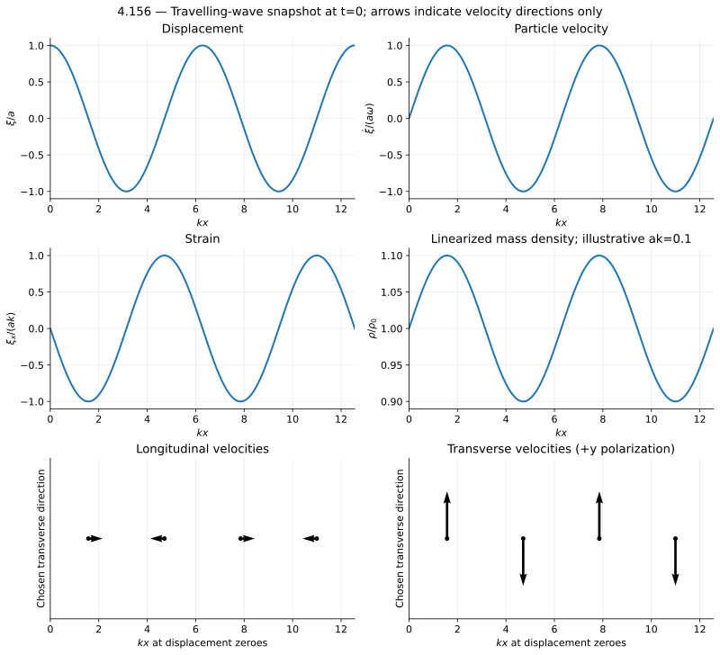
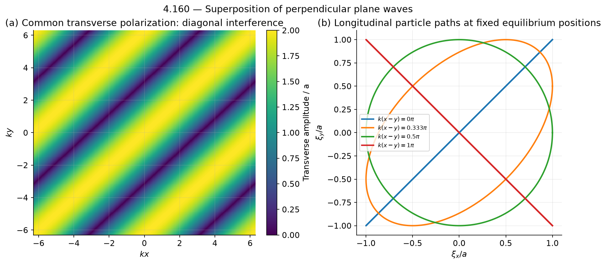
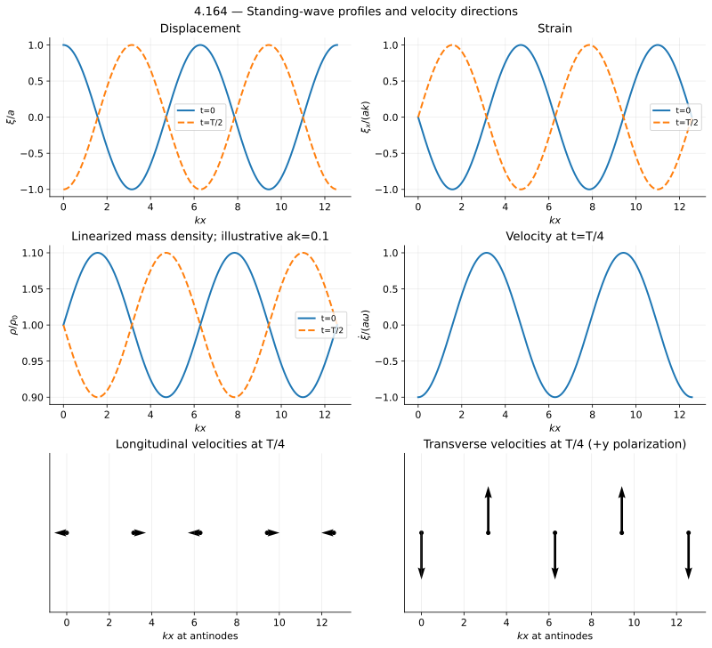
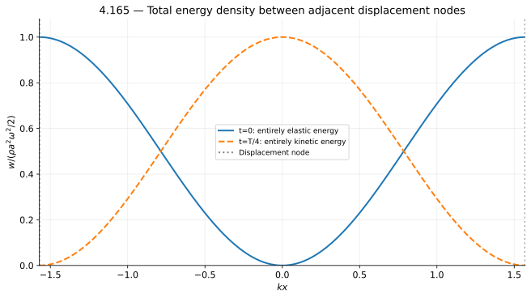
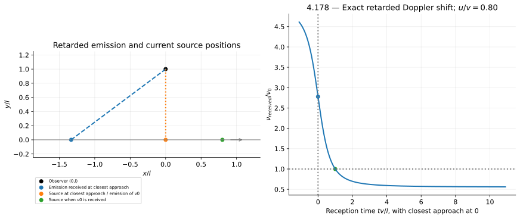

# 4.3 Elastic Waves. Acoustics

[Chapter index](../README.md#chapters) · [Structured solutions](4.3.json) · [Answer audit](../audit/README.md)

## 4.150

**Problem statement**

How long will it take sound waves to travel the distance $l$ between the points A and B if the air temperature between them varies linearly from $T_1$ to $T_2$ ? The velocity of sound propagation in air is equal to $v=\alpha\sqrt{T}$, where $\alpha$ is a constant.

**Solved · high confidence.** Integrate the local sound travel time through the linear temperature profile.

**Assumptions**

- Use absolute temperature T>0 and a stationary medium with no wind. Take x from A to B along the specified path, with x=0 at T1 and x=l at T2. The local propagation speed is alpha*sqrt(T), with alpha>0.
- Assume the local-speed description and the stated path are valid; temperature varies slowly enough for geometrical acoustics.

Write the prescribed temperature profile and add the incremental travel times.

$$
T(x)=T_1+\frac{T_2-T_1}{l}x,\quad t=\int_0^l\frac{dx}{\alpha\sqrt{T(x)}}.
$$

For unequal endpoint temperatures perform the elementary integral and rationalize the result.

$$
t=\frac{2l(\sqrt{T_2}-\sqrt{T_1})}{\alpha(T_2-T_1)}=\frac{2l}{\alpha(\sqrt{T_1}+\sqrt{T_2})}.
$$

The rationalized form is continuous at equal temperatures and can be expressed through the endpoint speeds.

$$
\boxed{t=\frac{2l}{v_1+v_2}},\quad T_2=T_1=T:\ t=\frac{l}{\alpha\sqrt T}.
$$

**Results**

Travel time along the specified path

$$
t=2l/[\alpha(\sqrt{T_1}+\sqrt{T_2})]=2l/(v_1+v_2)
$$

**Limitations**

- An arbitrary transverse temperature profile could refract the ray and change the path length; the solution uses the one-dimensional path specified by the question.

## 4.151

**Problem statement**

A plane harmonic wave with frequency $\omega$ propagates at a velocity v in a direction forming angles $\alpha$, $\beta$, $\gamma$ with the x, y, z axes. Find the phase difference between the oscillations at the points of medium with coordinates $x_1$, $y_1$, $z_1$ and $x_2$, $y_2$, $z_2$ .

**Solved · high confidence.** Project the point separation onto the propagation direction.

**Assumptions**

- Define the scalar phase by Phi(r,t)=omega*t-k_vector dot r+Phi0, with omega>0 and phase speed v>0. The propagation direction has direction cosines cos(alpha), cos(beta), cos(gamma), whose squares sum to one.

The wave vector is parallel to the propagation direction and has magnitude omega/v.

$$
\mathbf n=(\cos\alpha,\cos\beta,\cos\gamma),\quad \mathbf k=(\omega/v)\mathbf n.
$$

At a common time the phase at point 2 minus that at point 1 is the negative wave-vector projection.

$$
\Delta\Phi_{2-1}=-\mathbf k\cdot(\mathbf r_2-\mathbf r_1)=-\frac{\omega}{v}[(x_2-x_1)\cos\alpha+(y_2-y_1)\cos\beta+(z_2-z_1)\cos\gamma].
$$

If the phrase phase difference denotes the phase lag of point 2, use the opposite sign; all phase differences are modulo 2 pi.

$$
\text{phase lag of 2 relative to 1}=\mathbf k\cdot(\mathbf r_2-\mathbf r_1)\pmod{2\pi}.
$$

**Results**

Phase at point 2 minus phase at point 1

$$
\Delta\Phi_{2-1}=-(\omega/v)\,\mathbf n\cdot(\mathbf r_2-\mathbf r_1)\pmod{2\pi}
$$

## 4.152

**Problem statement**

A plane wave of frequency $\omega$ propagates so that a certain phase of oscillation moves along the x, y, z axes with velocities $v_1$, $v_2$, $v_3$ respectively. Find the wave vector $\mathbf{k}$, assuming the unit vectors $\mathbf{e}_x$, $\mathbf{e}_y$, $\mathbf{e}_z$ of the coordinate axes to be assigned.

**Solved · high confidence.** Interpret the axis speeds as speeds of phase-plane intersections, not Cartesian velocity components.

**Assumptions**

- Use phase omega*t-k dot r=constant with omega>0. The axis speeds v1,v2,v3 are signed rates of the same phase intersection along each axis, with the other coordinates fixed. Infinite axis speed is allowed when the phase does not vary along that axis.

Differentiate the constant-phase condition while moving along one coordinate axis at a time.

$$
\omega-k_xv_1=0,\quad\omega-k_yv_2=0,\quad\omega-k_zv_3=0.
$$

The three reciprocal speeds determine the wave-vector components.

$$
\boxed{\mathbf k=\omega\left(\frac{\mathbf e_x}{v_1}+\frac{\mathbf e_y}{v_2}+\frac{\mathbf e_z}{v_3}\right)}.
$$

The actual normal phase speed follows from the magnitude of the wave vector.

$$
v_{\rm phase}=\frac{\omega}{|\mathbf k|}=\left(v_1^{-2}+v_2^{-2}+v_3^{-2}\right)^{-1/2}.
$$

**Results**

Wave vector from signed phase-intersection speeds

$$
\mathbf k=\omega(\mathbf e_x/v_1+\mathbf e_y/v_2+\mathbf e_z/v_3)
$$

Actual phase speed normal to the phase planes

$$
v_{\rm phase}=(v_1^{-2}+v_2^{-2}+v_3^{-2})^{-1/2}
$$

**Limitations**

- An assigned finite zero axis speed is inconsistent with a nonzero finite angular frequency. Signs cannot be inferred if only unsigned axis-speed magnitudes are supplied.

## 4.153

**Problem statement**

A plane elastic wave $\xi=a\cos(\omega t-kx)$ propagates in a medium K. Find the equation of this wave in a reference frame K' moving in the positive direction of the x axis with a constant velocity V relative to the medium K. Investigate the expression obtained.

**Solved · high confidence.** Transform the phase under a Galilean change of coordinates.

**Assumptions**

- Use nonrelativistic acoustics with x=x_prime+V*t_prime and t=t_prime. V is positive along x. The displacement perturbation relative to the local unperturbed medium is unchanged; the medium itself moves at -V in the primed frame.
- Take k>0, omega>0 and v=omega/k for the original wave.

Substitute the moving coordinates into the scalar displacement field.

$$
\xi^\prime(x^\prime,t^\prime)=a\cos[(\omega-kV)t^\prime-kx^\prime].
$$

The wavelength at a common Galilean time is unchanged, while the signed frequency and phase speed transform.

$$
\Omega^\prime=\omega-kV=k(v-V),\quad \lambda^\prime=2\pi/k,\quad v_{\rm phase}^\prime=v-V,\quad\omega_{\rm observed}^\prime=|\omega-kV|.
$$

At the wave speed the pattern is frozen. If the frame overtakes the wave, rewrite with positive frequency to see propagation in the negative primed direction.

$$
V=v:\ \xi^\prime=a\cos(kx^\prime);\quad V>v:\ \xi^\prime=a\cos[(kV-\omega)t^\prime+kx^\prime].
$$

The transformed equation includes the motion of the medium rather than retaining an unchanged rest-medium wave equation.

$$
(\partial_{t^\prime}-V\partial_{x^\prime})^2\xi^\prime=v^2\partial_{x^\prime}^2\xi^\prime.
$$

**Results**

Wave in the moving frame

$$
\xi^\prime=a\cos[(\omega-kV)t^\prime-kx^\prime]
$$

Nonnegative temporal angular frequency at a fixed primed point

$$
\omega_{\rm observed}^\prime=|\omega-kV|
$$

Signed phase velocity relative to the moving frame

$$
v^\prime=v-V
$$

**Limitations**

- This is a Galilean medium-wave calculation. It does not assume Lorentz invariance or identify particle displacement velocity with the wave phase velocity.

## 4.154

**Problem statement**

Demonstrate that any differentiable function $f(t\pm\alpha x)$, where $\alpha$ is a constant, provides a solution of wave equation. What is the physical meaning of the constant $\alpha$?

**Solved · high confidence.** Apply the chain rule and state the regularity needed for a classical wave equation.

**Assumptions**

- For the classical demonstration let f be twice differentiable, with continuous second derivatives if a classical C2 field is required. The printed differentiable-only wording is insufficient to guarantee existence of second derivatives.
- Consider a finite positive wave speed v and a nonzero real alpha. Exceptional affine f has vanishing second derivative and solves the equation independently of this parameter relation.

For u=t plus or minus alpha*x, the two second derivatives contain the same function derivative.

$$
\xi=f(u),\quad \partial_t^2\xi=f^{\prime\prime}(u),\quad \partial_x^2\xi=\alpha^2 f^{\prime\prime}(u).
$$

The one-dimensional wave equation is satisfied for every such profile if alpha squared is the inverse speed squared.

$$
\partial_x^2\xi=\frac1{v^2}\partial_t^2\xi\quad\Longleftrightarrow\quad \alpha^2=\frac1{v^2}\quad\text{for arbitrary }f.
$$

Follow a fixed profile argument to identify propagation direction and the meaning of alpha.

$$
t-\alpha x=\mathrm{const}:\ \frac{dx}{dt}=\frac1\alpha;\quad t+\alpha x=\mathrm{const}:\ \frac{dx}{dt}=-\frac1\alpha;\quad v=1/|\alpha|.
$$

**Results**

Profile solution and required speed

$$
\xi=f(t\pm\alpha x),\quad v=1/|\alpha|
$$

Physical meaning and dimensions of alpha

$$
|\alpha|=1/v,\quad [\alpha]=\mathrm{s/m}
$$

**Limitations**

- If f is only differentiable, second derivatives need not exist pointwise; the same translated profile can instead be interpreted as a weak or distributional solution at v=1/abs(alpha).
- For alpha=0 the field is spatially uniform, and a finite-speed wave equation requires f_double_dot=0; an arbitrary time-varying profile is not a solution.

## 4.155

**Problem statement**

The equation of a travelling plane sound wave has the form $\xi=60\cos(1800t-5.3x)$, where $\xi$ is expressed in micrometres, t in seconds, and x in metres. Find: (a) the ratio of the displacement amplitude, with which the particles of medium oscillate, to the wavelength; (b) the velocity oscillation amplitude of particles of the medium and its ratio to the wave propagation velocity; (c) the oscillation amplitude of relative deformation of the medium and its relation to the velocity oscillation amplitude of particles of the medium.

**Solved · high confidence.** Read the wave parameters in SI units and differentiate displacement.

**Assumptions**

- The supplied displacement is longitudinal acoustic displacement. Convert 60 micrometres to 60e-6 metres; omega=1800 per second and k=5.3 per metre. Use the small-strain plane-wave model.

The wavelength and phase velocity follow from a constant phase.

$$
a=60\times10^{-6}\ \mathrm m,\quad \lambda=2\pi/k=1.185506662\ \mathrm m,\quad v=\omega/k=339.6226415\ \mathrm{m/s}.
$$

The displacement-to-wavelength ratio and particle velocity amplitude are small compared with their wave scales.

$$
\frac a\lambda=\frac{ak}{2\pi}=5.061127190\times10^{-5},\quad u_m=a\omega=0.108\ \mathrm{m/s},\quad \frac{u_m}{v}=ak=3.18\times10^{-4}.
$$

Differentiate with respect to position for the longitudinal strain. Its amplitude equals particle-speed amplitude divided by phase speed.

$$
\epsilon=\partial_x\xi=ak\sin(\omega t-kx),\quad\epsilon_m=ak=3.18\times10^{-4}=\frac{u_m}{v}.
$$

**Results**

Displacement amplitude divided by wavelength

$$
a/\lambda=ak/(2\pi)
$$

Particle velocity amplitude

$$
u_m=a\omega
$$

Particle velocity amplitude divided by phase speed

$$
u_m/v=ak
$$

Relative deformation amplitude

$$
\epsilon_m=ak=u_m/v
$$

Wave phase speed used in the ratios

$$
v=\omega/k
$$

## 4.156

**Problem statement**

A plane wave $\xi=a\cos(\omega t-kx)$ propagates in a homogeneous elastic medium. For the moment t = 0 draw (a) the plots of $\xi$, $\partial\xi/\partial t$, and $\partial\xi/\partial x$ vs x; (b) the velocity direction of the particles of the medium at the points where $\xi=0$, for the cases of longitudinal and transverse waves; (c) the approximate plot of density distribution $\rho(x)$ of the medium for the case of longitudinal waves.

**Solved · high confidence.** Differentiate the traveling wave and obtain density from one-dimensional mass conservation.

**Assumptions**

- Use a>0, omega>0, k>0, with propagation along +x. For a longitudinal wave displacement is along x; for the transverse illustration choose displacement along +y.
- Use the linear small-strain density relation for the requested approximate density plot. Here x denotes equilibrium material position; the current position in a longitudinal wave is x+xi(x,t).

At t=0 the three profiles have cosine, positive sine and negative sine spatial phases.

$$
\xi(x,0)=a\cos kx,\quad \partial_t\xi(x,0)=a\omega\sin kx,\quad \partial_x\xi(x,0)=-ak\sin kx.
$$

Displacement zeroes occur at odd quarter wavelengths. The sign of the time derivative gives the particle motion, not the phase velocity.

$$
x_n=\frac{\pi/2+n\pi}{k},\quad \partial_t\xi(x_n,0)=(-1)^na\omega.
$$

For longitudinal displacement the velocity points alternately along +x and -x; for the chosen transverse polarization it points along +y and -y.

$$
\mathbf u_{\parallel}(x_n,0)=(-1)^na\omega\,\mathbf e_x,\quad\mathbf u_{\perp}(x_n,0)=(-1)^na\omega\,\mathbf e_y.
$$

Conservation of mass in a material interval gives the density Jacobian. To first order the density perturbation is opposite the strain.

$$
\rho(x+\xi,0)=\frac{\rho_0}{1+\partial_x\xi(x,0)},\quad \rho(x,0)\simeq\rho_0[1+ak\sin kx].
$$

**Results**

Displacement profile at zero time

$$
\xi(x,0)=a\cos kx
$$

Particle velocity profile at zero time

$$
\partial_t\xi(x,0)=a\omega\sin kx
$$

Spatial displacement derivative at zero time

$$
\partial_x\xi(x,0)=-ak\sin kx
$$

Velocity at displacement zeroes, longitudinal or chosen transverse polarization

$$
\mathbf u(x_n,0)=(-1)^na\omega\,\mathbf e_{\rm polarization},\quad x_n=(\pi/2+n\pi)/k
$$

Approximate longitudinal density profile

$$
\rho(x,0)\simeq\rho_0[1+ak\sin kx]
$$

**Limitations**

- The approximate density profile assumes abs(ak)<<1. The exact one-dimensional Jacobian is written at the actual material position, whereas replacing that coordinate by x is valid only to first order.

## 4.157

**Problem statement**

A plane elastic wave $\xi=ae^{-\gamma x}\cos(\omega t-kx)$, where $a$, $\gamma$, $\omega$, and $k$ are constants, propagates in a homogeneous medium. Find the phase difference between the oscillations at the points where the particles' displacement amplitudes differ by $\eta=1.0\%$, if $\gamma=0.42$ m⁻¹ and the wavelength is $\lambda=50$ cm.

**Solved · medium confidence.** Infer spatial separation from exponential amplitude decay, then multiply by wave number.

**Assumptions**

- Use gamma=0.42 per metre and wavelength lambda=0.50 m. The requested phase difference is reported as a nonnegative separation magnitude; the signed phase at the more distant point minus the nearer point is negative.
- A percentage difference needs a reference amplitude. For the primary numerical value take a 1 percent decrease relative to the larger amplitude: A_far=(1-0.01)*A_near. Also give the alternative reference and the common first-order result.

The amplitude ratio fixes the separation independently of the initial amplitude.

$$
A(x)=ae^{-\gamma x},\quad \Delta x=\frac1\gamma\ln\frac{A_{\rm near}}{A_{\rm far}}.
$$

The harmonic phase decreases by k times the distance. This is the general answer without a percentage convention.

$$
|\Delta\Phi|=k\Delta x=\frac{2\pi}{\gamma\lambda}\ln\frac{A_{\rm near}}{A_{\rm far}}.
$$

With the larger-amplitude reference the exact logarithm is minus log(0.99). With the smaller-amplitude reference it is log(1.01). Both agree to the given precision with the small-percentage expansion.

$$
|\Delta\Phi|_{\rm larger}=-\frac{2\pi}{\gamma\lambda}\ln(0.99),\quad |\Delta\Phi|_{\rm smaller}=\frac{2\pi}{\gamma\lambda}\ln(1.01),\quad |\Delta\Phi|\simeq\frac{2\pi(0.01)}{\gamma\lambda}\simeq0.30\ \mathrm{rad}.
$$

**Results**

Phase-separation magnitude for an unambiguous amplitude ratio

$$
|\Delta\Phi|=(2\pi/(\gamma\lambda))\ln(A_{\rm near}/A_{\rm far})
$$

One percent decrease relative to the larger amplitude

$$
|\Delta\Phi|=-2\pi\ln(0.99)/(\gamma\lambda)
$$

One percent difference relative to the smaller amplitude

$$
|\Delta\Phi|=2\pi\ln(1.01)/(\gamma\lambda)
$$

Common first-order small-percentage result

$$
|\Delta\Phi|\simeq2\pi(0.01)/(\gamma\lambda)
$$

**Limitations**

- The printed statement does not specify which amplitude is the percentage denominator. Its two exact interpretations differ slightly, but both round to about 0.30 rad with the supplied precision.

## 4.158

**Problem statement**

Find the radius vector defining the position of a point source of spherical waves if that source is known to be located on the straight line between the points with radius vectors $\mathbf{r}_1$ and $\mathbf{r}_2$ at which the oscillation amplitudes of particles of the medium are equal to $a_1$ and $a_2$ . The damping of the wave is negligible, the medium is homogeneous.

**Solved · high confidence.** Use inverse-distance spherical-wave amplitude and locate the source by division of a segment.

**Assumptions**

- Assume nonzero positive amplitudes a1 and a2 at distinct points r1 and r2, a nonzero isotropic point source, a homogeneous lossless medium, and spherical displacement amplitude proportional to inverse source distance.
- The primary reading of between the points places the source on the open segment joining them. Give the additional solution if the phrase is read as the entire supporting straight line.

Let D be the point separation and s the distance from point 1 to a source lying between them. The common spherical-wave amplitude coefficient fixes the ratio of distances.

$$
D=|\mathbf r_2-\mathbf r_1|,\quad a_1s=a_2(D-s),\quad s=\frac{a_2D}{a_1+a_2}.
$$

The source divides the segment in this ratio, giving a weighted radius vector.

$$
\mathbf r_s=\mathbf r_1+\frac{s}{D}(\mathbf r_2-\mathbf r_1)=\boxed{\frac{a_1\mathbf r_1+a_2\mathbf r_2}{a_1+a_2}}.
$$

On the whole line, the same amplitude-ratio equation with absolute distances has an external-division branch when the amplitudes differ.

$$
\mathbf r_{s,\rm ext}=\frac{a_1\mathbf r_1-a_2\mathbf r_2}{a_1-a_2},\quad a_1\ne a_2.
$$

Equal amplitudes put the finite collinear source at the midpoint; the exterior branch then has no finite solution.

$$
a_1=a_2:\quad\mathbf r_s=(\mathbf r_1+\mathbf r_2)/2.
$$

**Results**

Source on the segment between the specified points

$$
\mathbf r_s=(a_1\mathbf r_1+a_2\mathbf r_2)/(a_1+a_2)
$$

Additional source if the entire supporting line is allowed

$$
\mathbf r_{s,\rm ext}=(a_1\mathbf r_1-a_2\mathbf r_2)/(a_1-a_2),\quad a_1\ne a_2
$$

**Limitations**

- Amplitude data alone generally locate an Apollonius surface; the stated collinearity and between-points restriction select the primary source position.
- A zero amplitude or coincidence with the ideal point source lies outside this nonzero inverse-distance model.

## 4.159

**Problem statement**

A point isotropic source generates sound oscillations with frequency $\nu=1.45$ kHz. At a distance $r_0=5.0$ m from the source the displacement amplitude of particles of the medium is equal to $a_0=50$ μm, and at the point A located at a distance r = 10.0 m from the source the displacement amplitude is $\eta=3.0$ times less than $a_0$ . Find: (a) the damping coefficient $\gamma$ of the wave; (b) the velocity oscillation amplitude of particles of the medium at the point A.

**Solved · high confidence.** Separate geometric spherical spreading from exponential material attenuation.

**Assumptions**

- Use the textbook spherical-wave displacement amplitude law A(r)=K*exp(-gamma*r)/r in a homogeneous isotropic medium. The source is harmonic and the quoted particle displacement is the oscillatory amplitude.
- The frequency remains nu=1450 Hz. At A the displacement amplitude is a0/eta=50 micrometres/3.

The amplitude ratio includes inverse-distance spreading even in the absence of absorption.

$$
\frac{a_0}{a(r)}=\frac r{r_0}e^{\gamma(r-r_0)}=\eta.
$$

Solve for the amplitude attenuation coefficient.

$$
\gamma=\frac{\ln(\eta r_0/r)}{r-r_0}=\frac{\ln(1.5)}5=0.08109302162\ \mathrm{m}^{-1}.
$$

Differentiate the harmonic displacement in time. Its local velocity amplitude is omega times its local displacement amplitude.

$$
u_m(A)=2\pi\nu\,\frac{a_0}{\eta}=0.1518436449\ \mathrm{m/s}.
$$

**Results**

Amplitude damping coefficient

$$
\gamma=\ln(\eta r_0/r)/(r-r_0)
$$

Particle velocity oscillation amplitude at A

$$
u_m(A)=2\pi\nu a_0/\eta
$$

**Limitations**

- The specified 1/r damped spherical-wave model is used; reactive near-source corrections and frequency-dependent changes of the source pattern are not included.

## 4.160

**Problem statement**

Two plane waves propagate in a homogeneous elastic medium, one along the x axis and the other along the y axis: $\xi_1=a\cos(\omega t-kx)$, $\xi_2=a\cos(\omega t-ky)$. Find the wave motion pattern of particles in the plane xy if both waves (a) are transverse and their oscillation directions coincide; (b) are longitudinal.

**Solved · high confidence.** Add displacement vectors and distinguish spatial interference from time-dependent beats.

**Assumptions**

- Both waves have the same angular frequency omega, equal wave-number magnitude k, and the coherent phases printed in the statement. Coordinates label equilibrium particle positions in the linearized medium.
- A common transverse polarization must be perpendicular to both x and y, so choose +z. For longitudinal waves the first displacement is along +x and the second along +y; these orthogonal components cannot be added as scalars.

Define a common time phase and a position-dependent half phase difference.

$$
\theta=\omega t-\frac{k(x+y)}2,\quad\delta=\frac{k(x-y)}2,\quad\omega t-kx=\theta-\delta,\quad\omega t-ky=\theta+\delta.
$$

For equal transverse polarizations the displacement is a local one-dimensional harmonic oscillation with a spatially varying signed amplitude.

$$
\text{(a)}\quad\boldsymbol\xi=2a\cos\delta\cos\theta\,\mathbf e_z,\quad A_\perp=2a|\cos\delta|.
$$

The transverse interference nodes and antinodes lie on parallel diagonals in the xy plane. There are no temporal beats at a fixed particle because the two frequencies coincide.

$$
\text{nodes: }k(x-y)=(2n+1)\pi;\quad\text{antinodes: }k(x-y)=2n\pi.
$$

For longitudinal waves transform to diagonal displacement coordinates u and v. Each particle traces an ellipse whose principal axes are the two diagonal directions.

$$
\text{(b)}\quad\boldsymbol\xi=a\cos(\theta-\delta)\mathbf e_x+a\cos(\theta+\delta)\mathbf e_y;\quad \xi_u=\frac{\xi_x+\xi_y}{\sqrt2}=\sqrt2a\cos\delta\cos\theta,\quad\xi_v=\frac{\xi_x-\xi_y}{\sqrt2}=\sqrt2a\sin\delta\sin\theta.
$$

Eliminating time gives the ellipse, with the vanishing-denominator cases understood as straight lines.

$$
\frac{\xi_u^2}{2a^2\cos^2\delta}+\frac{\xi_v^2}{2a^2\sin^2\delta}=1;\quad A_u=\sqrt2a|\cos\delta|,\quad A_v=\sqrt2a|\sin\delta|.
$$

Line and circle limits, and the signed rotation direction, complete the local particle-motion pattern.

$$
k(x-y)=n\pi:\ \text{line motion};\quad k(x-y)=\pi/2+n\pi:\ \text{circle of radius }a;\quad \xi_x\dot\xi_y-\xi_y\dot\xi_x=-a^2\omega\sin[k(x-y)].
$$

**Results**

Transverse displacement field and local amplitude

$$
\boldsymbol\xi_\perp=2a\cos[k(x-y)/2]\cos[\omega t-k(x+y)/2]\mathbf e_z,\quad A_\perp=2a|\cos[k(x-y)/2]|
$$

Longitudinal vector displacement field

$$
\boldsymbol\xi_\parallel=a\cos(\omega t-kx)\mathbf e_x+a\cos(\omega t-ky)\mathbf e_y
$$

Longitudinal particle-trajectory principal semiaxes

$$
A_u=\sqrt2a|\cos[k(x-y)/2]|,\quad A_v=\sqrt2a|\sin[k(x-y)/2]|
$$

**Limitations**

- The spatial envelope is an interference pattern, not a temporal beat envelope. If the frequencies or polarization directions differed, the local trajectories and envelopes would change.

## 4.161

**Problem statement**

A plane undamped harmonic wave propagates in a medium. Find the mean space density of the total oscillation energy $\langle w\rangle$, if at any point of the medium the space density of energy becomes equal to $w_0$ one-sixth of an oscillation period after passing the displacement maximum.

**Solved · high confidence.** Use the instantaneous traveling-wave kinetic and elastic energy densities before averaging.

**Assumptions**

- Use the standard linear, nondispersive plane traveling-wave model in a homogeneous lossless medium. The stated energy density w0 is the total instantaneous density, kinetic plus elastic, at a fixed spatial point T/6 after a displacement maximum.
- Choose phase zero at that displacement maximum; rho denotes the equilibrium mass density and a the displacement amplitude.

The particle velocity and strain are in the same traveling-wave phase. Their energies are equal at each point and time because the elastic modulus is rho*v^2.

$$
\xi=a\cos\theta,\quad w_{\rm kin}=\frac12\rho a^2\omega^2\sin^2\theta,\quad w_{\rm pot}=\frac12\rho a^2\omega^2\sin^2\theta.
$$

The total density is not constant at a fixed point: energy flows through it. Evaluate the phase after T/6.

$$
w=\rho a^2\omega^2\sin^2\theta,\quad \theta(T/6)=\pi/3,\quad w_0=\frac34\rho a^2\omega^2.
$$

Average the total density over time, or equivalently over one wavelength at a common time.

$$
\langle w\rangle=\frac12\rho a^2\omega^2=\boxed{\frac23w_0}.
$$

**Results**

Mean total oscillation energy per unit volume

$$
\langle w\rangle=2w_0/3
$$

**Limitations**

- If w0 denoted only kinetic or only potential energy, the ratio would differ. The result uses the printed total-energy specification and the elementary nondispersive elastic-wave model.

## 4.162

**Problem statement**

A point isotropic sound source is located on the perpendicular to the plane of a ring drawn through the centre O of the ring. The distance between the point O and the source is $l=1.00$ m, the radius of the ring is R = 0.50 m. Find the mean energy flow across the area enclosed by the ring if at the point O the intensity of sound is equal to $I_0$ = 30 μW/m² . The damping of the waves is negligible.

**Solved · high confidence.** Integrate the normal component of isotropic inverse-square energy flux over the disk.

**Assumptions**

- The source lies on the ring axis at distance l from its center. Let s be radial distance in the disk and choose the surface normal toward the transmitted energy. I0 is the time-averaged intensity magnitude at the disk center.
- Use lossless isotropic spherical spreading and interpret mean energy flow across the area as time-averaged power through that disk. The area-averaged normal flux density is supplied separately.

At radius s the source distance grows and the energy-flow direction is oblique to the disk normal.

$$
r=\sqrt{l^2+s^2},\quad I(r)=I_0l^2/r^2,\quad \cos\vartheta=l/r.
$$

Integrate the projected intensity, not its full magnitude, over annular area elements.

$$
P_{\rm disk}=\int_0^R I(r)\cos\vartheta\,2\pi s\,ds=2\pi I_0l^3\int_0^R\frac{s\,ds}{(l^2+s^2)^{3/2}}.
$$

The result is also the source power times the solid-angle fraction subtended by the disk.

$$
\boxed{P_{\rm disk}=2\pi I_0l^2\left(1-\frac l{\sqrt{l^2+R^2}}\right)},\quad\Omega_{\rm disk}=2\pi\left(1-\frac l{\sqrt{l^2+R^2}}\right).
$$

Substitute the stated geometry and intensity; divide by the disk area only if an area-averaged normal flux density is desired.

$$
P_{\rm disk}\simeq1.9900\times10^{-5}\ \mathrm W,\quad\overline I_n=P_{\rm disk}/(\pi R^2).
$$

**Results**

Mean energy transmitted through the enclosed disk per unit time

$$
P_{\rm disk}=2\pi I_0l^2[1-l/\sqrt{l^2+R^2}]
$$

Optional area-averaged normal intensity

$$
\overline I_n=P_{\rm disk}/(\pi R^2)
$$

## 4.163

**Problem statement**

A point isotropic source with sonic power P = 0.10 W is located at the centre of a round hollow cylinder with radius $R=1.0$ m and height h = 2.0 m. Assuming the sound to be completely absorbed by the walls of the cylinder, find the mean energy flow reaching the lateral surface of the cylinder.

**Solved · high confidence.** Integrate radial intensity projected onto the cylindrical sidewall.

**Assumptions**

- The isotropic point source is at the cylinder geometric center. Propagation is lossless before incidence and the wall absorbs all incident sound, so no reflected field returns.
- Mean energy flow means total time-averaged power intercepted by the lateral surface. End caps are excluded.

A ring at axial coordinate z has distance sqrt(R^2+z^2) from the source. Its normal projection introduces an extra factor R/distance.

$$
I(r)=\frac{P}{4\pi r^2},\quad r=\sqrt{R^2+z^2},\quad\cos\theta=\frac Rr,\quad dA=2\pi R\,dz.
$$

Integrate over the height to obtain the intercepted fraction of the full solid angle.

$$
P_{\rm side}=\frac{PR^2}{2}\int_{-h/2}^{h/2}\frac{dz}{(R^2+z^2)^{3/2}}=\frac{Ph}{\sqrt{h^2+4R^2}}.
$$

Insert the supplied dimensions and power. A surface-averaged normal intensity, if desired, is a different quantity.

$$
P_{\rm side}=0.07071067812\ {\rm W},\quad\overline{I_n}=\frac{P_{\rm side}}{2\pi Rh}=0.005626976976\ {\rm W\,m^{-2}}.
$$

**Results**

Mean power reaching the lateral surface

$$
P_{\rm side}=Ph/\sqrt{h^2+4R^2}
$$

Surface-averaged normal energy flux density

$$
\overline{I_n}=P_{\rm side}/(2\pi Rh)
$$

## 4.164

**Problem statement**

The equation of a plane standing wave in a homogeneous elastic medium has the form $\xi=a\cos kx\cdot\cos\omega t$. Plot: (a) $\xi$ and $\partial\xi/\partial x$ as functions of x at the moments t = 0 and t = T/2, where T is the oscillation period; (b) the distribution of density $\rho(x)$ of the medium at the moments t = 0 and t = T/2 in the case of longitudinal oscillations; (c) the velocity distribution of particles of the medium at the moment t = T/4; indicate the directions of velocities at the antinodes, both for longitudinal and transverse oscillations.

**Solved · high confidence.** Differentiate the standing displacement field and use linear mass conservation.

**Assumptions**

- Let x denote the undisturbed material coordinate; at linear order it can also label the laboratory profile. The amplitude strain ak is small, and rho0 denotes the undisturbed density.
- For the longitudinal case, particle displacement and velocity are along +x when their scalar values are positive. For the transverse illustration choose polarization +y.

The spatial derivative reverses along with displacement after half a period.

$$
\xi=a\cos kx\cos\omega t,\quad\xi_x=-ak\sin kx\cos\omega t,\quad T=2\pi/\omega.
$$

Linearized one-dimensional mass conservation makes the density perturbation opposite to the strain.

$$
\delta\rho=-\rho_0\xi_x=\rho_0ak\sin kx\cos\omega t,\quad\rho(x,t)\simeq\rho_0[1+ak\sin kx\cos\omega t].
$$

At the requested two phases the profiles are the following sinusoids.

$$
t=0:\ (\xi,\xi_x,\rho)=(a\cos kx,-ak\sin kx,\rho_0[1+ak\sin kx]);\quad t=T/2:\ (\xi,\xi_x,\rho)=(-a\cos kx,+ak\sin kx,\rho_0[1-ak\sin kx]).
$$

Differentiate in time for particle velocity. At a displacement antinode the sign alternates between successive antinodes.

$$
u=\xi_t=-a\omega\cos kx\sin\omega t,\quad u(x,T/4)=-a\omega\cos kx,\quad x_j=j\pi/k:\ u_j=-a\omega(-1)^j.
$$

**Results**

Displacement and strain at the two requested phases

$$
t=0:\xi=a\cos kx,\ \xi_x=-ak\sin kx;\quad t=T/2:\xi=-a\cos kx,\ \xi_x=ak\sin kx
$$

Longitudinal density profiles

$$
\rho(x,0)=\rho_0(1+ak\sin kx),\quad\rho(x,T/2)=\rho_0(1-ak\sin kx)
$$

Velocity at quarter period

$$
u(x,T/4)=-a\omega\cos kx
$$

Directions at successive displacement antinodes

$$
\boldsymbol u_j=-a\omega(-1)^j\boldsymbol e_x\quad\text{(longitudinal)},\qquad\boldsymbol u_j=-a\omega(-1)^j\boldsymbol e_y\quad\text{(transverse)}
$$

**Limitations**

- The density expressions are linearized. For fixed transverse area the exact material-coordinate statement is rho_current(x+xi,t)=rho0/(1+xi_x); replacing material coordinate by laboratory coordinate adds only higher-order terms.

## 4.165

**Problem statement**

A longitudinal standing wave $\xi=a\cos kx\cdot\cos\omega t$ is maintained in a homogeneous medium of density $\rho$. Find the expressions for the space density of (a) potential energy $w_p(x,t)$; (b) kinetic energy $w_k(x,t)$. Plot the space density distribution of the total energy w in the space between the displacement nodes at the moments t = 0 and t = $T/4$, where T is the oscillation period.

**Solved · high confidence.** Use quadratic elastic and kinetic energy densities of the standing longitudinal mode.

**Assumptions**

- The wave is linear, nondispersive and undamped. Its longitudinal elastic modulus M satisfies M=rho*c^2 and c=omega/k; rho is the equilibrium density.
- The scalar amplitude a is the maximum displacement of the resultant standing wave, not of either individual travelling component.

Strain supplies potential energy, whereas particle velocity supplies kinetic energy.

$$
\xi_x=-ak\sin kx\cos\omega t,\quad\xi_t=-a\omega\cos kx\sin\omega t,\quad w_p=\tfrac12M\xi_x^2,\quad w_k=\tfrac12\rho\xi_t^2.
$$

Use the wave dispersion relation to give both energy densities the same scale.

$$
W_*\equiv\tfrac12\rho a^2\omega^2,\quad w_p=W_*\sin^2kx\cos^2\omega t,\quad w_k=W_*\cos^2kx\sin^2\omega t.
$$

At t=0 the energy is entirely elastic and concentrated around displacement nodes; at quarter period it is entirely kinetic and concentrated around antinodes.

$$
w(x,0)=W_*\sin^2kx,\quad w(x,T/4)=W_*\cos^2kx,\quad -\pi/2\leq kx\leq\pi/2.
$$

Integrating over a full interval between adjacent displacement nodes verifies that total energy is constant despite its changing spatial distribution.

$$
\int_{-\pi/(2k)}^{\pi/(2k)}w\,dx=\frac{\pi\rho a^2\omega^2}{4k}.
$$

**Results**

Potential energy density

$$
w_p(x,t)=\tfrac12\rho a^2\omega^2\sin^2kx\cos^2\omega t
$$

Kinetic energy density

$$
w_k(x,t)=\tfrac12\rho a^2\omega^2\cos^2kx\sin^2\omega t
$$

Total energy density at zero phase

$$
w(x,0)=\tfrac12\rho a^2\omega^2\sin^2kx
$$

Total energy density at quarter period

$$
w(x,T/4)=\tfrac12\rho a^2\omega^2\cos^2kx
$$

## 4.166

**Problem statement**

A string 120 cm in length sustains a standing wave, with the points of the string at which the displacement amplitude is equal to 3.5 mm being separated by 15.0 cm. Find the maximum displacement amplitude. To which overtone do these oscillations correspond?

**Solved · medium confidence.** Use alternating equal-amplitude crossing gaps of a standing sine profile.

**Assumptions**

- For the intended unique answer, take both string ends as displacement nodes and interpret the quoted 15 cm as the spacing between EVERY successive point whose displacement amplitude is 3.5 mm.
- The observed amplitude is positive and below the antinode amplitude, so there are two such crossings in each half-wave lobe.

With amplitude profile A(x)=amax*abs(sin(k*x)), let alpha be the crossing phase in a positive lobe.

$$
\sin\alpha=b/a_{\max},\quad0<\alpha<\pi/2,\quad\Delta x_1=(\pi-2\alpha)/k,\quad\Delta x_2=2\alpha/k.
$$

All successive gaps are equal only when the two gap types coincide.

$$
\Delta x_1=\Delta x_2=d\Rightarrow\alpha=\pi/4,\quad k=\pi/(2d),\quad\lambda=4d=0.60\ {\rm m},\quad a_{\max}=\sqrt2\,b.
$$

The fixed-end standing-wave condition gives four half-waves along the string.

$$
n=2l/\lambda=l/(2d)=4,\quad a_{\max}=4.949747468\times10^{-3}\ {\rm m},\quad\text{fourth harmonic = third overtone}.
$$

If only two selected equal-amplitude points were intended, uniqueness fails. A fundamental-mode counterexample has two such points symmetric about the midpoint.

$$
n=1,\quad x_{1,2}=l/2\mp d/2,\quad a_{\max}=\frac b{\cos(\pi d/(2l))}=0.003568569054\ {\rm m}.
$$

**Results**

Maximum displacement under the equal-successive-gap interpretation

$$
a_{\max}=\sqrt2(3.5\ {\rm mm})
$$

Standing-wave wavelength under that interpretation

$$
\lambda=4d
$$

Harmonic number

$$
n=4
$$

Overtone number

$$
n-1=3\quad\text{(third overtone)}
$$

**Limitations**

- The wording does not explicitly say all successive crossings or state the endpoint conditions. The numerical result requires the stated standard fixed-end, uniformly spaced-crossing interpretation.

## 4.167

**Problem statement**

Find the ratio of the fundamental tone frequencies of two identical strings after one of them was stretched by $\eta_1=2.0\%$ and the other, by $\eta_2=4.0\%$. The tension is assumed to be proportional to the elongation.

**Solved · high confidence.** Retain the stretched lengths and conserve each string mass.

**Assumptions**

- The initially identical uniform strings have the same unstretched length l0 and fixed mass m. The percentages eta_i are fractional elongations relative to l0.
- As given, the tension is proportional to total elongation from the natural state, so the same proportionality constant applies to both strings.

The two stretched lengths and linear densities differ, even though the string masses remain equal.

$$
l_i=l_0(1+\eta_i),\quad\mu_i=m/l_i,\quad F_i=K l_0\eta_i.
$$

Insert these quantities into the fixed-end fundamental string frequency.

$$
\nu_i=\frac1{2l_i}\sqrt{F_i/\mu_i}=\frac12\sqrt{\frac{F_i}{ml_i}},\quad\frac{\nu_1}{\nu_2}=\sqrt{\frac{\eta_1(1+\eta_2)}{\eta_2(1+\eta_1)}}.
$$

Use eta1=0.02 and eta2=0.04. Neglecting all geometry and density changes gives a nearby leading small-strain approximation, not the retained expression.

$$
\nu_1/\nu_2=\sqrt{26/51}=0.7140055473,\quad\nu_2/\nu_1=1.400549343,\quad (\nu_1/\nu_2)_{\rm leading}\simeq\sqrt{\eta_1/\eta_2}=1/\sqrt2.
$$

**Results**

Fundamental frequency of 2 percent string divided by 4 percent string

$$
\nu_1/\nu_2=\sqrt{26/51}
$$

Reciprocal frequency ratio

$$
\nu_2/\nu_1=\sqrt{51/26}
$$

Approximation neglecting length and linear-density changes

$$
\nu_1/\nu_2\simeq1/\sqrt2
$$

**Limitations**

- The exact geometry factors are retained within the stipulated linear tension-elongation law; nonlinear elastic changes in that law are not modelled.

## 4.168

**Problem statement**

Determine in what way and how many times will the fundamental tone frequency of a stretched wire change if its length is shortened by 35% and the tension increased by 70%.

**Solved · medium confidence.** Separate shortening the vibrating span at fixed linear density from retaining all wire mass.

**Assumptions**

- The usual interpretation is cutting or reclamping the same uniform wire so its vibrating length is 0.65 of the original while its material and linear density stay unchanged. The new tension is 1.70 times the original.
- For a possible alternative, also give the frequency factor if all original vibrating mass is retained in the prescribed shorter length, changing linear density.

The fundamental frequency depends separately on length, tension and linear density.

$$
\nu=\frac1{2l}\sqrt{F/\mu},\quad\frac{\nu_2}{\nu_1}=\frac{l_1}{l_2}\sqrt{\frac{F_2}{F_1}\frac{\mu_1}{\mu_2}}.
$$

For cutting or changing the vibrating span, the linear density remains the same.

$$
\mu_2=\mu_1,\quad\frac{\nu_2}{\nu_1}=\frac{\sqrt{1.70}}{0.65}=2.005908432.
$$

If the entire original mass is instead compressed into the shorter prescribed length, its increased linear density changes the factor.

$$
m_2=m_1,\quad\mu_2=\mu_1/0.65,\quad\frac{\nu_2}{\nu_1}=\sqrt{\frac{1.70}{0.65}}=1.617215080.
$$

**Results**

Increase factor for unchanged material linear density

$$
\nu_2/\nu_1=\sqrt{1.70}/0.65
$$

Conditional factor if all original vibrating mass is retained

$$
\nu_2/\nu_1=\sqrt{1.70/0.65}
$$

**Limitations**

- The shortening operation is not specified explicitly. The fixed-mass alternative is a different preparation from cutting or reclamping; its prescribed length and tension need not follow the same ordinary elastic loading path.

## 4.169

**Problem statement**

To determine the sound propagation velocity in air by acoustic resonance technique one can use a pipe with a piston and a sonic membrane closing one of its ends. Find the velocity of sound if the distance between the adjacent positions of the piston at which resonance is observed at a frequency $\nu=2000$ Hz is equal to $l=8.5$ cm.

**Solved · high confidence.** Use the half-wavelength spacing between adjacent length resonances.

**Assumptions**

- At fixed driving frequency, the boundary phase at the sonic membrane is unchanged as the piston moves. The piston is reflecting and end corrections do not vary appreciably between adjacent resonances.

The standing-wave phase condition recurs when the round-trip phase changes by 2*pi.

$$
2k\Delta l=2\pi,\quad\Delta l=\lambda/2.
$$

The measured displacement is the difference between adjacent resonance lengths, not the absolute resonant pipe length.

$$
v=\nu\lambda=2\nu\Delta l=2(2000)(0.085)=340\ {\rm m\,s^{-1}}.
$$

**Results**

Sound speed measured by adjacent acoustic resonances

$$
v=2\nu\Delta l
$$

## 4.170

**Problem statement**

Find the number of possible natural oscillations of air column in a pipe whose frequencies lie below $\nu_0=1250$ Hz. The length of the pipe is $l=85$ cm. The velocity of sound is v = 340 m/s. Consider the two cases: (a) the pipe is closed from one end; (b) the pipe is opened from both ends. The open ends of the pipe are assumed to be the antinodes of displacement.

**Solved · high confidence.** Enumerate the allowed displacement node/antinode pipe modes below the cutoff.

**Assumptions**

- Neglect end correction. The rigid closed end is a displacement node, and an open end is a displacement antinode as stated. Count positive frequencies strictly below 1250 Hz.

A pipe closed at one end supports odd quarter-wave resonances.

$$
\nu_j^{\rm closed}=(2j-1)\frac{v}{4l}=(2j-1)(100\ {\rm Hz}),\quad j=1,2,\ldots.
$$

Both-open boundary conditions instead require an integral number of half-wavelengths.

$$
\nu_j^{\rm open}=j\frac{v}{2l}=j(200\ {\rm Hz}),\quad j=1,2,\ldots.
$$

List the positive allowed frequencies below the common upper bound.

$$
\nu^{\rm closed}=100,300,500,700,900,1100\ {\rm Hz};\quad\nu^{\rm open}=200,400,600,800,1000,1200\ {\rm Hz}.
$$

**Results**

Number of frequencies for the one-end-closed pipe

$$
N_{\rm closed}=6
$$

Number of frequencies for the both-open pipe

$$
N_{\rm open}=6
$$

One-end-closed frequencies

$$
\{100,300,500,700,900,1100\}\ {\rm Hz}
$$

Both-open frequencies

$$
\{200,400,600,800,1000,1200\}\ {\rm Hz}
$$

## 4.171

**Problem statement**

A copper rod of length $l=50$ cm is clamped at its midpoint. Find the number of natural longitudinal oscillations of the rod in the frequency range from 20 to 50 kHz. What are those frequencies equal to?

**Solved · high confidence.** Apply free-end longitudinal stress conditions to the two midpoint-clamped half-rods.

**Assumptions**

- Use the thin uniform rod limit with free lateral surfaces, so the longitudinal wave speed is sqrt(E/rho), not the bulk-medium longitudinal sound speed. The ideal clamp enforces zero axial displacement at the exact midpoint.
- Both outer ends are free, hence their longitudinal stress and displacement derivative vanish. Count distinct frequencies in the stated 20–50 kHz range.

Read the copper Young modulus and density from Appendices 13 and 11.

$$
E=130\times10^9\ {\rm Pa},\quad\rho=8900\ {\rm kg\,m^{-3}},\quad c=\sqrt{E/\rho}=3821.876708\ {\rm m\,s^{-1}}.
$$

Each half has one displacement node and one stress-free antinode. With x=0 at the midpoint, a representative mode is sin(k*x).

$$
\xi(0,t)=0,\quad\xi_x(\pm l/2,t)=0,\quad\cos(kl/2)=0,\quad k_j=(2j-1)\pi/l.
$$

The allowed frequency sequence contains odd multiples of c/(2*l). Here 2*l=1 m.

$$
\nu_j=(2j-1)c/(2l),\quad20000<\nu_j<50000\quad\Longrightarrow\quad2j-1\in\{7,9,11,13\}.
$$

The four frequencies follow directly from the Appendix speed.

$$
\nu=26753.13696,34396.89037,42040.64379,49684.39721\ {\rm Hz}.
$$

**Results**

Number of distinct allowed frequencies in the interval

$$
N=4
$$

Frequency for odd half-wave index 7

$$
\nu=7\sqrt{E/\rho}/(2l)
$$

Frequency for odd half-wave index 9

$$
\nu=9\sqrt{E/\rho}/(2l)
$$

Frequency for odd half-wave index 11

$$
\nu=11\sqrt{E/\rho}/(2l)
$$

Frequency for odd half-wave index 13

$$
\nu=13\sqrt{E/\rho}/(2l)
$$

**Limitations**

- A clamp of finite axial width changes the effective free lengths. Transverse constraint throughout a thick rod would require a different elastic wave speed.

## 4.172

**Problem statement**

A string of mass $m$ is fixed at both ends. The fundamental tone oscillations are excited with circular frequency $\omega$ and maximum displacement amplitude $a_{\max}$ . Find: (a) the maximum kinetic energy of the string; (b) the mean kinetic energy of the string averaged over one oscillation period.

**Solved · high confidence.** Integrate the fundamental-mode kinetic energy along the uniform string.

**Assumptions**

- The string has uniform linear density mu=m/l and fixed ends. Its fundamental-mode antinode displacement amplitude is amax; oscillations are small and transverse.

Choose a time origin at maximum displacement and write the fundamental shape.

$$
y(x,t)=a_{\max}\sin(\pi x/l)\cos\omega t,\quad\dot y=-\omega a_{\max}\sin(\pi x/l)\sin\omega t.
$$

The spatial mean of the squared mode shape is one half.

$$
K(t)=\frac12\int_0^l\mu\dot y^2\,dx=\frac{m\omega^2a_{\max}^2}{4}\sin^2\omega t.
$$

The maximum is the coefficient; averaging the squared sine supplies another one half.

$$
K_{\max}=\frac14m\omega^2a_{\max}^2,\quad\langle K\rangle_T=\frac18m\omega^2a_{\max}^2.
$$

**Results**

Maximum kinetic energy

$$
K_{\max}=m\omega^2a_{\max}^2/4
$$

Mean kinetic energy over one period

$$
\langle K\rangle_T=m\omega^2a_{\max}^2/8
$$

## 4.173

**Problem statement**

A standing wave $\xi=a\sin kx\cdot\cos\omega t$ is maintained in a homogeneous rod with cross-sectional area S and density $\rho$. Find the total mechanical energy confined between the sections corresponding to the adjacent displacement nodes.

**Solved · high confidence.** Integrate the elastic and kinetic standing-wave energies over one node interval.

**Assumptions**

- Use small longitudinal oscillations in a homogeneous elastic rod. The longitudinal modulus is M=rho*(omega/k)^2 by the wave equation. The wave is undamped.
- Adjacent displacement nodes are separated by d=pi/k. Cross-sectional area S and equilibrium density rho are uniform.

The sine displacement profile gives cosine strain and sine particle velocity.

$$
\xi_x=ak\cos kx\cos\omega t,\quad\xi_t=-a\omega\sin kx\sin\omega t.
$$

Potential and kinetic energy densities have the same coefficient after using M*k^2=rho*omega^2.

$$
w_p=\tfrac12\rho a^2\omega^2\cos^2kx\cos^2\omega t,\quad w_k=\tfrac12\rho a^2\omega^2\sin^2kx\sin^2\omega t.
$$

Each squared spatial function integrates to d/2 between adjacent nodes. The time factors therefore add to unity.

$$
W=S\int_0^{\pi/k}(w_p+w_k)\,dx=\frac{\pi\rho Sa^2\omega^2}{4k}=\frac14\rho Sd\,a^2\omega^2=\frac18\rho S\lambda a^2\omega^2.
$$

**Results**

Constant total mechanical energy between adjacent displacement nodes

$$
W=\pi\rho Sa^2\omega^2/(4k)=\rho S\lambda a^2\omega^2/8
$$

## 4.174

**Problem statement**

A source of sonic oscillations with frequency $\nu_0$ = 1000 Hz moves at right angles to the wall with a velocity u = 0.17 m/s. Two stationary receivers $R_1$ and $R_2$ are located on a straight line, coinciding with the trajectory of the source, in the following succession: $R_1$ -source-$R_2$ -wall. Which receiver registers the beatings and what is the beat frequency? The velocity of sound is equal to v = 340 m/s.

**Solved · high confidence.** Follow direct and stationary-wall-reflected ray frequencies separately.

**Assumptions**

- Assume both receivers lie in the stated order R1-source-R2-wall during the relevant propagation interval, and receive coherent direct and reflected sound. The wall is stationary and reflecting.
- Let signed source velocity u_s be positive toward the wall, with |u_s|<v. The statement gives its magnitude but does not explicitly specify approach or recession, so both signs are covered.

Rightgoing and leftgoing emissions have different wavelengths due to source motion.

$$
\nu_+=\frac{\nu_0v}{v-u_s},\quad\nu_-=\frac{\nu_0v}{v+u_s}.
$$

Reflection from a stationary wall changes propagation direction but not frequency. R2 sees the rightgoing direct and reflected frequencies, whereas R1 sees leftgoing direct plus rightgoing-emission reflected sound.

$$
R_2:\ (\nu_{\rm direct},\nu_{\rm reflected})=(\nu_+,\nu_+);\quad R_1:\ (\nu_{\rm direct},\nu_{\rm reflected})=(\nu_-,\nu_+).
$$

Only R1 therefore has a nonzero temporal beat frequency.

$$
\nu_b=|\nu_+-\nu_-|=\frac{2\nu_0v|u_s|}{v^2-u_s^2}=1.000000250\ {\rm Hz}\simeq1.00\ {\rm Hz}.
$$

Changing approach to recession interchanges the blue- and redshifted frequencies without changing which receiver beats or the beat magnitude.

$$
u_s\mapsto-u_s:\quad\nu_+\leftrightarrow\nu_-,\quad\nu_b\ \text{unchanged}.
$$

**Results**

Receiver registering beats

$$
R_1
$$

Beat frequency magnitude

$$
\nu_b=2\nu_0vu/(v^2-u^2)
$$

Leading low-speed approximation

$$
\nu_b\simeq2\nu_0u/v
$$

**Limitations**

- The reflection phase and the two amplitudes affect contrast and phase of interference, not its beat frequency. A perfectly absorbing wall would remove the reflected component and hence the beats.

## 4.175

**Problem statement**

A stationary observer receives sonic oscillations from two tuning forks one of which approaches, and the other recedes with the same velocity. As this takes place, the observer hears the beatings with frequency $\nu=2.0$ Hz. Find the velocity of each tuning fork if their oscillation frequency is $\nu_0$ = 680 Hz and the velocity of sound in air is v = 340 m/s.

**Solved · high confidence.** Invert the exact classical Doppler frequency difference for equal opposite source speeds.

**Assumptions**

- The two tuning forks have the same emitted oscillation frequency nu0, their velocities have equal magnitudes along the observer line, and the medium and observer are stationary. Both source speeds are subsonic.

The approaching source is blueshifted and the receding source is redshifted.

$$
\nu_a=\frac{\nu_0v}{v-u},\quad\nu_r=\frac{\nu_0v}{v+u},\quad\nu_b=\nu_a-\nu_r=\frac{2\nu_0vu}{v^2-u^2}.
$$

Solving the quadratic for its positive subsonic root gives a numerically stable expression.

$$
\frac uv=\frac{\sqrt{\nu_0^2+\nu_b^2}-\nu_0}{\nu_b}=\frac{\nu_b}{\sqrt{\nu_0^2+\nu_b^2}+\nu_0}.
$$

Insert the supplied beat and source frequencies. The low-speed approximation is sufficient at the stated precision.

$$
u=0.4999989187\ {\rm m\,s^{-1}}\simeq\frac{v\nu_b}{2\nu_0}=0.50\ {\rm m\,s^{-1}}.
$$

**Results**

Speed magnitude of each tuning fork

$$
u=v\nu_b/[\sqrt{\nu_0^2+\nu_b^2}+\nu_0]
$$

Leading low-speed value

$$
u\simeq v\nu_b/(2\nu_0)
$$

## 4.176

**Problem statement**

A receiver and a source of sonic oscillations of frequency $\nu_0$ = 2000 Hz are located on the x axis. The source swings harmonically along that axis with a circular frequency $\omega$ and an amplitude a = 50 cm. At what value of $\omega$ will the frequency bandwidth registered by the stationary receiver be equal to $\Delta\nu=200$ Hz? The velocity of sound is equal to v = 340 m/s.

**Solved · high confidence.** Apply the moving-source Doppler formula at the maximum approach and recession speeds.

**Assumptions**

- Use a stationary receiver in a stationary nondispersive medium. The source frequency is fixed at nu 0 while its position oscillates along the common axis with maximum speed u=a*omega<v.
- For the simplest nonsingular geometry place the receiver outside the source swing segment. The same full-cycle frequency limits hold for a receiver elsewhere on the line away from source coincidence; point-source passage through the receiver needs a limiting interpretation.

The frequency is determined by the radial source speed at emission. Its largest and smallest values occur at speed magnitude a*omega.

$$
\nu_{\max}=\frac{\nu_0v}{v-a\omega},\quad\nu_{\min}=\frac{\nu_0v}{v+a\omega},\quad\Delta\nu=\frac{2\nu_0v a\omega}{v^2-a^2\omega^2}.
$$

Normalize maximum speed by sound speed and solve the positive subsonic root without subtractive numerical cancellation.

$$
d=\Delta\nu/\nu_0,\quad b=a\omega/v,\quad d=\frac{2b}{1-b^2},\quad b=\frac{d}{\sqrt{1+d^2}+1},\quad\boxed{\omega=\frac va\frac{d}{\sqrt{1+d^2}+1}}.
$$

The retarded arrival-time map is monotone for a subsonic source, so propagation delay rearranges the occurrence times but not the extrema of the frequency set.

$$
t_r=t_e+|x_R-x_s(t_e)|/v,\quad\frac{dt_r}{dt_e}=1+\dot R(t_e)/v>0,\quad\nu_r=\frac{\nu_0}{1+\dot R(t_e)/v}.
$$

**Results**

Required circular frequency of source motion

$$
\omega=\frac va\frac{\Delta\nu/\nu_0}{\sqrt{1+(\Delta\nu/\nu_0)^2}+1}
$$

Upper received-frequency limit

$$
\nu_{\max}=\nu_0/(1-b)
$$

Lower received-frequency limit

$$
\nu_{\min}=\nu_0/(1+b)
$$

**Limitations**

- At an exact source–receiver coincidence the ideal point-source field is singular; frequency limits can be taken from either side, but finite-size/contact behavior is not described.
- The calculation is a classical acoustic phase calculation; changes in emitted amplitude are not needed for its frequency bandwidth.

## 4.177

**Problem statement**

A source of sonic oscillations with frequency $\nu_0$ = 1700 Hz and a receiver are located at the same point. At the moment t = 0 the source starts receding from the receiver with constant acceleration w = 10.0 m/s² . Assuming the velocity of sound to be equal to v = 340 m/s, find the oscillation frequency registered by the stationary receiver t = 10.0 s after the start of motion.

**Solved · high confidence.** Solve the retarded emission time before inserting the accelerating source speed in the Doppler formula.

**Assumptions**

- At t=0 source and stationary receiver coincide; the source subsequently starts from rest and recedes along a line with constant acceleration w. The specified 10 s is reception time, measured from that start.
- The emitted phase advances at frequency nu 0 in the medium rest frame to classical acoustic accuracy; propagation speed v is constant.

A crest emitted at time te travels the source distance at that emission instant.

$$
x_s(t_e)=\tfrac12wt_e^2,\quad t_r=t_e+\frac{wt_e^2}{2v},\quad t_e=\frac vw\left(\sqrt{1+2wt_r/v}-1\right).
$$

Differentiate the emission-phase arrival map, or use the retarded receding speed u_e=w*te.

$$
\nu_r=\nu_0\frac{dt_e}{dt_r}=\frac{\nu_0}{1+wt_e/v}=\boxed{\frac{\nu_0}{\sqrt{1+2wt_r/v}}}.
$$

At reception time 10 s the relevant source speed is about 88.49 m/s, not its later 100 m/s speed at that reception instant.

$$
t_e=8.8485706\ {\rm s},\quad u_e=88.485706\ {\rm m/s},\quad\nu_r=1348.9365\ {\rm Hz}.
$$

**Results**

Frequency heard 10 s after the source starts moving

$$
\nu_r=\nu_0/\sqrt{1+2wt_r/v}
$$

Emission time of the sound received then

$$
t_e=(v/w)(\sqrt{1+2wt_r/v}-1)
$$

Source speed when that sound was emitted

$$
u_e=wt_e
$$

**Limitations**

- Using the current source speed at reception would omit propagation delay and give a different frequency. The source is assumed to continue emitting throughout its acceleration.

## 4.178

**Problem statement**

A source of sound with natural frequency $\nu_0=1.8$ kHz moves uniformly along a straight line separated from a stationary observer by a distance $l=250$ m. The velocity of the source is equal to $\eta=0.80$ fraction of the velocity of sound. Find: (a) the frequency of sound received by the observer at the moment when the source gets closest to him; (b) the distance between the source and the observer at the moment when the observer receives a frequency $\nu=\nu_0$ .

**Solved · high confidence.** Use the source position at emission for Doppler shift and distinguish it from the source position at reception.

**Assumptions**

- Place the observer at the origin and the uniformly moving source at (u*t,l), with u=eta*v and eta<1. Define t=0 when the current source position is closest to the observer.
- Assume the source has been emitting before closest approach. Both requested moments are reception instants; distance in part(b) is the simultaneous actual source–observer distance then.

The retarded emission distance and the frequency arrival map are

$$
R_e=\sqrt{u^2t_e^2+l^2},\quad t_r=t_e+R_e/v,\quad\nu_r=\frac{\nu_0}{1+\eta u t_e/R_e}.
$$

At current closest approach tr=0, the sound was emitted earlier. The emission direction yields an approach radial speed eta²*v.

$$
t_r=0:\quad t_e=-\frac{l}{v\sqrt{1-\eta^2}},\quad R_e=\frac{l}{\sqrt{1-\eta^2}},\quad ut_e/R_e=-\eta,\quad\boxed{\nu_r=\nu_0/(1-\eta^2)}.
$$

Zero Doppler shift means zero radial source speed at emission, hence te=0. That sound arrives at tr=l/v, after the source has moved horizontally by eta*l.

$$
\nu_r=\nu_0:\quad t_e=0,\quad t_r=l/v,\quad\mathbf r_s(t_r)=(\eta l,l),\quad\boxed{R_r=l\sqrt{1+\eta^2}}.
$$

**Results**

Received frequency when the actual source is closest

$$
\nu_r(0)=\nu_0/(1-\eta^2)
$$

Actual simultaneous source distance when unshifted sound is heard

$$
R_r=l\sqrt{1+\eta^2}
$$

Source distance when that unshifted sound was emitted

$$
R_e=l
$$

**Limitations**

- A distance measured to the retarded apparent source would be l in part(b); the requested actual simultaneous distance is larger. The model assumes a stationary medium and subsonic uniform source motion.

## 4.179

**Problem statement**

A stationary source sends forth monochromatic sound. A wall approaches it with velocity $u=33$ cm/s. The propagation velocity of sound in the medium is v = 330 m/s. In what way and how much, in per cent, does the wavelength of sound change on reflection from the wall?

**Solved · high confidence.** Apply one Doppler shift on reception by the moving wall and another on re-emission toward the stationary medium.

**Assumptions**

- Use normal incidence on a perfectly reflecting wall approaching the stationary source at speed u. Sound speed v is the same in both propagation directions, and u<v.
- Reflection is elastic in the wall frame; frequencies here are classical acoustic phase frequencies in the medium frame.

The approaching wall receives incident crests at an increased rate, then acts as an approaching source of the reflected wave.

$$
\nu_{\rm wall}=\nu_0(1+u/v),\quad\nu_{\rm refl}=\nu_{\rm wall}/(1-u/v)=\nu_0\frac{v+u}{v-u}.
$$

The wavelength in the stationary medium decreases by the inverse frequency ratio.

$$
\lambda_{\rm refl}=\lambda_0\frac{v-u}{v+u},\quad\boxed{100\frac{\lambda_0-\lambda_{\rm refl}}{\lambda_0}=\frac{200u}{v+u}\%}.
$$

**Results**

Decrease in reflected wavelength relative to incident wavelength

$$
200u/(v+u)\%
$$

Reflected-to-incident wavelength ratio

$$
\lambda_{\rm refl}/\lambda_0=(v-u)/(v+u)
$$

## 4.180

**Problem statement**

A source of sonic oscillations with frequency $\nu_0$ = 1700 Hz and a receiver are located on the same normal to a wall. Both the source and the receiver are stationary, and the wall recedes from the source with velocity u = 6.0 cm/s. Find the beat frequency registered by the receiver. The velocity of sound is equal to v = 340 m/s.

**Solved · high confidence.** Compare the direct sound with a twice-Doppler-shifted reflection from a receding wall.

**Assumptions**

- Source and receiver lie on the same side of the receding wall along its normal, and the receiver hears both direct and reflected monochromatic sound. The reflection remains coherent enough for beats.
- Use a stationary medium, a uniformly receding wall speed u=0.060 m/s, and normal incidence.

The receding wall receives a lower incident frequency and emits the reflected wave toward the observer while receding from it.

$$
\nu_{\rm wall}=\nu_0(1-u/v),\quad\nu_{\rm refl}=\nu_0\frac{v-u}{v+u}.
$$

The beat frequency is the difference from the direct unshifted wave.

$$
\boxed{\nu_{\rm beat}=\nu_0-\nu_{\rm refl}=\frac{2\nu_0u}{v+u}}.
$$

**Results**

Beat frequency heard by the receiver

$$
\nu_{\rm beat}=2\nu_0u/(v+u)
$$

## 4.181

**Problem statement**

Find the damping coefficient $\gamma$ of a sound wave if at distances $r_1=10$ m and $r_2=20$ m from a point isotropic source of sound the sound wave intensity values differ by a factor $\eta=4.5$.

**Solved · high confidence.** Separate inverse-square spherical spreading from exponential amplitude attenuation.

**Assumptions**

- The chapter defines gamma as an amplitude attenuation coefficient: a spherical wave amplitude is proportional to exp(−gamma*r)/r. Its mean intensity therefore contains exp(−2 gamma*r)/r^2.
- Interpret the given factor as I(r 1)/I(r 2)=eta, with r 2>r 1.

Write the intensity ratio, keeping both geometrical dilution and absorption.

$$
I(r)=K\frac{e^{-2\gamma r}}{r^2},\quad\eta=\left(\frac{r_2}{r_1}\right)^2e^{2\gamma(r_2-r_1)}.
$$

Solve for the amplitude attenuation coefficient.

$$
\boxed{\gamma=\frac{\ln[\eta(r_1/r_2)^2]}{2(r_2-r_1)}}=5.88915\times10^{-3}\ {\rm m}^{-1}.
$$

**Results**

Amplitude damping coefficient

$$
\gamma=\ln[\eta(r_1/r_2)^2]/[2(r_2-r_1)]
$$

**Limitations**

- The inferred coefficient presumes a point isotropic source and no additional boundaries or direction-dependent spreading.

## 4.182

**Problem statement**

A plane sound wave propagates along the x axis. The damping coefficient of the wave is $\gamma=0.0230$ m⁻¹ . At the point x = 0 the loudness level is $L=60$ dB. Find: (a) the loudness level at a point with coordinate x = 50 m; (b) the coordinate x of the point at which the sound is not heard any more.

**Solved · high confidence.** Convert exponential intensity attenuation into a linear decrease of decibel level.

**Assumptions**

- The wave is plane, so there is no spherical spreading. Gamma is the amplitude attenuation coefficient. Levels given in dB mean L_dB=10*log 10(I/I_threshold), whereas the header formula written without 10 uses bels.
- The inaudibility boundary is the reference threshold L_dB=0 for the same frequency and hearing convention throughout this problem.

Square the amplitude attenuation to obtain the intensity ratio.

$$
I(x)/I(0)=e^{-2\gamma x},\quad L(x)=L(0)-\frac{20\gamma x}{\ln10}.
$$

Evaluate the specified point and the threshold crossing.

$$
\boxed{L(50)=60-20(0.0230)(50)/\ln10},\quad\boxed{x_{\rm th}=\frac{L(0)\ln10}{20\gamma}}.
$$

**Results**

Level 50 m downstream

$$
L(50)=60-20\gamma(50)/\ln10
$$

Distance to the reference audibility threshold

$$
x_{\rm th}=60\ln10/(20\gamma)
$$

**Limitations**

- For x beyond the threshold the ideal level is negative relative to this reference. Actual individual hearing thresholds can differ; the problem uses one fixed reference.

## 4.183

**Problem statement**

At a distance $r_0$ = 20.0 m from a point isotropic source of sound the loudness level $L_0$ = 30.0 dB. Neglecting the damping of the sound wave, find: (a) the loudness level at a distance r = 10.0 m from the source; (b) the distance from the source at which the sound is not heard.

**Solved · high confidence.** Apply inverse-square intensity dilution and the corresponding logarithmic level change.

**Assumptions**

- Use an isotropic point source without absorption or reflections. The reference audibility threshold is 0 dB at the same sound frequency.

The intensity ratio is the inverse square of the distance ratio.

$$
I(r)/I(r_0)=(r_0/r)^2,\quad L(r)=L_0-20\log_{10}(r/r_0).
$$

Evaluate the nearer distance and then set the level equal to zero.

$$
\boxed{L(10)=30+20\log_{10}2},\qquad\boxed{r_{\rm th}=r_0\,10^{L_0/20}}.
$$

**Results**

Sound level 10 m from the source

$$
L(10)=30+20\log_{10}2
$$

Distance at the reference audibility boundary

$$
r_{\rm th}=20\,10^{30/20}
$$

## 4.184

**Problem statement**

An observer A located at a distance $r_A=5.0$ m from a ringing tuning fork notes the sound to fade away $\tau=19$ s later than an observer B who is located at a distance $r_B=50$ m from the tuning fork. Find the damping coefficient $\beta$ of oscillations of the tuning fork. The sound velocity v = 340 m/s.

**Solved · high confidence.** Compare equal audibility thresholds at retarded emission times, including the different propagation delays.

**Assumptions**

- Assume tuning-fork displacement amplitude decays as exp(−beta*t_e) and the radiated sound pressure amplitude at fixed emitted time is proportional to that displacement divided by distance.
- Both observers have the same threshold at the fork frequency. Treat the fork as an isotropic point source over these distances, neglect additional propagation absorption, and measure their final-hearing instants on a common clock.

Sound received at time tr was emitted at te=tr−r/v, so intensity depends on retarded time.

$$
I(r,t_r)=K\frac{e^{-2\beta(t_r-r/v)}}{r^2}.
$$

Set the intensities equal at the two final-audibility times. Observer A hears later by tau.

$$
I(r_A,t_A)=I(r_B,t_B),\quad t_A-t_B=\tau,\quad\beta\left[\tau+\frac{r_B-r_A}{v}\right]=\ln\frac{r_B}{r_A}.
$$

Solve for the amplitude damping coefficient.

$$
\boxed{\beta=\frac{\ln(r_B/r_A)}{\tau+(r_B-r_A)/v}}=0.1203503\ {\rm s}^{-1}.
$$

**Results**

Tuning-fork amplitude damping coefficient

$$
\beta=\ln(r_B/r_A)/[\tau+(r_B-r_A)/v]
$$

**Limitations**

- Different observer thresholds, significant medium absorption or a strongly anisotropic radiation pattern require additional terms or data.

## 4.185

**Problem statement**

A plane longitudinal harmonic wave propagates in a medium with density $\rho$. The velocity of the wave propagation is v. Assuming that the density variations of the medium, induced by the propagating wave, $\Delta\rho\ll\rho$, demonstrate that (a) the pressure increment in the medium $\Delta p=-\rho v^2(\partial\xi/\partial x)$, where $\partial\xi/\partial x$ is the relative deformation; (b) the wave intensity is defined by Eq. (4.3i).

**Solved · high confidence.** Combine linearized mass conservation, the adiabatic pressure response, and the traveling-wave energy flux.

**Assumptions**

- Use small longitudinal strain and density perturbation in a homogeneous medium: |d_xi/d_x|<<1 and |Delta_rho|<<rho. Sound speed satisfies v^2=(dp/d_rho)_adiabatic.
- For the intensity relation take a right-traveling harmonic wave in a locally nondissipative medium. Pressure amplitude p_m is its peak rather than RMS value.

Conservation of mass in a displaced material slice relates density change to relative deformation.

$$
(\rho+\Delta\rho)(1+\partial_x\xi)=\rho,\quad\Delta\rho\simeq-\rho\,\partial_x\xi.
$$

The linear adiabatic constitutive relation gives the requested pressure increment.

$$
\Delta p=v^2\Delta\rho=\boxed{-\rho v^2\partial_x\xi}.
$$

For a wave depending on t−x/v, particle velocity and pressure are in phase.

$$
u=\partial_t\xi,\quad\partial_x\xi=-u/v,\quad\Delta p=\rho vu,\quad p_m=\rho v u_m.
$$

Average the instantaneous pressure-work flux over one period.

$$
\boxed{I=\langle\Delta p\,u\rangle=\rho v\langle u^2\rangle=\frac{p_m^2}{2\rho v}}.\qquad I=\frac{p_{\rm rms}^2}{\rho v}.
$$

**Results**

Pressure increment in terms of longitudinal relative deformation

$$
\Delta p=-\rho v^2\partial_x\xi
$$

Mean harmonic-wave intensity in the peak-pressure convention

$$
I=(\Delta p)_m^2/(2\rho v)
$$

**Limitations**

- The local plane traveling-wave relation between pressure and particle velocity does not describe standing-wave energy flux or arbitrary near fields.

## 4.186

**Problem statement**

A ball of radius R = 50 cm is located in the way of propagation of a plane sound wave. The sonic wavelength is $\lambda=20$ cm, the frequency is $\nu=1700$ Hz, the pressure oscillation amplitude in air is $(\Delta p)_m$ = 3.5 Pa. Find the mean energy flow, averaged over an oscillation period, reaching the surface of the ball.

**Solved · high confidence.** Integrate the inward projected component of the incident plane-wave intensity over the illuminated hemisphere.

**Assumptions**

- Use the incident-wave pressure amplitude 3.5 Pa as a peak value, with speed v=lambda*nu=340 m/s. For numerical density use Appendix Table 11 reference air under standard conditions, rho=1.293 kg/m^3.
- The requested reaching power is interpreted as incident geometric interception, not absorbed power or net energy crossing a closed surface. Reflection and diffraction of the actual ball depend on material and boundary data.

The acoustic intensity follows from the incident peak pressure.

$$
I_{\rm inc}=\frac{p_m^2}{2\rho v},\quad v=\lambda\nu=340\ {\rm m/s}.
$$

Surface elements at incidence angle theta intercept the projected flux I*cos(theta). Integrate only the facing hemisphere.

$$
P_{\rm inc}=\int_{\rm front}I_{\rm inc}\cos\theta\,dA=2\pi R^2 I_{\rm inc}\int_0^{\pi/2}\cos\theta\sin\theta\,d\theta=\boxed{\pi R^2 I_{\rm inc}}.
$$

The result is set by projected area, whereas the signed flux of the undisturbed incident field through the entire closed sphere cancels.

$$
\boxed{P_{\rm inc}=\frac{\pi R^2p_m^2}{2\rho\lambda\nu}}=0.01094255\ {\rm W},\quad\oint_{\rm sphere}\mathbf I_{\rm inc}\cdot\mathbf n\,dA=0.
$$

The size parameter supports a geometric interception estimate but is finite.

$$
\lambda/R=0.40,\qquad kR=2\pi R/\lambda=5\pi\simeq15.7.
$$

**Results**

Mean incident power geometrically intercepted by the ball

$$
P_{\rm inc}=\pi R^2p_m^2/(2\rho\lambda\nu)
$$

Mean incident acoustic intensity

$$
I_{\rm inc}=p_m^2/(2\rho\lambda\nu)
$$

Signed closed-surface flux of the undisturbed incident wave

$$
\oint\mathbf I_{\rm inc}\cdot\mathbf n\,dA=0
$$

**Limitations**

- The projected incident-component flux is well defined. Identifying it with energy absorbed by the object requires an absorption model; a reflecting object need not absorb that power.
- Because lambda/R is 0.4 rather than asymptotically small, detailed surface fields and scattering cross sections are not determined by a geometric-ray approximation alone.

## 4.187

**Problem statement**

A point A is located at a distance r = 1.5 m from a point isotropic source of sound of frequency $\nu=600$ Hz. The sonic power of the source is P = 0.80 W. Neglecting the damping of the waves and assuming the velocity of sound in air to be equal to v = 340 m/s, find at the point A: (a) the pressure oscillation amplitude $(\Delta p)_m$ and its ratio to the air pressure; (b) the oscillation amplitude of particles of the medium; compare it with the wavelength of sound.

**Solved · high confidence.** Convert isotropic source power into local intensity, then infer pressure and particle displacement.

**Assumptions**

- Use a lossless outgoing spherical wave. For numerical evaluation take the Appendix Table 11 standard-condition reference air density 1.293 kg/m^3 and assume ambient pressure 1 atm=101300 Pa using Table 28.
- Keep the problem-supplied sound speed 340 m/s. These are explicit reference model inputs; the actual ambient temperature and pressure are not supplied, so their exact thermodynamic relation is not inferred.
- The primary displacement formula is the local traveling-plane-wave or far-field approximation. A small outgoing-spherical-wave near-field correction is supplied separately; pressure amplitudes are peak values.

Isotropic conservation of radiated power fixes intensity at radius r.

$$
I=\frac{P}{4\pi r^2},\quad\boxed{p_m=\sqrt{2\rho vI}=\sqrt{\frac{\rho vP}{2\pi r^2}}},\quad\boxed{p_m/p_{\rm air}=\frac1{p_{\rm air}}\sqrt{\frac{\rho vP}{2\pi r^2}}}.
$$

For a locally plane traveling wave, pressure and velocity amplitudes obey p_m=rho*v*omega*a.

$$
\boxed{a\simeq\frac{p_m}{\rho v\,2\pi\nu}},\quad\boxed{\lambda=v/\nu},\quad\boxed{a/\lambda\simeq\frac{p_m}{2\pi\rho v^2}}.
$$

An exact outgoing monochromatic spherical pressure field has a small quadrature velocity component. It does not alter the pressure–mean-intensity relation, but it increases the displacement magnitude slightly.

$$
\widetilde p\propto e^{-ikr}/r,\quad\widetilde u=\frac{\widetilde p}{\rho v}\left(1-\frac{i}{kr}\right),\quad I=\tfrac12\Re(\widetilde p\widetilde u^*)=\frac{p_m^2}{2\rho v},\quad a_{\rm spherical}=\frac{p_m}{\rho v\omega}\sqrt{1+(kr)^{-2}}.
$$

Here kr≈16.63, so the correction is about 0.18%; the displacement remains tiny compared with wavelength.

$$
kr=2\pi\nu r/v\simeq16.63,\quad a_{\rm plane}\simeq3.00950\ \mu{\rm m},\quad a_{\rm spherical}\simeq3.01493\ \mu{\rm m}.
$$

**Results**

Peak pressure amplitude for the stated reference-air density

$$
p_m=\sqrt{\rho vP/(2\pi r^2)}
$$

Pressure amplitude relative to the assumed 1 atm ambient pressure

$$
p_m/p_{\rm air}
$$

Local plane-wave approximation to particle displacement amplitude

$$
a\simeq p_m/(2\pi\rho v\nu)
$$

Sound wavelength

$$
\lambda=v/\nu
$$

Particle displacement-to-wavelength ratio in the local plane-wave approximation

$$
a/\lambda\simeq p_m/(2\pi\rho v^2)
$$

Displacement amplitude including the outgoing-spherical near-field correction

$$
a_{\rm spherical}=a_{\rm plane}\sqrt{1+(kr)^{-2}}
$$

**Limitations**

- Numerical density and pressure are explicit reference choices; retain the symbolic formulas for other ambient conditions.
- The refined displacement assumes a pure outgoing monopole spherical wave without reflected or nonradiating fields. The usual local plane-wave approximation is already accurate to about 0.2% at this radius.

## 4.188

**Problem statement**

At a distance r = 100 m from a point isotropic source of sound of frequency 200 Hz the loudness level is equal to L = 50 dB. The audibility threshold at this frequency corresponds to the sound intensity $I_0$ = 0.10 nW/m² . The damping coefficient of the sound wave is $\gamma=5.0\cdot10^{-4}$ m⁻¹ . Find the sonic power of the source.

**Solved · high confidence.** Use the supplied frequency-specific intensity threshold and undo both spherical spreading and amplitude attenuation.

**Assumptions**

- The stated threshold at 200 Hz is 0.10 nW/m^2=1.0 e−10 W/m^2. Use that given value as the intensity-level reference, rather than substituting a different conventional threshold.
- L is given in dB, so I/I_threshold=10^(L/10). Gamma is the amplitude damping coefficient; intensity attenuates as exp(−2 gamma*r). Treat the source as isotropic and pointlike.

Convert the measured level using the threshold explicitly provided for this sound frequency.

$$
I(r)=I_{\rm th}\,10^{L/10}=(10^{-10})(10^5)=10^{-5}\ {\rm W/m^2}.
$$

At radius r the surviving acoustic power is 4 pi*r²*I. Extrapolate back to the source through the absorption factor.

$$
I(r)=\frac{P_{\rm source}}{4\pi r^2}e^{-2\gamma r},\quad\boxed{P_{\rm source}=4\pi r^2I_{\rm th}10^{L/10}e^{2\gamma r}}.
$$

Use 2 gamma*r=0.10 and the stated numerical inputs.

$$
\boxed{P_{\rm source}=4\pi(100)^2(10^{-5})e^{0.10}=1.38880\ {\rm W}}.
$$

**Results**

Mean sonic power emitted by the point source

$$
P_{\rm source}=4\pi r^2I_{\rm th}10^{L/10}e^{2\gamma r}
$$

Local intensity corresponding to the stated 50 dB level

$$
I(r)=I_{\rm th}10^{50/10}
$$

**Limitations**

- The absorption coefficient and point-source spreading law are assumed constant over the path. A finite source radius would define the emission reference surface explicitly.
