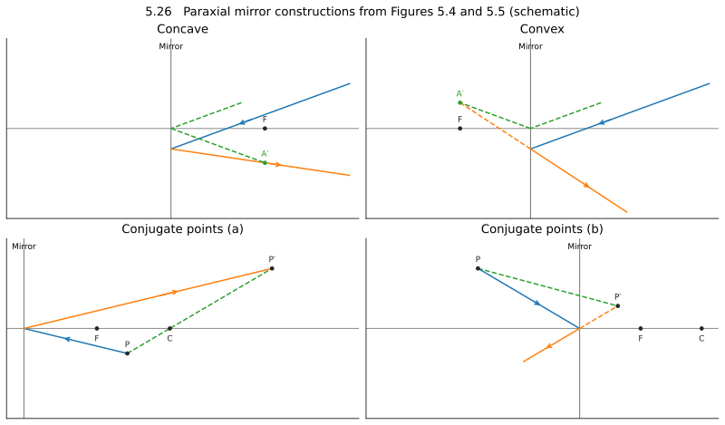
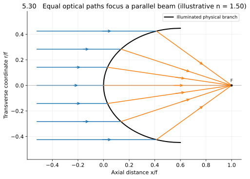
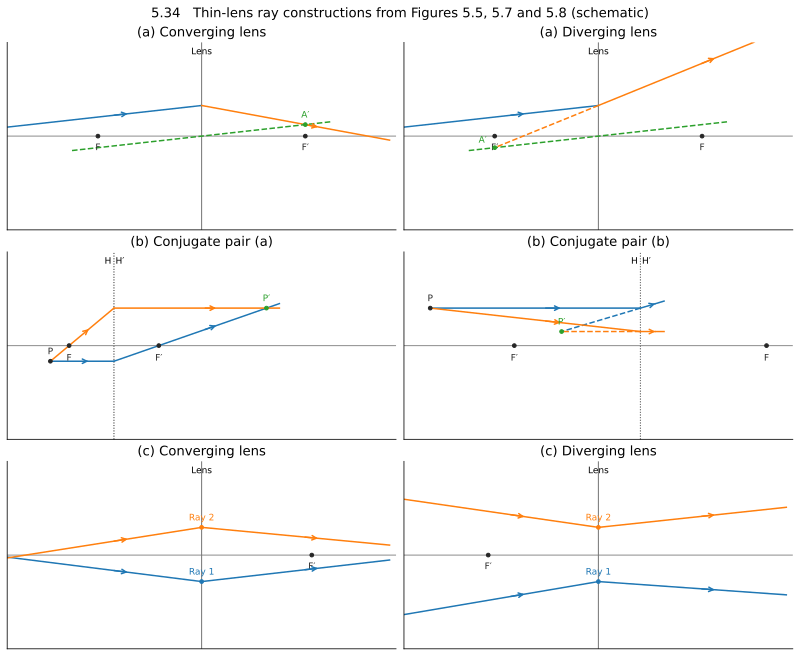
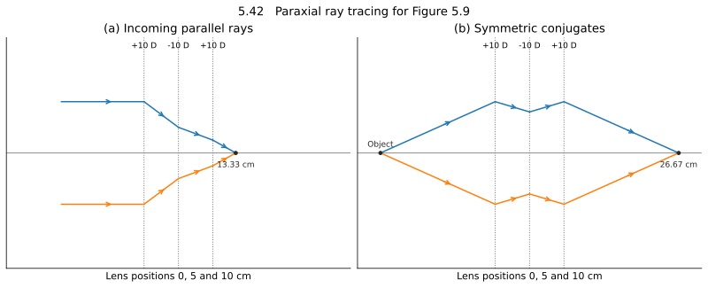
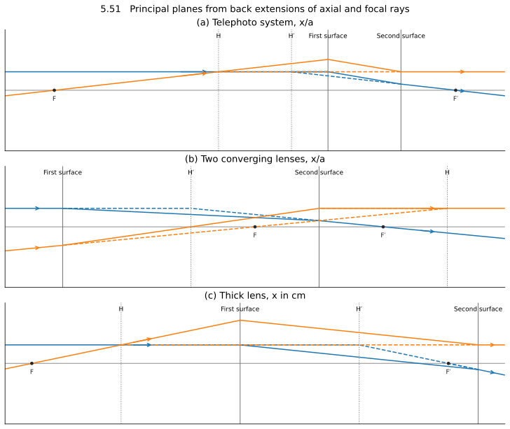
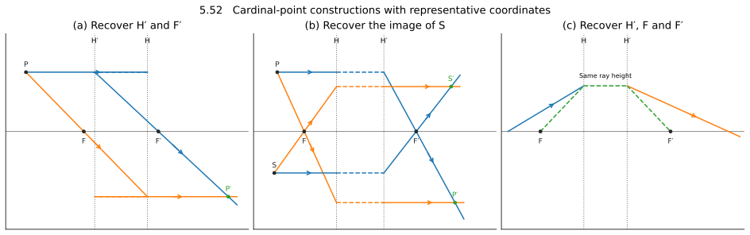
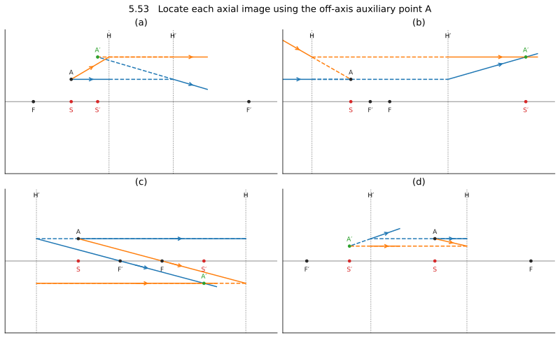

# 5.1 Photometry and Geometrical Optics

[Chapter index](../README.md#chapters) · [Structured solutions](5.1.json) · [Answer audit](../audit/README.md)

## 5.1

**Problem statement**

Making use of the spectral response curve for an eye (see Fig. 5.1), find: (a) the energy flux corresponding to the luminous flux of 1.0 lm at the wavelengths 0.51 and 0.64 μm; (b) the luminous flux corresponding to the wavelength interval from 0.58 to 0.63 μm if the respective energy flux, equal to Φ_e = 4.5 mW, is uniformly distributed over all wavelengths of the interval. The function V (λ) is assumed to be linear in the given spectral interval.

**Solved · medium confidence.** Convert between radiant and luminous flux with the printed eye-response convention.

**Assumptions**

- Preserve the Figure 5.1 annotation A=1.6 mW/lm at maximum response, equivalent to 625 lm/W; do not replace it by a modern efficacy constant.
- Source-only readings are V(0.51)≈0.50, V(0.64)≈0.17, V(0.58)≈0.85 and V(0.63)≈0.26, with an absolute V reading envelope ±0.02.
- The energy is uniformly distributed per unit wavelength in part (b); use the explicitly assumed linear V over that interval.

At a single wavelength, luminous flux is proportional to relative eye response.

$$
\Phi=\frac{V(\lambda)}A\Phi_e,\qquad A=1.6\times10^{-3}\ \mathrm{W/lm}.
$$

For part (a), solve this relation for the energy flux at each read wavelength.

$$
\Phi_e(0.51)=\frac A{0.50}=3.2\ \mathrm{mW},\qquad\Phi_e(0.64)=\frac A{0.17}\simeq9.4\ \mathrm{mW}.
$$

For part (b), average the linear response using its endpoints before applying the conversion.

$$
\overline V=\frac{0.85+0.26}{2}=0.555,\qquad\Phi=\frac{4.5\ \mathrm{mW}}{1.6\ \mathrm{mW/lm}}\,0.555\simeq1.56\ \mathrm{lm}.
$$

**Results**

Energy flux for 1 lm at 0.51 μm

$$
\Phi_e\simeq3.2\ \mathrm{mW}
$$

Visual-reading range about3.08–3.33 mW from V=0.50±0.02.

Energy flux for 1 lm at 0.64 μm

$$
\Phi_e\simeq9.4\ \mathrm{mW}
$$

Visual-reading range about8.42–10.67 mW from V=0.17±0.02.

Luminous flux in the specified spectral interval

$$
\Phi\simeq1.56\ \mathrm{lm}
$$

Endpoint reading envelopes give about1.50–1.62 lm; this is a graph-reading bound, not a statistical confidence interval.

## 5.2

**Problem statement**

A point isotropic source emits a luminous flux Φ = 10 lm with wavelength λ = 0.59 μm. Find the peak strength values of electric and magnetic fields in the luminous flux at a distance r = 1.0 m from the source. Make use of the curve illustrated in Fig. 5.1.

**Solved · medium confidence.** Convert isotropic luminous flux to irradiance, then use the time-averaged Poynting flux.

**Assumptions**

- Read V(0.59 μm)≈0.75±0.02 from the problem graph, using its printed A=1.6 mW/lm convention.
- Treat the source radiation locally as a monochromatic vacuum/air plane wave at r=1 m. Fields requested are peak amplitudes, not rms values.
- Use Z₀=√(μ₀/ε₀) from the digitized Appendix constants; this avoids imposing exact consistency with a separately rounded printed c.

The isotropic radiant power follows from the luminous conversion, and the average irradiance is spread over a sphere.

$$
\Phi_e=\frac{A\Phi}{V}=\frac{0.0016\times10}{0.75}\ \mathrm W,\qquad\mathcal I=\frac{\Phi_e}{4\pi r^2}\simeq1.70\times10^{-3}\ \mathrm{W/m^2}.
$$

For a sinusoidal wave, the average Poynting flux is half the product of the peak field strengths.

$$
\mathcal I=\frac12E_0H_0,\qquad\frac{E_0}{H_0}=Z_0=\sqrt{\frac{\mu_0}{\varepsilon_0}}.
$$

Solve for the electric and magnetic strengths; also state the corresponding magnetic induction.

$$
E_0=\sqrt{2\mathcal I Z_0},\qquad H_0=\sqrt{2\mathcal I/Z_0},\qquad B_0=\mu_0H_0.
$$

**Results**

Peak electric field strength

$$
E_0\simeq1.13\ \mathrm{V/m}
$$

Peak magnetic field strength

$$
H_0\simeq3.00\times10^{-3}\ \mathrm{A/m}
$$

Corresponding peak magnetic induction

$$
B_0\simeq3.77\times10^{-9}\ \mathrm T
$$

## 5.3

**Problem statement**

Find the mean illuminance of the irradiated part of an opaque sphere receiving (a) a parallel luminous flux resulting in illuminance E_0 at the point of normal incidence; (b) light from a point isotropic source located at a distance l = 100 cm from the centre of the sphere; the radius of the sphere is R = 60 cm and the luminous intensity is I = 36 cd.

**Solved · high confidence.** Divide intercepted luminous flux by the actual illuminated surface area.

**Assumptions**

- The sphere is opaque and nonreflecting for this interception calculation; mean illuminance is averaged over the illuminated spherical surface, not its projected disc.
- For part (b), l>R is the source-to-centre distance and I is isotropic luminous intensity.

For parallel rays, the sphere intercepts the flux through its projected disc; the illuminated area is a hemisphere.

$$
\overline E_a=\frac{E_0\pi R^2}{2\pi R^2}=\frac{E_0}{2}.
$$

The point source sees the sphere inside a tangent cone of half-angle β, while illumination ends at a spherical cap whose polar angle satisfies cos ψ=R/l.

$$
\sin\beta=R/l,\quad\Phi=2\pi I\left(1-\sqrt{1-R^2/l^2}\right),\quad S_{\rm lit}=2\pi R^2(1-R/l).
$$

Divide the intercepted flux by the cap area.

$$
\overline E_b=\frac I{R^2}\frac{1-\sqrt{1-R^2/l^2}}{1-R/l}=50\ \mathrm{lx}.
$$

**Results**

Mean illuminance for parallel rays

$$
\overline E=E_0/2
$$

Mean illuminance for the given point source

$$
\overline E=50\ \mathrm{lx}
$$

## 5.4

**Problem statement**

Determine the luminosity of a surface whose luminance depends on direction as L = L_0 cos θ, where θ is the angle between the radiation direction and the normal to the surface.

**Solved · high confidence.** Integrate directional luminance over the emitting hemisphere.

**Assumptions**

- Luminosity M means luminous exitance: emitted luminous flux per unit surface area, in lm/m². The normal points into the emitting hemisphere.

A surface element contributes L(θ) cos θ dΩ per unit area. Use axial symmetry and the specified extra cos θ in L.

$$
M=\int L_0\cos^2\theta\,d\Omega=2\pi L_0\int_0^{\pi/2}\cos^2\theta\sin\theta\,d\theta=\frac{2\pi L_0}{3}.
$$

**Results**

Luminous exitance

$$
M=2\pi L_0/3
$$

## 5.5

**Problem statement**

A certain luminous surface obeys Lambert's law. Its luminance is equal to L. Find: (a) the luminous flux emitted by an element ΔS of this surface into a cone whose axis is normal to the given element and whose aperture angle is equal to θ; (b) the luminosity of such a source.

**Solved · medium confidence.** Integrate Lambertian emission into a circular cone.

**Assumptions**

- Use β for the cone half-angle, measured from the surface normal.
- The phrase aperture angle θ is taken first as the full opening angle, θ=2β; the alternative half-angle convention is stated explicitly. Only the outward hemisphere emits.

For direction-independent luminance L, integrate the projected emission over the cone.

$$
\Delta\Phi=L\Delta S\int_0^{2\pi}d\varphi\int_0^\beta\cos\gamma\sin\gamma\,d\gamma=\pi L\Delta S\sin^2\beta.
$$

For all outward directions set β=π/2 and divide by area.

$$
M=\pi L.
$$

**Results**

Flux if θ is the full opening angle

$$
\Delta\Phi=\pi L\Delta S\sin^2(\theta/2)
$$

Flux if θ denotes the cone half-angle

$$
\Delta\Phi=\pi L\Delta S\sin^2\theta
$$

Source luminosity (exitance)

$$
M=\pi L
$$

## 5.6

**Problem statement**

An illuminant shaped as a plane horizontal disc S = 100 cm² in area is suspended over the centre of a round table of radius R = 1.0 m. Its luminance does not depend on direction and is equal to L = 1.6×10⁴ cd/m² . At what height over the table should the illuminant be suspended to provide maximum illuminance at the circumference of the table? How great will that illuminance be? The illuminant is assumed to be a point source.

**Solved · high confidence.** Optimize the two projected-area cosine factors for a small Lambertian disc.

**Assumptions**

- The disc is small compared with its distances to the table, as explicitly required by the point-source approximation. It emits toward the table with constant luminance L.

At a rim point the source normal and receiver normal each supply the same cosine h/√(h²+R²).

$$
E_{\rm rim}(h)=\frac{LS h^2}{(h^2+R^2)^2}.
$$

Differentiate with respect to h; the unique positive maximum has h²=R².

$$
h_*=R,\qquad E_{\max}=\frac{LS}{4R^2}.
$$

**Results**

Optimal source height

$$
h=1.0\ \mathrm m
$$

Maximum rim illuminance

$$
E_{\max}=40\ \mathrm{lx}
$$

## 5.7

**Problem statement**

A point source is suspended at a height h = 1.0 m over the centre of a round table of radius R = 1.0 m. The luminous intensity I of the source depends on direction so that illuminance at all points of the table is the same. Find the function I (θ), where θ is the angle between the radiation direction and the vertical, as well as the luminous flux reaching the table if I (0) = I_0 = 100 cd.

**Solved · high confidence.** Enforce constant illuminance through the inverse-square and incidence-cosine factors.

**Assumptions**

- θ is measured from downward vertical. The required intensity function is determined only for rays that intersect the table.

A point at direction θ has source distance h/cos θ and incidence angle θ.

$$
E(\theta)=\frac{I(\theta)\cos^3\theta}{h^2}.
$$

At the centre E=I₀/h². Equating every point to that value determines the angular intensity.

$$
I(\theta)=I_0\sec^3\theta,\qquad0\le\theta\le\arctan(R/h).
$$

Uniform illuminance times the table area gives the intercepted flux.

$$
\Phi_{\rm table}=\frac{I_0}{h^2}\pi R^2=100\pi\ \mathrm{lm}.
$$

**Results**

Intensity toward points on the table

$$
I(\theta)=I_0/\cos^3\theta,\quad0\le\theta\le\pi/4
$$

Luminous flux reaching the table

$$
\Phi=100\pi\ \mathrm{lm}\simeq314\ \mathrm{lm}
$$

**Limitations**

- Intensities outside the angular cone intercepted by the table are not fixed by the stated condition.

## 5.8

**Problem statement**

A vertical shaft of light from a projector forms a light spot S = 100 cm² in area on the ceiling of a round room of radius R = 2.0 m. The illuminance of the spot is equal to E = 1000 lx. The reflection coefficient of the ceiling is equal to ρ = 0.80. Find the maximum illuminance of the wall produced by the light reflected from the ceiling. The reflection is assumed to obey Lambert's law.

**Solved · medium confidence.** Treat the illuminated ceiling patch as a small Lambertian secondary source and optimize wall height.

**Assumptions**

- The standard circular-room answer assumes the spot is centred on the ceiling; the statement does not explicitly specify its horizontal position.
- Approximate the 100 cm² spot as a small horizontal patch, neglect multiple reflections, and assume the wall extends at least R/√3 below the ceiling.
- For an off-centre spot at radial displacement a<R, replace the nearest-wall horizontal distance R by d=R−a in the maximum formula.

Lambert reflection converts the incident spot illuminance into luminance.

$$
L=\frac{\rho E}{\pi}.
$$

At a wall point z below the ceiling and horizontal distance R from the spot, the emission cosine is z/r and incidence cosine is R/r.

$$
E_w(z)=\frac{\rho ES}{\pi}\frac{Rz}{(R^2+z^2)^2}.
$$

The derivative is proportional to R²−3z², so the maximum occurs at z=R/√3.

$$
E_{w,\max}=\frac{9\rho ES}{16\pi\sqrt3 R^2}\simeq0.207\ \mathrm{lx}.
$$

**Results**

Maximum wall illuminance for a centred spot

$$
E_{w,\max}\simeq0.207\ \mathrm{lx}
$$

Vertical drop of this maximum below the ceiling

$$
z_*=R/\sqrt3\simeq1.15\ \mathrm m
$$

Maximum for an off-centre spot with nearest-wall distance d

$$
E_{w,\max}=\frac{9\rho ES}{16\pi\sqrt3 d^2},\quad d=R-a
$$

**Limitations**

- Without a spot position or the standard centre assumption, room radius alone does not determine a unique maximum.

## 5.9

**Problem statement**

A luminous dome shaped as a hemisphere rests on a horizontal plane. Its luminosity is uniform. Determine the illuminance at the centre of that plane if its luminance equals L and is independent of direction.

**Solved · high confidence.** Integrate the incident radiance over the upper hemisphere.

**Assumptions**

- The dome radiates inward toward the plane; its luminance L is uniform and direction independent.

At the centre of the base the inward luminous hemisphere fills the upper hemisphere of viewing directions. Illuminance is the projected radiance integral.

$$
E=\int_{\rm upper\ hemisphere}L\cos\theta\,d\Omega=2\pi L\int_0^{\pi/2}\cos\theta\sin\theta\,d\theta=\pi L.
$$

**Results**

Illuminance at the base centre

$$
E=\pi L
$$

## 5.10

**Problem statement**

A Lambert source has the form of an infinite plane. Its luminance is equal to L. Find the illuminance of an area element oriented parallel to the given source.

**Solved · high confidence.** Integrate the Lambert plane over all viewing directions.

**Assumptions**

- The receiver is on one side of the infinite luminous plane and faces it; no intervening absorption is present.

An infinite plane fills exactly one viewing hemisphere at a parallel receiver. Every source direction carries the same luminanceL.

$$
E=2\pi L\int_0^{\pi/2}\cos\theta\sin\theta\,d\theta=\pi L.
$$

**Results**

Illuminance of a parallel receiving element

$$
E=\pi L
$$

## 5.11

**Problem statement**

An illuminant shaped as a plane horizontal disc of radius R = 25 cm is suspended over a table at a height h = 75 cm. The illuminance of the table below the centre of the illuminant is equal to E_0 = 70 lx. Assuming the source to obey Lambert's law, find its luminosity.

**Solved · high confidence.** Integrate the finite Lambertian source disc on axis and solve for its exitance.

**Assumptions**

- The table is parallel to the source disc. Luminosity means luminous exitance M, not its total emitted flux.

For a source annulus at radial coordinate ρ, both projection cosines equalh/√(h²+ρ²). Integrate over its area.

$$
E_0=2\pi Lh^2\int_0^R\frac{\rho\,d\rho}{(h^2+\rho^2)^2}=\pi L\frac{R^2}{h^2+R^2}.
$$

Use M=πL and the specified h/R=3.

$$
M=E_0\left(1+\frac{h^2}{R^2}\right)=70(1+9)=700\ \mathrm{lm/m^2}.
$$

**Results**

Illuminant luminosity (luminous exitance)

$$
M=700\ \mathrm{lm/m^2}
$$

## 5.12

**Problem statement**

A small lamp having the form of a uniformly luminous sphere of radius R = 6.0 cm is suspended at a height h = 3.0 m above the floor. The luminance of the lamp is equal to L = 2.0×10⁴ cd/m² and is independent of direction. Find the illuminance of the floor directly below the lamp.

**Solved · high confidence.** Use the apparent angular disc of the uniformly luminous sphere.

**Assumptions**

- Interpret h as the height of the sphere centre above the floor, as usual for a small spherical lamp.
- Every visible ray has luminanceL; h>R and the floor is horizontal.

The apparent sphere has angular radius β with sin β=R/h. Integrate its constant radiance over this circular cone.

$$
E=2\pi L\int_0^\beta\cos\theta\sin\theta\,d\theta=\pi L\sin^2\beta=\pi L\frac{R^2}{h^2}.
$$

Substitute the given dimensions in metres.

$$
E=\pi(2.0\times10^4)\frac{0.060^2}{3.0^2}=8\pi\ \mathrm{lx}.
$$

**Results**

Floor illuminance directly below the lamp

$$
E=8\pi\ \mathrm{lx}\simeq25.1\ \mathrm{lx}
$$

## 5.13

**Problem statement**

Write the law of reflection of a light beam from a mirror in vector form, using the directing unit vectors $\mathbf{e}$ and $\mathbf{e}'$ of the incident and reflected beams and the unit vector $\mathbf{n}$ of the outside normal to the mirror surface.

**Solved · high confidence.** Reverse the incident direction component normal to the mirror.

**Assumptions**

- e and e′ point along propagation, so the incident ray has e·n<0 for the outward surface normaln.

Decompose the incident unit vector into tangent and normal parts. Specular reflection preserves the tangent part and reverses the normal part.

$$
\mathbf e=\mathbf e_\parallel+(\mathbf e\cdot\mathbf n)\mathbf n,\qquad\mathbf e\prime=\mathbf e_\parallel-(\mathbf e\cdot\mathbf n)\mathbf n.
$$

**Results**

Vector reflection law

$$
\mathbf e\prime=\mathbf e-2(\mathbf e\cdot\mathbf n)\mathbf n
$$

## 5.14

**Problem statement**

Demonstrate that a light beam reflected from three mutually perpendicular plane mirrors in succession reverses its direction.

**Solved · high confidence.** Compose three reflections in an orthonormal basis of mirror normals.

**Assumptions**

- The ray actually encounters each of the three mutually perpendicular planes once. Let their unit normalsn₁,n₂,n₃ be orthonormal.

A reflection reverses only the component along that mirror’s normal. Orthogonality means the other two components remain available for their own sign reversals.

$$
\mathbf e_{\rm out}=\mathbf e-2\sum_{j=1}^3(\mathbf e\cdot\mathbf n_j)\mathbf n_j.
$$

The normals form a complete orthonormal basis, so the sum equals the original vector.

$$
\mathbf e_{\rm out}=-\mathbf e.
$$

**Results**

Direction after three perpendicular reflections

$$
\mathbf e_{\rm out}=-\mathbf e_{\rm in}
$$

**Limitations**

- Direction reversal does not in general mean the returning ray retraces the identical spatial line.

## 5.15

**Problem statement**

At what value of the angle of incident θ_1 is a shaft of light reflected from the surface of water perpendicular to the refracted shaft?

**Solved · high confidence.** Combine the right-angle reflected/refracted geometry with Snell’s law.

**Assumptions**

- Use the Appendix20 representative water indexn_w=1.33, approximate air index by 1, and neglect dispersion.
- The angles of incidence and refraction are measured from the normal.

The reflected angle equals the incident angle. Perpendicular reflected and transmitted rays require complementary incidence and refraction angles.

$$
\theta_1+\theta_2=\pi/2.
$$

Insertθ₂=π/2−θ₁ in Snell’s law.

$$
n_a\sin\theta_1=n_w\cos\theta_1\quad\Longrightarrow\quad\tan\theta_1=n_w/n_a.
$$

**Results**

Required incidence angle

$$
\theta_1=\arctan(n_w/n_a)\simeq\arctan1.33\simeq53.1^\circ
$$

## 5.16

**Problem statement**

Two optical media have a plane boundary between them. Suppose θ_1cr is the critical angle of incidence of a beam and θ_1 is the angle of incidence at which the refracted beam is perpendicular to the reflected one (the beam is assumed to come from an optically denser medium). Find the relative refractive index of these media if sin θ_1cr/sin θ_1 = η = 1.28.

**Solved · high confidence.** Eliminate the incidence angles using the critical and perpendicular-ray conditions.

**Assumptions**

- Defineq=n₂/n₁<1 for transmission from the denser incident medium 1 into medium 2. Both reciprocal index conventions are reported.

The critical angle and the perpendicular-ray angle satisfy separate forms of Snell’s law.

$$
\sin\theta_{1\rm cr}=q,\qquad\tan\theta_1=q,\qquad\sin\theta_1=\frac q{\sqrt{1+q^2}}.
$$

Take the supplied ratio and solve forq.

$$
\eta=\frac{\sin\theta_{1\rm cr}}{\sin\theta_1}=\sqrt{1+q^2}\quad\Longrightarrow\quad q=\sqrt{\eta^2-1}.
$$

**Results**

Refracted-to-incident relative index

$$
n_2/n_1=\sqrt{1.28^2-1}\simeq0.799
$$

Reciprocal, dense-to-rare index ratio

$$
n_1/n_2\simeq1.252
$$

## 5.17

**Problem statement**

A light beam falls upon a plane-parallel glass plate d=6.0 cm in thickness. The angle of incidence is θ = 60°. Find the value of deflection of the beam which passed through that plate.

**Solved · medium confidence.** Trace the parallel transmitted ray through the two faces of the slab.

**Assumptions**

- The surroundings are air approximated asn=1. Use the Appendix20 representative glass indexn=1.50, with dispersion neglected.
- Deflection is interpreted as lateral beam displacement; a plane-parallel plate does not change the final propagation direction.

Snell’s law fixes the internal angler.

$$
\sin r=\frac{\sin\theta}{n},\qquad r=\arcsin(\sin60^\circ/1.5)\simeq35.26^\circ.
$$

The slab thicknessd is measured normally. Project the difference between the two exit positions perpendicular to the emerging ray.

$$
\delta=d\frac{\sin(\theta-r)}{\cos r}.
$$

**Results**

Lateral displacement for the representative glass

$$
\delta\simeq3.07\ \mathrm{cm}
$$

Net angular deviation

$$
\Delta\theta=0
$$

**Limitations**

- For another glass index use the symbolic δ formula; the stated thickness and incidence angle alone do not determine a unique numerical offset.

## 5.18

**Problem statement**

A man standing on the edge of a swimming pool looks at a stone lying on the bottom. The depth of the swimming pool is equal to h. At what distance from the surface of water is the image of the stone formed if the line of vision makes an angle θ with the normal to the surface?

**Solved · medium confidence.** Back-project the refracted viewing ray and distinguish off-axis image conventions.

**Assumptions**

- Let n=n_water/n_air>1 and θ be the observer’s angle in air. Let i be the ray angle in water, so n sin i=sin θ.
- The usual apparent-depth construction places the image on the vertical through the actual stone. At oblique viewing a finite ray bundle is astigmatic, so that construction does not define one exact stigmatic image for all pupil rays.

A ray from the stone intersects the interface at horizontal offset h tan i. Back-projecting that ray at angle θ to the stone’s vertical gives the conventional depth d_s.

$$
d_s=\frac{h\tan i}{\tan\theta}=\frac{h\cos\theta}{\sqrt{n^2-\sin^2\theta}}.
$$

For a narrow meridional bundle near the chief ray, intersect neighbouring back-projected rays by differentiating the interface intercept x(θ)=h tan i.

$$
d_m=\cos^2\theta\frac{d(h\tan i)}{d\theta}=\frac{h\cos^3\theta}{n\cos^3 i}=\frac{hn^2\cos^3\theta}{(n^2-\sin^2\theta)^{3/2}}.
$$

The sagittal image depth equals d_s, while the meridional depth is d_m. They coincide only for normal viewing; the formula normally intended by a single-ray apparent-depth question is d_s.

**Results**

Conventional apparent depth on the stone’s vertical (also sagittal depth)

$$
d_s=\frac{h\cos\theta}{\sqrt{n^2-\sin^2\theta}}
$$

Meridional virtual-image depth of a narrow oblique bundle

$$
d_m=\frac{hn^2\cos^3\theta}{(n^2-\sin^2\theta)^{3/2}}
$$

Common normal-viewing limit

$$
d_s=d_m=h/n\quad(\theta=0)
$$

**Limitations**

- The question supplies no viewing aperture or focus convention; the two off-axis focal depths are explicitly distinguished rather than silently identified.

## 5.19

**Problem statement**

Demonstrate that in a prism with small refracting angle θ the shaft of light deviates through the angle α ≃ (n − 1) θ regardless of the angle of incidence, provided that the latter is also small.

**Solved · high confidence.** Linearize Snell’s law at both faces of a thin prism.

**Assumptions**

- The refracting angle θ and both exterior incidence/emergence angles are small in radians. The relative prism index isn>1 and the exterior medium is the same on both sides.

Let the internal refraction angles ber₁,r₂, whose sum is the prism angle. Small-angle Snell relations give exterior anglesi≈nr₁ ande≈nr₂.

$$
r_1+r_2=\theta,\qquad\alpha=i+e-\theta.
$$

Substitute the linearized laws; the separate dependence on incidence cancels.

$$
\alpha\simeq n(r_1+r_2)-\theta=(n-1)\theta.
$$

**Results**

First-order thin-prism deviation

$$
\alpha\simeq(n-1)\theta
$$

## 5.20

**Problem statement**

A shaft of light passes through a prism with refracting angle θ and refractive index n. Let α be the diffraction angle of the shaft. Demonstrate that if the shaft of light passes through the prism symmetrically, (a) the angle α is the least; (b) the relationship between the angles α and θ is defined by Eq. (5.1e).

**Solved · high confidence.** Use symmetry and convexity of the two-face Snell map.

**Assumptions**

- Interpret the printed word diffraction as geometrical deviation in this prism problem.
- The prism is surrounded by a lower-index uniform medium; n>1 is the relative index, and a transmitted branch exists with 0<θ<2arcsin(1/n).

Write the external angle associated with internal angler asf(r)=arcsin(n sin r). The internal angles satisfy r₁+r₂=θ.

$$
\alpha=f(r_1)+f(r_2)-\theta.
$$

The map is strictly convex on the transmitting interior range, so the sum at fixedr₁+r₂ is minimized at equal arguments.

$$
f^{\prime\prime}(r)=\frac{n(n^2-1)\sin r}{(1-n^2\sin^2r)^{3/2}}>0\quad\Longrightarrow\quad r_1=r_2=\theta/2.
$$

At this symmetric passage the incidence and emergence angles equal(α_min+θ)/2. Snell’s law then gives the requested book relation.

$$
\alpha_{\min}=2\arcsin[n\sin(\theta/2)]-\theta,\qquad\sin\frac{\alpha_{\min}+\theta}{2}=n\sin\frac\theta2.
$$

**Results**

Symmetric passage gives minimum deviation

$$
r_1=r_2=\theta/2,\quad i=e
$$

Minimum-deviation relation (Eq.5.1e)

$$
\sin[(\alpha_{\min}+\theta)/2]=n\sin(\theta/2)
$$

**Limitations**

- For a prism index below the surrounding medium the convexity conclusion changes; the stated ordinary-prism n>1 regime is essential.

## 5.21

**Problem statement**

The least deflection angle of a certain glass prism is equal to its refracting angle. Find the latter.

**Solved · medium confidence.** Insert equal refracting and minimum-deviation angles into the prism relation.

**Assumptions**

- Use the Appendix20 representative glass indexn=1.50 relative to air approximated as 1; actual glass is dispersive.
- Consider a nonzero prism angle and nongrazing transmitting incidence.

Setα_min=θ in the minimum-deviation equation, then divide out the nonzero sin(θ/2).

$$
\sin\theta=n\sin(\theta/2)\quad\Longrightarrow\quad2\cos(\theta/2)=n.
$$

The incidence angle is theni=(α_min+θ)/2=θ, so the principal transmitted branch must satisfy θ<π/2.

$$
\theta=2\arccos(n/2),\qquad\sqrt2<n<2.
$$

For the representative glass value evaluate the angle.

$$
\theta=2\arccos(0.75)\simeq82.8^\circ.
$$

**Results**

Nondegenerate transmitting solution for specified n

$$
\theta=2\arccos(n/2),\quad\sqrt2<n<2
$$

Angle for the book’s representative glass index 1.50

$$
\theta\simeq82.8^\circ
$$

**Limitations**

- The general algebraic equation also has a degeneratezero-angle solution; the reported result is for a genuine prism. Values n≤√2 would select an invalid principal-incidence branch for the equal-angle condition.

## 5.22

**Problem statement**

Find the minimum and maximum deflection angles for a light ray passing through a glass prism with refracting angle θ = 60°.

**Solved · high confidence.** Extremize the prism deviation over all two-face transmitted rays.

**Assumptions**

- Use the representative Appendix glass index n=1.5 and air index≈1. The ray passes successively through the two refracting faces; internal-reflection paths are excluded.

Let r₁+r₂=θ inside the prism, with outside angles i_j=arcsin(n sin r_j). The deflection is i₁+i₂−θ.

$$
\delta(r_1)=\arcsin(n\sin r_1)+\arcsin[n\sin(\theta-r_1)]-\theta.
$$

The symmetric path r₁=r₂=θ/2 gives the minimum. Transmission requires each internal angle not exceed r_c=arcsin(1/n). The largest deflection is approached when one outside angle tends to 90°.

$$
\delta_{\min}=2\arcsin[n\sin(\theta/2)]-\theta,\quad\delta_{\max}=\frac\pi2+\arcsin[n\sin(\theta-r_c)]-\theta.
$$

**Results**

Minimum deflection

$$
\delta_{\min}=37.1808\ldots{}^\circ
$$

Maximum limiting deflection

$$
\sup\delta=57.9205\ldots{}^\circ
$$

Grazing incidence or critical emergence is the limiting endpoint; strictly crossing rays approach it.

**Limitations**

- The numerical values are conditional on the representative glass index; real glasses disperse. A finite non-grazing beam has deviation strictly below the limiting maximum.

## 5.23

**Problem statement**

A trihedral prism with refracting angle 60° provides the least deflection angle 37° in air. Find the least deflection angle of that prism in water.

**Solved · high confidence.** Determine the prism index from its air minimum, then use its relative index in water.

**Assumptions**

- Use Appendix water n_w=1.33 and the chapter air≈1 convention. The same monochromatic prism index applies in both surroundings.

The minimum-deviation condition fixes the prism-to-air index.

$$
n_g=\frac{\sin[(\theta+\delta_a)/2]}{\sin(\theta/2)}=2\sin48.5^\circ.
$$

After immersion replace n_g by n_g/n_w in the same symmetric-path formula.

$$
\delta_w=2\arcsin\left[\frac{\sin[(\theta+\delta_a)/2]}{n_w}\right]-\theta.
$$

**Results**

Minimum deviation in water

$$
\delta_w\simeq8.54^\circ
$$

**Limitations**

- The printed representative n_w is 1.33, not the silently substituted 4/3. Retaining the small air-index correction changes the last reported digits.

## 5.24

**Problem statement**

A light ray composed of two monochromatic components passes through a trihedral prism with refracting angle θ = 60°. Find the angle Δα between the components of the ray after its passage through the prism if their respective indices of refraction are equal to 1.515 and 1.520. The prism is oriented to provide the least deflection angle.

**Solved · medium confidence.** Differentiate the symmetric prism-deviation law and distinguish fixed orientation from two separate minima.

**Assumptions**

- Air is approximated as index 1. The indices differ by only 0.005. A single prism orientation cannot be exactly at minimum deviation for both components simultaneously.
- For the numerical finite-difference example orient the prism at the mean-index minimum, n̄=1.5175.

Differentiate δ_min=2arcsin[n sin(θ/2)]−θ to first order in the small index difference.

$$
\Delta\delta\simeq\frac{2\sin(\theta/2)}{\sqrt{1-\bar n^2\sin^2(\theta/2)}}\Delta n.
$$

For an exactly specified fixed incidence i, apply Snell’s law twice to each colour. The input angle cancels from their output separation.

$$
e(n;i)=\arcsin\left\{n\sin\left[\theta-\arcsin\frac{\sin i}{n}\right]\right\},\quad\Delta\delta=e(n_2;i)-e(n_1;i).
$$

Set i=arcsin[n̄ sin(θ/2)] for a concrete shared orientation. The difference of the two separately minimized deviations gives the same leading approximation.

**Results**

Small-dispersion angular separation

$$
\Delta\delta\simeq\frac{0.005}{\sqrt{1-(1.5175/2)^2}}\simeq7.68\times10^{-3}\ \mathrm{rad}\simeq0.440^\circ
$$

Exact separation at the mean-index minimum

$$
\Delta\delta=e(n_2;i_0)-e(n_1;i_0),\quad i_0=\arcsin(\bar n/2)
$$

The precise finite-index result depends on which colour or mean index defines the chosen orientation.

**Limitations**

- The difference of separately minimized angles is not literally the exact output separation at one fixed orientation, although it is the appropriate leading small-dispersion result.

## 5.25

**Problem statement**

Using Fermat's principle derive the laws of deflection and refraction of light on the plane interface between two media.

**Solved · high confidence.** Stationarize the optical path with respect to the plane-interface crossing point.

**Assumptions**

- Use homogeneous isotropic media and geometrical optics. “Deflection” in this prompt denotes reflection at the plane interface; angles are measured from the normal.

For reflection with endpoints A and B on the same side, vary the reflection point X along the plane. Differentiating n(AX+XB) gives equal tangential direction components.

$$
\frac{\partial}{\partial x}[n|A-X|+n|X-B|]=0\quad\Longrightarrow\quad\sin i=\sin r.
$$

For refraction place the endpoints on opposite sides and weight the two lengths by their respective indices.

$$
\frac{\partial}{\partial x}[n_1|A-X|+n_2|X-B|]=0\quad\Longrightarrow\quad n_1\sin i=n_2\sin t.
$$

Variation in both independent in-plane directions makes the tangential optical-wavevector continuous, which also establishes coplanarity with the normal.

**Results**

Law of reflection

$$
r=i,\quad\text{incident ray, reflected ray and normal are coplanar}
$$

Law of refraction

$$
n_1\sin i=n_2\sin t,\quad\text{incident ray, refracted ray and normal are coplanar}
$$

## 5.26

**Problem statement**

By means of plotting find: (a) the path of a light ray after reflection from a concave and convex spherical mirrors (see Fig. 5.4, where F is the focal point, OO′ is the optical axis); (b) the positions of the mirror and its focal point in the cases illustrated in Fig. 5.5, where P and P′ are the conjugate points.

**Solved · high confidence.** Construct secondary foci for arbitrary incident rays and use the vertex-reflection and centre-normal rays for conjugates.

**Assumptions**

- The drawings specify Gaussian/paraxial spherical-mirror geometry. F is the paraxial focus and the centre of curvature C lies at twice the vertex-to-focus distance.
- The attached geometry_spec gives representative coordinates preserving the illustrated arrangements; it does not assert numerical source dimensions.

For each Fig.5.4 ray locate C by VC=2VF. Draw an auxiliary line parallel to the incident ray through C, meeting the focal plane perpendicular to the axis at Q. All rays of this incident direction reflect through Q, or appear to diverge from Q for the convex mirror.

$$
Q=(f,-fu),\qquad u_{\rm reflected}=-u-h/f\quad(V=(0,0),\ x\text{ positive toward the reflected half-space}).
$$

For Fig.5.5 let P̄ be P reflected across the optical axis. The vertex lies where P̄P′ meets the axis, because a vertex ray reflects at equal opposite angles to it. The centre of curvature lies where PP′ meets the axis, because a normal ray retraces its path.

$$
V=\overline P P\prime\cap\mathrm{axis},\qquad C=PP\prime\cap\mathrm{axis},\qquad F=\frac{V+C}{2}.
$$

Choose the reflected ray through the real secondary focus for the concave mirror, or away from its virtual secondary focus for the convex mirror. Fig.5.5(a) gives a concave mirror and real inverted image; (b) gives a convex mirror and virtual upright reduced image.

**Results**

Reflected-ray construction

$$
\text{Draw }Q\text{ as above; join the incidence point to }Q\text{ and choose the reflected direction}
$$

Mirror and focus reconstruction

$$
V=\overline P P\prime\cap\mathrm{axis},\quad C=PP\prime\cap\mathrm{axis},\quad F=(V+C)/2
$$

**Limitations**

- Exact nonparaxial spherical reflection has aberration; a single focal point does not determine exact arbitrary-aperture imaging.

## 5.27

**Problem statement**

Determine the focal length of a concave mirror if: (a) with the distance between an object and its image being equal to l = 15 cm, the transverse magnification β = −2.0; (b) in a certain position of the object the transverse magnification is β_1 = −0.50 and in another position displaced with respect to the former by a distance l = 5.0 cm the transverse magnification β_2 = −0.25.

**Solved · high confidence.** Combine mirror conjugacy with signed transverse magnification.

**Assumptions**

- Use positive real object and image distances a,b measured on the reflecting side, 1/a+1/b=1/f and β=−b/a.

For (a), b=2a and the distance between the real object and image is b−a=l. Hence a=l and b=2l.

$$
f=\frac{ab}{a+b}=\frac{2l}{3}.
$$

For (b), a=f(1−1/β). The two magnifications give a₁=3f and a₂=5f, whose separation is 2f.

$$
l=|a_2-a_1|=2f.
$$

**Results**

Focal length from β=−2

$$
f=10.0\ \mathrm{cm}
$$

Focal length from the two positions

$$
f=2.50\ \mathrm{cm}
$$

## 5.28

**Problem statement**

A point source with luminous intensity I_0 = 100 cd is positioned at a distance s = 20.0 cm from the crest of a concave mirror with focal length f = 25.0 cm. Find the luminous intensity of the reflected ray if the reflection coefficient of the mirror is ρ = 0.80.

**Solved · high confidence.** Relate incident and reflected paraxial solid angles at the virtual image.

**Assumptions**

- The mirror is treated paraxially, I₀ is the source intensity toward the mirror, and ρ is the reflected power fraction. Intensity of the reflected beam means its apparent point-image luminous intensity.

The source is inside the focal length; the mirror equation gives a virtual image one metre behind the mirror.

$$
b=\frac{fs}{s-f}=\frac{.25\times.20}{.20-.25}=-1.00\ \mathrm m,\qquad |\beta|=|b|/s=5.
$$

A mirror patch dA collects I₀dA/s² and sends the reflected flux into image-centred solid angle dA/b².

$$
I\prime\frac{dA}{b^2}=\rho I_0\frac{dA}{s^2},\qquad I\prime=\rho I_0\beta^2.
$$

**Results**

Apparent reflected-beam luminous intensity

$$
I\prime=0.80\times100\times25=2.00\times10^3\ \mathrm{cd}
$$

**Limitations**

- A finite-aperture nonparaxial distribution requires mirror aperture and exact ray tracing; no such aperture is specified.

## 5.29

**Problem statement**

Proceeding from Fermat's principle derive the refraction formula for paraxial rays on a spherical boundary surface of radius R between media with refractive indices n and n'.

**Solved · high confidence.** Expand Fermat optical path through a paraxial spherical-interface crossing.

**Assumptions**

- Light travels in the +x direction. The surface vertex is x=0 and its curvature centre is x=R, with signed R. Initially use a real object at x=−a and real image at x=b, a,b>0.
- The Cartesian source/image distances s,s′ are signed positions relative to the vertex; thus s=−a, s′=b in the real-real case.

For an interface crossing of height y, the surface sag is ξ≈y²/(2R). Expand both geometric lengths through quadratic order.

$$
\mathcal L=n\sqrt{(a+\xi)^2+y^2}+n\prime\sqrt{(b-\xi)^2+y^2}\simeq na+n\prime b+\frac{y^2}{2}\left[\frac n a+\frac{n\prime}b-\frac{n\prime-n}{R}\right].
$$

Stationarity of optical path for neighbouring paraxial rays sets the quadratic coefficient to zero. Express the result with the chapter Cartesian signs.

$$
\frac n a+\frac{n\prime}b=\frac{n\prime-n}{R}\quad\Longleftrightarrow\quad\frac{n\prime}{s\prime}-\frac n s=\frac{n\prime-n}{R}.
$$

**Results**

Paraxial spherical-refraction formula

$$
\frac{n\prime}{s\prime}-\frac n s=\frac{n\prime-n}{R}
$$

s and s′ are Cartesian signed distances; for a real object on the left, s<0.

**Limitations**

- The quadratic Fermat expansion omits spherical aberration and is a paraxial relation.

## 5.30

**Problem statement**

A parallel beam of light falls from vacuum on a surface enclosing a medium with refractive index n (Fig. 5.6). Find the shape of that surface, x (r), if the beam is brought into focus at the point F at a distance f from the crest O. What is the maximum radius of a beam that can still be focussed?

**Solved · high confidence.** Require equal optical path from an incident wavefront to the focus, then select the physical entrance branch.

**Assumptions**

- The incident beam travels from vacuum along +x into index n>1. Fig.5.6 has crest O=(0,0), focus F=(f,0), f>0, and x(r) measured from the crest toward the medium.
- This is an exact meridional geometrical-optics construction for a single refracting surface, neglecting reflection losses and diffraction.

Subtract the common incident wavefront offset. Optical path through a surface point is x+n times its distance to F; the axial path is nf.

$$
x+n\sqrt{(f-x)^2+r^2}=nf.
$$

Squaring and rearranging gives an ellipse in the meridional plane. Select the root through O with x(0)=0.

$$
(n^2-1)x^2-2n(n-1)fx+n^2r^2=0,\quad x(r)=\frac{nf}{n+1}\left[1-\sqrt{1-\frac{n+1}{n-1}\frac{r^2}{f^2}}\right].
$$

The radicand requires r≤b, the ellipse radial semiaxis. At b the cap has an axial tangent, so an incoming parallel ray is grazing rather than strictly crossing. The opposite algebraic branch does not pass through the stipulated crest and cannot be accepted as the same entrance cap.

$$
a=\frac{nf}{n+1},\quad b=f\sqrt{\frac{n-1}{n+1}},\quad\frac{(x-a)^2}{a^2}+\frac{r^2}{b^2}=1.
$$

Differentiating the unsquared constant-optical-path condition yields Snell’s law; the chosen cap has incident and transmitted rays on their proper sides of the local normal.

**Results**

Physical entrance-surface profile

$$
x(r)=\frac{nf}{n+1}\left[1-\sqrt{1-\frac{n+1}{n-1}\frac{r^2}{f^2}}\right]
$$

Maximum limiting parallel-beam radius

$$
r_{\max}=f\sqrt{\frac{n-1}{n+1}}
$$

Strictly transmitted nongrazing rays have r<r_max; r_max is the grazing limiting supremum.

**Limitations**

- An algebraic conic branch alone is insufficient: the crest, incident-side normal, forward focal ray and unsquared path condition must all be checked. Diffraction limits the interpretation of an exact point focus.

## 5.31

**Problem statement**

A point source is located at a distance of 20 cm from the front surface of a symmetrical glass biconvex lens. The lens is 5.0 cm thick and the curvature radius of its surfaces is 5.0 cm. How far beyond the rear surface of this lens is the image of the source formed?

**Solved · high confidence.** Apply spherical refraction successively at the two surfaces, retaining lens thickness.

**Assumptions**

- Use representative Appendix glass n=1.5, air≈1, and paraxial rays. With +x to the right, R₁=+5 cm and R₂=−5 cm.

At the first vertex the source distance is 20 cm. Its image lies 30 cm to the right of that vertex inside the glass.

$$
\frac{1.5}{b_1}+\frac1{20}=\frac{.5}{5}\quad\Longrightarrow\quad b_1=30\ \mathrm{cm}.
$$

At the rear vertex 5 cm farther right, that intermediate point is a virtual object 25 cm to the right. Apply the second refraction with signed real-positive object distance a₂=−25 cm.

$$
\frac1{b_2}+\frac{1.5}{-25}=\frac{1-1.5}{-5}=.10\ \mathrm{cm}^{-1}.
$$

**Results**

Image distance beyond the rear surface

$$
b_2=6.25\ \mathrm{cm}
$$

**Limitations**

- The result is Gaussian; the small aperture is not specified, so finite-aperture spherical aberration is not evaluated.

## 5.32

**Problem statement**

An object is placed in front of convex surface of a glass plano-convex lens of thickness d = 9.0 cm. The image of that object is formed on the plane surface of the lens serving as a screen. Find: (a) the transverse magnification if the curvature radius of the lens's convex surface is R = 2.5 cm; (b) the image illuminance if the luminance of the object is L = 7700 cd/m² and the entrance aperture diameter of the lens is D = 5.0 mm; losses of light are negligible.

**Solved · high confidence.** Use one spherical refraction for magnification and radiance/etendue conservation for image illuminance.

**Assumptions**

- Use Appendix glass n=1.5 and paraxial air≈1. The screen is at the plane rear surface; the entrance pupil is the small circular diameterD.
- Light losses are neglected. L is object luminance in air; conservation is of L/n², not L alone across unequal media.

The convex front surface images the object onto the plane at depth d. Determine object distance a and then transverse magnification.

$$
\frac1a+\frac nd=\frac{n-1}{R},\quad a=.30\ \mathrm m,\qquad\beta=-\frac{d}{na}=-.20.
$$

Within glass the image-directed ray luminance is n²L. The small pupil subtends an image cone with semi-angle u′≈D/(2d), so integrate L′cosu dΩ.

$$
L\prime=n^2L,\quad E=\pi L\prime\sin^2u\prime\simeq\frac{\pi n^2LD^2}{4d^2}.
$$

If the screen is regarded as immediately outside the plane exit, refraction restores air luminanceL but increases its cone angle by n; the same paraxial illuminance follows.

**Results**

Transverse magnification

$$
\beta=-0.200
$$

The image is inverted; its transverse size is one fifth of the object.

Image illuminance

$$
E\simeq\frac{\pi n^2LD^2}{4d^2}=42.0\ \mathrm{lx}
$$

**Limitations**

- The pupil is small (D/(2R)=0.10), and the formulas use paraxial angular factors. Real screen conversion/scattering properties are not part of incident illuminance.

## 5.33

**Problem statement**

Find the optical power and the focal lengths (a) of a thin glass lens in liquid with refractive index n_0 = 1.7 if its optical power in air is Φ_0 = —5.0 D; (b) of a thin symmetrical biconvex glass lens, with air on one side and water on the other side, if the optical power of that lens in air is Φ_0 = +10 D.

**Solved · high confidence.** Sum refracting-surface powers and use the unequal-medium focal-length relation.

**Assumptions**

- Use Appendix glass n_g=1.5 and water n_w=1.33. Air is approximated by 1 in the numerical results.
- Use the chapter reduced optical power Φ=n′/f′=−n/f (PDF207). f and f′ are Cartesian focal coordinates relative to the lens; Φ is not generally 1/f′ in a medium.

For (a), preserve the curvature combinationK=1/R₁−1/R₂ from its known air power. Immersion changes the refractive-index contrast.

$$
K=\Phi_0/(n_g-1),\qquad\Phi=(n_g-n_0)K=\Phi_0\frac{n_g-n_0}{n_g-1}=+2.00\ \mathrm D.
$$

Both surrounding indices in (a) are n₀=1.7, so f=−n₀/Φ and f′=+n₀/Φ.

For (b), symmetry gives R₁=+R,R₂=−R, with R=2(n_g−1)/Φ₀=.10 m. Sum front and rear surface powers using the actual air and water sides.

$$
\Phi=\frac{n_g-1}{R}+\frac{n_w-n_g}{-R}=\frac{2n_g-1-n_w}{R}=6.70\ \mathrm D.
$$

Apply the front and rear indices separately to the focal coordinates.

$$
f=-1/\Phi,\qquad f\prime=n_w/\Phi.
$$

**Results**

Immersed reduced optical power

$$
\Phi=+2.00\ \mathrm D
$$

Front and rear focal lengths in liquid

$$
f=-.850\ \mathrm m,\qquad f\prime=+.850\ \mathrm m
$$

Power with air on the left and water on the right

$$
\Phi=+6.70\ \mathrm D
$$

Front and rear focal lengths for unequal media

$$
f=-.149254\ \mathrm m,\qquad f\prime=+.198507\ \mathrm m
$$

**Limitations**

- The ordinary reciprocal image focal distance in (a) is 1/f′=1.17647 m⁻¹, distinct from the chapter reduced power 2 D. Reported focal signs are Cartesian; object-side physical focus distances are their positive magnitudes.

## 5.34

**Problem statement**

By means of plotting find: (a) the path of a ray of light beyond thin converging and diverging lenses (Fig. 5.7, where OO′ is the optical axis, F and F′ are the front and rear focal points); (b) the position of a thin lens and its focal points if the position of the optical axis OO′ and the positions of the conjugate points P, P′ (see Fig. 5.5) are known; the media on both sides of the lenses are identical; (c) the path of ray 2 beyond the converging and diverging lenses (Fig. 5.8) if the path of ray 1 and the positions of the lens and of its optical axis OO′ are all known; the media on both sides of the lenses are identical.

**Solved · high confidence.** Use undeviated central rays and secondary focal planes to construct each requested path or lens.

**Assumptions**

- The thin lenses are Gaussian and the media on their two sides are identical. Heights/slopes in geometry_spec are illustrative and preserve the scan ray signs.

For (a), draw through the optical centre a line parallel to the given incident ray. It is undeviated and intersects the rear focal plane at Q. Join the incidence point to Q; for a diverging lens its backward extension passes Q.

$$
Q=(f,fu),\qquad u\prime=u-h/f\quad\text{when the lens is at }x=0.
$$

For (b), the undeviated central ray PP′ locates the optical centre C at its intersection with the optical axis. Draw a ray from P parallel to the axis to the lens, then connect its lens point with P′; this line or its backward extension crosses the axis at F′. F is the axis point symmetric to F′ about C.

$$
C=PP\prime\cap\mathrm{axis},\quad F\prime=\{\text{line from parallel-ray incidence point to }P\prime\}\cap\mathrm{axis},\quad F=2C-F\prime.
$$

For (c), draw through C a line parallel to incoming ray 1. Its intersection with outgoing ray 1 (extended if necessary) is its secondary focus Q₁. The perpendicular to the axis through Q₁ locates the rear focal plane. Repeat the centre-parallel construction for ray 2 to obtain Q₂; its outgoing line joins its incidence point to Q₂.

$$
f=\frac{h_1}{u_1-u_1\prime},\qquad u_2\prime=u_2-\frac{h_2}{h_1}(u_1-u_1\prime).
$$

**Results**

Ray behind each lens

$$
\text{Outgoing ray passes through the appropriate real or virtual secondary focus }Q
$$

Lens position and focal points

$$
C=PP\prime\cap\mathrm{axis},\quad F\prime\text{ from the parallel ray},\quad F=2C-F\prime
$$

Fig.5.5(a) gives a converging lens; (b) a diverging lens.

Ray2 from known ray 1

$$
u_2\prime=u_2-\frac{h_2}{h_1}(u_1-u_1\prime)
$$

The secondary-focal-plane construction gives the graphical form of this relation.

**Limitations**

- The construction presupposes the Gaussian thin-lens approximation; finite-aperture aberrations are not specified by the drawings.

## 5.35

**Problem statement**

A thin converging lens with focal length f = 25 cm projects the image of an object on a screen removed from the lens by a distance l = 5.0 m. Then the screen was drawn closer to the lens by a distance Δl = 18 cm. By what distance should the object be shifted for its image to become sharp again?

**Solved · high confidence.** Recompute the object distance from each fixed-lens image distance.

**Assumptions**

- The lens remains fixed; only the screen and object are shifted. Distances are paraxial real-object and real-image distances in air.

For image distance b the object distance is a=fb/(b−f). Bringing the screen toward the lens by Δl replaces b by b−Δl.

$$
a=\frac{fb}{b-f},\qquad a\prime=\frac{f(b-\Delta l)}{b-\Delta l-f}.
$$

Subtract the two distances; the positive change means the object moves away from the lens.

$$
\Delta a=\frac{f^2\Delta l}{(b-f)(b-\Delta l-f)}.
$$

**Results**

Object shift away from the lens

$$
\Delta a=5.18253\times10^{-4}\ \mathrm m\simeq.518\ \mathrm{mm}
$$

## 5.36

**Problem statement**

A source of light is located at a distance l = 90 cm from a screen. A thin converging lens provides the sharp image of the source when placed between the source of light and the screen at two positions. Determine the focal length of the lens if (a) the distance between the two positions of the lens is Δl = 30 cm; (b) the transverse dimensions of the image at one position of the lens are η = 4.0 greater than those at the other position.

**Solved · high confidence.** Use the two conjugate lens positions with fixed source-to-screen distance.

**Assumptions**

- The source and screen remain fixed L=.90 m apart, with a thin converging lens in air. η in (b) is the ratio of transverse image dimensions, not area.

The object and image distances satisfy a+b=L and ab=fL. The two positions exchange a and b, whose difference is Δl.

$$
f=\frac{L^2-(\Delta l)^2}{4L}.
$$

The two absolute magnifications are reciprocal. If their ratio is η, their values are √η and 1/√η, giving a=L/(1+√η), b=L√η/(1+√η).

$$
f=\frac{L\sqrt\eta}{(1+\sqrt\eta)^2}.
$$

**Results**

Focal length from position separation

$$
f=\frac{.90^2-.30^2}{4(.90)}=.200\ \mathrm m
$$

Focal length from image-size ratio

$$
f=\frac{.90\sqrt4}{(1+\sqrt4)^2}=.200\ \mathrm m
$$

## 5.37

**Problem statement**

A thin converging lens is placed between an object and a screen whose positions are fixed. There are two positions of the lens at which the sharp image of the object is formed on the screen. Find the transverse dimension of the object if at one position of the lens the image dimension equals h' = 2.0 mm and at the other, h" = 4.5 mm.

**Solved · high confidence.** Use reciprocal magnifications at the two interchanged conjugate positions.

**Assumptions**

- The fixed object and screen admit the two usual thin-lens positions. h′ and h″ are positive transverse size magnitudes.

If h is the object size, h′=|β|h and h″=h/|β|, so their product is h².

$$
h=\sqrt{h\prime h\prime\prime}.
$$

Insert the two millimetre dimensions.

**Results**

Object transverse dimension

$$
h=\sqrt{2.0\times4.5}\ \mathrm{mm}=3.0\ \mathrm{mm}
$$

## 5.38

**Problem statement**

A thin converging lens with aperture ratio D : f = 1: 3.5 (D is the lens diameter, f is its focal length) provides the image of a sufficiently distant object on a photographic plate. The object luminance is L = 260 cd/m² . The losses of light in the lens amount to α = 0.10. Find the illuminance of the image.

**Solved · high confidence.** Integrate transmitted image-side radiance over the aperture cone.

**Assumptions**

- Use the thin-lens paraxial model, a sufficiently distant uniform object and an on-axis photographic-plate point in air. Transmission is τ=1−α=.90.

Image-space luminance of admitted rays is τL. For a distant object, the image plane is approximately at f and the pupil cone has u≈D/(2f).

$$
E=\pi\tau L\sin^2u\simeq\frac{\pi\tau L}{4(f/D)^2}.
$$

Insert f/D=3.5 and L=260 cd/m².

**Results**

Paraxial image illuminance

$$
E\simeq\frac{.90\pi(260)}{4(3.5)^2}=15.0\ \mathrm{lx}
$$

Finite geometric pupil-cone refinement

$$
E_{\rm cone}=\frac{\pi\tau L}{4(f/D)^2+1}\simeq14.7\ \mathrm{lx}
$$

This uses u=arctan[D/(2f)] for an ideal circular plane pupil; the primary result is the chapter paraxial approximation.

**Limitations**

- The model excludes vignetting, field-angle falloff, aberration and an unspecified nontrivial exit-pupil position.

## 5.39

**Problem statement**

How does the luminance of a real image depend on diameter D of a thin converging lens if that image is observed (a) directly; (b) on a white screen backscattering according to Lambert's law?

**Solved · high confidence.** Distinguish optical-image radiance from screen luminance produced by incident flux.

**Assumptions**

- Hold focal length, object position and image position fixed while changing clear diameterD. Assume an ideal lossless thin lens in equal surrounding media and paraxial apertures.
- A white diffuse screen has fixed Lambert reflectance ρ; it does not preserve the incident ray radiance as an optical image does.

For direct observation, conservation of radiance along admitted optical rays gives image luminance equal to object luminance. Diameter changes the accepted cone and total flux, not radiance of the rays that pass.

$$
L_{\rm direct}=L_{\rm object}\quad\text{(independent of }D\text{)}.
$$

For the screen, image illuminance is proportional to the pupil area at fixed image distanceb. A Lambertian screen emits luminance ρE/π.

$$
E\simeq\pi L\frac{D^2}{4b^2},\qquad L_{\rm screen}=\rho E/\pi\propto D^2.
$$

**Results**

Directly observed real-image luminance

$$
L_{\rm direct}\propto D^0
$$

For a fixed ray admitted by the aperture; a reduced angular field or eye-pupil clipping can still change retinal flux.

Lambertian-screen image luminance

$$
L_{\rm screen}\propto D^2
$$

**Limitations**

- The D² screen scaling is paraxial. For an ideal finite-angle pupil the cone factor is sin²u=D²/(4b²+D²), rather than an unbounded D² law.

## 5.40

**Problem statement**

There are two thin symmetrical lenses: one is converging, with refractive index n_1 = 1.70, and the other is diverging with refractive index n_2 = 1.51. Both lenses have the same curvature radius of their surfaces equal to R = 10 cm. The lenses were put close together and submerged into water. What is the focal length of this system in water?

**Solved · high confidence.** Add the reduced powers of the contacting opposite-curvature lenses in water.

**Assumptions**

- Use the stated lens indices 1.70 and 1.51, not the generic glass value. Appendix water index is 1.33. Neglect the separation and thickness of the two lenses.

The symmetric converging and diverging lenses have opposite curvature combinations, ±2/R.

$$
\Phi_1=\frac{2(n_1-n_w)}R,\qquad\Phi_2=-\frac{2(n_2-n_w)}R.
$$

Their water-index terms cancel in reduced power, but the image focal length still equals n_w/Φ.

$$
\Phi=\frac{2(n_1-n_2)}R=3.80\ \mathrm D,\qquad f\prime=n_w/\Phi.
$$

**Results**

Focal length of the converging combination in water

$$
f\prime=\frac{1.33}{3.80}=.350\ \mathrm m=35.0\ \mathrm{cm}
$$

Front Cartesian focal coordinate is −.350m; the ordinary positive focal-distance magnitude is35.0cm.

**Limitations**

- Using water 4/3 instead of the Appendix1.33 would change the guard digits; the historical reference is retained.

## 5.41

**Problem statement**

Determine the focal length of a concave spherical mirror which is manufactured in the form of a thin symmetric biconvex glass lens one of whose surfaces is silvered. The curvature radius of the lens surface is R = 40 cm.

**Solved · high confidence.** Unfold the two refractions and the reflection at the silvered rear surface.

**Assumptions**

- Use representative Appendix glass n=1.5 and air≈1. The lens is thin and symmetric; the front radius is +R and the silvered rear radius is −R for incoming light moving right.
- The reflected focal length is reported as a positive distance in front of the effective concave reflector.

The front air–glass refraction is traversed twice, giving total reduced focusing contribution 2(n−1)/R. The rear reflection occurs in glass and contributes 2n/R.

$$
\frac1F=\frac{2(n-1)}R+\frac{2n}R=\frac{4n-2}R.
$$

Equivalently a thin lens is traversed twice and combined with the bare rear spherical-mirror power:1/F=2/f_lens+2/R, where 1/f_lens=2(n−1)/R. These are equivalent decompositions, not additional contributions.

**Results**

Effective concave-mirror focal length

$$
F=\frac{R}{4n-2}=\frac{40\ \mathrm{cm}}4=10.0\ \mathrm{cm}
$$

**Limitations**

- Finite lens thickness shifts principal planes and modifies the power; no such thickness is specified. Real coating phase, dispersion and aberrations are excluded.

## 5.42

**Problem statement**

Figure 5.9 illustrates an aligned system consisting of three thin lenses. The system is located in air. Determine: (a) the position of the point of convergence of a parallel ray incoming from the left after passing through the system; (b) the distance between the first lens and a point lying on the axis to the left of the system, at which that point and its image are located symmetrically with respect to the lens system.

**Solved · high confidence.** Multiply the three thin-lens matrices and impose the two requested imaging conditions.

**Assumptions**

- Fig.5.9 was visually inspected on safe problem page 213 even when its original corpus figure_ids was empty. From left: +10 D, −10 D, +10 D, separated by 5.0 cm and 5.0 cm.
- Use paraxial air≈1 and ray state(y,u) with u the small angle to the +x axis. The system symmetry plane lies midway between its outer lenses.

A lens of powerP has matrixL(P); free propagation has matrixT(d). Multiply in propagation order.

$$
L(P)=\begin{pmatrix}1&0\\-P&1\end{pmatrix},\quad T(d)=\begin{pmatrix}1&d\\0&1\end{pmatrix},\quad M=L(10)T(.05)L(-10)T(.05)L(10)=\begin{pmatrix}.25&.125\,\mathrm m\\-7.5\,\mathrm m^{-1}&.25\end{pmatrix}.
$$

For a parallel incident ray, u_in=0. Its distance to convergence measured from the third lens is−A/C.

$$
b_f=-A/C=.0333333\ \mathrm m.
$$

Let a>0 be the object distance before the first lens. Symmetry requires image distancea beyond the third. The matrixT(a)MT(a) images when its upper-right element vanishes.

$$
B+(A+D)a+Ca^2=0\quad\Longrightarrow\quad .125+.50a-7.50a^2=0.
$$

The roots are a=1/6 m and−.10 m. Only the positive root places the object to the left of the system; its magnification isA+Ca=−1.

**Results**

Parallel-ray convergence point

$$
b_f=3.333\ \mathrm{cm}\text{ beyond the third lens}
$$

Its x coordinate from the first lens is13.333cm.

Distance from the first lens to the left-hand symmetric object

$$
a=\frac16\ \mathrm m=16.667\ \mathrm{cm}
$$

The image is16.667cm beyond the third lens, with transverse magnification−1.

## 5.43

**Problem statement**

A Galilean telescope of 10-fold magnification has the length of 45 cm when adjusted to infinity. Determine: (a) the focal lengths of the telescope's objective and ocular; (b) by what distance the ocular should be displaced to adjust the telescope to the distance of 50 m.

**Solved · high confidence.** Use afocal Galilean geometry and finite-object refocusing.

**Assumptions**

- Use paraxial optics, ideal thin lenses and negligible transmission losses.
- The 50 m object distance is from the objective; the final image remains at infinity.

Afocal length and angular magnification fix the two focal lengths.

$$
f_o+f_e=0.45\ \mathrm m,\quad -f_o/f_e=10.
$$

The objective forms its finite-object image farther back. Keep the ocular |f_e| ahead of that image.

$$
s\prime=\frac{f_os}{s-f_o},\quad L\prime=s\prime+f_e,\quad\Delta L=\frac{f_o^2}{s-f_o}.
$$

**Results**

Objective focal length

$$
f_o=+50.0\ \mathrm{cm}
$$

Ocular focal length

$$
f_e=-5.0\ \mathrm{cm}
$$

Ocular displacement

$$
\Delta L=+5.0505\ldots\ \mathrm{mm}
$$

Away from the objective.

## 5.44

**Problem statement**

Find the magnification of a Keplerian telescope adjusted to infinity if the mounting of the objective has a diameter D and the image of that mounting formed by the telescope's ocular has a diameter d.

**Solved · high confidence.** Image the objective mount through the ocular.

**Assumptions**

- Use paraxial optics, ideal thin lenses and negligible transmission losses.
- The objective mount is the aperture stop and the exit pupil is not clipped.

At afocal separation f_o+f_e, the ocular images the objective mount with diameter ratio f_e/f_o.

$$
d/D=f_e/f_o.
$$

The angular ratio is the inverse pupil ratio, with inversion for a Keplerian telescope.

$$
\Gamma_{\rm signed}=-f_o/f_e=-D/d.
$$

**Results**

Magnification magnitude

$$
|\Gamma|=D/d
$$

Signed angular magnification

$$
\Gamma=-D/d
$$

The image is inverted.

## 5.45

**Problem statement**

On passing through a telescope a flux of light increases its intensity η = 4.0×10⁴ times. Find the angular dimension of a distant object if its image formed by that telescope has an angular dimension ψ′ = 2.0°.

**Solved · high confidence.** Use power conservation in the compressed afocal beam.

**Assumptions**

- Use paraxial optics, ideal thin lenses and negligible transmission losses.
- Interpret intensity as irradiance of a collimated beam, not radiance or total transmitted power; the beam fills the objective.

The exit beam diameter is reduced by |Γ|, so constant transmitted power increases irradiance by Γ².

$$
\eta=|\Gamma|^2,\quad |\Gamma|=\sqrt\eta=200.
$$

Divide image angular size by the angular magnification.

$$
\psi=\psi\prime/200=0.010^\circ.
$$

**Results**

Object angular dimension

$$
\psi=0.010^\circ=0.60\ \mathrm{arcmin}=36\ \mathrm{arcsec}
$$

## 5.46

**Problem statement**

A Keplerian telescope with magnification Γ = 15 was submerged into water which filled up the inside of the telescope. To make the system work as a telescope again within the former dimensions, the objective was replaced. What has the magnification of the telescope become equal to? The refractive index of the glass of which the ocular is made is equal to n = 1.50.

**Solved · high confidence.** Preserve telescope length while changing the immersed ocular focal length.

**Assumptions**

- Use paraxial optics, ideal thin lenses and negligible transmission losses.
- Use Appendix 20 glass index n_g=1.50 and water index n_w=1.33. Approximate air as n_a=1 for the chapter lens-power convention; the tabulated 1.00029 correction is smaller than the ideal-model precision.
- The original and replacement systems are both afocal Keplerian telescopes.

For the same ocular shape, its geometric focal length in water changes by the lensmaker factor q.

$$
q=\frac{f_{e,w}}{f_{e,a}}=\frac{n_w(n_g-1)}{n_g-n_w}=3.9117647\ldots.
$$

The fixed length was 16 f_e,a; the new objective focal length is this length minus f_e,w.

$$
|\Gamma_w|=\frac{16}{q}-1.
$$

**Results**

New magnification magnitude

$$
|\Gamma_w|=3.090225564\ldots\simeq3.1
$$

Image remains inverted. Using the alternate rounding n_w=4/3 would give exactly 3.

## 5.47

**Problem statement**

At what magnification Γ of a telescope with a diameter of the objective D = 6.0 cm is the illuminance of the image of an object on the retina not less than without the telescope? The pupil diameter is assumed to be equal to d_0 = 3.0 mm. The losses of light in the telescope are negligible.

**Solved · high confidence.** Apply radiance conservation and eye-pupil clipping.

**Assumptions**

- Use paraxial optics, ideal thin lenses and negligible transmission losses.
- The object has an extended retinal image; compare irradiance for the same object radiance and eye, not total flux of an unresolved point.

The exit pupil is D/|Γ|. It gives naked-eye image irradiance if it covers the eye pupil; otherwise the admitted pupil area is smaller.

$$
\frac{E_{\rm tel}}{E_{\rm naked}}=\min\left[1,\left(\frac{D}{|\Gamma|d_0}\right)^2\right].
$$

No reduction therefore requires an exit pupil at least 3 mm wide.

$$
|\Gamma|\le D/d_0=60/3=20.
$$

**Results**

Magnifications with no illuminance reduction

$$
|\Gamma|\le20
$$

For an ordinary magnifying telescope,1≤|Γ|≤20.

Largest allowed magnification

$$
|\Gamma|_{\max}=20
$$

## 5.48

**Problem statement**

The optical powers of the objective and the ocular of a microscope are equal to 100 and 20 D respectively. The microscope magnification is equal to 50. What will the magnification of the microscope be when the distance between the objective and the ocular is increased by 2.0 cm?

**Solved · medium confidence.** Use the optical tube interval for normal microscope adjustment.

**Assumptions**

- Use paraxial optics, ideal thin lenses and negligible transmission losses.
- Adopt relaxed-eye normal adjustment: the intermediate image is at the ocular front focus and the final image at infinity. Conventional near-point distance L_N=25 cm defines visual magnification.
- Readjust the specimen to remain focused after changing lens separation.

If Δ is the interval from the objective rear focus to the ocular front focus, objective magnification is Δ/f_o and ocular visual magnification L_N/f_e.

$$
|\Gamma|=L_N\Phi_o\Phi_e\Delta.
$$

The 2 cm separation increase adds the same amount to Δ.

$$
\delta|\Gamma|=(0.25)(100)(20)(0.020)=10.
$$

**Results**

New microscope magnification

$$
|\Gamma\prime|=50+10=60
$$

**Limitations**

- The statement omits eye accommodation and final image distance. The primary answer uses standard relaxed-eye adjustment.

## 5.49

**Problem statement**

A microscope has a numerical aperture sin α = 0.12, where α is the aperture angle subtended by the entrance pupil of the microscope. Assuming the diameter of an eye's pupil to be equal to d_0 = 4.0 mm, determine the microscope magnification at which (a) the diameter of the beam of light coming from the microscope is equal to the diameter of the eye's pupil; (b) the illuminance of the image on the retina is independent of magnification (consider the case when the beam of light passing through the system "microscope-eye" is bounded by the mounting of the objective).

**Solved · medium confidence.** Use the optical invariant and distinguish the two aperture stops.

**Assumptions**

- Use paraxial optics, ideal thin lenses and negligible transmission losses.
- Use relaxed-eye normal adjustment and conventional L_N=25 cm. The numerical aperture in air is sin α=.12.
- Hold object radiance, numerical aperture and eye focal length fixed when varying magnification.

The invariant y sin α=(D_exit/2)ψ′ and |Γ|=L_Nψ′/y determine the exit pupil.

$$
D_{\rm exit}=\frac{2L_N\sin\alpha}{|\Gamma|},\quad\Gamma_c=\frac{2L_N\sin\alpha}{d_0}=15.
$$

The admitted beam is the smaller of eye pupil and exit pupil. Thus eye-limited image irradiance is constant, whereas objective-limited irradiance falls as Γ⁻².

$$
E_{\rm ret}\propto\min\left[d_0^2,\left(\frac{2L_N\sin\alpha}{|\Gamma|}\right)^2\right].
$$

**Results**

Magnification for a4 mm beam

$$
|\Gamma|=15
$$

Magnification-independent irradiance regime

$$
|\Gamma|\le15\quad\text{(eye pupil limits the beam)}
$$

Literal objective-stop regime

$$
|\Gamma|\ge15:\quad E_{\rm ret}\propto|\Gamma|^{-2}
$$

No nontrivial magnification-independent interval exists under this literal restriction;15 is the boundary between stops.

**Limitations**

- The requested independence in (b) conflicts with its literal objective-stop parenthesis for fixed-NA extended-image illumination. Both physical stop regimes are retained.

## 5.50

**Problem statement**

Find the positions of the principal planes, the focal and nodal points of a thin biconvex symmetric glass lens with curvature radius of its surfaces equal to R = 7.50 cm. There is air on one side of the lens and water on the other.

**Solved · high confidence.** Combine coincident refracting surfaces with unequal exterior indices.

**Assumptions**

- Use paraxial optics, ideal thin lenses and negligible transmission losses.
- Use Appendix 20 glass index n_g=1.50 and water index n_w=1.33. Approximate air as n_a=1 for the chapter lens-power convention; the tabulated 1.00029 correction is smaller than the ideal-model precision.
- Light enters air on the left and water on the right. The thin lens is at x=0 with signed radii+R and−R. Reverse traversal interchanges front/rear roles.

The reduced surface powers add.

$$
\Phi=\frac{n_g-1}{R}+\frac{n_g-n_w}{R}=8.933333\ldots\ \mathrm D.
$$

Principal planes coincide with the thin lens, but front and rear focal distances carry their exterior refractive indices.

$$
H=H\prime=0,\quad F=-1/\Phi,\quad F\prime=n_w/\Phi.
$$

Equal incident/emergent geometric angle at a nodal point requires n_wθ=θ+Φx_Nθ.

$$
N=N\prime=(n_w-1)/\Phi.
$$

**Results**

Principal planes

$$
H=H\prime:\ x=0
$$

Front focal coordinate

$$
x_F=-11.19403\ldots\ \mathrm{cm}
$$

Rear focal coordinate

$$
x_{F\prime}=+14.88806\ldots\ \mathrm{cm}
$$

Both nodal coordinates

$$
x_N=x_{N\prime}=+3.69403\ldots\ \mathrm{cm}
$$

Both are on the water side, not at the principal planes.

## 5.51

**Problem statement**

By means of plotting find the positions of focal points and principal planes of aligned optical systems illustrated in Fig. 5.10: (a) a telephoto lens, that is a combination of a converging and a diverging thin lenses (f_1 = 1.5 a, f_2 = −1.5 a); (b) a system of two thin converging lenses (f_1 = 1.5 a, f_2 = 0.5 a); (c) a thick convex-concave lens (d = 4 cm, n = 1.5, Φ_1 = +50 D, Φ_2 = −50 D).

**Solved · high confidence.** Compose component matrices and trace equal-height principal-plane rays.

**Assumptions**

- Use paraxial optics with external air approximated as index 1.
- Ray coordinates are(y,p=nθ), x increases with propagation and signedR is positive for a centre to the right. A surface matrix isS(φ)=[[1,0],[−φ,1]], φ=(n_out−n_in)/R, and propagation isT(d/n)=[[1,d/n],[0,1]]. Reduced system power is Φ=−C; its focal distance in an external index n is n/Φ.
- Fig.5.10 has spacinga for both thin-lens systems. Coordinates start at the first lens or first vertex. In (c),d=4 cm,n=1.5 and the given±50 D are reduced surface powers.

For two thin air lenses the matrix L₂T (d)L₁ gives equivalent power and principal-plane locations.

$$
\Phi=\frac1{f_1}+\frac1{f_2}-\frac d{f_1f_2},\quad f=1/\Phi,\quad H=\frac{df}{f_2},\quad H\prime=d-\frac{df}{f_1},\quad F=H-f,\quad F\prime=H\prime+f.
$$

For the thick refractor replace internal distance by reduced thickness τ=d/n.

$$
\Phi=\Phi_1+\Phi_2-\tau\Phi_1\Phi_2,\quad H=\frac{\tau\Phi_2}{\Phi},\quad H\prime=d-\frac{\tau\Phi_1}{\Phi}.
$$

For the requested plot, trace a parallel ray through the actual elements to F′. Extend its outgoing line backward to its incident height to locateH′. Reverse a parallel ray forF,H; the equivalent rays have equal heights atH andH′.

**Results**

Telephoto cardinal coordinates

$$
f=\frac94a,\ H=-\frac32a,\ H\prime=-\frac12a,\ F=-\frac{15}4a,\ F\prime=\frac74a
$$

Two-converging-lens cardinal coordinates

$$
f=\frac34a,\ H=\frac32a,\ H\prime=\frac12a,\ F=\frac34a,\ F\prime=\frac54a
$$

Thick-meniscus cardinal coordinates

$$
\Phi=66.6667\ \mathrm D,\ f=1.50\ \mathrm{cm},\ H=-2.00\ \mathrm{cm},\ H\prime=+2.00\ \mathrm{cm},\ F=-3.50\ \mathrm{cm},\ F\prime=+3.50\ \mathrm{cm}
$$

## 5.52

**Problem statement**

An optical system is located in air. Let OO′ be its optical axis, F and F' are the front and rear focal points, H and H' are the front and rear principal planes, P and P' are the conjugate points. By means of plotting find: (a) the positions F' and H' (Fig. 5.11a); (b) the position of the point S' conjugate to the point S (Fig. 5.11b); (c) the positions F, F', and H' (Fig. 5.11c, where the path of the ray of light is shown before and after passing through the system).

**Solved · high confidence.** Reconstruct cardinal planes and image points from principal-ray constructions.

**Assumptions**

- Use paraxial optics with external air approximated as index 1.
- The diagram is a construction, not a numerical scale drawing. In equal exterior media the nodal points coincide with the principal points.
- Use signed(x,y) coordinates; H,H′ denote the axial intercepts of principal planes. Continue lines backward for virtual foci or images.

In (a), drawPF and the horizontal through P′. Their intersection lies inH: a front-focal incident ray emerges horizontal at equal principal-plane height. With transverse magnificationm=y_P′/y_P this determinesf andH.

$$
m=\frac{y_{P\prime}}{y_P},\quad f=-m(x_F-x_P),\quad x_H=x_F+f.
$$

DrawPH. A line through P′ parallel toPH meets the axis atH′. A line from the height-y_P point of H′ toP′ then meets the axis atF′.

$$
u=x_H-x_P,\quad v=-mu,\quad x_{H\prime}=x_{P\prime}-v,\quad x_{F\prime}=x_{H\prime}+f.
$$

In (b), knownH and conjugateP,P′ determineH′ by the same nodal construction; their conjugacy determinesf.

$$
u=x_H-x_P,\quad m=y_{P\prime}/y_P,\quad v=-mu,\quad f=\frac{uv}{u+v},\quad x_{H\prime}=x_{P\prime}-v.
$$

ConstructS′ with a parallel/front-focal ray and a nodal ray. The equations also cover a pointS not exactly inP’s transverse plane.

$$
u_S=x_H-x_S,\quad v_S=\frac{fu_S}{u_S-f},\quad x_{S\prime}=x_{H\prime}+v_S,\quad y_{S\prime}=-\frac{v_S}{u_S}y_S.
$$

In (c), take the incoming-ray heighty atH and intersect the outgoing line with that same height to locateH′. The slope change determinesf and therefore both foci.

$$
f=\frac{y}{\theta_{\rm in}-\theta_{\rm out}},\quad x_F=x_H-f,\quad x_{F\prime}=x_{H\prime}+f.
$$

**Results**

Rear principal plane and focus construction

$$
H\prime:\ \text{axis intersection of the line through }P\prime\text{ parallel to }PH;\quad F\prime=H\prime+f
$$

PointS′ conjugate toS

$$
S\prime=\left(x_{H\prime}+\frac{fu_S}{u_S-f},\ -\frac f{u_S-f}y_S\right)
$$

In the drawn schematicP andS share a transverse plane, so x_S′=x_P′ and y_S′=m y_S.

Cardinal construction from the given ray

$$
H\prime:\ y_{\rm out}=y_{\rm in}(H),\quad f=\frac{y}{\theta_{\rm in}-\theta_{\rm out}},\quad F=H-f,\quad F\prime=H\prime+f
$$

## 5.53

**Problem statement**

Suppose F and F' are the front and rear focal points of an optical system, and H and H' are its front and rear principal points. By means of plotting find the position of the image S' of the point S for the following relative positions of the points S, F, F', H, and H': (a) FSHH'F'; (b) HSF'FH'; (c) H'SF'FH; (d) F'H'SHF.

**Solved · high confidence.** Apply signed conjugacy and draw the two cardinal rays in each order.

**Assumptions**

- Use paraxial optics with external air approximated as index 1.
- Light propagates left to right. Define signedf byx_F=x_H−f andx_F′=x_H′+f. Cardinal spacings must obey those equal focal-distance relations.
- A small arbitrary transverse arrow atS supplies a two-ray drawing of its axial conjugate.

A ray parallel to the axis is refracted towardF′ (or away from virtualF′), and a ray through nodalH emerges parallel from H′. Their intersection or backward intersection givesS′.

$$
u=x_H-x_S,\quad v=x_{S\prime}-x_{H\prime}=\frac{fu}{u-f},\quad m=-\frac f{u-f}.
$$

In (a),f>0 and 0<u<f givev<0. In (b),f<0 and the specified virtual-object placement givesv>0.

In (c),f>0 andu>f givev>f. In (d),f<0 andu>0 givef<v<0.

**Results**

OrderFSHH′F′

$$
S\prime<H\prime\quad(v<0)
$$

Virtual image; its position relative to other points is not fixed by ordering alone.

OrderHSF′FH′

$$
S\prime>H\prime\quad(v>0)
$$

OrderH′SF′FH

$$
S\prime>F\prime\quad(v>f>0)
$$

OrderF′H′SHF

$$
F\prime<S\prime<H\prime\quad(f<v<0)
$$

## 5.54

**Problem statement**

A telephoto lens consists of two thin lenses, the front converging lens and the rear diverging lens with optical powers Φ_1 = +10 D and Φ_2 = —10 D. Find: (a) the focal length and the positions of principal axes of that system if the lenses are separated by a distance d = 4.0 cm; (b) the distance d between the lenses at which the ratio of a focal length f of the system to a distance l between the converging lens and the rear principal focal point is the highest. What is this ratio equal to?

**Solved · medium confidence.** Factor the separated thin-lens system and optimize its telephoto ratio.

**Assumptions**

- Use paraxial optics with external air approximated as index 1.
- The scan says principal axes; interpret the intended quantity as principal planes, since this aligned system has one optical axis.
- Place the converging lens at x=0 and diverging lens at x=d. Their powers are+10 D and−10 D.

Separation produces net power 100d even though the individual powers cancel. The matrix factorization locates the principal planes.

$$
\Phi=100d,\quad f=\frac1{100d},\quad H=-0.10\ \mathrm m,\quad H\prime=d-0.10\ \mathrm m.
$$

At d=.04 m substitute directly; the rear focus has coordinateℓ=d−.10+1/(100d).

$$
f=0.25\ \mathrm m,\quad H=-0.10\ \mathrm m,\quad H\prime=-0.06\ \mathrm m.
$$

Maximizef/ℓ by minimizing its positive quadratic denominator.

$$
\frac f\ell=\frac1{100d^2-10d+1},\quad100d^2-10d+1=100(d-0.05)^2+0.75.
$$

**Results**

Focal length

$$
f=25.0\ \mathrm{cm}
$$

Principal-plane positions from the converging lens

$$
H=-10.0\ \mathrm{cm},\quad H\prime=-6.0\ \mathrm{cm}
$$

Separation maximizing the ratio

$$
d_*=5.0\ \mathrm{cm}
$$

Maximum ratio

$$
(f/\ell)_{\max}=4/3
$$

## 5.55

**Problem statement**

Calculate the positions of the principal planes and focal points of a thick convex-concave glass lens if the curvature radius of the convex surface is equal to R_1 = 10.0 cm and of the concave surface to R_2 = 5.0 cm and the lens thickness is d = 3.0 cm.

**Solved · high confidence.** Use the signed-curvature thick-meniscus matrix.

**Assumptions**

- Use paraxial optics with external air approximated as index 1.
- Ray coordinates are(y,p=nθ), x increases with propagation and signedR is positive for a centre to the right. A surface matrix isS(φ)=[[1,0],[−φ,1]], φ=(n_out−n_in)/R, and propagation isT(d/n)=[[1,d/n],[0,1]]. Reduced system power is Φ=−C; its focal distance in an external index n is n/Φ.
- Use Appendix 20 glass index n=1.50. Light enters the convex face first, soR₁=+10 cm,R₂=+5 cm; first vertexx=0,secondvertexx=3 cm.

The two reduced powers and internal propagation give the combined power.

$$
\Phi_1=5\ \mathrm D,\quad\Phi_2=-10\ \mathrm D,\quad\tau=d/n=0.020\ \mathrm m,\quad\Phi=\Phi_1+\Phi_2-\tau\Phi_1\Phi_2=-4\ \mathrm D.
$$

Locate the principal planes by matrix factorization, then the foci with signedf.

$$
f=-0.25\ \mathrm m,\quad H=\tau\Phi_2/\Phi=0.050\ \mathrm m,\quad H\prime=d-\tau\Phi_1/\Phi=0.055\ \mathrm m.
$$

A negative focal length places the front focus to the right of H and rear focus to the left of H′.

$$
F=H-f=0.300\ \mathrm m,\quad F\prime=H\prime+f=-0.195\ \mathrm m.
$$

**Results**

Principal-plane coordinates from first vertex

$$
H=+5.00\ \mathrm{cm},\quad H\prime=+5.50\ \mathrm{cm}
$$

Focal-point coordinates from first vertex

$$
F=+30.0\ \mathrm{cm},\quad F\prime=-19.5\ \mathrm{cm}
$$

Effective focal length

$$
f=-25.0\ \mathrm{cm}
$$

## 5.56

**Problem statement**

An aligned optical system consists of two thin lenses with focal lengths f_1 and f_2 , the distance between the lenses being equal to d. The given system has to be replaced by one thin lens which, at any position of an object, would provide the same transverse magnification as the system. What must the focal length of this lens be equal to and in what position must it be placed with respect to the two-lens system?

**Solved · high confidence.** Match the front principal plane and effective power, allowing the image plane to move.

**Assumptions**

- Use paraxial optics with external air approximated as index 1.
- Lens 1 is at x=0,lens 2 at x=d; signedf₁,f₂ are nonzero. The requirement concerns magnification for each fixed object plane, not equal physical image locations.

The two-lens matrix gives its effective focal length and two principal planes.

$$
\Delta=f_1+f_2-d,\quad f=\frac{f_1f_2}{\Delta},\quad H=\frac{df_1}{\Delta},\quad H\prime=d-\frac{df_2}{\Delta}.
$$

For an object at x_S, the lateral magnification depends onH andf alone. A thin lens of focal lengthf atH therefore has precisely the same magnification function.

$$
m(x_S)=-\frac f{H-x_S-f}.
$$

The original and replacement image distances are measured from H′ andH respectively, giving a constant displacement of their image planes.

$$
x_{I,\rm repl}-x_{I,\rm sys}=H-H\prime=\frac{d^2}{\Delta}.
$$

**Results**

Replacement focal length

$$
f_{\rm repl}=\frac{f_1f_2}{f_1+f_2-d}
$$

Replacement position from lens 1 toward lens 2

$$
x_{\rm repl}=\frac{df_1}{f_1+f_2-d}
$$

Physical image-plane displacement

$$
\delta x_I=\frac{d^2}{f_1+f_2-d}
$$

Identical magnification does not generally mean the same physical image position.

**Limitations**

- IfΔ=0 the system is afocal and no finite thin lens matches its generally nonunit constant lateral magnification for all object planes. The trivial identity case d=0,f₂=−f₁ admits a zero-power replacement.

## 5.57

**Problem statement**

A system consists of a thin symmetrical converging glass lens with the curvature radius of its surfaces R = 38 cm and a plane mirror oriented at right angles to the optical axis of the lens. The distance between the lens and the mirror is l = 12 cm. What is the optical power of this system when the space between the lens and the mirror is filled up with water?

**Solved · high confidence.** Unfold the mirror reflection and compose the round-trip matrix.

**Assumptions**

- Use paraxial optics, with external air approximated as index 1.
- Use reduced ray coordinates(y,p=nθ), surface matrixS(φ)=[[1,0],[−φ,1]] with φ=(n_out−n_in)/R and propagationT(d/n)=[[1,d/n],[0,1]]. A positive signed radius has its centre to the right. Reduced power Φ=−C; geometric focal distance in external index n is n/Φ.
- Use Appendix 20 n_g=1.50,n_w=1.33. Only the lens–mirror gap is filled with water; the incident and returning beam is in air.
- Unfold the plane reflection into continued forward propagation. Positive reduced power then means convergence of the actual returning beam.

Each pass through the asymmetric air–glass–water thin lens has reduced powerP. Reversal changes both traversal and surface-radius signs consistently.

$$
P=\frac{n_g-1}{R}+\frac{n_g-n_w}{R}=1.7631579\ldots\ \mathrm D.
$$

The unfolded double pass isS(P)T(2l/n_w)S(P); a plane mirror itself contributes no focusing power.

$$
\Phi_{\rm rt}=2P-\frac{2l}{n_w}P^2.
$$

In sertR=.38 m and l=.12 m using the printed water index 1.33.

**Results**

Converging round-trip power

$$
\Phi_{\rm rt}=2.965342720\ldots\ \mathrm D\simeq3.0\ \mathrm D
$$

## 5.58

**Problem statement**

At what thickness will a thick convex-concave glass lens in air (a) serve as a telescope provided the curvature radius of its convex surface is ΔR = 1.5 cm greater than that of its concave surface? (b) have the optical power equal to —1.0 D if the curvature radii of its convex and concave surfaces are equal to 10.0 and 7.5 cm respectively?

**Solved · high confidence.** Solve the thick-meniscus power equation for thickness.

**Assumptions**

- Use paraxial optics, with external air approximated as index 1.
- Use reduced ray coordinates(y,p=nθ), surface matrixS(φ)=[[1,0],[−φ,1]] with φ=(n_out−n_in)/R and propagationT(d/n)=[[1,d/n],[0,1]]. A positive signed radius has its centre to the right. Reduced power Φ=−C; geometric focal distance in external index n is n/Φ.
- Use Appendix 20 glass index n=1.50. Light enters the convex face first; both signed radii are positive and R₁>R₂.

The finite-thickness contribution is positive for this meniscus.

$$
\Phi=(n-1)\left(\frac1{R_1}-\frac1{R_2}\right)+\frac{d(n-1)^2}{nR_1R_2}.
$$

For an afocal telescope Φ=0, so only the curvature-radius difference is needed.

$$
d_{\rm afocal}=\frac n{n-1}(R_1-R_2)=3\Delta R.
$$

For (b), solve the same equation at the prescribed negative power.

$$
d=\frac{nR_1R_2}{(n-1)^2}\left[\Phi-(n-1)\left(\frac1{R_1}-\frac1{R_2}\right)\right].
$$

**Results**

Afocal thickness

$$
d=4.50\ \mathrm{cm}
$$

Thickness for−1 D

$$
d=3.00\ \mathrm{cm}
$$

## 5.59

**Problem statement**

Find the positions of the principal planes, the focal length and the sign of the optical power of a thick convex-concave glass lens (a) whose thickness is equal to d and curvature radii of the surfaces are the same and equal to R; (b) whose refractive surfaces are concentric and have the curvature radii R_1 and R_2 (R_2 > R_1).

**Solved · high confidence.** Keep meniscus orientation explicit and factor the cardinal matrices.

**Assumptions**

- Use paraxial optics, with external air approximated as index 1.
- Use reduced ray coordinates(y,p=nθ), surface matrixS(φ)=[[1,0],[−φ,1]] with φ=(n_out−n_in)/R and propagationT(d/n)=[[1,d/n],[0,1]]. A positive signed radius has its centre to the right. Reduced power Φ=−C; geometric focal distance in external index n is n/Φ.
- Use Appendix 20 glass index n=1.50. In (a), light meets the convex face first and both signed radii are+R; vertices arex=0,d.
- In (b), R₂>R₁ are positive outer and inner concentric radii. The first convex surface has radius+R₂ and second concave surface+R₁; put their common centreC at 0 and vertices at−R₂,−R₁. Thusd=R₂−R₁>0.

In (a), equal and opposite thin powers cancel, but thickness gives positive net power and equal principal offsets from their own vertices.

$$
\Phi=\frac{d(n-1)^2}{nR^2}>0,\quad f=\frac{nR^2}{d(n-1)^2},\quad H=-\frac R{n-1},\quad H\prime=d-\frac R{n-1}.
$$

In (b), use the physically ordered outer then inner radii in the meniscus equation.

$$
\Phi=\frac{n-1}{R_2}-\frac{n-1}{R_1}+\frac{(R_2-R_1)(n-1)^2}{nR_1R_2}=-\frac{(n-1)(R_2-R_1)}{nR_1R_2}.
$$

The principal-plane offsets then equalR₂ from the front vertex and R₁ from the rear vertex, so both planes pass through the common centre.

$$
H=H\prime=C,\quad f=-\frac{nR_1R_2}{(n-1)(R_2-R_1)}.
$$

**Results**

Equal radii: principal planes

$$
H=-2R,\quad H\prime=d-2R
$$

Equal radii: focal length and power sign

$$
f=6R^2/d,\quad\Phi=d/(6R^2)>0
$$

Concentric surfaces: principal planes

$$
H=H\prime=C
$$

Concentric surfaces: focal length and sign

$$
f=-\frac{3R_1R_2}{R_2-R_1},\quad\Phi=-\frac{R_2-R_1}{3R_1R_2}<0
$$

**Limitations**

- In (a) reverse traversal makes both signed radii−R and reverses the principal offsets from their vertices, while leaving the positive power unchanged. In (b) the common principal centre and negative power are unchanged by reversal.

## 5.60

**Problem statement**

A telescope system consists of two glass balls with radii R_1 = 5.0 cm and R_2 = 1.0 cm. What are the distance between the centres of the balls and the magnification of the system if the bigger ball serves as an objective?

**Solved · high confidence.** Treat each homogeneous glass ball by its central principal plane.

**Assumptions**

- Use paraxial optics, with external air approximated as index 1.
- Use Appendix 20 glass index n=1.50. Both balls are homogeneous; the larger is the objective.

A ball lens has two equal positive surface powers and internal thickness 2R. Its two principal planes pass through its centre.

$$
\Phi_{\rm ball}=\frac{2(n-1)}{nR},\quad f_{\rm ball}=\frac{nR}{2(n-1)}=\frac32R.
$$

The afocal centre spacing is the sum of effective focal lengths; the angular ratio is their negative ratio.

$$
L=\frac32(R_1+R_2),\quad\Gamma=-f_1/f_2=-R_1/R_2.
$$

**Results**

Centre-to-centre spacing

$$
L=9.00\ \mathrm{cm}
$$

Magnification magnitude

$$
|\Gamma|=5.0
$$

Signed magnification−5 gives an inverted image.

## 5.61

**Problem statement**

Two identical thick symmetrical biconvex lenses are put close together. The thickness of each lens equals the curvature radius of its surfaces, i.e. d = R = 3.0 cm. Find the optical power of this system in air.

**Solved · high confidence.** Square the matrix of one thick biconvex lens.

**Assumptions**

- Use paraxial optics, with external air approximated as index 1.
- Use reduced ray coordinates(y,p=nθ), surface matrixS(φ)=[[1,0],[−φ,1]] with φ=(n_out−n_in)/R and propagationT(d/n)=[[1,d/n],[0,1]]. A positive signed radius has its centre to the right. Reduced power Φ=−C; geometric focal distance in external index n is n/Φ.
- Use Appendix 20 glass index n=1.50. Each lens hasR=d=3 cm. Adjacent vertices touch with zero axial air gap; the two shapes are not replaced by a single cemented block.

For one lens the two powers are(n−1)/R and internal propagationR/n.

$$
M=\begin{pmatrix}1/n&R/n\\-(n^2-1)/(nR)&1/n\end{pmatrix}.
$$

The combined matrix isM². Its lower-left element is twice the product of the one-lens diagonal and lower-left entries.

$$
\Phi_{\rm pair}=\frac{2(n^2-1)}{n^2R}=\frac2R\left(1-\frac1{n^2}\right).
$$

**Results**

Power of the touching lens pair

$$
\Phi_{\rm pair}=37.0370\ldots\ \mathrm D\simeq37\ \mathrm D
$$

## 5.62

**Problem statement**

A ray of light propagating in an isotropic medium with refractive index n varying gradually from point to point has a curvature radius ρ determined by the formula $1/\rho = (\partial/\partial N)(\ln n)$ where the derivative is taken with respect to the principal normal to the ray. Derive this formula, assuming that in such a medium the law of refraction n sin θ = const holds. Here θ is the angle between the ray and the direction of the vector $\nabla n$ at a given point.

**Solved · high confidence.** Take the normal component of differential refraction.

**Assumptions**

- Use paraxial optics, with external air approximated as index 1.
- n is a positive differentiable scalar; s is ray arc length,t its unit tangent andN its principal normal.
- The global invariant n sin θ=constant with θ measured from∇n applies directly to a stratified medium with a fixed gradient direction. For a general inhomogeneous medium use its local differential Snell form.

For locally parallel index layers choosez along the fixed gradient and differentiate the Snell invariant along the ray.

$$
\frac1n\frac{dn}{ds}+\cot\theta\frac{d\theta}{ds}=0,\quad\frac{dn}{ds}=\frac{dn}{dz}\cos\theta.
$$

The curvature is|dθ/ds|; projecting the gradient perpendicular to the ray gives the normal derivative.

$$
\frac1\rho=\left|\frac{d\theta}{ds}\right|=\frac1n\left|\frac{dn}{dz}\right|\sin\theta=\frac{\partial\ln n}{\partial N}.
$$

For varying gradient direction, local Snell refraction has the vector ray equation. Its normal projection gives the same coordinate-independent result.

$$
\frac d{ds}(n\mathbf t)=\nabla n\ \Longrightarrow\ n\frac{d\mathbf t}{ds}=\nabla n-\mathbf t(\mathbf t\cdot\nabla n),\quad\frac{d\mathbf t}{ds}=\frac{\mathbf N}{\rho}.
$$

**Results**

Curvature formula

$$
\frac1\rho=\mathbf N\cdot\nabla\ln n=\frac\partial{\partial N}\ln n
$$

The principal normal points toward the transverse higher-index side.

## 5.63

**Problem statement**

Find the curvature radius of a ray of light propagating in a horizontal direction close to the Earth's surface where the gradient of the refractive index in air is equal to approximately 3×10⁻⁸ m⁻¹ . At what value of that gradient would the ray of light propagate all the way round the Earth?

**Solved · high confidence.** Match the normal index gradient to ray and Earth curvature.

**Assumptions**

- Use paraxial optics, with external air approximated as index 1.
- For the numerical estimate use airn≈1 and a downward index gradient of magnitudeG. The ray bends toward larger refractive index.
- For the circular-ray condition assume a stationary spherically symmetric atmospheric profile and Appendix 10 Earth radiusR_E=6.37×10⁶m.

The vertical gradient is entirely perpendicular to a horizontal ray.

$$
\rho=\frac nG\simeq\frac1{3\times10^{-8}}\ \mathrm m.
$$

An Earth-following circular ray needs ρ=R_E, hence a negative outward radial derivative.

$$
\left.\frac{dn}{dr}\right|_{R_E}=-\frac n{R_E},\quad G_{\rm circ}\simeq\frac1{R_E}.
$$

**Results**

Near-surface curvature radius

$$
\rho\simeq3.33\times10^7\ \mathrm m=3.33\times10^4\ \mathrm{km}
$$

Downward gradient for a circular ray

$$
G_{\rm circ}\simeq1.57\times10^{-7}\ \mathrm{m^{-1}}
$$

For upwardz this isdn/dz≈−1.57×10⁻⁷m⁻¹.

**Limitations**

- The local gradient condition alone does not guarantee circumnavigation in a horizontally varying real atmosphere. Spherical symmetry, negligible attenuation and geometric optics are idealizations.
