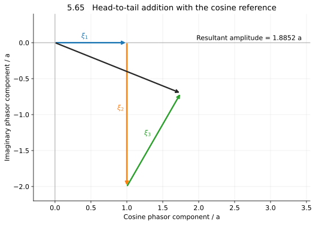
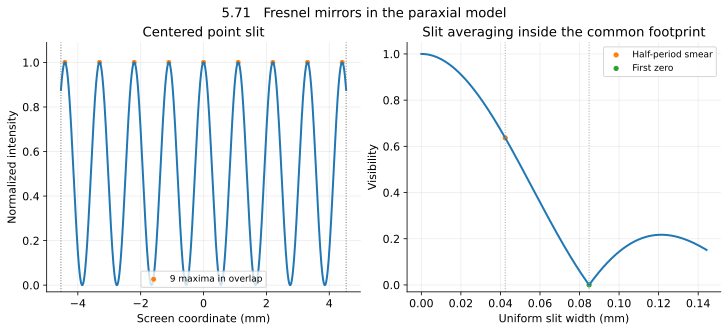
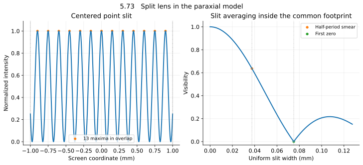
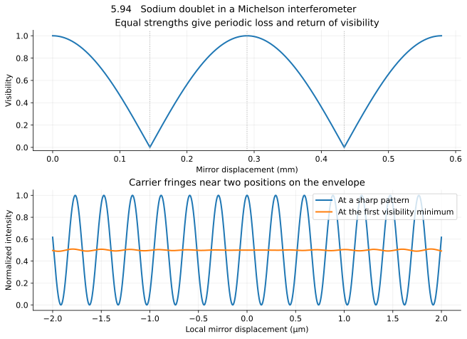
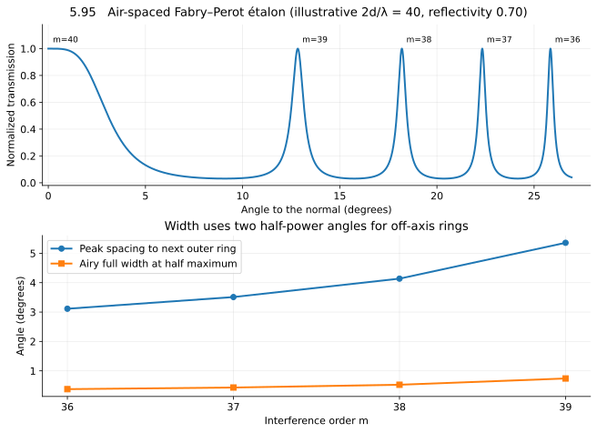

# 5.2 Interference of Light

[Chapter index](../README.md#chapters) · [Structured solutions](5.2.json) · [Answer audit](../audit/README.md)

## 5.64

**Problem statement**

Demonstrate that when two harmonic oscillations are added, the time-averaged energy of the resultant oscillation is equal to the sum of the energies of the constituent oscillations, if both of them (a) have the same direction and are incoherent, and all the values of the phase difference between the oscillations are equally probable; (b) are mutually perpendicular, have the same frequency and an arbitrary phase difference.

**Solved · high confidence.** Average the cross terms of a quadratic oscillation energy.

**Assumptions**

- For optical intensity use the same local quadratic energy normalization for both constituents. For mechanical oscillations the equivalent argument applies to an isotropic quadratic potential and kinetic energy.
- In(a), incoherence means the relative phase samples the uniform distribution over the observation interval; a time average at one permanently fixed relative phase would not remove the coherent cross term.

For collinear components of amplitudesA₁,A₂, average first over an optical cycle and retain the phase cross term.

$$
\left\langle(\xi_1+\xi_2)^2\right\rangle_t=\frac{A_1^2+A_2^2}{2}+A_1A_2\cos\Delta\varphi.
$$

Uniform relative phase makes its cosine average vanish. The same cancellation holds for the velocity cross term if mechanical energy is being used.

$$
\langle\cos\Delta\varphi\rangle=\frac1{2\pi}\int_0^{2\pi}\cos\phi\,d\phi=0\quad\Longrightarrow\quad\overline W=\overline W_1+\overline W_2.
$$

For perpendicular directions the vector dot product vanishes identically, so there is no cross term even at a fixed phase difference.

$$
|\boldsymbol\xi_1+\boldsymbol\xi_2|^2=|\boldsymbol\xi_1|^2+|\boldsymbol\xi_2|^2,\qquad\boldsymbol\xi_1\cdot\boldsymbol\xi_2=0.
$$

**Results**

Incoherent collinear oscillations

$$
\overline W=\overline W_1+\overline W_2
$$

Perpendicular oscillations at arbitrary phase

$$
\overline W=\overline W_1+\overline W_2
$$

## 5.65

**Problem statement**

By means of plotting find the amplitude of the oscillation resulting from the addition of the following three oscillations of the same direction: $\xi_1=a\cos\omega t,\quad \xi_2=2a\sin\omega t,\quad \xi_3=1.5a\cos(\omega t+\pi/3)$.

**Solved · high confidence.** Add the three phasors in a common cosine convention.

**Assumptions**

- Useξ=Re[Ze^{iωt}], so 2a sin ωt has phasor−2ia.

The three phasors have arguments 0,−π/2,+π/3. Their vector sum is

$$
\frac Za=1-2i+\frac32e^{i\pi/3}=\frac74+i\left(\frac{3\sqrt3}{4}-2\right).
$$

The resultant amplitude is the length of this vector; its argument fixes the phase.

$$
\frac Aa=\sqrt{\left(\frac74\right)^2+\left(\frac{3\sqrt3}{4}-2\right)^2}=\sqrt{\frac{35}4-3\sqrt3}\simeq1.88517.
$$

**Results**

Resultant amplitude

$$
A=a\sqrt{35/4-3\sqrt3}\simeq1.885a
$$

Resultant in cosine form

$$
\xi=A\cos(\omega t-0.380980\ldots)
$$

## 5.66

**Problem statement**

A certain oscillation results from the addition of coherent oscillations of the same direction $\xi_k=a\cos[\omega t+(k-1)\varphi]$, where k is the number of the oscillation (k = 1, 2, ..., N), φ is the phase difference between the kth and (k — 1)th oscillations. Find the amplitude of the resultant oscillation.

**Solved · high confidence.** Sum a finite geometric series of coherent phasors.

**Assumptions**

- N is a positive integer and the oscillations have the common angular frequency ω and polarization/direction.

Factor the geometric sum into a phase factor and a real sine ratio.

$$
Z=a\sum_{j=0}^{N-1}e^{ij\varphi}=a e^{i(N-1)\varphi/2}\frac{\sin(N\varphi/2)}{\sin(\varphi/2)}.
$$

The amplitude is the modulus; the apparent singularities at phase increments 2πq are removable by adding the identical phasors directly.

$$
A=a\left|\frac{\sin(N\varphi/2)}{\sin(\varphi/2)}\right|,\qquad A=Na\ \text{if }\varphi=2\pi q.
$$

**Results**

Resultant amplitude away from removable singularities

$$
A=a\left|\sin(N\varphi/2)/\sin(\varphi/2)\right|
$$

In-phase limiting case

$$
A=Na\quad(\varphi=2\pi q,\ q\in\mathbb Z)
$$

## 5.67

**Problem statement**

A system illustrated in Fig. 5.12 consists of two coherent point sources 1 and 2 located in a certain plane so that their dipole moments are oriented at right angles to that plane. The sources are separated by a distance d, the radiation wavelength is equal to λ. Taking into account that the oscillations of source 2 lag in phase behind the oscillations of source 1 by φ (φ < π), find: (a) the angles θ at which the radiation intensity is maximum; (b) the conditions under which the radiation intensity in the direction θ = π is maximum and in the opposite direction, minimum.

**Solved · high confidence.** Read the observation angle from the scan and combine source lag with propagation phase.

**Assumptions**

- In Fig. 5.12 source 1 is above source 2. Take+z from 2 toward 1, so θ=0 points upward and θ=π downward. Dipoles are parallel and perpendicular to the drawing plane.
- Use the far field, k=2π/λ, and a positive lag 0≤φ<π: source 2 phasor is e^(−iφ) times source 1 under e^(iΩt). Individual dipole intensity is constant with θ in this plane.

The source coordinates arez₁=d/2,z₂=−d/2. Far-field propagation contributes e^(ik n·r_j), giving the relative field phase

$$
\delta_{21}=-\varphi-kd\cos\theta,\qquad I(\theta)=I_1+I_2+2\sqrt{I_1I_2}\cos(\varphi+kd\cos\theta).
$$

Constructive interference occurs when the cosine argument is an integer multiple of 2π; only accessible cosines describe actual directions.

$$
\cos\theta_m=\frac{2\pi m-\varphi}{kd}=\frac\lambda d\left(m-\frac\varphi{2\pi}\right),\qquad|\cos\theta_m|\le1.
$$

For downward constructive and upward destructive interference, impose both endfire phases.

$$
\varphi-kd=2\pi p,\qquad\varphi+kd=(2q+1)\pi.
$$

Since the positive lag is smaller than π, the simultaneous conditions select φ=π/2 and a quarter-wave separation modulo a full wavelength.

$$
\varphi=\frac\pi2,\qquad d=\left(j+\frac14\right)\lambda,\quad j=0,1,2,\ldots.
$$

**Results**

Constructive maximum directions

$$
\theta_m=\arccos\!\left[\frac\lambda d\left(m-\frac\varphi{2\pi}\right)\right]
$$

Include only integersm giving an argument in[−1,1]. Directions symmetric about the source axis in the drawing plane have the same intensity.

If no constructive direction exists

$$
kd<\varphi:\quad\theta_{\max}=\pi
$$

This is the global maximum of the restricted angular pattern, although the two fields are not exactly in phase there.

Downward maximum and upward minimum

$$
\varphi=\pi/2,\qquad d/\lambda=j+1/4\quad(j=0,1,\ldots)
$$

## 5.68

**Problem statement**

A stationary radiating system consists of a linear chain of parallel oscillators separated by a distance d, with the oscillation phase varying linearly along the chain. Find the time dependence of the phase difference Δφ between the neighbouring oscillators at which the principal radiation maximum of the system will be "scanning" the surroundings with the constant angular velocity ω.

**Solved · high confidence.** Program the adjacent phase to cancel the geometrical array phase along a moving direction.

**Assumptions**

- Let oscillatorj be atz_j=jd and have phaseΩt+jΔφ(t), whereΔφ is the phase lead of the next oscillator along+z. The carrier frequencyΩ is distinct from the slow scan rate ω.
- Use a quasistatic array factor: phase controls vary slowly compared with the carrier and with relevant propagation delays across the whole array. Assume the individual-element pattern does not suppress the selected direction.
- An array on one line fixes the polar direction cosine; without additional geometry it cannot independently select a unique azimuth.

At angle θ to+z, neighbouring far-field contributions differ in phase byΔφ+kd cos θ. A principal maximum requires this phase increment to be an integer multiple of 2π.

$$
\Delta\varphi(t)+kd\cos\theta_s(t)=2\pi m.
$$

For a scan θ_s=θ₀+ωt at constant angular speed, choose the phase program

$$
\Delta\varphi(t)=-\frac{2\pi d}{\lambda}\cos(\theta_0+\omega t)\pmod{2\pi}.
$$

Other principal orders may produce equal array maxima. Their direction cosines differ by integer multiples of λ/d.

$$
\cos\theta_m=\cos\theta_s+m\lambda/d.
$$

**Results**

Adjacent phase-lead program

$$
\Delta\varphi(t)=-(2\pi d/\lambda)\cos(\theta_0+\omega t)\pmod{2\pi}
$$

Equivalent adjacent-lag convention

$$
\Delta\varphi_{\rm lag}(t)=+(2\pi d/\lambda)\cos(\theta_0+\omega t)\pmod{2\pi}
$$

**Limitations**

- For a finite scan rate with appreciable array retardation or carrier modulation, the instantaneous phase program alone is not an exact broadband solution.
- Finite arrays also have ordinary sidelobes even when the principal grating lobe is unique.

## 5.69

**Problem statement**

In Lloyd's mirror experiment (Fig. 5.13) a light wave emitted directly by the source S (narrow slit) interferes with the wave reflected from a mirror M. As a result, an interference fringe pattern is formed on the screen Sc. The source and the mirror are separated by a distance l = 100 cm. At a certain position of the source the fringe width on the screen was equal to Δx = 0.25 mm, and after the source was moved away from the mirror plane by Δh = 0.60 mm, the fringe width decreased η = 1.5 times. Find the wavelength of light.

**Solved · medium confidence.** Use the change in Lloyd-fringe spacing to infer source height, then state the required source–screen baseline explicitly.

**Assumptions**

- LetL denote the longitudinal source-to-screen distance andh the initial source height above the mirror plane. Use the usual small-angle Lloyd geometry.
- The printed scan says source–mirror distance l=100 cm. The conventional numerical answer below is conditional on thatl having been intended as the needed source–screen baselineL; this is not silently substituted.

The real source and its virtual mirror image are separated by 2h. The reflection phase reverses bright and dark fringes but not their spacing.

$$
\Delta x=\frac{\lambda L}{2h},\qquad\frac{\Delta x}{\Delta x\prime}=\frac{h+\Delta h}{h}=\eta.
$$

Solve the measured spacing ratio for the source height.

$$
h=\frac{\Delta h}{\eta-1}=1.20\ \mathrm{mm}.
$$

Eliminateh to obtain the wavelength in terms of the actual baselineL.

$$
\lambda=\frac{2\Delta x\,\Delta h}{(\eta-1)L};\quad L=1.00\ \mathrm m\ \Longrightarrow\ \lambda=0.60\ \mathrm{\mu m}.
$$

**Results**

Wavelength in terms of the actual source–screen distance

$$
\lambda=2\Delta x\Delta h/[(\eta-1)L]
$$

Conventional numerical value ifL=1.00 m is intended

$$
\lambda=0.60\ \mathrm{\mu m}
$$

Initial height above the mirror plane

$$
h=1.20\ \mathrm{mm}
$$

**Limitations**

- A literal longitudinal distance only from the source to the mirror does not determineL without additional screen geometry.

## 5.70

**Problem statement**

Two coherent plane light waves propagating with a divergence angle ψ ≪ 1 fall almost normally on a screen. The amplitudes of the waves are equal. Demonstrate that the distance between the neighbouring maxima on the screen is equal to Δx = λ/ψ, where λ is the wavelength.

**Solved · high confidence.** Take the transverse wave-vector difference on the screen.

**Assumptions**

- The waves have the same wavelength and equal amplitudes, and their mean propagation direction is nearly normal to the screen.
- For an exact symmetric construction use incidence angles±ψ/2 about the screen normal.

The interference phase on the screen changes with the transverse projection ofk₁−k₂.

$$
I(x)=4I_0\cos^2\!\left[\frac{(\mathbf k_1-\mathbf k_2)_\parallel\cdot\mathbf x}{2}+\frac{\phi_0}{2}\right].
$$

For symmetric incidence its transverse magnitude is 2k sin(ψ/2). A2π phase change separates neighbouring maxima.

$$
\Delta x=\frac{\lambda}{2\sin(\psi/2)}\simeq\frac\lambda\psi\qquad(\psi\ll1).
$$

**Results**

Small-divergence fringe spacing

$$
\Delta x\simeq\lambda/\psi
$$

Symmetric-incidence plane-wave spacing

$$
\Delta x=\lambda/[2\sin(\psi/2)]
$$

## 5.71

**Problem statement**

Figure 5.14 illustrates the interference experiment with Fresnel mirrors. The angle between the mirrors is α = 12′, the distances from the mirrors' intersection line to the narrow slit S and the screen Sc are equal to r = 10.0 cm and b = 130 cm respectively. The wavelength of light is λ = 0.55 μm. Find: (a) the width of a fringe on the screen and the number of possible maxima; (b) the shift of the interference pattern on the screen when the slit is displaced by δl = 1.0 mm along the arc of radius r with centre at the point O; (c) at what maximum width δ_max of the slit the interference fringes on the screen are still observed sufficiently sharp.

**Solved · medium confidence.** Unfold the two Fresnel mirrors into virtual sources and keep the finite overlap and slit visibility explicit.

**Assumptions**

- Use the centred geometry of Fig. 5.14, with mirror intersectionO at(0,0), screenx=b and virtual sourcesS±=(−r cos α,±r sin α). Both reflections carry the same phase reversal.
- The geometrical two-beam overlap is−b tan α<y<b tan α. Diffraction at the overlap edges is ignored.
- For finite slit width δ, use a uniformly bright spatially incoherent slit in the tangential/arc direction. Sharpness needs a stated visibility criterion; the numerical δ_max below uses the common half-period pattern-spread convention.

The virtual-source separation and source-plane-to-screen baseline give the central paraxial fringe pitch.

$$
d=2r\sin\alpha,\quad L=b+r\cos\alpha,\qquad\Delta x=\frac{\lambda L}{d}\simeq1.103\ \mathrm{mm}.
$$

Count integer bright orders in the actual overlap, rather than rounding width divided by pitch. Use exact point-source path differences to test the endpoints.

$$
q=b\tan\alpha,\quad K=\frac{|\sqrt{L^2+(q-d/2)^2}-\sqrt{L^2+(q+d/2)^2}|}{\lambda}=4.11430\ldots.
$$

Hence onlym=−4,...,+4 are possible. Closed-edge convention gives 2floor(K)+1; strict two-beam interior gives 2ceil(K)−1. They both give 9 for these data.

$$
N=9,\qquad m=-4,-3,\ldots,4.
$$

Moving the source aroundO rotates both virtual sources oppositely. Their perpendicular bisector still passes throughO, so the central fringe moves byb tan(δl/r), not by translating the virtual sources alone.

$$
|\Delta y_0|=b\tan(\delta l/r)\simeq\frac br\delta l=13.0\ \mathrm{mm}.
$$

A source element displacement shifts its pattern byb/r times that displacement. Averaging the phases of a uniform slit gives a sinc visibility.

$$
\mathcal V(\delta)=\left|\frac{\sin(\pi\delta/\delta_0)}{\pi\delta/\delta_0}\right|,\qquad\delta_0=\frac r b\Delta x\simeq84.84\ \mathrm{\mu m}.
$$

Requiring the full pattern spread to be no more than half a period gives δ_max=δ₀/2; its visibility is 2/π.

$$
\delta_{\max,\,half-period}=\frac{r\Delta x}{2b}\simeq42.42\ \mathrm{\mu m},\qquad\mathcal V=2/\pi.
$$

**Results**

Central fringe width

$$
\Delta x\simeq1.103\ \mathrm{mm}
$$

Number of possible bright maxima in the overlap

$$
N=9\quad(m=-4,\ldots,4)
$$

Pattern displacement magnitude

$$
|\Delta y_0|=b\tan(\delta l/r)\simeq13.0\ \mathrm{mm}
$$

Maximum full slit width under the half-period sharpness criterion

$$
\delta_{\max}\simeq42.4\ \mathrm{\mu m}
$$

This convention corresponds tovisibility2/π≈0.637 in the first visibility lobe.

First visibility-zero full slit width

$$
\delta_0\simeq84.8\ \mathrm{\mu m}
$$

This is not the same as a sufficiently-sharp threshold; a chosen minimum visibility determines a width within the first lobe.

**Limitations**

- The pitch is a paraxial local fringe width; exact spherical-wave fringe spacings vary very slightly across the overlap.
- If a different minimum visibility is specified, solve|sinc(πδ/δ₀)|=V_min in the first lobe instead of using δ₀/2.

## 5.72

**Problem statement**

A plane light wave falls on Fresnel mirrors with an angle α = 2.0′ between them. Determine the wavelength of light if the width of the fringe on the screen Δx = 0.55 mm.

**Solved · high confidence.** Use the double reflection-angle separation of the two outgoing plane waves.

**Assumptions**

- The screen is normal to the bisector of the two reflected beams. The stated mirror angle α is 2arcminutes, not 2degrees.

Plane-mirror reflections separate the outgoing propagation directions by 2α. Their transverse wave-vector difference has magnitude 2k sin α.

$$
\Delta x=\frac{\lambda}{2\sin\alpha}\quad\Longrightarrow\quad\lambda=2\Delta x\sin\alpha.
$$

Convert arcminutes to radians and substitute.

$$
\lambda=2(0.55\ \mathrm{mm})\sin(2\pi/(180\times60))\simeq0.640\ \mathrm{\mu m}.
$$

**Results**

Wavelength

$$
\lambda\simeq0.640\ \mathrm{\mu m}
$$

## 5.73

**Problem statement**

A lens of diameter 5.0 cm and focal length f = 25.0 cm was cut along the diameter into two identical halves. In the process, the layer of the lens a = 1.00 mm in thickness was lost. Then the halves were put together to form a composite lens. In its focal plane a narrow slit was placed, emitting monochromatic light with wavelength λ = 0.60 μm. Behind the lens a screen was located at a distance b = 50 cm from it. Find: (a) the width of a fringe on the screen and the number of possible maxima; (b) the maximum width of the slit δ_max at which the fringes on the screen will be still observed sufficiently sharp.

**Solved · medium confidence.** Trace the decentered half-lenses, then count maxima in their common beam footprint.

**Assumptions**

- The lost layer is a strip of full widtha across the cut; putting the halves together shifts their old optical axes by∓a/2.
- Use the paraxial thin-lens model. The slit lies in the front focal plane on the composite symmetry axis.
- Finite slit width δ means uniform spatially incoherent emission transverse to the cut; the usual half-period pattern-spread sharpness convention is stated separately from the first visibility zero.

The upper physical half has old optical axis−a/2 and sends the centred slit into a downward plane wave; the lower half sends it upward. Their angular separation isa/f.

$$
\theta_\pm\simeq\pm\frac{a}{2f},\qquad\Delta x=\frac{\lambda f}{a}=0.150\ \mathrm{mm}.
$$

At screen distanceb each half-beam is shifted toward the other byq=ba/(2f). The available half-aperture isw=(D−a)/2, which is large enough that the inner edges determine the overlap.

$$
q=1.00\ \mathrm{mm},\quad w=24.5\ \mathrm{mm}>2q,\quad -q<y<q.
$$

With equal phase at the symmetry axis, the bright orders satisfyy_m=mΔx. Count them against the overlap rather than approximating their number by the number of periods.

$$
\frac q{\Delta x}=\frac{20}3=6.666\ldots,\qquad m=-6,-5,\ldots,6,\qquad N=13.
$$

A source point displaced bys in the focal plane adds common beam tilt−s/f. Both footprints and the interference centre shift by−bs/f, while the central pitch remains the same.

$$
y_0(s)=-bs/f,\qquad\mathcal V(\delta)=\left|\frac{\sin(\pi\delta/\delta_0)}{\pi\delta/\delta_0}\right|,\quad\delta_0=\frac{f\Delta x}{b}=75.0\ \mathrm{\mu m}.
$$

The half-period-spread convention gives a full slit width δ₀/2 and visibility 2/π.

$$
\delta_{\max,\,half-period}=\frac{\lambda f^2}{2ab}=37.5\ \mathrm{\mu m}.
$$

**Results**

Fringe width

$$
\Delta x=0.150\ \mathrm{mm}
$$

Number of possible maxima

$$
N=13\quad(m=-6,\ldots,6)
$$

Maximum full slit width under the half-period criterion

$$
\delta_{\max}=37.5\ \mathrm{\mu m}
$$

A convention-dependent sharpness threshold withvisibility2/π, not a universal coherence limit.

First visibility-zero full slit width

$$
\delta_0=75.0\ \mathrm{\mu m}
$$

**Limitations**

- The sinc visibility applies away from portions of the screen where aperture clipping varies across the slit.
- A specified minimum visibility would replace the conventional 37.5 μm threshold.

## 5.74

**Problem statement**

The distances from a Fresnel biprism to a narrow slit and a screen are equal to a = 25 cm and b = 100 cm respectively. The refracting angle of the glass biprism is equal to θ = 20′. Find the wavelength of light if the width of the fringe on the screen is Δx = 0.55 mm.

**Solved · high confidence.** Replace the Fresnel biprism by its two virtual slit images.

**Assumptions**

- Use the Appendix20 representative glass indexn=1.50, with outside air approximated by 1 and dispersion neglected.
- The small refracting angle θ=20arcminutes refers to each prism half in the standard Fresnel-biprism convention.

Each prism half deflects a ray by δ≈(n−1)θ; the two virtual slit images are therefore separated by 2aδ.

$$
d\simeq2a(n-1)\theta.
$$

The virtual-source plane is at the slit plane, so its baseline to the screen isa+b. Solve the fringe-spacing law for wavelength.

$$
\Delta x=\frac{\lambda(a+b)}d\quad\Longrightarrow\quad\lambda=\frac{2a(n-1)\theta\Delta x}{a+b}\simeq0.640\ \mathrm{\mu m}.
$$

**Results**

Wavelength with the representative glass index

$$
\lambda\simeq0.640\ \mathrm{\mu m}
$$

## 5.75

**Problem statement**

A plane light wave with wavelength λ = 0.70 μm falls normally on the base of a biprism made of glass (n = 1.520) with refracting angle θ = 5.0°. Behind the biprism (Fig. 5.15) there is a plane-parallel plate, with the space between them filled up with benzene (n' = 1.500). Find the width of a fringe on the screen Sc placed behind this system.

**Solved · high confidence.** Trace the small deflection into benzene and conserve transverse wavevector through the parallel plate.

**Assumptions**

- The incident beam is normal to the flat biprism base; the upper and lower halves have face tilts±θ as in Fig. 5.15. Given n=1.520 and n′=1.500 take precedence over generic material values.
- Use λ as free-space wavelength, numerically the usual air≈1 convention. The outer plate faces are parallel to the biprism base; its unspecified thickness/index may give common phases and beam offsets but not a transverse-wavevector change.

At the inclined glass–benzene boundary, the angle to its normal grows from θ to r. Each benzene ray is deflected toward the axis by β=r−θ.

$$
n\sin\theta=n\prime\sin r,\qquad\beta=\arcsin[(n/n\prime)\sin\theta]-\theta.
$$

Tangential wavevector is conserved at every subsequent plane interface. The two emerging waves therefore have opposite k_y values of magnitude k₀n′sin β, even after transmission through the plate.

$$
k_y=\pm\frac{2\pi}{\lambda}n\prime\sin\beta,\qquad\Delta k_y=\frac{4\pi n\prime\sin\beta}{\lambda}.
$$

Adjacent bright fringes differ by 2π phase. For small θ the n′ factor cancels the index ratio in β.

$$
\Delta y=\frac{\lambda}{2n\prime\sin\beta}\simeq\frac{\lambda}{2(n-n\prime)\theta}.
$$

**Results**

Fringe width from exact Snell angles

$$
\Delta y=\frac{\lambda}{2n\prime\sin\{\arcsin[(n/n\prime)\sin\theta]-\theta\}}\simeq0.200\ \mathrm{mm}
$$

Small-prism approximation

$$
\Delta y\simeq\frac{\lambda}{2(n-n\prime)\theta}\simeq0.201\ \mathrm{mm}
$$

**Limitations**

- Finite aperture must leave an overlap region. The screen distance sets overlap and fringe phase position, not the spacing of the two plane-wave components.

## 5.76

**Problem statement**

A plane monochromatic light wave falls normally on a diaphragm with two narrow slits separated by a distance d = 2.5 mm. A fringe pattern is formed on a screen placed at a distance l = 100 cm behind the diaphragm. By what distance and in which direction will these fringes be displaced when one of the slits is covered by a glass plate of thickness h = 10 μm?

**Solved · high confidence.** Compensate the added slab optical path by moving the Young-interference observation point toward that slit.

**Assumptions**

- Use Appendix generic glass n_g=1.5 and air≈1. The plate is normal to the incident beam and replaces an equal thickness of air in only one slit path.

The extra optical path is δ=(n_g−1)h. With y positive toward the covered slit, its geometric path is shortened by approximately d y/l.

$$
\Delta\mathcal L=\delta-\frac{dy}{l},\qquad\delta=(n_g-1)h.
$$

Restoring any original phase order requires ΔL=0, so the whole pattern shifts by δl/d toward the covered slit.

$$
\Delta y=\frac{(n_g-1)hl}{d}.
$$

**Results**

Fringe displacement toward the covered slit

$$
\Delta y=\frac{.50(10\ \mu\mathrm m)(1.00\ \mathrm m)}{2.5\ \mathrm{mm}}=2.0\ \mathrm{mm}
$$

Toward the slit covered by the glass plate; upward if the upper slit is covered.

## 5.77

**Problem statement**

Figure 5.16 illustrates an interferometer used in measurements of refractive indices of transparent substances. Here S is a narrow slit illuminated by monochromatic light with wavelength λ = 589 nm, 1 and 2 are identical tubes with air of length l = 10.0 cm each, D is a diaphragm with two slits. After the air in tube 1 was replaced with ammonia gas, the interference pattern on the screen Sc was displaced upward by N = 17 fringes. The refractive index of air is equal to n = 1.000277. Determine the refractive index of ammonia gas.

**Solved · high confidence.** Use the figure ordering to determine the sign of the phase delay before converting fringe count to index.

**Assumptions**

- Fig. 5.16 places tube 1 above tube 2. Its source and two tube paths are initially symmetric; only tube 1 changes.
- Use the supplied air index 1.000277, not the nearby Appendix generic-air value. λ is the stated free-space/air-approximation wavelength.

Increasing the upper path optical length shifts the fringe pattern upward, toward that path. Hence the observed upward shift means n_ammonia>n_air rather than the opposite sign.

$$
\delta\mathcal L=(n_{\rm NH_3}-n_a)l>0.
$$

A displacement byN fringe spacings corresponds toN wavelengths of added optical path.

$$
N\lambda=(n_{\rm NH_3}-n_a)l,\qquad n_{\rm NH_3}=n_a+N\lambda/l.
$$

**Results**

Ammonia refractive index

$$
n_{\rm NH_3}=1.000277+\frac{17(589\times10^{-9})}{.100}=1.00037713
$$

**Limitations**

- If the supplied 589 nm were defined strictly as wavelength inside air rather than the free-space convention, λ₀=n_aλ_air would introduce a tiny additional factor in the index increment.

## 5.78

**Problem statement**

An electromagnetic wave falls normally on the boundary between two isotropic dielectrics with refractive indices n_1 and n_2 . Making use of the continuity condition for the tangential components, $\mathbf{E}$ and $\mathbf{H}$ across the boundary, demonstrate that at the interface the electric field vector $\mathbf{E}$ (a) of the transmitted wave experiences no phase jump; (b) of the reflected wave is subjected to the phase jump equal to π if it is reflected from a medium of higher optical density.

**Solved · high confidence.** Solve the tangential E and H continuity equations using real wave admittances.

**Assumptions**

- The ordinary optical-dielectric claim assumes lossless media with positive real constitutive parameters and equal magnetic permeabilities, usually μ₁≈μ₂≈μ₀.
- Compare phases at the common interface in one fixed tangential E-polarization basis; reflected H changes sign relative to the corresponding forward wave.

LetY_j=1/Z_j be wave admittance and Ei,Er,Et the signed electric amplitudes. Boundary continuity gives the sum ofE and the difference of forward/backwardH.

$$
E_i+E_r=E_t,\qquad Y_1(E_i-E_r)=Y_2E_t.
$$

Solve for the Fresnel amplitudes. Their signs determine the phase shifts for lossless positiveY.

$$
r_E=\frac{E_r}{E_i}=\frac{Y_1-Y_2}{Y_1+Y_2},\qquad t_E=\frac{E_t}{E_i}=\frac{2Y_1}{Y_1+Y_2}>0.
$$

For equal μ, Y is proportional to refractive index. Then transmission has zero phase jump, while reflection from larger n₂ gives negative r_E and aπ phase reversal.

$$
r_E=\frac{n_1-n_2}{n_1+n_2},\qquad t_E=\frac{2n_1}{n_1+n_2}.
$$

**Results**

Transmission phase at the boundary

$$
\arg t_E=0
$$

Reflection phase for higher optical density under equal μ

$$
n_2>n_1\ \Longrightarrow\ r_E<0,\quad\arg r_E=\pi\pmod{2\pi}
$$

General lossless magnetic-media criterion

$$
\arg r_E=\pi\ \text{iff }Y_2>Y_1
$$

Refractive index alone does not fix wave admittance if magnetic permeabilities differ.

**Limitations**

- With unequal magnetic permeabilities, higher n does not by itself prove aπ jump; the relevant contrast is admittance. Absorbing media give complex coefficients and generally nonzero transmission phase.

## 5.79

**Problem statement**

A parallel beam of white light falls on a thin film whose refractive index is equal to n = 1.33. The angle of indices is θ_1 = 52°. What must the film thickness be equal to for the reflected light to be coloured yellow (λ = 0.60 μm) most intensively?

**Solved · high confidence.** Apply the one-reflection phase reversal and the oblique thin-film optical path.

**Assumptions**

- Read the printed “angle of indices” as angle of incidence θ₁=52°, in accord with the geometry and header Eq.5.2c.
- The standard intended model is a lossless film of index 1.33 between air on both sides, with air≈1. The reflected components have one relative π reflection shift. λ=.60 μm is the specified yellow component.

Snell’s law gives n cos θ₂=√(n²−sin²θ₁). The optical-path difference for adjacent reflected contributions is 2nb cos θ₂.

$$
\mathcal D=2b\sqrt{n^2-\sin^2\theta_1}.
$$

With one relative π reflection shift, maximum reflected intensity occurs for half-integer optical order. The data select a family, not a unique thickness unless the smallest positive one is requested.

$$
\mathcal D=(m+\tfrac12)\lambda,\quad b_m=\frac{(2m+1)\lambda}{4\sqrt{n^2-\sin^2\theta_1}},\quad m=0,1,2,\ldots
$$

**Results**

Thicknesses maximizing the specified wavelength

$$
b_m=\frac{(2m+1)\lambda}{4\sqrt{n^2-\sin^2\theta_1}}
$$

Smallest positive thickness

$$
b_{\min}\simeq0.140\ \mu\mathrm m
$$

**Limitations**

- A substrate that changes the relative reflection phase changes this family. Maximizing one wavelength alone does not determine the exact perceived colour of an unspecified white-light spectrum.

## 5.80

**Problem statement**

Find the minimum thickness of a film with refractive index 1.33 at which light with wavelength 0.64 μm experiences maximum reflection while light with wavelength 0.40 μm is not reflected at all. The incidence angle of light is equal to 30°.

**Solved · high confidence.** Find the smallest common optical order satisfying a reflected maximum and a reflected zero.

**Assumptions**

- Treat the film as lossless and surrounded by identical air media, so exact multiple-reflection cancellation is possible at an integer optical order. Air≈1; the given film index is 1.33.

LetD=2b√(n²−sin²30°). Red maximum and violet minimum require half-integer and integer orders respectively.

$$
\mathcal D=(p+\tfrac12)(.64\ \mu\mathrm m)=q(.40\ \mu\mathrm m).
$$

Equate the two conditions. The least positive integer solution has 2p+1=5, p=2 andq=4.

$$
4(2p+1)=5q\quad\Longrightarrow\quad\mathcal D=1.60\ \mu\mathrm m.
$$

Convert the common optical path to physical thickness.

$$
b_{\min}=\frac{1.60\ \mu\mathrm m}{2\sqrt{1.33^2-\sin^230^\circ}}.
$$

**Results**

Minimum film thickness

$$
b_{\min}\simeq0.649\ \mu\mathrm m
$$

First simultaneous orders

$$
\mathcal D=2.5\lambda_{.64}=4\lambda_{.40}=1.60\ \mu\mathrm m
$$

**Limitations**

- A different substrate, absorption, or unequal surroundings generally prevent exact zero reflection.

## 5.81

**Problem statement**

To decrease light losses due to reflection from the glass surface the latter is coated with a thin layer of substance whose refractive index $n'=\sqrt{n}$ where n is the refractive index of the glass. In this case the amplitudes of electromagnetic oscillations reflected from both coated surfaces are equal. At what thickness of that coating is the glass reflectivity in the direction of the normal equal to zero for light with wavelength λ?

**Solved · high confidence.** Cancel the full coated-interface reflection using impedance matching and quarter-wave propagation.

**Assumptions**

- Normal incidence from air≈1 onto a lossless coating n_c=√n over lossless glassn. Nonmagnetic optical dielectrics and a single design wavelength λ are assumed.

Both individual interface reflections have the same electric-field sign. With n=n_c² their Fresnel amplitudes are equal.

$$
r_{ac}=\frac{1-n_c}{1+n_c},\quad r_{cg}=\frac{n_c-n}{n_c+n}=\frac{1-n_c}{1+n_c}=r_{ac}.
$$

The coating round-trip propagation must reverse one contribution relative to the other. The exact multiple-reflection numerator then vanishes.

$$
r_{\rm total}=\frac{r_{ac}+r_{cg}e^{2i\beta}}{1+r_{ac}r_{cg}e^{2i\beta}},\quad\beta=\frac{2\pi n_cb}{\lambda},\quad e^{2i\beta}=-1.
$$

Thus any odd quarter-wave physical thickness works at the design wavelength, with the first one the thinnest.

$$
b_m=\frac{(2m+1)\lambda}{4\sqrt n},\qquad m=0,1,2,\ldots
$$

**Results**

Smallest anti-reflection coating thickness

$$
b_{\min}=\frac{\lambda}{4\sqrt n}
$$

All normal-incidence design thicknesses

$$
b_m=\frac{(2m+1)\lambda}{4\sqrt n}
$$

**Limitations**

- The cancellation is monochromatic and normal-incidence. Absorption, magnetic impedance differences, incorrect coating index, and oblique polarization alter the condition.

## 5.82

**Problem statement**

Diffused monochromatic light with wavelength λ = 0.60 μm falls on a thin film with refractive index n = 1.5. Determine the film thickness if the angular separation of neighbouring maxima observed in reflected light at the angles close to θ = 45° to the normal is equal to δθ = 3.0° .

**Solved · high confidence.** Differentiate the equal-inclination optical path with respect to the observed external angle.

**Assumptions**

- θ≈45° is the angle of the incident/observed air ray to the film normal, not the internal refracted angle. Use external air≈1, monochromatic illumination and a lossless plane-parallel film.
- The given separation 3° is treated as a small angular interval around 45°, consistent with “close to” in the statement.

UseD(θ)=2b√(n²−sin²θ). Neighbouring reflected maxima differ by one wavelength of optical path; any fixed reflection phase offset cancels.

$$
\left|\frac{d\mathcal D}{d\theta}\right|\delta\theta\simeq\lambda,\qquad\frac{d\mathcal D}{d\theta}=-\frac{b\sin2\theta}{\sqrt{n^2-\sin^2\theta}}.
$$

Solve for thickness and substitute the angle interval in radians.

$$
b\simeq\frac{\lambda\sqrt{n^2-\sin^2\theta}}{|\sin2\theta|\delta\theta}=\frac{(.60\ \mu\mathrm m)\sqrt{1.75}}{3\pi/180}.
$$

If exact neighbouring angles θ_a,θ_b were supplied, their finite difference could replace the derivative.

$$
b=\frac{\lambda}{2|\sqrt{n^2-\sin^2\theta_a}-\sqrt{n^2-\sin^2\theta_b}|}.
$$

**Results**

Film thickness near 45°

$$
b\simeq15.2\ \mu\mathrm m
$$

**Limitations**

- The word “close” does not specify the two exact angles, so guard digits are computational rather than an exact thickness measurement.

## 5.83

**Problem statement**

Monochromatic light passes through an orifice in a screen Sc (Fig. 5.17) and being reflected from a thin transparent plate P produces fringes of equal inclination on the screen. The thickness of the plate is equal to d, the distance between the plate and the screen is l, the radii of the ith and kth dark rings are r_i and r_k . Find the wavelength of light taking into account that r_i,k ≪ l.

**Solved · medium confidence.** Compare the two returning optical paths in the actual source-screen coincidence geometry.

**Assumptions**

- Fig. 5.17 has the source orifice and observing screen in the same plane; the plate is a distance l away. The plate indexn is not specified in the prompt and is retained as an unknown material parameter.
- Use small observed radii r≪l, air≈1 and a lossless plane-parallel plate. The standard thin-plate simplification additionally takes d/n≪l. The two dark-ring indices differ by the same number as their phase orders, irrespective of the unknown central order.

A front-surface reflected ray returns to the original screen with r≈2lθ. A back-surface ray has extra refracted transverse propagation; its small external angle is r/[2(l+d/n)].

Paraxial Fermat paths from the source hole to a screen point are obtained by unfolding reflection. Their difference keeps the finite d/l correction.

$$
\mathcal L_f=2l+\frac{r^2}{4l},\quad\mathcal L_b=2l+2nd+\frac{r^2}{4(l+d/n)},\quad\mathcal D(r)=2nd-\frac{dr^2}{4nl(l+d/n)}.
$$

Subtract two dark-ring conditions. The central optical path and reflection phase cancel, leaving only squared-radius difference and order difference.

$$
|k-i|\lambda=\frac{d|r_k^2-r_i^2|}{4nl(l+d/n)}.
$$

For a thin plate far from the screen replace l+d/n by l. A screen at a focal plane of a different lens would give a different angle-to-radius calibration; that is not the drawn layout.

**Results**

Wavelength for the intended thin-plate geometry

$$
\lambda\simeq\frac{d|r_k^2-r_i^2|}{4nl^2|k-i|}
$$

Paraxial refinement retaining finite d/l

$$
\lambda=\frac{d|r_k^2-r_i^2|}{4nl(l+d/n)|k-i|}
$$

Valid through quadratic order in radius; use exact paths for larger observation angles.

Missing material parameter

$$
n\text{ must be supplied to obtain a unique wavelength from the stated data}
$$

The plate is only called transparent, not glass; the generic glass index is not silently imposed.

**Limitations**

- The exact finite-angle problem needs its full Snell ray paths. If n were intended as the generic glass 1.5, it must be declared as an additional material assumption.

## 5.84

**Problem statement**

A plane monochromatic light wave with wavelength λ falls on the surface of a glass wedge whose faces form an angle α ≪ 1. The plane of incidence is perpendicular to the edge, the angle of incidence is θ_1 . Find the distance between the neighbouring fringe maxima on the screen placed at right angles to reflected light.

**Solved · high confidence.** Calculate the wedge phase gradient on its face and project it onto the screen perpendicular to the reflected rays.

**Assumptions**

- Take the illuminated face as the reference plane. x runs along it perpendicular to the wedge edge, and local normal thickness is b(x)≈αx. θ₁ is measured from that first face normal.
- Letn be the glass index; Appendix20 supplies representative n=1.5 if a generic value is desired. External air is approximated by 1. Work to first order in α, away from grazing incidence.

The local optical-path difference varies along the face through thickness; a constant reflection phase shifts fringe order but not spacing.

$$
\mathcal D(x)=2n\alpha x\cos\theta_2,\quad n\sin\theta_2=\sin\theta_1,\quad\Delta x_{\rm face}=\frac{\lambda}{2\alpha\sqrt{n^2-\sin^2\theta_1}}.
$$

The screen is perpendicular to the reflected propagation, so adjacent face points project with the factor cos θ₁. The face spacing is not itself the requested screen spacing.

$$
\Delta s=\Delta x_{\rm face}\cos\theta_1.
$$

Equivalently the two reflected plane waves differ by angleΔψ≈2α√(n²−sin²θ₁)/cos θ₁, giving spacing λ/Δψ on a normal screen.

**Results**

Fringe spacing on the screen normal to reflected light

$$
\Delta s=\frac{\lambda\cos\theta_1}{2\alpha\sqrt{n^2-\sin^2\theta_1}}
$$

Representative glass substitution

$$
\Delta s=\frac{\lambda\cos\theta_1}{2\alpha\sqrt{2.25-\sin^2\theta_1}}
$$

For Appendix generic glass n=1.5; use the actual wavelength-dependent index when known.

**Limitations**

- Near grazing incidence the first-order angular expansion becomes nonuniform; it is not a prediction of arbitrarily small fringe spacing for a fixed finite wedge angle. A face-normal thickness and the stated illuminated-face incidence angle are essential conventions.

## 5.85

**Problem statement**

Light with wavelength λ = 0.55 μm from a distant point source falls normally on the surface of a glass wedge. A fringe pattern whose neighbouring maxima on the surface of the wedge are separated by a distance Δx = 0.21 mm is observed in reflected light. Find: (a) the angle between the wedge faces; (b) the degree of light monochromatism (Δλ/λ) if the fringes disappear at a distance l ≃ 1.5 cm from the wedge's edge.

**Solved · medium confidence.** Infer wedge angle from phase spacing, then estimate spectral bandwidth from loss of temporal coherence.

**Assumptions**

- Use Appendix generic glass n=1.5, air≈1 and normal incidence. The quoted spacing is measured on the wedge face, and wedge thickness near the edge is b≈αx.
- The coherence estimate uses the chapter convention l_coh≈λ²/Δλ, negligible material dispersion across the narrow band, and an operational disappearance of visible fringes. Spectrum shape and a detection threshold are not specified.

Normal-incidence adjacent reflected maxima differ by one λ of round-trip optical path.

$$
2n\alpha\Delta x=\lambda,\quad\alpha=\frac{\lambda}{2n\Delta x}.
$$

At distance l from the edge the OPD is 2nαl=λl/Δx. Equate this approximately to the coherence length.

$$
\mathcal D_l=2n\alpha l=\frac{\lambda l}{\Delta x},\quad\frac{\Delta\lambda}{\lambda}\sim\frac{\lambda}{\mathcal D_l}=\frac{\Delta x}{l}.
$$

A precise visibility law is a Fourier transform of the spectrum. For a rectangular narrow wavenumber band, the first visibility zero makes the same bandwidth formula a specified model rather than a universal rule. Here sinc z means sin(z)/z, with value1 at z=0.

$$
|\gamma(\mathcal D)|=\frac{|\int S(k)e^{ik\mathcal D}\,dk|}{\int S(k)\,dk};\quad |\gamma|=\left|\operatorname{sinc}\left(\frac{\mathcal D\Delta k}{2}\right)\right|,\quad\Delta k\simeq\frac{2\pi\Delta\lambda}{\lambda^2}.
$$

If glass dispersion matters, the coherence delay contains the group indexn_group=n−λdn/dλ instead ofn. The basic estimate then gains the factorn/n_group.

$$
\frac{\Delta\lambda}{\lambda}\sim\frac{n}{n_{\rm group}}\frac{\Delta x}{l}.
$$

**Results**

Angle between wedge faces

$$
\alpha=8.73016\times10^{-4}\ \mathrm{rad}\simeq3.00\ \mathrm{arcmin}
$$

Conventional relative spectral-width estimate

$$
\frac{\Delta\lambda}{\lambda}\sim\frac{.21\ \mathrm{mm}}{15\ \mathrm{mm}}=.014\simeq1.4\%
$$

Corresponding indicative spectral width

$$
\Delta\lambda\sim7.7\ \mathrm{nm}
$$

Optical path at the reported disappearance distance

$$
\mathcal D_l\simeq39.3\ \mu\mathrm m
$$

**Limitations**

- The1.4% result is an approximate chapter coherence convention, not a universal exact bandwidth measurement. A Gaussian spectrum has no finite exact zero and would need a chosen visibility threshold.

## 5.86

**Problem statement**

The convex surface of a plano-convex glass lens comes into contact with a glass plate. The curvature radius of the lens's convex surface is R, the wavelength of light is equal to λ. Find the width Δr of a Newton ring as a function of its radius r in the region where Δr ≪ r.

**Solved · high confidence.** Differentiate the equal-order squared-radius law.

**Assumptions**

- Use normal-incidence paraxial Newton rings in a thin air gap, n_air≈1, and vacuum wavelength λ. There is one relative π reflection shift at a glass–air–glass film, so zero-gap contact is dark.
- The width means a full radial fringe period between neighbouring rings of the same type (bright–bright or dark–dark).

The gap thickness is approximatelyr²/(2R), so adjacent same-kind fringes differ in round-trip gap 2t by λ.

$$
r_{m+1}^2-r_m^2=R\lambda.
$$

ForΔr≪r, expand the difference of squared radii.

$$
2r\,\Delta r+(\Delta r)^2=R\lambda\quad\Longrightarrow\quad\Delta r\simeq\frac{R\lambda}{2r}.
$$

**Results**

Full fringe width

$$
\Delta r\simeq\frac{R\lambda}{2r}
$$

Distance to the adjacent opposite-type extremum

$$
\Delta r_{\rm bright\to dark}\simeq\frac{R\lambda}{4r}
$$

This is half a full fringe period, if the word width is instead used for one bright/dark band.

## 5.87

**Problem statement**

The convex surface of a plano-convex glass lens with curvature radius R = 40 cm comes into contact with a glass plate. A certain ring observed in reflected light has a radius r = 2.5 mm. Watching the given ring, the lens was gradually removed from the plate by a distance Δh = 5.0 μm. What has the radius of that ring become equal to?

**Solved · high confidence.** Track one fixed interference order while adding a uniform gap.

**Assumptions**

- Use normal-incidence paraxial Newton rings in a thin air gap, n_air≈1, and vacuum wavelength λ. There is one relative π reflection shift at a glass–air–glass film, so zero-gap contact is dark.
- Follow the same phase-order ring continuously as the lens is raised; do not relabel rings by their changing apparent count from the centre.

Raising the lens increases every gap byΔh. At fixed order the total optical thickness remains unchanged.

$$
2h_0+\frac{r^2}{R}=2(h_0+\Delta h)+\frac{r\prime{}^2}{R}.
$$

Thus the squared radius decreases by 2RΔh.

$$
r\prime=\sqrt{r^2-2R\Delta h}.
$$

**Results**

Radius of the tracked ring

$$
r\prime=1.50\ \mathrm{mm}
$$

## 5.88

**Problem statement**

At the crest of a spherical surface of a plano-convex lens there is a ground-off plane spot of radius r_0 = 3.0 mm through which the lens comes into contact with a glass plate. The curvature radius of the lens's convex surface is equal to R = 150 cm. Find the radius of the sixth bright ring when observed in reflected light with wavelength λ = 655 nm.

**Solved · high confidence.** Shift the spherical gap origin to the boundary of the flat contact spot.

**Assumptions**

- Use normal-incidence paraxial Newton rings in a thin air gap, n_air≈1, and vacuum wavelength λ. There is one relative π reflection shift at a glass–air–glass film, so zero-gap contact is dark.
- The first bright ring is the first bright annulus outside the flat contact spot; the flat region itself is not counted as a bright ring.

Outside the ground-off circular spot, the gap vanishes atr=r₀ rather than atr=0.

$$
t(r)\simeq\frac{r^2-r_0^2}{2R},\qquad r\ge r_0.
$$

For thekth bright ring in reflected light,2t=(k−1/2)λ. Substitute k=6.

$$
r_k^2=r_0^2+(k-\tfrac12)\lambda R.
$$

**Results**

Sixth bright-ring radius

$$
r_6=3.79523\ldots\ \mathrm{mm}
$$

## 5.89

**Problem statement**

A plano-convex glass lens with curvature radius of spherical surface R = 12.5 cm is pressed against a glass plate. The diameters of the tenth and fifteenth dark Newton's rings in reflected light are equal to d_1 = 1.00 mm and d_2 = 1.50 mm. Find the wavelength of light.

**Solved · medium confidence.** Use the order difference to remove a common gap offset, then audit absolute contact consistency.

**Assumptions**

- Use normal-incidence paraxial Newton rings in a thin air gap, n_air≈1, and vacuum wavelength λ. There is one relative π reflection shift at a glass–air–glass film, so zero-gap contact is dark.
- For the primary wavelength inference, allow a constant centre gap h₀ or equivalent phase-origin offset and treat 10 and 15 as absolute phase-order labels differing by 5.

An offset gap gives dark-ring squared diameter linear in phase order. Subtracting two orders eliminates h₀.

$$
d_m^2=4R(m\lambda-2h_0),\qquad\lambda=\frac{d_2^2-d_1^2}{4R(m_2-m_1)}.
$$

The difference yields 500 nm. However a perfect zero-gap contact with literal 10th/15th absolute orders cannot fit both measured diameters.

$$
\lambda_{10,h_0=0}=200\ \mathrm{nm},\qquad\lambda_{15,h_0=0}=300\ \mathrm{nm}.
$$

Fitting the two diameters consistently with 500 nm requires a nonzero centre gap.

$$
h_0=\frac12\left(m_1\lambda-\frac{d_1^2}{4R}\right)=1.50\ \mathrm{\mu m}.
$$

**Results**

Wavelength from the five-order difference

$$
\lambda=500\ \mathrm{nm}
$$

Common centre gap required by absolute phase labels

$$
h_0=1.50\ \mathrm{\mu m}
$$

This is an imperfect-contact interpretation, not a zero-gap contact. If tenth/fifteenth mean ordinal visible rings from an ideal dark contact, the supplied absolute data are inconsistent.

**Limitations**

- The order-difference result is definite, but the ideal-contact absolute-order description is inconsistent unless a gap or phase-origin qualification is allowed.

## 5.90

**Problem statement**

Two plano-convex thin glass lenses are brought into contact with their spherical surfaces. Find the optical power of such a system if in reflected light with wavelength λ = 0.60 μm the diameter of the fifth bright ring is d = 1.50 mm.

**Solved · high confidence.** Relate the opposing convex gap curvature to the summed thin-lens power.

**Assumptions**

- Use normal-incidence paraxial Newton rings in a thin air gap, n_air≈1, and vacuum wavelength λ. There is one relative π reflection shift at a glass–air–glass film, so zero-gap contact is dark.
- Both lenses use Appendix20 glass index n_g=1.50 and are sufficiently thin to add their air powers. Their spherical faces touch at the common vertex; let their curvature magnitudes beR₁,R₂.

The two convex sags add in the gap. The fifth bright ring has round-trip optical thickness 4.5λ.

$$
2t=r^2\left(\frac1{R_1}+\frac1{R_2}\right),\qquad r^2\left(\frac1{R_1}+\frac1{R_2}\right)=\frac92\lambda.
$$

The plano-convex lens powers add with the same curvature sum.

$$
\Phi=(n_g-1)\left(\frac1{R_1}+\frac1{R_2}\right)=(n_g-1)\frac{18\lambda}{d^2}.
$$

**Results**

Combined optical power

$$
\Phi=+2.40\ \mathrm D
$$

## 5.91

**Problem statement**

Two thin symmetric glass lenses, one biconvex and the other biconcave, are brought into contact to make a system with optical power Φ = 0.50 D. Newton's rings are observed in reflected light with wavelength λ = 0.61 μm. Determine: (a) the radius of the tenth dark ring; (b) how the radius of that ring will change when the space between the lenses is filled up with water.

**Solved · high confidence.** Use the signed curvature difference of the physical inter-lens gap.

**Assumptions**

- Use normal-incidence paraxial Newton rings in a thin air gap, n_air≈1, and vacuum wavelength λ. There is one relative π reflection shift at a glass–air–glass film, so zero-gap contact is dark.
- Both symmetric lenses use Appendix20 glass n_g=1.50. LetR_c be the biconvex radius magnitude andR_d the biconcave radius magnitude. The given positive air power impliesR_c<R_d and a positive outward-opening central gap.
- Only the gap is filled in part(b); the glass shapes stay fixed. Appendix water n_w=1.33 is below n_g, so the single relative reflection flip persists.

For facing convex/concave surfaces the gap curvature is the difference, not the sum. The two symmetric air lens powers supply twice that difference.

$$
2t=r^2\left(\frac1{R_c}-\frac1{R_d}\right),\quad K_g=\frac1{R_c}-\frac1{R_d}=\frac{\Phi}{2(n_g-1)}=0.50\ \mathrm{m^{-1}}.
$$

The tenth dark-ring condition is 2t=10λ in air.

$$
r_{10,a}=\sqrt{\frac{10\lambda}{K_g}}.
$$

Water multiplies optical gap byn_w, so following the same dark order shrinks its radius by√n_w. The original air power is used only to infer the unchanged physical gap geometry.

$$
n_wK_gr_{10,w}^2=10\lambda,\quad r_{10,w}=r_{10,a}/\sqrt{n_w}.
$$

**Results**

Tenth dark radius in air

$$
r_{10,a}=3.49285\ldots\ \mathrm{mm}
$$

Tenth dark radius after water filling

$$
r_{10,w}=3.02868\ldots\ \mathrm{mm}
$$

The radius decreases by the factor1/√1.33≈0.8671; the geometry is unchanged.

**Limitations**

- For a negative curvature difference, a central-contact outward-opening gap is not the stated geometry; edge contact or deformation would require a different model.

## 5.92

**Problem statement**

The spherical surface of a plano-convex lens comes into contact with a glass plate. The space between the lens and the plate is filled up with carbon dioxide. The refractive indices of the lens, carbon dioxide, and the plate are equal to n_1 = 1.50, n_2 = 1.63, and n_3 = 1.70 respectively. The curvature radius of the spherical surface of the lens is equal to R = 100 cm. Determine the radius of the fifth dark Newton's ring in reflected light with wavelength λ = 0.50 μm.

**Solved · high confidence.** Count relative reflection phase changes before applying the ring-order condition.

**Assumptions**

- Normal incidence, paraxial spherical gap t≈r²/(2R), vacuum wavelength λ. Use all three problem-given indices exactly: n₁=1.50,n₂=1.63,n₃=1.70. The unusual carbon-dioxide index is not replaced by an ambient-gas value.

Both reflections are from lower to higher index: lens→gap and gap→plate. Each gains π, so their relative reflection phase is 0, not π. The centre is therefore bright.

$$
\Delta\varphi_{\rm refl}=\pi-\pi=0.
$$

Destructive reflected interference occurs at odd half-wave optical thickness. Count the first dark annulus fromm=0; the fifth ism=4.

$$
2n_2t=(m+\tfrac12)\lambda,\quad\frac{n_2r^2}{R}=\frac92\lambda\quad\text{for the fifth dark ring}.
$$

**Results**

Fifth dark-ring radius

$$
r_5=\sqrt{\frac{9\lambda R}{2n_2}}=1.17489\ldots\ \mathrm{mm}
$$

## 5.93

**Problem statement**

In a two-beam interferometer the orange mercury line composed of two wavelengths λ_1 = 576.97 nm and λ_2 = 579.03 nm is employed. What is the least order of interference at which the sharpness of the fringe pattern is the worst?

**Solved · high confidence.** Find the first visibility minimum of the two spectral fringe systems.

**Assumptions**

- Each narrow spectral line is temporally incoherent with the other, so their intensities add. Within each line the two interferometer arms interfere.
- Equal line strengths give exact contrast zeros; unequal strengths give minima at the same beat-phase positions but nonzero residual contrast.

For equal strengths, adding the two interference terms yields a carrier multiplied by a visibility envelope.

$$
\cos(2\pi\Delta/\lambda_1)+\cos(2\pi\Delta/\lambda_2)=2\cos(\pi\Delta\,\Delta\sigma)\cos(2\pi\Delta\bar\sigma),\quad\Delta\sigma=1/\lambda_1-1/\lambda_2.
$$

The first envelope minimum occurs when the two line patterns are half a cycle apart.

$$
\Delta_*\Delta\sigma=\tfrac12,\quad\Delta_* =\frac{\lambda_1\lambda_2}{2(\lambda_2-\lambda_1)}.
$$

State the interference order using the mean-wavenumber carrier. For a close doublet the conventional estimate is the mean wavelength divided by twice its separation.

$$
m_* =\Delta_*\bar\sigma=\frac{\lambda_1+\lambda_2}{4(\lambda_2-\lambda_1)}\simeq140.3.
$$

**Results**

Least order of worst visibility

$$
m\simeq140\quad\text{(about the140th order)}
$$

The mean-wavenumber carrier order at the continuous envelope zero is140.2913; its nearest integer carrier order is140.

Optical-path difference at the first minimum

$$
\Delta_*\simeq81.09\ \mathrm{\mu m}
$$

Order if referenced to the shorter wavelength

$$
\Delta_*/\lambda_1=\frac{\lambda_2}{2(\lambda_2-\lambda_1)}\simeq140.5413
$$

A continuous envelope minimum need not coincide with the integer maximum of either individual line; the conventional approximate order is not an exact integer identity.

## 5.94

**Problem statement**

In Michelson's interferometer the yellow sodium line composed of two wavelengths λ_1 = 589.0 nm and λ_2 = 589.6 nm was used. In the process of translational displacement of one of the mirrors the interference pattern vanished periodically (why?). Find the displacement of the mirror between two successive appearances of the sharpest pattern.

**Solved · high confidence.** Use spectral beating and the Michelson double-pass mirror displacement.

**Assumptions**

- The mirrors translate without changing alignment. Letx be the displacement of one mirror, so optical-path difference changes by 2x.
- Treat both sodium components as narrow lines. Complete disappearance assumes comparable line strengths; otherwise the fringe visibility still has periodic minima.

The two spectral patterns have relative phase 2πΔ(1/λ₁−1/λ₂). They wash each other out near half-integer relative cycles and line up at integer cycles.

$$
\Delta\varphi=2\pi\Delta\Delta\sigma,\quad\Delta\sigma=1/\lambda_1-1/\lambda_2.
$$

Successive sharpest appearances differ by one full relative cycle in optical path, hence half that change in mirror position.

$$
\Delta x=\frac1{2\Delta\sigma}=\frac{\lambda_1\lambda_2}{2(\lambda_2-\lambda_1)}.
$$

**Results**

Mirror displacement between successive sharpest patterns

$$
\Delta x=0.289395\ldots\ \mathrm{mm}\simeq0.29\ \mathrm{mm}
$$

## 5.95

**Problem statement**

When a Fabry-Perot étalon is illuminated by monochromatic light with wavelength λ an interference pattern, the system of concentric rings, appears in the focal plane of a lens (Fig. 5.18). The thickness of the étalon is equal to d. Determine how (a) the position of rings; (b) the angular width of fringes depends on the order of interference.

**Solved · medium confidence.** Separate angular order positions, order spacing and reflectivity-dependent Airy linewidth.

**Assumptions**

- Fig. 5.18 is an air-spaced plane-parallel etalon of separation d. θ is the external and internal angle for n≈1; lens focal length f_L only maps angles to focal-plane radii.
- Use an ideal symmetric lossless etalon with equal intensity reflectivity ℛ at its two inner surfaces. The problem does not specify ℛ, so absolute linewidth cannot be numerically fixed.
- Reflection phase is taken constant or absorbed into the integer order origin; the usual transmission maxima satisfy 2d cos θ=mλ.
- A conventional half-maximum linewidth within one resonance interval requires Airy coefficient A≥1, equivalently 3−2√2≤ℛ<1. For smaller reflectivity the transmission trough exceeds half the peak, so that FWHM is undefined.

Constructive transmission fixes each angular radius. Larger absolute orderm means smaller θ, approaching the axis as m approachesq=2d/λ.

$$
\theta_m=\arccos\frac{m\lambda}{2d},\quad r_m=f_L\tan\theta_m,\quad q=2d/\lambda.
$$

The exact adjacent-order angular spacing and its differential approximation distinguish fringe spacing from bright-fringe linewidth.

$$
\Delta\theta_{\rm FSR}=\arccos\frac{(m-1)\lambda}{2d}-\arccos\frac{m\lambda}{2d}\simeq\frac{\lambda}{2d\sin\theta_m}.
$$

The transmitted Airy profile fixes the phase FWHM. LetA be the Airy coefficient and ε_m the half-width expressed in order units.

$$
\mathcal T(\theta)=\frac1{1+\mathcal A\sin^2(\delta/2)},\quad\delta=\frac{4\pi d\cos\theta}{\lambda},\quad\mathcal A=\frac{4\mathcal R}{(1-\mathcal R)^2},\quad\epsilon_m=\frac1\pi\arcsin\frac{1-\mathcal R}{2\sqrt{\mathcal R}}.
$$

Away from the axis, convert the constant order width 2ε_m to angular width. Higher absolute order gives a wider angular FWHM because sin θ is smaller.

$$
\Delta\theta_{\rm FWHM}\simeq\frac{\lambda\epsilon_m}{d\sin\theta_m}\simeq\frac{\lambda(1-\mathcal R)}{2\pi d\sqrt{\mathcal R}\sin\theta_m}\quad(\mathcal R\to1).
$$

Nearθ=0, the linear angular approximation fails. Use exact half-maximum angles and clip them to the physical range; a central bright spot has a finite half-width, not an infinite linewidth.

$$
\theta_{\rm in}=\arccos\frac{(m+\epsilon_m)\lambda}{2d},\quad\theta_{\rm out}=\arccos\frac{(m-\epsilon_m)\lambda}{2d}.
$$

**Results**

Ring positions versus interference order

$$
\theta_m=\arccos(m/q),\quad r_m=f_L\tan\theta_m,\quad0\le m\le\lfloor q\rfloor
$$

Near-axis squared-radius law

$$
\theta_m^2\simeq\frac{\lambda}{d}(q-m),\quad r_m^2\simeq\frac{f_L^2\lambda}{d}(q-m)
$$

Ifq is integer the m=q maximum is the central spot. If not, the innermost bright ring has a nonzero angle.

Angular spacing of neighbouring orders

$$
\Delta\theta_{\rm FSR}\simeq\frac{\lambda}{2d\sin\theta_m}
$$

Angular bright-fringe FWHM away from axis

$$
\Delta\theta_{\rm FWHM}\simeq\frac{\lambda}{\pi d\sin\theta_m}\arcsin\frac{1-\mathcal R}{2\sqrt{\mathcal R}},\qquad 3-2\sqrt2\le\mathcal R<1
$$

The ratio to local angular order spacing is1/ℱ, withℱ=π/[2arcsin((1−ℛ)/(2√ℛ))]. The conventional high-reflectivity finesse isπ√ℛ/(1−ℛ).

Central-spot angular half-width whenq is integer

$$
\theta_{1/2}=\arccos(1-\epsilon_m/q)\simeq\sqrt{\frac{\lambda\epsilon_m}{d}}
$$

This is the half-width from the axis to the first half-maximum point; the diameter FWHM in a signed angular cross-section is2θ₁/₂.

**Limitations**

- The absolute bright-fringe linewidth needs mirror reflectivity or finesse. Only order positions, spacing and width scaling are determined by λ,d alone.
- If(m+ε_m)>q the inner half-maximum is clipped by the axis; use the exact Airy profile rather than the divergent 1/sin θ formula.
- For 0≤ℛ<3−2√2, T_min=1/(1+A)>1/2 and no conventional resonance FWHM exists. At the threshold the two half-maximum points lie at adjacent troughs.

## 5.96

**Problem statement**

For the Fabry-Perot etalon of thickness d = 2.5 cm find: (a) the highest order of interference of light with wavelength λ = 0.50 μm; (b) the dispersion region Δλ, i.e. the spectral interval of wavelengths, within which there is still no overlap with other orders of interference if the observation is carried out approximately at wavelength λ = 0.50 μm.

**Solved · high confidence.** Use the maximum normal-incidence order and adjacent-order wavelength separation.

**Assumptions**

- Use the same air-spaced etalon model as Fig. 5.18, with n≈1 and negligible dispersion across the narrow interval.
- Dispersion region means one free spectral range, not the reflectivity-dependent Airy linewidth or half of that range.

The largest order is obtained at normal incidence. For the supplied numbers 2d/λ is exactly an integer in the stated precision.

$$
m_{\max}=\left\lfloor\frac{2d}{\lambda}\right\rfloor=100000.
$$

At a fixed direction, resonant wavelengths are λ_m=2d cos θ/m. Adjacent orders give slightly different longer-side and shorter-side intervals.

$$
\Delta\lambda_{\rm short}=\frac{\lambda}{m+1}=\frac{\lambda^2}{2d+\lambda},\qquad\Delta\lambda_{\rm long}=\frac{\lambda}{m-1}=\frac{\lambda^2}{2d-\lambda}.
$$

Near the given wavelength, the usual local dispersion region is the first-order approximation λ/m.

$$
\Delta\lambda_{\rm FSR}\simeq\frac{\lambda^2}{2d}=5.0\times10^{-12}\ \mathrm m.
$$

**Results**

Highest order

$$
m_{\max}=1.00\times10^5
$$

Approximate dispersion region

$$
\Delta\lambda\simeq5.0\times10^{-12}\ \mathrm m=0.0050\ \mathrm{nm}
$$

Exact adjacent higher-order wavelength spacing at normal incidence

$$
\Delta\lambda_{\rm short}=4.9999500\ldots\times10^{-12}\ \mathrm m
$$

Exact adjacent lower-order wavelength spacing at normal incidence

$$
\Delta\lambda_{\rm long}=5.0000500\ldots\times10^{-12}\ \mathrm m
$$
