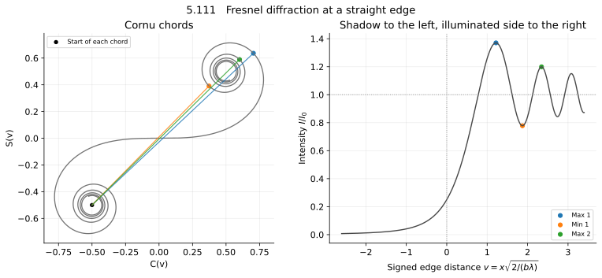

# 5.3 Diffraction of Light

[Chapter index](../README.md#chapters) · [Structured solutions](5.3.json) · [Answer audit](../audit/README.md)

## 5.97

**Solved · high confidence.** Conserve transmitted power and infer aperture area from its zone count.

**Assumptions**

- The aperture is lossless and illuminated uniformly. I(r) means irradiance on the full forward screen, radially symmetric aboutP. Use paraxial Fresnel propagation.

OpeningN zones gives the aperture area and incident transmitted power.

$$
\rho_N^2=N\lambda b,\quad P_{\rm trans}=I_0\pi N\lambda b.
$$

Integrate the screen irradiance over annuli and equate total powers.

$$
2\pi\int_0^\infty I(r)r\,dr=I_0\pi N\lambda b.
$$

**Results**

Incident irradiance

$$
I_0=\frac2{N\lambda b}\int_0^\infty I(r)r\,dr
$$

**Limitations**

- A finite measured screen needs a correction for missing diffracted power.
- With exact nonparaxial zone geometry replaceNλb by ρ_N²=Nλb+(Nλ/2)² and use a consistent power-conserving propagation model.

## 5.98

**Solved · high confidence.** Solve the spherical-wave Fresnel-zone boundary for observation distance.

**Assumptions**

- The source and observation point lie on the aperture axis; use the chapter paraxial zone formula.

The aperture radius is the third zone boundary.

$$
r^2=k\lambda\frac{ab}{a+b}.
$$

Isolate the positive observation distance.

$$
b=\frac{ar^2}{ka\lambda-r^2}=2.0\ \mathrm m.
$$

**Results**

Distance behind the diaphragm

$$
b=2.0\ \mathrm m
$$

## 5.99

**Solved · high confidence.** Use the two-zone increment between consecutive central maxima.

**Assumptions**

- Scalar Fresnel diffraction with approximately constant amplitude across the small aperture; consecutive bright central maxima correspond to odd zone counts differing by 2.

Define the opened-zone number; circular-aperture intensity is largest for odd integer q.

$$
q=\frac{r^2(a+b)}{\lambda ab},\quad U\propto1-e^{i\pi q},\quad q_2-q_1=2.
$$

Subtract the squared radii and solve for wavelength.

$$
\lambda=\frac{(r_2^2-r_1^2)(a+b)}{2ab}\simeq0.598\ \mathrm{\mu m}.
$$

**Results**

Wavelength

$$
\lambda\simeq0.598\ \mathrm{\mu m}\approx0.60\ \mathrm{\mu m}
$$

## 5.100

**Solved · high confidence.** Add circular-zone and angular-sector field s coherently.

**Assumptions**

- Normalize the unobstructed field to 1. A circular aperture throughq zones hasU(q)=1−exp(iπq).
- Internal half of a Fresnel zone means half its optical-phase interval/area: radiusρ₁/√2, notρ₁/2.

A full first zone and its inner half have these complex amplitudes.

$$
U_1=2,\qquad U_{1/2}=1-i.
$$

A diametric semicircle contributes half the full disk field.

$$
U_{\rm semicircle}=U_1/2=1.
$$

**Results**

Full first-zone aperture intensity

$$
I=4I_0
$$

Inner half-zone aperture intensity

$$
I=2I_0
$$

First-zone aperture half closed along a diameter

$$
I=I_0
$$

## 5.101

**Solved · high confidence.** Apply Babinet complementarity with inner and outer half-zone phasors.

**Assumptions**

- The initial opaque disk covers the entire first Fresnel zone.
- In(b), remove a diametric half of the outer radial half-zone, exposing that region only.

The original exterior-to-disk field is full field 1 minus first-zone field 2.

$$
U_{\rm ext}=-1.
$$

A semicircular first-zone opening contributes 1 and cancels the exterior field.

$$
U_a=-1+1=0.
$$

The outer radial half-zone contributes 1+i, so half of it contributes(1+i)/2.

$$
U_b=-1+\frac{1+i}{2}=\frac{-1+i}{2}.
$$

**Results**

Intensity after removing half of the disk

$$
I=0
$$

Intensity after exposing half the outer half-zone

$$
I=I_0/2
$$

## 5.102

**Solved · high confidence.** Use azimuthal fractions of full and first-zone field s.

**Assumptions**

- The shading in Fig 5.20 is opaque. Let β be the total opaque angular measure aboutP, summing disjoint sectors.
- For5–8 the opaque sectors begin only outside the first-zone circle because their inner edges are rounded away.

For sharp corners, each annulus loses the same angular fraction.

$$
U_{1-4}=1-\beta/(2\pi),\quad I/I_0=[1-\beta/(2\pi)]^2.
$$

Rounded screens block that fraction of the exterior-to-first-zone field −1.

$$
U_{5-8}=1+\beta/(2\pi),\quad I/I_0=[1+\beta/(2\pi)]^2.
$$

The scanned total angle s areπ/2,π,3π/2,π in each group.

$$
\frac{(I_1,I_2,I_3,I_4)}{I_0}=(9/16,1/4,1/16,1/4),\quad\frac{(I_5,I_6,I_7,I_8)}{I_0}=(25/16,9/4,49/16,9/4).
$$

**Results**

Screens1–4

$$
(I_1,I_2,I_3,I_4)=I_0(9/16,1/4,1/16,1/4)
$$

Screens5–8

$$
(I_5,I_6,I_7,I_8)=I_0(25/16,9/4,49/16,9/4)
$$

General sharp-corner formula

$$
I/I_0=(1-\beta/(2\pi))^2
$$

General first-zone-rounded formula

$$
I/I_0=(1+\beta/(2\pi))^2
$$

## 5.103

**Solved · high confidence.** Phase-advance a 1.5-zone circular region and add the exterior field.

**Assumptions**

- Use a lossless phase-only plate, neglecting surface-reflection losses and internal etalon echoes. The latter are explicitly included in 5.105.
- A recess removes glass optical path: relative factore^(−iδ),δ=2π(n−1)h/λ. Use the Appendix 20 representative glassn1.50 for numerical height s.

The1.5-zone region has field 1+i and the unmodified remainder has field−i.

$$
U=-i+(1+i)e^{-i\delta},\qquad I/I_0=3-2\cos\delta+2\sin\delta.
$$

Maximize, minimize or set this expression equal to 1.

$$
\delta_{\max}=3\pi/4+2\pi m,\quad\delta_{\min}=7\pi/4+2\pi m,\quad I=I_0:\ \delta=2\pi m\ \text{or}\ 3\pi/2+2\pi m.
$$

**Results**

Maximum-intensity recess depths

$$
h=(m+3/8)\lambda/(n-1),\quad h_{\rm least}=0.45\ \mathrm{\mu m}
$$

m=0,1,...;I_max=(3+2√2)I₀.

Minimum-intensity recess depths

$$
h=(m+7/8)\lambda/(n-1),\quad h_{\rm least}=1.05\ \mathrm{\mu m}
$$

I_min=(3−2√2)I₀, notzero.

Depths returning the intensity to I₀

$$
h=m\lambda/(n-1)\quad\text{or}\quad h=(m+3/4)\lambda/(n-1)
$$

Numerical value is the smallest positive depth at the Appendix glass index.

## 5.104

**Solved · high confidence.** Align the inner and outer half-zone field s with a recess phase advance.

**Assumptions**

- The aperture is the full first zone; its inner half-zone radius is ρ₁/√2.
- Use a phase-only plate; the recess reduces optical path and multiplies its region byexp(−iδ).

The two radial half-zones have phases differing by π/2.

$$
U=(1+i)+(1-i)e^{-i\delta},\qquad\delta=2\pi(n-1)h/\lambda.
$$

A positive phase reduction aligns the m first at 3π/2, notπ/2.

$$
\delta=3\pi/2+2\pi m,\qquad |U|_{\max}=2\sqrt2.
$$

**Results**

Recess depth family for maximum intensity

$$
h=(m+3/4)\lambda/(n-1),\quad m=0,1,\ldots
$$

Least depth3λ/[4(n−1)]; for representative glassn1.50 this is 3λ/2.

Maximum intensity

$$
I_{\max}=8I_0
$$

## 5.105

**Solved · high confidence.** Include the full lossless slab transmission and attain a global phasor bound.

**Assumptions**

- Treat the specified refractive index n = 1.60 as exact. Model the disk as a parallel-sided, lossless plate in air.
- The micrometre thickness does not materially change its 1.5-zone geometry. Sum internally reflected transmitted waves.

The field outside the disc is−i and its covered region contributes 1+i times the slab transfer.

$$
U=-i+t(h)(1+i).
$$

The complete slab transfer relative to the same path in air includes all internal echoes.

$$
t(h)=\frac{(1-\mathcal R)e^{i(n-1)kh}}{1-\mathcal R e^{2inkh}},\quad\mathcal R=\left(\frac{n-1}{n+1}\right)^2,\quad k=2\pi/\lambda.
$$

Passivity gives|t|≤1, hence|U|≤1+√2. Equality requires a slab resonance and transmission phase−3π/4.

$$
h=\frac{j\lambda}{2n},\quad t=e^{i\pi j(n-1)/n}=e^{i3\pi j/8}.
$$

The alignment congruence3j≡10mod16 has least positive solutionj14.

$$
j=14+16m,\quad h_{\min}=\frac{14\lambda}{3.20}=2.49375\ \mathrm{\mu m}.
$$

**Results**

Least thickness attaining the global maximum

$$
h_{\min}=2.49375\ \mathrm{\mu m}\simeq2.49\ \mathrm{\mu m}
$$

Global maximum intensity

$$
I_{\max}=(3+2\sqrt2)I_0
$$

**Limitations**

- Exact coincidence of slab resonance and field-phase alignment uses the nominal index 1.60 as exact. A different glass index can shift the optimum.

## 5.106

**Solved · high confidence.** Combine the lens phase with the quadratic free-propagation phase.

**Assumptions**

- Paraxial thin lens, uniform incident plane wave and a circular aperture immediately behind the lens; screen distance b differs fromf.

The quadratic phase contains1/b−1/f. Its magnitude defines the effective defocus distance.

$$
B=|1/b-1/f|^{-1}=\frac{fb}{|b-f|}=1.50\ \mathrm m.
$$

Central maxima occur at odd numbers of the corresponding zones.

$$
\rho_j^2=(2j+1)\lambda B,\qquad j=0,1,2,\ldots.
$$

**Results**

Aperture radii for central maxima

$$
\rho_j=0.900\sqrt{2j+1}\ \mathrm{mm},\quad j=0,1,\ldots
$$

Numerical value is the first member of the radius family.

## 5.107

**Solved · high confidence.** Preserve Fresnel-number similarity under aperture scaling.

**Assumptions**

- The wavelength and incident intensity are unchanged; similarity concerns the full paraxial Fresnel profile.

Reducing both aperture radius and screen coordinate s by η leaves the propagation integral unchanged ifb decreases by η².

$$
\rho\prime=\rho/\eta,\quad \rho\prime{}^2/b\prime=\rho^2/b\quad\Longrightarrow\quad b\prime=b/\eta^2=1.0\ \mathrm m.
$$

**Results**

New screen distance

$$
b\prime=1.0\ \mathrm m
$$

## 5.108

**Solved · medium confidence.** Image the source with the Poisson spot and estimate roughness from the edge-zone width.

**Assumptions**

- For a smooth opaque ball, each source point produces an Arago/Poisson bright spot along the source–ball-centre line; their superposition images the source inside the shadow.
- The note supplies an order-of-magnitude roughness criterion, not a specified stochastic contrast threshold.

Projection through the ball centre gives an inverted transverse source image.

$$
y\prime=-\frac ba y,\quad|y\prime|=9.0\ \mathrm{mm}.
$$

At ball radiusD/2, differentiate the Fresnel-zone radius formula to obtain one local zone width.

$$
\Delta\rho\simeq\frac{\lambda ab}{D(a+b)}=9.9\times10^{-5}\ \mathrm m\simeq0.10\ \mathrm{mm}.
$$

**Results**

Source-image dimension

$$
|y\prime|=9.0\ \mathrm{mm}
$$

Inverted diffraction image, not the ball silhouette.

Estimated effective roughness height

$$
h_{\rm rough}\sim0.10\ \mathrm{mm}
$$

Only an order-of-magnitude threshold.

## 5.109

**Solved · medium confidence.** Use the zone-plate conjugate equation with the diffractive order explicit.

**Assumptions**

- The point source and real image lie on opposite sides of a paraxial Fresnel zone plate.
- The usual primary-focus answer assumes imaging orderm1; an ordinary binary zone plate also produces higher positive odd order s.

The effective focal length of the actually imaged order satisfies the thin-lens conjugate equation.

$$
f_m=\frac{ab}{a+b}=0.60\ \mathrm m.
$$

Relate that order focal length to the primary focal length.

$$
f_m=f_1/m,\quad f_1=m\times(0.60\ \mathrm m),\quad m=1,3,5,\ldots.
$$

**Results**

Conventional primary focal length

$$
f_1=0.60\ \mathrm m\quad(m=1)
$$

Family if the image order is not specified

$$
f_m=0.60\ \mathrm m,\quad f_1=0.60m\ \mathrm m\ (m=1,3,5,\ldots)
$$

## 5.110

**Solved · high confidence.** Interfere two equal half-plane field s at the glass step projection.

**Assumptions**

- Use the phase-only plate model with reflection losses neglected as stated. At the step projection each half-plane supplies half the unobstructed field.
- Use Appendix 20 representative glassn1.50 for numerical height s.

The added optical phaseδ=2π(n−1)h/λ gives equal-amplitude interference.

$$
U=\tfrac12(1+e^{i\delta}),\quad I/I_0=\cos^2(\delta/2).
$$

Choose oddπ phase forzero intensity and oddπ/2 for I₀/2.

$$
h_{\min}=\frac{(2m+1)\lambda}{2(n-1)},\quad h_{I_0/2}=\frac{(2m+1)\lambda}{4(n-1)},\quad m=0,1,\ldots.
$$

**Results**

Heights giving minimum intensity

$$
h=(2m+1)\lambda/[2(n-1)],\quad h_{\rm least}=0.60\ \mathrm{\mu m}
$$

The ideal minimum iszero.

Heights giving half the incident intensity

$$
h=(2m+1)\lambda/[4(n-1)],\quad h_{\rm least}=0.30\ \mathrm{\mu m}
$$

Numerical values are the two depths in the first phase period for n=1.50.

## 5.111

**Solved · high confidence.** Evaluate the Cornu integral and solve the half-plane intensity-extremum equation.

**Assumptions**

- Let v=x√(2/(λb)), with x positive into the illuminated side.
- F(v)=C(v)+iS(v) denotes integrals ofcos(πu²/2),sin(πu²/2). Their normalization is checked against Fig 5.19; quoted precise values are numerical evaluations, not pixel digitizations.

The open half-plane field is the normalized Cornu chord from−v to+∞.

$$
U(v)=\frac{1/2+C(v)+i[1/2+S(v)]}{1+i},\quad I/I_0=\frac{[1/2+C(v)]^2+[1/2+S(v)]^2}{2}.
$$

Differentiate the intensity to locate extrema.

$$
[C(v)+1/2]\cos(\pi v^2/2)+[S(v)+1/2]\sin(\pi v^2/2)=0.
$$

The first maximum, next minimum and second maximum occur atv1.217198,1.872519,2.344485, with normalized intensities1.370443,0.778251,1.199271. Use the spacing of the two maxima to inferλ.

$$
\lambda=\frac{2(\Delta x)^2}{b(v_{\max2}-v_{\max1})^2}.
$$

**Results**

First-maximum to adjacent-minimum intensity ratio

$$
I_{\max1}/I_{\min1}\simeq1.76
$$

Wavelength

$$
\lambda\simeq0.625\ \mathrm{\mu m}\approx0.62\ \mathrm{\mu m}
$$

## 5.112

**Solved · high confidence.** Subtract the opaque-strip Cornu chord from the full incident field.

**Assumptions**

- The strip occupies−w/2<x<w/2, withw0.70 mm; diffraction is one-dimensional across its long direction.
- Use the same analytically defined Cornu normalization as5.111.

At screen coordinate x, subtract the Fresnel integral over the blocked strip.

$$
U(x)=1-\frac{F[(w/2-x)\sqrt{2/(\lambda b)}]-F[(-w/2-x)\sqrt{2/(\lambda b)}]}{1+i}.
$$

Atx0 and the shadow edgex=w/2, the computed normalized intensities are0.295514 and 0.111405.

$$
\frac{I(0)}{I(w/2)}\simeq2.65261.
$$

**Results**

Centre-to-shadow-edge intensity ratio

$$
I(0)/I(w/2)\simeq2.65
$$

## 5.113

**Solved · high confidence.** Locate positive-width Fresnel slit minima rather than assuming zeros.

**Assumptions**

- The observation is on the centreline of a long slit of full width h.
- The lowest minimum means the deepest nontrivial local minimum at positive width, excluding the trivial closed slit.

The central field is the symmetric Cornu chord with v=h/√(2λb).

$$
I(0)/I_0=2[C(v)^2+S(v)^2].
$$

Its nontrivial extrema solve this derivative equation; the first and second local minima occur atv1.8741999 and 2.7394030.

$$
C(v)\cos(\pi v^2/2)+S(v)\sin(\pi v^2/2)=0.
$$

Their full-width separation determinesλ.

$$
\Delta h=(v_2-v_1)\sqrt{2\lambda b},\quad\lambda=\frac{(\Delta h)^2}{2b(v_2-v_1)^2}.
$$

**Results**

Wavelength

$$
\lambda\simeq0.545\ \mathrm{\mu m}\approx0.55\ \mathrm{\mu m}
$$

## 5.114

**Solved · high confidence.** Phase-align the recessed-strip Cornu chord with the outside field.

**Assumptions**

- The full recess width isa0.60 mm. Use a phase-only transmitting plate without surface-reflection/etalon effects.
- A recess advances phase by δ=2π(n−1)h/λ. Use Appendix 20 representative glassn1.50.

The rectangular region and its complement contribute these field s at the pattern centre.

$$
v=\frac a{\sqrt{2\lambda b}}=0.599700\ldots,\quad c=\frac{2F(v)}{1+i}\simeq0.691222-0.470463i,\quad U=1-c+ce^{-i\delta}.
$$

Align the two terms with the least positive phase reduction.

$$
\delta_{\rm opt}=\arg c-\arg(1-c)\pmod{2\pi}=4.6955966\ldots,\quad h_{\min}=\frac{\lambda\delta_{\rm opt}}{2\pi(n-1)}.
$$

**Results**

Least recess depth for maximum central illuminance

$$
h_{\min}\simeq0.972\ \mathrm{\mu m}
$$

All equivalent depths

$$
h=h_{\min}+m\lambda/(n-1),\quad m=0,1,\ldots
$$

## 5.115

**Solved · high confidence.** Keep the two Fresnel tails attached to their correct labelled points.

**Assumptions**

- Fig 5.23 has opaque strip0<x<a and the right transmitting regionx>a thicker by h than the left. Point1 lies belowx0 and point 2 belowx=a.
- Use a phase-only plate with δ=2π(n−1)h/λ added on the right. The requested ratio needs no numerical glass index.

The normalized opposite-edge tailQ is determined by the full strip width.

$$
u=a\sqrt{2/(\lambda b)}=0.501745\ldots,\quad Q=\frac{(1+i)/2-F(u)}{1+i}\simeq0.220321+0.214277i.
$$

The near half-plane contributes 1/2, so the two labelled field s interchange the tail and half-plane terms.

$$
U_1=1/2+e^{i\delta}Q,\qquad U_2=Q+e^{i\delta}/2.
$$

To maximizeI₂ choose δ=argQ; evaluate both intensities at this same phase.

$$
I_2/I_0=(|Q|+1/2)^2\simeq0.651792,\quad I_1/I_0=|1/2+|Q|e^{2i\arg Q}|^2\simeq0.353003.
$$

**Results**

Intensity ratio at the optimum step height

$$
I_1/I_2\simeq0.542
$$

## 5.116

**Solved · high confidence.** Coherently add a one-sided straight slit and a semicircular first zone.

**Assumptions**

- In Fig 5.24, P projects to the semicircle centre on the original upper straight slit edge.
- The open straight strip is−w<y<0, withw0.90ρ₁, plus the upper semicircle of radiusρ₁=√(λb).

A semicircular half of the first-zone disk contributes field 1; the disk would contribute2.

$$
U_{\rm semicircle}=1.
$$

The one-sided strip contributes one Cornu chord, not the symmetric double chord.

$$
v=0.90\sqrt2,\quad U_{\rm strip}=\frac{F(v)}{1+i}\simeq0.667074+0.005229i.
$$

Add the amplitudes before squaring.

$$
I/I_0=\left|1+F(0.90\sqrt2)/(1+i)\right|^2\simeq2.77916.
$$

**Results**

Intensity at P

$$
I\simeq2.78I_0\approx2.8I_0
$$

## 5.117

**Solved · high confidence.** Decompose the rounded-end aperture into a half-infinite slit and half of the first Fresnel-zone disk.

**Assumptions**

- Read Fig .5.25 as a long slit of width 2R with a straight left end and semicircular right end. Points1 and 3 project onto the centres of the straight end and rounded cap; point 2 is far from both ends.
- Neglect the remote slit ends at each point and use scalar paraxial Fresnel diffraction. Let I₀ denote unobstructed plane-wave intensity at that observation plane.
- The rounded cap is half a disk of first-zone radiusR=√(λb), so the transverse Cornu edge parameter is v=R√[2/(λb)]=√2.

Define the Cornu integrals and normalize the infinite slit field by the free wave. The longitudinal aperture integral is complete, leaving a symmetric bounded transverse integral.

$$
F(v)=C(v)+iS(v)=\int_0^v e^{i\pi t^2/2}\,dt,\quad u_s=(1-i)F(\sqrt2).
$$

At the straight end the longitudinal integral is half the complete value. In the interior it is complete. At the rounded end add a half first-zone disk to a half-infinite slit; a full first-zone disk has normalized field 2.

$$
u_1=u_s/2,\quad u_2=u_s,\quad u_3=u_s/2+1.
$$

Evaluating the defining Cornu integrals gives C(√2)=.5288916 and S(√2)=.7139722. Square the amplitudes.

$$
u_s=1.2428638+.1850806i,\quad I_j/I_0=|u_j|^2.
$$

**Results**

Intensity ratio at points 1,2,3

$$
I_1:I_2:I_3\simeq1:4:6.68
$$

Intensities relative to an unobstructed plane wave

$$
(I_1,I_2,I_3)/I_0\simeq(.39474,1.57897,2.63761)
$$

**Limitations**

- The graph itself supports rounded readings; guard digits come from its defining Fresnel integrals, not measured source precision. Finite slit length and nonparaxial propagation alter the ideal result.

## 5.118

**Solved · high confidence.** Use Babinet complementarity for the opaque strip and add the circular hole field.

**Assumptions**

- The normal projection of P is the common centre of the strip and circular hole. The phrase half a Fresnel zone means a circular hole of half the first-zone area: R_h²=λb/2.
- If the strip width is W and hole diameter D_h, W=ηD_h. In Fresnel coordinate s the strip edges therefore lie at±η. Use scalar Fresnel diffraction and unobstructed intensityI₀.

A symmetric open slit of width W has normalized field u_s=(1−i)[C(η)+iS(η)]. Its opaque complement has field 1−u_s.

$$
u_{\rm strip}=1-u_s,\quad u_s=(1-i)F(\eta).
$$

The round hole opens phase range0 to π/2, so its normalized circular-aperture field is 1−exp(iπ/2). Add it to the opaque-strip field.

$$
u_h=1-e^{i\pi/2}=1-i,\qquad u=1-u_s+u_h=2-i-(1-i)F(1.07).
$$

Use the Cornu values C(1.07)=.77205055, S(1.07)=.50766643 and square the result.

$$
u=.7202830-.7356159i.
$$

**Results**

Intensity relative to the incident/unobstructed wave

$$
I(P)=|u|^2I_0\simeq1.06I_0
$$

**Limitations**

- Numerical guard digits evaluate the ideal Cornu integrals. The printed spiral and ideal long-strip geometry justify only rounded experimental accuracy.

## 5.119

**Solved · high confidence.** Integrate the phase across a uniformly illuminated rectangular aperture.

**Assumptions**

- The long direction of the slit is effectively infinite. θ is measured in the plane normal to its long edge; illumination and polarization are uniform across width b.
- Use scalar Fraunhofer diffraction and normalize to on-axis intensityI(0), ignoring slowly varying polarization/obliquity prefactors.

The far-field phase across transverse coordinate x is−kx sin θ. Integrate over−b/2<x<b/2.

$$
A(\theta)\propto\int_{-b/2}^{b/2}e^{-ikx\sin\theta}\,dx=b\frac{\sin u}{u},\quad u=\frac{\pi b}{\lambda}\sin\theta.
$$

Intensity is the squared amplitude; zeros occur at nonzero integer multiples of π.

$$
I(\theta)=I(0)\left(\frac{\sin u}{u}\right)^2,\qquad u=m\pi.
$$

**Results**

Normalized angular intensity

$$
I(\theta)/I(0)=\operatorname{sinc}_0^2\!\left(\pi b\sin\theta/\lambda\right),\quad\operatorname{sinc}_0u=\sin u/u
$$

Minimum directions

$$
b\sin\theta_m=m\lambda,\quad m=\pm1,\pm2,\ldots,\quad|m\lambda/b|\le1
$$

**Limitations**

- Only order s within the propagating angular domain occur; tangent endpoints are limiting directions. Absolute intensity also requires source amplitude, illuminated slit length and observation normalization.

## 5.120

**Solved · high confidence.** Differentiate the single-slit sinc-squared pattern and select its nonzero stationary maxima.

**Assumptions**

- Use the preceding scalar Fraunhofer pattern; order 1,2,3 here denotes the first three side maxima, excluding the central maximum.

At nonzero non-minimumu, differentiation of(sin u/u)² givesu cosu−sinu=0.

$$
\tan u=u,\qquad u=\pi b\sin\theta/\lambda.
$$

The first three positive roots lie betweenjπ and(j+1/2)π, j=1,2,3. Their negative counterparts give the symmetric maxima.

$$
u_1=4.49340946,\quad u_2=7.72525184,\quad u_3=10.90412166.
$$

**Results**

Exact side-maximum condition

$$
\tan(\pi b\sin\theta/\lambda)=\pi b\sin\theta/\lambda
$$

First three positive side-maximum directions

$$
\sin\theta_j=\frac{\lambda}{\pi b}(4.49340946,7.72525184,10.90412166)_j
$$

Equivalently sin θ≈(1.43030,2.45902,3.47089)λ/b; include only values≤1 and their symmetric negatives.

## 5.121

**Solved · high confidence.** Include the incident transverse phase in the single-slit Fraunhofer condition.

**Assumptions**

- Use signed angle s relative to the slit normal with incidentθ₀=+30°. The two first minima lie on either side of the undeflected transmitted directionθ=θ₀.

The phase difference across the slit depends on sin θ−sin θ₀, so first minima satisfy its product with b equal to±λ.

$$
b(\sin\theta-\sin\theta_0)=\pm\lambda.
$$

Insert λ/b=.050 and sin θ₀=.500.

$$
\sin\theta_-=.450,\qquad\sin\theta_+=.550.
$$

**Results**

Angles from the grating/slit normal

$$
\theta_-=26.7437^\circ,\qquad\theta_+=33.3670^\circ
$$

Relative to the central direction30°, the offsets are−3.2563° and +3.3670°.

## 5.122

**Solved · high confidence.** Use tangential phase matching on the inclined exit slit, the n locate its two first zeros.

**Assumptions**

- Use Appendix representative glass n=1.5 and air≈1. The slit width b=10 μm is measured along the inclined rear face, in the meridian perpendicular to the wedge edge.
- The first face is normal to the incident wave, so the wave inside the glass keeps its direction. Use the scalar uniformly illuminated exit-slit model.

At the rear face the internal incidence angle is Θ. If r is the outgoing angle to that face normal, the aperture phase gradient is proportional to sinr−n sin Θ.

$$
A(r)\propto\operatorname{sinc}_0\!\left[\frac{\pi b}{\lambda}(\sin r-n\sin\Theta)\right].
$$

The central maximum follows Snell refraction, while the two first zeros bracket it.

$$
r_0=\arcsin(n\sin\Theta),\quad r_\pm=\arcsin(n\sin\Theta\pm\lambda/b),\quad\Delta\theta=r_0-\Theta.
$$

The full central angular width is r_+−r_-; its narrow-width approximation includes the outgoing obliquity factor1/cosr₀.

$$
W_0=r_+-r_-\simeq\frac{2\lambda}{b\cos r_0}.
$$

**Results**

Zeroth-order deflection from the incident direction

$$
\Delta\theta=7.84432^\circ
$$

Full width between the first minima

$$
W_0=7.46880^\circ\simeq0.13036\ \mathrm{rad}
$$

The linearized width is 7.46069°; rear-normal angle s of the zeros are19.16129° and 26.63009°.

**Limitations**

- The model treats Fresnel transmission and obliquity factors as slowly varying across the slit pattern. Index dispersion and finite aperture aberrations are not specified.

## 5.123

**Solved · medium confidence.** Apply the reflection-grating condition in signed tangential wavevectors at grazing incidence.

**Assumptions**

- On the usual optical grazing branch, incident and observed outgoing rays both have positive tangential propagation along the grating: k_parallel,in=kcosα₀ and k_parallel,out=kcosα. “Second order” is the magnitude2.
- The unsigned glancing angle s alone would also permit an oppositely directed tangential (retroreflection) branch; it is given separately rather than mixed into the visible-light calculation.

A grating period supplies signed tangential momentum2πm/d.

$$
d(\cos\alpha-\cos\alpha_0)=m\lambda.
$$

Here α>α₀ givesm=−2. Solve for the positive wavelength on the usual branch.

$$
\lambda=\frac d2(\cos\alpha_0-\cos\alpha).
$$

**Results**

Wavelength on the co-propagating grazing optical branch

$$
\lambda=0.609080\ \mu\mathrm m
$$

Alternative if the outgoing tangential direction is reversed

$$
\lambda_{\rm retro}=\frac d2(\cos\alpha_0+\cos\alpha)=0.999239\ \mathrm{mm}
$$

A different branch, not an alternate sign of the same optical wavelength.

## 5.124

**Solved · high confidence.** Multiply the single-slit envelope by the coherent three-slit array factor.

**Assumptions**

- The three slits have width b, pitch d and uniform equal incident amplitudes. Use scalar Fraunhofer diffraction.
- Use u = d sin θ/λ and q = d/b. The normalized pattern uses u. A specified value of d/λ sets the propagating range |u| ≤ d/λ.

The slit envelope is sinc²(πu/q). The three phasors sum to a phase factor times 1+2cos(2πu), avoiding removable singularities at integer u.

$$
\frac{I_q(u)}{I_q(0)}=\left[\frac{\sin(\pi u/q)}{\pi u/q}\right]^2\frac{[1+2\cos(2\pi u)]^2}{9}.
$$

Forq=2, nonzero even nominal grating order s fall on slit-envelope zeros. Forq=3, nonzero multiples of 3 are missing.

$$
q=2:\ m=\pm2,\pm4,\ldots\text{ missing};\qquad q=3:\ m=\pm3,\pm6,\ldots\text{ missing}.
$$

There are two array minima between adjacent integer order s and one secondary array lobe between the m. Draw the full product rather than making all maxima equally high.

$$
u=m+\tfrac13,\quad m+\tfrac23\quad\text{are array zeros}.
$$

**Results**

Pattern for d/b=2

$$
I_2(u)/I_2(0)=\operatorname{sinc}_\pi^2(u/2)[1+2\cos(2\pi u)]^2/9
$$

The nominal first-order intensity is 4/π²≈.4053 of central; even order s vanish.

Pattern for d/b=3

$$
I_3(u)/I_3(0)=\operatorname{sinc}_\pi^2(u/3)[1+2\cos(2\pi u)]^2/9
$$

Nominal first/second-order height s are27/(4π²)≈.6839 and 27/(16π²)≈.1710; multiples of 3 vanish.

**Limitations**

- For only three slits, extrema of the envelope-times-array product are slightly displaced from array-factor maxima alone. The plotted formula includes this effect; nominal order labels refer to the array factor.

## 5.125

**Solved · high confidence.** Infer pitch from the first line, the n apply the same pitch to the second.

**Assumptions**

- Use normal-incidence grating principal ordersd sin θ=mλ in a common exterior medium.

The second-order 0.65 μm line fixes the pitch.

$$
d=\frac{2\lambda_1}{\sin45^\circ}.
$$

Use order 3 at λ₂=.50 μm.

$$
\sin\theta_3=\frac{3\lambda_2}{d}=\frac{3\lambda_2}{2\lambda_1}\sin45^\circ.
$$

**Results**

Third-order diffraction angle

$$
\theta_3=54.6757^\circ
$$

## 5.126

**Solved · high confidence.** Use the highest-order constraint to identify the integer order at 35°.

**Assumptions**

- The highest observable order at normal incidence has magnitude5. No missing-order extinction is specified.

The allowed pitch ratio lies between 5 and 6 wavelengths. Thus the integer at 35° must lie between 5sin35° and 6sin35°.

$$
5\le d/\lambda<6,\quad 2.8679\le m_{35}<3.4415\quad\Longrightarrow\quad m_{35}=3.
$$

Solve the third-order principal-maximum equation.

$$
d=3\lambda/\sin35^\circ.
$$

**Results**

Grating pitch

$$
d=2.79823\ \mu\mathrm m
$$

## 5.127

**Solved · medium confidence.** Solve the two-order angle relation and retain the side-of-normal ambiguity.

**Assumptions**

- Normal-incidence principal order s obeysinθ₁=λ/d andsinθ₂=2λ/d with positive angle magnitudes. The usual reading compares+1 and +2 on the same side.
- The prompt does not explicitly say whether the first and second order s are on the same or opposite sides of the normal, so both geometric readings are supplied.

For same-side ordersθ₂−θ₁=Δθ, use sin(θ₁+Δθ)=2sinθ₁ to obtaintanθ₁.

$$
\tan\theta_1=\frac{\sin\Delta\theta}{2-\cos\Delta\theta},\quad\lambda=d\frac{\sin\Delta\theta}{\sqrt{5-4\cos\Delta\theta}}.
$$

If the order s lie on opposite sides, their angular separation is θ₁+θ₂=Δθ instead.

$$
\tan\theta_1=\frac{\sin\Delta\theta}{2+\cos\Delta\theta},\quad\lambda=d\frac{\sin\Delta\theta}{\sqrt{5+4\cos\Delta\theta}}.
$$

**Results**

Conventional same-side result

$$
\lambda=0.534162\ \mu\mathrm m
$$

Angles14.05191° and 29.05191° differ by 15°.

Alternative for order s on opposite sides

$$
\lambda=0.191254\ \mu\mathrm m
$$

Angle magnitudes4.98723° and 10.01277° add to 15°.

## 5.128

**Solved · high confidence.** Enumerate every propagating signed grating order, including order s across the normal.

**Assumptions**

- Use signed output angle θ and input angle θ₀ in the same transverse sense, withsinθ_m=sin θ₀+mλ/d. “Highest order” means largest absolute integer|m|, not only the same-side branch.

At normal incidence λ/d=.353333, so onlym=−2,...,2 propagate.

$$
\theta_{\pm2}=\pm\arcsin(2\lambda/d).
$$

Atθ₀=60°, constrain−1≤sin 60°+m(.353333)≤1. The allowed integer s are−5,...,0; the highest magnitude is 5 on the side opposite the incident tangential direction.

$$
\sin\theta_{-5}=\sin60^\circ-5\lambda/d=-.90064126.
$$

**Results**

Normal-incidence highest-order directions

$$
m=\pm2:\quad\theta=\pm44.96435^\circ
$$

Oblique-incidence highest-order direction

$$
|m|=5,\quad\theta_{-5}=-64.24249^\circ
$$

Its magnitude relative to the normal is 64.24°, on the opposite side from the incident transverse direction.

## 5.129

**Solved · high confidence.** Treat the surface grating as a transverse phase ramp followed by cylindrical-lens Fourier imaging.

**Assumptions**

- Use Appendix generic glass n=1.5, air≈1 and a thin plano-convex cylindrical lens. The grating dispersion direction is the focusing meridian, perpendicular to the cylinder axis.
- Paraxial focal-plane coordinate s are intended; thickness and finite-aperture aberration data are not given.

The cylindrical thin-lens focal length in the focusing meridian is R/(n−1). A grating order adds transverse wavevectorm(2π/d), so its focal coordinate is f mλ/d.

$$
f=\frac R{n-1}=.400\ \mathrm m,\qquad x_m\simeq f\frac{m\lambda}{d}.
$$

The two first order s are symmetric, and their separation is twice the absolute first-order coordinate.

$$
\Delta x=2f\lambda/d.
$$

**Results**

Distance between the symmetric first-order maxima

$$
\Delta x=.0800\ \mathrm m=8.00\ \mathrm{cm}
$$

**Limitations**

- Usingf tan[arcsin(λ/d)] gives an ideal rectilinear-projection refinement8.040 cm, but exact nonparaxial imaging is not fixed by the supplied spherical-cylinder data.

## 5.130

**Solved · medium confidence.** Match tangential wavevector at the inclined grating and distinguish formal tangent order s from strictly emerging beams.

**Assumptions**

- Use the chapter approximation of unity for the air index, and the representative glass index n = 1.50. The incident wave is normal to the first wedge face.
- Let θ be the signed output angle to the grating-face normal in the same sense as the internal incidence Θ=30°. The signed deflection relative to the incident direction is δ=θ−Θ.

Tangential wavevector matching includes the glass illumination phase on the inclined exit face.

$$
\sin\theta_m=n\sin\Theta+\frac{m\lambda}{d}=.75+.25m,\qquad\delta_m=\theta_m-30^\circ.
$$

The zeroth order follows refraction. The two first order s arem=−1, which cancels refraction, and m=+1 at the tangent endpoint.

$$
\delta_0=18.59038^\circ,\quad\delta_{-1}=0,\quad\delta_{+1}=60^\circ\ \text{(tangent limit)}.
$$

The inclusive angular condition allows−7≤m≤1. Its largest magnitude is 7 at m=−7, tangent along the exit face. Requiring strictly outward nonzero normal propagation removes both tangent endpoints, leaving−6≤m≤0.

$$
m=-7:\ \theta=-90^\circ,\ \delta=-120^\circ;\qquad m=-6:\ \theta=-48.59038^\circ,\ \delta=-78.59038^\circ.
$$

Endpoint membership is sensitive to the representative-index rounding and air approximation. The more general equation with free-space wavelength retains both actual exterior and glass indices.

$$
n_a\sin\theta_m=n_g\sin\Theta+m\lambda_0/d.
$$

**Results**

Zeroth-order angle from the incident direction

$$
\delta_0=18.59038^\circ
$$

Formal first-order directions relative to incidence

$$
\delta_{-1}=0,\quad\delta_{+1}=60^\circ\ \text{(grazing)}
$$

Onlym=−1 is strictly emerging under the exact n=1.50, air=1 model.

Highest formal geometric order

$$
|m|_{\max}=7,\quad\delta_{-7}=-120^\circ\ \text{(grazing)}
$$

Highest strictly emerging order in that same model

$$
|m|_{\max,\rm strict}=6,\quad\delta_{-6}=-78.59038^\circ
$$

The corresponding angle magnitude from the incident direction is 78.59038°.

Angle of the highest formal tangent order relative to incidence

$$
\delta_{-7}=-120^\circ
$$

Angle of the highest strictly emerging order relative to incidence

$$
\delta_{-6}=-78.59038^\circ
$$

**Limitations**

- A tangent order is a limiting direction with zero outward-normal energy transport, not an ordinary separated transmitted beam. Wavelength-specific indices and the exterior wavelength convention are needed to decide actual near-tangent order s.

## 5.131

**Solved · high confidence.** Cancel the zeroth Fourier coefficient of the equal-duty binary phase grating.

**Assumptions**

- Fig .5.26 shows alternating terrace width s a and a, hence periodd=2a. The grooves create a phase delay without changing transmission magnitude in the ideal thin phase-mask model.
- Surrounding air is approximated by 1; n is the problem’s glass index. λ is the external/free-space wavelength in that convention.

The relative optical path of the two terrace thicknesses is(n−1)h. Their equal areas give a zeroth-order amplitude proportional to 1+exp(iφ).

$$
\phi=\frac{2\pi(n-1)h}{\lambda},\qquad c_0=\frac12(1+e^{i\phi}).
$$

Set φ to an odd multiple of π. The resulting binary±1 transmission has nonzero odd diffraction order s, whose first pair occurs at pitch2a.

$$
h_j=\frac{(2j+1)\lambda}{2(n-1)},\qquad\sin\theta_{\pm1}=\pm\frac{\lambda}{2a}.
$$

**Results**

Depths eliminating the central maximum

$$
h_j=\frac{(2j+1)\lambda}{2(n-1)},\quad j=0,1,2,\ldots
$$

The minimum is λ/[2(n−1)].

First-order diffraction angle s at that depth

$$
\theta_{\pm1}=\pm\arcsin\left(\frac{\lambda}{2a}\right)
$$

A strictly propagating first order requiresλ<2a; equality is a grazing limit.

**Limitations**

- Subwavelength periods, strong vector scattering, unequal terrace transmission or coherent Fresnel-film amplitude differences require a full electromagnetic model beyond a thin phase mask.

## 5.132

**Solved · high confidence.** Infer the acoustic spatial period from the diffraction angle s and multiply by ultrasound frequency.

**Assumptions**

- The refractive-index perturbation is linear in the standing-wave pressure/density. Its spatial period is the acoustic wavelengthΛ, not the half-wavelength distance between neighbouring nodes.
- Use paraxial diffraction maxima imaged by an air-side objective. Plane-parallel tank windows conserve transverse wavevector, so the external optical wavelengthλ enters the observed focal-plane spacing.

The acoustic grating gives outside angle s approximatelyθ_m=mλ/Λ. The objective maps the m to x_m≈fθ_m.

$$
\Delta x\simeq f\lambda/\Lambda,\qquad\Lambda\simeq f\lambda/\Delta x.
$$

Multiply the inferred pressure/index period by the ultrasound frequency.

$$
u=\nu\Lambda=\frac{\nu f\lambda}{\Delta x}.
$$

**Results**

Ultrasound propagation speed in water

$$
u=1.50792\times10^3\ \mathrm{m/s}\simeq1.51\ \mathrm{km/s}
$$

Inferred acoustic wavelength

$$
\Lambda=0.320833\ \mathrm{mm}
$$

**Limitations**

- The arrangement presumes a regime with multiple diffraction order s and negligible aperture clipping. Temporal modulation changes order intensities, but not the reciprocal acoustic-lattice spacing used here.

## 5.133

**Solved · medium confidence.** Use the first visibility cancellation of two mutually incoherent stellar fringe patterns.

**Assumptions**

- For the conventional numerical result, “first smearing” is the smallest positive baseline null of the two-point-source visibility, and the slit baseline is aligned with the star separation.
- Equal component brightness gives an exact visibility zero; unequal brightness gives a nonzero minimum at the same phase opposition. λ is treated as a narrow spectral line.

Each star supplies a two-slit pattern. Their relative fringe displacement in the focal plane isfψ, whereas the fringe period is λf/d. The first cancellation occurs for half a fringe displacement.

$$
f\psi=\frac12\frac{\lambda f}{d}\quad\Longrightarrow\quad\psi=\frac{\lambda}{2d}.
$$

Equivalently equal-brightness two-point visibility is|cos(πdψ/λ)|. Its zeros form an odd-half-order sequence.

$$
\mathcal V(d)=|\cos(\pi d\psi/\lambda)|,\qquad d\psi=(j+\tfrac12)\lambda.
$$

The wording saysd was being diminished but does not give its starting value. A first encountered zero after an unspecified larger baseline need not be the fundamental zero; keep that possible order ambiguity explicit.

**Results**

Conventional fundamental-null angular separation

$$
\psi=2.89474\times10^{-7}\ \mathrm{rad}=0.0597082\ \mathrm{arcsec}
$$

The same separation in arcseconds

$$
\psi\simeq0.0597\ \mathrm{arcsec}
$$

If the observed null order is unknown

$$
\psi_{\parallel}=(2j+1)\frac{\lambda}{2d},\quad j=0,1,2,\ldots
$$

This measures the baseline-projected separation; alignment is needed for the full two-star separation.

**Limitations**

- Without the null-order convention the data permit the odd-multiple family. With an unknown baseline orientation only the projected angular separation is determined.

## 5.134

**Solved · high confidence.** Differentiate the signed grating condition at fixed order after identifying the largest propagating order.

**Assumptions**

- Use sin θ_m=sin θ₀+mλ/d with signedθ. The requested angular dispersion is reported as a positive magnitude in arcmin/nm; the signed derivative is also stated for the oblique branch.
- The incident angle is fixed as wavelength varies locally within the same order.

At fixedθ₀ and m, differentiate the grating relation.

$$
\frac{d\theta}{d\lambda}=\frac{m}{d\cos\theta}.
$$

For normal incidence the largest order magnitude is 2, with|sin θ|=.7066667. Atθ₀=45° the allowed integer s are−4,...,0, so highest magnitude4 lies across the normal.

$$
\theta_{2}=44.96435^\circ,\qquad\theta_{-4}=\arcsin(\sin45^\circ-4\lambda/d)=-44.92872^\circ.
$$

Use d=1500 nm and multiply radians by 180×60/π to obtain the requested unit.

**Results**

Normal-incidence dispersion at highest order

$$
|D|=6.47825\ \mathrm{arcmin/nm}
$$

Atm=+2 the derivative is positive; at m=−2 it is negative with the same magnitude.

45°-incidence dispersion at highest order

$$
|D|=12.94846\ \mathrm{arcmin/nm}
$$

For the conventionm=−4, dθ/dλ=−12.94846arcmin/nm; the requested dispersion magnitude is positive.

## 5.135

**Solved · high confidence.** Differentiate the normal-incidence principal-maximum equation at fixed order.

**Assumptions**

- The wavelength is varied within one fixed diffraction order m; θ is signed relative to the grating normal.

Differentiate d sin θ=mλ, the n eliminate m/d with the original grating equation.

$$
d\cos\theta\frac{d\theta}{d\lambda}=m,\qquad\frac md=\frac{\sin\theta}{\lambda}.
$$

Signed dispersion and its magnitude follow immediately.

$$
D=\frac{d\theta}{d\lambda}=\frac{\tan\theta}{\lambda}.
$$

**Results**

Signed angular dispersion

$$
D(\theta)=\tan\theta/\lambda
$$

In rad/m if λ is measured in metres; magnitude is|tan θ|/λ.

## 5.136

**Solved · high confidence.** Locate the first array-factor zeros adjacent to the second principal order.

**Assumptions**

- AllN=10000 lines are coherently illuminated. The single-line/slit envelope is nonzero and slowly varying near order 2.
- Angular width means full width between the first minima, not FWHM or the one-sided Rayleigh distance.

The second principal direction obeys sin θ₂=2λ/d. Adjacent array zeros are displaced by ±1/N in order coordinate.

$$
\sin\theta_\pm=(2\pm1/N)\lambda/d,\qquad\theta_2=28.11222^\circ.
$$

Subtract the exact angle s, or linearize for largeN to obtain the conventional full width.

$$
W=\arcsin[(2+1/N)\lambda/d]-\arcsin[(2-1/N)\lambda/d]\simeq\frac{2\lambda}{Nd\cos\theta_2}.
$$

**Results**

Full first-minimum-to-first-minimum angular width

$$
W=5.34224\times10^{-5}\ \mathrm{rad}\simeq11.0192\ \mathrm{arcsec}
$$

One-sided first-zero distance for comparison

$$
w_{\rm half}\simeq2.67112\times10^{-5}\ \mathrm{rad}\simeq5.50958\ \mathrm{arcsec}
$$

This is half the reported full width to the stated accuracy; it is the distance used in a Rayleigh comparison.

## 5.137

**Solved · high confidence.** Combine grating resolving power with the allowed diffraction-angle condition.

**Assumptions**

- Use a uniformly illuminated ideal grating with N coherent periods of spacingd and effective width l=Nd, at normal incidence. The Rayleigh resolving power in order m is|m|N, assuming that order is present and its single-element envelope does not suppress it.

The normal-incidence grating equation bounds the observable order.

$$
d\sin\theta=m\lambda,\qquad |m|\le d/\lambda.
$$

Multiply by the number of illuminated periods.

$$
\mathcal R=|m|N=\frac{Nd}{\lambda}|\sin\theta|=\frac l\lambda|\sin\theta|\le\frac l\lambda.
$$

**Results**

Upper bound on grating resolving power

$$
\mathcal R_{\max}\le l/\lambda
$$

The bound is approached only in the grazing-angle limit; the highest integer order and the element envelope can make the actual value smaller.

## 5.138

**Solved · high confidence.** Compare the grating first-null frequency interval with its delay aperture.

**Assumptions**

- Use a uniformly illuminated ideal grating with N coherent periods of spacingd and effective width l=Nd, at normal incidence. The Rayleigh resolving power in order m is|m|N, assuming that order is present and its single-element envelope does not suppress it.
- Let τ=d|sin θ|/c be the delay between adjacent scattering centres at the selected diffraction direction. Distinguish the effective N-period delay aperture from the first-to-last centre span.

The spectral array factor is a sum of N phases separated by 2πντ. From a principal maximum, its first null occurs when the phase increment changes by 2π/N.

$$
\left|\sum_{j=0}^{N-1}e^{2\pi i j\nu\tau}\right|^2=\frac{\sin^2(\pi N\nu\tau)}{\sin^2(\pi\nu\tau)},\qquad\delta\nu\,\tau=1/N.
$$

Define the effective delay apertureδt_eff=Nτ=l|sin θ|/c. Rayleigh resolution is its reciprocal.

$$
\delta\nu=\frac{c}{Nd|\sin\theta|}=\frac1{\delta t_{\rm eff}}.
$$

For a literal discrete grating the actual first-to-last centre delay is(N−1)τ. Its finite-N relation contains a correction, approaching the stated reciprocal rule at largeN.

$$
\delta t_{\rm centres}=(N-1)\tau,\qquad\delta\nu=\frac{N-1}{N}\frac1{\delta t_{\rm centres}}.
$$

**Results**

Effective-aperture time–resolution relation

$$
\delta\nu=1/\delta t_{\rm eff},\qquad\delta t_{\rm eff}=Nd|\sin\theta|/c
$$

Literal extreme-centre correction

$$
\delta\nu\,\delta t_{\rm centres}=(N-1)/N
$$

Thus the unqualified identity for extreme slit centres is an N≫1 approximation; it is exact for the conventional effective N-period aperture.

**Limitations**

- The central zero order has no spectral dispersion and τ=0, so this spectral-resolution argument concerns nonzero order s.

## 5.139

**Solved · high confidence.** Eliminate grating period and order using the width-limited resolving power.

**Assumptions**

- Use a uniformly illuminated ideal grating with N coherent periods of spacingd and effective width l=Nd, at normal incidence. The Rayleigh resolving power in order m is|m|N, assuming that order is present and its single-element envelope does not suppress it.
- Use mean wavelength600.025 nm for the close doublet; retaining600 nm instead changes only insignificant guard digits.

At Rayleigh threshold,mN=λ/δλ. Normal-incidence diffraction also givesmN=l sin θ/λ.

$$
\frac{\lambda}{\delta\lambda}=\frac{l\sin\theta}{\lambda}\quad\Longrightarrow\quad\sin\theta=\frac{\lambda^2}{l\delta\lambda}.
$$

Insert the 10 mm width and 0.050 nm separation.

$$
\sin\theta=0.7200600\ldots.
$$

**Results**

Diffraction angle at the resolution threshold

$$
\theta=46.0594\ldots{}^\circ\simeq46.1^\circ
$$

## 5.140

**Solved · high confidence.** Use the required and geometrically allowed integer diffraction order s.

**Assumptions**

- Use a uniformly illuminated ideal grating with N coherent periods of spacingd and effective width l=Nd, at normal incidence. The Rayleigh resolving power in order m is|m|N, assuming that order is present and its single-element envelope does not suppress it.
- The200 lines/mm give periodd=5.0 µm and the 6.5 cm illuminated width containsN=13000 periods.

The specified670.8 nm doublet requiresmN≥λ/δλ.

$$
m\ge\frac{670.8}{13000(0.015)}=3.44\ldots\quad\Longrightarrow\quad m_{\min}=4.
$$

Near670 nm the highest propagating order isfloor(d/λ)=7. Use that order for the smallest resolvable wavelength difference.

$$
m_{\max}=\lfloor5000/670\rfloor=7,\qquad\delta\lambda_{\min}=\frac{670\ \mathrm{nm}}{7(13000)}.
$$

**Results**

First order resolving the stated doublet

$$
m_{\min}=4
$$

Orders4–7 can resolve it in the ideal model; lower order s cannot.

Least resolved wavelength difference near 670 nm

$$
\delta\lambda_{\min}=0.00736264\ldots\ \mathrm{nm}
$$

## 5.141

**Solved · medium confidence.** Interpret first resolution in the fifth order as an inequality, and give the conventional threshold estimate separately.

**Assumptions**

- Use a uniformly illuminated ideal grating with N coherent periods of spacingd and effective width l=Nd, at normal incidence. The Rayleigh resolving power in order m is|m|N, assuming that order is present and its single-element envelope does not suppress it.
- Use mean sodium wavelength589.3 nm. The statement says fifth order resolves but fourth does not; it does not say the fifth order is exactly at the Rayleigh limit.
- CountN as an integer number of illuminated periods; the continuous threshold estimate is also supplied because the problem asks for an evaluation.

The literal order threshold boundsN rather than fixing it.

$$
4N<\frac{589.3}{0.6}\le5N\quad\Longrightarrow\quad197\le N\le245.
$$

For width l=.010 m the period is d=l/N. If fifth order is assumed just resolved, useN≈(λ/δλ)/5 instead.

$$
40.8163\ \mu\mathrm m\le d\le50.7614\ \mu\mathrm m,\qquad d_{\rm threshold}\simeq50.9079\ \mu\mathrm m.
$$

The blue doublet in third order requires at least 1180 coherent periods. Its minimum illuminated width for the actuald is 1180d.

$$
N_{\rm blue}=\left\lceil\frac{460.0}{3(0.13)}\right\rceil=1180,\qquad l_{\rm blue,min}=1180d.
$$

**Results**

Literal period interval

$$
40.8163\ \mu\mathrm m\le d\le50.7614\ \mu\mathrm m
$$

Conventional just-resolved estimate

$$
d\simeq50.9\ \mu\mathrm m\simeq0.051\ \mathrm{mm}
$$

Minimum width at the actual period

$$
l_{\min}=1180d
$$

The literal period interval gives 4.8163 cm≤l_min≤5.98985 cm.

Continuous threshold estimate for the new width

$$
l_{\min}\simeq6.00\ \mathrm{cm}
$$

This uses the conventional fifth-order equality estimate and neglects integer-period rounding.

Range of minimum width s over the compatible periods

$$
4.82\ \mathrm{cm}\lesssim l_{\min}\lesssim5.99\ \mathrm{cm}
$$

**Limitations**

- The first-resolved integer order alone does not uniquely determine period or required width. Missing order s or nonuniform illumination would introduce additional limitations.

## 5.142

**Solved · medium confidence.** Map spectral angular separation onto a specified focal-plane geometry, the n apply grating resolution.

**Assumptions**

- Use a uniformly illuminated ideal grating with N coherent periods of spacingd and effective width l=Nd, at normal incidence. The Rayleigh resolving power in order m is|m|N, assuming that order is present and its single-element envelope does not suppress it.
- There areN=25 mm×250/mm=6250 illuminated periods and d=4.00 µm.
- For the primary finite-angle coordinate s, the objective axis is the grating normal and one fixed flat focal plane hasx=f tan θ. A camera aligned with each selected order instead uses its local angular difference. Strict paraxial geometry gives the same leading result under either convention.

Compute the two diffraction angle s in each order and intersect rays with the fixed normal-axis focal plane.

$$
\theta_{m,j}=\arcsin\frac{m\lambda_j}{d},\quad\Delta x_m=f[\tan\theta_{m,2}-\tan\theta_{m,1}].
$$

For a camera aligned with the mean order direction, the local separation is approximatelyfΔθ; in the strict small-angle limit this becomesfmΔλ/d.

$$
\Delta x_{m,\rm local}\simeq f(\theta_{m,2}-\theta_{m,1})\simeq\frac{fm\delta\lambda}{d\cos\bar\theta_m}.
$$

Compare mN with the doublet resolving-power requirement.

$$
\mathcal R_{\rm req}=\frac{310.169}{0.030}=10338.97\ldots,\quad N=6250,\quad2N=12500.
$$

**Results**

Separations on one plane normal to the grating normal

$$
\Delta x_1=6.05452\ldots\ \mu\mathrm m,\quad\Delta x_2=12.44631\ldots\ \mu\mathrm m
$$

Separations for locally order-aligned camera axes

$$
\Delta x_{1,\rm local}\simeq6.01812\ \mu\mathrm m,\quad\Delta x_{2,\rm local}\simeq12.14696\ \mu\mathrm m
$$

Strict first-order paraxial values are6.0 µm and 12.0 µm.

Resolution in the two orders

$$
m=1:\ \text{unresolved};\qquad m=2:\ \text{resolved}
$$

**Limitations**

- Beyond leading paraxial order the stated objective focal length alone does not specify its field projection or camera-axis alignment. The projection convention is therefore explicit.

## 5.143

**Solved · high confidence.** Combine minimum-deviation angular dispersion with the diffraction width of the illuminated prism face.

**Assumptions**

- Use an ideal fully illuminated symmetric prism path at minimum deviation, with apex angle A and incidence angle i. The effective transmitted beam aperture is treated as a slit; partial illumination would replaceb by its illuminated effective base width.

At minimum deviation, the internal angle is A/2 and sin i=n sin(A/2). Differentiate the deflectionδ=2i−A with wavelength.

$$
\left|\frac{d\delta}{d\lambda}\right|=\frac{2\sin(A/2)}{\cos i}\left|\frac{dn}{d\lambda}\right|.
$$

If the face length is b/[2sin(A/2)], its transverse projection gives beam width w. The slit first-null angular width is λ/w.

$$
w=\frac{b\cos i}{2\sin(A/2)},\quad\Delta\theta_{\rm diff}\simeq\frac\lambda w.
$$

Set the spectral angular separation equal to that diffraction width. The angular projection factors cancel.

$$
\left|\frac{d\delta}{d\lambda}\right|\delta\lambda=\frac\lambda w\quad\Longrightarrow\quad\frac\lambda{\delta\lambda}=b\left|\frac{dn}{d\lambda}\right|.
$$

**Results**

Prism resolving power

$$
\mathcal R=\frac\lambda{\delta\lambda}=b\left|\frac{dn}{d\lambda}\right|
$$

## 5.144

**Solved · high confidence.** Differentiate the material dispersion law and use prism resolving power.

**Assumptions**

- Use the fully illuminated minimum-deviation slit-edge criterion derived in 5.143. When using B=.010µm², express wavelength and prism-base width inµm.

The constantA does not affect dispersion. Differentiate the inverse-square term.

$$
\left|\frac{dn}{d\lambda}\right|=\frac{2B}{\lambda^3},\qquad\mathcal R=\frac{2bB}{\lambda^3}.
$$

Forb=5 cm=50000 µm evaluate the two given wavelengths.

$$
\mathcal R(434\ \mathrm{nm})=12232.94\ldots,\quad\mathcal R(656\ \mathrm{nm})=3542.326\ldots.
$$

To resolve the sodium doublet use meanλ=.5893 µm and δλ=.0006 µm, the n solve the Rayleigh equality for b.

$$
b_{\min}=\frac{\lambda^4}{2B\delta\lambda}.
$$

**Results**

Resolving-power wavelength dependence

$$
\mathcal R\propto\lambda^{-3}
$$

Resolving power near 434 nm

$$
\mathcal R=1.22329\times10^4
$$

Resolving power near 656 nm

$$
\mathcal R=3.54233\times10^3
$$

Minimum base width for sodium doublet

$$
b_{\min}=1.004996\ldots\ \mathrm{cm}\simeq1.0\ \mathrm{cm}
$$

## 5.145

**Solved · high confidence.** Equate the grating and prism resolving powers.

**Assumptions**

- The grating has10000 illuminated lines and is used in second order. Dispersion.10 µm⁻¹ must be combined with b inµm.

The grating resolution ismN=20000.

$$
\mathcal R=2(10000)=20000.
$$

Use the prism relation and solve for the base width.

$$
b=\frac{\mathcal R}{|dn/d\lambda|}=\frac{20000}{0.10}\ \mu\mathrm m=0.20\ \mathrm m.
$$

**Results**

Required prism base width

$$
b=20.0\ \mathrm{cm}
$$

## 5.146

**Solved · high confidence.** Apply the circular-aperture Rayleigh criterion and small-angle range conversion.

**Assumptions**

- Use an ideal diffraction-limited circular objective, two incoherent point objects and the standard Airy first-zero factor1.22. Atmospheric seeing, aberrations and detector/eye limitations are excluded.

Rayleigh resolution is the angle placing one Airy centre at the other Airy first minimum.

$$
\theta_{\min}=1.22\lambda/D,\qquad\mathcal R_\theta=1/\theta_{\min}.
$$

At a 3 km range the transverse separation is l tan θ≈lθ.

$$
s_{\min}\simeq l\theta_{\min}.
$$

**Results**

Minimum resolved angular separation

$$
\theta_{\min}=1.342\times10^{-5}\ \mathrm{rad}
$$

Reciprocal angular resolving power

$$
\mathcal R_\theta=7.45156\times10^4\ \mathrm{rad^{-1}}
$$

Minimum separation at 3 km

$$
s_{\min}=4.026\ \mathrm{cm}
$$

## 5.147

**Solved · high confidence.** Convert the mirror Rayleigh angle using an Appendix-derived lunar range and an independently sourced mean-range check.

**Assumptions**

- Use an ideal5 m circular mirror and two incoherent point features on the Moon. The angular Rayleigh criterion ignores atmospheric seeing and aberrations.
- Appendix 10 has no direct Earth–Moon distance. For an Appendix-only estimate assume the Moon is synchronously rotating so its 27.3day rotation period equals a circular orbital period; include both Earth and Moon masses.
- Treat the Earth–Moon centre range as the observer-to-feature range at the accuracy of this estimate. Observer location, lunar phase and topocentric corrections are not specified.

Use the circular two-body Kepler relation with the printed historical Appendix inputs.

$$
L_{\rm App}=\left[\frac{G(M_E+M_M)T^2}{4\pi^2}\right]^{1/3}=3.84194138\ldots\times10^8\ \mathrm m.
$$

The diffraction-limited angular threshold is 1.22λ/D. Multiply it by the range.

$$
\theta_{\min}=1.22\frac{0.55\times10^{-6}}5=1.342\times10^{-7}\ \mathrm{rad},\quad s_{\min}=L\theta_{\min}.
$$

NASA’s separately sourced conventional mean range384400 km provides a check rather than silently replacing Appendix constants.

$$
s_{\rm NASA}=51.58648\ \mathrm m.
$$

**Results**

Minimum lunar separation using Appendix-derived range

$$
s_{\min}=51.55885\ldots\ \mathrm m\simeq52\ \mathrm m
$$

Appendix-based circular-orbit range estimate

$$
L_{\rm App}=3.84194138\ldots\times10^8\ \mathrm m
$$

Result using NASA’s mean range

$$
s_{\rm NASA}=51.58648\ \mathrm m
$$

**Limitations**

- The numerical range is an approximate mean geometric model; a unique instantaneous surface-feature separation would need the actual observer–Moon distance.

## 5.148

**Solved · high confidence.** Compare the objective and ideal-eye diffraction angle s.

**Assumptions**

- The eye is treated as a diffraction-limited circular pupil at the same wavelength as the telescope. The magnification can vary continuously.

The telescope resolves angle1.22λ/D; the eye resolves apparent angle1.22λ/d₀. Angular magnification must enlarge the former to at least the latter.

$$
\Gamma_{\min}\frac{1.22\lambda}{D}=\frac{1.22\lambda}{d_0}.
$$

The common criterion factor and wavelength cancel.

$$
\Gamma_{\min}=D/d_0=50/4=12.5.
$$

**Results**

Minimum angular magnification

$$
\Gamma_{\min}=12.5\quad\text{(about13-fold)}
$$

## 5.149

**Solved · medium confidence.** State the diffraction resolution criterion before converting numerical aperture to object-space separation.

**Assumptions**

- The given numerical aperture is NA=sin α=.24 in air. Wavelength is .55 µm.
- For the primary answer use the circular-objective Rayleigh criterion for two incoherent point features. For coherent periodic structures the Abbe spatial-period criterion is a distinct alternative because illumination coherence is not specified.

A point image is an Airy pattern; comparing its first minimum with a second point centre gives object-space separation.61λ/NA.

$$
s_{\rm Rayleigh}=0.61\lambda/\mathrm{NA}.
$$

The Abbe two-diffracted-order criterion for a periodic object instead has factor.50, not.61.

$$
s_{\rm Abbe}=\lambda/(2\,\mathrm{NA}).
$$

**Results**

Minimum point-feature separation under Rayleigh

$$
s_{\rm Rayleigh}=1.39792\ldots\ \mu\mathrm m\simeq1.4\ \mu\mathrm m
$$

Alternative Abbe periodic-feature scale

$$
s_{\rm Abbe}=1.14583\ldots\ \mu\mathrm m\simeq1.15\ \mu\mathrm m
$$

This is a different feature/illumination criterion, not a numerical correction to the point-pair Rayleigh answer.

**Limitations**

- A unique resolution coefficient requires feature type, illumination coherence and a criterion; the problem does not explicitly state these.

## 5.150

**Solved · high confidence.** Match objective information to the ideal eye without exit-pupil clipping.

**Assumptions**

- Use normal relaxed-eye microscope adjustment and conventional near-point reference distance L_N=25 cm. The eye is an ideal circular pupil4 mm in diameter.
- The primary model uses the same circular-aperture Rayleigh point criterion for the objective and eye.

A resolved object separation.61λ/NA has apparent angular separationΓs/L_N. Set this equal to the eye threshold1.22λ/d₀.

$$
\Gamma_{\min}\frac{0.61\lambda}{L_N\mathrm{NA}}=\frac{1.22\lambda}{d_0}.
$$

Equivalently the optical invariant gives exit-pupil diameter 2L_N NA/Γ; require it not exceed the eye pupil.

$$
\Gamma_{\min}=\frac{2L_N\mathrm{NA}}{d_0}=\frac{2(.25)(.24)}{.004}=30.
$$

**Results**

Minimum magnification in the consistent Rayleigh model

$$
\Gamma_{\min}=30
$$

If an Abbe object period is compared to a Rayleigh eye point threshold

$$
\Gamma_{\rm mixed}=\frac{2.44L_N\mathrm{NA}}{d_0}=36.6
$$

This mixes different feature criteria and is not the same aperture-throughput definition of fully employing the objective.

**Limitations**

- The numerical30 assumes the conventional25 cm reference distance and an ideal diffraction-limited eye; neither empirical visual acuity nor a different reference distance is specified.

## 5.151

**Solved · medium confidence.** Impose the one-dimensional Laue phase condition with a directed chain axis.

**Assumptions**

- The incident ray has the specified60degree glancing angle to the chain. Let+x point along the chain with incident direction cosinecos60=.5.
- The printed request for angle s of incidence is interpreted as outgoing diffraction directions: the incoming incidence angle is already fixed. A one-dimensional chain produces cones around its axis, not a unique azimuth.

Adjacent scattering centres differ in phase by the projection of the wavevector change along the chain.

$$
a(\cos\beta-\cos60^\circ)=m\lambda,\quad\cos\beta=\frac12+\frac25m.
$$

Require the outgoing direction cosine to lie between −1 and 1.

$$
-1\le\frac12+\frac25m\le1\quad\Longrightarrow\quad m=-3,-2,-1,0,1.
$$

For each integer take the polar angle β from the directed+x chain axis. The zero-order cone contains the incident direction, with other azimuths allowed by the chain alone.

**Results**

All directed outgoing cone half-angles

$$
\beta=134.4270^\circ,\ 107.4576^\circ,\ 84.2608^\circ,\ 60.0000^\circ,\ 25.8419^\circ
$$

Listed in order m=−3,−2,−1,0,+1; azimuth about the chain is arbitrary.

Direction/order equation

$$
\cos\beta_m=\tfrac12+\tfrac25m,\qquad m=-3,\ldots,1
$$

**Limitations**

- If one asks for an angle relative to the incident beam instead, an azimuth must also be chosen. The incident angle itself remains60 degrees throughout.

## 5.152

**Solved · high confidence.** Convert symmetric screen coordinate s to exact direction cosines, the n use the two-dimensional Laue equation s.

**Assumptions**

- The screen is perpendicular to the normally incident beam and parallel to the rectangular array; its distance is 10 cm.
- The measured spans are between +2 and −2 maxima, so the individual second-order coordinate s arex=±30 mm and y=±20 mm, not60 mm/40 mm.

Along the x axis the order pair is(h,k)=(±2,0), so sin θ_x=2λ/a. Geometric projection givessinθ_x=x/√(l²+x²).

$$
a=\frac{2\lambda\sqrt{l^2+x^2}}x.
$$

Apply the same reasoning to the y-axis maxima.

$$
b=\frac{2\lambda\sqrt{l^2+y^2}}y.
$$

**Results**

Array period alongx

$$
a=278.408\ldots\ \mathrm{pm}
$$

Array period alongy

$$
b=407.922\ldots\ \mathrm{pm}
$$

## 5.153

**Solved · high confidence.** Combine orthogonal Laue phase conditions with elastic unit-vector normalization.

**Assumptions**

- Take the primitive periods alongx,y,z asa,b,c and the incident beam along+x. Treat all lattice sites as equivalent point scatterers; a multi-atom basis can add structure-factor extinctions.
- Use positive integer h for the loss of x direction cosine, with k,j any integer s for transverse order s.

The outgoing direction cosines obey the three independent path-difference conditions.

$$
s_x=1-h\lambda/a,\quad s_y=k\lambda/b,\quad s_z=j\lambda/c.
$$

The elastic outgoing wavevector has the same magnitude as the incident one. Enforces_x²+s_y²+s_z²=1 and solve for positiveλ.

$$
\lambda=\frac{2h/a}{h^2/a^2+k^2/b^2+j^2/c^2},\qquad h=1,2,\ldots;\quad k,j\in\mathbb Z.
$$

Each suchλ defines the associated normalized outgoing vector. Theh=0 case allows onlyk=j=0 for positiveλ, which is the undiffracted forward beam at arbitrary wavelength.

**Results**

Allowed positive wavelengths for nonforward maxima

$$
\lambda_{hkj}=\frac{2h/a}{h^2/a^2+k^2/b^2+j^2/c^2}
$$

Direction cosines at each maximum

$$
(\cos\alpha,\cos\beta,\cos\gamma)=\left(1-\frac{h\lambda}{a},\frac{k\lambda}{b},\frac{j\lambda}{c}\right)
$$

Forward exception

$$
(s_x,s_y,s_z)=(1,0,0)\quad\text{for any incident wavelength}
$$

## 5.154

**Solved · medium confidence.** Infer rock-salt plane spacing from density and apply second-order Bragg reflection.

**Assumptions**

- Use the usual NaCl rock-salt structure with four NaCl formula units per conventional cubic cell. Interpret the natural cleavage facet as the common{100} facet and its successive reflecting ionic planes with spacinga₀/2.
- The problem suppliesρ=2.16g/cm³. Appendix 30 supplies N_A=6.023×10²³mol⁻¹; the missing NaCl molar mass is explicitly supplied by NIST58.443g/mol.
- The quoted second order is relative to the successive equivalent surface-parallel reflecting-plane spacingd_h=a₀/2, not a relabeling by conventional-cell Miller index.

Adjacent{100}-parallel rock-salt layers contain equal numbers of both ions and are separated by a₀/2. They have the same specular scattering amplitude despite their in-plane shift. Thus the first allowed specular sequence is(200), then(400): the requested second observable order uses the latter, equivalently second Bragg order for spacingd_h=a₀/2.

$$
(200):\ d_{200}=a_0/2;\qquad(400):\ 2d_{200}\sin\alpha=2\lambda.
$$

The conventional cell mass is 4M/N_A. Density fixes its cubic edge and hence half-edge reflecting-plane spacing.

$$
a_0=\left(\frac{4M}{\rho N_A}\right)^{1/3},\quad d_h=\frac{a_0}{2}=\left(\frac{M}{2\rho N_A}\right)^{1/3}=282.149\ldots\ \mathrm{pm}.
$$

Apply Bragg2d_h sin α=pλ with p=2 and the stated glancing angle60 degrees.

$$
\lambda=\frac{2d_h\sin60^\circ}{2}=d_h\sin60^\circ.
$$

**Results**

X-ray wavelength under the stated cleavage-plane model

$$
\lambda=244.348\ldots\ \mathrm{pm}\simeq0.244\ \mathrm{nm}
$$

Inferred reflecting-plane spacing

$$
d_h=282.149\ldots\ \mathrm{pm}
$$

**Limitations**

- Density alone does not determine a plane spacing without the crystal basis, formula mass and facet family. These added NaCl structure/facet assumptions and the order convention are explicit.

## 5.155

**Solved · medium confidence.** Relate each Bragg glancing angle to its outgoing deflection at the corresponding crystal rotation.

**Assumptions**

- The crystal is rotated between the second- and third-order observations; the two order s do not in general occur at one unchanged crystal orientation.
- For fixed incident beam direction, a specular Bragg reflection through glancing angle θ emerges with deflection2θ. State whether the two outgoing maxima are on the same side or opposite sides of the incident ray.

Bragg diffraction fixes the two distinct glancing angle s in terms of the same plane spacing.

$$
\sin\theta_2=\lambda/d,\qquad\sin\theta_3=3\lambda/(2d).
$$

For the usual same-side observation, their outgoing separation60 degrees meansθ₃−θ₂=30 degrees. Expanding sin(θ₂+30 degrees) givescotθ₂=3−√3.

$$
\theta_3-\theta_2=30^\circ,\quad d_{\rm same}=\lambda\sqrt{1+(3-\sqrt3)^2}=\lambda\sqrt{13-6\sqrt3}.
$$

If instead the two observed rays lie on opposite sides of the fixed incident beam,θ₂+θ₃=30 degrees is also possible. This givescotθ₂=3+√3 and a different spacing.

$$
\theta_2+\theta_3=30^\circ,\quad d_{\rm opposite}=\lambda\sqrt{13+6\sqrt3}.
$$

**Results**

Plane spacing for the same-side rotation branch

$$
d_{\rm same}=280.981\ldots\ \mathrm{pm}\simeq281\ \mathrm{pm}
$$

The glancing angle s are38.26197 degrees and 68.26197 degrees; the reflected directions differ by 60 degrees.

Additional branch if the reflected rays are on opposite sides

$$
d_{\rm opposite}=841.561\ldots\ \mathrm{pm}\simeq842\ \mathrm{pm}
$$

The glancing angle s are11.93246 degrees and 18.06754 degrees; opposite-signed reflected deflections differ by 60 degrees.

**Limitations**

- The statement does not identify which sides of the incident ray contain the two observed maxima. The conventional same-side answer is primary, with the other physically allowed branch retained.

## 5.156

**Solved · high confidence.** Combine second-order Bragg scattering with the Debye–Scherrer cone intersection.

**Assumptions**

- The polycrystal has enough randomly oriented grains to fill a diffraction cone. The screen is perpendicular to the incident beam at distance l.
- The Bragg angle θ is measured from a reflecting plane; the angle between incident and diffracted rays is 2θ.

For order p=2 the Bragg condition reduces to sin θ=λ/d_h.

$$
2d_h\sin\theta=2\lambda,\quad\theta=\arcsin(17.8/155)=6.59432\ldots{}^\circ.
$$

The cone half-angle is 2θ, so its radius on a normal screen is l tan(2θ), retaining the finite-angle correction.

$$
r=l\tan(2\theta)=0.15\tan\left[2\arcsin(17.8/155)\right]\ \mathrm m.
$$

**Results**

Second-order powder-ring radius

$$
r=35.1508\ldots\ \mathrm{mm}\simeq35.2\ \mathrm{mm}
$$
