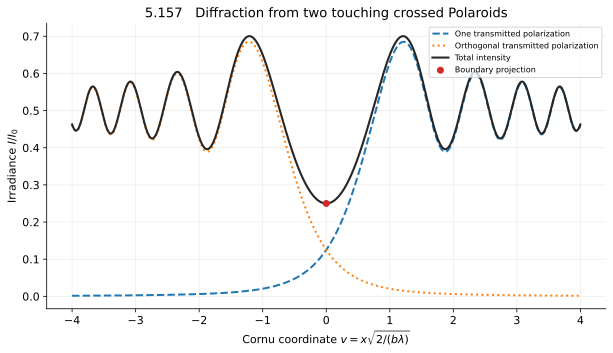
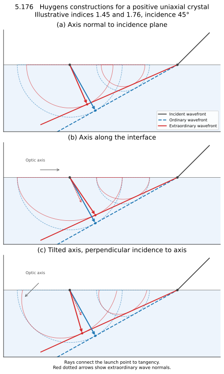
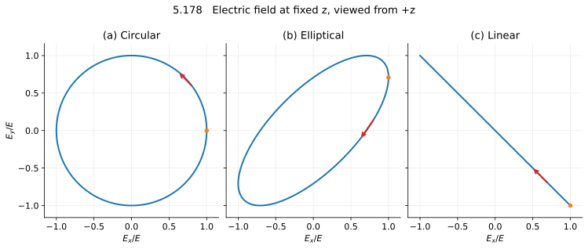
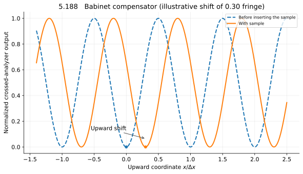
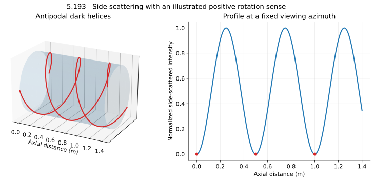
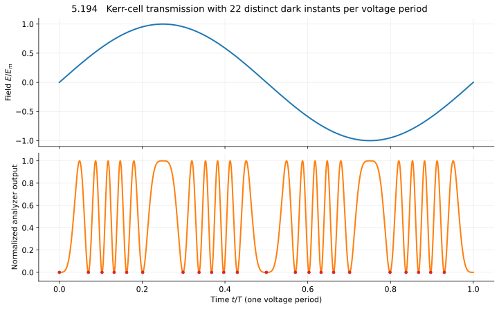

# 5.4 Polarization of Light

[Chapter index](../README.md#chapters) · [Structured solutions](5.4.json) · [Answer audit](../audit/README.md)

## 5.157

**Problem statement**

A plane monochromatic wave of natural light with intensity I_0 falls normally on a screen composed of two touching Polaroid half-planes. The principal direction of one Polaroid is parallel, and of the other perpendicular, to the boundary between them. What kind of diffraction pattern is formed behind the screen? What is the intensity of light behind the screen at the points of the plane perpendicular to the screen and passing through the boundary between the Polaroids?

**Solved · high confidence.** Add the Fresnel edge intensities in the two orthogonal polarization channels.

**Assumptions**

- The two ideal Polaroids transmit orthogonal linear components of natural light. Each incident component has mean intensityI₀/2.
- Use scalar paraxial half-plane diffraction separately in each polarization channel. Let x be distance across the boundary and z the downstream propagation distance.

The normalized field s of the complementary half-plane s are1/2±g(v), with v=x√(2/(λz)) and g=[C(v)+iS(v)]/(1+i). Orthogonal transmitted field s have no mutual intensity cross term.

$$
\frac I{I_0}=\frac12\left(|1/2+g|^2+|1/2-g|^2\right)=\frac14+\frac{C(v)^2+S(v)^2}{2}.
$$

The profile is even in x: straight symmetric Fresnel bands parallel to the junction, with a reduced central line. Individual half-plane diffraction remains although the two polarization channels do not interfere with each other.

Every point in the plane through the junction has x=0. Each half-plane supplies half a field in its own incident polarization.

$$
I(x=0)=I_0/4,\qquad I(|x|\to\infty)\to I_0/2.
$$

**Results**

Diffraction-pattern type

$$
I/I_0=1/4+[C(v)^2+S(v)^2]/2
$$

Symmetric Fresnel edge bands parallel to the junction. C,S are integrals of cos(πu²/2),sin(πu²/2). There is no cross-interference between orthogonal polarizations.

Intensity in the specified boundary plane

$$
I=I_0/4
$$

## 5.158

**Problem statement**

A plane monochromatic wave of natural light with intensity I_0 falls normally on an opaque screen with round hole corresponding to the first Fresnel zone for the observation point P. Find the intensity of light at the point P after the hole was covered with two identical Polaroids whose principal directions are mutually perpendicular and the boundary between them passes (a) along the diameter of the hole; (b) along the circumference of the circle limiting the first half of the Fresnel zone.

**Solved · high confidence.** Apply the polarization projection to each Fresnel subaperture.

**Assumptions**

- The two Polaroids cover complementary regions of the hole and transmit orthogonal polarizations.
- The natural incident wave has equal uncorrelated linear componentsI₀/2. First-half-zone means half the optical-phase interval/area, radiusρ₁/√2.

A full first-zone aperture has normalized field 2. Its diametric halves each have field 1, in separate polarization channels.

$$
I_a=(I_0/2)|1|^2+(I_0/2)|1|^2=I_0.
$$

The inner and outer radial half-zones have fields1−i and 1+i, but these two field s now carry orthogonal polarizations and must not interfere.

$$
I_b=(I_0/2)|1-i|^2+(I_0/2)|1+i|^2=2I_0.
$$

**Results**

Diameter boundary between the Polaroids

$$
I=I_0
$$

Boundary along the first half-zone circle

$$
I=2I_0
$$

## 5.159

**Problem statement**

A beam of plane-polarized light falls on a polarizer which rotates about the axis of the ray with angular velocity ω = 21 rad/s. Find the energy of light passing through the polarizer per one revolution if the flux of energy of the incident ray is equal to Φ_0 = 4.0 mW.

**Solved · high confidence.** Integrate Malus power over one mechanical revolution.

**Assumptions**

- The polarizer is ideal and the input is already linearly polarized. Its initial azimuth is arbitrary.

The transmitted radiant power oscillates ascos² of the mechanical angle.

$$
\Phi(t)=\Phi_0\cos^2(\omega t+\phi_0),\qquad T=2\pi/\omega.
$$

A complete revolution contains two Malus periods. The mean power is Φ₀/2.

$$
W=\int_0^T\Phi(t)dt=\frac{\pi\Phi_0}{\omega}=5.98399\times10^{-4}\ \mathrm J.
$$

**Results**

Energy transmitted per revolution

$$
W\simeq0.598\ \mathrm{mJ}
$$

## 5.160

**Problem statement**

A beam of natural light falls on a system of N = 6 Nicol prisms whose transmission planes are turned each through an angle φ = 30° with respect to that of the foregoing prism. What fraction of luminous flux passes through this system?

**Solved · high confidence.** Project the natural input once, the n apply Malus transmission a t five interfaces.

**Assumptions**

- All six Nicol prisms are ideal. Neglect reflection/absorption losses in their transmitted polarization.

The first Nicol transmits half the natural-light flux and makes it linear. Each of the remainingN−1 prisms adds a factorcos²φ.

$$
\frac\Phi{\Phi_0}=\frac12(\cos^2\varphi)^{N-1}=\frac12\left(\frac34\right)^5=\frac{243}{2048}.
$$

**Results**

Fraction of initial flux transmitted

$$
\Phi/\Phi_0=243/2048\simeq0.11865
$$

## 5.161

**Problem statement**

Natural light falls on a system of three identical in-line Polaroids, the principal direction of the middle Polaroid forming an angle φ = 60° with those of two other Polaroids. The maximum transmission coefficient of each Polaroid is equal to τ = 0.81 when plane-polarized light falls on them. How many times will the intensity of the light decrease after its passing through the system?

**Solved · high confidence.** Include finite pass-axis transmission a t all three polarization projections.

**Assumptions**

- τ0.81 is the intensity transmission for a n aligned polarized input. Orthogonal leakage is neglected because no extinction transmission is supplied.
- Each outside Polaroid makes angle φ60° with the middle direction. Their mutual orientation need not be assumed separately.

The first Polaroid transmitsτ/2 of the natural input. The next two each transmitτcos²φ.

$$
\frac I{I_0}=\frac{\tau^3}{2}\cos^4\varphi=\frac{0.81^3}{32}=0.01660753125.
$$

Invert this fraction to obtain the decrease factor.

$$
\frac{I_0}{I}=\frac{32}{0.81^3}\simeq60.21.
$$

**Results**

Intensity decrease factor

$$
I_0/I\simeq60.2
$$

Remaining intensity fraction

$$
I/I_0=0.0166075
$$

## 5.162

**Problem statement**

The degree of polarization of partially polarized light is P = 0.25. Find the ratio of intensities of the polarized component of this light and the natural component.

**Solved · high confidence.** Decompose partial linear polarization into polarized and natural components.

**Assumptions**

- Use the standard mixture of fully linearly polarized intensityI_p and unpolarized natural intensityI_n.

An ideal analyzer has maximumI_p+I_n/2 and minimumI_n/2.

$$
P=\frac{I_{\max}-I_{\min}}{I_{\max}+I_{\min}}=\frac{I_p}{I_p+I_n}.
$$

Solve for the requested component ratio.

$$
\frac{I_p}{I_n}=\frac P{1-P}=\frac13.
$$

**Results**

Polarized-to-natural component intensity ratio

$$
I_p/I_n=1/3
$$

## 5.163

**Problem statement**

A Nicol prism is placed in the way of partially polarized beam of light. When the prism is turned from the position of maximum transmission through an angle φ = 60° , the intensity of transmitted light decreased by a factor of η = 3.0. Find the degree of polarization of incident light.

**Solved · high confidence.** Use analyzer transmission a s a function of degree of linear polarization.

**Assumptions**

- The Nicol is ideal and the maximum-transmission axis defines zero analyzer angle. The partial polarization is linear.

At analyzer angle φ, the polarized-plus-natural decomposition gives

$$
I(\varphi)=\frac{I_{\rm total}}2[1+P\cos(2\varphi)].
$$

Insert the measured ratioη and solve.

$$
\eta=\frac{1+P}{1+P\cos2\varphi},\qquad P=\frac{\eta-1}{1-\eta\cos2\varphi}=0.80.
$$

**Results**

Incident degree of polarization

$$
P=0.80
$$

## 5.164

**Problem statement**

Two identical imperfect polarizers are placed in the way of a natural beam of light. When the polarizers' planes are parallel, the system transmits η = 10.0 times more light than in the case of crossed planes. Find the degree of polarization of light produced (a) by each polarizer separately; (b) by the whole system when the planes of the polarizers are parallel.

**Solved · high confidence.** Model each imperfect polarizer by two orthogonal intensity transmissions.

**Assumptions**

- Let T_a≥T_b≥0 be the pass- and leakage-axis intensity transmissions of each identical nondepolarizing linear polarizer.
- The input is natural. Phase retardance does not affect these parallel/crossed intensity measurements.

The parallel pair transmits the squared axis transmissions. The crossed pair gives the same product in both channels.

$$
I_\parallel=\tfrac12I_0(T_a^2+T_b^2),\quad I_\perp=I_0T_aT_b,\quad\eta=\frac{T_a^2+T_b^2}{2T_aT_b}.
$$

Express the single-polarizer degree and the parallel-pair degree throughη.

$$
P_1=\frac{T_a-T_b}{T_a+T_b}=\sqrt{\frac{\eta-1}{\eta+1}},\qquad P_2=\frac{T_a^2-T_b^2}{T_a^2+T_b^2}=\sqrt{1-\eta^{-2}}.
$$

**Results**

Degree produced by either polarizer alone

$$
P_1=\sqrt{9/11}\simeq0.9045
$$

Degree produced by the parallel pair

$$
P_2=\sqrt{0.99}\simeq0.9950
$$

## 5.165

**Problem statement**

Two parallel plane-polarized beams of light of equal intensity whose oscillation planes N_1 and N_2 form a small angle φ between them (Fig. 5.30) fall on a Nicol prism. To equalize the intensities of the beams emerging behind the prism, its principal direction N must be aligned along the bisecting line A or B. Find the value of the angle φ at which the rotation of the Nicol prism through a small angle δφ ≪ φ from the position A results in the fractional change of intensities of the beams ΔI/I by the value η = 100 times exceeding that resulting due to rotation through the same angle from the position B.

**Solved · high confidence.** Compare logarithmic Malus sensitivities a t the two scanned bisectors.

**Assumptions**

- Fig 5.30 has A perpendicular to the near-horizontal mean polarization directionB. A is the nearly extinguished bisector. B is the bright bisector.
- Linearize in the common analyzer rotationδφ, with δφ≪φ. The ratio is the same whether individual fractional changes or their relative beam imbalance is used.

AtA the common initial intensity is I_in sin²(φ/2), while a t B it is I_in cos²(φ/2). Differentiate Malus transmission.

$$
\left|\frac{\Delta I}{I}\right|_A\simeq2\cot(\varphi/2)|\delta\varphi|,\quad\left|\frac{\Delta I}{I}\right|_B\simeq2\tan(\varphi/2)|\delta\varphi|.
$$

Their ratio fixes the small separation angle.

$$
\eta=\cot^2(\varphi/2),\quad\varphi=2\arctan(\eta^{-1/2})=0.199337\ldots\ \mathrm{rad}.
$$

**Results**

Angle between the two incident polarization planes

$$
\varphi=2\arctan0.1\simeq11.42^\circ
$$

## 5.166

**Problem statement**

Resorting to the Fresnel equations, demonstrate that light reflected from the surface of dielectric will be totally polarized if the angle of incidence θ_1 satisfies the condition tan θ_1 = n, where n is the refractive index of the dielectric. What is in this case the angle between the reflected and refracted rays?

**Solved · high confidence.** Set the parallel Fresnel reflection amplitude to zero.

**Assumptions**

- The interface separates lossless isotropic nonmagnetic dielectrics. Let n=n₂/n₁. For incidence from air this is approximately the dielectric index.
- Exclude the trivial index-matched case, in which there is no reflected beam to polarize.

The parallel-polarized reflection amplitude vanishes when the numerator of its Fresnel coefficient iszero.

$$
r_p=\frac{n\cos\theta_1-\cos\theta_2}{n\cos\theta_1+\cos\theta_2}=0.
$$

Combine that condition with Snell’s law to obtain the Brewster relation and complementary refracted angle.

$$
\sin\theta_1=n\sin\theta_2,\quad\tan\theta_1=n,\quad\theta_1+\theta_2=\pi/2.
$$

Only the perpendicular electric component remains in reflection, so the reflected beam is totally linearly polarized.

**Results**

Brewster condition

$$
\tan\theta_B=n
$$

Reflected polarization

$$
\mathbf E_{\rm reflected}\perp\text{plane of incidence}
$$

Angle between reflected and refracted rays

$$
90^\circ
$$

## 5.167

**Problem statement**

Natural light falls at the Brewster angle on the surface of glass. Using the Fresnel equations, find (a) the reflection coefficient; (b) the degree of polarization of refracted light.

**Solved · high confidence.** Separate the two incident polarization powers a t Brewster incidence.

**Assumptions**

- Natural input carries equal s and p powers. Outside air is approximated a s index 1. Use Appendix 20 representative glassn1.50.
- Reflection coefficient means reflected luminous/radiant power fraction. Polarization degree of the transmitted beam is unchanged by the common refracted-area factor.

At Brewster incidenceRp0 and the perpendicular reflectance simplifies to q.

$$
R_p=0,\quad R_s=q=\left(\frac{n^2-1}{n^2+1}\right)^2,\quad\rho=\frac q2.
$$

Transmitted p and s powers are proportional to 1 and 1−q. Their contrast gives the polarization degree.

$$
P_t=\frac{1-(1-q)}{1+(1-q)}=\frac q{2-q}.
$$

**Results**

Natural-light reflection coefficient

$$
\rho=25/338\simeq0.07396
$$

Degree of polarization of refracted light

$$
P_t=25/313\simeq0.07987
$$

The transmitted beam is preferentially p-polarized, with E in the incidence plane.

## 5.168

**Problem statement**

A plane beam of natural light with intensity I_0 falls on the surface of water at the Brewster angle. A fraction ρ = 0.039 of luminous flux is reflected. Find the intensity of the refracted beam.

**Solved · high confidence.** Distinguish transmitted beam irradiance from its luminous-flux fraction.

**Assumptions**

- I₀ and I_t are intensities per area perpendicular to their respective propagation directions. No absorption occurs.
- At Brewster incidence the supplied reflection fraction fixes the water-to-air index ratio.

Flux conservation over the illuminated interface areaS includes different projected beam cross-sections.

$$
I_tS\cos\theta_2=(1-\rho)I_0S\cos\theta_1,\quad\frac{I_t}{I_0}=(1-\rho)\frac{\cos\theta_1}{\cos\theta_2}=\frac{1-\rho}{n}.
$$

For natural input,ρ=R_s/2. Invert the Brewster perpendicular reflectance to determine the index from the givenρ.

$$
\sqrt{2\rho}=\frac{n^2-1}{n^2+1},\qquad n=\sqrt{\frac{1+\sqrt{2\rho}}{1-\sqrt{2\rho}}}\simeq1.3323.
$$

Insert this value without confusing intensity with the transmitted power fraction.

$$
I_t=I_0(1-\rho)\sqrt{\frac{1-\sqrt{2\rho}}{1+\sqrt{2\rho}}}\simeq0.7213 I_0.
$$

**Results**

Refracted intensity normal to the refracted beam

$$
I_t\simeq0.72I_0
$$

Distinct transmitted luminous-flux fraction

$$
\Phi_t/\Phi_0=1-\rho=0.961
$$

This is the power fraction through the interface. The refracted beam has its own cross-sectional area.

## 5.169

**Problem statement**

A beam of plane-polarized light falls on the surface of water at the Brewster angle. The polarization plane of the electric vector of the electromagnetic wave makes an angle φ = 45° with the incidence plane. Find the reflection coefficient.

**Solved · high confidence.** Resolve the linear polarization into s and p components before reflection.

**Assumptions**

- Use Appendix 20 representative watern1.33 relative to air approximated as1. φ is the electric-vector angle from the incidence plane.

At Brewster incidence only the s component reflects. Its input power fraction issin²φ.

$$
\rho=R_s\sin^2\varphi=\left(\frac{n^2-1}{n^2+1}\right)^2\sin^2\varphi.
$$

Atφ45° the s and p incident powers are equal, giving the same power reflectance a s natural light.

$$
\rho\simeq0.03856\approx0.039.
$$

**Results**

Reflection coefficient

$$
\rho\simeq3.86\times10^{-2}
$$

## 5.170

**Problem statement**

A narrow beam of natural light falls on the surface of a thick transparent plane-parallel plate at the Brewster angle. As a result, a fraction ρ = 0.080 of luminous flux is reflected from its top surface. Find the degree of polarization of beams 1-4 (Fig. 5.31)

**Solved · high confidence.** Propagate the two polarization powers along the labelled primary rays.

**Assumptions**

- Fig 5.31 labels1 a s the to p reflection,2 a s the internal transmitted ray,3 a s the bottom reflection and 4 a s direct two-interface transmission.
- The plate is lossless and the narrow beams are spatially separated. Both interfaces are a t their reciprocal Brewster angle s, soRp0 and the sameRs=q applies a t each.

The measured top-surface reflectance of natural light is ρ=q/2, henceq0.16. Beams1 and 3 contain only s polarization.

$$
q=2\rho=0.16,\quad P_1=P_3=1.
$$

Inside beam2 the p:s powers are1:(1−q). In direct exit beam4 the y are1:(1−q)².

$$
P_2=\frac q{2-q}=\frac\rho{1-\rho},\qquad P_4=\frac{1-(1-q)^2}{1+(1-q)^2}.
$$

**Results**

Polarization degree of beam1

$$
P_1=1
$$

s-polarized.

Polarization degree of beam2

$$
P_2=0.0869565\ldots
$$

Preferentially p-polarized.

Polarization degree of beam3

$$
P_3=1
$$

s-polarized.

Polarization degree of direct beam4

$$
P_4=0.172608\ldots
$$

Preferentially p-polarized.

## 5.171

**Problem statement**

A narrow beam of light of intensity I_0 falls on a plane-parallel glass plate (Fig. 5.31) at the Brewster angle. Using the Fresnel equations, find: (a) the intensity of the transmitted beam I_4 if the oscillation plane of the incident plane-polarized light is perpendicular to the incidence plane; (b) the degree of polarization of the transmitted light if the light falling on the plate is natural.

**Solved · medium confidence.** Use the resolved direct beam4, and separate it from any collected ghost sum.

**Assumptions**

- Use the labelled primary beam4 of Fig 5.31 and Appendix 20 representative glassn1.50, with air approximated as1.
- Both interfaces are lossless and a t reciprocal Brewster angle s. The incident s-only beam in(a) has its electric vector perpendicular to the incidence plane.
- For(b) the primary interpretation is the same resolved direct beam4. If all spatially separated secondary transmitted beams are collected, their power sum is a different observable.

The s reflectance a t either interface isq25/169, while p reflectance iszero. The direct s-only transmitted beam incurs two power transmissions.

$$
q=R_s=25/169,\quad I_4/I_0=(1-q)^2=(144/169)^2.
$$

For natural input, the direct exit p:s powers are1:(1−q)².

$$
P_4=\frac{1-(1-q)^2}{1+(1-q)^2}=\frac{7825}{49297}\simeq0.158732.
$$

If all resolved ghost powers are collected instead, the s channel is a geometric series with round-trip factorq². The p channel has no reflection.

$$
T_{s,\rm all}=\frac{(1-q)^2}{1-q^2}=\frac{1-q}{1+q},\qquad P_{\rm all}=q.
$$

**Results**

Direct beam4 intensity for s-polarized input

$$
I_4=0.726025\ldots I_0
$$

Degree of polarization of direct beam4 for natural input

$$
P_4=0.158732\ldots
$$

If all resolved transmitted ghost powers are collected

$$
I_{s,\rm all}=0.742268\ldots I_0,\qquad P_{\rm all}=25/169\simeq0.147929
$$

Comparison only. label4 in the drawing is the direct ray, not this summed output.

## 5.172

**Problem statement**

A narrow beam of natural light falls on a set of N thick plane-parallel glass plates at the Brewster angle. Find: (a) the degree P of polarization of the transmitted beam; (b) what P is equal to when N = 1, 2, 5, and 10.

**Solved · high confidence.** Propagate the two incoherent polarization intensities separately through the selected direct beam of each plate.

**Assumptions**

- Use Appendix generic glass n=1.5, external air≈1 and lossless nonmagnetic Fresnel optics. The incidence plane s of the plates coincide.
- The thick plates and narrow beam select the direct transmitted beam analogous to beam4 of Fig .5.31. Laterally shifted secondary reflected/transmitted beams are not collected.

At Brewster incidence the p reflection vanishes. The s reflection a t either face isRs=[(n²−1)/(n²+1)]². Each direct plate traversal gives two transmission factors.

$$
R_p=0,\quad R_s=\left(\frac{n^2-1}{n^2+1}\right)^2,\qquad\tau_s=(1-R_s)^2.
$$

Natural light starts with equal intensities. AfterN plates the p part is unchanged while the s part is multiplied by τ_s^N.

$$
I_p=I_0/2,\qquad I_s=(I_0/2)\tau_s^N.
$$

The transmitted polarization degree is their difference divided by their sum.

$$
P_N=\frac{1-\tau_s^N}{1+\tau_s^N}.
$$

**Results**

Transmitted polarization degree afterN selected direct plate beams

$$
P_N=\frac{1-(1-R_s)^{2N}}{1+(1-R_s)^{2N}},\quad R_s=[(n^2-1)/(n^2+1)]^2
$$

Values for N=1,2,5,10

$$
(P_1,P_2,P_5,P_{10})\simeq(.15873,.30966,.66428,.92180)
$$

The dominant transmitted polarization is parallel to the incidence plane.

**Limitations**

- If all displaced secondary beams are collected, a n incoherent multiple-reflection transmission calculation is required. The direct-beam formula must not be relabelled a s total collected flux.

## 5.173

**Problem statement**

Using the Fresnel equations, find: (a) the reflection coefficient of natural light falling normally on the surface of glass; (b) the relative loss of luminous flux due to reflections of a paraxial ray of natural light passing through an aligned optical system comprising five glass lenses (secondary reflections of light are to be neglected).

**Solved · high confidence.** Use normal-incidence Fresnel reflectance and multiply the ten direct surface transmissions.

**Assumptions**

- Use generic Appendix glass n=1.5, air≈1, lossless separated lenses, and paraxial near-normal surface incidence.
- There are two air–glass surfaces per lens and no cemented interfaces. The question explicitly excludes secondary reflections.

At normal incidence both polarizations have the same intensity reflection coefficient.

$$
R=\left(\frac{n-1}{n+1}\right)^2=.0400.
$$

A ray passing through five lenses crosses ten surfaces. Multiply the ten primary transmission factors.

$$
T=(1-R)^{10}=.96^{10},\qquad\eta_{\rm loss}=1-T.
$$

**Results**

Single-surface natural-light reflectance

$$
R=.0400=4.00\%
$$

Relative luminous-flux loss for five separated lenses

$$
\eta_{\rm loss}=1-.96^{10}=.335167\simeq33.5\%
$$

## 5.174

**Problem statement**

A light wave falls normally on the surface of glass coated with a layer of transparent substance. Neglecting secondary reflections, demonstrate that the amplitudes of light waves reflected from the two surfaces of such a layer will be equal under the condition $n'=\sqrt{n}$ , where n' and n are the refractive indices of the layer and the glass respectively.

**Solved · medium confidence.** Separate interface-coefficient matching from exact amplitudes returned to one observation plane.

**Assumptions**

- Normal incidence from air≈1 onto a lossless coating of index q=n′ and substrate glass index n, with 1<q<n.
- The printed square-root condition is the interface-reflection matching condition, or first-order weak-reflection approximation. An exact two-returned-wave model must also retain both coating transmission factors.

The local Fresnel electric reflection amplitudes are negative a t both interfaces. Equating their magnitudes yields the stated square-root relation.

$$
r_{01}=\frac{1-q}{1+q},\quad r_{12}=\frac{q-n}{q+n};\qquad\frac{q-1}{q+1}=\frac{n-q}{n+q}\ \Longleftrightarrow\ q^2=n.
$$

At a common external reference plane, however, the first back-surface return has passed through the to p interface twice. Exact transmission factors give t01t10=1−r01².

$$
E_1=r_{01}E_0,\qquad E_2=(1-r_{01}^2)r_{12}e^{2i\beta}E_0.
$$

If the two returned waves retain their exact transmission factors, equality requires the following condition. The square-root index is its leading weak-reflection limit.

$$
|r_{01}|=(1-r_{01}^2)|r_{12}|.
$$

When the full coherent coating series is retained, the square-root matching is exact for zero reflected field a t odd-quarter-wave phase. This is a different, consistent approximation level.

$$
r_{\rm total}=\frac{r_{01}+r_{12}e^{2i\beta}}{1+r_{01}r_{12}e^{2i\beta}},\quad q^2=n,\ e^{2i\beta}=-1\ \Longrightarrow\ r_{\rm total}=0.
$$

**Results**

Fresnel interface-matching condition in the intended leading approximation

$$
n\prime=\sqrt n
$$

Exact equality if only the first two externally returned waves are retained

$$
|r_{01}|=(1-r_{01}^2)|r_{12}|
$$

Atn′=√n the second first-return amplitude is smaller by factor1−r01². It is not exactly equal.

Exact anti-reflection statement including all internal re-reflections

$$
n\prime=\sqrt n,\quad\beta=(2j+1)\pi/2\ \Longrightarrow\ r_{\rm total}=0
$$

**Limitations**

- The wording does not specify which amplitude normalization or level of neglected reflection effects is intended. Ignoring re-reflections and ignoring transmission attenuation are distinct operations.

## 5.175

**Problem statement**

A beam of natural light falls on the surface of glass at an angle of 45°. Using the Fresnel equations, find the degree of polarization of (a) reflected light; (b) refracted light.

**Solved · high confidence.** Resolve natural light into equal s/p intensities and use the Fresnel power coefficients.

**Assumptions**

- Use generic Appendix glass n=1.5 and external air≈1. Reflection and refraction refer to the single lossless entrance interface.

Snell’s law gives θ₂=arcsin(sin 45°/n). Compute the two reflected intensity fractions.

$$
R_s=\left(\frac{\cos\theta_1-n\cos\theta_2}{\cos\theta_1+n\cos\theta_2}\right)^2,\quad R_p=\left(\frac{n\cos\theta_1-\cos\theta_2}{n\cos\theta_1+\cos\theta_2}\right)^2.
$$

The reflected s/p intensities areI0Rs/2 and I0Rp/2. For the transmitted beam useTs=1−Rs andTp=1−Rp, which already include the flux-normalization factor.

$$
P_r=\frac{R_s-R_p}{R_s+R_p},\qquad P_t=\frac{R_s-R_p}{2-R_s-R_p}.
$$

**Results**

Degree of polarization of reflected light

$$
P_r=.831479\simeq83.1\%
$$

Dominant electric oscillations are perpendicular to the incidence plane.

Degree of polarization of refracted light

$$
P_t=.0439832\simeq4.40\%
$$

Dominant electric oscillations are parallel to the incidence plane.

## 5.176

**Problem statement**

Using Huygens's principle, construct the wavefronts and the propagation directions of the ordinary and extraordinary rays in a positive uniaxial crystal whose optical axis (a) is perpendicular to the incidence plane and parallel to the surface of the crystal; (b) lies in the incidence plane and is parallel to the surface of the crystal; (c) lies in the incidence plane at an angle of 45° to the surface of the crystal, and light falls at right angles to the optical axis.

**Solved · high confidence.** Construct ordinary spherical and extraordinary ellipsoidal Huygens wavelets and their common-envelope tangent plane s.

**Assumptions**

- Use positive uniaxial principal indicesn_e>n_o. The isotropic incident medium is air≈1. The ray direction is group/energy propagation, whereas the wave normal is perpendicular to its phase front.
- Use coordinatesx along the interface within the incidence plane and z into the crystal. Case(a) has optic axis alongy. case(b) alongx. For(c), chooseaxis(−x+z)/√2 and incoming direction(x+z)/√2, so external incidence is 45° and perpendicular to the optic axis.
- Numerical construction coordinates are illustrative only, using no=1.45,ne=1.76 and 45° incidence for all panels a s requested for the drawings. No material value s are inferred from those choices.

The ordinary wavelet is a sphere of radiuscT/n_o. The extraordinary ray wavelet is a n ellipsoid with semiaxiscT/n_o along the optic axis andcT/n_e perpendicular to it. For a positive crystal it lies inside the ordinary sphere and touches it along the optic axis.

Tangential phase matching fixesp=sin i. Define the ray-velocity metricM=aaᵀ/n_o²+(I−aaᵀ)/n_e², restricted to the incidence plane. Choose q from(p,q)ᵀM(p,q)=1 with energy propagation into the crystal. The tangent front and ray are different geometrical objects.

$$
\mathbf k/k_0=(p,q),\quad\mathbf k^TM\mathbf k/k_0^2=1,\quad p x+q z=cT,\quad\mathbf v_g/c=M(p,q)^T.
$$

In(a), the incidence-plane extraordinary wavelet is a circle of radiuscT/n_e. Both rays are normal to their fronts. In(b), the extraordinary section is a n ellipse with long axis along the interface, giving walkoff.

$$
\text{(a)}\quad n_o\sin r_o=n_e\sin r_e=\sin i;\qquad\text{(b)}\quad\tan\rho_e=(n_e/n_o)\tan r_o.
$$

In (c), rotate the ellipsoid by 45° and draw the tangent fixed by the boundary phase. Draw the extraordinary ray from the launch point to the point of tangency. The perpendicular to the tangent shows the wave normal.

**Results**

Axis perpendicular to incidence plane

$$
r_e=\arcsin(\sin i/n_e)<r_o=\arcsin(\sin i/n_o),\quad\mathbf v_{g,e}\parallel\mathbf k_e
$$

Axis parallel to interface inside incidence plane

$$
p^2/n_o^2+q_e^2/n_e^2=1,\quad\mathbf v_{g,e}/c=(p/n_o^2,q_e/n_e^2)
$$

The e-ray is farther from the normal than the o-ray, while its wave normal is closer.

Axis tilted45° and incident beam perpendicular to it

$$
\mathbf a=(-1,1)/\sqrt2,\quad p=1/\sqrt2,\quad M=\mathbf a\mathbf a^T/n_o^2+(I-\mathbf a\mathbf a^T)/n_e^2
$$

Use the positive-energy q root, draw the tangentfrontpx+qz=cT and the centre-to-tangency raycT M(p,q). geometry_spec supplies the full representative construction.

**Limitations**

- Huygens phase fronts and energy-ray directions must not be interchanged for extraordinary waves. The opposite tilt convention in(c) is the mirror image of this construction.

## 5.177

**Problem statement**

A narrow beam of natural light with wavelength λ = 589 nm falls normally on the surface of a Wollaston polarizing prism made of Iceland spar as shown in Fig. 5.32. The optical axes of the two parts of the prism are mutually perpendicular. Find the angle δ between the directions of the beams behind the prism if the angle θ is equal to 30°.

**Solved · high confidence.** Follow the two polarization eigenmodes through the inclined internal boundary and the parallel outer exit face.

**Assumptions**

- Use Appendix 20 Iceland-spar indices a t 589 nm: n_o=1.658 and n_e=1.486. Air≈1.
- Fig .5.32 has the first optic axis vertical in the incidence plane and the second perpendicular to it/out of the page. Initial propagation is perpendicular to both. Thus each component swaps ordinary/extraordinary identity a t the internal interface. In the second prism the principal plane is perpendicular to the incidence plane, so its e phase and ray directions coincide.

The component initially extraordinary becomes ordinary, and vice versa. At the internal interface of incidenceθ, their transmitted anglesr_a,r_b satisfy two Snell relations.

$$
n_e\sin\theta=n_o\sin r_a,\qquad n_o\sin\theta=n_e\sin r_b.
$$

Relative to the outer-face normal, the internal deflections areβ_a=r_a−θ and β_b=r_b−θ. Refraction out of the second prism gives opposite signed external angle s.

$$
\delta_a=\arcsin[n_o\sin(r_a-\theta)],\qquad\delta_b=\arcsin[n_e\sin(r_b-\theta)].
$$

Subtract the two outgoing angle s to obtain the beam separation.

$$
\delta=\delta_b-\delta_a.
$$

**Results**

Wollaston output beam separation

$$
\delta=11.4175^\circ\simeq0.199271\ \mathrm{rad}
$$

Signed external directions relative to incidence

$$
\delta_a=-5.60345^\circ,\qquad\delta_b=+5.81404^\circ
$$

The lower beam is e→o. The upper beam is o→e for the illustrated boundary tilt.

## 5.178

**Problem statement**

What kind of polarization has a plane electromagnetic wave if the projections of the vector $\mathbf{E}$ on the x and y axes are perpendicular to the propagation direction and are defined by the following equations: (a) $E_x=E\cos(\omega t-kz)$, $E_y=E\sin(\omega t-kz)$; (b) $E_x=E\cos(\omega t-kz)$, $E_y=E\cos(\omega t-kz+\pi/4)$; (c) $E_x=E\cos(\omega t-kz)$, $E_y=E\cos(\omega t-kz+\pi)$?

**Solved · high confidence.** Eliminate the common phase to identify each polarization ellipse, the n determine its time orientation explicitly.

**Assumptions**

- Use the printed source237 equation(b) with +π/4. The wave propagates along+z because its common phase is τ=ωt−kz.
- The stated rotation senses are for increasing time a t fixedz, viewed from the+z side looking toward the origin. Changing the viewing direction reverses the apparent sense.

In(a), the two equal components are in quadrature. Atτ=0 the vector is on+x and its derivative point s toward+y.

$$
E_x^2+E_y^2=E^2.
$$

For(b), eliminateτ from Ex=Ecosτ andEy=Ecos(τ+π/4). Equal component amplitudes place the ellipse axes a t ±45°. Its major direction is y=x becausecos(π/4)>0.

$$
E_x^2+E_y^2-\sqrt2E_xE_y=E^2/2,\quad a=E\sqrt{1+1/\sqrt2},\quad b=E\sqrt{1-1/\sqrt2}.
$$

The signed area-rate Ex Ėy−Ey Ėx is negative in(b), fixing clockwise motion in the declared view. In(c), the components are always opposite, so the vector stays on one line.

$$
\text{(b)}\quad E_x\dot E_y-E_y\dot E_x=-\omega E^2\sin(\pi/4)<0;\qquad\text{(c)}\quad E_y=-E_x.
$$

**Results**

Circular polarization and its orientation

$$
E_x^2+E_y^2=E^2
$$

Counterclockwise with increasing time when viewed from+z toward the origin.

Elliptical polarization

$$
\frac{b}{a}=\tan(\pi/8)=\sqrt2-1
$$

Major axis alongy=x. Clockwise in the declared+z-to-origin view.

Linear polarization

$$
E_y=-E_x
$$

Polarization axis a t −45° to+x, equivalently135°.

**Limitations**

- Labels such a s right- and left-circular polarization vary with viewing/time convention. The explicit rotation definition avoids that ambiguity.

## 5.179

**Problem statement**

One has to manufacture a quartz plate cut parallel to its optical axis and not exceeding 0.50 mm in thickness. Find the maximum thickness of the plate allowing plane-polarized light with wavelength λ = 589 nm (a) to experience only rotation of polarization plane; (b) to acquire circular polarization after passing through that plate.

**Solved · high confidence.** Enumerate half-wave and odd-quarter-wave retardance order s below the thickness cap.

**Assumptions**

- Use Appendix 20 quartz indices a t 589 nm: n_e=1.553 and n_o=1.544, soΔn=.009. Light crosses the plate normally and its wavevector is perpendicular to the in-plane optic axis.
- Part(a) means a plate that preserves linear polarization for a generic incident azimuth while changing that azimuth. part(b) requires incident linear polarization a t 45° to its eigenaxes for circular output.

A thicknessd produces phase retardance magnitudeδ=2πΔnd/λ. Under d≤.50 mm the number of whole retardance cycles cannot exceed7.64007.

$$
q=\Delta n d/\lambda\le7.64007.
$$

A nontrivial linear-to-linear rotation uses a n odd half-wave retardance, q=j+1/2. The largest such order is 7.5, corresponding to δ=15π.

$$
d_a=\frac{15\lambda}{2\Delta n}.
$$

Circular output from 45° linear input requires odd-quarter-wave order q=(2j+1)/4. The largest below the cap is 29/4=7.25, not31/4.

$$
d_b=\frac{29\lambda}{4\Delta n}.
$$

**Results**

Maximum half-wave-equivalent thickness

$$
d_a=.490833\ \mathrm{mm}
$$

The incident linear azimuthφ becomes−φ relative to the eigenaxis. The rotation is −2φ moduloπ, not a n azimuth-independent optical rotation.

Maximum circularizing thickness

$$
d_b=.474472\ \mathrm{mm}
$$

The incident polarization must make45° with both eigenaxes.

**Limitations**

- If the incident polarization is already exactly along a n eigenaxis, any thickness preserves it without rotation. That degenerate input is not the generic half-wave design condition.

## 5.180

**Problem statement**

A quartz plate cut parallel to the optical axis is placed between two crossed Nicol prisms. The angle between the principal directions of the Nicol prisms and the plate is equal to 45°. The thickness of the plate is d = 0.50 mm. At what wavelengths in the interval from 0.50 to 0.60 μm is the intensity of light which passed through that system independent of rotation of the rear prism? The difference of refractive indices for ordinary and extraordinary rays in that wavelength interval is assumed to be Δn = 0.0090.

**Solved · high confidence.** Require circular polarization before the rotatable rear Nicol, the n count the allowed odd-quarter-wave order s.

**Assumptions**

- The front Nicol prepares linear light a t 45° to the quartz eigenaxes. Use the specifiedΔn=.0090, independent of wavelength in this interval.
- The plate and analyzer are ideal and lossless apart from polarizer selection. Analyzer-angle independence means the emerging state is circular, not merely a particular stationary value a t one analyzer angle.

Equal eigenmode amplitudes with retardanceδ produce circular light exactly whenδ is a n odd multiple of π/2.

$$
\delta=\frac{2\pi\Delta n d}{\lambda}=\frac{(2j+1)\pi}{2}\quad\Longrightarrow\quad\lambda=\frac{4\Delta n d}{2j+1}.
$$

Here4Δnd=18.0 μm. Requiringλ∈[.50,.60]μm selects odd denominators31,33,35.

$$
30\le\frac{18.0\ \mu\mathrm m}{\lambda}\le36\quad\Longrightarrow\quad2j+1\in\{31,33,35\}.
$$

**Results**

Wavelengths giving analyzer-rotation-independent intensity

$$
\lambda\simeq514.286,\ 545.455,\ 580.645\ \mathrm{nm}
$$

## 5.181

**Problem statement**

White natural light falls on a system of two crossed Nicol prisms having between them a quartz plate 1.50 mm thick, cut parallel to the optical axis. The axis of the plate forms an angle of 45° with the principal directions of the Nicol prisms. The light transmitted through that system was split into the spectrum. How many dark fringes will be observed in the wavelength interval from 0.55 to 0.66 μm? The difference of refractive indices for ordinary and extraordinary rays in that wavelength interval is assumed to be equal to 0.0090.

**Solved · high confidence.** Count integer full-wave retardances in the specified spectral interval.

**Assumptions**

- The input is natural white light, the crossed Nicols are ideal, and the plate eigenaxis is a t 45° to the m. Use the stated constantΔn=.0090.

After the front Nicol each monochromatic component is linear. The crossed-analyzer transfer normalized to that prepared intensity is sin²(δ/2).

$$
T_\perp(\lambda)=\sin^2\left(\frac{\pi\Delta n d}{\lambda}\right).
$$

Dark wavelength s requireΔnd=mλ. HereΔnd=13.50 μm and the band bounds select integers21 through24.

$$
\frac{13.50}{.66}\le m\le\frac{13.50}{.55}\quad\Longrightarrow\quad m=21,22,23,24.
$$

**Results**

Number of dark spectral fringes

$$
N_{\rm dark}=4
$$

Dark wavelengths

$$
\lambda\simeq562.500,\ 586.957,\ 613.636,\ 642.857\ \mathrm{nm}
$$

## 5.182

**Problem statement**

A crystalline plate cut parallel to its optical axis is 0.25 mm thick and serves as a quarter-wave plate for a wavelength λ = 530 nm. At what other wavelengths of visible spectrum will it also serve as a quarter-wave plate? The difference of refractive indices for extraordinary and ordinary rays is assumed to be constant and equal to n_e − n_o = 0.0090 at all wavelengths of the visible spectrum.

**Solved · medium confidence.** Enumerate odd-quarter-wave spectral order s while preserving input rounding and the undefined visible-band boundary.

> **Audit update.** Keep the same signed retardation and fixed fast-axis orientation as at nominal 530 nm to obtain 692.3 and 428.6 nm. The 600.0 and 473.7 nm settings reverse that signed retardation.

**Assumptions**

- Treat the suppliedd=.25 mm and constantΔn=.0090 a s the model value s, so the optical retardation is Δnd=2.25 μm.
- Visible bounds are not specified. The primary list below uses a n explicitly illustrative400–700 nm interval. a parameterized family and nearby boundary candidate are also supplied.
- The given nominal530 nm design is consistent with the rounded data: the nearest exact odd-quarter-wave value from Δnd is 9000/17=529.412 nm.

Quarter-wave-equivalent phase retardance is any odd multiple of π/2. Therefore all eligible wavelength s are a n odd-denominator family.

$$
\lambda_q=\frac{4\Delta n d}{q}=\frac{9000\ \mathrm{nm}}q,\qquad q=1,3,5,\ldots
$$

Within400–700 nm the denominators are13,15,17,19,21. Removeq=17 a s the nominally specified530 nm plate function and list the remaining four.

For a broader violet limit extending to 391.304 nm, q=23 is a n additional candidate. The692.308 nm candidate is retained only if the adopted upper visible limit reaches it.

**Results**

All odd-quarter-wave wavelength s in any chosen visible band

$$
\lambda_q=9000\ \mathrm{nm}/q,\quad q\ \text{positive odd},\quad\lambda_{\min}\le\lambda_q\le\lambda_{\max}
$$

Other wavelength s if 400–700 nm is used

$$
\lambda\simeq428.571,\ 473.684,\ 600.000,\ 692.308\ \mathrm{nm}
$$

Additional candidate if the lower bound includes391.3 nm

$$
\lambda_{23}=391.304\ \mathrm{nm}
$$

Exact counterpart of the nominal530 nm design using printedd and Δn

$$
\lambda_{17}=529.412\ \mathrm{nm}
$$

**Limitations**

- Do not silently discard the 391.3 nm or692.3 nm candidates without stating the adopted band. A true wavelength-dependent birefringence would require solving the phase condition with Δn(λ).

## 5.183

**Problem statement**

A quartz plate cut parallel to its optical axis is placed between two crossed Nicol prisms so that their principle directions form an angle of 45° with the optical axis of the plate. What is the minimum thickness of that plate transmitting light of wavelength λ_1 = 643 nm with maximum intensity while greatly reducing the intensity of transmitting light of wavelength λ_2 = 564 nm? The difference of refractive indices for extraordinary and ordinary rays is assumed to be equal to n_e − n_o = 0.0090 for both wavelengths.

**Solved · medium confidence.** Choose a n odd-half-wave order for the desired line and examine near-integer retardance a t the suppressed line.

**Assumptions**

- The crossed Nicols are ideal and 45° to the plate eigenaxes. Normalize spectral transmission to the intensity after the front Nicol, soT(λ)=sin²(πΔnd/λ).
- Use the givenconstantΔn=.0090. The phrase greatly reducing supplies no numerical leakage threshold, so the conventional first deep low-order rejection is distinguished from a formally specified minimum.

An exact maximum a t λ₁ requiresΔnd=qλ₁/2 with positive oddq. Exact darkness a t λ₂ would additionally requireqλ₁=2kλ₂.

$$
643q=1128k,\qquad q\ \text{odd}.
$$

With the printed integer wavelength s, the left side is odd and the right side even, so simultaneous exact maximum/zero is impossible. Evaluate the first oddq value s to locate the intended approximate deep minimum.

$$
T_2(q)=\sin^2\left(\frac{\pi q\lambda_1}{2\lambda_2}\right).
$$

Forq=1,3,5,7 the leakage fractions are about.9524,.6240,.2057,.0009383. Thusq=7 is the first choice meeting, for example, a 1% leakage requirement.

$$
\Delta nd=\frac72\lambda_1=2250.5\ \mathrm{nm},\quad\frac{\Delta nd}{\lambda_2}=3.99024823.
$$

A mathematically defined minimum for a given toleranceε is obtained by minimizing the positive odd order satisfying the stated inequality.

$$
d_{\min}(\varepsilon)=\frac{\lambda_1}{2\Delta n}\min_{q\in\{1,3,5,\ldots\}}\{q:T_2(q)\le\varepsilon\}.
$$

**Results**

Conventional first deep-suppression thickness

$$
d=\frac{7\lambda_1}{2\Delta n}=.250056\ \mathrm{mm}
$$

This is the minimum if, for example, leakage≤1% of the prepared-line intensity is required.

Residual normalized transmission a t 564 nm for that thickness

$$
T_2=9.38277\times10^{-4},\qquad T_1=1
$$

Exact darkness cannot coincide with the 643 nm maximum for these exact wavelengths

$$
643q=1128k\ \text{has no solution with odd }q
$$

**Limitations**

- If a different leakage threshold is intended, the minimizing order can change. If no odd order meets it, no exact design with that threshold exists. Wavelength rounding and true dispersion also limit the significance of guard digits.

## 5.184

**Problem statement**

A quartz wedge with refracting angle Θ = 3.5° is inserted between two crossed Polaroids. The optical axis of the wedge is parallel to its edge and forms an angle of 45° with the principal directions of the Polaroids. On transmission of light with wavelength λ = 550 nm through this system, an interference fringe pattern is formed. The width of each fringe is Δx = 1.0 mm. Find the difference of refractive indices of quartz for ordinary and extraordinary rays at the wavelength indicated above.

**Solved · high confidence.** Infer birefringence from the single-pass retardance gradient of the quartz wedge.

**Assumptions**

- Use the standard thin-wedge, near-normal transmission geometry. x is transverse to the wedge edge and d(x)≈Θx. The two polarizer directions are a t 45° to the optic axis.
- This is single-pass ordinary/extraordinary phase retardance, not the round-trip phase of a reflecting thin film. Exact finite-angle screen geometry is not specified.

The crossed-polarizer intensity is proportional to sin²[πΔn d(x)/λ]. Adjacent maxima differ by one wavelength of differential optical path.

$$
\Delta n\,[d(x+\Delta x)-d(x)]=\lambda.
$$

Using the thin-wedge slopeΘ gives the required index difference.

$$
\Delta n\simeq\frac{\lambda}{\Theta\Delta x}=\frac{550\times10^{-9}}{(3.5\pi/180)(1.0\times10^{-3})}.
$$

Ifx is specifically measured along the reference face with geometric thicknessd=x tan Θ, that convention gives a small tangent-slope refinement. It should not be called a n exact arbitrary-screen correction.

**Results**

Birefringence a t 550 nm in the intended thin-wedge approximation

$$
n_e-n_o\simeq.00900
$$

Refinement for a reference-face coordinate

$$
\Delta n=\lambda/(\Delta x\tan\Theta)\simeq.0089924
$$

**Limitations**

- A finite-angle external observation plane and actual ray deflections require a more complete geometry. The main.0090 result is the conventional small-wedge determination.

## 5.185

**Problem statement**

Natural monochromatic light of intensity I_0 falls on a system of two Polaroids between which a crystalline plate is inserted, cut parallel to its optical axis. The plate introduces a phase difference δ between the ordinary and extraordinary rays. Demonstrate that the intensity of light transmitted through that system is equal to $I=\tfrac12 I_0[\cos^2(\varphi-\varphi')-\sin2\varphi\,\sin2\varphi'\,\sin^2(\delta/2)]$, where φ and φ′ are the angles between the optical axis of the crystal and the principal directions of the Polaroids. In particular, consider the cases of crossed and parallel Polaroids.

**Solved · high confidence.** Project the coherently retarded eigenmode amplitudes onto the rear analyzer.

**Assumptions**

- Both Polaroids are ideal. Natural incident light of intensityI₀ leaves the first polarizer with intensityI₀/2. The crystalline plate is a n ideal lossless linear retarder.
- φ and φ′ are signed eigenaxis-to-polarizer direction angle s moduloπ, measured in the same sense. The sign assigned to δ changes the field convention but not the cosine-based intensity.

After the first polarizer the normalized eigenmode vector is(cos φ,sin φ). Add the relative phase δ to one component and project onto(cos φ′,sin φ′).

$$
a=\cos\varphi\cos\varphi\prime e^{i\delta}+\sin\varphi\sin\varphi\prime,\qquad I=\frac{I_0}{2}|a|^2.
$$

Expand the squared modulus and usecosδ=1−2sin²(δ/2) to obtain the requested for m.

$$
I=\frac{I_0}{2}\left[\cos^2(\varphi-\varphi\prime)-\sin2\varphi\sin2\varphi\prime\sin^2(\delta/2)\right].
$$

For crossed axes takeφ′=φ+π/2. For parallel axes takeφ′=φ.

$$
I_\perp=\frac{I_0}{2}\sin^22\varphi\sin^2(\delta/2),\qquad I_\parallel=\frac{I_0}{2}\left[1-\sin^22\varphi\sin^2(\delta/2)\right].
$$

**Results**

Transmitted intensity for arbitrary polarizer orientations

$$
I=\tfrac12I_0[\cos^2(\varphi-\varphi\prime)-\sin2\varphi\sin2\varphi\prime\sin^2(\delta/2)]
$$

Crossed Polaroids

$$
I_\perp=\tfrac12I_0\sin^22\varphi\sin^2(\delta/2)
$$

Parallel Polaroids

$$
I_\parallel=\tfrac12I_0[1-\sin^22\varphi\sin^2(\delta/2)]
$$

## 5.186

**Problem statement**

Monochromatic light with circular polarization falls normally on a crystalline plate cut parallel to the optical axis. Behind the plate there is a Nicol prism whose principal direction forms an angle φ with the optical axis of the plate. Demonstrate that the intensity of light transmitted through that system is equal to $I=I_0(1+\sin2\varphi\,\sin\delta)$, where δ is the phase difference between the ordinary and extraordinary rays which is introduced by the plate.

**Solved · medium confidence.** Project a retarded circular Jones vector on the Nicol axis and audit intensity normalization.

**Assumptions**

- Use complex field s proportional to exp[i(kz−ωt)] and a fixed right-handed transverse basis. Withx along the plate optical axis(e) and y alongo, takeδ=phase_o−phase_e=2π(n_o−n_e)d/λ, a s in header5.4e.
- Let I_in be total intensity before the lossless plate. DefineI₀=I_in/2, the intensity of either orthogonal circular-field component or the unretarded analyzer baseline.
- Let the circular Jones vector be(1,−iσ)/√2,σ=±1. This explicit helicity definition avoids conflicting verbal right/left conventions.

Remove the common plate phase. The output Jones vector has o component multiplied by exp(iδ). Projection on a n analyzer a t φ gives its complex amplitude.

$$
a=\frac1{\sqrt2}(\cos\varphi-i\sigma e^{i\delta}\sin\varphi).
$$

Square its modulus. The cross term changes sign with helicity or with the definition of δ.

$$
I=I_{\rm in}|a|^2=\frac{I_{\rm in}}2[1+\sigma\sin2\varphi\sin\delta].
$$

For the helicity σ = +1, the printed form uses I₀ = I_in/2, the analyzer baseline for circular input.

$$
I=I_0(1+\sin2\varphi\sin\delta),\qquad I_0=I_{\rm in}/2.
$$

**Results**

Normalized intensity for either helicity

$$
I=\frac{I_{\rm in}}2(1+\sigma\sin2\varphi\sin\delta)
$$

Meaning of the stated formula

$$
I=I_0(1+\sin2\varphi\sin\delta)\quad\text{for }\sigma=+1,\ I_0=I_{\rm in}/2
$$

The opposite circular state reverses the sign of the sin e term.

**Limitations**

- The statement does not defineI₀ or the handedness convention. Its printed expression needs the stated baseline normalization and one helicity choice.

## 5.187

**Problem statement**

Explain how, using a Polaroid and a quarter-wave plate made of positive uniaxial crystal (n_e > n_o ), to distinguish (a) light with left-hand circular polarization from that with right-hand polarization; (b) natural light from light with circular polarization and from the composition of natural light and that with circular polarization.

**Solved · high confidence.** Convert circular polarization to orthogonal linear states with a calibrated quarter-wave plate.

**Assumptions**

- Use a positive uniaxial plate with x=e slow axis(n_e>n_o),y=o fast axis and phase_e−phase_o=π/2 modulo2π. A higher-order plate must have this calibrated retardance sign.
- For exp[i(kz−ωt)], defineR=(x−iy)/√2 and L=(x+iy)/√2. An observer looking toward the source seesR rotate clockwise and L counterclockwise a t a fixed point.
- Part (b) treats an incoherent mixture of natural light and light of a single circular helicity.

Ignoring a common phase, the positive quarter-wave plate isdiag(1,−i). It mapsR and L to perpendicular linear axes.

$$
Q\mathbf e_R\propto(1,-1),\qquad Q\mathbf e_L\propto(1,1).
$$

A Polaroid a t −45 degrees from the slowx axis passesR and blocksL. a t +45 degrees it passesL and blocksR. This gives the handedness test using only the stated two elements.

For incident natural intensityI_u and circular intensityI_c, rotate the Polaroid after the quarter-wave plate. Natural light remains unpolarized and circular light becomes fully linear.

$$
I(\beta)=\frac{I_u}{2}+I_c\cos^2(\beta-\beta_c),\quad I_{\max}=I_u/2+I_c,\quad I_{\min}=I_u/2.
$$

**Results**

Handedness discrimination

$$
R\longrightarrow-45^\circ;\qquad L\longrightarrow+45^\circ
$$

These axis labels apply to the explicitly defined Jones/time/viewing convention. Swapping plate retardance sign interchanges the m.

Natural, circular and mixed cases

$$
\begin{cases}I_{\max}=I_{\min}:&\text{natural},\\I_{\min}=0<I_{\max}:&\text{pure circular},\\0<I_{\min}<I_{\max}:&\text{natural+circular mixture}.\end{cases}
$$

Circular fraction in the stated mixture

$$
\frac{I_c}{I_u+I_c}=\frac{I_{\max}-I_{\min}}{I_{\max}+I_{\min}}
$$

## 5.188

**Problem statement**

Light with wavelength λ falls on a system of crossed polarizer P and analyzer A between which a Babinet compensator C is inserted (Fig. 5.33). The compensator consists of two quartz wedges with the optical axis of one of them being parallel to the edge, and of the other, perpendicular to it. The principal directions of the polarizer and the analyser form an angle of 45° with the optical axes of the compensator. The refracting angle of the wedges is equal to Θ (Θ ≪ 1) and the difference of refractive indices of quartz is n_e − n_o . The insertion of investigated birefringent sample S, with the optical axis oriented as shown in the figure, results in displacement of the fringes upward by δx mm. Find: (a) the width of the fringe Δx; (b) the magnitude and the sign of the optical path difference of ordinary and extraordinary rays, which appears due to the sample S.

**Solved · high confidence.** Use the signed Babinet retardation gradient read from the wedge axes in Fig .5.33.

**Assumptions**

- Let x be upward in the printed figure and letΔn_q=n_e−n_o>0 for quartz. The vertically marked wedge thickens downward. The dotted wedge has its optical axis perpendicular to the page and thickens upward.
- The sample optical axis is vertical, matching the marked wedge. DefineD_e−o=L_e−L_o for the sample, and stateD_o−e with the opposite sign.
- Both polarizer axes are45 degrees to the compensator axes. Reflected losses and optical activity are neglected relative to the intended linear birefringence.

Let t_v,t_h be the two wedge thicknesses. With upwardx, dt_v/dx=−tan Θ anddt_h/dx=+tan Θ, giving the signed optical-path gradient.

$$
D_C(x)=(n_e-n_o)(t_v-t_h),\qquad\frac{dD_C}{dx}=-2\Delta n_q\tan\Theta.
$$

Between crossed45degree polarizers, intensity is proportional tosin²(πD_C/λ). Adjacent same-type fringes differ by λ of retardation.

$$
\Delta x=\frac{\lambda}{2|\Delta n_q|\tan\Theta}\simeq\frac{\lambda}{2\Delta n_q\Theta}.
$$

A fixed-order fringe shifted upward by δx satisfiesD_C(x+δx)+D_S=D_C(x). Therefore the sample increases the extraordinary path relative to the ordinary one.

$$
D_{S,e-o}=+2\Delta n_q\tan\Theta\,\delta x=+\lambda\frac{\delta x}{\Delta x}.
$$

**Results**

Full fringe width

$$
\Delta x\simeq\frac{\lambda}{2(n_e-n_o)\Theta}
$$

Signed sample path difference, extraordinary minus ordinary

$$
D_{e-o}=+2(n_e-n_o)\tan\Theta\,\delta x\simeq+2(n_e-n_o)\Theta\,\delta x
$$

Signed ordinary-minus-extraordinary difference

$$
D_{o-e}=-2(n_e-n_o)\tan\Theta\,\delta x
$$

Thus the ordinary optical path is smaller for the stated upward displacement. Use the same length units for δx and λ.

## 5.189

**Problem statement**

Using the tables of the Appendix, calculate the difference of refractive indices of quartz for light of wavelength λ = 589.5 nm with right-hand and left-hand circular polarizations.

**Solved · high confidence.** Convert natural optical rotation into differential phase of the circular eigenmodes.

**Assumptions**

- Use the magnitude21.72 degrees for 1 mm quartz a t 589.5 nm from Appendix 21, a s preserved in the canonical registry.
- For exp[i(kz−ωt)] definee_R=(x−iy)/√2 and e_L=(x+iy)/√2. Positive geometric polarization angle is from+x toward+y. The sign of dextrorotation is stated separately.

A linear wave is the sum of the two circular eigenmodes. Their phase difference rotates the linear direction by half that amount.

$$
\varphi=\frac12(k_R-k_L)l=\frac{\pi l}{\lambda}(n_R-n_L).
$$

Only a rotation magnitude is supplied by the Appendix. Use it to obtain the magnitude of the circular-index difference.

$$
|n_R-n_L|=\frac{\lambda|\alpha|}{\pi},\quad |\alpha|=21.72\frac\pi{180}\times10^3\ \mathrm{rad/m}.
$$

**Results**

Magnitude of the circular refractive-index difference

$$
|n_R-n_L|=7.1133\times10^{-5}
$$

Sign if the crystal is dextrorotatory under the stated basis

$$
n_R-n_L=-|n_R-n_L|
$$

Dextrorotation is clockwise for a n observer looking toward the source, opposite the positive+x-to+y geometric angle. The other quartz enantiomorph reverses the sign.

## 5.190

**Problem statement**

Plane-polarized light of wavelength 0.59 μm falls on a trihedral quartz prism P (Fig. 5.34) with refracting angle Θ = 30°. Inside the prism light propagates along the optical axis whose direction is shown by hatching. Behind the Polaroid Pol an interference pattern of bright and dark fringes of width Δx = 15.0 mm is observed. Find the specific rotation constant of quartz and the distribution of intensity of light behind the Polaroid.

**Solved · medium confidence.** Use the transverse gradient of optical rotation through the prism.

**Assumptions**

- Fig .5.34 has rays travelling horizontally along the prism optical axis. Let x be distance downward from the apex in the exit-face plane. The crystal path length is L(x)=x tan Θ.
- Let ρ be the signed natural rotation per unit path. Use the polarization angle ψ_in just inside the crystal and neglect entrance and exit losses.
- The analyzer axis angle β and entrance polarization orientation are unspecified, so the pattern phase origin cannot be fixed absolutely.

Successive equal-type fringes occur when the rotated linear axis changes by π, not2π.

$$
|\rho|\,\Delta x\tan\Theta=\pi.
$$

InsertΔx=15 mm and Θ=30 degrees.

$$
|\rho|=\frac{\pi}{15\tan30^\circ}\ \mathrm{rad/mm}=20.78461\ldots\ \mathrm{deg/mm}.
$$

Malus law supplies the spatial intensity. Its phase offset carries the entrance polarization and analyzer directions.

$$
I(x)=I_{\rm in}\cos^2[\psi_{\rm in}-\beta+\rho x\tan\Theta]=I_{\rm in}\cos^2[\varphi_0\pm\pi x/\Delta x].
$$

**Results**

Specific-rotation magnitude

$$
|\rho|=20.78461\ldots\ \mathrm{deg/mm}
$$

Intensity behind the Polaroid

$$
I(x)=I_{\rm in}\cos^2[\varphi_0\pm\pi x/(15\ \mathrm{mm})]
$$

Equivalently choosex₀ a t a bright fringe and writeI=I_in cos²[π(x−x₀)/Δx]. The source does not specifyφ₀ or chirality.

**Limitations**

- Non-normal entrance refraction can rotate the polarization angle and alter intensity through unequal real Fresnel amplitudes. This changesφ₀ andnormalization, not the ideal rotation-gradient fringe period.

## 5.191

**Problem statement**

Natural monochromatic light falls on a system of two crossed Nicol prisms between which a quartz plate cut at right angles to its optical axis is inserted. Find the minimum thickness of the plate at which this system will transmit η = 0.30 of luminous flux if the specific rotation constant of quartz is equal to α = 17 ang.deg/mm.

**Solved · high confidence.** Include the first Nicol loss before applying optical-rotation Malus law.

**Assumptions**

- The incident light is natural with total intensityI_in. Both Nicol prisms are ideal, so the first transmitsI_in/2. The requestedη=.30 is relative to that initial natural flux.
- Use the given rotation magnitude17 degrees/mm.

A plate rotationφ=αd between crossed prisms gives transmitted fractionη=(1/2)sin²φ.

$$
\eta=\frac12\sin^2(\alpha d).
$$

The smallest positive angle has sin²φ=.60. Divide by 17 degrees/mm.

$$
d_{\min}=\frac{\arcsin\sqrt{2\eta}}{|\alpha|}.
$$

**Results**

Minimum quartz thickness

$$
d_{\min}=2.98638\ldots\ \mathrm{mm}\simeq2.99\ \mathrm{mm}
$$

## 5.192

**Problem statement**

Light passes through a system of two crossed Nicol prisms between which a quartz plate cut at right angles to its optical axis is placed. Determine the minimum thickness of the plate which allows light of wavelength 436 nm to be completely cut off by the system and transmits half the light of wavelength 497 nm. The specific rotation constant of quartz for these wavelengths is equal to 41.5 and 31.1 angular degrees per mm respectively.

**Solved · medium confidence.** Separate the intended rounded wave-rotation design from exact commensurability of the printed rate s.

**Assumptions**

- Normalize transmission to the intensity after the first Nicol. The usual intended half-transmission condition is sin²(α₂d)=1/2.
- Treat41.5 and 31.1 degrees/mm a s experimental rounded data for the practical design. Separately audit what happens if their decimals are considered exact.

Exact extinction a t 436 nm requiresα₁d=180k degrees, so the shortest nonzero candidate is d=180/41.5 mm.

$$
d=\frac{180k}{41.5}\ \mathrm{mm},\qquad k=1,2,\ldots.
$$

For half of the post-first-Nicol flux a t 497 nm,α₂d=45(2j+1)degrees. Substituting the printed rate s produces a n impossible integer parity equation.

$$
4(311)k=415(2j+1).
$$

The intended rounded ratio is α₂/α₁≈3/4. At the shortest candidate,497 nm rotates134.89157 degrees, close to the 135degree half-transmission design.

$$
d_{\rm design}=4.3373494\ldots\ \mathrm{mm},\quad T_{497}=\sin^2(134.891566\ldots{}^\circ)=0.5018925\ldots.
$$

**Results**

Literal exact-decimal compatibility

$$
\text{No nonzero thickness exactly satisfies both requirements}
$$

The left side1244k is even, whereas415(2j+1) is odd.

Shortest conventional rounded design

$$
d_{\rm design}=4.33735\ldots\ \mathrm{mm}\simeq4.34\ \mathrm{mm}
$$

Actual497 nm transfer a t that design using printed decimals

$$
T_{497}=0.5018925\ldots
$$

If half refers to total incident natural flux instead

$$
d\simeq\frac{360}{41.5}\ \mathrm{mm}=8.67470\ldots\ \mathrm{mm}
$$

Then497 nm must be near a full post-first-Nicol transmission maximum. The exact decimals again have no exact simultaneous solution.

**Limitations**

- A literal exact answer does not exist for the printed decimal rate s. The conventional4.34 mm answer uses their rounded near 4:3 ratio and the stated post-first-Nicol normalization.

## 5.193

**Problem statement**

Plane-polarized light of wavelength 589 nm propagates along the axis of a cylindrical glass vessel filled with slightly turbid sugar solution of concentration 500 g/l. Viewing from the side, one can see a system of helical fringes, with 50 cm between neighbouring dark fringes along the axis. Explain the emergence of the fringes and determine the specific rotation constant of the solution.

**Solved · high confidence.** Treat side scattering a s a local polarization analyzer and use its π-periodic dark condition.

**Assumptions**

- The turbid solution scatters weakly by single dipole-like scattering, with negligible depolarization. Looking in a transverse direction, scattered intensity vanishes when the local electric field is parallel to that viewing direction.
- Let c=500g/l=.50g/cm³ and define the concentration-specific constant[α] by φ=[α]cl. Only its magnitude follows from the given axial spacing.

The optical activity rotates the polarization plane steadily with axial distancez. Side-view dark positions repeat after a π change, not2π.

$$
|\rho|\Delta z=\pi,\qquad |\rho|=\pi/(0.50\ \mathrm m)=2\pi\ \mathrm{rad/m}.
$$

Divide this actual rotation rate by concentration to obtain the specific rotation constant.

$$
|[\alpha]|=\frac{180^\circ}{(50\ \mathrm{cm})(0.50\ \mathrm{g/cm^3})}=7.20\ \mathrm{deg\,cm^2/g}.
$$

The two opposite viewing azimuths parallel to the instantaneous polarization define a pair of dark helices. A full2π winding has axial pitch1 m, while a fixed transverse view sees repeated dark positions50 cm apart.

**Results**

Concentration-specific rotation magnitude

$$
|[\alpha]|=7.20\ \mathrm{deg\,cm^2/g}=72.0\ \mathrm{deg\,mL/(g\,dm)}
$$

Rotation rate of the stated solution

$$
|\rho|=2\pi\ \mathrm{rad/m}=3.60\ \mathrm{deg/cm}
$$

Full turn of each dark helix

$$
p=1.00\ \mathrm m
$$

## 5.194

**Problem statement**

A Kerr cell is positioned between two crossed Nicol prisms so that the direction of electric field E in the capacitor forms an angle of 45° with the principal directions of the prisms. The capacitor has the length l = 10 cm and is filled up with nitrobenzene. Light of wavelength λ = 0.50 μm passes through the system. Taking into account that in this case the Kerr constant is equal to B = 2.2×10⁻¹⁰ cm/V² , find: (a) the minimum strength of electric field E in the capacitor at which the intensity of light that passes through this system is independent of rotation of the rear prism; (b) how many times per second light will be interrupted when a sinusoidal voltage of frequency ν = 10 MHz and strength amplitude E_m = 50 kV/cm is applied to the capacitor. Note. The Kerr constant is the coefficient B in the equation $n_e-n_o=B\lambda E^2$ .

**Solved · high confidence.** Use electric-field-squared Kerr retardance and count distinct extinction instants.

**Assumptions**

- Use the problem Kerr conventionΔn=BλE², with B=2.2×10⁻¹⁰cm/V²,length 10 cm and E in V/cm. The incident field after the first Nicol is linear a t 45 degrees to the Kerr axes.
- For crossed ideal polarizers the analyzer receives I₁ sin²(δ/2), where I₁ is intensity after the first prism. Count distinct instants when this expression is zero.

The wavelength cancels from the accumulated Kerr phase.

$$
\delta=\frac{2\pi}{\lambda}\Delta n\,l=2\pi BlE^2.
$$

Analyzer-rotation independence requires circular polarization, first reached a t δ=π/2.

$$
E_{\min}=\frac1{\sqrt{4Bl}}=10.66004\ldots\ \mathrm{kV/cm}.
$$

For sinusoidalE(t), the intensity is periodic in sin²Ωt. The peak phase factorq=B l E_m²=5.5 fixes its extinction order s.

$$
I(t)=I_1\sin^2[\pi q\sin^2(2\pi\nu t)],\quad q=5.5,\quad q\sin^2(2\pi\nu t)=k.
$$

Over one voltage cyclek=0 occurs twice, while eachk=1,…,5 has four roots. The peakq is not a n integer, so no additional turning-point zero occurs.

$$
N_{\rm zeros}=2+4(5)=22,\qquad f_{\rm interruptions}=22\nu.
$$

**Results**

Minimum electric-field magnitude

$$
E_{\min}=10.66004\ldots\ \mathrm{kV/cm}
$$

Distinct dark instants per second

$$
f_{\rm interruptions}=22\nu=2.20\times10^8\ \mathrm{s^{-1}}
$$

Optical-waveform repetition frequency

$$
f_{\rm repeat}=2\nu=20\ \mathrm{MHz}
$$

Repetition frequency differs from the number of individual extinction instants. The22 zeros are not equally spaced.

**Limitations**

- A finite detector darkness threshold gives finite pulse width s and a threshold-dependent edge count. The requested ideal interruption count here means distinct zeros.

## 5.195

**Problem statement**

Monochromatic plane-polarized light with angular frequency ω passes through a certain substance along a uniform magnetic field H. Find the difference of refractive indices for right-hand and left-hand components of light beam with circular polarization if the Verdet constant is equal to V.

**Solved · high confidence.** Express Faraday rotation a s half the circular-eigenmode phase difference.

**Assumptions**

- Use complex field s exp[i(kz−ωt)] and define e_R=(x−iy)/√2,e_L=(x+iy)/√2 in a right-handed fixed transverse basis.
- Positive geometric rotation is from+x to+y, counterclockwise for a n observer looking toward the source. Define signedV by φ=VHl in that convention whenH point s along+z.

A linearly polarized input is a n equal coherent sum of the circular eigenmodes. Their differential phase gives the rotation.

$$
\varphi=\frac12(k_R-k_L)l=\frac{\omega l}{2c}(n_R-n_L).
$$

Equate this to the Verdet law and cancel the path length.

$$
\frac{\omega}{2c}(n_R-n_L)=VH.
$$

**Results**

Circular-index difference in the declared basis

$$
n_R-n_L=\frac{2cVH}{\omega}
$$

Convention-independent magnitude

$$
|n_R-n_L|=\frac{2c|VH|}{\omega}
$$

Swapping the namesR/L or the positive viewing convention reverses the signed expression, not the magnitude.

## 5.196

**Problem statement**

A certain substance is placed in a longitudinal magnetic field of a solenoid located between two Polaroids. The length of the tube with substance is equal to l = 30 cm. Find the Verdet constant if at a field strength H = 56.5 kA/m the angle of rotation of polarization plane is equal to φ_1 = +5°10′ for one direction of the field and to φ_2 = −3°20′, for the opposite direction.

**Solved · high confidence.** Separate the field-odd Faraday rotation from the field-even background.

**Assumptions**

- The two field magnitudes are equal and opposite and the same signed analyzer reference is retained. The field-independent part can include natural optical activity or a calibrated instrument offset.

Writeφ₊=φ_even+VHl and φ₋=φ_even−VHl. Subtraction removes the nonmagnetic contribution.

$$
\varphi_F=\frac{\varphi_1-\varphi_2}{2}=4^\circ15\prime,\qquad\varphi_{\rm even}=\frac{\varphi_1+\varphi_2}{2}=0^\circ55\prime.
$$

Convert the Faraday angle to radians before dividing bylH.

$$
V=\frac{(4.25)\pi/180}{(.30)(56500)}.
$$

**Results**

Verdet constant

$$
V=4.37619\ldots\times10^{-6}\ \mathrm{rad/A}
$$

Field-even rotation

$$
\varphi_{\rm even}=+55\prime
$$

## 5.197

**Problem statement**

A narrow beam of plane-polarized light passes through dextrorotatory positive compound placed into a longitudinal magnetic field as shown in Fig. 5.35. Find the angle through which the polarization plane of the transmitted beam will turn if the length of the tube with the compound is equal to l, the specific rotation constant of the compound is equal to α, the Verdet constant is V, and the magnetic field strength is H.

**Solved · medium confidence.** Count traversals and distinguish reciprocal natural rotation from nonreciprocal Faraday rotation.

**Assumptions**

- Fig .5.35 contains five tube traversals: three in the initial propagation direction and two backward. The longitudinal field point s along the initial beam.
- For the primary named convention, call clockwise rotation viewed toward the source positive(dextrorotation). Positive FaradayV for H parallel to propagation is counterclockwise in that same view, hence has negative sign in the dextrorotation convention.
- Equivalently defineβ_F a s the signed single-forward-pass Faraday angle in one fixed transverse frame. This removes verbal handedness conventions. Ideal reflection adds no unrelated polarization phase.

Natural optical activity is reciprocal: a backward pass undoes a forward pass in a fixed polarization reference. The three forward and two backward paths leave one net natural length.

$$
\varphi_{\rm nat}=(3-2)\alpha l=\alpha l.
$$

Faraday rotation is nonreciprocal and adds for all five traversals. The convention-independent signed formula is therefore one natural pass plus five Faraday passes.

$$
\varphi_{\rm total}=\alpha l+5\beta_F.
$$

For the primary clockwise-toward-source convention,β_F=−VHl and the two effects oppose.

$$
\varphi_{\rm total}=(\alpha-5VH)l.
$$

**Results**

Signed net rotation in the primary named convention

$$
\varphi=(\alpha-5VH)l
$$

Positive means clockwise viewed toward the source. a negative result reverses that sense.

Signed single-pass-angle form

$$
\varphi=\alpha l+5\beta_F
$$

IfV is instead defined so the forward Faraday angle is+VHl in the chosen positive frame, the displayed algebra becomes(α+5VH)l. This is a convention change, not a different optical path.

**Limitations**

- A numerical or named-sign answer requires a handedness/viewing convention. The five-pass coefficient and reciprocal/nonreciprocal distinction are convention independent.

## 5.198

**Problem statement**

A tube of length l = 26 cm is filled with benzene and placed in a longitudinal magnetic field of a solenoid positioned between two Polaroids. The angle between the principle directions of the Polaroids is equal to 45°. Find the minimum strength of the magnetic field at which light of the wavelength 589 nm propagates through that system only in one direction (optical valve). What happens if the direction of the given magnetic field is changed to the opposite one?

**Solved · high confidence.** Set a 45degree nonreciprocal rotation between the two45degree-separated polarizers.

**Assumptions**

- Use Appendix 21 benzene Verdet value 2.59angularmin/A a t 589 nm, preserved exactly despite the Appendix quality note about unusual printed value s. The H-based law is φ=VHl with V inrad/A.
- Take ideal polarizers and a lossless Faraday rotator of length .26 m. Neglect natural optical activity and all other rotation.

Let the polarizer axes differ by β=45 degrees and the rotator add signedγ in a fixed transverse reference. Forward and backward transfers arecos²(β−γ) andcos²(β+γ).

$$
T_\rightarrow=\cos^2(\beta-\gamma),\qquad T_\leftarrow=\cos^2(\beta+\gamma).
$$

The smallest field magnitude giving full transmission in one direction and extinction in the reverse has|γ|=45 degrees.

$$
H_{\min}=\frac{\pi/4}{|V|l}=\frac{2700\ \mathrm{arcmin}}{(2.59\ \mathrm{arcmin/A})(.26\ \mathrm m)}.
$$

ReversingH reversesγ and interchanges the two transfer factors, reversing the allowed propagation direction.

**Results**

Minimum longitudinal magnetic-field strength

$$
|H|_{\min}=4009.504\ldots\ \mathrm{A/m}\simeq4.01\ \mathrm{kA/m}
$$

Effect of reversing the field

$$
T_\rightarrow\leftrightarrow T_\leftarrow
$$

The optical valve passes the previously blocked direction and blocks the previously transmitted one.

**Limitations**

- The numerical value follows the historical printed Appendix benzene entry. Replacing it with a different modern experimental value would define a different numerical calculation.

## 5.199

**Problem statement**

Experience shows that a body irradiated with light with circular polarization acquires a torque. This happens because such a light possesses an angular momentum whose flow density in vacuum is equal to M = I/ω, where I is the intensity of light, ω is the angular oscillation frequency. Suppose light with circular polarization and wavelength λ = 0.70 μm falls normally on a uniform black disc of mass m = 10 mg which can freely rotate about its axis. How soon will its angular velocity become equal to ω_0 = 1.0 rad/s provided I = 10 W/cm² ?

**Solved · high confidence.** Equate absorbed optical spin angular-momentum flux to the disc mechanical torque.

**Assumptions**

- Assume the uniform circularly polarized beam covers the whole uniform black disc, which absorbs the incident spin angular momentum without reflection/transmission. The radiusR is not specified and will cancel only under this full uniform coverage.
- Neglect mechanical drag, bearing friction and thermal reradiation torque. The target mechanical speed is negligible compared with the optical frequency. Use printed Appendix vacuum light speedc=2.998×10⁸m/s.

The absorbed angular momentum per unit time is intensity times illuminated area divided by optical angular frequency. For a uniform disc the moment of inertia is mR²/2.

$$
\tau=\frac{I\pi R^2}{\omega_{\rm light}},\qquad J=\frac12mR^2,\qquad\omega_{\rm light}=\frac{2\pi c}{\lambda}.
$$

Divide torque by mechanical inertia. The radius cancels under full illumination.

$$
\dot\omega_{\rm disc}=\frac{I\lambda}{mc},\qquad t=\frac{mc\omega_0}{I\lambda}.
$$

Convert10mg to 10⁻⁵kg and 10W/cm² to 10⁵W/m², the n insert the target speed1 rad/s.

**Results**

Time to reach1 rad/s under full coverage

$$
t=4.282857\ldots\times10^4\ \mathrm s\simeq11.90\ \mathrm h
$$

If only a n area fractionf is illuminated a t the stated intensity

$$
t_f=\frac{mc\omega_0}{fI\lambda}=t/f
$$

For0<f<1 the full-coverage result is a lower time estimate. beam-spot or disc-size information would be needed to specifyf.

**Limitations**

- An unspecified narrow or nonuniform beam cannot be assigned the full-disc area. The area-fraction for m states the missing coverage dependence explicitly.
