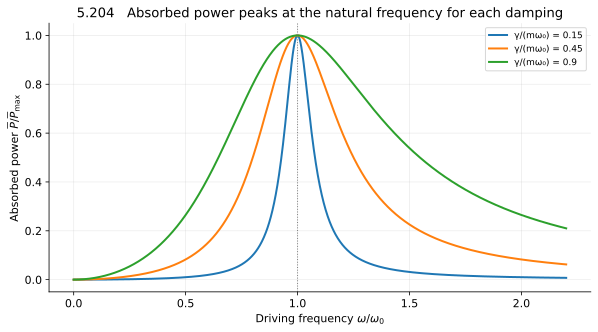

# 5.5 Dispersion and Absorption of Light

[Chapter index](../README.md#chapters) · [Structured solutions](5.5.json) · [Answer audit](../audit/README.md)

## 5.200

**Solved · high confidence.** Solve the nonrelativistic electric quiver, then evaluate the magnetic force on that motion.

**Assumptions**

- A linearly polarized plane wave travels in vacuum along +z, with E along x and B along y. I is its time averaged irradiance.
- The requested displacement and speed amplitudes describe the periodic quiver. Any free uniform drift is set to zero. Radiation reaction and magnetic corrections to the orbit are neglected as instructed.

Determine the peak electric field from the time averaged Poynting flux.

$$
I=\tfrac12\epsilon_0cE_0^2,\qquad E_0=\sqrt{2I/(\epsilon_0c)}=336.26\ \mathrm{V/m}.
$$

The charge is −e. The displacement is in phase with the electric field because acceleration has the opposite sign to displacement.

$$
m\ddot x=-eE_0\cos\omega t,\qquad x=a\cos\omega t,\quad a=\frac{eE_0}{m\omega^2},\quad \dot x=-v\sin\omega t,\quad v=\omega a.
$$

Substitute the field and angular frequency to obtain the two quiver amplitudes.

$$
a=5.1152\times10^{-18}\ \mathrm m,\qquad v=1.7392\times10^{-2}\ \mathrm{m/s}.
$$

The velocity and magnetic field are in temporal quadrature. Their product has twice the optical frequency, and its peak is half the product of their separate peaks.

$$
B_y=(E_0/c)\cos\omega t,\quad F_{m,z}=-e\dot xB_y=\frac{evE_0}{2c}\sin2\omega t,\quad F_e=eE_0,\quad \frac{F_m}{F_e}=\frac{v}{2c}=2.9005\times10^{-11}.
$$

**Results**

Electron displacement amplitude

$$
a=\frac{e}{m\omega^2}\sqrt{\frac{2I}{\epsilon_0c}}\simeq5.1\times10^{-18}\ \mathrm m
$$

Electron velocity amplitude

$$
v=\omega a\simeq1.7\times10^{-2}\ \mathrm{m/s}
$$

Magnetic to electric force amplitude ratio

$$
F_m/F_e=v/(2c)\simeq2.9\times10^{-11}
$$

## 5.201

**Solved · high confidence.** Obtain the collisionless Drude response and eliminate frequency in favor of wavelength in the plasma.

**Assumptions**

- The plasma is homogeneous, cold, unmagnetized, collisionless and nonmagnetic. Its ions supply neutralization but have negligible oscillatory response.
- ε denotes relative permittivity, consistent with equation (5.5a). λ is the wavelength within the propagating plasma, not the vacuum wavelength.

Solve the forced motion of a free electron and multiply its dipole moment by the number density.

$$
m\ddot x=-eE_0\cos\omega t,\quad x=\frac{eE_0}{m\omega^2}\cos\omega t,\quad P=-n_0ex=-\frac{n_0e^2}{m\omega^2}E.
$$

Use D=ε₀E+P and define the electron plasma angular frequency.

$$
\epsilon_r(\omega)=1-\frac{\omega_p^2}{\omega^2},\qquad\omega_p^2=\frac{n_0e^2}{\epsilon_0m}.
$$

Maxwell propagation gives the dispersion relation. Real travelling waves require frequency above the plasma frequency.

$$
k^2=\epsilon_r\frac{\omega^2}{c^2}=\frac{\omega^2-\omega_p^2}{c^2},\qquad\omega>\omega_p.
$$

Since λ=2π/k and v=ω/k, eliminating k gives the requested wavelength dependence.

$$
v(\lambda)=\sqrt{c^2+\frac{\omega_p^2\lambda^2}{4\pi^2}}=c\sqrt{1+\frac{n_0e^2\lambda^2}{4\pi^2\epsilon_0mc^2}}.
$$

**Results**

Relative permittivity

$$
\epsilon_r(\omega)=1-\frac{n_0e^2}{\epsilon_0m\omega^2}
$$

Phase velocity as a function of in-plasma wavelength

$$
v(\lambda)=\sqrt{c^2+\frac{n_0e^2\lambda^2}{4\pi^2\epsilon_0m}}
$$

## 5.202

**Solved · high confidence.** Invert the collisionless electron-plasma refractive index.

**Assumptions**

- The scalar unmagnetized, collisionless plasma model from 5.201 applies. Ion motion and Earth magnetic-field effects are neglected.
- ν=100 MHz is ordinary frequency, so ω=2πν. The refractive index is real and refers to the propagating mode.

Square the supplied refractive index and isolate the plasma frequency squared.

$$
n^2=1-\frac{\omega_p^2}{\omega^2},\qquad\omega_p^2=(1-n^2)(2\pi\nu)^2.
$$

Express plasma frequency through electron concentration and substitute the stated value s.

$$
n_e=\frac{\epsilon_0m}{e^2}(1-n^2)(2\pi\nu)^2=2.3564\times10^{13}\ \mathrm{m^{-3}}.
$$

Check that the corresponding plasma frequency is below the probing frequency, as required for a real refractive index.

$$
\nu_p=\nu\sqrt{1-n^2}=43.589\ \mathrm{MHz}<100\ \mathrm{MHz}.
$$

**Results**

Free electron concentration

$$
n_e=\frac{4\pi^2\epsilon_0m\nu^2}{e^2}(1-n^2)\simeq2.4\times10^{13}\ \mathrm{m^{-3}}
$$

## 5.203

**Solved · high confidence.** Count all graphite electrons and apply the high-frequency free-electron refractive-index decrement.

**Assumptions**

- All six electrons per carbon atom are treated as free for the hard X-rays, as requested. Absorption, anisotropy and bound-state corrections are neglected.
- Use the book Appendix density 1.6 g/cm³. Approximate natural carbon atom mass by the dominant carbon-12 isotope using the printed atomic mass unit. This precision is sufficient for the supplied density.
- The specified wavelength is in vacuum, so ω=2πc/λ₀.

The Appendix carbon row gives Z=6 and carbon-12 mass number 12 with zero mass excess. Convert the book graphite density and count electrons per unit volume.

$$
m_C=12\,\mathrm u=1.992\times10^{-26}\ \mathrm{kg},\quad \rho=1600\ \mathrm{kg/m^3},\quad n_e=\frac{Z\rho}{m_C}=4.8193\times10^{29}\ \mathrm{m^{-3}}.
$$

For free electrons the susceptibility is negative. Express it through vacuum wavelength to avoid confusing λ₀ with the wavelength in graphite.

$$
n^2=1-X,\qquad X=\frac{n_ee^2}{\epsilon_0m\omega^2}=\frac{n_ee^2\lambda_0^2}{4\pi^2\epsilon_0mc^2}=1.08084\times10^{-6}.
$$

The index is slightly below unity. Rationalize the exact small difference, or expand to first order in X.

$$
1-n=1-\sqrt{1-X}=\frac{X}{1+\sqrt{1-X}}\simeq\frac X2=5.4042\times10^{-7}.
$$

**Results**

Magnitude and sign of refractive-index difference

$$
1-n\simeq\frac{Z\rho e^2\lambda_0^2}{8\pi^2m_C\epsilon_0mc^2}\simeq5.4\times10^{-7}
$$

The index is smaller than unity: n≈0.99999946.

**Limitations**

- Natural graphite isotopic composition is not specified. carbon-12 mass is an explicit approximation. The physical accuracy of treating all electrons as free is imposed by the problem.

## 5.204

**Solved · high confidence.** Solve the driven damped oscillator and maximize its cycle averaged dissipated power.

**Assumptions**

- The quasi-elastic and friction forces oppose displacement and velocity: −kx and −γẋ. Here k>0 and γ>0. The printed kx and γẋ are force magnitudes.
- E₀ is a fixed peak electric field while ω is varied. Mean absorbed power refers to the periodic steady state after transients have decayed.
- The electron charge is −e, its mass is m, and magnetic forces are neglected as instructed.

Newton’s law includes restoring, damping and electric forces with their signs.

$$
m\ddot x+\gamma\dot x+kx=-eE_0\cos\omega t.
$$

Solve for the steady displacement by complex amplitudes, or by matching sine and cosine coefficients. The full solution also contains the homogeneous transient.

$$
x_{\rm ss}(t)=-\frac{eE_0[(k-m\omega^2)\cos\omega t+\gamma\omega\sin\omega t]}{(k-m\omega^2)^2+\gamma^2\omega^2},\quad x=x_{\rm ss}+x_h,\quad m\ddot x_h+\gamma\dot x_h+kx_h=0.
$$

Multiply Newton’s law by velocity and average over a period. The mean rate of change of stored mechanical energy vanishes, so absorbed power equals friction loss.

$$
\overline P=\langle-eE\dot x\rangle=\gamma\langle\dot x^2\rangle=\frac{e^2E_0^2\gamma\omega^2}{2[(k-m\omega^2)^2+\gamma^2\omega^2]}.
$$

For positive frequency, divide the denominator by ω². It is smallest when k/ω−mω=0. The absorption peak is at the undamped natural frequency, independent of γ.

$$
\overline P=\frac{e^2E_0^2\gamma}{2[(k/\omega-m\omega)^2+\gamma^2]},\qquad\omega_{\max}=\sqrt{k/m},\qquad\overline P_{\max}=\frac{e^2E_0^2}{2\gamma}.
$$

**Results**

Equation of motion

$$
m\ddot x+\gamma\dot x+kx=-eE_0\cos\omega t
$$

Periodic steady electron displacement

$$
x_{\rm ss}=-\frac{eE_0[(k-m\omega^2)\cos\omega t+\gamma\omega\sin\omega t]}{(k-m\omega^2)^2+\gamma^2\omega^2}
$$

Mean absorbed power

$$
\overline P=\frac{e^2E_0^2\gamma\omega^2}{2[(k-m\omega^2)^2+\gamma^2\omega^2]}
$$

Angular frequency of maximum absorbed power

$$
\omega_{\max}=\sqrt{k/m}
$$

Maximum mean absorbed power

$$
\overline P_{\max}=e^2E_0^2/(2\gamma)
$$

**Limitations**

- Initial displacement and velocity are not specified, so the transient x_h is arbitrary. At γ=0 there is no finite resonant steady state. The positive-damping maximum formula is inapplicable.

## 5.205

**Solved · high confidence.** Insert a complex wave number into a harmonic plane wave, distinguishing attenuation from evanescence.

**Assumptions**

- Use exp[i(kz−ωt)] and the passive branch n′=n+iκ with κ≥0. The wave or evanescent field is chosen to decay into a half-space z>0.
- The medium is homogeneous and nonmagnetic, so ε_r=(n′)². E denotes a transverse field component. Amplitudes are peak value s.

The complex refractive index makes the wave number complex. Its real part gives spatial phase, while its imaginary part gives an exponentially decaying amplitude.

$$
k=\frac\omega c(n+i\kappa),\qquad E(z,t)=E_0e^{-\omega\kappa z/c}\cos\left(\frac{\omega n}c z-\omega t+\phi\right).
$$

For n>0 the wave propagates with phase velocity c/n and wavelength λ₀/n. Its irradiance decays at twice the amplitude exponent.

$$
v_{\rm ph}=c/n,\quad\lambda=\frac{2\pi c}{\omega n},\quad I(z)=I(0)e^{-2\omega\kappa z/c},\quad \ell_E=\frac c{\omega\kappa},\quad \ell_I=\frac c{2\omega\kappa}.
$$

A purely imaginary index has no real longitudinal wave number. The field oscillates in time at every depth but decays in space without a travelling phase.

$$
n^{\prime}=i\kappa,\qquad E(z,t)=E_0e^{-\omega\kappa z/c}\cos(\omega t-\phi),\qquad\epsilon_r=-\kappa^2.
$$

For a lossless negative permittivity, the magnetic phasor is in quadrature with the electric phasor. Their product in the average normal Poynting flux is purely imaginary.

$$
\widetilde H_y=\frac{i\kappa}{\mu_0c}\widetilde E_x,\qquad\langle S_z\rangle=\frac12\operatorname{Re}(\widetilde E_x\widetilde H_y^*)=0.
$$

**Results**

Plane wave for a complex refractive index

$$
E=E_0e^{-\omega\kappa z/c}\cos(\omega nz/c-\omega t+\phi)
$$

Amplitude penetration depth and intensity attenuation coefficient

$$
\ell_E=c/(\omega\kappa),\qquad\alpha_I=2\omega\kappa/c
$$

Evanescent field for a purely imaginary refractive index

$$
E=E_0e^{-\omega\kappa z/c}\cos(\omega t-\phi)
$$

No travelling phase or average normal energy flux in a single lossless decaying mode

$$
\epsilon_r=-\kappa^2,\qquad\langle S_z\rangle=0
$$

**Limitations**

- The opposite complex-exponential convention reverses the sign assigned to the imaginary part of the index. No absorption length interpretation is implied for the lossless purely imaginary-index case.

## 5.206

**Solved · medium confidence.** Interpret the observed long-wavelength reflection boundary as the electron plasma cutoff.

**Assumptions**

- λ₀=0.75 m is the incident vacuum wavelength at the cutoff. The wavelength inside the plasma diverges there.
- Take the measured threshold to be the normal-incidence propagation cutoff of a cold collisionless unmagnetized plasma with stationary ions.

A transverse wave cannot propagate when the plasma relative permittivity is negative. At the boundary between propagation and evanescence the frequency equals the plasma frequency.

$$
\epsilon_r=1-\omega_p^2/\omega^2,\qquad\omega_{\rm cutoff}=\omega_p,\qquad\omega_p=2\pi c/\lambda_0.
$$

Solve the electron plasma frequency for concentration and substitute the stated vacuum cutoff wavelength.

$$
n_e=\frac{\epsilon_0m\omega_p^2}{e^2}=\frac{4\pi^2\epsilon_0mc^2}{e^2\lambda_0^2}=1.9817\times10^{15}\ \mathrm{m^{-3}}.
$$

The corresponding ordinary cutoff frequency is about 400 MHz. Incident wavelengths longer than λ₀ have frequencies below this and therefore an imaginary bulk wave number.

$$
\nu_p=c/\lambda_0=3.9973\times10^8\ \mathrm{Hz},\qquad\lambda_{\rm vac}>\lambda_0\ \Longrightarrow\ \omega<\omega_p.
$$

**Results**

Electron concentration inferred from vacuum plasma cutoff

$$
n_e=\frac{4\pi^2\epsilon_0mc^2}{e^2\lambda_0^2}\simeq2.0\times10^{15}\ \mathrm{m^{-3}}
$$

If instead the threshold is oblique reflection at incidence angle θ

$$
n_e(\theta)=\frac{4\pi^2\epsilon_0mc^2}{e^2\lambda_0^2}\cos^2\theta
$$

θ is measured from the normal. An unspecified angle would prevent a unique concentration.

**Limitations**

- An oblique-interface interpretation without an incidence angle is underdetermined. Collision damping and geomagnetic splitting are outside the stated dilute scalar plasma model.

## 5.207

**Solved · high confidence.** Differentiate ω=kv(k) and interpret Rayleigh’s result as the tangent intercept.

**Assumptions**

- λ=2π/k is the wavelength in the medium. A smooth dispersion branch and a narrow spectral wave packet define the local group velocity.
- The label v′ in Figure 5.36 indicates the height of the tangent intercept.

Write the angular frequency as the product of wave number and phase velocity, then differentiate along the dispersion branch.

$$
\omega=kv,\qquad u=\frac{d\omega}{dk}=v+k\frac{dv}{dk}.
$$

Because λ=2π/k, its derivative with respect to k is −λ/k. Substitution produces Rayleigh’s formula.

$$
\frac{d\lambda}{dk}=-\frac\lambda k,\qquad u=v+k\frac{dv}{d\lambda}\frac{d\lambda}{dk}=v-\lambda\frac{dv}{d\lambda}.
$$

Write the equation of the tangent to the v versus λ curve at λ′. Its value where λ=0 is exactly the local group velocity at the tangency point.

$$
v_{\rm tangent}(\lambda)=v(\lambda^{\prime})+\left.\frac{dv}{d\lambda}\right|_{\lambda^{\prime}}(\lambda-\lambda^{\prime}),\qquad v^{\prime}=v_{\rm tangent}(0)=v(\lambda^{\prime})-\lambda^{\prime}\left.\frac{dv}{d\lambda}\right|_{\lambda^{\prime}}=u(\lambda^{\prime}).
$$

**Results**

Rayleigh group-velocity formula

$$
u=v-\lambda\,dv/d\lambda
$$

Vertical intercept of the tangent at λ′

$$
v^{\prime}=v(\lambda^{\prime})-\lambda^{\prime} v_{,\lambda}(\lambda^{\prime})=u(\lambda^{\prime})
$$

## 5.208

**Solved · high confidence.** Differentiate the dispersion relation omega(k), using the in-medium wavelength lambda=2pi/k.

**Assumptions**

- Use the in-medium wavelength in all three dispersion laws and in Rayleigh’s formula.
- The constants of proportionality are independent of frequency over the band of interest. Each law describes a differentiable propagating branch. u=d omega/dk is its group velocity.

Write omega=kv. Differentiation gives two useful equivalent forms of the group velocity.

$$
u=\frac{d\omega}{dk}=v+k\frac{dv}{dk}=v-\lambda\frac{dv}{d\lambda}.
$$

For v=A lambda^(-1/2), the wavelength derivative is -v/(2 lambda).

$$
\frac{dv}{d\lambda}=-\frac{v}{2\lambda},\qquad u=\frac32v.
$$

For v=B k, the angular frequency is B k squared.

$$
\omega=Bk^2,\qquad u=2Bk=2v.
$$

For v=D/omega squared, invert the dispersion law before differentiating: k=omega/v=omega cubed/D.

$$
k=\frac{\omega^3}{D},\qquad u=\left(\frac{dk}{d\omega}\right)^{-1}=\frac{D}{3\omega^2}=\frac{v}{3}.
$$

**Results**

Group velocity for v proportional to inverse square root of wavelength

$$
u=\tfrac32v
$$

The numerical value gives the group-to-phase velocity ratio u/v.

Group velocity for v proportional to wave number

$$
u=2v
$$

The numerical value gives the group-to-phase velocity ratio u/v.

Group velocity for v proportional to inverse square of angular frequency

$$
u=\tfrac13v
$$

The numerical value gives the group-to-phase velocity ratio u/v.

## 5.209

**Solved · high confidence.** Integrate u v=c squared as a differential equation for omega(k), then use the chapter relation n squared = epsilon.

**Assumptions**

- The chapter uses relative permittivity epsilon and a nonmagnetic medium, so n squared = epsilon and v=c/n. If magnetic permeability also disperses, the velocity relation determines epsilon times mu instead.
- Consider a transparent, differentiable propagating branch with real k and omega. The positive-frequency, positive-phase-index branch is used when describing velocities.

Substitute v=omega/k and u=d omega/dk into the given relation.

$$
\frac{\omega}{k}\frac{d\omega}{dk}=c^2,\qquad \omega\,d\omega=c^2k\,dk.
$$

Integration introduces one frequency-independent constant C. Its sign is not fixed by the velocity product.

$$
\omega^2-c^2k^2=C.
$$

The squared refractive index is c squared k squared divided by omega squared. This yields the complete family of relative permittivities.

$$
\varepsilon(\omega)=n^2=\frac{c^2k^2}{\omega^2}=1-\frac{C}{\omega^2}.
$$

For the special case C>0, write C=omega_0 squared. Real propagation on this branch requires omega>omega_0. C=0 is nondispersive vacuum-like behavior, and C<0 is also mathematically allowed by the stated condition.

$$
C>0:\quad \varepsilon=1-\frac{\omega_0^2}{\omega^2},\qquad \omega>\omega_0.
$$

**Results**

Permittivity family determined by the velocity relation

$$
\boxed{\varepsilon(\omega)=1-C/\omega^2},\quad C\text{ an arbitrary real constant with units }\mathrm{s^{-2}}
$$

Require epsilon>0 on the real propagating band. No given datum determines the magnitude or sign of C.

**Limitations**

- The constant, its sign, and the physical material model are not specified.

## 5.210

**Solved · medium confidence.** Estimate the local wavelength derivative on the unequal tabulation grid and evaluate phase and group indices.

**Assumptions**

- The printed material name is carbon dioxide. The calculation uses the three supplied indices directly.
- The listed wavelengths are vacuum wavelengths. Then k=n(omega) omega/c and the group index is n_g=n-lambda_0 dn/d lambda_0.
- Three samples do not determine an exact derivative. The primary estimate differentiates the quadratic interpolating all three points at 534 nm. An endpoint secant estimate is also reported because the steps 25 nm and 55 nm are unequal.

At the central wavelength, the phase velocity requires no numerical derivative.

$$
v=\frac{c}{n(534\,\mathrm{nm})}=\frac{2.998\times10^8}{1.640}=1.82804878\times10^8\,\mathrm{m/s}.
$$

Form the left and right first differences using their actual intervals, not an assumed equal spacing.

$$
s_- =\frac{1.640-1.647}{25\,\mathrm{nm}}=-2.80000\times10^{-4}\,\mathrm{nm^{-1}},\qquad s_+=\frac{1.630-1.640}{55\,\mathrm{nm}}=-1.81818\times10^{-4}\,\mathrm{nm^{-1}}.
$$

The derivative of the quadratic interpolant at the middle node weights the left slope by the right interval and vice versa.

$$
\left.\frac{dn}{d\lambda_0}\right|_{534\,\mathrm{nm}}\simeq\frac{55s_-+25s_+}{80}=-2.4931818\times10^{-4}\,\mathrm{nm^{-1}}.
$$

Insert the local derivative into the group-index formula.

$$
n_g=1.640-534(-2.4931818\times10^{-4})=1.77313591,\qquad u=\frac{c}{n_g}=1.69078974\times10^8\,\mathrm{m/s}.
$$

A simpler secant over the whole interval gives a slightly different derivative, and hence a defensible coarser numerical estimate.

$$
\left(\frac{dn}{d\lambda_0}\right)_{\rm sec}=\frac{1.630-1.647}{589-509}=-2.12500\times10^{-4}\,\mathrm{nm^{-1}},\quad n_{g,\rm sec}=1.753475,\quad u_{\rm sec}=1.70974779\times10^8\,\mathrm{m/s}.
$$

**Results**

Phase velocity at 534 nm

$$
v=c/1.640\simeq1.83\times10^8\,\mathrm{m/s}
$$

Group velocity from unequal-grid quadratic derivative

$$
u\simeq c/1.77313591\simeq1.69\times10^8\,\mathrm{m/s}
$$

Interpolation-based estimate. Displayed extra digits document the calculation rather than physical precision.

Group velocity from the full-interval secant

$$
u_{\rm sec}\simeq c/1.753475\simeq1.71\times10^8\,\mathrm{m/s}
$$

This coarser finite-difference convention differs by about1.1 percent from the primary estimate.

Group velocity if the tabulated wavelengths are wavelengths in the medium

$$
u=v-\lambda\frac{dv}{d\lambda}=\frac cn\left(1+\frac{\lambda}{n}\frac{dn}{d\lambda}\right)\simeq1.68\times10^8\ \mathrm{m/s}
$$

This uses the same three-point derivative with the alternative wavelength convention.

**Limitations**

- The supplied material name is not independently established by the optical data. The numerical result is conditional on those data.
- The true local derivative and its interpolation error cannot be deduced uniquely from only these three samples.

## 5.211

**Solved · high confidence.** Fourier-decompose the wave train and separate common group translation from the spectral-independent phase rotation.

**Assumptions**

- Lambda is the in-medium wavelength2pi/k, and the stated real dispersion law applies to every positive-k Fourier component in the train. Absorption is absent.
- Use the analytic positive-frequency field. The physical electric field is its real part. Restoring a traveling train means equality after the accompanying spatial translation, not generally equality at the same fixed position.

Multiply the phase velocity by k. The dispersion relation is affine in wave number.

$$
\omega(k)=k(a+b\lambda)=ak+2\pi b,\qquad u=\frac{d\omega}{dk}=a.
$$

Apply the time evolution to an arbitrary spectral amplitude A(k). All modes acquire the same extra phase in addition to translation with speed a.

$$
\mathcal E(x,t)=\int_0^\infty A(k)e^{i[kx-\omega(k)t]}\,dk=e^{-i2\pi bt}\mathcal E(x-at,0).
$$

The analytic envelope translates without changing shape at every time. The common phase rotates within that envelope, changing the instantaneous real field for a general train.

$$
|\mathcal E(x,t)|=|\mathcal E(x-at,0)|.
$$

After tau=1/b the common phase is exactly one. Therefore the entire field, including its real instantaneous waveform, is reproduced after the translationa tau.

$$
\tau=\frac1b,\qquad e^{-i2\pi b\tau}=1,\qquad \mathcal E(x,t+\tau)=\mathcal E(x-a\tau,t),\quad E(x,t+\tau)=E(x-a\tau,t).
$$

**Results**

Full waveform recurrence time in the frame moving with speed a

$$
\boxed{\tau=1/b},\qquad E(x,t+\tau)=E(x-a\tau,t)
$$

Envelope and intensity profile behavior at arbitrary times

$$
\mathcal E(x,t)=e^{-i2\pi bt}\mathcal E(x-at,0),\quad |\mathcal E(x,t)|^2=|\mathcal E(x-at,0)|^2
$$

**Limitations**

- A fixed observer does not generally see temporal periodicity with period 1/b unless the initial spatial train has the corresponding translation symmetry.
- For a spectrum extending outside the band where v=a+b lambda holds, exact recurrence need not persist.

## 5.212

**Solved · high confidence.** Combine initial polarization selection, Beer absorption, Faraday rotation, and crossed-analyzer projection.

**Assumptions**

- The Nicol prisms are ideal. The tube solution has uniform intensity absorption coefficient kappa and uniform Verdet constant V over its length l.
- Use the convention in which the Faraday angle is theta=V H l. If V is defined per magnetic induction rather than per field strengthH, replace V H by the corresponding V_B B.
- The solution has no additional circular dichroism, depolarization, or specified natural optical rotation. Unspecified window reflection losses are omitted.

The first Nicol transmits half the intensity of natural light, leaving linearly polarized light.

$$
I_1=I_0/2.
$$

The solution attenuates the intensity while rotating its linear polarization through the Faraday angle.

$$
I_2=\frac{I_0}{2}e^{-\kappa l},\qquad \theta=VHl.
$$

Since the rear Nicol is crossed relative to the first, its transmitting axis makes anglepi/2-theta with the emerging polarization.

$$
I=I_2\cos^2(\pi/2-\theta)=\frac{I_0}{2}e^{-\kappa l}\sin^2(VHl).
$$

**Results**

Transmitted intensity

$$
\boxed{I=\frac{I_0}{2}e^{-\kappa l}\sin^2(VHl)}
$$

## 5.213

**Solved · medium confidence.** Sum the transmitted field amplitudes coherently, and separately derive the phase-averaged intensity sum.

**Assumptions**

- Rho is the power reflection coefficient of each interface,0 <= rho<1. The exterior medium is the same on both sides. Model each interface as lossless with power transmission1-rho, while all absorption is assigned to propagation inside the plate.
- Kappa is an intensity absorption coefficient, so a=exp(-kappa d) is the one-way intensity survival factor and sqrt(a) is the one-way field survival factor.
- A monochromatic plane wave at normal incidence gives overlapping coherent returns. Its transmission depends on a round-trip phasePhi, which is not specified in the problem. Phase-averaged transmission is an additional result requiring phase randomization or averaging over unresolved interference fringes.
- For an ordinary symmetric dielectric slab with negligible absorptive interface phase, Phi=4pi n d/lambda_0 modulo2pi. More generally include the phase of the product of the two internal reflection amplitudes inPhi.

The primary transmitted amplitude, normalized to the incident field in the common exterior medium, has magnitude(1-rho) sqrt(a). Each additional round trip multiplies it by rho a exp(iPhi).

$$
\frac{E_t}{E_0}=(1-\rho)\sqrt a\,e^{i\chi}\sum_{m=0}^\infty(\rho a e^{i\Phi})^m=\frac{(1-\rho)\sqrt a\,e^{i\chi}}{1-\rho a e^{i\Phi}},\qquad a=e^{-\kappa d}.
$$

Take the squared modulus for the monochromatic coherent answer. The arbitrary primary phasechi cancels.

$$
\frac{I_t}{I_0}=\frac{(1-\rho)^2a}{1+\rho^2a^2-2\rho a\cos\Phi}.
$$

For a transparent plate set a=1. The result is the Airy transmission with unit resonant transmission.

$$
\left.\frac{I_t}{I_0}\right|_{\kappa=0}=\frac{(1-\rho)^2}{(1-\rho)^2+4\rho\sin^2(\Phi/2)}=\left[1+\frac{4\rho}{(1-\rho)^2}\sin^2(\Phi/2)\right]^{-1}.
$$

If phase is uniformly averaged, the cross terms between different round trips vanish. Sum the intensities of all transmitted orders instead.

$$
\frac{\langle I_t\rangle}{I_0}=(1-\rho)^2a\sum_{m=0}^\infty(\rho^2a^2)^m=\frac{(1-\rho)^2e^{-\kappa d}}{1-\rho^2e^{-2\kappa d}}.
$$

For a transparent phase-averaged plate, cancel one factor1-rho.

$$
\left.\frac{\langle I_t\rangle}{I_0}\right|_{\kappa=0}=\frac{1-\rho}{1+\rho}.
$$

**Results**

Transparent plate, coherent monochromatic transmission

$$
I_t=I_0\left[1+\frac{4\rho}{(1-\rho)^2}\sin^2(\Phi/2)\right]^{-1}
$$

The phasePhi must be known to obtain a single transmitted intensity.

Absorbing plate, coherent monochromatic transmission

$$
I_t=I_0\frac{(1-\rho)^2e^{-\kappa d}}{1+\rho^2e^{-2\kappa d}-2\rho e^{-\kappa d}\cos\Phi}
$$

Transparent plate, phase-averaged transmission

$$
\langle I_t\rangle=I_0\frac{1-\rho}{1+\rho}
$$

Absorbing plate, phase-averaged transmission

$$
\langle I_t\rangle=I_0\frac{(1-\rho)^2e^{-\kappa d}}{1-\rho^2e^{-2\kappa d}}
$$

Also the incoherent sum of the powers in all transmitted orders, when those powers add without interference.

**Limitations**

- A pure coherent monochromatic result cannot be reduced to a function of rho, kappa, d alone without an optical phase. The commonly useful geometric power sum is a phase-averaged or incoherent result.
- If absorption significantly changes complex Fresnel coefficients, a single real power reflectancerho need not determine both complex interface transmission amplitudes. Additional optical constants are needed.

## 5.214

**Solved · high confidence.** Eliminate the common surface-transmission factor by dividing the two measured transmissions.

**Assumptions**

- Both plates have identical bulk composition, surface preparation, surrounding medium, and per-interface reflection coefficient rho at the measured wavelength. Secondary reflections are omitted as directed.
- The absorption coefficient kappa is constant and governs intensity. Thus each plate has the same two-interface factor A=(1-rho)^2, multiplied by exp(-kappa d).
- The reported flux fractions are taken as the measured central value s. Their limited precision constrains the practical accuracy of the inferred coefficient.

Keep the unknown common interface loss factor instead of attributing all missing light to absorption.

$$
\tau_1=Ae^{-\kappa d_1},\qquad \tau_2=Ae^{-\kappa d_2},\qquad A=(1-\rho)^2.
$$

Take the ratio to cancelA and solve for the intensity absorption coefficient.

$$
\kappa=\frac{\ln(\tau_1/\tau_2)}{d_2-d_1}=\frac{\ln(0.84/0.70)}{(9.0-3.8)\times10^{-3}\,\mathrm m}=35.0618378\,\mathrm{m^{-1}}.
$$

Recover the common prefactor as a consistency check. It is less than one and corresponds to a nonnegative reflectance, so the printed measurements are compatible with the assumed model.

$$
A=\tau_1e^{\kappa d_1}=0.959715490,\qquad \rho=1-\sqrt A=0.0203493022.
$$

Sensitivity is amplified when the logarithmic transmission ratio is small. Differentiate the ratio result to display the dependence on measurement errors.

$$
\delta\kappa\simeq\frac{\delta\tau_1/\tau_1-\delta\tau_2/\tau_2}{\Delta d}-\frac{\kappa\,\delta(\Delta d)}{\Delta d},\qquad \Delta d=d_2-d_1,\qquad \frac1{\ln(\tau_1/\tau_2)}=5.48481.
$$

**Results**

Linear intensity absorption coefficient

$$
\boxed{\kappa\simeq35\,\mathrm{m^{-1}}=0.35\,\mathrm{cm^{-1}}}
$$

Common two-interface transmission prefactor inferred from the data

$$
A\simeq0.95971549,\qquad \rho\simeq0.0203493
$$

A diagnostic under the equal-surface model. The requested absorption coefficient does not require knowing rho.

**Limitations**

- Different surface reflectances on the two plates would not cancel and would bias the extracted bulk absorption.
- The logarithmic ratio is modest. The many displayed computational digits should not be interpreted as measurement precision. Determining the small inferred reflectance is even more sensitive to rounding.

## 5.215

**Solved · high confidence.** Count the two physical interfaces per separated plate and the total glass path, then invert direct-beam transmission.

**Assumptions**

- The pile consists of N optically separated plates with air or another lower-index gap between neighbors. Each plate therefore contributes two of the stated reflecting surfaces, giving 2N physical interfaces.
- The given per-surface reflection coefficient rho is a power coefficient and is used directly. No generic glass index is needed. Secondary reflected beams are omitted as directed.
- The beam traverses pathlength l in each plate, as for normal incidence. Kappa is the glass intensity absorption coefficient. There is no additional gap absorption.

For one plate, multiply the entrance and exit power-transmission factors and the bulk Beer factor.

$$
t_{\rm plate}=(1-\rho)^2e^{-\kappa l}.
$$

The selected direct beam traverses all five plates. There are ten interface transmissions and total glass lengthN l=0.025m.

$$
\tau=(1-\rho)^{2N}e^{-\kappa Nl},\qquad 2N=10,\quad Nl=5(0.0050\,\mathrm m)=0.025\,\mathrm m.
$$

Solve the logarithmic equation for the absorption coefficient.

$$
\kappa=\frac{2N\ln(1-\rho)-\ln\tau}{Nl}=\frac{10\ln(0.95)-\ln(0.55)}{0.025\,\mathrm m}=3.39616228\,\mathrm{m^{-1}}.
$$

Check that the measured transmission does not exceed the maximum allowed by the known interface losses. The remaining survival factor is compatible with positive absorption.

$$
(1-\rho)^{10}=0.598736939>0.55,\qquad e^{-\kappa Nl}=\frac{0.55}{0.598736939}=0.918600414.
$$

**Results**

Glass linear intensity absorption coefficient

$$
\boxed{\kappa\simeq3.4\,\mathrm{m^{-1}}=0.034\,\mathrm{cm^{-1}}}
$$

**Limitations**

- If plates were bonded in optical contact, there would not be ten glass-gap interfaces. The quoted per-surface loss could not be assigned to ten fictitious boundaries. Such a different physical assembly requires a different model.
- The stated thickness is used as the traversed length. An oblique incidence path would require the internal ray angle, which is not given.

## 5.216

**Solved · high confidence.** Integrate the spatially varying intensity absorption coefficient along the direct path.

**Assumptions**

- The absorption coefficient acts on intensity, so dI/dx=−κ(x)I. Take κ₁,κ₂≥0 and 0≤ρ<1. Each interface transmits a fraction 1−ρ of the incident flux.
- As explicitly required, keep only the once-transmitted beam and neglect secondary reflections.

Write the linear coefficient with x measured from the entrance face.

$$
\kappa(x)=\kappa_1+\frac{\kappa_2-\kappa_1}{l}x.
$$

Integrate Beer absorption. The mean of a linear function is the mean of its endpoints.

$$
\int_0^l\kappa(x)\,dx=\frac{\kappa_1+\kappa_2}{2}l,\qquad I(l^-)=I(0^+)e^{-(\kappa_1+\kappa_2)l/2}.
$$

Multiply by the two interface transmission factors.

$$
T=\frac{I_{\rm out}}{I_{\rm in}}=(1-\rho)^2\exp\!\left[-\frac{\kappa_1+\kappa_2}{2}l\right].
$$

**Results**

Direct-beam transmission coefficient

$$
T=(1-\rho)^2e^{-(\kappa_1+\kappa_2)l/2}
$$

## 5.217

**Solved · high confidence.** Average monochromatic Beer transmission over a spectrum uniform per wavelength.

**Assumptions**

- I₀ is the total incident intensity integrated over λ₁≤λ≤λ₂, with equal spectral intensity per unit wavelength: Sλ=I₀/(λ₂−λ₁).
- The same intensity reflection coefficient ρ applies at both surfaces and across the interval. Secondary reflections are explicitly neglected. Spectral intensities add.

Interpolate the coefficient between its endpoint value s and write the transmitted spectral integral.

$$
\kappa(\lambda)=\kappa_1+(\kappa_2-\kappa_1)\frac{\lambda-\lambda_1}{\lambda_2-\lambda_1},\qquad I_{\rm out}=\frac{I_0(1-\rho)^2}{\lambda_2-\lambda_1}\int_{\lambda_1}^{\lambda_2}e^{-l\kappa(\lambda)}d\lambda.
$$

Use u=(λ−λ₁)/(λ₂−λ₁). The wavelength interval cancels because I₀ is its total intensity.

$$
I_{\rm out}=I_0(1-\rho)^2\int_0^1e^{-l[\kappa_1+(\kappa_2-\kappa_1)u]}du.
$$

Evaluate the exponential integral. Take the continuous limit when the endpoint coefficients coincide.

$$
I_{\rm out}=I_0(1-\rho)^2\frac{e^{-\kappa_1l}-e^{-\kappa_2l}}{(\kappa_2-\kappa_1)l},\quad \kappa_1\ne\kappa_2.
$$

**Results**

Transmitted intensity for unequal endpoint coefficients

$$
I_{\rm out}=I_0(1-\rho)^2\frac{e^{-\kappa_1l}-e^{-\kappa_2l}}{(\kappa_2-\kappa_1)l}
$$

Equal-coefficient or zero-thickness limit

$$
I_{\rm out}\to I_0(1-\rho)^2e^{-\kappa l}\quad(\kappa_2\to\kappa_1=\kappa);\qquad I_{\rm out}\to I_0(1-\rho)^2\quad(l\to0)
$$

**Limitations**

- A spectrum uniform per frequency would have a different weighting. The statement specifically gives equal spectral intensity over wavelength.

## 5.218

**Solved · medium confidence.** Define the relative transmission passband and distinguish direct, incoherent-multiple and coherent models.

**Assumptions**

- The primary answer interprets attenuation as inverse intensity transmission: at an edge T(λ_edge)=T(λ₀)/η, with η>1. Interpret α as an inverse-length coefficient, so αd is dimensionless. Use d in cm when α is expressed in cm⁻¹.
- For the primary direct-beam result use T(λ)=C exp[−κ(λ)d], where C=(1−ρ)² is wavelength independent. This retains the once-transmitted beam. The statement, unlike 5.216–217, does not explicitly prescribe the treatment of secondary reflections.
- Take α>0, d>0, λ₀>0 and 0≤ρ<1. A two-sided physical passband around λ₀ requires the calculated lower edge to remain positive and the quadratic absorption model to hold over the interval.

The minimum absorption at λ₀ is zero. Divide transmission by its value at that wavelength to eliminate the constant surface factor.

$$
\frac{T(\lambda)}{T(\lambda_0)}=\exp\!\left[-\alpha d\left(1-\frac{\lambda}{\lambda_0}\right)^2\right].
$$

Set the edge ratio to 1/η. The two mathematical edge wavelengths are symmetric about λ₀.

$$
\lambda_\pm=\lambda_0\left(1\pm\sqrt{\frac{\ln\eta}{\alpha d}}\right),\qquad \Delta\lambda=2\lambda_0\sqrt{\frac{\ln\eta}{\alpha d}}.
$$

If secondary intensities are added incoherently, sum their geometric series. Put x=exp[−κ(λ)d]. Then the relative transmission no longer cancels reflection completely.

$$
T_{\rm inc}=\frac{(1-\rho)^2x}{1-\rho^2x^2},\qquad \frac{T_{\rm inc}(\lambda)}{T_{\rm inc}(\lambda_0)}=\frac{(1-\rho^2)x}{1-\rho^2x^2}.
$$

For the same relative attenuation threshold, solve the quadratic for the positive attenuation factor, then recover the width.

$$
x_e=\frac{2}{\eta(1-\rho^2)+\sqrt{\eta^2(1-\rho^2)^2+4\rho^2}},\qquad \Delta\lambda_{\rm inc}=2\lambda_0\sqrt{\frac{-\ln x_e}{\alpha d}}.
$$

For coherent plane-parallel reflections, the Airy phase varies with optical thickness. A wavelength-independent reflection magnitude alone does not specify that phase or the passband.

$$
T_{\rm coh}(\lambda)=\frac{(1-\rho)^2x}{1-2\rho x\cos\phi(\lambda)+\rho^2x^2},\qquad\phi(\lambda)\simeq\frac{4\pi n(\lambda)d}{\lambda}\ \text{with interface phases included as needed}.
$$

**Results**

Conventional direct-beam full passband

$$
\boxed{\Delta\lambda=2\lambda_0\sqrt{\frac{\ln\eta}{\alpha d}}}
$$

Here attenuation means inverse transmission. The symmetric positive-wavelength band requires ln η<αd.

Correction if secondary reflected intensities are retained

$$
\Delta\lambda_{\rm inc}=2\lambda_0\sqrt{\frac1{\alpha d}\ln\!\left[\frac{\eta(1-\rho^2)+\sqrt{\eta^2(1-\rho^2)^2+4\rho^2}}2\right]}
$$

If attenuation instead means total optical depth

$$
\Delta\lambda_{\tau}=2\lambda_0\sqrt{\frac{(\eta-1)\tau_0}{\alpha d}},\qquad \tau_0=-\ln C
$$

This alternative defines τ_edge=ητ₀ in the direct model and requires τ₀>0. If only bulk optical depth is used, or if ρ=0 in this lossless-at-center model, τ₀=0 and a ratio to its central value is undefined. No finite nonzero band follows from that interpretation.

**Limitations**

- The conventional formula needs the stated inverse-transmission and direct-beam meanings. Constant interface reflectance alone does not eliminate coherent Fabry–Perot modulation.
- If ln η≥αd, the formal lower direct-model edge is nonpositive. Restrict the mathematical pass region to λ>0. a symmetric positive-wavelength full width is then inappropriate.
- The coherent passband cannot be uniquely obtained without refractive-index dispersion and optical phase, or a specified phase-averaging regime.

## 5.219

**Solved · high confidence.** Follow conserved radial luminous flux through the two interfaces and absorbing shell.

**Assumptions**

- Assume the point source emits isotropically, as needed to infer local irradiance from its total flux Φ. Every direct ray is radial, meets both spherical surfaces normally, and travels material length b−a.
- Take 0<a<b, κ≥0 and 0≤ρ<1. Secondary reflections are neglected as required. The requested local intensity is specified just outside r=b. Total transmitted flux and per-steradian intensity are also distinguished.

The shell multiplies every direct radial bundle by the same transmission factor.

$$
T=(1-\rho)^2e^{-\kappa(b-a)},\qquad\Phi_{\rm out}=\Phi T.
$$

Distribute the surviving flux over the sphere of radius r≥b. The outgoing surface value uses b², not a².

$$
I(r)=\frac{\Phi_{\rm out}}{4\pi r^2},\qquad I(b^+)=\frac{\Phi(1-\rho)^2}{4\pi b^2}e^{-\kappa(b-a)}.
$$

The incident irradiance at the inner boundary is Φ/(4πa²). Comparing two different radii adds geometric dilution. Radiant/luminous intensity per solid angle is a different quantity.

$$
\frac{I(b^+)}{I(a^-)}=\left(\frac ab\right)^2T,\qquad J_{\rm out}=\frac{d\Phi_{\rm out}}{d\Omega}=\frac{\Phi T}{4\pi}.
$$

**Results**

Local intensity just outside the layer

$$
I(b^+)=\frac{\Phi}{4\pi b^2}(1-\rho)^2e^{-\kappa(b-a)}
$$

For luminous Φ in lumens this is illuminance in lm/m². For radiant Φ in watts this is irradiance in W/m².

Total transmitted luminous flux

$$
\Phi_{\rm out}=\Phi(1-\rho)^2e^{-\kappa(b-a)}
$$

Luminous or radiant intensity per unit solid angle

$$
J_{\rm out}=\frac{\Phi}{4\pi}(1-\rho)^2e^{-\kappa(b-a)}
$$

Units are lm/sr (candela) for luminous flux or W/sr for radiant flux. Local intensity at a later radius r is J_out/r².

**Limitations**

- For an anisotropic source total flux alone does not determine intensity in each direction. Replace Φ/(4π) by the source angular intensity dΦ/dΩ.

## 5.220

**Solved · high confidence.** Convert the given mass coefficient to linear attenuation and exponentiate the optical depth.

**Assumptions**

- Use the given mass absorption coefficient as the narrow-beam exponential attenuation coefficient at 20 pm. Take lead density from the canonical Appendix: 11.3 g/cm³.
- Neglect photons scattered back into the detector and other buildup contributions. The requested narrow beam follows I=I₀exp(−μd). The given wavelength selects the coefficient, so it is not inserted a second time.

Multiply mass coefficient by density, keeping centimetre/gram units consistent.

$$
\mu=\left(\frac\mu\rho\right)\rho_{\rm Pb}=(3.6\ \mathrm{cm^2/g})(11.3\ \mathrm{g/cm^3})=40.68\ \mathrm{cm^{-1}}.
$$

Convert 1 mm to 0.10 cm and find the dimensionless optical depth.

$$
\tau=\mu d=40.68(0.10)=4.068.
$$

The requested decrease factor is incident intensity divided by transmitted intensity.

$$
\frac{I_0}{I}=e^{4.068}=58.43997\ldots,\qquad \frac I{I_0}=e^{-4.068}=0.01711158\ldots.
$$

**Results**

Factor by which intensity decreases

$$
I_0/I=58.43997\ldots\simeq58.4
$$

Remaining intensity fraction

$$
I/I_0=0.01711158\ldots
$$

## 5.221

**Solved · high confidence.** Equate aluminium and lead optical depths using their mass coefficients and densities.

**Assumptions**

- For the stated 62 pm radiation, both screens obey narrow-beam Beer attenuation with the supplied wavelength-specific mass coefficients.
- Use canonical Appendix densities ρ_Al=2.7 g/cm³ and ρ_Pb=11.3 g/cm³. Equal attenuation means equal transmitted fractions relative to the incident beam.

Equal exponential transmissions require equal linear attenuation times thickness.

$$
\left(\frac\mu\rho\right)_{\rm Al}\rho_{\rm Al}d_{\rm Al}=\left(\frac\mu\rho\right)_{\rm Pb}\rho_{\rm Pb}d_{\rm Pb}.
$$

Solve for the lead thickness with all lengths in centimetres.

$$
d_{\rm Pb}=\frac{(3.48)(2.7)(2.6)}{(72.0)(11.3)}\ \mathrm{cm}=0.03002655\ldots\ \mathrm{cm}.
$$

**Results**

Required lead thickness

$$
d_{\rm Pb}=0.3002655\ldots\ \mathrm{mm}\simeq0.30\ \mathrm{mm}
$$

**Limitations**

- A broad detector collecting secondary radiation can have buildup effects absent from the stated narrow-beam law.

## 5.222

**Solved · high confidence.** Set the attenuation exponent equal to ln 2 for a half-value layer.

**Assumptions**

- The beam is narrow and monochromatic. Take the supplied mass absorption coefficient as its exponential attenuation coefficient and use Appendix aluminium density 2.7 g/cm³.

The half-intensity condition determines the optical depth directly.

$$
\frac I{I_0}=e^{-\mu d}=\frac12\quad\Longrightarrow\quad\mu d=\ln2.
$$

Convert the mass coefficient to the linear coefficient and divide.

$$
\mu=(0.32)(2.7)=0.864\ \mathrm{cm^{-1}},\qquad d=\frac{\ln2}{0.864}\ \mathrm{cm}=0.8022537\ldots\ \mathrm{cm}.
$$

**Results**

Aluminium half-value thickness

$$
d=8.022537\ldots\ \mathrm{mm}\simeq8.0\ \mathrm{mm}
$$

## 5.223

**Solved · high confidence.** Express total optical depth in units of the half-value-layer optical depth.

**Assumptions**

- A 50%-absorption layer here means a half-value layer: each such thickness halves the remaining narrow-beam intensity. The material and wavelength remain fixed, so attenuation is exponential.

After a thickness equal to N half-value layers the transmitted fraction is 2^(−N). N need not be an integer for a continuous plate.

$$
\frac I{I_0}=2^{-N}=\frac1\eta,\qquad N=\frac{\ln\eta}{\ln2}.
$$

Insert the given decrease factor η=50.

$$
N=\log_2 50=5.643856\ldots.
$$

**Results**

Equivalent number of half-value layers

$$
N=\frac{\ln50}{\ln2}=5.643856\ldots\simeq5.64
$$

If only complete separate half-value layers may be used

$$
N_{\rm integer,min}=\lceil\log_2 50\rceil=6
$$

Six complete layers attenuate by 64, exceeding the requested factor 50. Five give only a factor 32. The actual plate contains 5.64 equivalent layer thicknesses.
