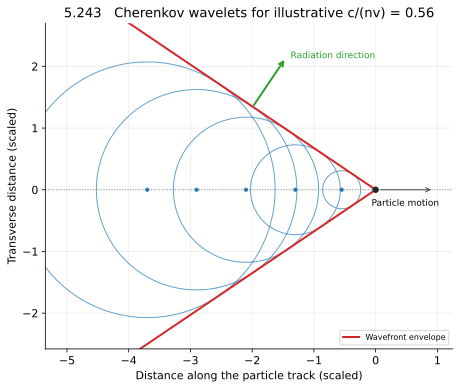

# 5.6 Optics of Moving Sources

[Chapter index](../README.md#chapters) · [Structured solutions](5.6.json) · [Answer audit](../audit/README.md)

## 5.224

**Solved · high confidence.** Use the rotation-speed interval between adjacent extinction orders to infer the light round-trip time.

**Assumptions**

- The wheel axle and mirror are fixed a distance l apart. The rotating wheel has z equally spaced tooth pitches.
- The two disappearances are successive extinction orders for the same optical path. Intervening maxima are not counted as disappearances.

During the light round trip the wheel turns through an angle proportional to its rotation frequency n. Adjacent extinction conditions differ by one full tooth pitch.

$$
t_f=2l/c,\qquad\Delta\phi=2\pi(n_2-n_1)t_f=2\pi/z.
$$

The difference of extinction orders eliminates the unknown absolute order. Use the period corresponding to the rotation-frequency difference.

$$
t_f=\frac{1}{z(n_2-n_1)},\qquad c=2lz(n_2-n_1).
$$

Insert the distance in metres and the rotation frequencies in revolutions per second. The factors of 2π cancel.

$$
c=2(7.0\times10^3)(720)(313-283)=3.024\times10^8\ \mathrm{m/s}.
$$

**Results**

Measured speed of light

$$
c=2lz(n_2-n_1)\simeq3.0\times10^8\ \mathrm{m/s}
$$

## 5.225

**Solved · high confidence.** Compare emission and reception intervals of neighboring wave crests, then take the low-speed limit.

**Assumptions**

- θ is the receiver-frame angle between source velocity and the ray from source to receiver. cosθ>0 corresponds to an approaching radial velocity component.
- The receiver is at rest in the chosen frame. The source moves uniformly. Changes of viewing direction over one optical cycle are negligible.
- ω₀ is the source proper angular frequency. The distinction between ω and ω₀ in a first-order fractional denominator is second order.

Let T₀ be the proper period between emissions. Time dilation makes the receiver-frame emission interval γT₀.

$$
\Delta t_e=\gamma T_0,\qquad\gamma=(1-v^2/c^2)^{-1/2}.
$$

Between emissions the source approaches the receiver by v cosθ times the emission interval. The later crest therefore has a shorter travel time.

$$
\Delta t_r=\Delta t_e\left(1-\frac vc\cos\theta\right)=\gamma T_0(1-\beta\cos\theta).
$$

Invert the period ratio and expand. Time dilation first contributes at order β².

$$
\frac{\omega}{\omega_0}=\frac{\sqrt{1-\beta^2}}{1-\beta\cos\theta}=1+\beta\cos\theta+O(\beta^2),\qquad\frac{\Delta\omega}{\omega_0}=\frac vc\cos\theta+O(v^2/c^2).
$$

**Results**

First-order Doppler frequency shift

$$
\Delta\omega/\omega\simeq(v/c)\cos\theta
$$

## 5.226

**Solved · high confidence.** Infer relativistic speed from ion kinetic energy and apply the observer-frame angular Doppler formula.

**Assumptions**

- The stated 410 nm is the rest-frame emission wavelength. The observation angle 30° is in the laboratory between the ion velocity and the emitted ray toward the observer.
- Use singly ionized helium-4, the ordinary dominant isotope, with the existing Appendix-derived mass alias. The small ionization-energy contribution to mass is neglected as documented in the registry.
- Define Δλ=λ_observed−λ_rest, so a blue shift is negative.

Use the exact relativistic kinetic-energy relation. Convert 10 MeV using the printed elementary charge and use the singly ionized, rather than neutral, atom mass.

$$
T=(\gamma-1)mc^2,\quad\gamma=1+\frac{T}{mc^2}=1.002682925,\quad\beta=\sqrt{1-\gamma^{-2}}=0.07310494.
$$

Invert the frequency Doppler factor to obtain the wavelength ratio in the laboratory direction.

$$
\frac{\lambda_{\rm obs}}{\lambda_0}=\gamma(1-\beta\cos\theta).
$$

Evaluate both the signed shift and observed wavelength. The finite time-dilation correction is retained.

$$
\Delta\lambda=\lambda_0[\gamma(1-\beta\cos30^\circ)-1]=-24.9270\ \mathrm{nm},\qquad\lambda_{\rm obs}=385.0730\ \mathrm{nm}.
$$

**Results**

Signed relativistic Doppler wavelength shift

$$
\Delta\lambda=\lambda_0[\gamma(1-\beta\cos30^\circ)-1]\simeq-24.9\ \mathrm{nm}
$$

The line is shifted toward shorter wavelengths.

Observed wavelength

$$
\lambda_{\rm obs}\simeq385.1\ \mathrm{nm}
$$

**Limitations**

- The isotope is not specified in the printed statement. The numerical answer assumes helium-4. Another isotope requires its own mass in the displayed formula.

## 5.227

**Solved · high confidence.** Use the differential Doppler shift of approaching and receding equatorial limbs.

**Assumptions**

- The Sun is viewed approximately in its equatorial plane, so the rotational limb velocities are line-of-sight velocities ±v_eq. Neglect differential rotation and other differential line shifts.
- Both limbs have the same rest wavelength. Their common systemic and gravitational shifts cancel to first order. Use the Appendix mean solar radius.

The two opposite limbs have equal and opposite first-order wavelength shifts, so their difference is twice the individual shift.

$$
\delta\lambda=2\lambda\frac{v_{\rm eq}}c,\qquad v_{\rm eq}=\frac{c\,\delta\lambda}{2\lambda}=2.03254\times10^3\ \mathrm{m/s}.
$$

Relate equatorial speed to the rotation period and insert the mean solar radius.

$$
P=\frac{2\pi R_\odot}{v_{\rm eq}}=\frac{4\pi R_\odot\lambda}{c\,\delta\lambda}=2.14845\times10^6\ \mathrm s\simeq24.87\ \mathrm{days}.
$$

**Results**

Solar equatorial rotation period for equatorial viewing

$$
P=\frac{4\pi R_\odot\lambda}{c\,\delta\lambda}\simeq25\ \mathrm{days}
$$

Viewing-angle correction if the spin-axis inclination is i

$$
P=\frac{4\pi R_\odot\lambda}{c\,\delta\lambda}\sin i
$$

i is measured from the line of sight. The stated numerical estimate uses i=90°.

**Limitations**

- Without viewing inclination an exact equatorial period needs the displayed sin i correction. The intended estimate treats the solar equator as seen edge-on.

## 5.228

**Solved · medium confidence.** Infer projected circular binary parameters from the maximum line separation and its repetition interval.

**Assumptions**

- Interpret the intended model as two equal masses in a circular Newtonian orbit, with negligible intrinsic differential spectral shifts.
- Let a be the separation between the stars, each at radius a/2, and i the orbital angular-momentum inclination to the line of sight. Edge-on means i=90°.
- The stated maximum splitting is the full separation of the two lines divided by their common rest wavelength, and τ is the interval between successive maxima of its unsigned magnitude.

Each star has speed v and its maximum line-of-sight speed is v sin i. At quadrature one line is red and the other blue by equal amounts.

$$
\Delta\equiv(\Delta\lambda/\lambda)_m=\frac{2v\sin i}{c},\qquad v\sin i=\frac{c\Delta}{2}=1.7988\times10^4\ \mathrm{m/s}.
$$

The line identities exchange after half an orbit, producing the same unsigned maximum splitting twice per revolution. Thus the period is twice the observed interval.

$$
P=2\tau=60\ \mathrm{days},\qquad v=\frac{2\pi(a/2)}P=\frac{\pi a}{P},\qquad a\sin i=\frac{c\Delta\tau}{\pi}=2.96823\times10^{10}\ \mathrm m.
$$

Balance the gravitational attraction on either star with its centripetal force about the midpoint. Here m is the mass of one star.

$$
\frac{Gm^2}{a^2}=\frac{mv^2}{a/2},\quad m=\frac{2av^2}{G}=\frac{2\pi^2a^3}{GP^2},\quad m\sin^3i=\frac{c^3\Delta^3\tau}{2\pi G}=2.87984\times10^{29}\ \mathrm{kg}.
$$

The spectrum alone fixes projected combinations. The conventional edge-on answers are the minimum separation and minimum individual masses within the circular model.

$$
a=\frac{2.96823\times10^{10}}{\sin i}\ \mathrm m,\qquad m_1=m_2=\frac{2.87984\times10^{29}}{\sin^3i}\ \mathrm{kg}.
$$

**Results**

Circular orbital period

$$
P=2\tau=60\ \mathrm{days}
$$

Projected circular separation

$$
a\sin i=\frac{c\Delta\tau}{\pi}=2.97\times10^{10}\ \mathrm m
$$

Projected mass of each star

$$
m_1\sin^3i=m_2\sin^3i=\frac{c^3\Delta^3\tau}{2\pi G}=2.88\times10^{29}\ \mathrm{kg}
$$

Edge-on minimum separation

$$
a_{i=90^\circ}\simeq3.0\times10^{10}\ \mathrm m
$$

Edge-on minimum mass of each star

$$
m_{1,i=90^\circ}=m_{2,i=90^\circ}\simeq2.9\times10^{29}\ \mathrm{kg}
$$

The total binary mass is twice this value, not this value itself.

**Limitations**

- The numerical true separation and masses are conditional on an edge-on circular orbit. The data alone leave inclination undetermined.
- For a general eccentric binary the two unsigned splitting maxima need not be equal or equally spaced, and the supplied maximum and repetition time do not determine an orbit without additional elements.

## 5.229

**Solved · high confidence.** Apply two collinear Doppler transformations with elastic reflection in the mirror rest frame.

**Assumptions**

- The incident wave propagates along +x in the laboratory. The ideal plane mirror moves along −x with speed V>0, approaching the source.
- Reflection is elastic in the mirror rest frame. Recoil of the macroscopic mirror is negligible. Set β=V/c.

The approaching mirror receives an incident frequency larger than the laboratory frequency by the head-on Doppler factor.

$$
\omega_M=\gamma(\omega_0-(-V)k_0)=\gamma(1+\beta)\omega_0,\qquad k_0=\omega_0/c.
$$

In the mirror frame reflection reverses the wave vector and preserves its frequency. Transform the reflected wave back to the laboratory.

$$
k_{M,r}=-\omega_M/c,\qquad\omega_r=\gamma[\omega_M+(-V)k_{M,r}]=\gamma(1+\beta)\omega_M.
$$

Combine the two equal Doppler factors and expand at small speed.

$$
\omega_r=\gamma^2(1+\beta)^2\omega_0=\omega_0\frac{1+\beta}{1-\beta},\qquad\omega_r\simeq\omega_0\left(1+\frac{2V}c\right),\quad\Delta\omega\simeq\frac{2V}c\omega_0.
$$

**Results**

Frequency reflected by an approaching mirror

$$
\omega_r=\omega_0\frac{c+V}{c-V}
$$

Low-speed reflected frequency

$$
\omega_r\simeq\omega_0(1+2V/c)
$$

## 5.230

**Solved · high confidence.** Use the two-way monostatic Doppler shift and invert its exact collinear for m.

**Assumptions**

- The radar transmitter and receiver are at the same stationary location. The target approaches along the line of sight. The inferred speed is radial closing speed.
- The reflected wave is elastic in the target rest frame. The stated λ is the transmitted vacuum wavelength. Recoil and acceleration over the measurement are negligible.

The reflected signal is shifted on both the outward and return legs. Use the approaching-mirror ratio, not a one-way source shift.

$$
\nu_r=\nu_0\frac{1+\beta}{1-\beta},\qquad\Delta\nu=\nu_r-\nu_0=\frac{2\beta}{1-\beta}\nu_0,\qquad\nu_0=c/\lambda.
$$

At aircraft speeds the leading expression suffices. The exact inversion provides a numerical check.

$$
v\simeq\frac{\lambda\Delta\nu}{2}=250\ \mathrm{m/s},\qquad v_{\rm exact}=\frac{\lambda\Delta\nu}{2+\lambda\Delta\nu/c}=249.99979\ \mathrm{m/s}.
$$

**Results**

Approaching radial aircraft speed

$$
v\simeq\lambda\Delta\nu/2=250\ \mathrm{m/s}
$$

Exact collinear result

$$
v=\frac{\lambda\Delta\nu}{2+\lambda\Delta\nu/c}
$$

**Limitations**

- If the aircraft velocity is not along the radar line of sight, this measures its radial component to first order. Its full speed needs the viewing angle.

## 5.231

**Solved · high confidence.** Substitute the inverse Lorentz transformation into the invariant phase and identify its coefficients.

**Assumptions**

- Frame S′ moves at velocity +V along x relative to S. Use t′=γ(t−Vx/c²), x′=γ(x−Vt), and γ=(1−V²/c²)⁻¹ᐟ².
- The wave number k is signed: positive k denotes propagation in +x for positive frequency. The derivation does not require a vacuum dispersion relation.

Express the unprimed coordinates through the primed ones using the inverse boost.

$$
t=\gamma(t^{\prime}+Vx^{\prime}/c^2),\qquad x=\gamma(x^{\prime}+Vt^{\prime}).
$$

Substitute these coordinates into ωt−kx and collect coefficients of t′ and x′.

$$
\omega t-kx=\gamma(\omega-Vk)t^{\prime}-\gamma\left(k-\frac{V\omega}{c^2}\right)x^{\prime}.
$$

Phase invariance makes these coefficients the primed frequency and wave number. Reverse the velocity to obtain the inverse transformation.

$$
\omega^{\prime}=\gamma(\omega-Vk),\qquad k^{\prime}=\gamma\left(k-\frac{V\omega}{c^2}\right),\qquad\omega=\gamma(\omega^{\prime}+Vk^{\prime}),\quad k=\gamma\left(k^{\prime}+\frac{V\omega^{\prime}}{c^2}\right).
$$

For a vacuum wave along +x, substitute k=ω/c to recover the longitudinal Doppler shift in a frame chasing the wave.

$$
k=\omega/c\quad\Longrightarrow\quad\omega^{\prime}=\gamma\omega(1-\beta)=\omega\sqrt{\frac{1-\beta}{1+\beta}},\qquad k^{\prime}=\omega^{\prime}/c.
$$

**Results**

Frequency transformation

$$
\omega^{\prime}=\frac{\omega-Vk}{\sqrt{1-V^2/c^2}}
$$

Signed wave-number transformation

$$
k^{\prime}=\frac{k-V\omega/c^2}{\sqrt{1-V^2/c^2}}
$$

Inverse transformations

$$
\omega=\gamma(\omega^{\prime}+Vk^{\prime}),\qquad k=\gamma(k^{\prime}+V\omega^{\prime}/c^2)
$$

## 5.232

**Solved · high confidence.** Invert the exact longitudinal relativistic Doppler redshift.

**Assumptions**

- Attribute the entire wavelength shift to uniform radial recession in special relativity. The listed 434 nm line is its rest wavelength. Cosmological or gravitational redshifts are outside this idealized model.
- The shift of 130 nm toward longer wavelengths gives a measured wavelength of 564 nm.

For a radially receding source, the observed wavelength is increased by the exact relativistic factor.

$$
r=\frac{\lambda_{\rm obs}}{\lambda_0}=\frac{434+130}{434}=\sqrt{\frac{1+\beta}{1-\beta}},\qquad \beta=v/c.
$$

Square the relation and solve algebraically for the recession speed.

$$
\beta=\frac{r^2-1}{r^2+1}=\frac{564^2-434^2}{564^2+434^2}=0.2561743265.
$$

Use the Appendix value of the vacuum light speed.

$$
v=0.2561743265c=7.6801063\times10^7\,\mathrm{m/s}\simeq7.68\times10^7\,\mathrm{m/s}.
$$

**Results**

Nebula recession speed

$$
\boxed{v\simeq0.256c\simeq7.68\times10^7\,\mathrm{m/s}}
$$

Recession speed as a fraction of c

$$
v/c=(564^2-434^2)/(564^2+434^2)
$$

## 5.233

**Solved · high confidence.** Apply the longitudinal blue Doppler factor for an observer approaching a stationary light.

**Assumptions**

- The traffic light is at rest in the road frame and lies directly ahead of the driver. The car moves toward it along the line of sight.
- Use the approximate wavelengths stated in the problem as representative monochromatic value s. Color perception is represented solely by the Doppler wavelength change.

The approaching observer measures a frequency factor D=sqrt((1+beta)/(1-beta)). The corresponding wavelength is reduced by the reciprocal factor.

$$
\frac{\lambda\prime}{\lambda}=\sqrt{\frac{1-\beta}{1+\beta}},\qquad \beta=v/c.
$$

Invert this relation using the red rest wavelength 0.70 micrometres and the desired observed wavelength 0.55 micrometres.

$$
\beta=\frac{\lambda^2-\lambda\prime^2}{\lambda^2+\lambda\prime^2}=\frac{0.70^2-0.55^2}{0.70^2+0.55^2}=0.2365930599.
$$

Convert the speed fraction using the canonical Appendix light speed.

$$
v=0.2365930599c=7.0930599\times10^7\,\mathrm{m/s}\simeq7.1\times10^7\,\mathrm{m/s}.
$$

**Results**

Car speed toward the traffic light

$$
\boxed{v\simeq0.237c\simeq7.1\times10^7\,\mathrm{m/s}}
$$

Required speed fraction

$$
v/c=(0.70^2-0.55^2)/(0.70^2+0.55^2)
$$

## 5.234

**Solved · high confidence.** First find the source velocity in the observer frame, then apply the radial recession factor.

**Assumptions**

- The source is ahead of the observer and both move along+x in the same inertial frame. The source moves faster, so their separation increases.
- The observed photons propagate backward from the source to the observer. Omega_0 is the proper emission angular frequency in the source rest frame.

Relativistic subtraction of collinear velocities gives the recession velocity measured in the observer rest frame.

$$
\beta_{\rm rel}=\frac{\beta_2-\beta_1}{1-\beta_1\beta_2}=\frac{3/4-1/2}{1-3/8}=\frac25.
$$

Apply the exact redshift factor in that frame.

$$
\omega=\omega_0\sqrt{\frac{1-\beta_{\rm rel}}{1+\beta_{\rm rel}}}=\omega_0\sqrt{\frac{3/5}{7/5}}=\sqrt{\frac37}\,\omega_0.
$$

An independent two-stage transformation gives the same result: the backward photon is redshifted by 1/sqrt7 in the common frame, while the moving observer boosts its frequency by sqrt3.

$$
\omega_{\rm lab}=\frac{\omega_0}{\gamma_2(1+\beta_2)}=\frac{\omega_0}{\sqrt7},\qquad \omega=\gamma_1(1+\beta_1)\omega_{\rm lab}=\sqrt3\,\omega_{\rm lab}.
$$

**Results**

Frequency registered by the observer

$$
\boxed{\omega=\sqrt{3/7}\,\omega_0\simeq0.654654\,\omega_0}
$$

Observed to proper frequency ratio

$$
\omega/\omega_0=\sqrt{3/7}
$$

## 5.235

**Solved · high confidence.** Use the laboratory-transverse relativistic Doppler factor and express gamma directly through the atom kinetic energy.

**Assumptions**

- Right-angle observation refers to the photon propagation direction in the laboratory relative to the hydrogen beam, so the laboratory emission angle is 90 degrees.
- The moving radiators are neutral hydrogen-1 atoms (protium), not hydrogen molecules or bare protons. Use the canonical hydrogen1_atom_mass_kg derived from the Appendix 26 neutral-atom mass and the Appendix 30 atomic mass unit.
- The quoted 656.3 nm is the proper spectral wavelength and T=1.0 MeV is the kinetic energy of each atom. The beam is monoenergetic for this calculation.

For a moving source observed transversely in the laboratory, the angular frequency is omega_0/gamma, and the wavelength is gamma times the rest wavelength.

$$
\omega=\frac{\omega_0}{\gamma},\qquad \lambda_{\rm obs}=\gamma\lambda_0,\qquad \Delta\lambda=(\gamma-1)\lambda_0.
$$

The relativistic kinetic energy identity gives gamma-1 exactly, without needing a low-velocity expansion.

$$
T=(\gamma-1)m_Hc^2,\qquad \Delta\lambda=\lambda_0\frac{T}{m_Hc^2}.
$$

Use the neutral hydrogen-1 atomic mass. Appendix 26 gives relative mass 1.00783 u. Multiplying by the Appendix atomic mass unit 1.66e-27 kg gives the mass used here. Convert 1.0 MeV to joules using the elementary charge.

$$
m_H=1.00783(1.66\times10^{-27}\,\mathrm{kg})=1.6729978\times10^{-27}\,\mathrm{kg},\quad T=1.602\times10^{-13}\,\mathrm J,\quad m_Hc^2\simeq938.633640\,\mathrm{MeV}.
$$

Evaluate the positive transverse wavelength shift.

$$
\Delta\lambda=656.3\,\mathrm{nm}\frac{1.0}{938.633640}=0.69920784\,\mathrm{nm}\simeq0.70\,\mathrm{nm},\qquad \lambda_{\rm obs}\simeq657.0\,\mathrm{nm}.
$$

**Results**

Transverse redshift of the hydrogen line

$$
\boxed{\Delta\lambda=\lambda_0 T/(m_Hc^2)\simeq+0.70\,\mathrm{nm}}
$$

Observed wavelength

$$
\lambda_{\rm obs}\simeq657.0\,\mathrm{nm}
$$

Shift expressed in nanometres

$$
\Delta\lambda\simeq0.699208\,\mathrm{nm}
$$

Extra digits show the calculation with the rounded Appendix mass constants, not the physical precision.

**Limitations**

- The isotope convention is hydrogen-1. The rounded Appendix atomic mass unit and mass table limit numerical precision. Extra displayed digits document substitution, not atomic-mass accuracy.
- An angle of 90 degrees in the atom rest frame would describe a different observation geometry and a different Doppler factor.

## 5.236

**Solved · high confidence.** Solve the retarded-emission geometry separately for simultaneous crossing and for seeing the source at closest approach.

**Assumptions**

- Use the stationary observer laboratory frame. Let O=(0,0),P=(0,-l), the source trajectory be(x,z)=(v t,0), and the physical crossing of O occur at laboratory time t=0.
- The received frequency uses the photon direction from the retarded emission position. The propagation speed is c.
- Omega_0 is the proper source angular frequency. The source velocity and proper frequency remain constant.

A signal emitted at time t_e travels distanceR(t_e) to the observer. Reception time is therefore t_r=t_e+R/c.

$$
R(t_e)=\sqrt{v^2t_e^2+l^2},\qquad t_r=t_e+\frac{R(t_e)}c,\qquad \cos\theta_e=\frac{-vt_e}{R(t_e)}.
$$

Relate adjacent proper emission times to adjacent reception times. Laboratory emission intervals are gamma times the proper intervals, while propagation adds the usual radial delay derivative.

$$
\frac{dt_r}{dt_e}=1+\frac{v^2t_e}{cR}=1-\beta\cos\theta_e,\qquad \omega_r=\frac{\omega_0}{\gamma(1-\beta\cos\theta_e)}.
$$

In part(a), the source is physically at O at the reception moment, so t_r=0. The relevant emission event was earlier. Solve0=t_e+R/c to obtain its position and viewing direction.

$$
t_e=-\frac{\gamma l}c,\quad R=\gamma l,\quad x_e=-\beta\gamma l,\quad \cos\theta_e=\beta.
$$

The approaching retarded source direction makes the received frequency in part(a) greater than the proper frequency.

$$
\omega_a=\frac{\omega_0}{\gamma(1-\beta^2)}=\gamma\omega_0=\frac{3.0\times10^{10}}{\sqrt{1-0.80^2}}=5.0\times10^{10}\,\mathrm{s^{-1}}.
$$

In part(b), seeing the source at O means the signal was emitted there, so t_e=0. It reaches the observer at t_r=l/c, when the actual source has advanced to x=beta l. The emission ray was transverse.

$$
t_e=0,\quad t_r=l/c,\quad \theta_e=\pi/2,\qquad \omega_b=\frac{\omega_0}{\gamma}=\omega_0\sqrt{1-\beta^2}=1.8\times10^{10}\,\mathrm{s^{-1}}.
$$

**Results**

Received frequency when the source is simultaneously at O

$$
\boxed{\omega_a=\gamma\omega_0=5.0\times10^{10}\,\mathrm{s^{-1}}}
$$

Received frequency when the observer sees the source at O

$$
\boxed{\omega_b=\omega_0/\gamma=1.8\times10^{10}\,\mathrm{s^{-1}}}
$$

## 5.237

**Solved · medium confidence.** Interpret the grating-induced radiation as coherent emission from periodically excited surface structures and compare adjacent arrival phase s.

**Assumptions**

- Figure 5.38 measures θ from the forward electron trajectory, parallel to the grating surface.
- The electrons travel parallel to the periodic direction, crossing successive grating periods at speed v=beta c. The grooves are perpendicular to their trajectory.
- The source supplies no numerical speed and does not select a diffraction harmonic. The general answer must retain beta and the positive integer radiation order m.
- For the phase-matching derivation, use far-field observation and many identical grating periods. The electron field excites currents or polarization on the corrugated conductor. Its spatial periodicity permits propagating radiation.

A charge moving uniformly over a flat conducting surface cannot satisfy the same propagating-wave phase matching at subluminal speed. The periodic corrugation supplies grating momentum and converts the moving near field into far-field radiation, usually called Smith-Purcell radiation. Interference makes the observed wavelength depend on direction.

The electron takesd/v to advance from one groove to the next. In a direction at angle theta from its forward path, the next groove is closer to the observer by d cos theta, reducing the propagation time by d cos theta/c.

$$
\Delta t_{\rm arrival}=\frac dv-\frac{d\cos\theta}{c}.
$$

Constructive interference occurs when the phase difference is 2pi times a positive integer m. Express that condition in terms of the vacuum wavelength.

$$
\omega\Delta t_{\rm arrival}=2\pi m,\qquad \lambda_m=\frac{c\Delta t_{\rm arrival}}m=\frac dm\left(\frac1\beta-\cos\theta\right),\qquad m=1,2,\ldots.
$$

Substitute only the data actually specified: period2.0 micrometres and angle45 degrees.

$$
\boxed{\lambda_m(45^\circ)=\frac{2.0\,\mathrm{\mu m}}m\left(\frac cv-\frac1{\sqrt2}\right)}.
$$

If one additionally adopts the ultrarelativistic approximationv approximately equal to c and selects the fundamental order m=1, the familiar visible-wavelength estimate follows. It is not uniquely implied by speed merely comparable to c.

$$
\beta\longrightarrow1:\quad \lambda_m\longrightarrow\frac{2.0(1-1/\sqrt2)}m\,\mathrm{\mu m}=\frac{0.5857864}{m}\,\mathrm{\mu m};\qquad m=1:\ \lambda_1\simeq586\,\mathrm{nm}.
$$

**Results**

Angle-dependent grating radiation wavelength family

$$
\boxed{\lambda_m=\frac dm(c/v-\cos\theta)},\qquad m=1,2,\ldots
$$

Wavelength family at the requested 45 degree observation angle

$$
\boxed{\lambda_m=\frac{2.0\,\mathrm{\mu m}}m(c/v-1/\sqrt2)}
$$

No unique numerical wavelength follows without specifying v and m.

Conditional first-order estimate for v approximately equal to c

$$
\lambda_1\simeq2.0(1-1/\sqrt2)\,\mathrm{\mu m}\simeq586\,\mathrm{nm}
$$

Requires both beta approximately 1 and order m=1, additional assumptions beyond the literal numerical data.

**Limitations**

- The wavelength formula does not determine the strength of each order. Electron height, grating profile, losses, and the collection aperture determine the visible intensity and which orders dominate.
- Treatingv as exactlyc would contradict finite-speed massive electrons. v approximatelyc is a separate ultrarelativistic approximation.

## 5.238

**Solved · high confidence.** Map the one-dimensional Maxwell velocity distribution to frequency using the first-order Doppler shift, then solve for the Gaussian half-height frequencies.

**Assumptions**

- The gas is nonrelativistic: k_B T is much smaller than m c squared. Its line-of-sight velocity component has a Maxwell Gaussian distribution.
- The natural line is treated as infinitely narrow compared with its thermal Doppler width. Collisional, lifetime, instrumental, recoil, and bulk-flow broadening or shifts are omitted.
- Keep the first-order Doppler shift only and neglect velocity dependence of each atom luminosity, relativistic beaming, and arrival-rate weighting across the narrow line. The target Gaussian is the leading thermal Doppler approximation, not an exact all-temperature relativistic spectrum.
- I_omega is spectral intensity per unit angular frequency, and I_0 denotes its peak value at omega_0 rather than the frequency-integrated intensity.

Choose the velocity componentw positive toward the observer. Integrating the three-dimensional Maxwell distribution over the transverse velocities gives the one-dimensional distribution.

$$
f(w)=\sqrt{\frac{m}{2\pi k_BT}}\exp\left(-\frac{mw^2}{2k_BT}\right).
$$

The first-order Doppler relation maps this velocity to frequency with a constant Jacobian.

$$
\omega\simeq\omega_0\left(1+\frac wc\right),\qquad w=c\left(\frac\omega{\omega_0}-1\right),\qquad \left|\frac{dw}{d\omega}\right|=\frac c{\omega_0}.
$$

The spectral density is proportional to f(w) times the Jacobian. Absorb its constant prefactor into the peak intensity I_0.

$$
I_\omega=I_0\exp\left[-\frac{mc^2}{2k_BT}\left(1-\frac\omega{\omega_0}\right)^2\right]=I_0e^{-a(1-\omega/\omega_0)^2},\qquad a=\frac{mc^2}{2k_BT}.
$$

At either half-height frequency, the exponent magnitude is ln2. Solve for the lower and upper frequencies.

$$
\omega_\pm=\omega_0\left(1\pm\sqrt{\frac{\ln2}{a}}\right)=\omega_0\left(1\pm\sqrt{\frac{2k_BT\ln2}{mc^2}}\right).
$$

The requested full width is the difference between these two half-height frequencies, twice the half width.

$$
\boxed{\frac{\Delta\omega}{\omega_0}=2\sqrt{\frac{\ln2}{a}}=\sqrt{\frac{8k_BT\ln2}{mc^2}}}.
$$

**Results**

Leading thermal Doppler spectral profile

$$
\boxed{I_\omega=I_0\exp[-\tfrac{mc^2}{2k_BT}(1-\omega/\omega_0)^2]}
$$

Relative full width at half maximum

$$
\boxed{\Delta\omega/\omega_0=\sqrt{8\ln2\,k_BT/(mc^2)}}
$$

Relative Gaussian standard deviation

$$
\sigma_\omega/\omega_0=\sqrt{k_BT/(mc^2)}
$$

This is not the requested FWHM. Delta omega=2 sqrt(2 ln2) sigma_omega.

**Limitations**

- At relativistic temperatures the Maxwell distribution and linear Doppler mapping fail. a relativistic velocity distribution, transverse Doppler effects, and emission weighting generally change both profile and line center.
- Additional physical broadening mechanisms would require convolution with the thermal Gaussian, so the observed total FWHM would not generally equal this thermal-only expression.

## 5.239

**Solved · high confidence.** Lorentz-transform the rest-medium wave phase, or equivalently add its collinear phase velocity relativistically.

**Assumptions**

- Let K₀ be the rest frame of the medium. The specified refractive index n is the phase index for this wave in K₀, so its rest-medium phase velocity is c/n.
- For the conventional constant-n Fizeau formula take a nondispersive medium. If n is evaluated at the actual rest-medium frequency, the exact collinear phase-velocity transformation also applies to a dispersive medium. a comparison at fixed laboratory frequency requires an additional dispersion correction.
- V is positive along the wave propagation and V≪c. The velocity sought is the phase velocity. a group velocity requires the group index unless dispersion is negligible.

Transform a wave phase from the medium rest frame. With k₀=nω₀/c, the frequency and longitudinal wave number transform as components of a four-vector.

$$
\omega=\gamma_V(\omega_0+Vk_0),\qquad k=\gamma_V\left(k_0+\frac{V\omega_0}{c^2}\right).
$$

Their ratio gives the laboratory phase velocity and agrees with collinear relativistic velocity addition.

$$
u_\phi=\frac\omega k=\frac{c/n+V}{1+V/(nc)}.
$$

Expand to first order in V/c. The coefficient multiplying V is the nondispersive Fresnel drag coefficient.

$$
u_\phi=\frac cn+V\left(1-\frac1{n^2}\right)+O\!\left(\frac{V^2}{c}\right).
$$

If instead a laboratory frequency ω is held fixed and n=n(ω) denotes the unboosted medium index at that frequency, ω₀≈ω[1−n(ω)V/c]. Expanding the rest index produces the extra dispersive term.

$$
u_\phi(\omega)=\frac{c}{n(\omega)}+V\left[1-\frac1{n(\omega)^2}+\frac{\omega}{n(\omega)}\frac{dn}{d\omega}\right]+O(V^2/c).
$$

**Results**

First-order phase velocity for the specified constant rest-medium index

$$
u_\phi\simeq\frac cn+V\left(1-\frac1{n^2}\right)
$$

Exact collinear phase-velocity transformation

$$
u_\phi=\frac{c/n+V}{1+V/(nc)}
$$

Here n is evaluated at the actual wave frequency in the medium rest frame. In a nondispersive medium this is also the group velocity transformation.

**Limitations**

- A supplied phase index alone does not determine a dispersive group velocity. The primary drag coefficient assumes constant n, or that n refers to the actual rest-frame wave.

## 5.240

**Solved · high confidence.** Relate the full annual aberration excursion to twice the first-order aberration amplitude.

**Assumptions**

- The printed δθ=41 arcseconds is the full angular range of the apparent stellar oscillation, not its semi-amplitude. Assume circular Earth orbital motion, a distant star in the ecliptic plane, and V≪c.
- Neglect parallax and other apparent-motion effects. Convert arcseconds to radians before multiplying by the Appendix light speed.

At first order in β=V/c, aberration shifts the source direction by the transverse observer velocity divided by c. Its signed ecliptic component oscillates between ±V/c during the orbit.

$$
\delta\theta=2\frac Vc+O[(V/c)^3].
$$

Use the semi-amplitude 20.5 arcseconds and the canonical c=2.998×10⁸ m/s.

$$
V\simeq\frac{c\,\delta\theta}{2}=(2.998\times10^8)\frac{41}{2}\frac{\pi}{180\times3600}\ \mathrm{m/s}.
$$

**Results**

Earth orbital speed

$$
V\simeq2.9796164\times10^4\ \mathrm{m/s}\simeq29.8\ \mathrm{km/s}
$$

## 5.241

**Solved · high confidence.** Transform the photon wave four-vector under a boost along the common x axis.

**Assumptions**

- K′ moves with signed velocity +V along the common x,x′ axis relative to K. θ and θ′ are angles of light propagation, not directions pointing toward its source.
- Take |β|<1, k_x=(ω/c)cosθ, and photon propagation in vacuum.

The Lorentz boost gives the transformed frequency and longitudinal wave-vector component.

$$
\omega\prime=\gamma\omega(1-\beta\cos\theta),\qquad k_x\prime=\gamma\frac\omega c(\cos\theta-\beta).
$$

For vacuum light |k′|=ω′/c. Divide the transformed longitudinal component by this magnitude.

$$
\cos\theta\prime=\frac{ck_x\prime}{\omega\prime}=\frac{\cos\theta-\beta}{1-\beta\cos\theta}.
$$

The transverse component is unchanged. This also gives a useful sine or half-angle for m.

$$
\sin\theta\prime=\frac{\sin\theta}{\gamma(1-\beta\cos\theta)},\qquad \tan\frac{\theta\prime}{2}=\sqrt{\frac{1+\beta}{1-\beta}}\tan\frac\theta2.
$$

**Results**

Relativistic aberration of propagation direction

$$
\boxed{\cos\theta\prime=\frac{\cos\theta-\beta}{1-\beta\cos\theta}}
$$

## 5.242

**Solved · medium confidence.** Apply aberration to the sky directions of the forward hemisphere and distinguish cone radius from aperture.

**Assumptions**

- Interpret the hemisphere as the forward sky relative to the traveller motion: the original source-looking angle ψ from +V satisfies 0≤ψ≤π/2. This orientation is required for the usual forward-cone answer.
- The traveller speed differs from c by 1% on the subluminal side, so β=0.990. A cone aperture is its full vertex angle, twice the half-angle.

The formula in 5.241 uses photon propagation. Reverse that vector to get the direction in which the observer looks toward a star.

$$
\cos\psi\prime=\frac{\cos\psi+\beta}{1+\beta\cos\psi}.
$$

The forward hemisphere maps monotonically to a forward cone. Its boundary ψ=π/2 has cosψ′=β, while ψ=0 stays on the axis.

$$
0\le\psi\prime\le\psi\prime_{\max}=\arccos\beta.
$$

Double the cone half-angle to obtain the full aperture.

$$
\mathcal A=2\arccos(0.99)=16.2192289\ldots{}^\circ.
$$

**Results**

Full vertex/aperture angle

$$
\mathcal A=16.21923\ldots{}^\circ\simeq16.2^\circ
$$

Cone half-angle

$$
\psi\prime_{\max}=8.109614\ldots{}^\circ
$$

**Limitations**

- The text does not explicitly orient the original hemisphere relative to motion. The stated narrow forward cone applies to the forward hemisphere. An arbitrary hemisphere orientation gives a different region.

## 5.243

**Solved · high confidence.** Phase-match radiation emitted at successive positions of a uniformly moving charge.

**Assumptions**

- Work in the medium rest frame, with a transparent approximately homogeneous isotropic medium and real positive phase index n(ω). The charged particle has speed v=βc<c and travels essentially uniformly over a long track.
- θ is the angle between the particle velocity and the emitted wave-vector/ray direction in an isotropic medium. In a dispersive material use the phase index at each emitted frequency, not the group index.

Compare two induced oscillations excited at positions separated by vΔt. Their wave arrival-time/phase difference in a direction θ is the emission delay minus the propagation advance.

$$
\Delta\phi=\omega\Delta t-kv\Delta t\cos\theta=\omega\Delta t\left(1-\frac{nv}{c}\cos\theta\right).
$$

Constructive interference along the continuous track requires the coefficient of arbitrary Δt to vanish.

$$
\cos\theta=\frac{c}{nv}=\frac1{n\beta}.
$$

A real nonzero emission cone requires nβ>1. At the equality the cone collapses and the ordinary bulk Cherenkov emission strength vanishes.

$$
v>\frac cn,\qquad n>1\ \text{for a massive particle};\qquad0<\theta<\arccos\frac1n.
$$

Equivalently, the expanding Huygens wavelets for m a conical wavefront. Its envelope half-angle is the complement of the propagation cone half-angle.

$$
\sin\alpha=\frac{c}{nv},\qquad\alpha+\theta=\frac\pi2.
$$

**Results**

Strict bulk Cherenkov-emission condition

$$
\boxed{n(\omega)\beta>1}
$$

Radiation cone about the particle velocity

$$
\boxed{\theta(\omega)=\arccos[1/(n(\omega)\beta)]}
$$

This is the photon/wave-vector cone angle, not the complementary Huygens wavefront-envelope angle.

Kinematic threshold

$$
\beta_{\rm th}=1/n,\qquad\theta_{\rm th}=0
$$

Equality is the limiting threshold. Finite bulk emission requires strictly greater speed.

**Limitations**

- Finite track lengths broaden the angular condition. Strong absorption, anisotropy, boundaries or transition radiation require additional physics. These are outside the uniform bulk-medium model.

## 5.244

**Solved · medium confidence.** Convert the Cherenkov speed threshold to relativistic kinetic energy and infer the rest mass from a stated threshold.

**Assumptions**

- Use n=1.60 as the effective phase refractive index of the relevant radiation band in a transparent isotropic medium. Threshold value s are kinematic infima. a nonzero bulk Cherenkov yield requires an energy strictly above them.
- Use the directly printed Appendix electron rest energy of 0.511 MeV and the proton rest energy obtained from the Appendix mass, speed of light and elementary charge.
- The muon mass is absent from the Appendices. Use the NIST CODATA rest energy for the particle identification.

At threshold β=1/n. Substitute into the relativistic kinetic-energy relation.

$$
\gamma_{\rm th}=\frac1{\sqrt{1-n^{-2}}}=\frac n{\sqrt{n^2-1}},\qquad T_{\rm th}=(\gamma_{\rm th}-1)mc^2.
$$

For n=1.60 the common mass-independent kinetic/rest-energy ratio is 0.2810252304….

$$
\gamma_{\rm th}=1.2810252304\ldots,\quad T_{e,\rm th}=0.2810252304\ldots(0.511)\ \mathrm{MeV},\quad T_{p,\rm th}=0.2810252304\ldots(938.0738257\ldots)\ \mathrm{MeV}.
$$

Invert the same relation for a threshold kinetic energy 29.6 MeV.

$$
mc^2=\frac{29.6\ \mathrm{MeV}}{0.2810252304\ldots}=105.3286210\ldots\ \mathrm{MeV}.
$$

The inferred rest energy is close to the charged muon rest energy. The reference value of 105.6583755 MeV predicts a threshold of 29.693 MeV at exactly n = 1.60.

$$
T_{\mu,\rm th}=29.6926693\ldots\ \mathrm{MeV},\qquad n=1.6017134\ldots\ \text{would give }T_{\mu,\rm th}=29.6\ \mathrm{MeV}.
$$

The small index change needed for exact muon agreement is compatible with rounding n to 1.60. The charge sign does not change the threshold. The particle must be charged to radiate by this mechanism.

**Results**

Electron threshold energy

$$
T_{e,\rm th}=0.14360389\ldots\ \mathrm{MeV}\simeq0.144\ \mathrm{MeV}
$$

Strictly positive bulk emission requires T_e>T_e,th. Equality is the onset limit.

Proton threshold energy

$$
T_{p,\rm th}=263.622413\ldots\ \mathrm{MeV}\simeq264\ \mathrm{MeV}
$$

Rest energy inferred literally from the printed 29.6 MeV

$$
mc^2=105.328621\ldots\ \mathrm{MeV}
$$

Approximate particle identification

$$
\mu^+\ \text{or}\ \mu^-
$$

The inferred mass is about 0.31% below the modern reference muon mass. Treat the given n and threshold as rounded experimental data. Mass alone identifies this ordinary charged-particle species, not the charge sign.

**Limitations**

- A frequency-dependent index gives frequency-dependent thresholds. The quoted n is treated as the specified effective value.
- At the exact threshold the ideal bulk yield vanishes. The calculated lowest energy is an infimum for nonzero radiation.

## 5.245

**Solved · high confidence.** Infer the electron speed from the Cherenkov angle, then use the relativistic kinetic-energy relation.

**Assumptions**

- The medium is homogeneous, transparent and isotropic at the observed wavelength, with phase index n=1.50. The given 30-degree angle is measured between the emitted light direction and the electron velocity, as stated.
- Use the directly printed Appendix electron rest energy .511 MeV. The electron motion is approximately uniform while the local radiation angle is measured.

Solve the phase-matching angle condition for β.

$$
\cos\theta=\frac1{n\beta}\quad\Longrightarrow\quad\beta=\frac1{n\cos\theta}=\frac{4}{3\sqrt3}=0.7698003589\ldots.
$$

The speed is relativistic, so calculate γ without a nonrelativistic approximation.

$$
\gamma=\frac1{\sqrt{1-\beta^2}}=\frac{n\cos\theta}{\sqrt{n^2\cos^2\theta-1}}=\sqrt{\frac{27}{11}}=1.5666989036\ldots.
$$

Multiply γ−1 by the printed electron rest energy.

$$
T=(\gamma-1)m_ec^2=0.511\left(\sqrt{\frac{27}{11}}-1\right)\ \mathrm{MeV}.
$$

**Results**

Electron kinetic energy

$$
T=0.28958314\ldots\ \mathrm{MeV}\simeq0.290\ \mathrm{MeV}
$$

Electron speed as a fraction of c

$$
v/c=0.76980036\ldots
$$

**Limitations**

- A dispersive medium has a wavelength-dependent Cherenkov angle. The supplied index is taken at the measured radiation wavelength.
