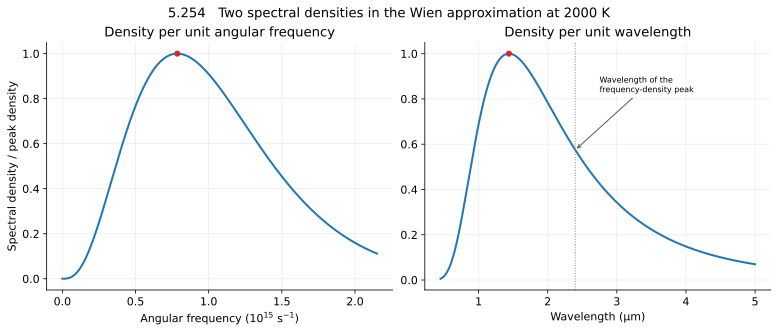
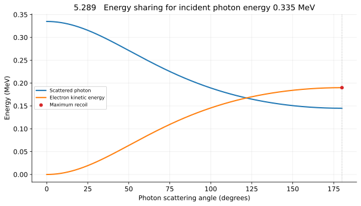

# 5.7 Thermal Radiation. Quantum Nature of Light

[Chapter index](../README.md#chapters) · [Structured solutions](5.7.json) · [Answer audit](../audit/README.md)

## 5.246

**Solved · high confidence.** Rescale the general Wien spectrum with the dimensionless variable ω/T.

**Assumptions**

- Use the general Wien scaling u_ω(ω,T)=ω³F(ω/T) printed in Eq.(5.7b), with a temperature independent F. The spectrum has a finite positive integral and an interior maximum.
- The most probable radiation frequency means the maximum of the energy density per angular-frequency interval, u_ω. The radiation field is isotropic, so M_e=cu/4.

Write the spectrum as a temperature power times a fixed shape in the scaled frequency.

$$
x=\omega/T,\qquad u_\omega=T^3g(x),\qquad g(x)=x^3F(x).
$$

A stationary spectral maximum occurs at a fixed value x_m independent of temperature.

$$
g^{\prime}(x_m)=0\quad\Longleftrightarrow\quad3F(x_m)+x_mF^{\prime}(x_m)=0,\qquad\omega_{\rm pr}=Tx_m\propto T.
$$

At that same scaled frequency the peak height is its temperature independent shape value multiplied by T³.

$$
(u_\omega)_{\max}=T^3g(x_m)\propto T^3.
$$

When integrating over angular frequency, the differential contributes one additional factor of temperature.

$$
u=\int_0^\infty u_\omega\,d\omega=T^4\int_0^\infty g(x)\,dx,\qquad M_e=\frac c4u\propto T^4.
$$

**Results**

Most probable angular frequency scaling

$$
\omega_{\rm pr}\propto T
$$

Peak energy density per angular frequency scaling

$$
(u_\omega)_{\max}\propto T^3
$$

Total radiosity scaling

$$
M_e\propto T^4
$$

## 5.247

**Solved · high confidence.** Apply the wavelength for m of Wien displacement to both black bodies.

**Assumptions**

- Both maxima refer to emissive power per unit wavelength, so the same Appendix Wien constant b applies.
- The second peak wavelength is larger by 0.50 μm. Therefore the second body is cooler.

Write the two peak wavelengths using Wien displacement and take their stated difference.

$$
\lambda_{m1}=b/T_1,\quad\lambda_{m2}=b/T_2=\lambda_{m1}+\Delta\lambda.
$$

Solve for the second temperature, using the wavelength increment in metres.

$$
T_2=\frac{b}{b/T_1+\Delta\lambda}=\frac{T_1}{1+T_1\Delta\lambda/b}=1746.99\ \mathrm K.
$$

**Results**

Temperature of second black body

$$
T_2=\frac{bT_1}{b+T_1\Delta\lambda}\simeq1.75\times10^3\ \mathrm K
$$

## 5.248

**Solved · high confidence.** Combine Stefan–Boltzmann radiosity with Wien displacement.

**Assumptions**

- The emitter is an ideal black body. Radiosity is the total emitted power per unit area.
- The requested maximum is in the spectrum per unit wavelength.

Convert square centimetres in the supplied radiosity to square metres, then obtain temperature.

$$
M_e=3.0\ \mathrm{W/cm^2}=3.0\times10^4\ \mathrm{W/m^2},\qquad T=(M_e/\sigma)^{1/4}=852.87\ \mathrm K.
$$

Use the wavelength displacement law at that temperature.

$$
\lambda_m=b/T=b(\sigma/M_e)^{1/4}=3.40027\times10^{-6}\ \mathrm m.
$$

**Results**

Peak wavelength

$$
\lambda_m=b(\sigma/M_e)^{1/4}\simeq3.4\ \mathrm{\mu m}
$$

Intermediate black-body temperature

$$
T=(M_e/\sigma)^{1/4}\simeq853\ \mathrm K
$$

## 5.249

**Solved · high confidence.** Infer the solar black-body luminosity and convert radiation energy loss to mass loss.

**Assumptions**

- Treat the Sun as a sphere of the Appendix mean radius, with a black-body spectrum and uniform effective temperature set by the stated wavelength peak.
- The requested one-percent time is a constant-current-luminosity extrapolation. Changes of stellar structure, radius, spectrum or other mass losses are not modeled.
- The primary time unit is seconds. A Julian year is explicitly defined as 365.25×86400=31557600 s when converting the estimate to years.

The given wavelength peak fixes the effective temperature through the Appendix Wien constant.

$$
T=b/\lambda_m=(2.9\times10^{-3})/(0.48\times10^{-6})=6041.67\ \mathrm K.
$$

Multiply the emitted radiosity by the entire spherical surface area.

$$
L=4\pi R_\odot^2\sigma T^4=4.58553\times10^{26}\ \mathrm W.
$$

Radiated energy carries mass-equivalent energy at the rate L/c². Divide one percent of the current solar mass by this rate.

$$
\dot M_{\rm loss}=L/c^2=5.10183\times10^9\ \mathrm{kg/s},\qquad t_{1\%}=\frac{0.01M_\odot c^2}{L}=3.86136\times10^{18}\ \mathrm s\simeq1.22\times10^{11}\ \mathrm{Julian\ years}.
$$

**Results**

Positive rate of solar mass loss by radiation

$$
\dot M_{\rm loss}=4\pi R_\odot^2\sigma(b/\lambda_m)^4/c^2\simeq5.1\times10^9\ \mathrm{kg/s}
$$

The derivative of the remaining solar mass is dM/dt=−ṁ_loss.

Constant-luminosity time for one-percent mass-equivalent loss

$$
t_{1\%}=0.01M_\odot/\dot M_{\rm loss}\simeq3.9\times10^{18}\ \mathrm s
$$

Same estimate in explicitly defined Julian years

$$
t_{1\%}\simeq1.2\times10^{11}\ \mathrm{Julian\ years}
$$

**Limitations**

- The long time is a formal constant-output estimate, not a stellar-evolution prediction. The book prints a nonstandard seconds-per-year conversion elsewhere. It is not used in the explicitly defined Julian-year value.

## 5.250

**Solved · high confidence.** Equate black-body radiation pressure to the ideal pressure of both electrons and protons.

**Assumptions**

- Hydrogen is fully ionized and neutral, so the electron and proton number densities are equal. Electron mass is neglected in the mass density.
- The plasma particles are nonrelativistic ideal gases at the same temperature, and radiation is in thermal equilibrium at that temperature.
- The density 0.10 g/cm³ is 100 kg/m³. No external photon leakage is included in the equilibrium radiation energy density.

Convert the radiation radiosity to its isotropic equilibrium energy density, then take one third for pressure.

$$
u=\frac{4\sigma}{c}T^4,\qquad p_{\rm rad}=\frac{u}{3}=\frac{4\sigma}{3c}T^4.
$$

Each hydrogen atom supplies two pressure-carrying particles after complete ionization.

$$
n_p=n_e\simeq\rho/m_p,\qquad p_{\rm gas}=(n_p+n_e)k_BT=\frac{2\rho k_BT}{m_p}.
$$

Cancel one power of temperature from the equality and solve for its positive nonzero value.

$$
T^3=\frac{3\rho k_Bc}{2\sigma m_p},\qquad T=\left(\frac{3\rho k_Bc}{2\sigma m_p}\right)^{1/3}=1.87066\times10^7\ \mathrm K.
$$

**Results**

Temperature at equal radiation and particle pressures

$$
T=\left(\frac{3\rho k_Bc}{2\sigma m_p}\right)^{1/3}\simeq1.9\times10^7\ \mathrm K
$$

## 5.251

**Solved · medium confidence.** Integrate radiative cooling with an explicitly constant book heat capacity.

**Assumptions**

- The ball is isothermal at each instant and radiates as an ideal black body into walls at zero temperature. The vacuum eliminates convection. Conduction through supports is negligible.
- Use the historical Appendix copper density 8900 kg/m³ and specific heat 390 J/(kg K), treating the latter as constant from 300 K to 150 K. The tabulated heat capacity is a standard-condition value, not a temperature-dependent cryogenic model.
- Changes in ball diameter and density during cooling are neglected.

Set the internal-energy decrease equal to the emitted power. A sphere has volume-to-area ratio d/6.

$$
mc_p\frac{dT}{dt}=-\sigma AT^4,\qquad\frac mA=\frac{\rho d}{6},\qquad dt=-\frac{\rho c_pd}{6\sigma}T^{-4}\,dT.
$$

Integrate from T₀ to T₀/η. The cooling time is nonlinear because the radiation power decreases strongly as temperature falls.

$$
t=\frac{\rho c_pd}{18\sigma}\left[\frac{1}{(T_0/\eta)^3}-\frac{1}{T_0^3}\right]=\frac{\rho c_pd(\eta^3-1)}{18\sigma T_0^3}.
$$

Insert the diameter in metres and the book copper data.

$$
t=\frac{(8900)(390)(0.012)(8-1)}{18(5.67\times10^{-8})(300)^3}=1.05807\times10^4\ \mathrm s\simeq176\ \mathrm{min}\simeq2.94\ \mathrm h.
$$

**Results**

Cooling time in the constant-heat-capacity model

$$
t=\frac{\rho c_pd(\eta^3-1)}{18\sigma T_0^3}\simeq1.06\times10^4\ \mathrm s
$$

Same cooling time in minutes

$$
t\simeq176\ \mathrm{min}
$$

If a temperature-dependent heat capacity is supplied

$$
t=\frac{\rho d}{6\sigma}\int_{T_0/\eta}^{T_0}\frac{c_p(T)}{T^4}\,dT
$$

**Limitations**

- Actual copper heat capacity varies over this interval. A physically more accurate cooling time requires c_p(T), which the supplied local data do not provide.

## 5.252

**Solved · high confidence.** Balance diffuse black-aperture irradiation against radiation escaping the second cavity.

**Assumptions**

- The two small circular holes face one another coaxially with approximately parallel local planes, as Fig.5.39 indicates. l is their plane separation.
- Each small hole behaves as a black, diffuse (Lambertian) aperture at its cavity temperature. All radiative loss from cavity 2 occurs through its hole. Perfectly reflecting exterior walls have no emissive loss.
- No external background radiation is incident on the holes, and no additional reflected external paths are collected into them. Small-hole exchange is evaluated to leading order in d/l.

Lambert’s law makes the aperture radiance equal to its total emitted flux per area divided by π. In the small-hole axial geometry the second hole subtends solid angle A/l².

$$
A=\pi d^2/4,\qquad L_1=\frac{\sigma T_1^4}{\pi},\qquad P_{1\to2}\simeq L_1 A\frac{A}{l^2}=\sigma T_1^4\frac{A^2}{\pi l^2}.
$$

The second hole emits into a hemisphere. Its full outgoing power, not only the fraction aimed back at cavity 1, must balance the incoming power.

$$
P_{2,\rm out}=\sigma AT_2^4=P_{1\to2},\qquad T_2^4=T_1^4\frac{A}{\pi l^2}=T_1^4\frac{d^2}{4l^2}.
$$

Take the fourth root and substitute the hole diameter and separation.

$$
T_2=T_1\sqrt{\frac d{2l}}=(1700)\sqrt{\frac{0.01}{0.20}}=380.13\ \mathrm K.
$$

For ideal coaxial planar disks, the exact diffuse view factor supplies a small finite-aperture correction and checks the approximation.

$$
F_{12}=\frac{S-\sqrt{S^2-4}}2=\frac{2}{S+\sqrt{S^2-4}},\quad S=2+(l/R)^2,\quad R=d/2,\quad T_2=T_1F_{12}^{1/4}=379.66\ \mathrm K.
$$

**Results**

Steady-state cavity temperature to leading small-hole order

$$
T_2=T_1\sqrt{d/(2l)}\simeq3.8\times10^2\ \mathrm K
$$

Finite coaxial disk correction under the same idealized geometry

$$
T_2=T_1\left[\frac{2}{S+\sqrt{S^2-4}}\right]^{1/4}\simeq379.66\ \mathrm K,\quad S=2+(2l/d)^2
$$

The correction is about0.12%, below the printed input precision.

**Limitations**

- External reflector shapes and any additional multi-reflected rays are not specified. The result uses the direct small-aperture exchange shown in the figure and negligible external background.

## 5.253

**Solved · high confidence.** Use the black-body energy density and integrate the fixed-volume thermodynamic identity.

**Assumptions**

- The cavity radiation is in thermal equilibrium, with zero photon chemical potential. Cavity walls and their heat capacity are excluded.
- Heat capacity is taken at fixed cavity volume. Set the radiation entropy to zero at zero temperature.

Express total radiation energy in terms of the Stefan–Boltzmann constant and convert one litre to cubic metres.

$$
U=uV=\frac{4\sigma V}{c}T^4,\qquad V=10^{-3}\ \mathrm{m^3}.
$$

Differentiate total energy at fixed volume to obtain the radiation heat capacity.

$$
C_V=\left(\frac{\partial U}{\partial T}\right)_V=\frac{16\sigma V}{c}T^3=3.02602\times10^{-9}\ \mathrm{J/K}.
$$

At fixed volume, dS=dU/T. Integrate from zero temperature, or use the radiation Euler relation TS=U+pV with p=U/(3V).

$$
S=\int_0^T\frac{C_V(T^{\prime})}{T^{\prime}}\,dT^{\prime}=\frac{16\sigma V}{3c}T^3=\frac{C_V}{3}=1.00867\times10^{-9}\ \mathrm{J/K}.
$$

**Results**

Radiation heat capacity at fixed volume

$$
C_V=16\sigma VT^3/c\simeq3.0\times10^{-9}\ \mathrm{J/K}
$$

Radiation entropy

$$
S=16\sigma VT^3/(3c)\simeq1.0\times10^{-9}\ \mathrm{J/K}
$$

## 5.254

**Solved · high confidence.** Maximize the Wien energy spectrum separately in angular frequency and wavelength, including the Jacobian.

**Assumptions**

- The stated u(ω,T) is energy density per angular-frequency interval. The most probable frequency and wavelength are modes of the corresponding energy distributions.
- For vacuum radiation λ=2πc/ω. The constant a=7.64 ps K is 7.64×10⁻¹² s K. It is a problem datum, not the Wien wavelength displacement constant b.

Differentiate the logarithm of the frequency spectrum. Its positive interior maximum occurs at aω/T=3.

$$
\frac{\partial}{\partial\omega}\ln u_\omega=\frac3\omega-\frac aT=0,\qquad\omega_{\rm pr}=\frac{3T}{a}=7.8534\times10^{14}\ \mathrm{s^{-1}}.
$$

Transform the spectral density before maximizing in wavelength. A wavelength interval has a nonconstant frequency Jacobian.

$$
u_\lambda=u_\omega\left|\frac{d\omega}{d\lambda}\right|=A(2\pi c)^4\lambda^{-5}\exp\left[-\frac{2\pi ac}{\lambda T}\right].
$$

Differentiate the logarithm of the wavelength spectrum. The maximum now has inverse-wavelength exponent 5, not 3.

$$
\frac{d}{d\lambda}\ln u_\lambda=-\frac5\lambda+\frac{2\pi ac}{T\lambda^2}=0,\qquad\lambda_{\rm pr}=\frac{2\pi ac}{5T}=1.43915\ \mathrm{\mu m}.
$$

**Results**

Most probable angular frequency

$$
\omega_{\rm pr}=3T/a\simeq7.85\times10^{14}\ \mathrm{s^{-1}}
$$

Equivalent ordinary frequency at that frequency peak

$$
\nu_{\rm pr}=3T/(2\pi a)\simeq1.25\times10^{14}\ \mathrm{Hz}
$$

Most probable wavelength from the wavelength spectrum

$$
\lambda_{\rm pr}=2\pi ac/(5T)\simeq1.44\ \mathrm{\mu m}
$$

## 5.255

**Solved · high confidence.** Expand the Planck occupation denominator in its small- and large-argument limits.

**Assumptions**

- u_ω is energy per unit volume per unit angular frequency. The two transverse photon polarizations are included.
- The limits apply locally in frequency. The Rayleigh–Jeans expression cannot be integrated to arbitrarily high frequency.

Start from the printed Planck energy-density spectrum and define its dimensionless exponent.

$$
u_\omega=\frac{\hbar\omega^3}{\pi^2c^3}\frac{1}{e^x-1},\qquad x=\frac{\hbar\omega}{k_BT}.
$$

At small x, the first nonzero term of eˣ−1 is x, and Planck’s constant cancels from the leading expression.

$$
x\ll1:\quad e^x-1\simeq x,\qquad u_\omega\simeq\frac{k_BT\,\omega^2}{\pi^2c^3}.
$$

At large x, subtraction of one is negligible relative to eˣ, giving the exponentially suppressed Wien tail.

$$
x\gg1:\quad e^x-1\simeq e^x,\qquad u_\omega\simeq\frac{\hbar\omega^3}{\pi^2c^3}\exp\left(-\frac{\hbar\omega}{k_BT}\right).
$$

**Results**

Rayleigh–Jeans angular-frequency energy density

$$
u_\omega\simeq\frac{k_BT\omega^2}{\pi^2c^3},\quad\hbar\omega\ll k_BT
$$

Wien angular-frequency energy density

$$
u_\omega\simeq\frac{\hbar\omega^3}{\pi^2c^3}e^{-\hbar\omega/(k_BT)},\quad\hbar\omega\gg k_BT
$$

## 5.256

**Solved · high confidence.** Transform spectral densities using conservation of energy within corresponding intervals.

**Assumptions**

- ν is ordinary frequency, ω=2πν, and λ=c/ν is the vacuum wavelength. Spectral densities multiply their own positive interval widths.
- Use h=2πħ as derived from the printed reduced Planck constant. Do not confuse a density per hertz with one per angular frequency.

Set the energy in corresponding intervals equal. Reversing the wavelength ordering requires the absolute value of the Jacobian.

$$
u_\nu\,d\nu=u_\omega\,d\omega,\qquad u_\lambda\,d\lambda=u_\omega|d\omega|,\qquad\frac{d\omega}{d\nu}=2\pi,\quad\left|\frac{d\omega}{d\lambda}\right|=\frac{2\pi c}{\lambda^2}.
$$

Substitute ω=2πν into Planck’s formula and multiply by the frequency Jacobian.

$$
u_\nu(\nu,T)=\frac{8\pi h\nu^3}{c^3}\frac{1}{e^{h\nu/(k_BT)}-1}.
$$

Substitute ω=2πc/λ and multiply by the wavelength Jacobian.

$$
u_\lambda(\lambda,T)=\frac{8\pi hc}{\lambda^5}\frac{1}{e^{hc/(\lambda k_BT)}-1}.
$$

**Results**

Planck energy density per ordinary frequency

$$
u_\nu=\frac{8\pi h\nu^3}{c^3(e^{h\nu/(k_BT)}-1)}
$$

Planck energy density per wavelength

$$
u_\lambda=\frac{8\pi hc}{\lambda^5(e^{hc/(\lambda k_BT)}-1)}
$$

## 5.257

**Solved · high confidence.** Evaluate the wavelength Planck radiosity at its maximum and multiply by the narrow spectral width.

**Assumptions**

- The maximum is that of the spectral density per wavelength. The specified interval is sufficiently narrow that the spectrum is constant to leading order across its 1.0 nm width.
- The black body emits into a hemisphere, so spectral radiosity is c/4 times the equilibrium spectral energy density. Constants h=2πħ, k_B and c use the Appendix nominal value s.

Write the spectral emitted power per unit area using the isotropic radiation relation.

$$
M_\lambda=\frac c4u_\lambda=\frac{2\pi hc^2}{\lambda^5}\frac1{e^{hc/(\lambda k_BT)}-1}.
$$

Maximize with respect to wavelength. The positive, nonzero root of the dimensionless stationarity equation determines the peak.

$$
x_m=\frac{hc}{\lambda_mk_BT},\qquad5(1-e^{-x_m})=x_m,\qquad x_m=4.96511423,\quad\lambda_m=9.65879\times10^{-7}\ \mathrm m.
$$

Multiply the peak radiosity per metre of wavelength by the width in metres.

$$
\frac{P_{\Delta\lambda}}A\simeq M_\lambda(\lambda_m)\Delta\lambda=\frac{2\pi hc^2}{\lambda_m^5(e^{x_m}-1)}(10^{-9}\ \mathrm m)=3.12586\times10^3\ \mathrm{W/m^2}.
$$

**Results**

Power radiated per unit area in the 1 nm interval at the peak

$$
P_{\Delta\lambda}/A\simeq3.1\times10^3\ \mathrm{W/m^2}
$$

Planck peak wavelength at 3000 K using the same nominal constants

$$
\lambda_m=hc/(x_mk_BT)\simeq0.966\ \mathrm{\mu m}
$$

## 5.258

**Solved · medium confidence.** Read cumulative spectral fractions from Fig.5.40 and apply Wien and Stefan–Boltzmann scaling.

**Assumptions**

- The graph gives the cumulative fraction from zero wavelength to x times the wavelength-density peak.
- Use the printed Wien constant to convert wavelength ratios to wavelengths. The emitting area and blackbody emissivity are fixed.
- Calibrate the scanned grid and linearly interpolate between marked curve centers. Individual ordinate readings support roughly 0.01–0.02 precision.

Interpolate the traced curve at cumulative fraction one-half and convert the result using the 3700 K peak wavelength.

$$
x_{1/2}\simeq1.411,\qquad\lambda_{1/2}=x_{1/2}b/(3700\ \mathrm K)\simeq1.11\ \mathrm{\mu m}.
$$

At 5000 K the peak wavelength is 0.580 μm. Convert both visible endpoints to wavelength ratios and subtract their cumulative fractions.

$$
y(0.40/0.580)\simeq0.076,\qquad y(0.76/0.580)\simeq0.445,\qquad f_{\rm vis}\simeq0.369.
$$

The long-wavelength tail is the complement of the plotted fraction. Multiply the tail-fraction ratio by the fourth power of the temperature ratio.

$$
R_{\rm IR}=\left(\frac{5000}{3000}\right)^4\frac{1-y(1.310)}{1-y(0.786)}\simeq\left(\frac53\right)^4\frac{1-0.445}{1-0.124}\simeq4.89.
$$

As an independent theoretical check, integrate the dimensionless wavelength Planck distribution. Its median and fractions agree with the graph at its reading precision.

$$
y_{\rm Planck}(x)=\frac{15}{\pi^4}\int_{x_m/x}^\infty\frac{t^3}{e^t-1}\,dt,\qquad x_m=4.96511423,\quad x_{1/2}=1.41738,\quad f_{\rm vis}=0.37632,\quad R_{\rm IR}=4.86220.
$$

**Results**

Graphical energy-median wavelength at 3700 K

$$
\lambda_{1/2}\simeq1.11\ \mathrm{\mu m}
$$

The independent Planck-integral result is 1.11092 μm.

Graphical visible fraction at 5000 K

$$
f_{\rm vis}\simeq0.37
$$

The independent Planck-integral result is 0.37632.

Graphical factor of increase in power above 0.76 μm

$$
R_{\rm IR}\simeq4.9
$$

The independent Planck-integral result is 4.86220.

**Limitations**

- The estimated reading precision describes the printed curve and its scan. The data file retains extra digits so the interpolation can be reproduced.

## 5.259

**Solved · high confidence.** Divide the Planck energy in each spectral interval by its photon energy, then use a 1 cm³ volume.

**Assumptions**

- Photon energies are ħω=hν=hc/λ, with h=2πħ. The equilibrium black-body spectrum includes both polarizations.
- All formula variables c, ω, λ, ħ, h and k_B use SI units. One cubic centimetre equals10⁻⁶ m³, producing the explicit volume factor in the requested photon counts.
- The wavelength expression counts photons in the positive interval (λ,λ+dλ). Its Jacobian is taken in absolute value.

The energy in an angular-frequency interval in volume V is Vu_ωdω. Divide by the energy of each photon.

$$
dN=\frac{Vu_\omega\,d\omega}{\hbar\omega}=V\frac{\omega^2\,d\omega}{\pi^2c^3[e^{\hbar\omega/(k_BT)}-1]}.
$$

For the requested one-cubic-centimetre volume, insert its value in cubic metres.

$$
V=10^{-6}\ \mathrm{m^3},\qquad dN_{1\,\mathrm{cm^3}}=10^{-6}\frac{\omega^2\,d\omega}{\pi^2c^3[e^{\hbar\omega/(k_BT)}-1]}.
$$

In wavelength variables divide u_λ by hc/λ, or transform the angular-frequency photon spectrum with its Jacobian.

$$
dN=V\frac{u_\lambda}{hc/\lambda}\,d\lambda=V\frac{8\pi\,d\lambda}{\lambda^4[e^{hc/(\lambda k_BT)}-1]},\qquad dN_{1\,\mathrm{cm^3}}=10^{-6}\frac{8\pi\,d\lambda}{\lambda^4[e^{hc/(\lambda k_BT)}-1]}.
$$

**Results**

Number of photons in 1 cm³ in the angular-frequency interval

$$
dN_{1\,\mathrm{cm^3}}=10^{-6}\frac{\omega^2\,d\omega}{\pi^2c^3(e^{\hbar\omega/(k_BT)}-1)}
$$

Numerical SI formula: ω in s⁻¹, c in m/s. The factor10⁻⁶ is the volume in m³.

Number of photons in 1 cm³ in the wavelength interval

$$
dN_{1\,\mathrm{cm^3}}=10^{-6}\frac{8\pi\,d\lambda}{\lambda^4(e^{hc/(\lambda k_BT)}-1)}
$$

Numerical SI formula: λ and dλ in metres. For a photon concentration per m³, omit the volume factor.

## 5.260

**Solved · high confidence.** Convert power to photon luminosity and use spherical dilution and flux=concentration times c.

**Assumptions**

- The source is steady, monochromatic and isotropic in vacuum. There is no attenuation or background radiation.
- Photon flow density means the number crossing a unit area normal to the outward radial direction per unit time. Photon concentration is the number per volume, so j=cn for this outward beam.

Each photon has energy hc/λ. Divide total radiation power by that energy to get the photon emission rate.

$$
E_\gamma=hc/\lambda=3.37083\times10^{-19}\ \mathrm J,\qquad\dot N=P/E_\gamma.
$$

The photons cross a sphere of area 4πr², giving the requested mean number flux at two metres.

$$
j(r)=\frac{\dot N}{4\pi r^2}=\frac{P\lambda}{4\pi r^2hc},\qquad j(2.0\ \mathrm m)=5.90192\times10^{17}\ \mathrm{m^{-2}s^{-1}}.
$$

The outward photon number density equals its radial flux divided by c. Convert the target concentration to SI before solving for distance.

$$
n=100\ \mathrm{cm^{-3}}=10^8\ \mathrm{m^{-3}},\qquad n(r)=\frac{P\lambda}{4\pi r^2hc^2},\qquad r=\sqrt{\frac{P\lambda}{4\pi nhc^2}}=8.87382\ \mathrm m.
$$

**Results**

Photon number flux at two metres

$$
j=\frac{P\lambda}{4\pi r^2hc}\simeq5.9\times10^{17}\ \mathrm{m^{-2}s^{-1}}
$$

Equivalent to 5.9×10¹³ photons/(cm² s).

Radius at photon concentration 100 cm⁻³

$$
r=\sqrt{\frac{P\lambda}{4\pi nhc^2}}\simeq8.9\ \mathrm m
$$

## 5.261

**Solved · high confidence.** Add photon momenta and compare each photon momentum with its energy.

**Assumptions**

- The beam is parallel and propagates in vacuum. The phrase momentum transferred by the beam is interpreted first as momentum transported across a transverse section per unit time.
- If momentum delivered to a target is intended, its absorption, reflection, transmission, and geometry must be held fixed. An ideal absorbing target receives the incident momentum flux. a normal ideal reflector receives twice it.

For every photon, regardless of frequency, the ratio of momentum magnitude to energy is 1/c.

$$
\epsilon_j=\hbar\omega_j,\qquad p_j=\hbar\omega_j/c=\epsilon_j/c.
$$

Let the photon rate in a frequency interval be d(dot N). Since all momenta are parallel, add their magnitudes along the common beam direction.

$$
\Phi_e=\int\hbar\omega\,d\dot N(\omega),\qquad \frac{d\mathbf p_{\rm beam}}{dt}=\frac{\hat{\mathbf s}}c\int\hbar\omega\,d\dot N(\omega)=\frac{\Phi_e}c\hat{\mathbf s}.
$$

Thus redistributing a fixed energy flux among photon frequencies changes photon numbers but not the transported momentum rate. For a normally illuminated opaque surface of frequency-independent power reflectance rho, the same reasoning gives the delivered force with a fixed interaction multiplier.

$$
F_{\rm absorb}=\Phi_e/c,\qquad F_{\rm perfect\ mirror}=2\Phi_e/c,\qquad F_{\rm opaque,\rho}=(1+\rho)\Phi_e/c.
$$

**Results**

Momentum transported per unit time

$$
\boxed{d\mathbf p_{\rm beam}/dt=(\Phi_e/c)\hat{\mathbf s}}
$$

Momentum transfer for fixed normal-incidence interaction

$$
F=\Phi_e/c\text{ for absorption};\quad F=2\Phi_e/c\text{ for ideal reflection}
$$

**Limitations**

- Only the incident beam momentum transport is universally spectrum independent. A target force additionally depends on its optical response and geometry. Changing spectral composition can matter if that response changes with frequency.

## 5.262

**Solved · high confidence.** Convert the pulse energy to a mean momentum flux over the illuminated spot.

**Assumptions**

- The stationary surface is opaque: the reflected energy fraction isrho=0.50 and the remaining fraction 1-rho is absorbed. Reflection is specular and normal to the surface.
- The entire pulse reaches a circular spot of diameter10 micrometres. The requested pressure is averaged over the pulse duration and the geometrical spot area. No temporal or spatial peak profile is specified.
- The optical coefficients are assumed constant during the idealized pulse interaction.

Absorbed photons transfer their incident momentum. Reflected photons reverse their momentum and transfer twice that amount.

$$
\Delta p=\frac{(1-\rho)E+2\rho E}{c}=\frac{(1+\rho)E}{c}.
$$

Divide the impulse by pulse duration and area to obtain the mean normal pressure.

$$
S=\frac{\pi d^2}{4},\qquad \overline p=\frac{\Delta p}{\tau S}=\frac{4(1+\rho)E}{\pi c\tau d^2}.
$$

Use the duration0.13 ms=1.3e-4 s and diameter10 micrometres=1.0e-5m.

$$
\overline p=\frac{4(1.50)(10)}{\pi(2.998\times10^8)(1.3\times10^{-4})(10^{-5})^2}=4.9003421\times10^6\,\mathrm{Pa}\simeq4.9\,\mathrm{MPa}.
$$

**Results**

Mean pressure over the pulse and spot

$$
\boxed{\overline p\simeq4.9\times10^6\,\mathrm{Pa}}
$$

**Limitations**

- Reflectance alone does not determine pressure for a transmitting surface. If some of the unreflected energy is transmitted, its outgoing momentum must also be included.
- This is an area-and-time average, not a peak laser pressure.

## 5.263

**Solved · high confidence.** Subtract the reflected photon momentum vector from the total incident photon momentum.

**Assumptions**

- The mirror plate is opaque and stationary during the short pulse. The fraction rho is reflected specularly and 1-rho is absorbed. Its recoil has negligible effect on reflected photon energy.
- The incidence angle30 degrees is measured from the plate normal. The entire narrow pulse of energy E reaches the plate.
- Let the unit normaln point into the plate and the tangentt follow the incident beam projection onto the plate.

Write the incoming and outgoing reflected momentum vectors. Absorbed energy has no outgoing optical momentum.

$$
\mathbf p_{\rm in}=\frac Ec(\cos\alpha\,\hat{\mathbf n}+\sin\alpha\,\hat{\mathbf t}),\qquad \mathbf p_{\rm refl}=\frac{\rho E}c(-\cos\alpha\,\hat{\mathbf n}+\sin\alpha\,\hat{\mathbf t}).
$$

The plate receives the incident minus reflected vector, so its impulse has both normal and tangential components when absorption is nonzero.

$$
\Delta\mathbf p=\frac Ec[(1+\rho)\cos\alpha\,\hat{\mathbf n}+(1-\rho)\sin\alpha\,\hat{\mathbf t}].
$$

Take the vector magnitude and substitute the numerical data.

$$
|\Delta\mathbf p|=\frac Ec\sqrt{(1+\rho)^2\cos^2\alpha+(1-\rho)^2\sin^2\alpha}=\frac Ec\sqrt{1+\rho^2+2\rho\cos2\alpha}=3.5023349\times10^{-8}\,\mathrm{kg\,m/s}.
$$

The impulse direction is displaced from the inward normal toward the incident tangential projection.

$$
\Delta p_n=3.4664126\times10^{-8}\,\mathrm{kg\,m/s},\quad \Delta p_t=5.0033356\times10^{-9}\,\mathrm{kg\,m/s},\quad \tan\psi=\frac{1-\rho}{1+\rho}\tan\alpha,\quad \psi=8.21321^\circ.
$$

**Results**

Magnitude of momentum imparted to the plate

$$
\boxed{|\Delta\mathbf p|\simeq3.50\times10^{-8}\,\mathrm{kg\,m/s}}
$$

Normal impulse component

$$
\Delta p_n=(1+\rho)E\cos\alpha/c
$$

Tangential impulse component

$$
\Delta p_t=(1-\rho)E\sin\alpha/c
$$

Angle of the impulse from the inward normal

$$
\psi=\arctan[\tfrac{1-\rho}{1+\rho}\tan\alpha]\simeq8.21^\circ
$$

**Limitations**

- If the unreflected fraction were transmitted rather than absorbed, its momentum would change both components. Opacity is required for the stated partial-reflector result.

## 5.264

**Solved · high confidence.** Count the projected photon flux onto the surface and the normal impulse of each photon.

**Assumptions**

- The surface is stationary, opaque, and specularly reflecting with power reflectance rho=0.8. The rest of the energy is absorbed.
- The intensityI is energy per time per area perpendicular to the beam. The incidence angle45 degrees is measured from the surface normal.

The energy striking a physical surface elementdS duringdt is reduced by its projected-area factorcos(alpha).

$$
dE=I\cos\alpha\,dS\,dt.
$$

The normal momentum delivered per incident energy is(1+rho) cos(alpha)/c. Combining the two projection factors gives the normal pressure.

$$
p_n=\frac{d p_n}{dS\,dt}=\frac{(1+\rho)I}{c}\cos^2\alpha.
$$

Convert the irradiance to SI units and evaluate.

$$
I=0.20\,\mathrm{W/cm^2}=2.0\times10^3\,\mathrm{W/m^2},\qquad p_n=\frac{(1.8)(2000)}{2.998\times10^8}\cos^245^\circ=6.0040027\times10^{-6}\,\mathrm{Pa}.
$$

**Results**

Normal radiation pressure

$$
\boxed{p_n\simeq6.0\times10^{-6}\,\mathrm{Pa}}
$$

**Limitations**

- A nonopaque surface would require transmission information. The given reflectance is used with the standard opaque-mirror convention.

## 5.265

**Solved · high confidence.** Integrate the axial component of specular-reflection impulse over the illuminated hemisphere.

**Assumptions**

- The sphere is stationary, opaque, perfectly specular, and large enough for geometrical optics. The beam is uniform across its entire projected disk.
- The given intensity0.70W/cm squared is measured perpendicular to the propagation direction. The sphere intercepts incident power I pi R squared.

Letalpha be the angle between the incoming direction and the inward surface normal on the illuminated hemisphere. An area element receives power I cos(alpha)dS and transfers normal force2I cos squared(alpha)dS/c.

$$
dF_n=\frac{2I}{c}\cos^2\alpha\,dS.
$$

Azimuthal symmetry cancels transverse force components. Project the normal force onto the incident direction and integrate over the hemisphere.

$$
F=\frac{2I}{c}\int\cos^3\alpha\,dS=\frac{4\pi I R^2}{c}\int_0^{\pi/2}\cos^3\alpha\sin\alpha\,d\alpha=\frac{\pi I R^2}{c}.
$$

Convert units and substitute the sphere radius.

$$
I=7.0\times10^3\,\mathrm{W/m^2},\quad R=0.050\,\mathrm m,\qquad F=\frac{\pi(7000)(0.050)^2}{2.998\times10^8}=1.8338183\times10^{-7}\,\mathrm N.
$$

**Results**

Force along the incident beam direction

$$
\boxed{F=\pi I R^2/c\simeq1.8\times10^{-7}\,\mathrm N}
$$

## 5.266

**Solved · high confidence.** Integrate the mirror-normal photon impulse over the solid angle subtended by the circular plate.

**Assumptions**

- The plate is a flat circular ideal mirror of radius a. The isotropic point source lies on its normal axis a distance L=eta a from its center.
- The source power P is prescribed and unaffected by returning light. Include the single reflection from the plate and neglect any further source-plate interactions.

A cone of rays reaching the disk has half-angle alpha_max determined by the source distance and plate radius. The power entering solid angle dOmega is P dOmega/(4pi).

$$
\tan\alpha_{\max}=a/L=1/\eta,\qquad dP=\frac{P}{4\pi}\,d\Omega.
$$

A ray at angle alpha to the axis transfers normal momentum2cos(alpha)dP/c. Transverse components cancel between opposite azimuths.

$$
F=\frac{P}{2\pi c}\int_{\rm cone}\cos\alpha\,d\Omega=\frac{P}{c}\int_0^{\alpha_{\max}}\cos\alpha\sin\alpha\,d\alpha=\frac{P}{2c}\sin^2\alpha_{\max}.
$$

Express the cone factor usingeta=L/a.

$$
\sin^2\alpha_{\max}=\frac{a^2}{L^2+a^2}=\frac1{1+\eta^2},\qquad \boxed{F=\frac{P}{2c(1+\eta^2)}}.
$$

**Results**

Axial force on the ideal mirror plate, away from the source

$$
\boxed{F=P/[2c(1+\eta^2)]}
$$

## 5.267

**Solved · high confidence.** Transform the incident photon to the mirror rest frame and transform the reflected photon back.

**Assumptions**

- Choose the incident photon along+x. The mirror approaches it with laboratory velocity-V, wherebeta=V/c>0.
- The requested fixed-mirror-frame result uses the standard heavy-mirror limit: one-photon recoil is negligible and the mirror speed remains essentially unchanged during reflection. The reflected photon energy is unchanged in that mirror rest frame.
- For an exactly finite freely recoiling mirror, its rest massM is an additional necessary datum. A conditional finite-mass extension is supplied to distinguish that different model.

The incident photon energy isepsilon=hbar omega. In the mirror rest frame it is blueshifted by the longitudinal Doppler factor.

$$
\epsilon\prime=\gamma\epsilon(1+\beta)=\epsilon\sqrt{\frac{1+\beta}{1-\beta}},\qquad \gamma=(1-\beta^2)^{-1/2}.
$$

In the heavy-mirror rest frame the photon reverses its momentum with unchanged energy. Its momentum change gives the mirror impulse.

$$
\boxed{\Delta p\prime=\frac{2\epsilon\prime}{c}=\frac{2\hbar\omega}{c}\sqrt{\frac{1+\beta}{1-\beta}}}.
$$

Transform the backward reflected photon back to the laboratory. Its energy exceeds the incident energy because the approaching mirror loses kinetic energy.

$$
\epsilon_r=\gamma\epsilon\prime(1+\beta)=\epsilon\frac{1+\beta}{1-\beta}.
$$

The incident and reflected photon momenta point in opposite directions, so their magnitudes add in the laboratory impulse.

$$
\boxed{\Delta p=\frac{\epsilon+\epsilon_r}{c}=\frac{2\hbar\omega}{c(1-\beta)}}.
$$

Both impulses point along+x, opposing the mirror velocity. In the mirror rest frame the transferred energy is zero in the no-recoil limit. In the laboratory it is negative.

$$
\Delta E_{\rm mirror}=\epsilon-\epsilon_r=-\frac{2\beta\epsilon}{1-\beta}=-V\Delta p,\qquad \Delta p=\gamma\Delta p\prime.
$$

For reference, exact one-dimensional finite-mass energy-momentum conservation would instead give the following reflected energies. The first is in the initial mirror rest frame. The second is in the laboratory. They approach the preceding expressions asM tends to infinity.

$$
\epsilon\prime_r=\frac{\epsilon\prime}{1+2\epsilon\prime/(Mc^2)},\qquad \epsilon_r=\frac{\epsilon(1+\beta)}{1-\beta+2\epsilon/(\gamma Mc^2)},\qquad \Delta p\prime=\frac{\epsilon\prime+\epsilon\prime_r}{c},\quad \Delta p=\frac{\epsilon+\epsilon_r}{c}.
$$

**Results**

Mirror-frame impulse in the heavy-mirror limit

$$
\boxed{\Delta p\prime=(2\hbar\omega/c)\sqrt{(1+\beta)/(1-\beta)}}
$$

Laboratory impulse in the heavy-mirror limit

$$
\boxed{\Delta p=2\hbar\omega/[c(1-\beta)]}
$$

Laboratory energy imparted to the approaching mirror in that limit

$$
\Delta E_{\rm mirror}=-V\Delta p=-2\beta\hbar\omega/(1-\beta)
$$

Negative energy transfer means the mirror kinetic energy decreases while the reflected photon gains energy.

**Limitations**

- The two boxed requested impulses are for negligible recoil or externally maintained velocity. They are not exact for a freely recoiling mirror of unspecified finite mass.
- For a finite mirror the rest frame changes during the reflection. The conditional extension uses its initial rest frame.

## 5.268

**Solved · high confidence.** Use photon momentum for the short horizontal impulse, then convert the mirror kinetic energy into pendulum gravitational energy.

**Assumptions**

- The ideal mirror intercepts and reflects the entire pulse. The impulse acts through its center of mass and creates translational pendulum motion without rotation.
- The pulse is short enough that the thread position and gravitational potential change negligibly during the impulse. At the bottom the thread is vertical and does not supply a horizontal impulse.
- The pulse energy is much smaller than the mirror rest energy, so nonrelativistic mirror mechanics and impulse2E/c are overwhelmingly accurate. A one-dimensional recoil energy formula is retained as a consistency check.

The pulse reverses nearly all of its initial photon momentum, giving the mirror a horizontal impulse and speed.

$$
p_m\simeq\frac{2E}{c},\qquad u\simeq\frac{2E}{mc},\qquad K\simeq\frac{p_m^2}{2m}=\frac{2E^2}{mc^2}.
$$

At maximum deflection the mirror is momentarily at rest, so its initial kinetic energy has become gravitational potential energy.

$$
mgl(1-\cos\theta)=K,\qquad \theta=\arccos\left(1-\frac{K}{mgl}\right)\simeq\frac{2E}{mc\sqrt{gl}}.
$$

Convert10 mg to 1.0e-5 kg and 10 cm to 0.10m. The numerical impulse and kinetic energy are very small despite the13 J optical pulse.

$$
p_m\simeq8.6724483\times10^{-8}\,\mathrm{kg\,m/s},\quad K\simeq3.7605680\times10^{-10}\,\mathrm J,\quad \theta\simeq8.75740\times10^{-3}\,\mathrm{rad}=0.501762^\circ.
$$

The mirror kinetic energy comes from a small decrease of the reflected pulse energy: as the mirror accelerates away, the reflected photons are redshifted. Total energy and momentum conservation for a collinear pulse reflected by an initially stationary finite mirror give an exact benchmark.

$$
E_r=\frac{E}{1+2E/(mc^2)},\qquad K=E-E_r=\frac{2E^2}{mc^2+2E},\qquad \frac{K}{E}=2.8927446\times10^{-11}.
$$

Using this exact recoil energy in the pendulum energy equation changes the angle negligibly at the stated precision. The light supplies the energy. An exactly unchanged reflected pulse energy would be inconsistent with the mirror recoil.

$$
\theta=2\arcsin\sqrt{\frac{K}{2mgl}}\simeq0.50^\circ.
$$

**Results**

Maximum thread deflection

$$
\boxed{\theta\simeq0.50^\circ\simeq8.76\times10^{-3}\,\mathrm{rad}}
$$

Deflection expressed in degrees

$$
\theta\simeq0.501762^\circ
$$

Mirror kinetic energy after the pulse

$$
K\simeq2E^2/(mc^2)\simeq3.76\times10^{-10}\,\mathrm J
$$

Origin of the kinetic energy

$$
K=E-E_r,\quad E_r=E/[1+2E/(mc^2)]
$$

The reflected pulse is slightly redshifted and has less energy than the incident pulse.

**Limitations**

- Losses, pulse clipping, mirror rotation, or a pulse long enough to move the pendulum substantially during illumination would alter the simple kick model.

## 5.269

**Solved · high confidence.** Compare the photon frequency measured locally at the stellar surface with that measured by a static distant observer.

**Assumptions**

- The emitted frequency omega_0 is measured in the local rest frame of a static surface emitter. Delta omega is defined as omega_infinity-omega_0, so a gravitational redshift gives a negative value.
- The elementary weak-field answer assumes GM/(R c squared) much smaller than 1 and neglects stellar rotation, surface motion, and recoil.
- The optional exact Schwarzschild expression additionally assumes a static spherical nonrotating star with exterior vacuum geometry and R>2GM/c squared. It is not an exact formula for an arbitrary rotating star.

In a weak gravitational field, comparing clocks or conserving photon energy with the leading gravitational potential term gives a fractional frequency difference equal to the potential difference divided by c squared.

$$
\frac{\omega_\infty-\omega_0}{\omega_0}\simeq\frac{\Phi(R)-\Phi(\infty)}{c^2}=-\frac{GM}{Rc^2}.
$$

Thus the elementary answer is a reduction in frequency. If shift denotes a positive decrease magnitude instead of signed final-minus-initial difference, its magnitude is GM/(R c squared).

$$
\boxed{\frac{\Delta\omega}{\omega_0}\simeq-\frac{GM}{Rc^2}},\qquad \frac{\omega_0-\omega_\infty}{\omega_0}\simeq\frac{GM}{Rc^2}.
$$

For the stated static Schwarzschild specialization, conserved photon Killing energy relates a local surface frequency to that at infinity through the lapse factor.

$$
\omega_\infty=\omega_0\sqrt{1-\frac{2GM}{Rc^2}},\qquad \frac{\Delta\omega}{\omega_0}=\sqrt{1-\frac{2GM}{Rc^2}}-1.
$$

Expanding the exact specialization verifies the weak-field result and displays its first correction.

$$
\chi=\frac{GM}{Rc^2}\ll1:\qquad \sqrt{1-2\chi}-1=-\chi-\frac{\chi^2}{2}+O(\chi^3).
$$

**Results**

Signed gravitational frequency shift at infinity

$$
\boxed{\Delta\omega/\omega_0\simeq-GM/(Rc^2)}
$$

Delta omega=omega_infinity-omega_0. The positive fractional frequency decrease has the opposite sign.

Conditional exact static spherical-star result

$$
\Delta\omega/\omega_0=\sqrt{1-2GM/(Rc^2)}-1
$$

Requires the static Schwarzschild exterior and a static surface emitter;R>2GM/c squared.

**Limitations**

- Mass and radius alone do not specify an exact gravitational frequency shift for a general rotating, nonspherical, or time-dependent star.
- Using the weak-field approximation near the Schwarzschild radius would be invalid.

## 5.270

**Solved · high confidence.** Use the inverse dependence of the bremsstrahlung cutoff wavelength on accelerating voltage.

**Assumptions**

- An electron gains kinetic energy eU on traversing the tube voltage U. The maximum emitted photon energy equals that kinetic energy, so hc/lambda_min=eU.
- Increasing voltage by 1.5 decreases the short-wave limit. The stated 26 pm is the positive magnitude of that wavelength decrease.

Relate the two cutoff wavelengths to the initial and final voltages.

$$
\lambda_1=\frac{hc}{eU_1},\qquad U_2=\eta U_1,\qquad \lambda_2=\lambda_1/\eta.
$$

The observed cutoff change fixes the initial wavelength without knowing the voltage.

$$
\Delta\lambda=\lambda_1-\lambda_2=\lambda_1\frac{\eta-1}{\eta},\qquad \lambda_1=\frac{\eta\Delta\lambda}{\eta-1}=78\,\mathrm{pm}.
$$

Invert the cutoff relation using the canonical book constants, with h=2pi hbar.

$$
U_1=\frac{hc(\eta-1)}{e\eta\Delta\lambda}=1.58889425\times10^4\,\mathrm V\simeq15.9\,\mathrm{kV}.
$$

**Results**

Initial X-ray tube voltage

$$
\boxed{U_1\simeq1.59\times10^4\,\mathrm V\simeq15.9\,\mathrm{kV}}
$$

Initial short-wave limit

$$
\lambda_1=78\,\mathrm{pm}
$$

## 5.271

**Solved · high confidence.** Combine the lowest-angle first-order Bragg condition with the continuous-spectrum short-wave cutoff.

**Assumptions**

- The crystallographic incidence angle alpha is the grazing angle between the incident ray and the reflecting lattice planes, as used in the Bragg condition2d sin(alpha)=n lambda.
- The least angle of reflection occurs when the first-order condition reaches the shortest wavelength present in the continuous spectrum. Geometric extinction, absorption edges, and detection thresholds are neglected.

For a specified Bragg ordern, the shortest wavelength set s the smallest permitted grazing angle. Among positive integer orders, n=1 gives the smallest angle overall.

$$
2d\sin\alpha=n\lambda,\qquad \sin\alpha_{\min,n}=\frac{n\lambda_{\min}}{2d},\qquad n=1\text{ at the least angle}.
$$

Use the observed least angle to infer the short-wave limit.

$$
\lambda_{\min}=2d\sin\alpha=2(0.28\,\mathrm{nm})\sin4.1^\circ=40.0385688\,\mathrm{pm}.
$$

The maximum photon energy in the tube continuum is eU, giving the accelerating voltage.

$$
U=\frac{hc}{e\lambda_{\min}}=\frac{hc}{2ed\sin\alpha}=3.09535918\times10^4\,\mathrm V\simeq31\,\mathrm{kV}.
$$

**Results**

X-ray tube voltage

$$
\boxed{U\simeq3.1\times10^4\,\mathrm V}
$$

Inferred short-wave limit

$$
\lambda_{\min}=2d\sin4.1^\circ\simeq40.0\,\mathrm{pm}
$$

**Limitations**

- If angle were measured from the plane normal it would be the complement of the Bragg grazing angle. The stated small crystallographic angle is interpreted in the standard grazing convention.

## 5.272

**Solved · high confidence.** Convert the relativistic electron kinetic energy into the maximum bremsstrahlung photon energy.

**Assumptions**

- The electron speed 0.85c is measured immediately before impact on the anticathode. In the short-wave-limit event its kinetic energy is converted into one photon.
- Use the relativistic electron kinetic energy. The nonrelativistic expressionm v squared/2 is not valid at this speed. Target recoil is negligible on the scale of the problem.

Calculate the Lorentz factor and electron kinetic energy.

$$
\gamma=\frac1{\sqrt{1-0.85^2}}=1.89831599,\qquad T=(\gamma-1)m_ec^2\simeq459.1433\,\mathrm{keV}.
$$

Set the maximum photon energy equal to this kinetic energy.

$$
\frac{hc}{\lambda_{\min}}=T,\qquad \lambda_{\min}=\frac{h}{m_ec(\gamma-1)}.
$$

Substitute the canonical Appendix constants.

$$
\lambda_{\min}=2.6992390\times10^{-12}\,\mathrm m\simeq2.7\,\mathrm{pm}.
$$

**Results**

Short-wave limit at electron speed 0.85c

$$
\boxed{\lambda_{\min}\simeq2.7\,\mathrm{pm}}
$$

Incident electron kinetic energy

$$
T\simeq459\,\mathrm{keV}
$$

## 5.273

**Solved · high confidence.** Apply the photoelectric energy balance with the workbook zinc work function.

**Assumptions**

- Use the supplied book Appendix 22 zinc work function A_Zn=3.74 eV, not a value from an external surface table.
- Single-photon photoemission is assumed from an ideal clean surface, without charging, external acceleration, or contact-potential corrections.
- The emitted electron kinetic energy is about1.2 eV, much smaller than its rest energy, so the chapter nonrelativistic maximum-speed relation is accurate.

At the threshold the fastest electron has zero kinetic energy. State the threshold as both a longest wavelength and a corresponding frequency.

$$
\frac{hc}{\lambda_{\rm th}}=A_{\rm Zn},\qquad \lambda_{\rm th}=\frac{hc}{A_{\rm Zn}}\simeq331.3737\,\mathrm{nm},\qquad \nu_{\rm th}=\frac{A_{\rm Zn}}h\simeq9.04719\times10^{14}\,\mathrm{Hz}.
$$

For 250 nm illumination, subtract the work function from the photon energy.

$$
T_{\max}=\frac{hc}{250\,\mathrm{nm}}-A_{\rm Zn}=(4.95735006-3.74)\,\mathrm{eV}=1.21735006\,\mathrm{eV}.
$$

Convert this energy to the maximum electron speed.

$$
v_{\max}=\sqrt{\frac{2T_{\max}}{m_e}}=6.5432695\times10^5\,\mathrm{m/s}\simeq6.5\times10^5\,\mathrm{m/s}.
$$

**Results**

Longest photoelectric wavelength for zinc

$$
\boxed{\lambda_{\rm th}\simeq331\,\mathrm{nm}}
$$

Photoelectric threshold frequency

$$
\nu_{\rm th}=A_{\rm Zn}/h\simeq9.05\times10^{14}\,\mathrm{Hz}
$$

Threshold expressed as angular frequency

$$
\omega_{\rm th}=A_{\rm Zn}/\hbar\simeq5.68\times10^{15}\,\mathrm{s^{-1}}
$$

Maximum photoelectron speed for 250 nm illumination

$$
\boxed{v_{\max}\simeq6.54\times10^5\,\mathrm{m/s}}
$$

Maximum photoelectron kinetic energy

$$
T_{\max}\simeq1.21735\,\mathrm{eV}
$$

**Limitations**

- Actual threshold value s depend on the physical surface. This solution deliberately follows the historical work function printed in the supplied book.

## 5.274

**Solved · high confidence.** Eliminate the two electron kinetic energies using the square of the measured speed ratio.

**Assumptions**

- The shorter-wavelength illumination gives the larger maximum speed, so v_1=eta v_2 with lambda_1=0.35 micrometres andlambda_2=0.54 micrometres.
- Photoelectron speeds are nonrelativistic, so the kinetic-energy ratio is eta squared. The same surface work function applies to both measurements.

Write the photoelectric equations for the two wavelengths.

$$
\frac{m_ev_1^2}{2}=\frac{hc}{\lambda_1}-A,\qquad \frac{m_ev_2^2}{2}=\frac{hc}{\lambda_2}-A.
$$

Use v_1=eta v_2, so the left-hand sides differ by eta squared, and solve for the common work function.

$$
\frac{hc}{\lambda_1}-A=\eta^2\left(\frac{hc}{\lambda_2}-A\right),\qquad A=\frac{hc}{\eta^2-1}\left(\frac{\eta^2}{\lambda_2}-\frac1{\lambda_1}\right).
$$

With eta=2, substitute the two wavelengths and the canonical photon-energy conversion.

$$
A=1.87977119\,\mathrm{eV}=3.01139344\times10^{-19}\,\mathrm J\simeq1.88\,\mathrm{eV}.
$$

**Results**

Metal work function

$$
\boxed{A\simeq1.88\,\mathrm{eV}}
$$

Work function in SI units

$$
A\simeq3.01\times10^{-19}\,\mathrm J
$$

## 5.275

**Solved · high confidence.** Equate the maximum photoelectron excess energy to the retarding electrostatic potential energy of the positively charged ball.

**Assumptions**

- The ball is initially uncharged and isolated, with zero potential defined at infinity. Photoelectron loss charges it positively.
- Use the book Appendix 22 copper work function A_Cu=4.47 eV. Single-photon photoemission, negligible return of escaped electrons, and a macroscopic continuous-charge approximation are assumed.
- The ball radius is unnecessary for the limiting potential. It would be needed to obtain the final charge from its capacitance.

Before electrostatic charging, the largest photoelectron kinetic energy just outside the surface is photon energy minus the work function.

$$
T_{\max,0}=\frac{hc}{\lambda}-A_{\rm Cu}.
$$

At positive ball potentialphi, an electron must expend energy e phi to escape to infinity. Charging stops when even the most energetic photoelectron has zero remaining energy at infinity.

$$
T_{\max,\infty}=\frac{hc}{\lambda}-A_{\rm Cu}-e\varphi,\qquad e\varphi_{\max}=\frac{hc}{\lambda}-A_{\rm Cu}.
$$

For 140 nm radiation the photon energy is 8.85241082 eV. Subtract the workbook work function.

$$
\varphi_{\max}=\frac{hc}{e(140\,\mathrm{nm})}-\frac{A_{\rm Cu}}e=(8.85241082-4.47)\,\mathrm V=+4.38241082\,\mathrm V\simeq+4.4\,\mathrm V.
$$

**Results**

Maximum positive potential relative to infinity

$$
\boxed{\varphi_{\max}\simeq+4.38\,\mathrm V}
$$

**Limitations**

- The historical copper work function is used as instructed by the workbook. a differently prepared surface would have a different threshold and limiting potential.

## 5.276

**Solved · high confidence.** Resolve the amplitude-modulated electric field into its photon frequency components and use the highest-energy component.

**Assumptions**

- Interpret omega and omega_0 as angular frequencies. The field is weak enough for the standard single-photon photoelectric effect. Multiphoton absorption and strong-field work-function changes are excluded.
- Use the exact workbook Appendix 22 lithium work function A_Li=2.39 eV. Assume nonzero amplitude a so that the upper sideband is present.

Expand the modulation product. The field has a carrier and two sidebands, not only one photon frequency at omega_0.

$$
E=a\cos\omega_0t+\frac a2\cos[(\omega_0+\omega)t]+\frac a2\cos[(\omega_0-\omega)t].
$$

All three frequencies are positive here. The highest isomega_+=4.20e15 s inverse. Its nonzero sideband amplitude determines the maximum possible photoelectron energy, regardless of the differing photon rates.

$$
\omega_- =3.00\times10^{15}\,\mathrm{s^{-1}},\quad \omega_0=3.60\times10^{15}\,\mathrm{s^{-1}},\quad \omega_+=4.20\times10^{15}\,\mathrm{s^{-1}}.
$$

Subtract the lithium work function from the upper-sideband photon energy using hbar, because the supplied frequencies are angular.

$$
T_{\max}=\hbar(\omega_0+\omega)-A_{\rm Li}=(1.054\times10^{-34})(4.20\times10^{15})-(2.39)(1.602\times10^{-19})=5.9802\times10^{-20}\,\mathrm J=0.37329588\,\mathrm{eV}.
$$

The other two spectral components do not reach the workbook lithium threshold: their photon energies are about 1.974 eV and 2.369 eV. Only the upper sideband contributes photoemission in this idealized one-photon model.

$$
\hbar\omega_-<\hbar\omega_0<A_{\rm Li}<\hbar\omega_+.
$$

**Results**

Maximum photoelectron kinetic energy

$$
\boxed{T_{\max}\simeq5.98\times10^{-20}\,\mathrm J\simeq0.373\,\mathrm{eV}}
$$

Maximum energy in electronvolts

$$
T_{\max}=\hbar(\omega_0+\omega)-A_{\rm Li}\simeq0.3733\,\mathrm{eV}
$$

**Limitations**

- At unspecified very high optical intensity, multiphoton or strong-field effects could exceed this ordinary photoelectric cutoff. The chapter equation presumes the single-photon regime.

## 5.277

**Solved · high confidence.** Convert optical power and saturated photocurrent into incident photon rate and emitted-electron rate.

**Assumptions**

- The spectral sensitivity is the measured saturated photocurrent divided by incident monochromatic optical power: J=4.8mA/W=0.0048A/W.
- Saturation means every liberated photoelectron is collected. There is no internal current multiplication, so the collected electron rate equals the produced photoelectron rate.
- The requested yield is per incident photon, including any absorption or escape losses already represented by the measured sensitivity.

For incident optical power P the photon rate is P divided by the photon energy, while the saturated electron rate is current divided by e.

$$
\dot N_\gamma=\frac{P}{hc/\lambda},\qquad I_{\rm ph}=JP,\qquad \dot N_e=\frac{I_{\rm ph}}e=\frac{JP}{e}.
$$

Divide the two rates. The unspecified optical power cancels.

$$
Y=\frac{\dot N_e}{\dot N_\gamma}=\frac{Jhc}{e\lambda}.
$$

Insert the responsivity and wavelength.

$$
Y=\frac{(4.8\times10^{-3})hc}{e(0.30\times10^{-6}\,\mathrm m)}=0.0198294002\simeq2.0\times10^{-2}\simeq2.0\%.
$$

**Results**

Photoelectrons produced per incident photon

$$
\boxed{Y\simeq0.020\text{ electron per photon}\simeq2.0\%}
$$

## 5.278

**Solved · high confidence.** Include the contact retarding potential before calculating the photoelectron arrival speed.

**Assumptions**

- The shorted electrodes have equal Fermi levels, but different vacuum electrostatic potentials. Use the historical Appendix work functions W_Cs=1.89 eV and W_Cu=4.47 eV.
- Consider the most energetic electrons emitted from cesium and reaching copper in the ideal clean-surface vacuum photocell. Ignore space charge. Their kinetic energies are small compared with m_ec², so the nonrelativistic speed formula is adequate.

Shorting aligns Fermi levels. The higher copper work function means the copper vacuum potential is lower, so electrons travelling from cesium to copper lose kinetic energy.

$$
\varphi_{\rm Cu}-\varphi_{\rm Cs}=\frac{W_{\rm Cs}-W_{\rm Cu}}e=-2.58\ \mathrm V.
$$

The maximum energy immediately outside cesium is Eγ−W_Cs. Add the electrostatic energy gain e(φ_Cu−φ_Cs). The cesium work function cancels.

$$
T_{\rm Cu,max}=(E_\gamma-W_{\rm Cs})+e(\varphi_{\rm Cu}-\varphi_{\rm Cs})=E_\gamma-W_{\rm Cu}.
$$

Evaluate the photon energy using h=2πħ from the book and convert the remaining electron energy to speed.

$$
E_\gamma=\frac{hc}{\lambda}=5.6333523\ldots\ \mathrm{eV},\qquad T_{\rm Cu,max}=1.1633523\ldots\ \mathrm{eV},\qquad v_{\max}=\sqrt{\frac{2T_{\rm Cu,max}}{m_e}}.
$$

**Results**

Maximum photoelectron speed on approach to copper

$$
v_{\max}=6.39650\ldots\times10^5\ \mathrm{m/s}\simeq6.4\times10^5\ \mathrm{m/s}
$$

Maximum arrival kinetic energy

$$
T_{\rm Cu,max}=1.1633523\ldots\ \mathrm{eV}
$$

Copper-minus-cesium vacuum contact potential

$$
\varphi_{\rm Cu}-\varphi_{\rm Cs}=-2.58\ \mathrm V
$$

**Limitations**

- Real contact potentials depend on surface condition. The solution uses the historical Appendix work functions and the ideal Fermi-alignment model.

## 5.279

**Solved · high confidence.** Separate the applied retarding terminal voltage from the built-in vacuum contact potential.

**Assumptions**

- Let A denote the collecting electrode and define U_c=φ_A−φ_Zn in the vacuum gap when the terminals are shorted. Positive U_c accelerates electrons emitted by zinc.
- An external retarding voltage of magnitude U_s=1.5 V makes the collector terminal lower than the zinc terminal, so its signed contribution is −U_s. Use the canonical zinc work function 3.74 eV.

Einstein photoemission gives the maximum energy just outside zinc.

$$
T_0=\frac{hc}{262\ \mathrm{nm}}-W_{\rm Zn}=0.99029586\ldots\ \mathrm{eV}.
$$

At the stopping point the largest arrival kinetic energy is zero. Both the contact potential and externally imposed voltage act across the vacuum gap.

$$
0=T_0+e(U_c-U_s)\quad\Longrightarrow\quad U_c=U_s-\frac{T_0}e.
$$

The applied stopping voltage exceeds the bare photoelectron energy per charge, so the contact field must have been accelerating. The collector is at higher outer vacuum potential than zinc.

$$
U_c=1.5-0.99029586\ldots=+0.50970414\ldots\ \mathrm V.
$$

**Results**

Outer contact-potential difference, collector minus zinc

$$
U_c=\varphi_A-\varphi_{\rm Zn}=+0.509704\ldots\ \mathrm V\simeq+0.51\ \mathrm V
$$

The collector is positive and the zinc emitter negative in the built-in outer-potential sense. This contact field accelerates photoelectrons toward the collector.

**Limitations**

- The polarity stated is for the built-in outer vacuum contact potential. The externally applied stopping terminal voltage has the opposite polarity and is a separate quantity.

## 5.280

**Solved · high confidence.** Solve the dimension equations for a length built from ħ, m and c.

**Assumptions**

- Seek a monomial C c^a m^b ħ^d with dimension length. Dimensional analysis fixes its powers, while C is an arbitrary dimensionless factor. The conventional reduced-Compton choice is C=1.

Insert [c]=LT⁻¹, [m]=M and [ħ]=ML²T⁻¹.

$$
[c^am^b\hbar^d]=L^{a+2d}M^{b+d}T^{-a-d}.
$$

Equate the length, mass and time powers to 1,0,0.

$$
a+2d=1,\qquad b+d=0,\qquad a+d=0\quad\Longrightarrow\quad d=1,\ a=b=-1.
$$

This is the reduced Compton wavelength. Multiplying by 2π gives the ordinary Compton wavelength defined using h.

$$
\overline\lambda_C=\frac\hbar{mc},\qquad \lambda_C=\frac h{mc}=2\pi\overline\lambda_C.
$$

**Results**

Reduced Compton wavelength

$$
\boxed{\overline\lambda_C=\hbar/(mc)}
$$

## 5.281

**Solved · high confidence.** Use the electron rest frame to show that photon absorption would violate the final mass shell.

**Assumptions**

- The electron is free and isolated, the absorbed photon has strictly positive energy E, and the putative final state contains only one electron of the same rest mass. There is no nucleus, external field, second photon or other momentum recipient.

Choose the initial electron rest frame. Conservation requires the final electron momentum to equal the photon momentum E/c and its total energy to be mc²+E.

$$
\mathbf p_f=\frac Ec\hat{\mathbf n},\qquad E_f=mc^2+E.
$$

The final electron must also satisfy its relativistic energy-momentum relation. Squaring the two expressions gives an impossible condition for E>0.

$$
(mc^2+E)^2=m^2c^4+E^2\quad\Longrightarrow\quad 2mc^2E=0.
$$

The contradiction holds in every inertial frame because the existence of a reaction cannot depend on a frame choice. Covariantly, (P+K)²=P²+2P·K cannot equal the same electron mass shell when a future timelike P and a nonzero future null K have P·K>0.

**Results**

Complete absorption by a lone free electron

$$
\text{Impossible for }E_\gamma>0
$$

## 5.282

**Solved · medium confidence.** Separate universal free-electron recoil kinematics from bound-electron coherent and incoherent scattering strengths.

**Assumptions**

- The usual X-ray Compton model treats sufficiently weakly bound electrons as initially nearly stationary and free during the collision. Binding and initial momentum can alter line shapes and small shifts.
- Interpret part (b) as the prominence of the shifted component relative to the unresolved unshifted component under comparable conditions. Its literal absolute-intensity wording is not a universal angular or atomic-number law.

For a stationary free electron, energy-momentum conservation gives a wavelength shift depending only on electron mass and photon scattering angle. Every material contains electrons of the same mass.

$$
\Delta\lambda=\frac h{m_ec}(1-\cos\theta).
$$

The momentum transfer grows roughly as q≈(4π/λ)sin(θ/2). Increasing q resolves individual electrons and reduces the coherent atomic for m factor. The incoherent recoil channel therefore becomes more prominent relative to elastic atomic scattering.

For a schematic independent-electron atom with normalized one-electron for m factor f(q), coherent intensity scales as Z²|f|² whereas incoherent intensity scales as Z(1−|f|²). The shifted/unshifted ratio is correspondingly enhanced when the coherent factor decreases, and coherent enhancement is weaker for smaller Z.

$$
\frac{I_{\rm shifted}}{I_{\rm unshifted}}\ \sim\ \frac{1-|f(q)|^2}{Z|f(q)|^2}.
$$

This scaling is explanatory rather than a universal quantitative formula: binding energies, shell structure, photon energy, target thickness and the Klein–Nishina angular factor matter. Even the low-energy free-electron differential cross section contains 1+cos²θ and is not monotonically increasing with angle.

Elastic coherent scattering transfers recoil to an entire atom or larger solid mass. Its recoil wavelength shift is much smaller than the free-electron shift and is experimentally unresolved, producing the unshifted component.

$$
\Delta\lambda_{\rm elastic}\sim\frac h{Mc}(1-\cos\theta)\ll\frac h{m_ec}(1-\cos\theta),\qquad M\gg m_e.
$$

**Results**

Material-independent shifted-line position in the free-electron limit

$$
\Delta\lambda=\lambda_C(1-\cos\theta)
$$

Qualified intensity trend

$$
I_{\rm shifted}/I_{\rm unshifted}\ \text{typically grows as coherent atomic scattering is suppressed}
$$

Larger scattering momentum transfer and smaller atomic number generally favor the shifted component relative to the unshifted one. Absolute shifted intensity need not increase monotonically with angle or decreasing Z.

Origin of the non-displaced component

$$
\text{Coherent elastic scattering with recoil shared by an atom or a larger mass}
$$

**Limitations**

- Part (b), read as an unconditional statement about absolute shifted intensity, is to o strong. The solution states the experimentally relevant relative-component interpretation.
- The simple form-factor scaling assumes a schematic independent-electron atom. Detailed incoherent scattering functions and binding corrections are material dependent.

## 5.283

**Solved · high confidence.** Apply the Compton wavelength shifts at the two specified scattering angles and solve their ratio.

**Assumptions**

- The electron is initially stationary and free. Since the Compton shift increases from 60 to 120 degrees, the ratio must mean λ_120/λ_60=2.0.

At 60 degrees and 120 degrees, the added wavelengths are λ_C/2 and 3λ_C/2 respectively.

$$
\lambda_{60}=\lambda+\frac{\lambda_C}{2},\qquad\lambda_{120}=\lambda+\frac{3\lambda_C}{2}.
$$

Impose the measured factor of two.

$$
\lambda+\frac{3\lambda_C}{2}=2\left(\lambda+\frac{\lambda_C}{2}\right)\quad\Longrightarrow\quad\lambda=\frac{\lambda_C}{2}.
$$

**Results**

Incident wavelength

$$
\lambda=1.2126590\ldots\ \mathrm{pm}\simeq1.2\ \mathrm{pm}
$$

## 5.284

**Solved · high confidence.** Convert the stated relative wavelength increase to the final photon energy, then conserve energy.

**Assumptions**

- The electron is initially stationary and free. λ′=(1+η)λ with η=.25, since ordinary Compton scattering cannot decrease the photon wavelength. Photon energy is inversely proportional to wavelength.

A 25% wavelength increase makes the final photon energy 1/1.25 of its initial value.

$$
E\prime=\frac{E}{1+\eta}=\frac{1.00}{1.25}\ \mathrm{MeV}=0.800\ \mathrm{MeV}.
$$

The photon energy loss is the recoil-electron kinetic energy.

$$
T=E-E\prime=\frac{\eta E}{1+\eta}=0.200\ \mathrm{MeV}.
$$

**Results**

Compton electron kinetic energy

$$
T=0.200\ \mathrm{MeV}
$$

## 5.285

**Solved · high confidence.** Find the right-angle Compton wavelength, then convert it to frequency and recoil energy.

**Assumptions**

- The scattering angle of the outgoing photon is 90 degrees relative to its original direction. Use the canonical full Compton wavelength consistent with h,c and the printed electron rest energy.

At right-angle scattering 1−cosθ=1.

$$
\lambda\prime=\lambda+\lambda_C=8.4253180\ldots\ \mathrm{pm}.
$$

Convert the final wavelength to ordinary frequency ν′, rather than angular frequency.

$$
\nu\prime=\frac c{\lambda\prime}.
$$

The electron gains exactly the photon energy loss.

$$
T=hc\left(\frac1\lambda-\frac1{\lambda\prime}\right).
$$

**Results**

Scattered-photon frequency

$$
\nu\prime=3.5583226\ldots\times10^{19}\ \mathrm{Hz}\simeq3.6\times10^{19}\ \mathrm{Hz}
$$

Recoil-electron kinetic energy

$$
T=59.45943\ldots\ \mathrm{keV}\simeq59\ \mathrm{keV}
$$

## 5.286

**Solved · high confidence.** Apply the stationary-electron Compton energy-angle relation.

**Assumptions**

- Use the stated photon scattering angle θ=120 degrees relative to the incident photon and the directly printed electron rest energy m_ec²=.511 MeV.

Energy-momentum conservation for a stationary electron yields the inverse-energy relation.

$$
\frac1{E\prime}-\frac1E=\frac{1-\cos\theta}{m_ec^2}.
$$

At 120 degrees, 1−cosθ=3/2. Substitute E=.250 MeV.

$$
E\prime=\frac{E}{1+(E/m_ec^2)(1-\cos\theta)}=\frac{(.250)(.511)}{.511+(.250)(1.5)}\ \mathrm{MeV}.
$$

**Results**

Scattered-photon energy

$$
E\prime=144.18736\ldots\ \mathrm{keV}\simeq144\ \mathrm{keV}
$$

## 5.287

**Solved · high confidence.** Treat photon momentum times c as energy and invert the Compton energy-angle relation.

**Assumptions**

- For a photon E=pc, so the supplied momenta correspond to E=1.02 MeV and E′=.255 MeV. The electron is initially free and stationary. Use m_ec²=.511 MeV.

Rearrange the reciprocal-energy relation to get the photon scattering cosine.

$$
1-\cos\theta=m_ec^2\left(\frac1{E\prime}-\frac1E\right)=.511\left(\frac1{.255}-\frac1{1.02}\right)=1.502941176\ldots.
$$

Take the angle in the physical interval 0 to π.

$$
\theta=\arccos(-0.502941176\ldots)=120.194778\ldots{}^\circ.
$$

**Results**

Photon scattering angle

$$
\theta=120.19478\ldots{}^\circ\simeq120^\circ
$$

## 5.288

**Solved · high confidence.** Combine the measured electron recoil energy with the Compton photon-angle relation.

**Assumptions**

- The initial electron is free and stationary. θ=120 degrees is the outgoing photon angle relative to the incident photon. Its kinetic energy is exactly the lost photon energy.

Write E′=E−T and use the inverse-energy relation.

$$
\frac1{E-T}-\frac1E=\frac{1-\cos\theta}{m_ec^2}\quad\Longrightarrow\quad E(E-T)=\frac{m_ec^2T}{1-\cos\theta}.
$$

Solve the quadratic and keep the positive root. The negative root would give an unphysical photon energy.

$$
E=\frac12\left[T+\sqrt{T^2+\frac{4m_ec^2T}{1-\cos\theta}}\right].
$$

Insert T=.45 MeV, m_ec²=.511 MeV and 1−cos120°=1.5.

$$
E=0.67658056\ldots\ \mathrm{MeV}.
$$

**Results**

Incident photon energy

$$
E=0.67658056\ldots\ \mathrm{MeV}\simeq0.68\ \mathrm{MeV}
$$

## 5.289

**Solved · high confidence.** Use backscattering to maximize electron recoil and invert the resulting energy relation.

**Assumptions**

- A stationary free electron receives the greatest energy when the photon backscatters through 180 degrees. Use the canonical h,c and .511 MeV rest energy.

At 180 degrees, the scattered photon has its minimum possible energy.

$$
E\prime_{\min}=\frac{E}{1+2E/(m_ec^2)},\qquad T_{\max}=E-E\prime_{\min}=\frac{2E^2}{m_ec^2+2E}.
$$

Solve for the positive incident energy.

$$
E=\frac12\left[T_{\max}+\sqrt{T_{\max}^2+2m_ec^2T_{\max}}\right]=0.33493749\ldots\ \mathrm{MeV}.
$$

Convert that photon energy to wavelength. Equivalently solve directly in units of the full Compton wavelength.

$$
\lambda=\frac{hc}{E}=\lambda_C\left[\sqrt{1+\frac{2m_ec^2}{T_{\max}}}-1\right].
$$

**Results**

Incident X-ray wavelength

$$
\lambda=3.7002054\ldots\ \mathrm{pm}\simeq3.7\ \mathrm{pm}
$$

Incident photon energy

$$
E=0.33493749\ldots\ \mathrm{MeV}
$$

## 5.290

**Solved · high confidence.** Recover the photon scattering angle from its wavelength change, then use vector momentum to find the electron angle.

**Assumptions**

- Define θ as the outgoing photon angle relative to the original photon and φ as the recoil electron angle relative to that same original direction. These are different angles.
- The initial electron is free and stationary. Work in the plane of scattering, taking the outgoing photon above the original beam. The recoil electron then has a negative transverse component.

Use the measured wavelength change to determine the photon scattering cosine.

$$
1-\cos\theta=\frac{\Delta\lambda}{\lambda_C},\qquad \cos\theta=1-\frac{3.0\ \mathrm{pm}}{2.4253180\ldots\ \mathrm{pm}}.
$$

Calculate the outgoing photon energy with the same scattering angle.

$$
E\prime=\frac{E}{1+(E/m_ec^2)(1-\cos\theta)}.
$$

Conserve longitudinal and transverse momentum. The electron lies on the opposite transverse side from the outgoing photon.

$$
p_{e,x}=\frac{E-E\prime\cos\theta}{c},\qquad p_{e,y}=-\frac{E\prime\sin\theta}{c},\qquad\tan\varphi=\frac{E\prime\sin\theta}{E-E\prime\cos\theta}.
$$

Eliminating E′ gives the equivalent half-angle relation, which supplies an independent angular check.

$$
\cot\varphi=\left(1+\frac E{m_ec^2}\right)\tan\frac\theta2.
$$

**Results**

Recoil electron angle relative to the incident photon

$$
\varphi=31.265396\ldots{}^\circ\simeq31^\circ
$$

The recoil electron and scattered photon lie on opposite sides of the incident beam in the scattering plane.

Photon scattering angle, a different quantity

$$
\theta=103.706666\ldots{}^\circ
$$

## 5.291

**Solved · medium confidence.** Interpret head-on scattering as collinear photon backscatter, then use relativistic magnetic rigidity.

**Assumptions**

- For a stationary initial electron there is no incoming electron direction defining a literal head-on approach. Interpret the central/head-on collision as a collinear recoil with the photon reversing its direction (θ=π).
- The phrase energy exceeding η times the rest energy is taken to mean E=ηm_ec², with η=2.0. The electron trajectory is perpendicular to the uniform magnetic field, as specified.
- Use the SI Appendix electron mass, elementary charge and light speed for the radius. Do not use a nonrelativistic momentum formula.

For photon backscatter, the final photon energy follows the Compton denominator with 1−cosθ=2.

$$
E=\eta m_ec^2,\qquad E\prime=\frac{\eta m_ec^2}{1+2\eta}.
$$

The initial photon moves forward and the final photon backward, so the electron receives the sum of their momentum magnitudes.

$$
p_e=\frac{E+E\prime}{c}=\frac{2\eta(1+\eta)}{1+2\eta}m_ec=\frac{12}{5}m_ec.
$$

The magnetic force changes only direction. Relativistic magnetic rigidity is p_e=eBr, hence the radius is proportional to momentum.

$$
r=\frac{p_e}{eB}=\frac{12m_ec}{5eB}=0.03409710\ldots\ \mathrm m.
$$

**Results**

Curvature radius under the backscatter interpretation

$$
r=3.409710\ldots\ \mathrm{cm}\simeq3.4\ \mathrm{cm}
$$

Recoil electron momentum

$$
p_e=(12/5)m_ec
$$

**Limitations**

- The central/head-on wording must select photon backscatter. a collision with a stationary target alone does not specify a scattering angle. The reported radius is conditional on this conventional interpretation.

## 5.292

**Solved · high confidence.** Apply exact energy-momentum conservation with the electron at rest in the final state.

**Assumptions**

- Define the signed displacement as Δλ=λ′−λ, where the primed photon is scattered. The given θ=60 degrees is the angle between incident and scattered photons.
- The initial electron is relativistic and the final electron is at rest. Treat a free isolated two-body collision. Do not use the stationary-initial-electron Compton formula with its usual positive sign.

Let M=m_ec², and let E,E′ be the incoming and outgoing photon energies. Conservation gives initial electron energy E_e=M+E′−E and initial momentum p_ec=E′n′−En.

$$
E_e=M+E\prime-E,\qquad c\mathbf p_e=E\prime\hat{\mathbf n}\prime-E\hat{\mathbf n}.
$$

Impose the initial electron mass shell and expand. Photon terms E² and E′² cancel, leaving the exact inverse-Compton relation.

$$
(M+E\prime-E)^2=M^2+E^2+E\prime{}^2-2EE\prime\cos\theta\quad\Longrightarrow\quad M(E\prime-E)=EE\prime(1-\cos\theta).
$$

Divide by EE′ and convert reciprocal photon energies into wavelengths. The photon gains kinetic energy from the stopping electron, so its wavelength decreases.

$$
\frac1E-\frac1{E\prime}=\frac{1-\cos\theta}{M}\quad\Longrightarrow\quad\Delta\lambda=-\frac{hc}{M}(1-\cos\theta)=-\lambda_C(1-\cos\theta).
$$

At 60 degrees the angle factor is 1/2.

$$
\Delta\lambda=-\frac{\lambda_C}{2}=-1.2126590\ldots\ \mathrm{pm}.
$$

**Results**

Signed Compton wavelength displacement

$$
\boxed{\Delta\lambda=\lambda\prime-\lambda=-1.2126590\ldots\ \mathrm{pm}}
$$

Magnitude of the wavelength decrease

$$
|\Delta\lambda|=1.2126590\ldots\ \mathrm{pm}
$$
