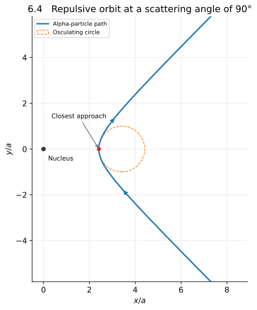
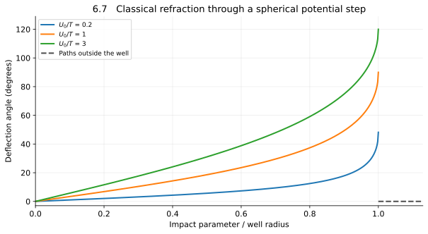
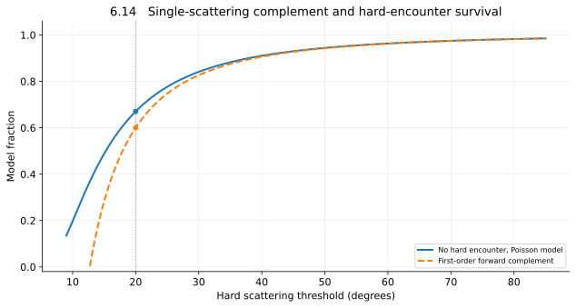
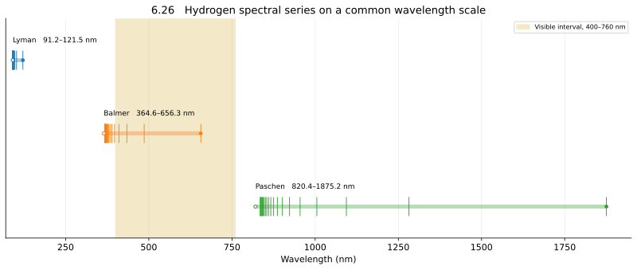
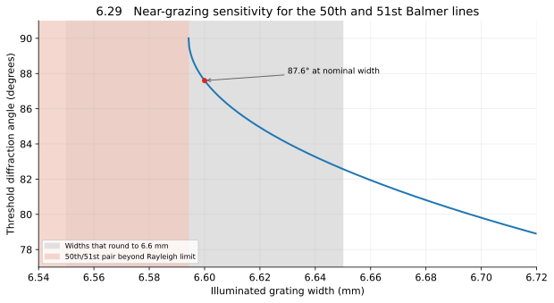
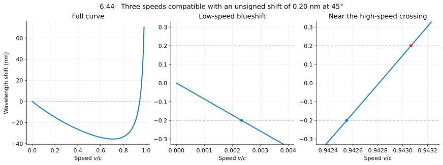

# 6.1 Scattering of Particles. Rutherford-Bohr Atom

[Chapter index](../README.md#chapters) · [Structured solutions](6.1.json) · [Answer audit](../audit/README.md)

## 6.1

**Problem statement**

Employing Thomson's model, calculate the radius of a hydrogen atom and the wavelength of emitted light if the ionization energy of the atom is known to be equal to E = 13.6 eV.

**Solved · high confidence.** Use the full electrostatic potential of Thomson’s uniformly charged sphere and its small-oscillation force.

**Assumptions**

- Thomson’s hydrogen atom is a stationary uniform sphere of total positive charge +e and radius R, with one point electron in equilibrium at its center.
- Ionization removes the electron from the center to infinity. The positive sphere is rigid, and its self energy remains unchanged. Emission is the classical small-amplitude harmonic oscillation frequency.
- In SI replace Gaussian e² by k_e e², where k_e=1/(4πε₀).

The potential energy of the electron is quadratic inside the positive sphere and Coulombic outside. Choose zero potential energy at infinity.

$$
U(r)=-\frac{k_ee^2}{2R}\left(3-\frac{r^2}{R^2}\right)\ (r<R),\qquad U(r)=-\frac{k_ee^2}{r}\ (r\ge R).
$$

The full ionization energy is the center-to-infinity energy difference. It includes work both inside and outside the sphere.

$$
E=-U(0)=\frac{3k_ee^2}{2R},\qquad R=\frac{3k_ee^2}{2E}=1.58877\times10^{-10}\ \mathrm m.
$$

Differentiate the internal potential to obtain a linear restoring force and the oscillation angular frequency.

$$
F_x=-\frac{k_ee^2}{R^3}x,\qquad\omega=\sqrt{\frac{k_ee^2}{m_eR^3}},\qquad\lambda=\frac{2\pi c}{\omega}=2\pi c\sqrt{\frac{m_eR^3}{k_ee^2}}\simeq2.37\times10^{-7}\ \mathrm m.
$$

**Results**

Thomson hydrogen radius

$$
R=3k_ee^2/(2E)\simeq0.159\ \mathrm{nm}
$$

Classical oscillation radiation wavelength

$$
\lambda=2\pi c\sqrt{m_eR^3/(k_ee^2)}\simeq0.237\ \mathrm{\mu m}
$$

## 6.2

**Problem statement**

An alpha particle with kinetic energy 0.27 MeV is deflected through an angle of 60° by a golden foil. Find the corresponding value of the aiming parameter.

**Solved · high confidence.** Invert the Rutherford impact-parameter relation for an alpha particle and a heavy gold center.

**Assumptions**

- Use a nonrelativistic alpha particle of charge+2e and a stationary heavy gold Coulomb center of charge+79e, neglecting target recoil and electronic screening at this large deflection.
- The printed chapter formulas are Gaussian; in SI their charge product is replaced by A=k_e(2e)(Ze).

Relate deflection to the repulsive Coulomb coefficient and incident kinetic energy.

$$
A=2Zk_ee^2,\qquad\tan(\theta/2)=\frac{A}{2Tb},\qquad b=\frac{A}{2T}\cot(\theta/2).
$$

Substitute the Appendix gold atomic number and convert the incident energy to joules.

$$
Z=79,\quad T=0.27\times10^6e\ \mathrm J,\quad\theta=60^\circ,\qquad b=7.30018\times10^{-13}\ \mathrm m.
$$

**Results**

Gold alpha-particle aiming parameter

$$
b=\frac{Zk_ee^2}{T}\cot30^\circ\simeq0.73\ \mathrm{pm}
$$

## 6.3

**Problem statement**

To what minimum distance will an alpha particle with kinetic energy T = 0.40 MeV approach in the case of a head-on collision to (a) a stationary Pb nucleus; (b) a stationary free Li⁷ nucleus?

**Solved · high confidence.** Use head-on turning-point energy, retaining the reduced-mass energy for free lithium recoil.

**Assumptions**

- For part(a), stationary Pb is treated as the effectively fixed heavy Coulomb center used in the chapter formulas. A symbolic free-Pb correction is supplied separately.
- Part(b) explicitly has a free target initially at rest. The turning point is a minimum separation in the relative two-body motion, not a point where both laboratory velocities vanish.
- Use a charge+2e alpha nucleus and positive target charge+Ze. All Coulomb energies use A=2Zk_e e² in SI. Nuclear-size and screening effects are negligible at these distances.

For an immobile target the entire incident kinetic energy becomes repulsive potential energy at the head-on turning point.

$$
T=A/r_{\min},\qquad r_{\min,\rm Pb}=\frac{2Z_{\rm Pb}k_ee^2}{T}=5.90600\times10^{-13}\ \mathrm m.
$$

For a free target of mass M initially at rest, separate center-of-mass translation from the relative kinetic energy.

$$
\mu=\frac{m_\alpha M}{m_\alpha+M},\quad v^2=2T/m_\alpha,\quad E_{\rm rel}=\frac12\mu v^2=\frac{M}{m_\alpha+M}T.
$$

At closest approach the relative radial speed is zero. The unchanged center-of-mass kinetic energy cannot be converted into electrostatic energy.

$$
r_{\min}=\frac{A}{E_{\rm rel}}=\frac{A}{T}\left(1+\frac{m_\alpha}{M}\right),\qquad r_{\min,{}^7\rm Li}=3.39337\times10^{-14}\ \mathrm m.
$$

The same formula provides the correction if stationary Pb is instead interpreted as initially stationary and free.

$$
r_{\min,\rm free\ Pb}=r_{\min,\rm fixed\ Pb}\left(1+\frac{m_\alpha}{M_{\rm Pb}}\right).
$$

**Results**

Minimum approach to fixed heavy Pb

$$
r_{\min}=2Z_{\rm Pb}k_ee^2/T\simeq0.591\ \mathrm{pm}
$$

Minimum separation for a free lithium-7 nucleus

$$
r_{\min}=\frac{2Z_{\rm Li}k_ee^2}{T}\left(1+\frac{m_\alpha}{M_{{}^7\rm Li}}\right)\simeq0.0339\ \mathrm{pm}
$$

Conditional recoil correction for freely moving Pb

$$
r_{\min,\rm free\ Pb}=\frac{2Z_{\rm Pb}k_ee^2}{T}\left(1+\frac{m_\alpha}{M_{\rm Pb}}\right)
$$

A Pb nuclear mass or isotope would be needed for a more precise recoil-corrected numerical value.

**Limitations**

- The intended fixed-heavy-Pb result is stated explicitly; if Pb is free, the supplied symbolic correction applies and depends on target mass.

## 6.4

**Problem statement**

An alpha particle with kinetic energy T = 0.50 MeV is deflected through an angle of θ = 90° by the Coulomb field of a stationary Hg nucleus. Find: (a) the least curvature radius of its trajectory; (b) the minimum approach distance between the particle and the nucleus.

**Solved · high confidence.** Find the Coulomb turning point and show that the trajectory curvature is greatest there.

**Assumptions**

- The Hg nucleus is a fixed heavy Coulomb center of charge+80e; alpha recoil of the target is neglected. Use A=2Zk_e e² in SI.
- The projectile orbit is nonrelativistic and repulsive. The requested least curvature radius is a local geometrical radius, distinct from closest separation.

The Rutherford relation makes the aiming parameter equal to the Coulomb length r₀ for 90° scattering.

$$
r_0=\frac{A}{2T},\qquad b=r_0\cot(\theta/2)=r_0\quad(\theta=90^\circ).
$$

At closest approach, radial velocity is zero and the angular kinetic energy is Tb²/r². Solve the energy equation for separation.

$$
T=\frac{A}{r_{\min}}+\frac{Tb^2}{r_{\min}^2},\quad r_{\min}=r_0+\sqrt{r_0^2+b^2}=(1+\sqrt2)r_0.
$$

At general separation the normal force is F times the sine of the angle between radial direction and velocity. Angular momentum fixes that sine, giving a curvature radius that increases with r on the allowed branch.

$$
\rho(r)=\frac{mv^2}{F_\perp}=\frac{[r(r-2r_0)]^{3/2}}{r_0b},\qquad r\ge r_{\min}>2r_0\quad(b>0).
$$

The least radius therefore occurs at closest approach, where the force is entirely normal. The turning-point equation simplifies its value.

$$
\rho_{\min}=\frac{2Tr_{\min}^2-2Ar_{\min}}{A}=\frac{b^2}{r_0}=r_0=2.30478\times10^{-13}\ \mathrm m,\qquad r_{\min}=5.56423\times10^{-13}\ \mathrm m.
$$

**Results**

Least curvature radius

$$
\rho_{\min}=A/(2T)\simeq0.230\ \mathrm{pm}
$$

Minimum separation from Hg nucleus

$$
r_{\min}=(1+\sqrt2)A/(2T)\simeq0.556\ \mathrm{pm}
$$

## 6.5

**Problem statement**

A proton with kinetic energy T and aiming parameter b was deflected by the Coulomb field of a stationary Au nucleus. Find the momentum imparted to the given nucleus as a result of scattering.

**Solved · high confidence.** Relate momentum transfer to the projectile scattering angle and eliminate that angle using Rutherford scattering.

**Assumptions**

- The leading answer treats the Au nucleus as a stationary heavy center, so the incident and outgoing proton momenta have equal magnitude p=√(2m_pT). The nuclear impulse is the negative projectile momentum change.
- A=k_eZe² with Z=79 for a proton on Au in SI; the printed Gaussian charge product must include k_e after unit conversion.
- A finite free-target correction is also supplied in symbolic form for an initially stationary Au nucleus of mass M.

The vector difference of equal incident and outgoing projectile momenta has magnitude 2p sin(θ/2).

$$
Q=|\mathbf p_{\rm in}-\mathbf p_{\rm out}|=2p\sin(\theta/2),\qquad p=\sqrt{2m_pT}.
$$

Use the heavy-center Coulomb angle relation to eliminate θ.

$$
\tan(\theta/2)=\frac{A}{2Tb},\qquad Q=\frac{2\sqrt{2m_pT}}{\sqrt{1+(2Tb/A)^2}},\qquad A=79k_ee^2.
$$

If the incoming proton moves along+x and is deflected toward+y, the nucleus impulse points opposite that transverse change.

$$
\mathbf Q=p(1-\cos\theta)\,\hat{\mathbf x}-p\sin\theta\,\hat{\mathbf y}.
$$

For a finite free target, use relative scattering momentum μv and relative energy μv²/2 instead of their heavy-center limits.

$$
\mu=\frac{m_pM}{m_p+M},\quad v=\sqrt{2T/m_p},\qquad Q_{\rm free}=\frac{2\mu v}{\sqrt{1+(\mu v^2b/A)^2}}.
$$

**Results**

Impulse magnitude imparted to the heavy Au nucleus

$$
Q=\frac{2\sqrt{2m_pT}}{\sqrt{1+[2Tb/(79k_ee^2)]^2}}
$$

Impulse vector for projectile deflection toward+y

$$
\mathbf Q=p(1-\cos\theta)\hat{\mathbf x}-p\sin\theta\hat{\mathbf y},\quad p=\sqrt{2m_pT}
$$

Finite free-target generalization

$$
Q_{\rm free}=\frac{2\mu v}{\sqrt{1+(\mu v^2b/A)^2}},\quad\mu=m_pM/(m_p+M),\quad v=\sqrt{2T/m_p}
$$

## 6.6

**Problem statement**

A proton with kinetic energy T = 10 MeV flies past a stationary free electron at a distance b = 10 pm. Find the energy acquired by the electron, assuming the proton's trajectory to be rectilinear and the electron to be practically motionless as the proton flies by.

**Solved · high confidence.** Integrate the transverse impulse exerted during a straight proton flyby.

**Assumptions**

- Follow the instructed impulse approximation: the proton has constant straight-line speed, and the electron remains at its initial position while the field pulse passes.
- The primary result uses the nonrelativistic proton relation v²=2 T/m_p, as in the chapter’s classical scattering formulas. A separately labelled speed correction uses the exact relativistic kinetic energy.
- The electron recoil energy is nonrelativistic. Use k_e e² for the Gaussian electrostatic factor in SI.

Place the electron at transverse distance b from the proton line. The longitudinal force integrates to zero by odd symmetry.

$$
F_\perp(t)=\frac{k_ee^2b}{(b^2+v^2t^2)^{3/2}},\qquad\Delta p_\parallel=0.
$$

Integrate the transverse force over the entire flyby and convert the impulse into electron kinetic energy.

$$
\Delta p_\perp=\int_{-\infty}^{\infty}F_\perp\,dt=\frac{2k_ee^2}{bv},\qquad W_e=\frac{(\Delta p_\perp)^2}{2m_e}=\frac{2(k_ee^2)^2}{m_eb^2v^2}.
$$

Insert the classical proton speed obtained from its specified energy.

$$
v^2=2T/m_p,\qquad W_e=\frac{(k_ee^2)^2m_p}{m_eb^2T}\simeq3.81\ \mathrm{eV}.
$$

A relativistic incident-speed refinement is small but visible at this input precision. Integrating the Lorentz-contracted transverse electric pulse gives the same net impulse formula in terms of v.

$$
\gamma_p=1+\frac{T}{m_pc^2},\quad v_{\rm rel}=c\sqrt{1-\gamma_p^{-2}},\quad W_{e,\rm rel\ speed}=\frac{2(k_ee^2)^2}{m_eb^2v_{\rm rel}^2}\simeq3.87\ \mathrm{eV}.
$$

**Results**

Electron energy in the stated classical impulse model

$$
W_e=(k_ee^2)^2m_p/(m_eb^2T)\simeq3.8\ \mathrm{eV}
$$

Optional incident-speed refinement within the same frozen-electron impulse model

$$
W_e=2(k_ee^2)^2/(m_eb^2v_{\rm rel}^2)\simeq3.9\ \mathrm{eV}
$$

**Limitations**

- Electron motion during the interaction and its feedback on the force history are intentionally neglected. The small relativistic speed correction does not remove that instructed approximation.

## 6.7

**Problem statement**

A particle with kinetic energy T is deflected by a spherical potential well of radius R and depth U_0 , i.e. by the field in which the potential energy of the particle takes the form $U=\begin{cases}0,&r>R,\\-U_0,&r<R,\end{cases}$ where r is the distance from the centre of the well. Find the relationship between the aiming parameter b of the particle and the angle θ through which it deflects from the initial motion direction.

**Solved · high confidence.** Use refraction of the classical trajectory at both boundaries of an attractive spherical square well.

**Assumptions**

- The particle is nonrelativistic and the potential center is fixed. Its exterior kinetic energy is T and its interior kinetic energy is T+U₀, with U₀>0.
- The potential step changes normal momentum, while tangential momentum is continuous. The deflection θ is an unsigned angle, directed toward the center for the attractive interaction.

A ray with b<R enters the well at incidence angle α measured from the inward surface normal. Conservation of tangential momentum defines the refracted angle β.

$$
n=\frac{p_{\rm in}}{p_{\rm out}}=\sqrt{1+U_0/T},\qquad\sin\alpha=b/R,\quad\sin\beta=\frac{\sin\alpha}{n}=\frac{b}{nR}.
$$

The two interface refractions each turn the direction by α−β. The interior chord is straight.

$$
\theta(b)=2(\alpha-\beta)=2\left[\arcsin\frac bR-\arcsin\frac{b}{R\sqrt{1+U_0/T}}\right],\qquad0\le b<R.
$$

An equivalent explicit inverse relation follows by writing α=β+θ/2 and solving the refraction equation.

$$
\tan\beta=\frac{\sin(\theta/2)}{n-\cos(\theta/2)},\qquad b=\frac{nR\sin(\theta/2)}{\sqrt{n^2+1-2n\cos(\theta/2)}}.
$$

The allowed nontrivial deflections end at grazing incidence. Trajectories outside the well are undeflected.

$$
0\le\theta<2\arccos(1/n),\qquad b\ge R:\ \theta=0.
$$

**Results**

Deflection for trajectories entering the spherical well

$$
\theta=2\left[\arcsin(b/R)-\arcsin\left(\frac bR\sqrt{\frac T{T+U_0}}\right)\right],\quad0\le b<R
$$

Impact parameter in terms of a nonzero allowed deflection

$$
b=\frac{nR\sin(\theta/2)}{\sqrt{n^2+1-2n\cos(\theta/2)}},\quad n=\sqrt{1+U_0/T}
$$

Trajectories missing the well

$$
\theta=0\quad(b\ge R)
$$

**Limitations**

- The exact b=R tangent is a singular boundary convention for an abrupt step and has zero cross-sectional measure. The inverse formula applies only to the entering branch; θ=0 also includes every trajectory with b≥R.

## 6.8

**Problem statement**

A stationary ball of radius R is irradiated by a parallel stream of particles whose radius is r. Assuming the collision of a particle and the ball to be elastic, find: (a) the deflection angle θ of a particle as a function of its aiming parameter b; (b) the fraction of particles which after a collision with the ball are scattered into the angular interval between θ and θ + dθ; (c) the probability of a particle to be deflected, after a collision with the ball, into the front hemisphere (θ < π/2).

**Solved · high confidence.** Treat elastic hard-sphere contact as specular reflection of the relative center trajectory.

**Assumptions**

- The target ball is held stationary, or is massive enough that its recoil is negligible. Without this condition a laboratory deflection distribution would also require the two masses.
- Particles and target are perfectly hard smooth spheres, with elastic frictionless impacts. Contact occurs when their center separation is a=R+r.
- Fractions and probabilities are conditioned on a collision: the incident beam is uniform over the collision disk of areaπa².

At contact the impact parameter fixes the normal’s angle α to the incident direction. Specular reflection reverses the normal velocity component.

$$
a=R+r,\quad\sin\alpha=b/a,\qquad\theta=\pi-2\alpha=2\arccos(b/a),\qquad0\le b\le a.
$$

An incident annulus contributes collision fraction 2bdb/a². Change variables with b=a cos(θ/2), taking the absolute value of its derivative.

$$
dP=\frac{2b|db|}{a^2}=\frac12\sin\theta\,d\theta,\qquad0\le\theta\le\pi.
$$

Integration over the forward hemisphere gives one half. Equivalently, the corresponding collision annulus occupies half the collision disk.

$$
P(\theta<\pi/2)=\frac12\int_0^{\pi/2}\sin\theta\,d\theta=\frac12,\qquad b>a/\sqrt2.
$$

The full differential cross section is isotropic, which checks both the angular density and its normalization.

$$
\frac{d\sigma}{d\Omega}=\frac{a^2}{4},\qquad\sigma_{\rm total}=\pi a^2,\quad\frac{dP}{d\Omega}=\frac1{4\pi}.
$$

**Results**

Hard-sphere deflection angle

$$
\theta=2\arccos[b/(R+r)],\quad0\le b\le R+r
$$

Conditional collision fraction in the polar interval

$$
dP=\tfrac12\sin\theta\,d\theta
$$

Conditional probability of forward-hemisphere scattering

$$
P(\theta<\pi/2)=1/2
$$

**Limitations**

- If the ball is initially stationary but free with finite unknown mass, the center-of-mass isotropic distribution does not imply the same laboratory-angle distribution; the displayed result is for the stated stationary-target interpretation.

## 6.9

**Problem statement**

A narrow beam of alpha particles with kinetic energy 1.0 MeV falls normally on a platinum foil 1.0 µm thick. The scattered particles are observed at an angle of 60° to the incident beam direction by means of a counter with a circular inlet area 1.0 cm² located at the distance 10 cm from the scattering section of the foil. What fraction of scattered alpha particles reaches the counter inlet?

**Solved · medium confidence.** Evaluate the differential Rutherford count fraction relative to the incident beam, with a denominator qualification.

**Assumptions**

- Use thin-foil single scattering on stationary heavy Pt centers, neglecting energy loss, multiple scattering and screening at 60°.
- The circular inlet faces the scattering point with its plane normal to the central viewing ray. The central solid-angle approximation isΔΩ≈S/r².
- The intended denominator is the number of incident alpha particles, as in Eq.(6.1b). The literal phrase fraction of scattered particles would require an angular or screening definition of which events count as scattered.

Convert foil thickness to the areal target density, using the Appendix density and externally referenced Pt molar mass only because that mass is absent from the Appendices.

$$
n_t=\frac{\rho dN_A}{M_{\rm Pt}}=6.63788\times10^{22}\ \mathrm{m^{-2}},\qquad\Delta\Omega\simeq\frac{S}{r^2}=\frac{10^{-4}}{0.10^2}=0.0100\ \mathrm{sr}.
$$

Write the SI Rutherford differential cross section and multiply by areal density and detector solid angle.

$$
\frac{d\sigma}{d\Omega}=\left(\frac{A}{4T}\right)^2\csc^4(\theta/2),\quad A=2Z_{\rm Pt}k_ee^2,\qquad\frac{N_{\rm det}}{N_{\rm incident}}\simeq n_t\frac{d\sigma}{d\Omega}(60^\circ)\Delta\Omega=3.35195\times10^{-5}.
$$

The finite circular inlet may be integrated over its angular acceptance. This changes the result by only about 0.32%, confirming the small-inlet approximation at the printed precision.

$$
\alpha=\arctan\left(\frac{\sqrt{S/\pi}}r\right),\qquad\frac{N_{\rm det}}{N_{\rm incident}}=n_t\int_{\rm inlet}\frac{d\sigma}{d\Omega}\,d\Omega\simeq3.36264\times10^{-5}.
$$

Rutherford scattering has a divergent total cross section at zero angle. A conditional fraction among events with θ>θ_s can be stated, but it cannot be assigned a unique numerical value without θ_s or a screened model.

$$
\sigma(\theta>\theta_s)=\pi\left(\frac{A}{2T}\right)^2\cot^2(\theta_s/2),\qquad\frac{N_{{\rm det},\theta>\theta_s}}{N_{\theta>\theta_s}}=\frac{\int_{\Omega_{\rm inlet}\cap\{\theta>\theta_s\}}(d\sigma/d\Omega)\,d\Omega}{\sigma(\theta>\theta_s)}.
$$

**Results**

Fraction of incident alpha particles reaching the counter

$$
N_{\rm det}/N_{\rm incident}\simeq3.4\times10^{-5}
$$

Finite circular-inlet correction under the stated geometry

$$
N_{\rm det}/N_{\rm incident}\simeq3.36264\times10^{-5}
$$

Conditional fraction if scattering is defined by θ>θ_s

$$
\frac{N_{{\rm det},\theta>\theta_s}}{N_{\theta>\theta_s}}=\frac{\int_{\Omega_{\rm inlet}\cap\{\theta>\theta_s\}}(d\sigma/d\Omega)\,d\Omega}{\sigma(\theta>\theta_s)}.
$$

The numerator integrates only the part of the inlet within the selected angle range.

**Limitations**

- The numeric result is incident normalized. A literal fraction among all Coulomb-scattered particles is not fixed by the supplied data. Foil stopping and multiple-scattering corrections are excluded from the ideal chapter model.

## 6.10

**Problem statement**

A narrow beam of alpha particles with kinetic energy T = 0.50 MeV and intensity I = 5.0·10⁵ particles per second falls normally on a golden foil. Find the thickness of the foil if at a distance r = 15 cm from a scattering section of that foil the flux density of scattered particles at the angle θ = 60° to the incident beam is equal to J = 40 particles/(cm²·s).

**Solved · high confidence.** Invert the single-scattering flux density to obtain foil thickness.

**Assumptions**

- The measured flux density is per area normal to the outgoing viewing ray. Use a pointlike scattering region and a stationary heavy Au Rutherford target.
- The incident particle intensity I is a total rate, not an irradiance. The foil is uniform; incident energy loss and multiple scattering are neglected as in the chapter formula.
- The SI Coulomb coefficient for alpha scattering is A=2Z_Au k_e e².

Relate the areal density to thickness. The rate per unit solid angle equals incident rate times areal density times differential cross section.

$$
n_t=\rho dN_A/M_{\rm Au},\qquad\frac{d\dot N}{d\Omega}=In_t\left(\frac{A}{4T}\right)^2\csc^4(\theta/2).
$$

At radius r, a small area normal to the scattered ray subtends dΩ=dS/r². Solve the resulting flux-density relation for d.

$$
J=\frac{In_t}{r^2}\frac{d\sigma}{d\Omega},\qquad d=\frac{Jr^2M_{\rm Au}}{I\rho N_A(d\sigma/d\Omega)}.
$$

Convert J from cm⁻²s⁻¹ to m⁻²s⁻¹ and insert the gold property references.

$$
J=4.0\times10^5\ \mathrm{m^{-2}s^{-1}},\quad r=0.15\ \mathrm m,\qquad d=1.47198\times10^{-6}\ \mathrm m\simeq1.5\ \mathrm{\mu m}.
$$

**Results**

Gold foil thickness in the ideal Rutherford model

$$
d=\frac{Jr^2M_{\rm Au}}{I\rho N_A(d\sigma/d\Omega)}\simeq1.5\ \mathrm{\mu m}
$$

**Limitations**

- The inferred physical thickness is conditional on negligible energy loss and single scattering. These assumptions can be restrictive for low-energy alpha particles in dense material.

## 6.11

**Problem statement**

A narrow beam of alpha particles falls normally on a silver foil behind which a counter is set to register the scattered particles. On substitution of platinum foil of the same mass thickness for the silver foil, the number of alpha particles registered per unit time increased η = 1.52 times. Find the atomic number of platinum, assuming the atomic number of silver and the atomic masses of both platinum and silver to be known.

**Solved · high confidence.** Cancel common geometry and beam factors at fixed foil mass thickness, then solve the Z² dependence.

**Assumptions**

- The alpha energy, detector acceptance and incident rate are unchanged. Both foils are treated by the same single-scattering, stationary-heavy-target Rutherford approximation.
- Equal mass thickness means equal mass per area, not equal nucleus count per area. Use known molar masses of Ag and Pt, and only the known Ag atomic number as input.
- In SI the common factor k_e(2e)e cancels from the ratio; no absolute Coulomb conversion is required in the final result.

At equal mass thickness w, the target areal density is wN_A/M, while the Rutherford cross section scales as Z².

$$
\dot N\propto\frac{wN_A}{M}Z^2,\qquad\eta=\frac{\dot N_{\rm Pt}}{\dot N_{\rm Ag}}=\frac{M_{\rm Ag}}{M_{\rm Pt}}\left(\frac{Z_{\rm Pt}}{Z_{\rm Ag}}\right)^2.
$$

Solve for the unknown Pt atomic number and round the estimate to its physical integer value.

$$
Z_{\rm Pt}=Z_{\rm Ag}\sqrt{\eta M_{\rm Pt}/M_{\rm Ag}}=47\sqrt{1.52(0.195084)/(0.1078682)}=77.9262\simeq78.
$$

**Results**

Inferred platinum atomic number

$$
Z_{\rm Pt}=Z_{\rm Ag}\sqrt{\eta M_{\rm Pt}/M_{\rm Ag}}\simeq78
$$

Unrounded estimate from the stated count ratio

$$
Z_{\rm Pt}=77.9262
$$

## 6.12

**Problem statement**

A narrow beam of alpha particles with kinetic energy T = 0.50 MeV falls normally on a golden foil whose mass thickness is ρd = 1.5 mg/cm² . The beam intensity is I_0 = 5.0·10⁵ particles per second. Find the number of alpha particles scattered by the foil during a time interval τ = 30 min into the angular interval: (a) 59-61°; (b) over θ_0 = 60°.

**Solved · high confidence.** Integrate Rutherford scattering over all azimuths and the specified polar-angle ranges.

**Assumptions**

- Use a thin foil of stationary heavy Au nuclei and a nonrelativistic alpha beam, neglecting energy loss and multiple scattering. The stated intervals include all azimuths.
- The mass thickness is w=1.5 mg/cm²=0.015 kg/m², and τ=30 min=1800 s. The SI Coulomb coefficient is A=2Z_Au k_e e².
- The external Au molar mass is needed because the checked Appendices supply Z and constants but no heavy-element atomic-weight table.

Find the target areal density and the total number of incident alpha particles.

$$
n_t=wN_A/M_{\rm Au},\qquad N_0=I_0\tau=9.0\times10^8.
$$

Integrate the differential cross section with dΩ=2π sin θ dθ. This yields a finite upper-angle tail for every positive lower cutoff.

$$
\frac{d\sigma}{d\Omega}=\left(\frac{A}{4T}\right)^2\csc^4(\theta/2),\qquad\sigma(\theta>\theta_0)=\pi\left(\frac{A}{2T}\right)^2\cot^2(\theta_0/2).
$$

The narrow polar band is the difference of two upper tails, not a one-degree solid-angle aperture.

$$
N_{59^\circ-61^\circ}=N_0n_t\pi\left(\frac{A}{2T}\right)^2\left[\cot^2(29.5^\circ)-\cot^2(30.5^\circ)\right]=1.62558\times10^6.
$$

For all deflections above 60° use the single upper-tail expression.

$$
N_{>60^\circ}=N_0n_t\pi\left(\frac{A}{2T}\right)^2\cot^2(30^\circ)=2.01539\times10^7.
$$

**Results**

Alpha count in the full-azimuth 59–61° band

$$
N_{59^\circ-61^\circ}\simeq1.6\times10^6
$$

Alpha count with polar angle greater than 60°

$$
N_{>60^\circ}\simeq2.0\times10^7
$$

**Limitations**

- The ideal calculation ignores stopping and straggling of low-energy alpha particles; real-foil measurements can require these corrections.

## 6.13

**Problem statement**

A narrow beam of protons with velocity v = 6·10⁶ m/s falls normally on a silver foil of thickness d = 1.0 μm. Find the probability of the protons to be scattered into the rear hemisphere (θ > 90°).

**Solved · high confidence.** Integrate the proton Rutherford cross section over the backward hemisphere.

**Assumptions**

- The proton has charge+e, the silver nucleus charge+47e. Treat the heavy target as fixed and use the classical proton energy T=m_pv²/2.
- Use the Appendix silver density and the registered natural-silver molar mass to convert the foil thickness to target nuclei per area.
- Use the single-scattering approximation with negligible stopping; the backward-angle threshold avoids the forward Rutherford divergence.

Express the backward integrated cross section in SI and specialize to 90°.

$$
A=Z_{\rm Ag}k_ee^2,\qquad\sigma_{\rm back}=\pi\left(\frac{A}{2T}\right)^2\cot^2(45^\circ)=\pi\left(\frac{A}{m_pv^2}\right)^2.
$$

Multiply by the target areal density to obtain the incident-beam probability.

$$
n_t=\rho dN_A/M_{\rm Ag},\qquad P_{\rm back}=n_t\sigma_{\rm back}=5.98027\times10^{-3}\simeq0.60\%.
$$

**Results**

Probability of rear-hemisphere proton scattering

$$
P(\theta>90^\circ)=\frac{\rho dN_A}{M_{\rm Ag}}\pi\left(\frac{Z_{\rm Ag}k_ee^2}{m_pv^2}\right)^2\simeq6.0\times10^{-3}
$$

## 6.14

**Problem statement**

A narrow beam of alpha particles with kinetic energy T = 600 keV falls normally on a golden foil incorporating n = 1.1·10¹⁹ nuclei/cm² . Find the fraction of alpha particles scattered through the angles θ < θ_0 = 20°.

**Solved · medium confidence.** Use a forward complement of the finite large-angle cross section, and expose the approximation’s validity limit.

**Assumptions**

- The requested fraction is normalized to all incident particles, so it includes unscattered and unresolved small-angle particles in the forward cone.
- Use stationary-heavy-target, single-scattering Rutherford theory at angles near and above 20°. The unscreened formula cannot be integrated from zero angle to define a total finite scattered fraction.
- The areal density is n_t=1.1×10¹⁹cm⁻²=1.1×10²³m⁻². In SI A=2Z_Au k_e e². The first-order complement is the conventional intended chapter calculation.

Compute the cross section for a single collision outside the forward cone; it is finite even though the zero-angle total is not.

$$
\sigma_{>\theta_0}=\pi\left(\frac{A}{2T}\right)^2\cot^2(\theta_0/2),\qquad\theta_0=20^\circ.
$$

In first-order single scattering the outgoing beam outside the cone is n_t times this cross section. Subtract it from the incident beam.

$$
\mu_h=n_t\sigma_{>20^\circ}=0.399830,\qquad f_{<20^\circ}^{\rm first\ order}=1-\mu_h=0.600170\simeq0.60.
$$

The optical depth is not much smaller than one, so the first-order answer is only approximate. A Poisson no-hard-collision probability is a distinct quantity, not an exact net-angle answer.

$$
P(\text{no individual collision above }20^\circ)=e^{-\mu_h}=0.670434,\quad P(\text{two or more such collisions})=1-e^{-\mu_h}(1+\mu_h)=0.061506.
$$

A real forward-angle distribution requires screened Coulomb interactions and multiple-scattering transport: several subthreshold bends can leave the cone, while larger bends can partially cancel. Neither direct integration of the divergent forward Rutherford law nor the no-hard-collision probability by itself supplies that net-angle distribution.

**Results**

Formal first-order fraction remaining inside 20°

$$
f_{<20^\circ}\simeq1-n_t\pi\left(\frac{2Z_{\rm Au}k_ee^2}{2T}\right)^2\cot^2(10^\circ)\simeq0.60
$$

Incident normalized; includes the unscattered/unresolved forward beam. Quantitatively marginal because μ_h≈0.40.

Single-hard-scattering optical depth

$$
\mu_h=n_t\sigma_{>20^\circ}\simeq0.39983
$$

Separate probability of no individual hard collision in an independent-collision Poisson model

$$
P_{0,\rm hard}=e^{-\mu_h}\simeq0.67043
$$

This is not a substitute exact answer for net deflectionθ<20°.

**Limitations**

- The supplied ideal chapter model determines the displayed first-order estimate; it does not uniquely specify a full screened multiple-scattering transport calculation.
- A fraction conditional on only resolved scattering would additionally need the resolution or screening convention and a different denominator.

## 6.15

**Problem statement**

A narrow beam of protons with kinetic energy T = 1.4 MeV falls normally on a brass foil whose mass thickness ρd = 1.5 mg/cm² . The weight ratio of copper and zinc in the foil is equal to 7 : 3 respectively. Find the fraction of the protons scattered through the angles exceeding θ_0 = 30°.

**Solved · high confidence.** Add independent Rutherford tail probabilities weighted by each element’s mass fraction and molar mass.

**Assumptions**

- The brass mass fractions are f_Cu=0.7 and f_Zn=0.3, not atom fractions. Each species contributes its own target areal density.
- Use nonrelativistic protons and heavy fixed Cu and Zn centers. Probabilities are small enough to add in the single-scattering approximation; stopping is neglected.
- In SI A_i=Z_i k_e e² for a pro to n. Use external molar-mass entries only because the Appendices lack these atomic weights.

Convert the total mass thickness and split it by the stated weight ratio.

$$
w=1.5\ \mathrm{mg/cm^2}=0.015\ \mathrm{kg/m^2},\quad n_{\rm Cu}=wf_{\rm Cu}N_A/M_{\rm Cu},\quad n_{\rm Zn}=wf_{\rm Zn}N_A/M_{\rm Zn}.
$$

Each nuclear species has its own charge-squared Rutherford tail; sum target density times cross section.

$$
P_{>\theta_0}=\sum_i n_i\pi\left(\frac{Z_ik_ee^2}{2T}\right)^2\cot^2(\theta_0/2).
$$

Insert the two mass fractions and 30° threshold.

$$
P_{>30^\circ}=wN_A\pi\left(\frac{k_ee^2}{2T}\right)^2\cot^2(15^\circ)\left(\frac{0.7Z_{\rm Cu}^2}{M_{\rm Cu}}+\frac{0.3Z_{\rm Zn}^2}{M_{\rm Zn}}\right)=1.40139\times10^{-3}.
$$

**Results**

Fraction of incident protons scattered by more than 30°

$$
P_{>30^\circ}\simeq1.4\times10^{-3}
$$

Copper contribution to the fraction

$$
P_{\rm Cu}=n_{\rm Cu}\sigma_{\rm Cu}(>30^\circ)
$$

Zinc contribution to the fraction

$$
P_{\rm Zn}=n_{\rm Zn}\sigma_{\rm Zn}(>30^\circ)
$$

## 6.16

**Problem statement**

Find the effective cross section of a uranium nucleus corresponding to the scattering of alpha particles with kinetic energy T = 1.5 MeV through the angles exceeding θ_0 = 60°.

**Solved · high confidence.** Integrate the alpha–uranium Rutherford cross section over angles above 60°.

**Assumptions**

- The uranium nucleus is a stationary heavy charge+92e center, and the projectile is a nonrelativistic alpha particle of charge+2e. Recoil, screening at large angles and nuclear forces are neglected.
- The effective cross section is an area per target nucleus, not a foil-scattering probability. In SI A=2Z_U k_e e²;1 barn=10⁻²⁸m² and 1 kilobarn=10⁻²⁵m².

Integrate the Rutherford differential cross section over every azimuth and the polar-angle tail.

$$
\sigma_{>\theta_0}=2\pi\int_{\theta_0}^{\pi}\left(\frac{A}{4T}\right)^2\frac{\sin\theta}{\sin^4(\theta/2)}\,d\theta=\pi\left(\frac{A}{2T}\right)^2\cot^2(\theta_0/2).
$$

Set the threshold to 60°, so cot²30°=3, and insert the uranium charge and incident energy.

$$
\sigma_{>60^\circ}=3\pi\left(\frac{Z_Uk_ee^2}{T}\right)^2=7.35670\times10^{-26}\ \mathrm{m^2}=735.67\ \mathrm b\simeq0.736\ \mathrm{kb}.
$$

**Results**

Effective alpha–uranium cross section for deflection above 60°

$$
\sigma_{>60^\circ}=3\pi(Z_Uk_ee^2/T)^2\simeq7.4\times10^{-26}\ \mathrm{m^2}
$$

Same cross section in kilobarns

$$
\sigma_{>60^\circ}\simeq0.736\ \mathrm{kb}
$$

## 6.17

**Problem statement**

The effective cross section of a gold nucleus corresponding to the scattering of monoenergetic alpha particles within the angular interval from 90° to 180° is equal to Δσ = 0.50 kb. Find: (a) the energy of alpha particles; (b) the differential cross section of scattering dσ/dΩ (kb/sr) corresponding to the angle θ = 60°.

**Solved · high confidence.** Integrate the Rutherford differential cross section over the backward hemisphere, then eliminate its amplitude.

**Assumptions**

- Use Rutherford scattering by a stationary heavy gold nucleus with chargeZe, Z=79. Alpha particles have charge 2e; nuclear recoil, screening, and finite nuclear size are neglected.
- The chapter equations are Gaussian. For SI numerical substitution replace the Coulomb product q1 q2 by k_e q1 q2. Use 1 barn=1e-28 m squared and 1 kilobarn=1e-25 m squared.

Write the Rutherford cross section in a form with one common amplitudeC_R.

$$
\frac{d\sigma}{d\Omega}=C_R\csc^4(\theta/2),\qquad C_R=\left(\frac{\kappa}{4T}\right)^2,\qquad \kappa=2Zk_e e^2.
$$

Integrating from 90 degrees to 180 degrees, including the azimuthal factor, gives the specified backward-hemisphere cross section.

$$
\Delta\sigma=2\pi C_R\int_{\pi/2}^{\pi}\frac{\sin\theta\,d\theta}{\sin^4(\theta/2)}=4\pi C_R=\pi\left(\frac{\kappa}{2T}\right)^2.
$$

Invert this relation for the alpha kinetic energy.

$$
T=\frac\kappa2\sqrt{\frac\pi{\Delta\sigma}}=1.44507010\times10^{-13}\,\mathrm J=0.9020413\,\mathrm{MeV}\simeq0.90\,\mathrm{MeV}.
$$

At 60 degrees the half-angle sine is 1/2, so its fourth-power reciprocal is 16. Express the answer directly through the measured integral cross section.

$$
\left.\frac{d\sigma}{d\Omega}\right|_{60^\circ}=16C_R=\frac{4\Delta\sigma}\pi=\frac{2}{\pi}\,\mathrm{kb/sr}=0.63661977\,\mathrm{kb/sr}.
$$

**Results**

Alpha particle kinetic energy

$$
\boxed{T\simeq0.90\,\mathrm{MeV}}
$$

Kinetic energy in joules

$$
T\simeq1.44507\times10^{-13}\,\mathrm J
$$

Differential cross section at 60 degrees

$$
\boxed{(d\sigma/d\Omega)_{60^\circ}=2/\pi\simeq0.637\,\mathrm{kb/sr}}
$$

## 6.18

**Problem statement**

In accordance with classical electrodynamics an electron moving with acceleration w loses its energy due to radiation as $\frac{dE}{dt}=-\frac{2e^2}{3c^3}w^2$, where e is the electron charge, c is the velocity of light. Estimate the time during which the energy of an electron performing almost harmonic oscillations with frequency ω = 5·10¹⁵ s⁻¹ will decrease η = 10 times.

**Solved · high confidence.** Average the Larmor power over a weakly damped harmonic cycle and integrate the resulting exponential energy decay.

**Assumptions**

- The given ω=5e15 s inverse is an angular frequency. The oscillation remains nearly harmonic, with slowly varying amplitude and essentially constant frequency.
- The printed Larmor formula is Gaussian. Define the classical electron radiusr_e=e_G squared/(m_e c squared), equivalentlyk_e e_SI squared/(m_e c squared), and use its Appendix value.

For displacementx=A cos(omega t), the mechanical energy and cycle-averaged acceleration squared are related simply.

$$
E=\frac12m_e\omega^2A^2,\qquad \langle w^2\rangle=\frac12\omega^4A^2=\frac{\omega^2}{m_e}E.
$$

Insert the average into Larmor loss. The coefficient multiplies the instantaneous slowly varying oscillator energy.

$$
\frac{dE}{dt}=-\frac{2e_G^2\omega^2}{3m_ec^3}E=-\frac{2r_e\omega^2}{3c}E=-\frac{E}{\tau_E},\qquad \tau_E=\frac{3c}{2r_e\omega^2}.
$$

Integrate until the energy has decreased by a factor eta. It is an exponential decay, so the required logarithm must be retained.

$$
E(t)=E(0)e^{-t/\tau_E},\qquad t=\tau_E\ln\eta=\frac{3c\ln10}{2r_e(5\times10^{15})^2}=1.4687553\times10^{-8}\,\mathrm s\simeq15\,\mathrm{ns}.
$$

**Results**

Time for the oscillator energy to decrease tenfold

$$
\boxed{t=3c\ln\eta/(2r_e\omega^2)\simeq1.5\times10^{-8}\,\mathrm s}
$$

**Limitations**

- This is a classical weak-damping estimate; it is not a quantum spontaneous-emission lifetime.

## 6.19

**Problem statement**

Making use of the formula of the foregoing problem, estimate the time during which an electron moving in a hydrogen atom along a circular orbit of radius r = 50 pm would have fallen onto the nucleus. For the sake of simplicity assume the vector w to be permanently directed toward the centre of the atom.

**Solved · high confidence.** Treat the radiating orbit as a slowly shrinking sequence of circular Coulomb orbits and integrate its radial energy loss.

**Assumptions**

- This is the requested classical radiation-collapse estimate, not the stable quantum hydrogen ground state. The proton is fixed and the electron motion is nonrelativistic over the part dominating the collapse time.
- Use the inward centripetal acceleration and an adiabatically shrinking circular orbit, neglecting its small radial acceleration during most of the evolution. Extrapolation of the classical model to zero radius defines the formal collapse time.

For a circular Coulomb orbit, write its acceleration and total mechanical energy using the classical electron radius.

$$
w=\frac{e_G^2}{m_er^2}=\frac{c^2r_e}{r^2},\qquad E(r)=-\frac{e_G^2}{2r}=-\frac{m_ec^2r_e}{2r}.
$$

Apply Larmor radiation and differentiate the orbit energy with respect to radius.

$$
\frac{dE}{dt}=\frac{m_ec^2r_e}{2r^2}\frac{dr}{dt}=-\frac{2m_ec^3r_e^3}{3r^4},\qquad \frac{dr}{dt}=-\frac{4cr_e^2}{3r^2}.
$$

Integrating the radial equation gives a linear decay of radius cubed.

$$
r^3(t)=r_0^3-4cr_e^2t,\qquad t_{\rm fall}=\frac{r_0^3}{4cr_e^2}.
$$

Insert the initial radius 50 pm and the Appendix classical electron radius.

$$
t_{\rm fall}=\frac{(50\times10^{-12})^3}{4(2.998\times10^8)(2.82\times10^{-15})^2}=1.31075094\times10^{-11}\,\mathrm s\simeq13\,\mathrm{ps}.
$$

**Results**

Formal classical collapse time

$$
\boxed{t_{\rm fall}=r_0^3/(4cr_e^2)\simeq1.3\times10^{-11}\,\mathrm s}
$$

**Limitations**

- Real hydrogen does not undergo this classical collapse. Quantum stationary states and the late-time failure of classical/nonrelativistic mechanics are outside the extrapolated estimate.

## 6.20

**Problem statement**

Demonstrate that the frequency ω of a photon emerging when an electron jumps between neighbouring circular orbits of a hydrogen-like ion satisfies the inequality ω_n > ω > ω_(n+1) , where ω_n and ω_(n+1) are the frequencies of revolution of that electron around the nucleus along the circular orbits. Make sure that as n → ∞ the frequency of the photon ω → ω_n.

**Solved · high confidence.** Express neighboring Bohr level differences as an average of the continuously interpolated orbital angular frequency.

**Assumptions**

- Use the nonrelativistic fixed-nucleus Coulomb Bohr model with circular orbits. WriteE_n=-C/n squared with C>0, including itsZ squared dependence.
- Both the photonomega and the orbitalomega_n denote angular frequencies; ordinary cycles-per-second frequencies would require dividing both by 2pi.

Bohr circular-orbit mechanics and L_n=n hbar give the orbital angular frequency.

$$
E_n=-\frac{C}{n^2},\qquad \omega_n=\frac{2C}{\hbar n^3}.
$$

The downward transition fromn+1 ton emits a photon whose angular frequency is the adjacent energy difference divided byhbar.

$$
\omega=\frac{E_{n+1}-E_n}{\hbar}=\frac{C}{\hbar}\left(\frac1{n^2}-\frac1{(n+1)^2}\right)=\int_n^{n+1}\frac{2C}{\hbar x^3}\,dx.
$$

The integrand strictly decreases on this interval and its width is 1. Its average therefore lies strictly between its endpoint values.

$$
\boxed{\omega_n>\omega>\omega_{n+1}}.
$$

The exact ratio to the lower orbit frequency proves the stronger relative form of correspondence asn becomes large.

$$
\frac{\omega}{\omega_n}=\frac{n(2n+1)}{2(n+1)^2}\longrightarrow1\quad(n\to\infty).
$$

**Results**

Photon frequency lies between the neighboring orbital frequencies

$$
\boxed{\omega_n>\omega_{n+1\to n}>\omega_{n+1}}
$$

Large-quantum-number correspondence

$$
\omega_{n+1\to n}/\omega_n=n(2n+1)/[2(n+1)^2]\to1
$$

**Limitations**

- Relativistic, recoil, fine-structure, or non-Coulomb corrections are not part of this circular Bohr-model statement.

## 6.21

**Problem statement**

A particle of mass m moves along a circular orbit in a centrosymmetrical potential field U (r) = kr²/2. Using the Bohr quantization condition, find the permissible orbital radii and energy levels of that particle.

**Solved · high confidence.** Combine circular-force balance in the harmonic potential with orbital angular-momentum quantization.

**Assumptions**

- Take k>0 and m>0 so that circular orbits exist in the central restoring potential. SetOmega=sqrt(k/m).
- Apply the old Bohr conditionL=n hbar to circular orbits, with n=1,2,... . This is the requested semiclassical circular-orbit model, not the complete quantum spectrum of a multidimensional harmonic oscillator.

The restoring force has magnitudekr. Circular balance gives a radius-independent orbital angular frequency.

$$
\frac{mv^2}{r}=kr,\qquad v=\Omega r,\qquad \Omega=\sqrt{k/m}.
$$

The angular momentum ism Omega r squared. Quantization fixes the allowed radii.

$$
m\Omega r_n^2=n\hbar,\qquad \boxed{r_n=\left(\frac{n\hbar}{\sqrt{mk}}\right)^{1/2}}.
$$

Kinetic and potential energies are equal for the circular orbit, so its total energy iskr squared.

$$
T_n=U_n=\frac12kr_n^2,\qquad \boxed{E_n=kr_n^2=n\hbar\sqrt{k/m}},\qquad n=1,2,\ldots.
$$

**Results**

Permissible circular orbital radii

$$
\boxed{r_n=\sqrt{n\hbar/(m\Omega)}=(n\hbar/\sqrt{mk})^{1/2}},\quad \Omega=\sqrt{k/m}
$$

Circular-orbit Bohr energy levels

$$
\boxed{E_n=n\hbar\Omega=n\hbar\sqrt{k/m}},\quad n=1,2,\ldots
$$

**Limitations**

- The exact quantum harmonic-oscillator zero-point energy, degeneracies, and noncircular states are not reproduced by this old circular-orbit Bohr prescription.

## 6.22

**Problem statement**

Calculate for a hydrogen atom and a He + ion: (a) the radius of the first Bohr orbit and the velocity of an electron moving along it; (b) the kinetic energy and the binding energy of an electron in the ground state; (c) the ionization potential, the first excitation potential and the wavelength of the resonance line (n′ = 2 → n = 1).

**Solved · high confidence.** Apply hydrogenic Z scaling to the Bohr radius, speed, energies, excitation thresholds, and resonance line.

**Assumptions**

- Use nonrelativistic one-electron Bohr systems with effectively fixed nuclei: Z=1 for H and Z=2 for He⁺. Reduced nuclear mass, fine structure, and spin are neglected.
- Use the historical Appendix anchorsa_0=5.29e-11 m, hydrogen binding E_H=13.56 eV, and R prime=1.097e7 m inverse. They were printed independently and are not forced to obey exact cross-identities in guard digits.
- Usea_0 for radii, angular-momentum quantization for speeds, the printed binding energy for energies/potentials, and the printed spectral Rydberg wavenumber for wavelengths. Numerical results should be read at the precision of those anchors.

Bohr angular momentum and Coulomb scaling give the first-orbit radius and speed.

$$
r_1(Z)=\frac{a_0}{Z},\qquad m_ev_1r_1=\hbar,\qquad v_1(Z)=\frac{Z\hbar}{m_ea_0}\simeq2.19\times10^6Z\,\mathrm{m/s}.
$$

The Coulomb virial relation gives total energy −E_H Z squared, positive kinetic energy E_H Z squared, and equal positive binding energy.

$$
E_n=-\frac{Z^2E_H}{n^2},\quad T_1=B_1=Z^2E_H;\qquad H:13.56\,\mathrm{eV},\quad He^+:54.24\,\mathrm{eV}.
$$

Ionization costs the whole binding energy. The smallest excitation is 1→2, costing three quarters of it. Expressing these energies per elementary charge gives the corresponding accelerating potentials.

$$
U_{\rm ion}=\frac{Z^2E_H}{e},\qquad U_{\rm exc}=\frac{3Z^2E_H}{4e};\quad H:(13.56,10.17)\,\mathrm V,\quad He^+:(54.24,40.68)\,\mathrm V.
$$

Evaluate the resonance wavelength through the spectral Rydberg formula, consistently with the later spectrum problems.

$$
\lambda_{2\to1}=\frac1{R\prime Z^2(1-1/4)}=\frac4{3R\prime Z^2};\qquad H:121.5436\,\mathrm{nm},\quad He^+:30.3859\,\mathrm{nm}.
$$

The requested radius and speed pairs are H:(52.9 pm, 2.19e6 m/s) and He⁺:(26.45 pm, 4.37e6 m/s). The small differences obtained by reconstructing all atomic constants from other rounded Appendix entries are not additional physical effects.

**Results**

H first Bohr orbit radius

$$
r_1=a_0/Z
$$

H first-orbit speed

$$
v_1=Z\hbar/(m_ea_0)\simeq(2.19\times10^6Z)\,\mathrm{m/s}
$$

H ground-state kinetic and binding energies

$$
T_1=B_1=Z^2E_H
$$

H ionization potential

$$
U_{\rm ion}=Z^2E_H/e
$$

H first excitation potential

$$
U_{\rm exc}=3Z^2E_H/(4e)
$$

H resonance wavelength 2→1

$$
\lambda_{2\to1}=4/(3R\prime Z^2)
$$

He+ first Bohr orbit radius

$$
r_1=a_0/Z
$$

He+ first-orbit speed

$$
v_1=Z\hbar/(m_ea_0)\simeq(2.19\times10^6Z)\,\mathrm{m/s}
$$

He+ ground-state kinetic and binding energies

$$
T_1=B_1=Z^2E_H
$$

He+ ionization potential

$$
U_{\rm ion}=Z^2E_H/e
$$

He+ first excitation potential

$$
U_{\rm exc}=3Z^2E_H/(4e)
$$

He+ resonance wavelength 2→1

$$
\lambda_{2\to1}=4/(3R\prime Z^2)
$$

**Limitations**

- The printed atomic reference values limit precision. Recoil, isotope dependence, fine structure, and many-electron helium are outside the specified hydrogen-like approximation.

## 6.23

**Problem statement**

Calculate the angular frequency of an electron occupying the second Bohr orbit of He + ion.

**Solved · high confidence.** Use the Bohr circular-orbit angular frequency and hydrogenic Z squared/n cubed scaling.

**Assumptions**

- TreatHe+ as a one-electronZ=2 fixed-nucleus Bohr ion. Omega denotes orbital angular frequency, not ordinary revolution frequency inHz.
- Use the Appendix angular-frequency Rydberg constant R=2.07e16 s inverse for this angular-frequency calculation.

For a circular Bohr orbit the total binding scale isC=hbar R Z squared, and the orbital angular frequency is 2C/(hbar n cubed).

$$
\Omega_n=\frac{2RZ^2}{n^3}.
$$

For the second He⁺ orbit the scale factors cancel to give exactly one R in this model.

$$
Z=2,\ n=2:\qquad \Omega_2=\frac{2R\cdot4}{8}=R=2.07\times10^{16}\,\mathrm{s^{-1}}.
$$

**Results**

Electron orbital angular frequency in the second He⁺ orbit

$$
\boxed{\Omega_2=2.07\times10^{16}\,\mathrm{s^{-1}}}
$$

## 6.24

**Problem statement**

For hydrogen-like systems find the magnetic moment μ_n corresponding to the motion of an electron along the n-th orbit and the ratio of the magnetic and mechanical moments μ_n/M_n . Calculate the magnetic moment of an electron occupying the first Bohr orbit.

**Solved · high confidence.** Compute the current-loop magnetic moment and relate it to quantized orbital angular momentum.

**Assumptions**

- Only the orbital magnetic moment is considered; electron spin and nuclear magnetism are excluded. Let e be the positive charge magnitude, so the electron charge is-e.
- The chapter uses Gaussian momentsmu_G=I_G S/c. SI moments instead obeymu_SI=I_SI S. State the system explicitly rather than inserting SI coulombs into a Gaussian formula.
- The vector magnetic moment is antiparallel to the mechanical angular momentum. A ratio of their magnitudes is positive; the signed vector proportionality is negative.

For a circular electron orbit the current magnitude is ev/(2pi r). Multiplying by the orbit area and the appropriate unit-system factor relates the moment toL=m_evr.

$$
\boldsymbol\mu_G=-\frac{e}{2m_ec}\mathbf L,\qquad \boldsymbol\mu_{\rm SI}=-\frac{e}{2m_e}\mathbf L.
$$

Use the Bohr orbital angular momentumL_n=n hbar. The magnetic moment magnitude is independent of the ion chargeZ at a fixedn.

$$
|\mu_{n,G}|=\frac{ne\hbar}{2m_ec}=n\mu_{B,G},\qquad |\mu_{n,\rm SI}|=\frac{ne\hbar}{2m_e}=n\mu_B.
$$

Give the Gaussian and SI magnetomechanical ratios and the first-orbit moment.

$$
\frac{|\mu_{n,G}|}{|M_n|}=\frac{e}{2m_ec},\qquad \frac{|\mu_{n,\rm SI}|}{|M_n|}=\frac{e}{2m_e}\simeq8.79\times10^{10}\,\mathrm{C/kg};\qquad |\mu_1|=9.27\times10^{-24}\,\mathrm{J/T}.
$$

Convert the printed Gaussian magneton with 1 erg/G=1e-3 J/T.

$$
9.27\times10^{-21}\,\mathrm{erg/G}=9.27\times10^{-24}\,\mathrm{J/T}.
$$

**Results**

Magnitude of the nth orbital magnetic moment in Gaussian units

$$
|\mu_n|=ne\hbar/(2m_ec)=n\mu_{B,G}
$$

Magnitude of the nth orbital magnetic moment in SI

$$
|\mu_n|=ne\hbar/(2m_e)=n\mu_B
$$

Magnetic-to-mechanical moment magnitude ratio, Gaussian

$$
|\mu_n|/|M_n|=e/(2m_ec)
$$

Magnetic-to-mechanical moment magnitude ratio, SI

$$
|\mu_n|/|M_n|=e/(2m_e)\simeq8.79\times10^{10}\,\mathrm{C/kg}
$$

First-orbit magnetic moment magnitude

$$
|\mu_1|=\mu_B\simeq9.27\times10^{-24}\,\mathrm{J/T}=9.27\times10^{-21}\,\mathrm{erg/G}
$$

Its vector points opposite to the electron mechanical angular momentum.

## 6.25

**Problem statement**

Calculate the magnetic field induction at the centre of a hydrogen atom caused by an electron moving along the first Bohr orbit.

**Solved · high confidence.** Treat the orbiting electron as a circular current and evaluate its field at the loop center.

**Assumptions**

- Use the first circular Bohr orbit of hydrogen with a fixed pro to n. Ignore spin, proton magnetism, and quantum field-distribution corrections.
- The Gaussian loop-center formula and SI loop-center formula are different in theirc andmu_0 factors. Numerical calculation is done explicitly in SI, then converted with 1 T=1e4 G.

The magnitude of the circulating current is ev/(2pi r). The field at the center of a circular loop has the following forms in Gaussian and SI units.

$$
I=\frac{ev}{2\pi r},\qquad B_G=\frac{2\pi I_G}{cr}=\frac{e_Gv}{cr^2},\qquad B_{\rm SI}=\frac{\mu_0I_{\rm SI}}{2r}=\frac{\mu_0ev}{4\pi r^2}.
$$

Setr=a_0 and use the Bohr conditionm_eva_0=hbar to evaluate the speed and eliminate it from the field formula.

$$
v=\frac{\hbar}{m_ea_0},\qquad B_{\rm SI}=\frac{\mu_0}{4\pi}\frac{e\hbar}{m_ea_0^3}.
$$

Use the consistent Appendix μ₀/(4pi)=1e-7H/m, along with the tabulated Bohr radius. The resulting field points along the conventional current moment, opposite to the electron mechanical angular momentum.

$$
B=12.5203863\,\mathrm T\simeq12.5\,\mathrm T=1.25\times10^5\,\mathrm G.
$$

**Results**

Field induction magnitude at the hydrogen nucleus

$$
\boxed{B\simeq12.5\,\mathrm T}
$$

Field magnitude in Gaussian units

$$
B\simeq1.25\times10^5\,\mathrm G
$$

Direction is opposite to the orbital mechanical angular momentum.

**Limitations**

- The orbiting-point-electron field is a Bohr-model construction; it is not a full quantum hyperfine-field calculation.

## 6.26

**Problem statement**

Calculate and draw on the wavelength scale the spectral intervals in which the Lyman, Balmer, and Paschen series for atomic hydrogen are confined. Show the visible portion of the spectrum.

**Solved · high confidence.** Evaluate the first line and infinite-upper-level limit for each hydrogen series, then place them on a common wavelength axis.

**Assumptions**

- Use the gross hydrogen Bohr/Rydberg spectrum with the printed spectral wavenumberR prime=1.097e7 m inverse. Fine structure, isotope shifts, and refractive-index corrections are omitted.
- Adopt 400–760 nm as the stated illustrative visible interval, consistent with the visible band used elsewhere in this workbook. Human visual sensitivity does not define exact universal endpoints.
- Each series consists of discrete lines. Its short-wavelength limit is approached as the upper quantum number tends to infinity; no finite bound-bound transition attains that limit.

For fixed lower level j and upper level n>j, apply the spectral Rydberg formula.

$$
\frac1{\lambda_{n\to j}}=R\prime\left(\frac1{j^2}-\frac1{n^2}\right).
$$

The shortest limiting wavelength occurs at n tending to infinity. The longest series line has the smallest upper level n=j+1.

$$
\lambda_{\rm lim}=\frac{j^2}{R\prime},\qquad \lambda_{\rm first}=\frac1{R\prime[1/j^2-1/(j+1)^2]}=\frac{j^2(j+1)^2}{R\prime(2j+1)}.
$$

Insert j=1,2,3. On a wavelength plot Lyman lies in the ultraviolet, Balmer extends from near ultraviolet into visible wavelengths, and Paschen lies in the infrared.

$$
\begin{aligned}\text{Lyman: }&91.1577<\lambda\le121.5436\,\mathrm{nm},\\\text{Balmer: }&364.6308<\lambda\le656.3355\,\mathrm{nm},\\\text{Paschen: }&820.4193<\lambda\le1875.2442\,\mathrm{nm}.\end{aligned}
$$

Within the adopted visible interval the first four Balmer lines are visible; the following line is already below 400 nm.

$$
\lambda_{3\to2}=656.3355\,\mathrm{nm},\quad\lambda_{4\to2}=486.1744\,\mathrm{nm},\quad\lambda_{5\to2}=434.0843\,\mathrm{nm},\quad\lambda_{6\to2}=410.2097\,\mathrm{nm}.
$$

**Results**

Lyman bounding interval

$$
\lambda\in(91.1577,121.5436]\,\mathrm{nm}
$$

Discrete lines; the short endpoint is only the series limit.

Balmer bounding interval

$$
\lambda\in(364.6308,656.3355]\,\mathrm{nm}
$$

Paschen bounding interval

$$
\lambda\in(820.4193,1875.2442]\,\mathrm{nm}
$$

Visible shading convention on the spectrum diagram

$$
400\,\mathrm{nm}\le\lambda\le760\,\mathrm{nm}
$$

**Limitations**

- Exact visible-band edges are a plotting convention. Finite-upper-level lines exclude the limiting endpoint.

## 6.27

**Problem statement**

To what series does the spectral line of atomic hydrogen belong if its wave number is equal to the difference between the wave numbers of the following two lines of the Balmer series: 486.1 and 410.2 nm? What is the wavelength of that line?

**Solved · high confidence.** Identify the two Balmer upper levels and cancel their common lower-level contribution in the wavenumber difference.

**Assumptions**

- Take the positive magnitude of the difference of wavenumbers. A physical spectral line has positive frequency and wavelength regardless of the order in which the two given wavelengths are listed.
- Identify 486.1 nm as the Balmer 4→2 line and 410.2 nm as the Balmer 6→2 line. Use the quoted rounded wavelengths directly for the primary numerical result.

Write the two Balmer wavenumbers. Their positive difference cancels the common 1/4 term.

$$
\tilde\nu_{6\to2}-\tilde\nu_{4\to2}=R\prime\left[\left(\frac14-\frac1{36}\right)-\left(\frac14-\frac1{16}\right)\right]=R\prime\left(\frac1{16}-\frac1{36}\right).
$$

This is the 6→4 transition. The series with lower level 4 is Brackett, and n=6 makes it the second line of that series.

$$
6\longrightarrow4:\quad\text{Brackett series, second line}.
$$

Compute the line wavelength from the measured wavenumber difference rather than averaging the wavelengths.

$$
\lambda=\left|\frac1{410.2\,\mathrm{nm}}-\frac1{486.1\,\mathrm{nm}}\right|^{-1}=\frac{(486.1)(410.2)}{486.1-410.2}\,\mathrm{nm}=2627.1175\,\mathrm{nm}\simeq2.63\,\mathrm{\mu m}.
$$

Using the independent printed Rydberg reference for the ideal 6→4 line gives a slightly different guard-digit value. The two conventions agree at the intended precision.

$$
\lambda_{6\to4}=\frac1{R\prime(1/16-1/36)}=\frac{144}{5R\prime}=2625.3418\,\mathrm{nm}.
$$

**Results**

Series and transition

$$
\boxed{6\to4,\ \text{Brackett series, second line}}
$$

Wavelength from the supplied Balmer wavelengths

$$
\boxed{\lambda\simeq2.63\,\mathrm{\mu m}}
$$

Ideal Rydberg value from the separate Appendix anchor

$$
\lambda_{6\to4}=144/(5R\prime)\simeq2.62534\,\mathrm{\mu m}
$$

Small difference from the value derived from the two rounded input wavelengths is retained explicitly.

**Limitations**

- Subtracting two wavenumbers amplifies their relative rounding uncertainty; excess guard digits should not be read as spectroscopic accuracy.

## 6.28

**Problem statement**

For the case of atomic hydrogen find: (a) the wavelengths of the first three lines of the Balmer series; (b) the minimum resolving power λ/δλ of a spectral instrument capable of resolving the first 20 lines of the Balmer series.

**Solved · high confidence.** Calculate Balmer wavelengths and identify the closest adjacent pair under each explicit first 20-lines resolving convention.

**Assumptions**

- The Balmer series ends at level 2; its first line is 3→2. Thus the kth Balmer line has upper quantum numbern=k+2, and the first 20 lines have n=3 through 22.
- Use the Appendix spectral Rydberg wavenumber. For a pair of close lines define the representative wavelength as their midpoint and resolving power as that midpoint divided by their separation.
- Distinguish resolving the 20 listed lines mutually from isolating the 20th line against the next physical line in the spectrum. Both conventions are given because the wording does not state whether that next line is to be excluded.

The first three Balmer lines have upper levels 3,4,5.

$$
\lambda_n=\frac1{R\prime(1/4-1/n^2)}=\frac{4n^2}{R\prime(n^2-4)};\qquad \lambda_3=656.3355\,\mathrm{nm},\quad\lambda_4=486.1744\,\mathrm{nm},\quad\lambda_5=434.0843\,\mathrm{nm}.
$$

Successive wavelengths converge asn increases. Compute their exact discrete separation, not a derivative approximation.

$$
\delta\lambda_n=\lambda_n-\lambda_{n+1}=\frac{16(2n+1)}{R\prime(n^2-4)[(n+1)^2-4]},\qquad \mathcal R_n=\frac{(\lambda_n+\lambda_{n+1})/2}{\delta\lambda_n}.
$$

If only the first 20 lines must be mutually resolved, the closest included pair is the 19th and 20th, with upper levels 21 and 22.

$$
\lambda_{21}=367.9683931\,\mathrm{nm},\quad\lambda_{22}=367.6694014\,\mathrm{nm},\quad\delta\lambda=0.29899170\,\mathrm{nm},\qquad\mathcal R_{19,20}=1230.19767\simeq1.23\times10^3.
$$

If the 20th line must also be separated from its next neighbor, compare upper levels 22 and 23 instead. This is the stricter isolation requirement.

$$
\lambda_{23}=367.4089508\,\mathrm{nm},\quad\delta\lambda_{20,21}=0.26045058\,\mathrm{nm},\qquad\mathcal R_{20,21}=1411.16667\simeq1.41\times10^3.
$$

Using the longer member of either pair instead of its midpoint increases the exact quoted resolving-power number by 1/2, which is negligible at the displayed three-significant-figure precision.

$$
\frac{\lambda_n}{\delta\lambda_n}=\frac{n^2[(n+1)^2-4]}{4(2n+1)}=\mathcal R_n+\frac12.
$$

**Results**

First three Balmer wavelengths

$$
\boxed{\lambda=(656.34,486.17,434.08)\,\mathrm{nm}}
$$

Minimum resolving power for the 20 listed lines mutually

$$
\boxed{\mathcal R_{\min}\simeq1.23\times10^3}
$$

The limiting pair is line 19/20, upper levels 21/22.

Resolving power to isolate line 20 against line 21 as well

$$
\boxed{\mathcal R_{\min}\simeq1.41\times10^3}
$$

The limiting pair is line 20/21, upper levels 22/23. This stricter interpretation includes the next line outside the first 20.

**Limitations**

- The statement does not specify whether the 21st line must be separated from the 20th; the two answers explicitly distinguish those requirements.

## 6.29

**Problem statement**

Radiation of atomic hydrogen falls normally on a diffraction grating of width l = 6.6 mm. The 50th line of the Balmer series in the observed spectrum is close to resolution at a diffraction angle θ (in accordance with Rayleigh's criterion). Find that angle.

**Solved · medium confidence.** Eliminate the grating order and period between angular dispersion and the Rayleigh resolving-power condition.

**Assumptions**

- The 50th Balmer line has upper level 52; its closer neighbor is the 51st line with upper level 53. Use the 50th/51st gap for the primary resolution condition.
- Treat the grating as uniformly illuminated across its stated width l=6.6 mm at normal incidence. Use the midpoint wavelength of the pair in the narrow-line Rayleigh relation.
- Use the nominal printed width literally for the nominal angle. The result is close to grazing and is strongly sensitive to rounding of that width and the spectral reference.

For grating periodd, diffraction order q, and N=l/d illuminated periods, the normal-incidence grating equation and resolving power areq lambda=d sin(theta) and R=qN.

$$
q\lambda=d\sin\theta,\qquad\mathcal R=qN=\frac{l\sin\theta}{\lambda}.
$$

Rayleigh resolution of the adjacent lines requiresR=lambda_bar/delta lambda. Eliminate the unspecified period and order.

$$
\frac{l\sin\theta}{\bar\lambda}=\frac{\bar\lambda}{\delta\lambda},\qquad\boxed{\sin\theta=\frac{\bar\lambda^2}{l\,\delta\lambda}}.
$$

Evaluate the 50th and 51st Balmer wavelengths from upper levels 52 and 53.

$$
\lambda_{52}=365.17100510\,\mathrm{nm},\quad\lambda_{53}=365.15078394\,\mathrm{nm},\quad\bar\lambda=365.16089452\,\mathrm{nm},\quad\delta\lambda=0.0202211581\,\mathrm{nm}.
$$

Substitution yields a nearly grazing nominal diffraction angle.

$$
\sin\theta=0.9991220982,\qquad\theta=87.5989987^\circ\simeq88^\circ.
$$

The minimum width at which this pair is resolvable even at grazing is only slightly smaller than the quoted width. This exposes the numerical ill-conditioning.

$$
l_{\rm crit}=\frac{\bar\lambda^2}{\delta\lambda}=6.59420585\,\mathrm{mm},\qquad l-l_{\rm crit}\simeq0.00579\,\mathrm{mm}.
$$

For comparison, pairing the 50th line with its preceding 49th line uses upper levels 51/52 and gives a substantially smaller angle. That is a different adjacent-line convention, not the closest-neighbor criterion used above.

$$
\sin\theta_{49,50}=0.943103273,\qquad\theta_{49,50}=70.5794^\circ.
$$

**Results**

Nominal angle for resolving the 50th from the 51st Balmer line

$$
\boxed{\theta\simeq87.6^\circ\text{, approximately grazing}}
$$

Literal printed width and midpoint-wavelength Rayleigh convention; practical precision is much poorer than the guard digits.

Sine of the nominal diffraction angle

$$
\sin\theta=\bar\lambda^2/(l\delta\lambda)\simeq0.99912210
$$

Critical grating width for this pair

$$
l_{\rm crit}=\bar\lambda^2/\delta\lambda\simeq6.59421\,\mathrm{mm}
$$

Conditional 49th/50th-pair angle

$$
\theta_{49,50}\simeq70.6^\circ
$$

Uses the preceding neighbor instead of the closer following 51st line.

**Limitations**

- The exact quoted nominal angle should not be read as high experimental precision. The interpretation of which adjacent line defines resolution must also be stated.

## 6.30

**Problem statement**

What element has a hydrogen-like spectrum whose lines have wavelengths four times shorter than those of atomic hydrogen?

**Solved · high confidence.** Use the Z squared frequency scaling of corresponding hydrogenic transitions.

**Assumptions**

- Compare transitions with the same principal quantum numbers in one-electron ions and use the fixed-nucleus nonrelativistic Bohr spectrum.
- The word element identifies nuclear chargeZ, but the emitting system must remain hydrogen-like with one electron.

Corresponding hydrogenic wavenumbers scale asZ squared, and wavelengths scale as its reciprocal.

$$
\lambda_Z=\frac{\lambda_H}{Z^2}.
$$

A factor 4 shortening therefore requiresZ squared=4 and positive nuclear chargeZ=2.

$$
\lambda_Z=\lambda_H/4\quad\Longrightarrow\quad Z=2\quad\Longrightarrow\quad{}\mathrm{He}^+.
$$

**Results**

Element and ionization state

$$
\boxed{Z=2:\ \text{singly ionized helium }He^+\text{ (one electron)}}
$$

**Limitations**

- Reduced nuclear-mass and fine-structure effects slightly modify an exact factor 4 for real isotopes.

## 6.31

**Problem statement**

How many spectral lines are emitted by atomic hydrogen excited to the n-th energy level?

**Solved · high confidence.** Count all downward level pairs available to a cascade ensemble, while distinguishing transitions from distinct frequencies and individual-atom photon counts.

**Assumptions**

- Use the source old Bohr-model convention allowing all downward transitions between principal levels up  to n. Consider an ensemble whose decay pathways can populate those levels.
- The conventional answer counts possible transition pairs, treating each as a spectral line. For arbitrary large n, exactly equal gross-Bohr frequencies from different pairs can reduce the number of mathematically distinct frequencies.
- If actual electric-dipole selection rules are imposed, initial angular-momentum populations and cascades are additional data; principal quantumn alone does not specify every observed intensity or allowed pathway.

Each upper level j can transition to its j-1 lower levels. A cascade ensemble can therefore exhibit all unordered level pairs drawn from 1 through n.

$$
N_{\rm transitions}=\sum_{j=2}^{n}(j-1)=\binom n2=\frac{n(n-1)}2.
$$

This is a count of possible lines across many atoms and paths. One atom initially in n emits at most n−1 downward-step photons on an adjacent cascade, and only n−1 direct transitions originate at its original level.

$$
N_{\rm direct\ from\ n}=n-1,\qquad N_{\rm photons\ per\ cascade}\le n-1.
$$

If distinct frequencies rather than transition pairs are literally required in the ideal gross-Bohr spectrum, take the cardinality of the set of energy differences. It need not equal the pair count for all n.

$$
N_{\rm distinct}(n)=\left|\left\{R\left(\frac1{i^2}-\frac1{j^2}\right):1\le i<j\le n\right\}\right|\le\frac{n(n-1)}2.
$$

An explicit coincidence appears once level 35 is available:7→5 and 35→7 have the same ideal Coulomb frequency.

$$
\frac1{5^2}-\frac1{7^2}=\frac1{7^2}-\frac1{35^2}=\frac{24}{1225}.
$$

Thus give the conventional workbook result with its counting convention, rather than claiming that every pair is a different exact frequency for unrestrictedn.

$$
\boxed{N=\frac{n(n-1)}2\text{ possible downward transitions, conventionally called lines}.}
$$

**Results**

Conventional Bohr cascade transition count

$$
\boxed{N=n(n-1)/2}
$$

Counts all possible downward level pairs in an ensemble; it is not the photon count of one atom.

Exact distinct-frequency count in the ideal gross-Bohr model

$$
N_{\rm distinct}=|\{R(i^{-2}-j^{-2}):1\le i<j\le n\}|\le n(n-1)/2
$$

Different transitions can coincide, for example 7→5 and 35→7 at n>=35.

Maximum photon count from one monotonically downward cascade

$$
N_{\rm photons}\le n-1
$$

**Limitations**

- An actual line count and line intensities can require angular-momentum selection rules, initial sublevel populations, fine structure, and frequency-resolution information.

## 6.32

**Problem statement**

What lines of atomic hydrogen absorption spectrum fall within the wavelength range from 94.5 to 130.0 nm?

**Solved · high confidence.** Bound the integer upper levels with the Rydberg wavelength inequality and identify the corresponding Lyman absorption lines.

**Assumptions**

- Consider discrete bound-bound absorption of atomic hydrogen in the gross Bohr spectrum, using the printedR prime. The relevant lower level is 1: all series with lower level at least 2 have wavelengths at least the Balmer limit, much longer than the specified band.
- For an ordinary unexcited hydrogen sample these transitions originate in the populated ground state. Photoionization continua or absorption from excited populations are not counted as discrete lines.

Use the Lyman absorption wavelength for excitation 1 to n.

$$
\lambda_{1\to n}=\frac1{R\prime(1-1/n^2)},\qquad n=2,3,\ldots.
$$

Apply both wavelength cutoffs before roundingn. Since the wavelength decreases withn, the long-wavelength cutoff gives a lower bound on n and the short-wavelength cutoff gives an upper bound.

$$
\frac1{\sqrt{1-1/[R\prime(130.0\,\mathrm{nm})]}}\le n\le\frac1{\sqrt{1-1/[R\prime(94.5\,\mathrm{nm})]}}.
$$

The admissible integers are 2,3,4,5. Evaluate their wavelengths.

$$
\lambda=(121.5436,102.5524,97.2349,94.9559)\,\mathrm{nm}.
$$

The next level n=6 is already outside the short-wavelength edge, so no higher Lyman line qualifies.

$$
\lambda_{1\to6}=93.7622\,\mathrm{nm}<94.5\,\mathrm{nm}.
$$

**Results**

Absorption lines in the requested wavelength band

$$
\boxed{1\to2,\ 1\to3,\ 1\to4,\ 1\to5:\ \text{Lyman }\alpha,\beta,\gamma,\delta}
$$

Wavelengths of the four admitted lines

$$
\boxed{\lambda\simeq(121.54,102.55,97.23,94.96)\,\mathrm{nm}}
$$

Number of discrete absorption lines in the band

$$
N=4
$$

**Limitations**

- Line strengths depend on ground-state population and optical depth; the task determines line positions rather than their measured strengths.

## 6.33

**Problem statement**

Find the quantum number n corresponding to the excited state of He⁺ ion if on transition to the ground state that ion emits two photons in succession with wavelengths 108.5 and 30.4 nm.

**Solved · high confidence.** Identify the intermediate He⁺ level from the final photon, then infer the upper cascade level.

**Assumptions**

- Use the hydrogenic He⁺ spectrum with Z=2; neglect fine structure and nuclear-motion corrections at the precision of the given wavelengths. The two photons are sequential and the atom ends in its ground state.

The final 30.4 nm photon agrees with the He⁺ first Lyman line 2→1; its predicted wavelength from the canonical spectral constant is 30.3859… nm.

$$
\lambda_{2\to1}=\frac1{4R_{\rm w}(1-1/4)}=\frac1{3R_{\rm w}}.
$$

The preceding 108.5 nm photon therefore corresponds to n→2. Solve its Balmer relation for the upper principal quantum number.

$$
\frac1{108.5\ \mathrm{nm}}=4R_{\rm w}\left(\frac14-\frac1{n^2}\right)\quad\Longrightarrow\quad n\approx5.
$$

Both lines are thus the cascade 5→2→1. Their independent approximate integer assignments agree within the rounded wavelengths.

**Results**

Initially excited principal quantum number

$$
n=5
$$

Sequence of the two photon emissions

$$
5\xrightarrow{108.5\,\mathrm{nm}}2\xrightarrow{30.4\,\mathrm{nm}}1
$$

## 6.34

**Problem statement**

Calculate the Rydberg constant R if He⁺ ions are known to have the wavelength difference between the first (of the longest wavelength) lines of the Balmer and Lyman series equal to Δλ = 133.7 nm.

**Solved · high confidence.** Extract the angular-frequency Rydberg constant from the first Balmer and Lyman wavelengths of Z=2.

**Assumptions**

- Use the chapter definition ω=RZ²(1/n₁²−1/n₂²), with ω angular frequency and λ=2πc/ω. The longer first Balmer line is the 3→2 transition; the first Lyman line is 2→1.
- Neglect fine structure, recoil and small isotope corrections beyond the effective constant inferred from these measured lines.

Write the two angular frequencies for He⁺.

$$
\omega_B=4R\left(\frac14-\frac19\right)=\frac59R,\qquad\omega_L=4R\left(1-\frac14\right)=3R.
$$

Subtract their wavelengths, not their frequencies.

$$
\Delta\lambda=2\pi c\left(\frac9{5R}-\frac1{3R}\right)=\frac{44\pi c}{15R}.
$$

Invert using Δλ=133.7 nm.

$$
R=\frac{44\pi c}{15\Delta\lambda}=2.0663863\ldots\times10^{16}\ \mathrm{s^{-1}}.
$$

**Results**

Rydberg constant in the chapter angular-frequency convention

$$
R=2.0663863\ldots\times10^{16}\ \mathrm{s^{-1}}
$$

Equivalent spectroscopic wavenumber constant

$$
R_{\rm w}=R/(2\pi c)=1.0969833\ldots\times10^7\ \mathrm{m^{-1}}
$$

## 6.35

**Problem statement**

What hydrogen-like ion has the wavelength difference between the first lines of the Balmer and Lyman series equal to 59.3 nm?

**Solved · high confidence.** Use the Z⁻² scaling of the first Balmer-minus-Lyman wavelength gap.

**Assumptions**

- Treat the spectrum as hydrogen-like with a single electron and nuclear charge Z. Fine structure and finite-nucleus effects are smaller than the supplied wavelength precision.

For general Z, the first Balmer and first Lyman wavelengths are proportional to 1/Z².

$$
\lambda_B=\frac{36}{5R_{\rm w}Z^2},\qquad\lambda_L=\frac4{3R_{\rm w}Z^2}.
$$

Subtract and solve for the integer nuclear charge.

$$
\Delta\lambda=\frac{88}{15R_{\rm w}Z^2}\quad\Longrightarrow\quad Z=\sqrt{\frac{88}{15R_{\rm w}\Delta\lambda}}=3.00307\ldots\approx3.
$$

A Z=3 nucleus is lithium; retaining only one electron makes the ion doubly positive.

**Results**

Hydrogen-like ion

$$
\mathrm{Li}^{2+},\qquad Z=3
$$

## 6.36

**Problem statement**

Find the wavelength of the first line of the He⁺ ion spectral series whose interval between the extreme lines is Δω = 5.18·10¹⁵ s⁻¹.

**Solved · high confidence.** Find the series lower level from its angular-frequency span, then its longest-wavelength line.

**Assumptions**

- The supplied Δω is an angular-frequency interval, not ordinary frequency. A series with lower level n has its first line n+1→n and its limit at upper level tending to infinity.
- The independently rounded Appendix R_angular is used to identify the integer series. Once n is identified, the given Δω directly determines the first-line frequency without introducing further rounded constants.

Subtract the first-line angular frequency from the series-limit angular frequency. For Z=2, their difference depends only on n+1.

$$
\Delta\omega=\omega_{\infty\to n}-\omega_{n+1\to n}=\frac{4R}{(n+1)^2}.
$$

Solve for the lower level using R=2.07×10¹⁶ s⁻¹.

$$
n+1=\sqrt{\frac{4R}{\Delta\omega}}\approx3.998\quad\Longrightarrow\quad n=3\quad(\text{Paschen series}).
$$

At n=3 the first-line frequency is 7/9 of the supplied span. Convert angular frequency to wavelength with 2πc.

$$
\omega_{4\to3}=4R\left(\frac19-\frac1{16}\right)=\frac79\Delta\omega,\qquad\lambda_{4\to3}=\frac{18\pi c}{7\Delta\omega}.
$$

**Results**

First line of the He⁺ Paschen series

$$
\lambda_{4\to3}=467.5480\ldots\ \mathrm{nm}\simeq468\ \mathrm{nm}
$$

Lower level and transition

$$
n=3,\qquad4\to3
$$

**Limitations**

- The three-digit input interval and rounded R do not produce an exact integer. Their consistent integer assignment is n=3.

## 6.37

**Problem statement**

Find the binding energy of an electron in the ground state of hydrogen-like ions in whose spectrum the third line of the Balmer series is equal to 108.5 nm.

**Solved · high confidence.** Relate the third Balmer photon to the full ground-state binding energy.

**Assumptions**

- The third Balmer line means the 5→2 transition: the first is 3→2 and the second 4→2. Treat a hydrogen-like spectrum E_n=−B/n² and neglect recoil/fine structure.

The line energy is the difference between the n=5 and n=2 levels.

$$
\frac{hc}{\lambda}=B\left(\frac14-\frac1{25}\right)=\frac{21}{100}B.
$$

Solve for the binding energy using the supplied wavelength.

$$
B=\frac{100hc}{21\lambda}=54.39269\ldots\ \mathrm{eV}.
$$

**Results**

Ground-state electron binding energy

$$
B=54.39269\ldots\ \mathrm{eV}\simeq54.4\ \mathrm{eV}
$$

## 6.38

**Problem statement**

The binding energy of an electron in the ground state of He atom is equal to E_0 = 24.6 eV. Find the energy required to remove both electrons from the atom.

**Solved · high confidence.** Add the first helium ionization energy to the hydrogenic He⁺ ionization energy.

**Assumptions**

- The given 24.6 eV is the energy to remove the first electron from neutral ground-state helium, leaving ground-state He⁺. The remaining one-electron ion has Z=2.
- Use the direct printed hydrogen binding reference B∞=13.56 eV for the second, hydrogenic ionization estimate, as an independently rounded fixed-nucleus energy anchor.

The second ionization energy is four hydrogenic Rydberg binding energies because it scales as Z².

$$
I_2=Z^2B_\infty=4(13.56\ \mathrm{eV})=54.24\ \mathrm{eV}.
$$

Removing both electrons requires the sum of the sequential ionization energies, not twice the first one.

$$
E_{\rm both}=24.6\ \mathrm{eV}+54.24\ \mathrm{eV}=78.84\ \mathrm{eV}.
$$

**Results**

Total energy to remove both electrons

$$
E_{\rm both}=78.84\ \mathrm{eV}\simeq78.8\ \mathrm{eV}
$$

**Limitations**

- Electron correlation in neutral helium is represented by the supplied first ionization energy; the second is the nonrelativistic hydrogen-like estimate.

## 6.39

**Problem statement**

Find the velocity of photoelectrons liberated by electromagnetic radiation of wavelength λ = 18.0 nm from stationary He⁺ ions in the ground state.

**Solved · high confidence.** Subtract the He⁺ ground-state ionization energy from the incident photon energy.

**Assumptions**

- Treat ground-state He⁺ as a one-electron Z=2 Coulomb ion. Use B_He+=4B∞ with B∞=13.56 eV from the Appendix.
- The ion is initially stationary. Neglect the small nuclear recoil and reduced-mass corrections in this ordinary fixed-nucleus Bohr estimate; the electron kinetic energy is nonrelativistic.

The photon energy is hc/λ and the binding energy is 4B∞.

$$
E_\gamma=\frac{hc}{18.0\ \mathrm{nm}}=68.852084\ldots\ \mathrm{eV},\qquad B_{\rm He^+}=54.24\ \mathrm{eV}.
$$

The available excess energy becomes the electron kinetic energy in the stated recoil-neglect approximation.

$$
T_e=E_\gamma-B_{\rm He^+}=14.612084\ldots\ \mathrm{eV}.
$$

Convert electron kinetic energy to speed using the Appendix electron mass.

$$
v_e=\sqrt{\frac{2T_e}{m_e}}=2.2669563\ldots\times10^6\ \mathrm{m/s}.
$$

**Results**

Photoelectron speed in the fixed-nucleus approximation

$$
v_e=2.2669563\ldots\times10^6\ \mathrm{m/s}\simeq2.27\times10^6\ \mathrm{m/s}
$$

**Limitations**

- Finite nuclear recoil slightly changes the electron energy and introduces ejection-angle dependence. It is neglected consistently with the chapter fixed-nucleus estimate; reduced-mass corrections are addressed explicitly in 6.46–48.

## 6.40

**Problem statement**

At what minimum kinetic energy must a hydrogen atom move for its inelastic head-on collision with another, stationary, hydrogen atom to make one of them capable of emitting a photon? Both atoms are supposed to be in the ground state prior to the collision.

**Solved · high confidence.** Conserve centre-of-mass kinetic energy in the equal-mass inelastic collision.

**Assumptions**

- The lowest radiating hydrogen excitation is n=1→2 with internal energy Δ=(3/4)B∞. Use the shared Appendix energy anchor B∞=13.56 eV.
- Initially one atom moves and the identical target is at rest. At the kinematic threshold only one atom is excited; both final atoms have zero relative velocity. The primary numerical result is nonrelativistic.

The first excitation gap is Δ=10.17 eV. The centre-of-mass motion cannot be spent on excitation.

$$
\Delta=B_\infty\left(1-\frac14\right)=\frac34B_\infty=10.17\ \mathrm{eV}.
$$

For equal initial masses with one target at rest, the initial relative/CM kinetic energy is half the laboratory projectile energy.

$$
T_{\rm rel}=\frac{T_{\rm lab}}2,\qquad\frac{T_{\rm lab,min}}2=\Delta\quad\Longrightarrow\quad T_{\rm lab,min}=2\Delta.
$$

An exact invariant-mass threshold, allowing the excited atom mass to increase by Δ/c², adds an utterly negligible positive recoil-mass correction.

$$
4M^2c^4+2Mc^2T_{\rm lab,min}=(2Mc^2+\Delta)^2\quad\Longrightarrow\quad T_{\rm lab,min}=2\Delta+\frac{\Delta^2}{2Mc^2}.
$$

**Results**

Minimum laboratory kinetic energy, nonrelativistic threshold

$$
T_{\rm lab,min}=20.34\ \mathrm{eV}\simeq20.3\ \mathrm{eV}
$$

Relativistic threshold with atomic mass increase

$$
T_{\rm lab,min}=20.340000055\ldots\ \mathrm{eV}
$$

This correction is negligible at the accuracy of the supplied atomic constants.

**Limitations**

- This is a kinematic onset threshold; a finite excitation rate requires energy above the threshold and an allowed collision channel.

## 6.41

**Problem statement**

A stationary hydrogen atom emits a photon corresponding to the first line of the Lyman series. What velocity does the atom acquire?

**Solved · high confidence.** Use photon recoil momentum for an initially stationary excited atom.

**Assumptions**

- The first Lyman line is the n=2→1 transition with internal energy Δ=(3/4)B∞=10.17 eV using the Appendix binding anchor.
- Use the neutral ground-state hydrogen-1 mass M from the digitized Appendix mass registry. Its excited-state mass is M_i=M+Δ/c²; isotope and binding-mass corrections beyond the registry precision are immaterial.

Momentum conservation sends the atom opposite the emitted photon with momentum magnitude Eγ/c.

$$
p_A=\frac{E_\gamma}{c},\qquad\mathbf v_A\ \text{opposes the photon direction}.
$$

The exact two-body decay photon energy includes recoil. Its deviation from the internal transition energy is very small.

$$
E_\gamma=\frac{M_i^2-M^2}{2M_i}c^2=\Delta\left(1-\frac{\Delta}{2M_ic^2}\right).
$$

The atom is nonrelativistic, so v≈Eγ/(Mc)≈Δ/(Mc). The exact velocity from its energy-momentum relation differs negligibly.

$$
v_A\simeq\frac\Delta{Mc}=3.2483025\ldots\ \mathrm{m/s},\qquad v_{A,\rm exact}=\frac{E_\gamma c}{M_ic^2-E_\gamma}.
$$

**Results**

Hydrogen recoil speed

$$
v_A\simeq3.2483025\ldots\ \mathrm{m/s}\simeq3.25\ \mathrm{m/s}
$$

The direction is opposite the emitted photon.

## 6.42

**Problem statement**

From the conditions of the foregoing problem find how much (in per cent) the energy of the emitted photon differs from the energy of the corresponding transition in a hydrogen atom.

**Solved · high confidence.** Divide the atom recoil energy by its internal transition energy.

**Assumptions**

- Use the same first-Lyman excitation and atomic mass as 6.41: Δ=10.17 eV and M_i=M+Δ/c². Compare the actual photon energy with the internal level difference Δ.
- The emitted photon has slightly less energy than Δ because the initially stationary atom must recoil.

The exact two-body photon energy immediately gives the energy deficit.

$$
E_\gamma=\Delta\left(1-\frac{\Delta}{2M_ic^2}\right),\qquad\frac{\Delta-E_\gamma}{\Delta}=\frac{\Delta}{2M_ic^2}.
$$

To leading order the same result follows from the nonrelativistic recoil energy Eγ²/(2Mc²). Multiply the relative deficit by 100 to express a percentage.

$$
100\frac{\Delta-E_\gamma}{\Delta}\simeq100\frac{\Delta}{2Mc^2}=5.4174491\ldots\times10^{-7}\%.
$$

**Results**

Percentage by which the photon energy is lower

$$
100(\Delta-E_\gamma)/\Delta=5.4174491\ldots\times10^{-7}\%
$$

## 6.43

**Problem statement**

A stationary He⁺ ion emitted a photon corresponding to the first line of the Lyman series. That photon liberated a photoelectron from a stationary hydrogen atom in the ground state. Find the velocity of the photoelectron.

**Solved · high confidence.** Use the He⁺ Lyman photon energy to ionize hydrogen and convert the excess to electron speed.

**Assumptions**

- The first He⁺ Lyman line is 2→1. Treat He⁺ and H with the nonrelativistic fixed-nucleus Bohr energies using the shared B∞=13.56 eV anchor.
- Both emitters/targets are initially stationary. Neglect their small photon recoil and photoion recoil corrections; finite-nucleus/ejection-angle effects are outside this leading estimate.

The He⁺ level difference is four times the hydrogen first-Lyman gap.

$$
E_\gamma=4B_\infty\left(1-\frac14\right)=3B_\infty=40.68\ \mathrm{eV}.
$$

Subtract the hydrogen ground-state ionization energy.

$$
T_e=E_\gamma-B_\infty=2B_\infty=27.12\ \mathrm{eV}.
$$

The electron kinetic energy is nonrelativistic.

$$
v_e=\sqrt{\frac{2T_e}{m_e}}=\sqrt{\frac{4B_\infty}{m_e}}=3.0883884\ldots\times10^6\ \mathrm{m/s}.
$$

**Results**

Photoelectron speed

$$
v_e=3.0883884\ldots\times10^6\ \mathrm{m/s}\simeq3.09\times10^6\ \mathrm{m/s}
$$

**Limitations**

- Exact finite-mass photoionization has a slight ejection-angle dependence and a small reduced-mass correction. The specified answer is the leading fixed-nucleus Bohr estimate.

## 6.44

**Problem statement**

Find the velocity of the excited hydrogen atoms if the first line of the Lyman series is displaced by Δλ = 0.20 nm when their radiation is observed at an angle θ = 45° to their motion direction.

**Solved · medium confidence.** Solve the exact lab-angle Doppler equation and retain the sign and branch ambiguity of the quoted shift.

**Assumptions**

- Use θ=45 degrees as the laboratory angle between the emitted photon propagation toward the observer and the actual positive atom velocity. The rest-frame first-Lyman wavelength is λ₀=4/(3R′), neglecting fine structure/recoil.
- The statement gives only the magnitude .20 nm of a displacement; it does not state redshift versus blueshift or explicitly restrict v≪c. The conventional slow-atom result is a blueshift at this acute observation angle.
- Use β=v/c≥0. Negative mathematical β would reverse the velocity direction and hence change the stated angle; it is not another positive-speed solution at fixed θ=45 degrees.

The exact Doppler wavelength ratio for an observation angle defined in the laboratory is γ(1−βcosθ).

$$
r\equiv\frac\lambda{\lambda_0}=\gamma(1-\beta\cos\theta),\qquad\lambda_0=\frac4{3R\prime}=121.543604\ldots\ \mathrm{nm}.
$$

At low speed r−1≈−βcosθ. Thus the usual small-speed answer uses λ=λ₀−.20 nm, not a redshift.

$$
v_{\rm slow}\simeq c\frac{|\Delta\lambda|}{\lambda_0\cos\theta}\approx6.98\times10^5\ \mathrm{m/s}.
$$

To find all relativistic branches, square the exact equation and solve its quadratic. Retain roots satisfying β≥0 and the unsquared equation.

$$
(r^2+\mu^2)\beta^2-2\mu\beta+(1-r^2)=0,\quad\mu=\cos\theta,\qquad\beta=\frac{\mu\pm r\sqrt{r^2+\mu^2-1}}{r^2+\mu^2}.
$$

For the blueshift r=1−.20/λ₀=.9983545 there are two positive roots, one slow and one relativistic.

$$
\beta_{\rm blue}=0.00233092396\ldots\quad\text{or}\quad0.9425494796\ldots.
$$

For the redshift r=1+.20/λ₀=1.0016455 only the high-speed positive root survives; the other root is negative.

$$
\beta_{\rm red}=0.9430666180\ldots.
$$

The high-speed branches arise because time dilation eventually overcomes the acute-angle longitudinal blueshift. The shift is exactly zero again at β=2cosθ/(1+cos²θ)=.94280904… for θ=45 degrees.

**Results**

Conventional slow-atom speed, first order in v/c

$$
v_{\rm slow}\simeq6.9766\times10^5\ \mathrm{m/s}\simeq7.0\times10^5\ \mathrm{m/s}
$$

At θ=45 degrees this branch has a .20 nm blueshift.

Exact slow positive root for the blueshift

$$
v=0.00233092396\ldots c=6.9881100\ldots\times10^5\ \mathrm{m/s}
$$

Second exact positive root for the same blueshift

$$
v=0.9425494796\ldots c=2.82576334\ldots\times10^8\ \mathrm{m/s}
$$

Exact positive root for a .20 nm redshift

$$
v=0.9430666180\ldots c=2.82731372\ldots\times10^8\ \mathrm{m/s}
$$

**Limitations**

- An unsigned line displacement without a speed regime does not determine a unique atom speed; all admissible positive roots are stated.
- The photon angle is defined in the laboratory. A rest-frame emission angle would require a different angular form of the Doppler equation.

## 6.45

**Problem statement**

According to the Bohr-Sommerfeld postulate the periodic motion of a particle in a potential field must satisfy the following quantization rule: $\oint p\,dq=2π\hbar n$, where q and p are generalized coordinate and momentum of the particle, n are integers. Making use of this rule, find the permitted values of energy for a particle of mass m moving (a) in a unidimensional rectangular potential well of width l with infinitely high walls; (b) along a circle of radius r; (c) in a unidimensional potential field U = αx²/2, where α is a positive constant; (d) along a round orbit in a central field, where the potential energy of the particle is equal to U = −α/r (α is a positive constant).

**Solved · high confidence.** Evaluate the closed classical action for each system using the stated Bohr–Sommerfeld rule.

**Assumptions**

- Apply precisely ∮p dq=2πħn without a Maslov or zero-point correction. Give the old-rule spectrum first; modern quantum spectra are distinguished where they differ.
- Set the zero of potential inside the infinite well to zero and take α>0 in parts (c),(d). The circle in (b) has fixed radius r; the circular Coulomb orbit radius in (d) is determined dynamically.

For the one-dimensional well, a full bounce travels from one wall to the other and back. Both legs contribute positively to ∮p dx.

$$
2l\sqrt{2mE}=2\pi\hbar n\quad\Longrightarrow\quad E_n=\frac{\pi^2\hbar^2n^2}{2ml^2},\qquad n=1,2,\ldots.
$$

On a circle the conjugate momentum to the angle is signed L. Quantizing the positively oriented coordinate cycle gives 2πL=2πħn; equivalently the action over an actual orbit is 2π|L| and fixes |n|. The two signs represent opposite directions.

$$
2\pi L=2\pi\hbar n,\qquad E_n=\frac{L^2}{2mr^2}=\frac{\hbar^2n^2}{2mr^2},\quad n\in\mathbb Z.
$$

The oscillator phase-space orbit is an ellipse with area 2πE/ω₀, where ω₀=√(α/m). The stated old rule therefore gives integer, rather than half-integer, oscillator energies.

$$
\oint p\,dx=\frac{2\pi E}{\omega_0},\qquad E_n^{\rm old}=n\hbar\omega_0=n\hbar\sqrt{\alpha/m}.
$$

For a circular orbit in U=−α/r, the radial force condition gives L²=mαr. Combine this with L=nħ and total energy −α/(2r).

$$
r_n=\frac{n^2\hbar^2}{m\alpha},\qquad E_n=-\frac{m\alpha^2}{2\hbar^2n^2},\qquad n=1,2,\ldots.
$$

The infinite-well energies and free-rotor energies coincide with their corresponding modern eigenvalues. For the oscillator modern quantization adds the Maslov half: E_n=(n+1/2)ħω₀. The old circular Coulomb result reproduces the principal-energy dependence, but its orbital angular-momentum assignment is not the full modern atom.

**Results**

Infinite-well energies

$$
E_n=\pi^2\hbar^2n^2/(2ml^2),\quad n=1,2,\ldots
$$

Fixed-circle energies

$$
E_n=\hbar^2n^2/(2mr^2),\quad n\in\mathbb Z
$$

The signs ±n are opposite directions. The n=0 rotor state is the zero-motion limit; nontrivial classical periodic motion has n≠0.

Oscillator energies from the stated old rule

$$
E_n^{\rm old}=n\hbar\sqrt{\alpha/m},\quad n=0,1,2,\ldots
$$

The n=0 solution is the trivial classical rest limit. Modern quantum mechanics instead gives (n+1/2)ħ√(α/m).

Circular Coulomb-orbit energies

$$
E_n=-m\alpha^2/(2\hbar^2n^2),\quad n=1,2,\ldots
$$

**Limitations**

- The postulate is semiclassical and omits turning-point phase corrections. Its oscillator ground state is not the modern quantum ground state.
- The n=0 limits do not describe a nontrivial finite-period classical orbit; they are identified separately from the quantized moving states.

## 6.46

**Problem statement**

Taking into account the motion of the nucleus of a hydrogen atom, find the expressions for the electron's binding energy in the ground state and for the Rydberg constant. How much (in per cent) do the binding energy and the Rydberg constant, obtained without taking into account the motion of the nucleus, differ from the more accurate corresponding values of these quantities?

**Solved · high confidence.** Separate centre-of-mass motion and replace the electron mass by the electron–proton reduced mass.

**Assumptions**

- Use the point Coulomb two-body nonrelativistic model and proton mass M=m_p. In SI write g=e²/(4πε₀), so U=−g/r; in the book Gaussian system g=e².
- R denotes the angular-frequency Rydberg constant of the chapter. Define the percentage overestimate relative to the more accurate finite-proton-mass value, as requested; also give the alternative infinite-mass denominator.

The relative coordinate has reduced mass μ=m_eM/(m_e+M). Centre-of-mass motion does not enter its binding spectrum.

$$
\mu=\frac{m_eM}{m_e+M},\qquad B_1=\frac{\mu g^2}{2\hbar^2},\qquad R=\frac{B_1}{\hbar}=\frac{\mu g^2}{2\hbar^3}.
$$

Compare with the fixed-nucleus values obtained by replacing μ by m_e.

$$
B_1=\frac{B_\infty}{1+m_e/M},\qquad R=\frac{R_\infty}{1+m_e/M},\qquad R_{\rm w}=R/(2\pi c).
$$

Both fixed-nucleus quantities overestimate the accurate ones by the same relative amount.

$$
\frac{B_\infty-B_1}{B_1}=\frac{R_\infty-R}{R}=\frac{m_e}{M}.
$$

Use the canonical Appendix electron and proton masses.

$$
100\frac{m_e}{m_p}=0.05448565\ldots\%.
$$

**Results**

Finite-nuclear-mass ground-state binding energy

$$
B_1=\frac{\mu}{m_e}B_\infty=\frac{\mu e^4}{2(4\pi\epsilon_0)^2\hbar^2}
$$

Angular-frequency Rydberg constant

$$
R=\frac{\mu e^4}{2(4\pi\epsilon_0)^2\hbar^3}=\frac{R_\infty}{1+m_e/m_p}
$$

Overestimate relative to the accurate finite-mass result

$$
100(B_\infty-B_1)/B_1=100m_e/m_p=0.05448565\ldots\%
$$

Decrease relative to the fixed-nucleus value

$$
100(B_\infty-B_1)/B_\infty=100m_e/(m_p+m_e)=0.05445598\ldots\%
$$

**Limitations**

- Fine structure, radiative, finite-size and recoil effects beyond the nonrelativistic reduced-mass Coulomb model are not included.

## 6.47

**Problem statement**

For atoms of light and heavy hydrogen (H and D) find the difference (a) between the binding energies of their electrons in the ground state; (b) between the wavelengths of first lines of the Lyman series.

**Solved · high confidence.** Scale the hydrogenic binding and line wavelength with each isotope reduced mass.

**Assumptions**

- Treat light hydrogen as electron plus proton and deuterium as electron plus deuteron. The deuteron mass is obtained from the Appendix neutral ²H mass minus one electron mass; its electronic binding-mass correction is negligible at the tabulated precision.
- Use B∞=13.56 eV and λ_Ly,∞=4/(3R′) as the prescribed independent fixed-nucleus energy and wavelength anchors. Fine structure, nuclear size and photon recoil are neglected relative to the isotope reduced-mass effect.

The electron reduced mass is larger for the heavier nucleus, so deuterium binds its electron more strongly.

$$
\mu_H=\frac{m_em_p}{m_e+m_p},\qquad\mu_D=\frac{m_eM_D}{m_e+M_D},\qquad B_i=B_\infty\frac{\mu_i}{m_e}.
$$

Subtract the ground-state binding energies, keeping the sign explicit.

$$
B_D-B_H=B_\infty\frac{\mu_D-\mu_H}{m_e}=0.003689447\ldots\ \mathrm{eV}.
$$

Lyman wavelengths scale inversely with reduced mass. Subtract the shorter deuterium wavelength from the longer hydrogen wavelength.

$$
\lambda_i=\lambda_{\infty}\frac{m_e}{\mu_i}=\lambda_{\infty}\left(1+\frac{m_e}{M_i}\right),\qquad\lambda_H-\lambda_D=\lambda_{\infty}m_e\left(\frac1{m_p}-\frac1{M_D}\right).
$$

**Results**

Greater binding in deuterium

$$
B_D-B_H=3.689447\ldots\times10^{-3}\ \mathrm{eV}\simeq3.69\ \mathrm{meV}
$$

Hydrogen-minus-deuterium first-Lyman wavelength

$$
\lambda_H-\lambda_D=0.0330969998\ldots\ \mathrm{nm}\simeq0.0331\ \mathrm{nm}
$$

The deuterium line is shifted toward shorter wavelength.

**Limitations**

- The directly tabulated B∞, R′ and other historical representations are not exactly algebraically consistent after unit conversion; the prescribed independent energy/wavelength anchors are explicitly retained. The reduced-mass scaling is applied consistently to each.
- The result is the leading nonrelativistic isotope shift; higher-order atomic/nuclear contributions are omitted.

## 6.48

**Problem statement**

Calculate the separation between the particles of a system in the ground state, the corresponding binding energy, and the wavelength of the first line of the Lyman series, if such a system is (a) a mesonic hydrogen atom whose nucleus is a proton (in a mesonic atom an electron is replaced by a meson whose charge is the same and mass is 207 that of an electron); (b) a positronium consisting of an electron and a positron revolving around their common centre of masses.

**Solved · high confidence.** Use the relative-coordinate Bohr orbit and each two-body reduced mass.

**Assumptions**

- Both systems contain opposite charges of magnitude e. The requested separation is the distance between the two particles, not either particle distance from the centre of mass.
- For mesonic hydrogen use exactly the given meson mass 207m_e and the Appendix proton mass; do not replace 207 by a modern muon/electron mass ratio.
- Use shared fixed-nucleus anchors a₀=5.29×10⁻¹¹ m, B∞=13.56 eV and λ_Ly,∞=4/(3R′). The separately printed anchors are scaled by the same reduced-mass factor, without imposing extra numerical precision on their mutual consistency.

For charges ±e, Bohr relative-coordinate radius, binding energy and first-Lyman wavelength scale as inverse mass, mass and inverse mass respectively.

$$
a=a_0\frac{m_e}{\mu},\qquad B=B_\infty\frac\mu{m_e},\qquad\lambda_{2\to1}=\lambda_{\rm Ly,\infty}\frac{m_e}{\mu}.
$$

For the meson–proton system the finite proton mass is important: the reduced mass is about 186.02 electron masses, rather than 207.

$$
\frac{\mu_{\mu p}}{m_e}=\frac{207m_p}{m_p+207m_e}=186.019713\ldots.
$$

Apply all three scalings with that same reduced mass.

$$
a_{\mu p}=2.8437846\ldots\times10^{-13}\ \mathrm m,\quad B_{\mu p}=2.5224273\ldots\ \mathrm{keV},\quad\lambda_{\mu p}=0.65339099\ldots\ \mathrm{nm}.
$$

For positronium the reduced mass is m_e/2. Its interparticle distance is 2a₀, while each particle travels on a centre-of-mass circle of radius a₀.

$$
\mu_{\rm Ps}=\frac{m_e}2,\qquad a_{\rm Ps}=2a_0,\quad B_{\rm Ps}=\frac{B_\infty}{2},\quad\lambda_{\rm Ps}=2\lambda_{\rm Ly,\infty}.
$$

In either system, individual orbit radii are the separation multiplied by the other mass divided by the total mass. The relative orbit is what enters the reduced-mass Bohr quantization.

$$
r_1=\frac{m_2}{m_1+m_2}a,\qquad r_2=\frac{m_1}{m_1+m_2}a,\qquad r_1+r_2=a.
$$

**Results**

Mesonic-hydrogen ground-state particle separation

$$
a_{\mu p}=2.8437846\ldots\times10^{-13}\ \mathrm m\simeq0.284\ \mathrm{pm}
$$

Mesonic-hydrogen binding energy

$$
B_{\mu p}=2.5224273\ldots\ \mathrm{keV}\simeq2.52\ \mathrm{keV}
$$

Mesonic-hydrogen first-Lyman wavelength

$$
\lambda_{\mu p}=0.65339099\ldots\ \mathrm{nm}\simeq0.653\ \mathrm{nm}
$$

Positronium ground-state electron–positron separation

$$
a_{\rm Ps}=1.058\times10^{-10}\ \mathrm m
$$

Positronium binding energy

$$
B_{\rm Ps}=6.78\ \mathrm{eV}
$$

Positronium first-Lyman wavelength

$$
\lambda_{\rm Ps}=243.08721\ldots\ \mathrm{nm}\simeq243\ \mathrm{nm}
$$

**Limitations**

- The independently tabulated a₀, B∞ and R′ representations are not exactly algebraically consistent; their prescribed anchor values are used separately and the exact reduced-mass scaling factors are shared.
- Fine structure, annihilation/hyperfine effects in positronium, nuclear size and vacuum polarization in mesonic hydrogen, and photon-emission recoil are outside this elementary Bohr model.
