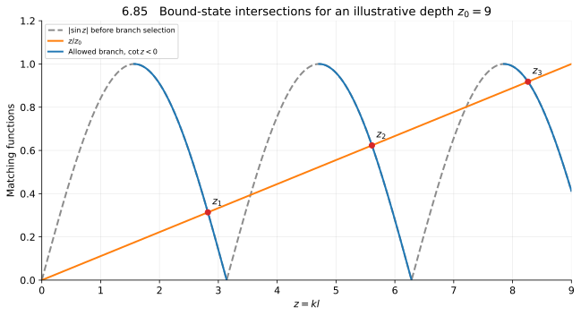

# 6.2 Wave Properties of Particles. Schrodinger Equation

[Chapter index](../README.md#chapters) · [Structured solutions](6.2.json) · [Answer audit](../audit/README.md)

## 6.49

**Solved · high confidence.** Evaluate h divided by the nonrelativistic momentum for each particle at the same kinetic energy.

**Assumptions**

- The de Broglie wavelength is the full wavelength λ = h/p = 2πħ/p, as printed in the chapter header.
- At 100 eV all three particles are nonrelativistic. Approximate the unspecified uranium atom by uranium-238 with mass 238 u; its natural isotope and atomic binding corrections are immaterial at the requested precision.

Use kinetic energy to determine momentum. The common energy is converted from electronvolts to joules for SI masses.

$$
T=100\ \mathrm{eV}=1.602\times10^{-17}\ \mathrm J,\qquad p=\sqrt{2mT},\qquad\lambda=\frac{h}{\sqrt{2mT}}.
$$

Insert the Appendix electron and proton masses and the explicitly approximate uranium-238 atom mass.

$$
\lambda_e=1.22579\times10^{-10}\ \mathrm m,\qquad\lambda_p=2.86125\times10^{-12}\ \mathrm m,\qquad\lambda_U=1.86137\times10^{-13}\ \mathrm m.
$$

**Results**

Electron wavelength

$$
\lambda_e\simeq0.123\ \mathrm{nm}
$$

Proton wavelength

$$
\lambda_p\simeq2.86\ \mathrm{pm}
$$

Uranium atom wavelength using mass approximately 238 u

$$
\lambda_U\simeq0.186\ \mathrm{pm}
$$

**Limitations**

- The uranium isotope is not specified; the displayed numerical estimate adopts the locally documented 238 u approximation.

## 6.50

**Solved · high confidence.** Find the kinetic energy associated with each de Broglie momentum and subtract.

**Assumptions**

- Adding energy changes the electron kinetic energy while its rest mass is fixed. Use λ = h/p, with the exact relativistic energy relation; also show the accurate nonrelativistic limit.
- The supplied wavelengths are in picometres, not nanometres.

Express kinetic energy directly as a function of wavelength.

$$
p=h/\lambda,\qquad T(\lambda)=\sqrt{m_e^2c^4+(hc/\lambda)^2}-m_ec^2.
$$

Subtract the initial kinetic energy from the final one. The electron rest energies cancel.

$$
\Delta T=\sqrt{m_e^2c^4+\left[\frac{hc}{50\,\mathrm{pm}}\right]^2}-\sqrt{m_e^2c^4+\left[\frac{hc}{100\,\mathrm{pm}}\right]^2}=450.435\ \mathrm{eV}.
$$

Since the energies are below one keV, the nonrelativistic expression gives essentially the same two-significant-figure answer.

$$
\Delta T_{\rm nr}=\frac{h^2}{2m_e}\left(\lambda_2^{-2}-\lambda_1^{-2}\right)=450.766\ \mathrm{eV}.
$$

**Results**

Required added electron energy

$$
\Delta T\simeq4.5\times10^2\ \mathrm{eV}
$$

Nonrelativistic approximation

$$
\Delta T_{\rm nr}\simeq450.77\ \mathrm{eV}
$$

## 6.51

**Solved · high confidence.** Transform both momenta to the two-particle center-of-mass frame before the collision.

**Assumptions**

- The neutron has kinetic energy 25 eV in the laboratory, and the deuteron is initially at rest. Nonrelativistic center-of-mass kinematics is sufficient.
- The question concerns the incoming momenta expressed in the center-of-mass frame. No scattering angle or post-collision reaction channel is supplied.
- Use the Appendix-derived neutron mass and the deuterium nuclear mass after subtracting the electron from the neutral isotope mass.

The laboratory neutron momentum fixes the center-of-mass velocity.

$$
p=\sqrt{2m_nT},\qquad V_{\rm cm}=\frac{p}{m_n+m_d}.
$$

Subtract the translational momentum of each particle. Their center-of-mass momenta have equal magnitudes and opposite signs.

$$
p_n^*=p-m_nV_{\rm cm}=\frac{m_d}{m_n+m_d}p,\qquad p_d^*=-m_dV_{\rm cm}=-p_n^*.
$$

Their different masses therefore do not produce different de Broglie wavelengths in this frame.

$$
\lambda_n^*=\lambda_d^*=\frac{h(m_n+m_d)}{m_d\sqrt{2m_nT}}=8.58300\times10^{-12}\ \mathrm m.
$$

**Results**

Neutron wavelength in the center-of-mass frame

$$
\lambda_n^*\simeq8.58\ \mathrm{pm}
$$

Deuteron wavelength in the center-of-mass frame

$$
\lambda_d^*=\lambda_n^*\simeq8.58\ \mathrm{pm}
$$

**Limitations**

- After a purely elastic collision the common momentum magnitude, and thus these wavelengths, is unchanged. Inelastic reactions would require additional data.

## 6.52

**Solved · high confidence.** Apply a Galilean center-of-mass boost to two equal masses with orthogonal initial momenta.

**Assumptions**

- The particles have equal mass and are nonrelativistic. Their initial laboratory momentum vectors are perpendicular, as specified.
- The wavelengths refer to momentum magnitudes; the center-of-mass momentum vectors are opposite.

For equal masses, half of the total momentum is subtracted from each laboratory momentum.

$$
\mathbf p_1^*=\frac{\mathbf p_1-\mathbf p_2}{2},\qquad\mathbf p_2^*=-\mathbf p_1^*.
$$

Orthogonality removes the cross term in the squared relative momentum.

$$
p^*=\frac12\sqrt{p_1^2+p_2^2}=\frac h2\sqrt{\lambda_1^{-2}+\lambda_2^{-2}}.
$$

Divide h by this common momentum magnitude.

$$
\lambda_1^*=\lambda_2^*=\frac{2}{\sqrt{\lambda_1^{-2}+\lambda_2^{-2}}}=\frac{2\lambda_1\lambda_2}{\sqrt{\lambda_1^2+\lambda_2^2}}.
$$

**Results**

Common wavelength in the center-of-mass frame

$$
\lambda_1^*=\lambda_2^*=\frac{2\lambda_1\lambda_2}{\sqrt{\lambda_1^2+\lambda_2^2}}
$$

## 6.53

**Solved · high confidence.** Evaluate the de Broglie wavelength at the mode of the Maxwell speed distribution.

**Assumptions**

- Take room temperature to mean 300 K and give the temperature scaling so another room-temperature convention can be used.
- Hydrogen means molecular H₂ with the printed molar mass 2.0 g/mol. The gas is dilute, classical and nonrelativistic; use m = M/N_A.

The Maxwell speed density is proportional to v² exp[−mv²/(2k_BT)]. Its maximum is at mv² = 2k_BT.

$$
v_{\rm mp}=\sqrt{\frac{2k_BT}{m}},\qquad m=\frac{M_{\rm H_2}}{N_A}.
$$

Evaluate the momentum wavelength at that speed; this is not yet the mode of the wavelength distribution.

$$
\lambda(v_{\rm mp})=\frac{h}{mv_{\rm mp}}=\frac{h}{\sqrt{2mk_BT}}=1.26298\times10^{-10}\ \mathrm m\quad(T=300\ \mathrm K).
$$

**Results**

Wavelength corresponding to the most probable molecular speed

$$
\lambda(v_{\rm mp})\simeq0.126\sqrt{300\,\mathrm K/T}\ \mathrm{nm}
$$

Numerical value is for 300 K; wavelength scales as T^(−1/2).

Most probable molecular speed at 300 K

$$
v_{\rm mp}\simeq1.58\times10^3\ \mathrm{m/s}
$$

**Limitations**

- A numerical room temperature is not specified in the statement; 300 K is explicit here. The displayed scaling permits direct conversion to another choice.

## 6.54

**Solved · high confidence.** Transform the Maxwell speed probability density into a wavelength density and maximize it.

**Assumptions**

- Take room temperature as 300 K, with an explicit T^(−1/2) scaling. Molecular hydrogen is classical and has mass M_H₂/N_A from the Appendix.
- Most probable wavelength means the mode of the probability density per unit wavelength, not the wavelength obtained by inserting the most probable speed.

The inverse relation v = h/(mλ) supplies a nonconstant Jacobian when changing the Maxwell speed density.

$$
f_\lambda(\lambda)=f_v\left(\frac h{m\lambda}\right)\frac h{m\lambda^2}\ \propto\ \lambda^{-4}\exp\left[-\frac{h^2}{2mk_BT\lambda^2}\right],\qquad\lambda>0.
$$

Differentiate the logarithm of this density to locate its maximum.

$$
\frac{d}{d\lambda}\ln f_\lambda=-\frac4\lambda+\frac{h^2}{mk_BT\lambda^3}=0,\qquad\lambda_{\rm mp}=\frac{h}{2\sqrt{mk_BT}}.
$$

Insert the molecular mass and temperature, and compare with the mode-speed wavelength.

$$
\lambda_{\rm mp}=8.93062\times10^{-11}\ \mathrm m=\frac{\lambda(v_{\rm mp})}{\sqrt2}\quad(T=300\ \mathrm K).
$$

**Results**

Most probable molecular de Broglie wavelength

$$
\lambda_{\rm mp}=\frac{h}{2\sqrt{mk_BT}}\simeq0.0893\sqrt{300\,\mathrm K/T}\ \mathrm{nm}
$$

Numerical value is for 300 K.

**Limitations**

- The numerical answer depends on the explicit 300 K room-temperature convention; the analytic result is provided for any T.

## 6.55

**Solved · high confidence.** Relate de Broglie momentum to relativistic kinetic energy and bound the approximation error.

**Assumptions**

- T is kinetic energy, m is rest mass, and λ = h/p is the full de Broglie wavelength.
- The primary relative error is measured against the exact wavelength: (λ_nr − λ_rel)/λ_rel. Also give the alternative normalization to λ_nr because the statement does not specify its denominator.
- Numerical limits use the Appendix SI rest masses and c consistently; independently rounded rest-energy representations differ only in guard digits.

Eliminate total energy from the relativistic energy-momentum relation.

$$
(T+mc^2)^2=m^2c^4+p^2c^2,\qquad p^2c^2=T(T+2mc^2),\qquad\lambda_{\rm rel}=\frac{hc}{\sqrt{T(T+2mc^2)}}.
$$

Compare with the nonrelativistic expression. It overestimates wavelength at fixed kinetic energy.

$$
\lambda_{\rm nr}=\frac{h}{\sqrt{2mT}},\qquad\frac{\lambda_{\rm nr}}{\lambda_{\rm rel}}=\sqrt{1+\frac{T}{2mc^2}}.
$$

Bound the primary error by η = 0.01 and solve exactly for kinetic energy.

$$
\epsilon_{\rm exact}=\sqrt{1+T/(2mc^2)}-1\le\eta\quad\Longrightarrow\quad T\le2mc^2[(1+\eta)^2-1]=0.0402mc^2.
$$

If error is normalized instead by the approximate wavelength, solve the slightly different inequality.

$$
\epsilon_{\rm nr}=1-[1+T/(2mc^2)]^{-1/2}\le\eta\quad\Longrightarrow\quad T\le2mc^2[(1-\eta)^{-2}-1]=0.0406081mc^2.
$$

**Results**

Exact relativistic de Broglie wavelength

$$
\lambda=hc/\sqrt{T(T+2mc^2)}
$$

Electron upper kinetic energy for 1% error relative to exact λ

$$
0<T_e\le0.0402m_ec^2\simeq20.5\ \mathrm{keV}
$$

Proton upper kinetic energy for 1% error relative to exact λ

$$
0<T_p\le0.0402m_pc^2\simeq37.7\ \mathrm{MeV}
$$

Electron limit if error is divided by the approximate wavelength

$$
T_e\le0.0406081m_ec^2\simeq20.8\ \mathrm{keV}
$$

Proton limit if error is divided by the approximate wavelength

$$
T_p\le0.0406081m_pc^2\simeq38.1\ \mathrm{MeV}
$$

## 6.56

**Solved · high confidence.** Apply the book’s reduced-Compton convention before solving the relativistic momentum relation.

**Assumptions**

- In the book, the printed Compton wavelength symbol denotes the reduced length ħ/(m_e c), as documented by Appendix 30 and the established chapter convention. De Broglie wavelength is the full wavelength h/p = 2πħ/p.
- Use the defining identities for the comparison, rather than combining separately rounded numerical wavelength and mass representations.
- For clarity, provide a separate conditional result for the common alternative convention in which Compton wavelength means h/(m_e c).

Equating the full de Broglie wavelength to the book’s reduced Compton length fixes momentum at 2π times m_e c.

$$
\frac{2\pi\hbar}{p}=\frac{\hbar}{m_ec}\quad\Longrightarrow\quad p=2\pi m_ec.
$$

Insert that momentum in the relativistic kinetic energy formula.

$$
T=\sqrt{m_e^2c^4+p^2c^2}-m_ec^2=m_ec^2\left(\sqrt{1+4\pi^2}-1\right)\simeq2.74\ \mathrm{MeV}.
$$

Under the alternative full-Compton definition, equality would instead give p = m_e c and a different kinetic energy.

$$
\lambda_C^{\rm full}=h/(m_ec):\quad p=m_ec,\qquad T=(\sqrt2-1)m_ec^2\simeq0.212\ \mathrm{MeV}.
$$

**Results**

Kinetic energy using the book’s reduced Compton length

$$
T=(\sqrt{1+4\pi^2}-1)m_ec^2\simeq2.74\ \mathrm{MeV}
$$

Conditional result for the full Compton wavelength h/(m_e c)

$$
T=(\sqrt2-1)m_ec^2\simeq0.212\ \mathrm{MeV}
$$

This is a notation comparison, not the result under the book’s reduced-length definition.

## 6.57

**Solved · high confidence.** Infer incident electron kinetic energy from the bremsstrahlung cutoff and use relativistic de Broglie momentum.

**Assumptions**

- At the short-wavelength cutoff, one photon takes essentially the entire kinetic energy of an electron at the anticathode. Target recoil is negligible.
- The specified 10.0 pm is a photon wavelength, while the requested result is the electron de Broglie wavelength. Relativity is retained for the approximately 124 keV electron.

Use the maximum photon energy to determine the electron kinetic energy.

$$
T_e=E_{\gamma,\max}=hc/\lambda_{\rm sh}=123.934\ \mathrm{keV}.
$$

Relate kinetic energy to electron momentum and express the electron wavelength in terms of the photon cutoff.

$$
p_ec=\sqrt{T_e(T_e+2m_ec^2)},\qquad\lambda_e=\frac{hc}{\sqrt{T_e(T_e+2m_ec^2)}}=\frac{\lambda_{\rm sh}}{\sqrt{1+2m_ec^2\lambda_{\rm sh}/(hc)}}.
$$

Insert the specified cutoff and the Appendix electron mass and photon constants.

$$
\lambda_e=3.28830\times10^{-12}\ \mathrm m\simeq3.29\ \mathrm{pm}.
$$

**Results**

Electron de Broglie wavelength at the anticathode

$$
\lambda_e=\frac{\lambda_{\rm sh}}{\sqrt{1+2m_ec^2\lambda_{\rm sh}/(hc)}}\simeq3.29\ \mathrm{pm}
$$

Incident electron kinetic energy inferred from the cutoff

$$
T_e=hc/\lambda_{\rm sh}\simeq124\ \mathrm{keV}
$$

## 6.58

**Solved · high confidence.** Use the full single-aperture central-maximum width to infer wavelength and then electron speed.

**Assumptions**

- The central-maximum width is measured between the first zeros along a screen direction parallel to one side of the square aperture, not along a diagonal.
- The screen is perpendicular to the incident beam. The angular single-aperture minimum satisfies b sinα = λ; the aperture is in the far field at the stated distance.
- The resulting electron speed is nonrelativistic. A small relativistic momentum-to-speed correction is shown as a check.

Each first zero lies half the stated full width from the central axis. Keep the geometric tangent before making the small-angle approximation.

$$
\tan\alpha=\frac{\Delta x}{2l},\qquad\lambda=b\sin\alpha=\frac{b\Delta x}{\sqrt{4l^2+\Delta x^2}}\simeq3.60\times10^{-10}\ \mathrm m.
$$

Use momentum p = h/λ and the nonrelativistic velocity relation.

$$
v\simeq\frac{h}{m_e\lambda}=\frac{2hl}{m_eb\Delta x}\simeq2.01929\times10^6\ \mathrm{m/s}.
$$

The exact relativistic speed for the inferred momentum differs by only about 0.0023%.

$$
v_{\rm rel}=\frac{h/(m_e\lambda)}{\sqrt{1+[h/(m_ec\lambda)]^2}}\simeq2.01925\times10^6\ \mathrm{m/s}.
$$

**Results**

Electron speed from the diffraction width

$$
v\simeq2.02\times10^6\ \mathrm{m/s}
$$

Inferred electron wavelength

$$
\lambda\simeq0.360\ \mathrm{nm}
$$

Relativistic speed check at the same inferred momentum

$$
v_{\rm rel}\simeq2.01925\times10^6\ \mathrm{m/s}
$$

## 6.59

**Solved · high confidence.** Determine the accelerated electron wavelength and apply the two-slit path-difference condition.

**Assumptions**

- The electron starts with negligible kinetic energy, so acceleration through 25 V gives kinetic energy eV. The two slits are coherently illuminated.
- Neighbouring central fringes are observed on a screen perpendicular to the beam in the paraxial region. The slit widths affect the envelope but not the stated two-slit spacing.
- The exact relativistic wavelength is used numerically; at 25 eV its correction is negligible at the printed precision.

Convert the acceleration energy to momentum and wavelength.

$$
T=eV,\qquad\lambda=\frac{hc}{\sqrt{eV(eV+2m_ec^2)}}\simeq\frac{h}{\sqrt{2m_eeV}}\simeq0.245\ \mathrm{nm}.
$$

Adjacent maxima differ in path by one wavelength. For small observation angles the screen spacing is lλ/d.

$$
d\sin\alpha_q=q\lambda,\qquad\Delta x\simeq\frac{l\lambda}{d}=4.90309\times10^{-6}\ \mathrm m.
$$

**Results**

Distance between neighbouring central interference maxima

$$
\Delta x=l\lambda/d\simeq4.9\ \mathrm{\mu m}
$$

## 6.60

**Solved · high confidence.** Identify the two successive Bragg orders from their voltage ratio, then apply the correct incidence geometry.

> **Audit update.** If the 30° angle is measured from the crystal face, as in the book’s Bragg-angle convention, the voltage is 150.26 V. If measured from the normal, the independent result is 50.09 V.

**Assumptions**

- The angle of incidence 30° is measured from the facet normal, following the standard optical convention. The reflecting lattice planes are parallel to the facet.
- Neglect the crystal inner potential and use elastic, nonrelativistic electron diffraction. The ratio 2.25 is a rounded experimental datum; the small relativistic correction at approximately 50 V is far below its precision.
- Successive maxima are consecutive positive Bragg orders j and j + 1 at fixed crystal orientation.

Convert the stated incidence angle from the normal to the glancing Bragg angle from the planes.

$$
\alpha=90^\circ-\theta=60^\circ,\qquad j\lambda_j=2d\sin\alpha=2d\cos\theta.
$$

At low energy wavelength is proportional to V^(−1/2), so increasing the Bragg order by one fixes the accelerating-voltage ratio.

$$
\eta=\frac{V_{j+1}}{V_j}=\left(\frac{j+1}{j}\right)^2,\qquad\sqrt\eta=1.5,\qquad j=\frac1{\sqrt\eta-1}=2.
$$

The first observed maximum is therefore second order. Its wavelength fixes the acceleration voltage.

$$
\lambda_0=\frac{2d\cos30^\circ}{2}=d\cos30^\circ=0.173205\ \mathrm{nm},\qquad V_0=\frac{h^2}{2m_ee\lambda_0^2}=50.0851\ \mathrm V.
$$

Holding this inferred order and geometrical wavelength fixed, exact kinetic energy gives only a tiny voltage refinement.

$$
V_{0,\rm rel}=\frac{\sqrt{m_e^2c^4+(hc/\lambda_0)^2}-m_ec^2}{e}=50.0827\ \mathrm V.
$$

**Results**

Initial accelerating voltage in the intended low-energy model

$$
V_0=\frac{h^2}{2m_ee[d\cos30^\circ]^2}\simeq50\ \mathrm V
$$

Order of the initial mirror-reflection maximum

$$
j=2
$$

Small relativistic refinement at the same inferred Bragg wavelength

$$
V_{0,\rm rel}\simeq50.0827\ \mathrm V
$$

**Limitations**

- Inner-potential refraction is neglected because no inner potential is specified for this crystal. If the 30° angle were instead explicitly measured from the planes, the inferred voltage would differ; the stored result uses the stated incidence convention.

## 6.61

**Solved · high confidence.** Use the elastic momentum-transfer vector to identify the reflecting planes and Bragg angle.

**Assumptions**

- Take the surface outward normal as +z. The normally incident electron travels along −z, while the reflected beam makes 55° with +z.
- The corresponding reflecting planes need not be parallel to the surface. Their reciprocal-lattice normal is along the momentum transfer q = p_f − p_i.
- Use elastic kinematic diffraction with order j = 4 and neglect the unspecified crystal inner potential. The exact relativistic wavelength is used numerically, with a negligible correction at 180 eV.

Calculate the electron momentum wavelength from its kinetic energy.

$$
\lambda=\frac{hc}{\sqrt{T(T+2m_ec^2)}}\simeq9.13567\times10^{-11}\ \mathrm m.
$$

The incident propagation direction and the outgoing reflected ray form the supplementary angle 180° − θ. Thus the momentum-transfer magnitude contains cos(θ/2).

$$
\mathbf p_i=-p\hat{\mathbf z},\quad\mathbf p_f=p(\sin\theta\,\hat{\mathbf x}+\cos\theta\,\hat{\mathbf z}),\quad|\mathbf q|=2p\cos(\theta/2).
$$

A reflection of order j from spacing d has momentum transfer jh/d. Equivalently, the glancing Bragg angle is 90° − θ/2.

$$
|\mathbf q|=jh/d,\qquad\alpha=90^\circ-\theta/2=62.5^\circ,\qquad d=\frac{j\lambda}{2\cos(\theta/2)}=2.05988\times10^{-10}\ \mathrm m.
$$

The plane normal tilts by θ/2 relative to the surface normal, so a nonzero outgoing angle is consistent with normal incidence on the surface.

$$
\tan\chi=\frac{\sin\theta}{1+\cos\theta}=\tan(\theta/2),\qquad\chi=27.5^\circ.
$$

**Results**

Interplanar distance for the fourth-order reflection

$$
d=\frac{4\lambda}{2\cos27.5^\circ}\simeq0.206\ \mathrm{nm}
$$

Reflecting-plane normal tilt from the outward surface normal

$$
\chi=27.5^\circ
$$

**Limitations**

- The external-direction interpretation uses the outward normal for the reflected ray. A different signed-angle convention would need to be stated explicitly. Crystal inner-potential refraction is outside the supplied ideal model.

## 6.62

**Solved · high confidence.** Convert the powder-ring radius to the scattering angle and apply the third-order Bragg condition.

**Assumptions**

- The screen is perpendicular to the incident beam and lies behind the transmitting foil. The diffraction ring is centered on the undeflected beam.
- The powder ring radius is D/2. The angle between incident and scattered propagation directions is twice the Bragg glancing angle.
- The electrons have kinetic energy 10 keV; retain relativistic momentum and the exact screen geometry. Neglect the small, unspecified inner potential and multiple diffraction.

Calculate the relativistic de Broglie wavelength at the stated kinetic energy.

$$
\lambda=\frac{hc}{\sqrt{T(T+2m_ec^2)}}=1.21984\times10^{-11}\ \mathrm m.
$$

Use the ring radius, not its diameter, to find the full scattering angle.

$$
\tan(2\alpha)=\frac{D/2}{l}=0.160,\qquad\alpha=\frac12\arctan(0.160)=4.54514^\circ.
$$

The third-order reflection condition gives the interplanar distance.

$$
2d\sin\alpha=3\lambda,\qquad d=\frac{3\lambda}{2\sin[\tfrac12\arctan(D/(2l))]}=2.30900\times10^{-10}\ \mathrm m.
$$

**Results**

Interplanar spacing from the third-order powder ring

$$
d\simeq0.231\ \mathrm{nm}
$$

Bragg glancing angle

$$
\alpha\simeq4.545^\circ
$$

## 6.63

**Solved · high confidence.** Use momentum increase in an attractive inner potential to define the electron wave refractive index.

**Assumptions**

- The positive inner potential V_i lowers the electron potential energy by eV_i, so its kinetic energy rises from eV outside to e(V + V_i) inside.
- Use the nonrelativistic wave index n = k_inside/k_outside = λ_outside/λ_inside. This equals the inside-to-outside speed ratio.
- The stated 1.0% difference from unity is n − 1 ≤ 0.010, with positive accelerating and inner potentials.

At a flat interface the tangential wave vector is conserved. The momentum ratio therefore gives the Snell-law index for electron waves.

$$
n=\frac{p_{\rm in}}{p_{\rm out}}=\sqrt{\frac{V+V_i}{V}}=\sqrt{1+\frac{V_i}{V}}.
$$

Substitute the given voltage and inner potential for part (a).

$$
n(V=150\ \mathrm V)=\sqrt{1+15/150}=\sqrt{1.1}=1.04880885.
$$

Solve the index tolerance exactly rather than stopping at a linear expansion.

$$
\sqrt{1+V_i/V}-1\le\eta\quad\Longrightarrow\quad\frac{V}{V_i}\ge\frac{1}{(1+\eta)^2-1}=49.7512,\qquad\eta=0.010.
$$

**Results**

Metal refractive index for the 150 V electron beam

$$
n=\sqrt{1.1}\simeq1.049
$$

Allowed accelerating-to-inner-potential ratio for at most 1% index difference

$$
V/V_i\ge1/(2\eta+\eta^2)=49.7512\simeq50
$$

Equivalent minimum voltage for V_i = 15 V

$$
V\ge746.27\ \mathrm V
$$

**Limitations**

- The supplied chapter model is nonrelativistic. At 150 V and near the tolerance boundary the relativistic correction is well below the printed precision.

## 6.64

**Solved · high confidence.** Fit an integer number of standing-wave half wavelengths between the infinite walls.

**Assumptions**

- The one-dimensional nonrelativistic well occupies 0 < x < l. Set its constant internal potential to zero and require the wave function to vanish at both infinitely high walls.
- A bound state is a standing wave containing both signs of momentum; the quantized p used in energy is the momentum magnitude of each traveling-wave component.

The boundary condition allows n positive half wavelengths across the well.

$$
l=n\lambda_n/2,\qquad\lambda_n=2l/n,\qquad n=1,2,3,\ldots.
$$

Use the de Broglie relation to get the allowed momentum magnitudes and kinetic energies.

$$
p_n=h/\lambda_n=\frac{nh}{2l}=\frac{n\pi\hbar}{l},\qquad E_n=\frac{p_n^2}{2m}=\frac{n^2h^2}{8ml^2}=\frac{n^2\pi^2\hbar^2}{2ml^2}.
$$

The corresponding normalized standing waves satisfy both wall conditions. The n = 0 sine is identically zero and is not a state.

$$
\psi_n(x)=\sqrt{2/l}\sin(n\pi x/l),\qquad n\ge1.
$$

**Results**

Permitted energies measured from the well bottom

$$
E_n=\frac{n^2\pi^2\hbar^2}{2ml^2},\qquad n=1,2,3,\ldots
$$

## 6.65

**Solved · high confidence.** Impose single-valued phase around the circular orbit and use the de Broglie wavelength.

**Assumptions**

- This is the semiclassical circular-orbit interpretation of the Bohr condition, not a claim that the full quantum hydrogen eigenstates are literal electron trajectories.
- The particle momentum magnitude is constant along the orbit. The wave amplitude must return to the same phase after one complete circuit.

The de Broglie wavelength is λ=2pi hbar/p. A whole number of wavelengths around the circumference makes the accumulated phase2pi times an integer.

$$
2\pi r=n\lambda,\qquad \lambda=\frac{2\pi\hbar}{p},\qquad n=1,2,\ldots.
$$

Eliminate the wavelength to obtain the Bohr angular-momentum condition.

$$
2\pi r=n\frac{2\pi\hbar}{p}\quad\Longrightarrow\quad pr=n\hbar,\qquad L=n\hbar.
$$

Equivalently, the phase integral around the closed orbit is quantized. For a circular Coulomb orbit this also reproduces the permitted Bohr radii.

$$
\oint\frac{\mathbf p\cdot d\mathbf r}{\hbar}=2\pi n,\qquad \frac{p^2}{m_er}=\frac{\kappa}{r^2}\quad\Longrightarrow\quad r_n=\frac{n^2\hbar^2}{m_e\kappa},\quad\kappa=k_e e^2.
$$

**Results**

Whole-number de Broglie waves fit around the orbit

$$
\boxed{2\pi r=n\lambda\iff pr=n\hbar},\quad n=1,2,\ldots
$$

**Limitations**

- Exact hydrogen orbital angular momenta are governed by quantum angular-momentum eigenvalues and selection rules; this argument is the requested old circular-orbit wave picture.

## 6.66

**Solved · high confidence.** Relate position-momentum uncertainty to nonrelativistic velocity uncertainty for each mass.

**Assumptions**

- The chapter prints the order-of-magnitude relation Delta x Delta p_x greater than or of order hbar. For genuine RMS standard deviations the sharp Robertson bound is sigma_x sigma_p>=hbar/2. These are different precision conventions; the factor1/2 is retained whenever an exact RMS bound is stated.
- Use a single Cartesian component and p_x=m v_x. The ball mass is 1 mg=1e-6kg. These are intrinsic quantum dispersions or localization scales, not a universal model of apparatus error.
- The sharp RMS numbers require interpreting the quoted coordinate uncertainty as sigma_x=1micrometre and can be saturated by a suitable minimum-uncertainty Gaussian.

At the chapter estimation level, divide the momentum uncertainty scale by the mass.

$$
\Delta p_x\sim\frac\hbar{\Delta x},\qquad \Delta v_x\sim\frac\hbar{m\Delta x}.
$$

Substitute the electron, proton, and ball masses withDelta x=1e-6 m.

$$
\Delta v_e\sim1.15697\times10^2\,\mathrm{m/s},\qquad\Delta v_p\sim6.30383\times10^{-2}\,\mathrm{m/s},\qquad\Delta v_{\rm ball}\sim1.054\times10^{-22}\,\mathrm{m/s}.
$$

If the width is genuinely an RMS standard deviation, Robertson gives lower bounds one half of the preceding scales, not an equality for arbitrary states.

$$
\sigma_{v_x}\ge\frac\hbar{2m\sigma_x};\qquad(e,p,\text{ball}):\ (57.85,\ 0.03152,\ 5.27\times10^{-23})\,\mathrm{m/s}.
$$

**Results**

electron velocity-component uncertainty, chapter estimate

$$
\Delta v_x\sim\hbar/(m\Delta x)
$$

electron sharp RMS lower bound if sigma_x=1micrometre

$$
\sigma_{v_x}\ge\hbar/(2m\sigma_x)
$$

proton velocity-component uncertainty, chapter estimate

$$
\Delta v_x\sim\hbar/(m\Delta x)
$$

proton sharp RMS lower bound if sigma_x=1micrometre

$$
\sigma_{v_x}\ge\hbar/(2m\sigma_x)
$$

ball velocity-component uncertainty, chapter estimate

$$
\Delta v_x\sim\hbar/(m\Delta x)
$$

ball sharp RMS lower bound if sigma_x=1micrometre

$$
\sigma_{v_x}\ge\hbar/(2m\sigma_x)
$$

**Limitations**

- A coordinate support width, a resolution interval, and an RMS standard deviation are not generally equal; their numerical uncertainty prefactors should not be interchanged.

## 6.67

**Solved · high confidence.** Use the atomic size as a localization scale and compare its uncertainty momentum with the Bohr momentum.

**Assumptions**

- The chapter prints the order-of-magnitude relation Delta x Delta p_x greater than or of order hbar. For genuine RMS standard deviations the sharp Robertson bound is sigma_x sigma_p>=hbar/2. These are different precision conventions; the factor1/2 is retained whenever an exact RMS bound is stated.
- Treatl=0.10 nm as the characteristic electron localization length. The atom size is not specified as an RMS width, so only the scale is fixed.
- The comparison is with the positive orbital speed of the Bohr model, not the vector expectation value of velocity in a stationary quantum state.

UseDelta p of orderhbar/l and divide by the electron mass.

$$
\Delta v\sim\frac\hbar{m_el}=1.1569704\times10^6\,\mathrm{m/s}\sim10^6\,\mathrm{m/s}.
$$

Bohr angular momentum on the first orbit gives its speed from the tabulated Bohr radius.

$$
v_B=\frac\hbar{m_ea_0}=2.1870895\times10^6\,\mathrm{m/s},\qquad\frac{\Delta v}{v_B}\sim\frac{a_0}{l}=0.529.
$$

The uncertainty is therefore comparable in order of magnitude with the Bohr speed. If l were instead an RMS coordinate standard deviation, the sharp velocity lower bound would be half the chapter estimate.

$$
\sigma_x=l:\qquad\sigma_v\ge\frac\hbar{2m_el}=5.78485\times10^5\,\mathrm{m/s}.
$$

**Results**

Electron velocity uncertainty scale in a hydrogen atom

$$
\boxed{\Delta v\sim1.2\times10^6\,\mathrm{m/s}}
$$

Bohr first-orbit speed

$$
v_B\simeq2.19\times10^6\,\mathrm{m/s}
$$

Estimated uncertainty relative to Bohr speed

$$
\Delta v/v_B\sim a_0/l\simeq0.53
$$

**Limitations**

- The atom diameter, radial decay length, and coordinate standard deviation are different length measures; changing the choice changes the order-one prefactor.

## 6.68

**Solved · high confidence.** Combine the de Broglie wavelength with the uncertainty relation and use nonrelativistic momentum-velocity proportionality.

**Assumptions**

- The chapter prints the order-of-magnitude relation Delta x Delta p_x greater than or of order hbar. For genuine RMS standard deviations the sharp Robertson bound is sigma_x sigma_p>=hbar/2. These are different precision conventions; the factor1/2 is retained whenever an exact RMS bound is stated.
- Assume nonrelativistic motionp=m v, as in the chapter Schrödinger treatment. The quantityv is a characteristic or mean longitudinal velocity scale associated with the stated de Broglie momentum.

The specified position scale equals the reduced de Broglie wavelength, hbar/p.

$$
\Delta x=\frac\lambda{2\pi},\qquad\lambda=\frac{2\pi\hbar}{p}\quad\Longrightarrow\quad\Delta x=\frac\hbar p.
$$

At the chapter estimation level, the momentum uncertainty is of order the momentum itself.

$$
\Delta p\sim\frac\hbar{\Delta x}=p,\qquad\frac{\Delta v}{v}=\frac{\Delta p}{p}\sim1.
$$

For exact RMS quantities, the same substituted length only implies a lower bound of1/2 on the relative velocity dispersion; this is still an order-one uncertainty.

$$
\sigma_x=\hbar/p:\qquad\sigma_p\ge p/2,\qquad\sigma_v/v\ge1/2.
$$

**Results**

Velocity uncertainty is comparable with the velocity scale

$$
\boxed{\Delta v/v\sim1}
$$

Conditional sharp RMS inequality

$$
\sigma_x=\hbar/p\quad\Longrightarrow\quad\sigma_v/v\ge1/2
$$

**Limitations**

- Without the nonrelativistic assumption the momentum conclusion survives, but the claimed velocity scaling is not universal.

## 6.69

**Solved · medium confidence.** Choose a stated uncorrelated Gaussian width convention to compute a reproducible spreading time, then distinguish the general covariance-dependent evolution.

**Assumptions**

- The chapter prints the order-of-magnitude relation Delta x Delta p_x greater than or of order hbar. For genuine RMS standard deviations the sharp Robertson bound is sigma_x sigma_p>=hbar/2. These are different precision conventions; the factor1/2 is retained whenever an exact RMS bound is stated.
- The initial linear dimension is not given a statistical definition. For a reproducible benchmark take the unchirped Gaussianpsi(x,0) proportional toexp[-x squared/(2l squared)], so the probability density has1/e half-widthl and RMS widthsigma_x=l/sqrt2.
- The electron is free after release, nonrelativistic, and has zero initial position-momentum covariance. The mean velocity translates the packet but does not change its width.
- Localization size alone does not determine a unique spreading time for arbitrary packet shape, momentum variance, or initial covariance; the main numerical answer is a scale estimate under the stated benchmark.

For a general free particle the Heisenberg operator evolutionx(t)=x(0)+p(0)t/m gives the exact variance formula.

$$
\sigma_x^2(t)=\sigma_{x0}^2+\frac{2C_{xp,0}}m t+\frac{\sigma_{p0}^2}{m^2}t^2,\qquad C_{xp,0}=\tfrac12\langle\{x-\langle x\rangle,p-\langle p\rangle\}\rangle.
$$

The specified unchirped Gaussian hasC=0,sigma_x0=l/sqrt2, andsigma_p0=hbar/(sqrt2 l). It exactly saturates the RMS Robertson inequality. Its1/e half-width therefore evolves as follows.

$$
l(t)=l\sqrt{1+\left(\frac{\hbar t}{ml^2}\right)^2}.
$$

Set the width ratio toeta. This gives the Gaussian benchmark and the chapter time scale.

$$
t=\frac{ml^2}{\hbar}\sqrt{\eta^2-1}\sim\frac{\eta ml^2}{\hbar}=8.5999389\times10^{-16}\,\mathrm s\sim10^{-15}\,\mathrm s.
$$

If the quotedl were instead the initial RMS widthsigma_x0 of a minimum-uncertainty uncorrelated Gaussian, its exact growth time would be twice as long.

$$
\sigma_{x0}=l,\quad\sigma_{p0}=\hbar/(2l),\quad C_0=0:\qquad t_{\rm RMS}=\frac{2ml^2}{\hbar}\sqrt{\eta^2-1}=1.7199878\times10^{-15}\,\mathrm s.
$$

A nonzero covariance may produce initial contraction or faster expansion. The uncertainty inequality alone does not supply that covariance or force the Gaussian minimum momentum spread.

**Results**

Characteristic spreading time to ten times the initial width

$$
\boxed{t\sim10^{-15}\,\mathrm s}
$$

Explicit Gaussian1/e half-width benchmark

$$
t=(ml^2/\hbar)\sqrt{\eta^2-1}\simeq8.60\times10^{-16}\,\mathrm s
$$

Conditional benchmark if the givenl is an RMS width

$$
t_{\rm RMS}=(2ml^2/\hbar)\sqrt{\eta^2-1}\simeq1.72\times10^{-15}\,\mathrm s
$$

**Limitations**

- The quoted region is modeled as a characteristic width, not strict compact support. Other physically prepared packets can give different order-one factors or different contraction/expansion histories.

## 6.70

**Solved · medium confidence.** Estimate the localization momentum and convert it to nonrelativistic kinetic energy while identifying the missing geometrical prefactor.

**Assumptions**

- The chapter prints the order-of-magnitude relation Delta x Delta p_x greater than or of order hbar. For genuine RMS standard deviations the sharp Robertson bound is sigma_x sigma_p>=hbar/2. These are different precision conventions; the factor1/2 is retained whenever an exact RMS bound is stated.
- Interpretl=0.20 nm as a characteristic localization length and take zero mean momentum. The geometry and exact meaning of region size are not specified.
- The primary answer is a one-direction characteristic confinement energy. A three-dimensional box, an RMS width, and a strict hard-wall interval give different numerical coefficients.

At the chapter scaleDelta p of orderhbar/l, the minimum characteristic kinetic energy is of orderhbar squared/(2 m l squared).

$$
T_{\rm est}\sim\frac{(\Delta p)^2}{2m_e}\sim\frac{\hbar^2}{2m_el^2}.
$$

Evaluate with the supplied localization scale.

$$
T_{\rm est}=1.52430845\times10^{-19}\,\mathrm J=0.9515034\,\mathrm{eV}\sim1\,\mathrm{eV}.
$$

If l means an RMS standard deviation in one coordinate, Robertson instead gives a sharp lower bound, attainable by an unconfined Gaussian with that RMS width.

$$
\sigma_x=l:\qquad\langle T_x\rangle\ge\frac{\hbar^2}{8m_el^2}=0.2378759\,\mathrm{eV}.
$$

If l is the full width of a one-dimensional infinite square well, the exact ground energy is larger than the crude estimate bypi squared. A cubic three-dimensional well adds three such contributions.

$$
T_{1,\rm box}=\frac{\pi^2\hbar^2}{2m_el^2}=9.39096\,\mathrm{eV},\qquad T_{\rm cube}=3T_{1,\rm box}.
$$

**Results**

Chapter characteristic confinement energy

$$
\boxed{T_{\rm est}\sim\hbar^2/(2m_el^2)\sim1\,\mathrm{eV}}
$$

Conditional one-coordinate RMS lower bound

$$
\langle T_x\rangle\ge\hbar^2/(8m_el^2)\simeq0.238\,\mathrm{eV}
$$

Conditional exact one-dimensional hard-wall benchmark

$$
T_{1,\rm box}=\pi^2\hbar^2/(2m_el^2)\simeq9.39\,\mathrm{eV}
$$

**Limitations**

- No single exact minimum follows from a generic region size without a specified shape, boundary condition, and width definition.

## 6.71

**Solved · high confidence.** Compare the uncertainty momentum of the localized electron with its kinetic-energy momentum scale.

**Assumptions**

- The chapter prints the order-of-magnitude relation Delta x Delta p_x greater than or of order hbar. For genuine RMS standard deviations the sharp Robertson bound is sigma_x sigma_p>=hbar/2. These are different precision conventions; the factor1/2 is retained whenever an exact RMS bound is stated.
- Use a nonrelativistic electron and characteristic momentump_0=sqrt(2m_eT). Since the resulting relative uncertainty is small, the given kinetic energy may be identified with the motion scale without a significant uncertainty-energy correction.
- Treat the quoted1micrometre size as the characteristic uncertainty in the relevant coordinate. For an exact RMS interpretation the sharp lower-bound coefficient is one half.

Use the uncertainty momentumhbar/l and divide it by the electron momentum associated with 4 eV.

$$
\frac{\Delta v}{v}=\frac{\Delta p}{p_0}\sim\frac{\hbar}{l\sqrt{2m_eT}}.
$$

Substitute the localization scale and kinetic energy.

$$
\frac{\Delta v}{v}\sim9.7545036\times10^{-5}\sim10^{-4}.
$$

For an RMS coordinate standard deviationl, Robertson gives the corresponding conditional lower bound.

$$
\sigma_x=l:\qquad\frac{\sigma_v}{v}\ge\frac{\hbar}{2l\sqrt{2m_eT}}=4.8772518\times10^{-5}.
$$

**Results**

Chapter relative velocity uncertainty scale

$$
\boxed{\Delta v/v\sim9.8\times10^{-5}\sim10^{-4}}
$$

Conditional sharp RMS lower bound

$$
\sigma_v/v\ge4.88\times10^{-5}
$$

**Limitations**

- The actual uncertainty may exceed the estimated minimum scale; an exact bound coefficient requires a statistical width definition.

## 6.72

**Solved · high confidence.** Use the inverse-square confinement energy scaling and differentiate with respect to well width.

**Assumptions**

- The chapter prints the order-of-magnitude relation Delta x Delta p_x greater than or of order hbar. For genuine RMS standard deviations the sharp Robertson bound is sigma_x sigma_p>=hbar/2. These are different precision conventions; the factor1/2 is retained whenever an exact RMS bound is stated.
- The infinite one-dimensional well has full widthl and a particle in its minimum permitted energy state. Each wall experiences an equal outward force; their vector sum on the complete well is zero.
- The uncertainty argument determines a scale, not the exactpi-dependent hard-wall eigenvalue. The exact well result is supplied separately as a benchmark.

The characteristic momentum of a confined electron is of orderhbar/l, giving energy of orderhbar squared/(2m_el squared).

$$
E_0\sim\frac{\hbar^2}{2m_el^2}.
$$

When one wall is moved quasistatically, virtual work identifies the outward force withminus dE/dl.

$$
F_{\rm est}\sim-\frac{d}{dl}\left(\frac{\hbar^2}{2m_el^2}\right)=\frac{\hbar^2}{m_el^3}.
$$

The same scale follows from momentum reversal at each wall: a collision transfers2p and successive collisions on the same wall are separated by time2l/v.

$$
F\sim(2p)\frac{v}{2l}=\frac{p^2}{m_el}\sim\frac{\hbar^2}{m_el^3}.
$$

For the exact infinite-well ground statep=pi hbar/l, so its force ispi squared times the characteristic estimate.

$$
E_1=\frac{\pi^2\hbar^2}{2m_el^2},\qquad F_{\rm exact}=\frac{\pi^2\hbar^2}{m_el^3}.
$$

**Results**

Outward force scale on each wall

$$
\boxed{F\sim\hbar^2/(m_el^3)}
$$

Exact hard-wall ground-state force benchmark

$$
F_{\rm exact}=\pi^2\hbar^2/(m_el^3)
$$

Magnitude on each wall; opposite walls experience opposite force vectors.

**Limitations**

- The uncertainty principle alone does not determine the hard-wall π squared coefficient.

## 6.73

**Solved · high confidence.** Minimize the harmonic energy using the sharp RMS uncertainty relation and verify that its bound is attainable.

**Assumptions**

- Letk>0,m>0, and Ω=sqrt(k/m). Set the mean coordinate and mean momentum to zero, since either nonzero mean adds positive energy.
- Use the sharp Robertson standard-deviation relation sigma_x sigma_p>=hbar/2 for the exact calculation. The chapter order-of-magnitude Delta x Delta p of orderhbar only fixes the scale and cannot by itself select the zero-point coefficient1/2.

The energy is the sum of momentum and position variances. Eliminate sigma_p with its exact lower bound.

$$
\langle H\rangle=\frac{\sigma_p^2}{2m}+\frac{k\sigma_x^2}{2}\ge\frac{\hbar^2}{8m\sigma_x^2}+\frac{k\sigma_x^2}{2}.
$$

Minimize the right-hand side over the positive width. At its minimum kinetic and potential energies are equal.

$$
\sigma_x^2=\frac{\hbar}{2m\Omega},\qquad\sigma_p^2=\frac{m\hbar\Omega}{2},\qquad\langle H\rangle\ge\frac{\hbar\Omega}{2}.
$$

A zero-chirp Gaussian has exactly these variances, saturates Robertson, and is the harmonic-oscillator ground state. Therefore the lower bound is attained and is exact.

$$
\psi_0(x)=\left(\frac{m\Omega}{\pi\hbar}\right)^{1/4}e^{-m\Omega x^2/(2\hbar)},\qquad\boxed{E_0=\frac\hbar2\sqrt{\frac km}}.
$$

If instead one substitutes the rough chapter estimateDelta p approximatelyhbar/Delta x into the same classical energy expression, minimization giveshbar Omega. That is a correct order-of-magnitude estimate but not the exact zero-point energy.

$$
E_{\rm chapter}\sim\hbar\Omega,\qquad E_0=\tfrac12\hbar\Omega.
$$

**Results**

Minimum harmonic-oscillator energy

$$
\boxed{E_0=\tfrac12\hbar\sqrt{k/m}}
$$

Order-of-magnitude uncertainty estimate

$$
E_{\rm est}\sim\hbar\sqrt{k/m}
$$

The exact coefficient1/2 follows from the sharp RMS inequality and attainability, not the chapter scale relation alone.

## 6.74

**Solved · high confidence.** Minimize a characteristic Coulomb localization energy, then independently validate it with the exact exponential ground-state family.

**Assumptions**

- Use a fixed proton and nonrelativistic electron with Coulomb potentialU=-kappa/r, wherekappa=k_e e squared in SI. Nuclear recoil, spin, and relativistic corrections are neglected.
- The uncertainty substitutionp of orderhbar/a is a scale estimate. The radial distancea is not an RMS Cartesian coordinate, so replacinghbar byhbar/2 in that substitution would not be a justified sharp bound.
- To establish exactness beyond the crude estimate, use the explicitly normalized three-dimensional exponentialtrial psi_a=(pi a cubed)^(-1/2)exp(-r/a). Its expectation values and direct Schrödinger substitution can be computed independently.

Localization to a radial scalea gives a kinetic scalehbar squared/(2m_ea squared), competing with Coulomb energy-kappa/a.

$$
E_{\rm est}(a)\sim\frac{\hbar^2}{2m_ea^2}-\frac\kappa a.
$$

Minimize this expression overa. The minimizing length and energy have the familiar atomic scales.

$$
\frac{dE}{da}=0\quad\Longrightarrow\quad a_*=\frac{\hbar^2}{m_e\kappa},\qquad E_*=-\frac{m_e\kappa^2}{2\hbar^2}.
$$

For the exponential trial family, the same energy expression is an exact expectation, not merely an uncertainty substitution.

$$
\psi_a=\frac{e^{-r/a}}{\sqrt{\pi a^3}},\qquad\left\langle\frac1r\right\rangle=\frac1a,\qquad\langle p^2\rangle=\frac{\hbar^2}{a^2},\qquad\langle H\rangle_a=\frac{\hbar^2}{2m_ea^2}-\frac\kappa a.
$$

Directly apply the Hamiltonian. Ata=a_* the 1/r term cancels, so the nodeless normalizable trial function is the exact Coulomb ground state. The sharpness follows from this verification, not from uncertainty alone.

$$
\nabla^2e^{-r/a}=\left(\frac1{a^2}-\frac2{ar}\right)e^{-r/a},\qquad H\psi_a=\left[-\frac{\hbar^2}{2m_ea^2}+\frac{\hbar^2/(m_ea)-\kappa}{r}\right]\psi_a.
$$

Evaluate from the fundamental Appendix constants. Their derived values differ slightly from separately rounded historical tabulated atomic anchors, but both give the same intended atomic scale.

$$
a_*=5.2843425\times10^{-11}\,\mathrm m\simeq0.053\,\mathrm{nm},\qquad E_*=-13.62977\,\mathrm{eV}\simeq-13.6\,\mathrm{eV}.
$$

The apparent distancea_* is the exponential decay length and most probable radius of the radial probability distribution. Other radius statistics are not identical.

$$
r_{\rm radial\ mode}=a_*,\qquad\langle r\rangle=\frac32a_*,\qquad\sqrt{\langle r^2\rangle}=\sqrt3\,a_*.
$$

**Results**

Ground energy relative to a free electron at infinity

$$
\boxed{E_{\min}\simeq-13.6\,\mathrm{eV}}
$$

Characteristic apparent electron-nucleus distance

$$
\boxed{a_*\simeq5.3\times10^{-11}\,\mathrm m}
$$

Exponential length and radial-probability mode; the mean radius is 3a_*/2.

Positive binding energy

$$
B=-E_{\min}\simeq13.6\,\mathrm{eV}
$$

**Limitations**

- Exactness is for the one-electron fixed-proton nonrelativistic Coulomb Hamiltonian, not for reduced-mass, fine-structure, or QED corrections.

## 6.75

**Solved · medium confidence.** Balance initial beam width against quantum transverse spreading over the flight time, with an explicit width model.

**Assumptions**

- Use neutral hydrogen-1 atomic mass from the Appendix registry, not the H2 molecular mass. The mean longitudinal velocity is600 m/s, and the propagation time isL/v with L=1.0 m.
- The requested uncertainty-principle result is a characteristic slit-width scale. A literal full geometric slit width and a measured image width require a diffraction or aperture definition to fix an exact numerical coefficient.
- For a reproducible benchmark use an unchirped Gaussian transverse amplitude proportional toexp[-x squared/(2a squared)], and define the same width measurea as the 1/e half-width of its probability density at the aperture and screen. This is a smooth-aperture model, not a literal hard rectangular slit.
- The incoming beam has no deliberate transverse focusing correlation; its initially flat wavefront corresponds to zero position-momentum covariance.

A characteristic transverse localizationdelta produces momentum spread of orderhbar/delta. During the flight this produces transverse spreading of orderhbar L/(m_H v delta).

$$
\Delta x_{\rm dif}\sim\frac{\Delta p_x}{m_H}\frac Lv\sim\frac{\hbar L}{m_Hv\delta}.
$$

The minimum overall width occurs when the initial size and diffraction contribution are comparable, giving the robust characteristic scale.

$$
\delta\sim\frac{\hbar L}{m_Hv\delta}\quad\Longrightarrow\quad\boxed{\delta_{\rm opt}\sim\sqrt{\frac{\hbar L}{m_Hv}}\sim10^{-5}\,\mathrm m}.
$$

For the stated Gaussian convention this balance is an exact width minimization. Its1/e half-width evolves in quadrature.

$$
a_{\rm screen}^2=a^2+\left(\frac{\hbar L}{m_Hva}\right)^2,\qquad a_{\rm opt}=\sqrt{\frac{\hbar L}{m_Hv}},\qquad a_{\rm screen,min}=\sqrt2\,a_{\rm opt}.
$$

Evaluate this benchmark and spell out the corresponding RMS and full1/e widths instead of calling them the same physical slit width.

$$
a_{\rm opt}=1.0247006\times10^{-5}\,\mathrm m=10.2470\,\mathrm{\mu m},\quad\sigma_{x,\rm opt}=a_{\rm opt}/\sqrt2=7.2457\,\mathrm{\mu m},\quad W_{1/e,\rm full}=2a_{\rm opt}=20.4940\,\mathrm{\mu m}.
$$

A hard rectangular slit has algebraic diffraction tails and divergent momentum variance, so an RMS image width is not finite in the ideal hard-edge model. Its central-lobe width or another finite containment-width definition gives a different order-one optimum coefficient.

**Results**

Characteristic slit-width estimate for minimum spreading

$$
\boxed{\delta_{\rm opt}\sim\sqrt{\hbar L/(m_Hv)}\sim10\,\mathrm{\mu m}}
$$

Characteristic uncertainty scale; not an exact prediction for the full width of a hard slit.

Conditional Gaussian optimum aperture RMS width

$$
\sigma_{x,\rm opt}=\sqrt{\hbar L/(2m_Hv)}\simeq7.25\,\mathrm{\mu m}
$$

Conditional Gaussian full1/e-density width

$$
W_{1/e,\rm full}=2\sqrt{\hbar L/(m_Hv)}\simeq20.5\,\mathrm{\mu m}
$$

**Limitations**

- A sharply bounded rectangular slit requires a specified finite diffraction-width criterion; its RMS diffraction width is divergent. Initial focusing correlations would change the optimization.

## 6.76

**Solved · high confidence.** Use a momentum eigenmode whose temporal phase is fixed by the free-particle dispersion relation.

**Assumptions**

- Take the free potential to be zero and use the nonrelativistic time-dependent Schrödinger equation. Momentum vectorp and amplitudeA are constants.
- A plane wave is a generalized state, not a square-normalizable probability state over all space. It can be box normalized or superposed into a wave packet.

Try an exponential plane wave with the classical free kinetic energy in its temporal phase.

$$
\Psi(\mathbf r,t)=A\exp\left[\frac{i}{\hbar}\left(\mathbf p\cdot\mathbf r-\frac{p^2}{2m}t\right)\right].
$$

Time differentiation multiplies byE=p squared/(2 m); the spatial Laplacian multiplies by-p squared/hbar squared. Thus the two sides of the Schrödinger equation coincide.

$$
i\hbar\frac{\partial\Psi}{\partial t}=\frac{p^2}{2m}\Psi,\qquad-\frac{\hbar^2}{2m}\nabla^2\Psi=\frac{p^2}{2m}\Psi.
$$

Equivalently use a wave vectork=p/hbar and angular frequencyomega=hbar k squared/(2 m). A physical normalizable free packet is a Fourier superposition of these particular modes.

$$
\Psi=Ae^{i(\mathbf k\cdot\mathbf r-\omega t)},\qquad\omega=\frac{\hbar k^2}{2m}.
$$

**Results**

Free-particle plane-wave solution

$$
\boxed{\Psi(\mathbf r,t)=A\exp\{i[\mathbf p\cdot\mathbf r-p^2t/(2m)]/\hbar\}}
$$

Free-particle dispersion relation

$$
E=p^2/(2m),\qquad\omega=\hbar k^2/(2m)
$$

**Limitations**

- The ideal plane wave is not normalizable over the whole infinite domain.

## 6.77

**Solved · high confidence.** Integrate the normalized ground-state probability density over the central third of the infinite well.

**Assumptions**

- The infinite well spans0<x<l. Its ground-state eigenfunction isreal and normalized; the probability is independent of the stationary time phase.

Use the normalized first sine mode of the well.

$$
\psi_1(x)=\sqrt{\frac2l}\sin\frac{\pi x}l,\qquad0<x<l.
$$

Integrate the density betweenl/3 and 2l/3 using2sin squared(u)=1-cos(2u).

$$
P=\frac2l\int_{l/3}^{2l/3}\sin^2\frac{\pi x}l\,dx=\left[\frac xl-\frac{\sin(2\pi x/l)}{2\pi}\right]_{l/3}^{2l/3}.
$$

The endpoint sines areplus andminus sqrt3/2, giving the exact central probability.

$$
\boxed{P=\frac13+\frac{\sqrt3}{2\pi}=0.608997781\simeq0.609}.
$$

**Results**

Probability of finding the particle in the middle third

$$
\boxed{P=1/3+\sqrt3/(2\pi)\simeq0.609}
$$

## 6.78

**Solved · high confidence.** Shift the familiar sine eigenmodes to a well centered at the origin and choose real parity eigenfunctions.

**Assumptions**

- The well occupies-l/2<x<l/2 with potential zero inside and infinite outside. Physical state indices aren=1,2,... .
- An overall constant phase or sign of each normalized eigenfunction is arbitrary; the displayed parity forms are one convenient choice.

The boundary conditions force the internal wave number to k_n=n pi/l. A shifted sine basis automatically vanishes at both walls.

$$
\psi_n(x)=\sqrt{\frac2l}\sin\left[\frac{n\pi}{l}\left(x+\frac l2\right)\right],\qquad |x|<l/2.
$$

Removing irrelevant state-dependent overall signs gives an even cosine for oddn and an odd sine for evenn.

$$
\boxed{\psi_n(x)=\sqrt{\frac2l}\begin{cases}\cos(n\pi x/l),&n=1,3,5,\ldots,\\\sin(n\pi x/l),&n=2,4,6,\ldots,\end{cases}\quad |x|<l/2;\qquad\psi_n=0\text{ outside}.}
$$

The normalization follows because each sine or cosine squared integrates tol/2 over the centered well. The corresponding energies and stationary time factors are unchanged by shifting the origin.

$$
E_n=\frac{n^2\pi^2\hbar^2}{2ml^2},\qquad\Psi_n(x,t)=\psi_n(x)e^{-iE_nt/\hbar}.
$$

**Results**

Normalized centered-well stationary eigenfunctions

$$
\psi_n=\sqrt{2/l}\cos(n\pi x/l)\text{ for odd }n;\quad\psi_n=\sqrt{2/l}\sin(n\pi x/l)\text{ for even }n;\quad\psi_n=0\text{ for }|x|\ge l/2
$$

Corresponding energy eigenvalues

$$
E_n=n^2\pi^2\hbar^2/(2ml^2),\quad n=1,2,\ldots
$$

## 6.79

**Solved · high confidence.** Evaluate the sine-mode overlap and independently use self-adjointness with the hard-wall boundary conditions.

**Assumptions**

- Use the real normalized eigenfunctionspsi_n=sqrt(2/l)sin(n pi x/l) with positive integer indicesn,n prime. Negative indices duplicate the same functions up to sign and are not additional independent states.
- For complex wave functions the inner product containspsi_n complex conjugated. The book omits the conjugation because this stationary basis is chosen real.

Apply the product-to-sum identity to the overlap integral.

$$
\int_0^l\psi_n\psi_{n\prime}\,dx=\frac1l\int_0^l\left[\cos\frac{(n-n\prime)\pi x}l-\cos\frac{(n+n\prime)\pi x}l\right]dx.
$$

For distinct positive integers both integrated terms vanish at the endpoints because their sine arguments are integer multiples ofpi.

$$
\int_0^l\psi_n\psi_{n\prime}\,dx=\frac{\sin[(n-n\prime)\pi]}{(n-n\prime)\pi}-\frac{\sin[(n+n\prime)\pi]}{(n+n\prime)\pi}=0,\qquad n\ne n\prime.
$$

The diagonal case is the normalization integral. Thus the full overlap is the Kronecker delta.

$$
\boxed{\int_0^l\psi_n^*(x)\psi_{n\prime}(x)\,dx=\delta_{nn\prime}}.
$$

Independently subtract the two stationary Schrödinger equations after cross-multiplication and integrate by parts. The boundary term vanishes because both eigenfunctions vanish at both walls; distinct energies then require zero overlap.

$$
(E_n-E_{n\prime})\int_0^l\psi_n^*\psi_{n\prime}\,dx=\frac{\hbar^2}{2m}\left[\psi_n^*\frac{d\psi_{n\prime}}{dx}-\frac{d\psi_n^*}{dx}\psi_{n\prime}\right]_0^l=0.
$$

**Results**

Orthonormality of the stationary infinite-well modes

$$
\boxed{\int_0^l\psi_n^*\psi_{n\prime}\,dx=\delta_{nn\prime}}
$$

## 6.80

**Solved · high confidence.** Invert the infinite-well energy spectrum and differentiate its smooth counting function without adding spin or traveling-wave degeneracy.

**Assumptions**

- Count each spatial energy leveln=1,2,... once. The task asks for energy-level density, not spin-resolved state density; electron spin degeneracy is not included in the primary answer.
- Dirichlet standing-wave modes already contain both propagation directions. There is no extra factor2 from plus/minus wave number.
- The exact counting function is a staircase and the exact density is a sum of delta functions. Very dense levels permit the requested smooth, locally averaged density of states.

Write the one-dimensional hard-wall energy levels and invert for the maximum principal index at energyE.

$$
E_n=\frac{\pi^2\hbar^2n^2}{2m_el^2},\qquad N(E)=\left\lfloor\frac{l\sqrt{2m_eE}}{\pi\hbar}\right\rfloor.
$$

Ignore the small integer steps in the dense-level limit and differentiate the smooth envelope.

$$
N_{\rm smooth}(E)=\frac{l\sqrt{2m_eE}}{\pi\hbar},\qquad\boxed{\frac{dN}{dE}=\frac{l}{\pi\hbar}\sqrt{\frac{m_e}{2E}}}.
$$

Forl=1.0 cm and E=1.0 eV, convert the energy to joules before evaluating the SI density.

$$
\frac{dN}{dE}=5.0923993\times10^{25}\,\mathrm{J^{-1}}.
$$

A unit energy interval ineV contains1.602e-19joules per electronvolt, so multiply the per-joule density by this conversion, rather than dividing.

$$
\left(\frac{dN}{dE}\right)_{\mathrm{per\ eV}}=(1.602\times10^{-19}\,\mathrm{J/eV})\left(\frac{dN}{dE}\right)_{\mathrm{per\ J}}=8.1580237\times10^6\,\mathrm{eV^{-1}}.
$$

The corresponding level index is about1.63e7, justifying the continuum approximation. If spin-resolved electron states are requested instead, multiply the result by2.

$$
n(E)\simeq1.6316047\times10^7,\qquad\delta E\simeq\left(\frac{dN}{dE}\right)^{-1}\simeq1.23\times10^{-7}\,\mathrm{eV}.
$$

**Results**

Smooth spatial-level density as a function of energy

$$
\boxed{g(E)=\frac{l}{\pi\hbar}\sqrt{m_e/(2E)}}
$$

Density at 1.0 eV in a1.0 cm well, per joule

$$
g(1\,\mathrm{eV})\simeq5.09\times10^{25}\,\mathrm{J^{-1}}
$$

Density per electronvolt

$$
\boxed{g(1\,\mathrm{eV})\simeq8.16\times10^6\,\mathrm{eV^{-1}}}
$$

Optional spin-resolved state density

$$
g_{\rm spin}(E)=2g(E)
$$

This is not the primary energy-level count and adds no extra plus/minus wave-number factor.

**Limitations**

- The smooth formula requires an energy window large compared with the local level spacing and small compared with the scale on which g(E) changes. Spin doubles state counts only if it is deliberately included.

## 6.81

**Solved · high confidence.** Separate the two Cartesian infinite-well eigenfunctions and order distinct square-well sums.

**Assumptions**

- The wavefunction vanishes at all walls. In part (a) the sides may be unequal, so the shape is rectangular despite the generic square-well wording.
- A level means a distinct energy; spatial degeneracies are listed separately. Spin is not specified and is not counted.

Dirichlet conditions give positive-integer wave numbers in each coordinate. The energies add.

$$
\psi_{n_1n_2}=\frac{2}{\sqrt{l_1l_2}}\sin\frac{n_1\pi x}{l_1}\sin\frac{n_2\pi y}{l_2},\quad E_{n_1n_2}=\frac{\pi^2\hbar^2}{2m}\left(\frac{n_1^2}{l_1^2}+\frac{n_2^2}{l_2^2}\right),\quad n_1,n_2=1,2,\ldots.
$$

For a square define C=π²ħ²/(2ml²). The first four distinct sums n₁²+n₂² are 2,5,8,10.

$$
\begin{array}{c|c|c}E/C&(n_1,n_2)&g\\\hline2&(1,1)&1\\5&(1,2),(2,1)&2\\8&(2,2)&1\\10&(1,3),(3,1)&2\end{array}
$$

**Results**

Allowed rectangular-well energies

$$
E_{n_1n_2}=\frac{\pi^2\hbar^2}{2m}\left(n_1^2/l_1^2+n_2^2/l_2^2\right),\quad n_1,n_2\ge1
$$

First four distinct square-well levels

$$
E_1=2C,\quad E_2=5C,\quad E_3=8C,\quad E_4=10C,\qquad C=\pi^2\hbar^2/(2ml^2)
$$

## 6.82

**Solved · high confidence.** Integrate the normalized two-dimensional ground-state density over all y and the first third of x.

**Assumptions**

- The requested region contains the full y interval 0<y<b and 0<x<a/3. The normalized ground state is the product of the two one-dimensional sine ground states.

Use the normalized ground state and integrate out y.

$$
\psi_{11}=\frac2{\sqrt{ab}}\sin\frac{\pi x}a\sin\frac{\pi y}b,\quad P=\frac2a\int_0^{a/3}\sin^2\frac{\pi x}a\,dx.
$$

Evaluate the integral exactly.

$$
P=\left[\frac xa-\frac1{2\pi}\sin\frac{2\pi x}a\right]_0^{a/3}=\frac13-\frac{\sqrt3}{4\pi}.
$$

**Results**

Ground-state probability in the specified strip

$$
P=\frac13-\frac{\sqrt3}{4\pi}=0.1955011095\ldots
$$

## 6.83

**Solved · high confidence.** Separate three hard-wall coordinates and enumerate distinct sums of three positive squares.

**Assumptions**

- A level is a distinct energy value; degeneracy means the number of spatial eigenstates at that energy. No additional spin factor is included.

Cartesian separation gives additive kinetic energies with positive quantum numbers.

$$
E_{n_xn_yn_z}=C(n_x^2+n_y^2+n_z^2),\quad C=\frac{\pi^2\hbar^2}{2ma^2},\quad n_x,n_y,n_z\ge1.
$$

Enumerate the first six distinct values, retaining permutations as degeneracies rather than extra levels.

$$
\begin{array}{c|c|c}E/C&\text{representative triple}&g\\\hline3&(1,1,1)&1\\6&(1,1,2)&3\\9&(1,2,2)&3\\11&(1,1,3)&3\\12&(2,2,2)&1\\14&(1,2,3)&6\end{array}
$$

Read the requested difference and sixth level from this ordered list.

$$
E_4-E_3=2C=\frac{\pi^2\hbar^2}{ma^2},\qquad E_6=14C=\frac{7\pi^2\hbar^2}{ma^2},\quad g_6=3!=6.
$$

**Results**

Cubic-well energies

$$
E=C(n_x^2+n_y^2+n_z^2),\ C=\pi^2\hbar^2/(2ma^2),\ n_i=1,2,\ldots
$$

Third-to-fourth distinct-level spacing

$$
E_4-E_3=\pi^2\hbar^2/(ma^2)
$$

Sixth distinct energy level

$$
E_6=7\pi^2\hbar^2/(ma^2)
$$

Spatial degeneracy of the sixth level

$$
g_6=6
$$

## 6.84

**Solved · high confidence.** Integrate the constant-mass Schrödinger equation across a finite potential step.

**Assumptions**

- The potential has a finite jump at x₀ and no δ-function or infinite-wall singularity. The mass m is the same on both sides; ψ is a physical locally bounded finite-energy stationary solution.

A jump in ψ would produce a δ′ term in ψ″, which cannot be balanced by multiplication by a finite potential. Thus ψ is continuous.

$$
\psi(x_0^+)=\psi(x_0^-).
$$

Integrate the Schrödinger equation from x₀−ε to x₀+ε.

$$
-\frac{\hbar^2}{2m}[\psi\prime(x_0+\epsilon)-\psi\prime(x_0-\epsilon)]+\int_{x_0-\epsilon}^{x_0+\epsilon}(U-E)\psi\,dx=0.
$$

The bounded integral tends to zero with ε. The derivative therefore has no jump.

$$
\psi\prime(x_0^+)=\psi\prime(x_0^-).
$$

The second derivative may jump by a finite amount; the Schrödinger equation gives that jump directly.

$$
\psi\prime\prime(x_0^+)-\psi\prime\prime(x_0^-)=\frac{2m}{\hbar^2}[U(x_0^+)-U(x_0^-)]\psi(x_0).
$$

**Results**

Smoothness across a finite nonsingular potential discontinuity

$$
\psi(x_0^+)=\psi(x_0^-),\qquad\psi\prime(x_0^+)=\psi\prime(x_0^-)
$$

**Limitations**

- A δ-function potential or an infinite wall is outside the hypothesis and can change the derivative matching rule.

## 6.85

**Solved · high confidence.** Match a sine to a decaying tail and retain the physical branches before finding the bound-state thresholds.

**Assumptions**

- Fig. 6.2 has a hard wall at x=0, U=0 for 0<x<l and U=U₀ for x>l. Bound states require 0<E<U₀ and a normalizable tail.
- Define k=√(2mE)/ħ, κ=√[2 m(U₀−E)]/ħ, z=kl and z₀=l√(2mU₀)/ħ.

The hard wall removes the cosine solution inside, and normalizability removes the growing exponential outside.

$$
\psi(x)=\begin{cases}A\sin kx,&0<x<l,\\A\sin(kl)e^{-\kappa(x-l)},&x>l.\end{cases}
$$

Continuity of ψ′ at l, together with ψ continuity, gives the unsquared eigenvalue equation.

$$
k\cot(kl)=-\kappa\quad\Longleftrightarrow\quad z\cot z=-\sqrt{z_0^2-z^2}.
$$

Squaring and using k²+κ²=2mU₀/ħ² yields the requested sine equation. The sign and quadrant information from the unsquared equation must be retained.

$$
\sin z=\pm\frac z{z_0}=\pm kl\sqrt{\frac{\hbar^2}{2ml^2U_0}}.
$$

Graph sin z against ±z/z₀, accepting only roots in the negative-cotangent half-periods. In branch n the sine sign is (−1)^(n+1). Each eligible branch contains one root, hence a discrete bound spectrum.

$$
(n-\tfrac12)\pi<z<n\pi,\quad z<z_0,\qquad\sin z=(-1)^{n+1}z/z_0,\quad n=1,2,\ldots.
$$

A new branch becomes possible when z₀ exceeds its left endpoint. Equality would have κ=0 and a constant nondecaying tail, not a bound state.

$$
z_0>(n-\tfrac12)\pi\quad\Longleftrightarrow\quad l^2U_0>\frac{\pi^2\hbar^2(2n-1)^2}{8m}.
$$

**Results**

Physical eigenvalue equation

$$
z\cot z=-\sqrt{z_0^2-z^2},\quad E=\hbar^2z^2/(2ml^2)
$$

Requested graphical form with essential branch filter

$$
\sin z=\pm z/z_0,\quad (n-\tfrac12)\pi<z<\min(n\pi,z_0)
$$

The formal root z=0 is excluded; it gives no bound eigenfunction. Roots with cot z≥0 introduced by squaring must also be rejected.

First bound-state onset value, an infimum

$$
(l^2U_0)_{\rm crit,1}=\pi^2\hbar^2/(8m)
$$

An actual E<U₀ normalizable level exists only for l²U₀ strictly greater than this value.

Nth bound-state onset value

$$
(l^2U_0)_{\rm crit,n}=\pi^2\hbar^2(2n-1)^2/(8m)
$$

The critical equality itself is not a normalizable bound state.

**Limitations**

- At threshold E=U₀ the exterior tail is not square integrable; critical values describe onsets/infima rather than included bound eigenvalues.

## 6.86

**Solved · high confidence.** Normalize the matched wavefunction rather than treating the tail amplitude as a probability.

**Assumptions**

- Use the hard-wall finite-well geometry and matching condition of 6.85. Here E=U₀/2 implies k=κ.
- The given depth-width relation makes kl=κl=3π/4, which is in the first physical branch and satisfies cot(kl)=−1.

Use the matched wavefunction from 6.85. The exterior amplitude is A sin(3π/4)=A/√2.

$$
\psi_{\rm in}=A\sin kx,\qquad\psi_{\rm out}=A\sin(kl)e^{-k(x-l)},\quad kl=3\pi/4.
$$

Integrate the probabilities on the two sides of l before normalization.

$$
P_{\rm in}=|A|^2\left(\frac l2-\frac{\sin2kl}{4k}\right)=|A|^2\left(\frac l2+\frac1{4k}\right),\qquad P_{\rm out}=\frac{|A|^2\sin^2kl}{2k}=\frac{|A|^2}{4k}.
$$

Divide the tail norm by the total norm; A cancels.

$$
\Pr(x>l)=\frac{1/(4k)}{l/2+1/(2k)}=\frac1{2(kl+1)}=\frac2{4+3\pi}.
$$

**Results**

Probability of finding the particle beyond l

$$
\Pr(x>l)=\frac2{4+3\pi}=0.1489782554\ldots
$$

## 6.87

**Solved · high confidence.** Remove the spherical radial Jacobian using χ=rψ and impose origin regularity.

**Assumptions**

- The given ψ depends only on r, so only the s-wave (orbital angular momentum zero) sector is requested. The infinite spherical boundary is r=r₀.
- The full three-dimensional wavefunction must be regular at r=0; this requires χ(0)=0, rather than allowing a singular cos(kr)/r solution.

The s-wave Laplacian reduces to χ″/r, so the interior equation is a one-dimensional sine equation.

$$
\psi=\chi/r,\qquad\chi\prime\prime+k^2\chi=0,\qquad k^2=2mE/\hbar^2.
$$

Regularity at zero and the hard wall impose χ(0)=χ(r₀)=0.

$$
\chi_n=C_n\sin(n\pi r/r_0),\quad k_n=n\pi/r_0,\quad n=1,2,\ldots.
$$

Convert the permitted wave numbers to energy.

$$
E_n=\frac{\pi^2\hbar^2n^2}{2mr_0^2}.
$$

**Results**

Energy levels in the radial-only sector

$$
E_n=\pi^2\hbar^2n^2/(2mr_0^2),\quad n=1,2,\ldots
$$

## 6.88

**Solved · high confidence.** Normalize the full isotropic wavefunction using the spherical volume element and maximize the radial density.

**Assumptions**

- ψ(r) is the full isotropic three-dimensional wavefunction, so its normalization is 4π∫r²|ψ|²dr=1. The requested most probable distance uses radial probability, not pointwise |ψ|².

The origin-regular functions from 6.87 are C_n sin(nπr/r₀)/r. Their normalization fixes C_n.

$$
1=4\pi|C_n|^2\int_0^{r_0}\sin^2(n\pi r/r_0)\,dr=2\pi r_0|C_n|^2.
$$

Choose a real positive normalization constant and take the finite limit at r=0.

$$
\psi_n(r)=\frac1{\sqrt{2\pi r_0}}\frac{\sin(n\pi r/r_0)}r,\quad0<r<r_0;\qquad\psi_n(0)=\frac{n\pi}{r_0\sqrt{2\pi r_0}}.
$$

For the ground state, the shell probability density is a sine squared, with maximum at the midpoint.

$$
p_1(r)=4\pi r^2|\psi_1(r)|^2=\frac2{r_0}\sin^2\frac{\pi r}{r_0},\qquad r_{\rm pr}=r_0/2.
$$

Symmetry or direct integration gives half the norm inside that radius.

$$
\Pr(r<r_{\rm pr})=\frac2{r_0}\int_0^{r_0/2}\sin^2\frac{\pi r}{r_0}\,dr=\frac12.
$$

**Results**

Normalized full three-dimensional isotropic eigenfunctions

$$
\psi_n(r)=\frac{\sin(n\pi r/r_0)}{r\sqrt{2\pi r_0}}\quad(0<r<r_0),\qquad\psi_n=0\quad(r\ge r_0)
$$

Most probable ground-state distance

$$
r_{\rm pr}=r_0/2
$$

Probability inside that distance

$$
\Pr(r<r_{\rm pr})=1/2
$$

## 6.89

**Solved · high confidence.** Match the regular s-wave reduced radial function to the decaying exterior solution.

**Assumptions**

- Only ψ(r) independent of angles is considered. For 0<E<U₀, χ=rψ is regular with χ(0)=0 and decays outside the finite well.
- Define z=kr₀ and z₀=r₀√(2mU₀)/ħ. The same finite-well branch restrictions as in 6.85 apply to χ.

Write the radial solutions and match χ and χ′ at r₀. Matching these is equivalent to continuity of ψ and ψ′ at the finite boundary.

$$
\chi_{\rm in}=A\sin kr,\qquad\chi_{\rm out}=B e^{-\kappa(r-r_0)},\qquad k\cot(kr_0)=-\kappa.
$$

Reduce the equation to the requested sine form, retaining the negative-cotangent branch filter.

$$
z\cot z=-\sqrt{z_0^2-z^2},\qquad\sin z=\pm z/z_0=\pm kr_0\sqrt{\frac{\hbar^2}{2mr_0^2U_0}}.
$$

The first physical branch starts at z=π/2. A bound level requires z₀>π/2.

$$
(r_0^2U_0)_{\rm crit}=\frac{\pi^2\hbar^2}{8m},\qquad\text{bound state only for }r_0^2U_0>\frac{\pi^2\hbar^2}{8m}.
$$

At the equality κ=0 and ψ outside is proportional to 1/r, so the volume norm diverges. The critical equality is not itself a normalizable state.

**Results**

s-wave eigenvalue equation

$$
k\cot(kr_0)=-\sqrt{2m(U_0-E)}/\hbar
$$

Requested form with physical-root domain

$$
\sin z=\pm z/z_0,\quad (n-\tfrac12)\pi<z<\min(n\pi,z_0),\quad n\ge1
$$

Critical depth-radius product for the first s-wave level

$$
(r_0^2U_0)_{\rm crit}=\pi^2\hbar^2/(8m)
$$

This is an onset/infimum. The first E<U₀ square-integrable level exists only above the critical value.

**Limitations**

- The result concerns only angular-independent states; higher angular momentum introduces a centrifugal potential.

## 6.90

**Solved · high confidence.** Substitute the Gaussian into the stationary Schrödinger equation and match powers of x.

**Assumptions**

- k>0 is the oscillator force constant; use α>0 so the wavefunction is normalizable on the full real line.

Differentiate twice and divide the Schrödinger equation by the nonzero Gaussian.

$$
\psi\prime\prime=(4\alpha^2x^2-2\alpha)\psi,\qquad E=\frac{\hbar^2\alpha}m+\left(\frac k2-\frac{2\hbar^2\alpha^2}m\right)x^2.
$$

The coefficient of x² must vanish. Its positive root fixes α; the remaining constant is the energy.

$$
\alpha=\frac{\sqrt{mk}}{2\hbar}=\frac{m\omega_0}{2\hbar},\qquad E=\frac\hbar2\sqrt{k/m}=\frac12\hbar\omega_0.
$$

Normalization, if desired, follows from the Gaussian integral.

$$
A=\left(\frac{2\alpha}{\pi}\right)^{1/4}\quad\text{up to a constant phase}.
$$

**Results**

Gaussian exponent constant

$$
\alpha=\sqrt{mk}/(2\hbar)
$$

Ground-state oscillator energy

$$
E=\tfrac12\hbar\sqrt{k/m}
$$

## 6.91

**Solved · medium confidence.** Match the radial Schrödinger equation coefficients and retain the a=0 special case.

**Assumptions**

- Use U(r)=−g/r with g=e²/(4πε₀) in SI (g=e² in Gaussian units), a fixed proton and electron mass m_e. Define a_B=ħ²/(m_eg). Normalizability requires α>0.
- The intended nonconstant linear polynomial has a≠0; however the statement does not explicitly exclude a=0, which reduces the ansatz to the hydrogen ground state. Both admissible branches are given.

Compute the s-wave radial Laplacian and substitute the given form.

$$
\nabla^2\psi=Ae^{-\alpha r}\left[a\alpha^2r+(\alpha^2-4a\alpha)+\frac{2(a-\alpha)}r\right].
$$

The coefficient of 1/r imposes the Coulomb cusp relation.

$$
a-\alpha=-\frac{m_eg}{\hbar^2}=-\frac1{a_B}.
$$

For a≠0 the coefficient of r gives E=−ħ²α²/(2m_e). The constant coefficient then gives 2ħ²α/m_e=g.

$$
\alpha=\frac1{2a_B},\qquad a=-\frac1{2a_B}=-\alpha,\qquad E=-\frac{m_eg^2}{8\hbar^2}=-\frac{B_\infty}{4}.
$$

This is the 2s state: its polynomial has a node at r=2a_B. If a=0 instead, the cusp relation gives α=1/a_B and the state is 1s.

$$
a=0:\quad\alpha=1/a_B,\qquad E=-\frac{m_eg^2}{2\hbar^2}=-B_\infty.
$$

**Results**

Energy for a nonconstant linear polynomial, the 2s state

$$
E=-m_eg^2/(8\hbar^2)=-B_\infty/4\simeq-3.39\ \mathrm{eV}
$$

The numerical estimate uses the historical direct Appendix B∞=13.56 eV; the symbolic Coulomb result is the primary derivation.

Also allowed if a=0 is not excluded

$$
E=-B_\infty\simeq-13.56\ \mathrm{eV},\quad\alpha=1/a_B
$$

**Limitations**

- A unique intended 2s answer needs a≠0; the printed ansatz also permits the separately stated a=0 ground-state branch.
- Independent historical Bohr-radius/binding-energy constants are not exactly numerically interchangeable; the energy estimate uses the declared binding anchor.

## 6.92

**Solved · high confidence.** Normalize the ground-state spherical density and compute radial Coulomb moments.

**Assumptions**

- r₁ is the given first Bohr radius. The full normalized ground-state probability density is |ψ|²=exp(−2r/r₁)/(πr₁³).
- The most probable distance maximizes radial shell probability 4πr²|ψ|². The mean force requested is the magnitude, not the vector expectation. Define g=e²/(4πε₀) in SI.

Normalize the exponential and form its radial probability density.

$$
A=(\pi r_1^3)^{-1/2},\qquad p(r)=\frac{4r^2}{r_1^3}e^{-2r/r_1}.
$$

Differentiate log p(r) for r>0 to find the nonzero maximum.

$$
\frac{d}{dr}\ln p=\frac2r-\frac2{r_1}=0\quad\Longrightarrow\quad r_{\rm pr}=r_1.
$$

The required inverse-radius moments follow by ordinary exponential integrals.

$$
\left\langle\frac1r\right\rangle=\frac4{r_1^3}\int_0^\infty r e^{-2r/r_1}dr=\frac1{r_1},\qquad\left\langle\frac1{r^2}\right\rangle=\frac4{r_1^3}\int_0^\infty e^{-2r/r_1}dr=\frac2{r_1^2}.
$$

Multiply by the Coulomb coefficients, retaining the attractive potential sign.

$$
\langle|\mathbf F|\rangle=\frac{2g}{r_1^2},\qquad\langle U\rangle=-\frac g{r_1}.
$$

**Results**

Most probable electron–nucleus distance

$$
r_{\rm pr}=r_1=5.29\times10^{-11}\ \mathrm m
$$

Mean magnitude of the Coulomb force

$$
\langle|\mathbf F|\rangle=2g/r_1^2=1.649265\ldots\times10^{-7}\ \mathrm N\simeq1.65\times10^{-7}\ \mathrm N
$$

Mean potential energy

$$
\langle U\rangle=-g/r_1=-27.23038\ldots\ \mathrm{eV}\simeq-27.2\ \mathrm{eV}
$$

**Limitations**

- The textbook fixed-nucleus Coulomb model is used; fine structure and nuclear/recoil effects are omitted.

## 6.93

**Solved · high confidence.** Average the electron Coulomb potential at the fixed nucleus over its ground-state position.

**Assumptions**

- The requested source is the electron alone, of charge −e. The observation point is the atom centre/nucleus; the proton self-potential is not included.
- Use the normalized exponential ground state and SI Coulomb potential. The needed average is ⟨1/r⟩=1/r₁.

For a given electron position at radius r its potential at the nucleus is −e/(4πε₀r). Average with the normalized radial density.

$$
\langle\varphi_e(0)\rangle=-\frac e{4\pi\epsilon_0}\int\frac{|\psi(\mathbf r)|^2}{r}\,d^3r=-\frac e{4\pi\epsilon_0r_1}.
$$

Evaluate using the direct Appendix r₁, elementary charge and permittivity.

$$
\langle\varphi_e(0)\rangle=-27.23038\ldots\ \mathrm V\simeq-27.2\ \mathrm V.
$$

**Results**

Mean electron-produced potential at the nucleus

$$
\boxed{\langle\varphi_e(0)\rangle=-e/(4\pi\epsilon_0r_1)\simeq-27.2\ \mathrm V}
$$

## 6.94

**Solved · high confidence.** Match stationary waves at the single upward step and distinguish amplitude decay from probability decay.

**Assumptions**

- Fig. 6.3 is a semi-infinite step U=0 for x<0 and U=U₀ for x>0, not a finite-width barrier. The mass is constant and the incident flux comes from the left.
- For part (b) penetration depth is defined using local probability density, as stated. It is half the amplitude e-folding length.

For E>U₀ write the incident plus reflected wave on the left and the transmitted wave on the right.

$$
\psi_L=e^{ik_1x}+r e^{-ik_1x},\qquad\psi_R=t e^{ik_2x},\quad k_1=\sqrt{2mE}/\hbar,\ k_2=\sqrt{2m(E-U_0)}/\hbar.
$$

Match ψ and ψ′ at zero. The reflection coefficient is reflected/incident flux; the two left-side wave numbers have equal magnitude.

$$
1+r=t,\qquad k_1(1-r)=k_2t\quad\Longrightarrow\quad r=\frac{k_1-k_2}{k_1+k_2},\quad R=|r|^2.
$$

For E<U₀ normalizability excludes the growing exterior exponential. Its probability density falls as exp(−2κx).

$$
\psi_R=C e^{-\kappa x},\qquad\kappa=\frac{\sqrt{2m(U_0-E)}}\hbar,\qquad\frac{|\psi_R(x)|^2}{|\psi_R(0)|^2}=e^{-2\kappa x}.
$$

Setting the probability ratio to e⁻¹ gives the requested penetration distance.

$$
d_{\rm prob}=\frac1{2\kappa}=\frac\hbar{2\sqrt{2m(U_0-E)}}.
$$

**Results**

Above-step reflection coefficient

$$
R=\left[\frac{\sqrt E-\sqrt{E-U_0}}{\sqrt E+\sqrt{E-U_0}}\right]^2,\qquad E>U_0
$$

Probability-density e-folding penetration depth

$$
d_{\rm prob}=\hbar/[2\sqrt{2m(U_0-E)}],\qquad E<U_0
$$

## 6.95

**Solved · high confidence.** Evaluate the forbidden-region action for the rectangular and linear-ramp barriers in the figures.

**Assumptions**

- Use the leading exponential form of Eq. 6.2e: D≈exp(−2S/ħ), with S=∫√[2m_e(U−E)]dx over U>E. This is WKB exponential accuracy, not an exact transmission coefficient including interface prefactors.
- Take 0<E<U₀. In each figure choose x=0 at the left barrier foot and x=l at its right edge. The source l is the full geometric width; the ramp forbidden width need not equal l.
- The exterior potential is the lower baseline U=0. The horizontal E line in the drawings is the particle energy; the peak potential is U₀ above that baseline.

For Fig. 6.4, U=U₀ across the entire interval 0<x<l, so the integrand is constant.

$$
S_{\rm rect}=\int_0^l\sqrt{2m_e(U_0-E)}dx=l\sqrt{2m_e(U_0-E)}.
$$

Insert this action into the given WKB expression.

$$
D_{\rm rect}\simeq\exp\!\left[-\frac{2l}{\hbar}\sqrt{2m_e(U_0-E)}\right].
$$

For Fig. 6.5, U(x)=U₀x/l on 0<x<l and it drops to zero at l. The left turning point is at x_t=lE/U₀; only x_t<x<l is forbidden.

$$
x_t=lE/U_0,\qquad S_{\rm ramp}=\int_{x_t}^l\sqrt{2m_e(U_0x/l-E)}dx.
$$

With u=U₀x/l−E, integrate √u exactly. The linear slope must include the full geometric width l.

$$
S_{\rm ramp}=\frac{2l\sqrt{2m_e}}{3U_0}(U_0-E)^{3/2},\qquad D_{\rm ramp}\simeq\exp\!\left[-\frac{4l\sqrt{2m_e}}{3\hbar U_0}(U_0-E)^{3/2}\right].
$$

**Results**

Rectangular-barrier WKB probability

$$
D_a\simeq\exp[-2l\sqrt{2m_e(U_0-E)}/\hbar]
$$

Linear-ramp-barrier WKB probability

$$
D_b\simeq\exp[-4l\sqrt{2m_e}(U_0-E)^{3/2}/(3\hbar U_0)]
$$

**Limitations**

- The action integrals are exact for the scan-defined shapes, but D is only the requested leading WKB exponential. Interface prefactors, especially at the sharp edges, are omitted.
- Near the barrier top or vanishing incident energy, the leading exponential alone is not a uniformly accurate flux transmission coefficient.

## 6.96

**Solved · high confidence.** Integrate the inverted-parabolic forbidden-region action using the scan-defined half-width l.

**Assumptions**

- Fig. 6.6 has U(x)=U₀(1−x²/l²) for −l<x<l and U=0 outside. Its total geometric width is 2l; the printed l is a half-width.
- Use 0<E<U₀ and D≈exp(−2S/ħ) as requested by Eq. 6.2e. The finite-energy turning points lie strictly inside ±l.
- Keep mass m symbolic; this problem is not restricted to an electron.

Solve U(x)=E for the two turning points.

$$
x_\pm=\pm l\sqrt{1-E/U_0}\equiv\pm x_t.
$$

Write the exact action between these turning points; do not integrate the whole geometric barrier when E>0.

$$
S=\int_{-x_t}^{x_t}\sqrt{2m\left[U_0(1-x^2/l^2)-E\right]}dx=\frac{\sqrt{2mU_0}}l\int_{-x_t}^{x_t}\sqrt{x_t^2-x^2}dx.
$$

The remaining integral is the area of a semicircle. Substitute x_t²=l²(1−E/U₀).

$$
S=\frac{\pi l\sqrt{2mU_0}}2\left(1-\frac E{U_0}\right).
$$

Insert the exact shape action into the leading WKB transmission formula.

$$
D\simeq\exp\!\left[-\frac{\pi l\sqrt{2mU_0}}\hbar\left(1-\frac E{U_0}\right)\right]=\exp\!\left[-\frac{\pi l}{\hbar}\sqrt{\frac{2m}{U_0}}(U_0-E)\right].
$$

**Results**

Parabolic-barrier WKB tunnelling probability

$$
\boxed{D\simeq\exp[-\pi l\sqrt{2mU_0}(1-E/U_0)/\hbar]}
$$

Exact forbidden-region action for the specified shape

$$
S=\tfrac12\pi l\sqrt{2mU_0}(1-E/U_0)
$$

**Limitations**

- The action is exact but the probability is only leading WKB. In particular its limiting value 1 at the barrier top is not a controlled exact top-of-barrier transmission prediction.
- An exact transmission formula for an inverted parabola continued to infinity would describe a different exterior potential from the finite barrier in Fig. 6.6.
