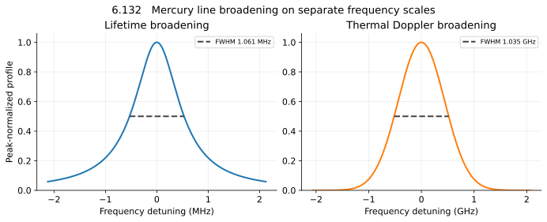

# 6.3 Properties of Atoms. Spectra

[Chapter index](../README.md#chapters) · [Structured solutions](6.3.json) · [Answer audit](../audit/README.md)

## 6.97

**Solved · high confidence.** Invert the alkali Rydberg term formula using positive binding energies.

**Assumptions**

- The book defines its correction by n_eff = n + α, so its α is the negative of the commonly used positive quantum defect δ.
- Use the positive physical branch n + α > 0. The S and P binding energies are measured from the same ionization limit.
- Convert the Appendix wavenumber R̃ to an energy E_R = hcR̃, using those constants consistently rather than mixing its separately rounded angular-frequency representation.

For a positive binding energy B, Eq. (6.3a) becomes an energy relation with effective principal quantum number n + α.

$$
B_{nL}=\frac{hc\widetilde R}{(n+\alpha_L)^2},\qquad\alpha_L=\sqrt{\frac{hc\widetilde R}{B_{nL}}}-n,\quad hc\widetilde R=13.59553\ \mathrm{eV}.
$$

Both stated states have n = 2. Substitute their separate binding energies.

$$
\alpha_S=\sqrt{13.59553/5.39}-2=-0.411805,\qquad\alpha_P=\sqrt{13.59553/3.54}-2=-0.0402689.
$$

**Results**

Rydberg correction for lithium S terms

$$
\alpha_S\simeq-0.412
$$

Rydberg correction for lithium P terms

$$
\alpha_P\simeq-0.0403
$$

## 6.98

**Solved · high confidence.** Subtract the first excitation energy from the ground binding energy, then invert the Rydberg formula.

**Assumptions**

- The first excitation is the 3S to 3P excitation; an excitation potential of 2.10 V means an energy difference of 2.10 eV.
- Use the book convention B = hcR̃/(n + α)² and choose positive n + α. Fine structure is unresolved in the supplied data.

The excited electron is less tightly bound by the excitation energy.

$$
B_{3P}=B_{3S}-\Delta E=5.14-2.10=3.04\ \mathrm{eV}.
$$

With n = 3, the P correction follows directly from this binding energy.

$$
\alpha_{3P}=\sqrt{\frac{hc\widetilde R}{B_{3P}}}-3=\sqrt{13.59553/3.04}-3=-0.885239.
$$

**Results**

Sodium 3P Rydberg correction

$$
\alpha_{3P}\simeq-0.885
$$

## 6.99

**Solved · high confidence.** Use the sharp-series limit to locate 2P and infer the shared S quantum defect from its first line.

**Assumptions**

- From Fig. 6.7, the lithium sharp series is nS → 2P, with its first line 3S → 2P. Its short-wave limit is the transition from the ionization limit down to 2P.
- Use one n-independent S correction for 3S and 2S, as assumed by the chapter Rydberg formula. Fine structure and variation of quantum defect with n are neglected.
- Use the stated wavelengths as data; the ground binding energy from another exercise is not imported.

The series limit gives the binding of the common lower 2P state, while the first line gives the energy gap between 3S and 2P.

$$
B_{2P}=hc/\lambda_2,\qquad B_{2P}-B_{3S}=hc/\lambda_1,\qquad B_{3S}=hc(\lambda_2^{-1}-\lambda_1^{-1})=2.01656\ \mathrm{eV}.
$$

Infer the effective principal number for 3S from its binding energy.

$$
3+\alpha_S=\sqrt{hc\widetilde R/B_{3S}}=2.59652,\qquad\alpha_S=-0.403477.
$$

The same S correction makes the effective principal number for 2S smaller by exactly one.

$$
B_{2S}=\frac{hc\widetilde R}{(2+\alpha_S)^2}=\frac{hc\widetilde R}{[\sqrt{hc\widetilde R/B_{3S}}-1]^2}=5.33391\ \mathrm{eV}.
$$

**Results**

Ground-state valence-electron binding in the constant-defect model

$$
B_{2S}\simeq5.33\ \mathrm{eV}
$$

Intermediate S correction inferred from these two wavelengths

$$
\alpha_S\simeq-0.4035
$$

**Limitations**

- Real alkali quantum defects can vary slightly with principal quantum number. The inferred binding uses the chapter’s constant-correction approximation.

## 6.100

**Solved · high confidence.** Identify the allowed downward E1 cascade and evaluate its two term-energy differences.

**Assumptions**

- Treat the specified S and P corrections as independent of n, using n + α as in Eq. (6.3a). Ignore unresolved fine structure.
- Consider the ordinary electric-dipole lines. The valence-electron rule is Δl = ±1; a direct 3S → 2S single-photon E1 transition is forbidden.
- The level ordering makes 2P the only lower P state reachable from 3S; 3P lies above 3S in this model.

The allowed cascade is 3S → 2P → 2S. Subtract the positive binding energies to obtain each emitted photon energy.

$$
3S\to2P:\quad\frac1{\lambda_a}=\widetilde R\left[(2+\alpha_P)^{-2}-(3+\alpha_S)^{-2}\right].
$$

Insert the specified corrections for the first line.

$$
\alpha_S=-0.41,\quad\alpha_P=-0.04,\qquad\lambda_a=819.508\ \mathrm{nm}.
$$

For the second step the lower state is 2S, whose binding is larger than that of 2P.

$$
2P\to2S:\quad\frac1{\lambda_b}=\widetilde R\left[(2+\alpha_S)^{-2}-(2+\alpha_P)^{-2}\right],\qquad\lambda_b=674.015\ \mathrm{nm}.
$$

**Results**

First cascade line

$$
3S\to2P:\quad\lambda\simeq820\ \mathrm{nm}
$$

Second cascade line

$$
2P\to2S:\quad\lambda\simeq674\ \mathrm{nm}
$$

**Limitations**

- Higher-order or two-photon processes are outside this ordinary line calculation. The supplied orbital corrections determine two unresolved cascade wavelengths.

## 6.101

**Solved · high confidence.** Subtract the photon energies from a common unsplit lower S level.

**Assumptions**

- Both resonance components terminate at the same 3S fine-structure level. Hyperfine structure and recoil are neglected.
- The shorter-wavelength component has greater photon energy and therefore starts from the higher of the two 3P levels.

The common lower-state energy cancels when subtracting the two transition energies.

$$
\Delta E_{3P}=hc\left|\frac1{\lambda_1}-\frac1{\lambda_2}\right|.
$$

Use the wavelengths in metres and convert the resulting energy from joules to electronvolts.

$$
\Delta E_{3P}=hc\left(\frac1{589.00\,\mathrm{nm}}-\frac1{589.56\,\mathrm{nm}}\right)=1.99864\times10^{-3}\ \mathrm{eV}.
$$

**Results**

Sodium 3P fine-structure energy separation

$$
\Delta E_{3P}\simeq2.00\times10^{-3}\ \mathrm{eV}
$$

## 6.102

**Solved · high confidence.** Prove that all sharp-series doublets share the same angular-frequency interval from their common split lower P term.

**Assumptions**

- An alkali sharp-series line is nS_1/2 → lower P_1/2 or P_3/2. The upper S state has only J = 1/2, so it does not produce an LS fine-structure doublet.
- Every successive sharp-series line ends at the same lower P doublet. Hyperfine splitting and small external-field or isotope shifts are neglected.
- The supplied wavelengths determine an angular-frequency interval; successive wavelength intervals themselves need not be equal.

Write both transition angular frequencies for an arbitrary upper nS state.

$$
\omega_{n,1/2}=\frac{E_{nS}-E_{P_{1/2}}}{\hbar},\qquad\omega_{n,3/2}=\frac{E_{nS}-E_{P_{3/2}}}{\hbar}.
$$

Subtract them. The upper-state energy cancels, proving that the splitting is independent of which sharp-series line is chosen.

$$
|\omega_{n,1/2}-\omega_{n,3/2}|=\frac{|E_{P_{3/2}}-E_{P_{1/2}}|}{\hbar}=\Delta\omega\quad\text{for every }n.
$$

Evaluate that common interval from the given first doublet, converting frequency c/λ to angular frequency 2πc/λ.

$$
\Delta\omega=2\pi c\left|\frac1{1358.8\,\mathrm{nm}}-\frac1{1469.5\,\mathrm{nm}}\right|=1.04432\times10^{14}\ \mathrm{rad/s}.
$$

**Results**

Interval between components of every subsequent sharp-series doublet

$$
\Delta\omega_n=\Delta\omega_1\simeq1.0443\times10^{14}\ \mathrm{rad/s}
$$

No further absolute line wavelengths are needed because the same split lower P term is shared.

## 6.103

**Solved · high confidence.** Enumerate l = 0, 1, 2 for n = 3 and couple each to the electron spin 1/2.

**Assumptions**

- Use electronic LS term labels with spin S = 1/2 for a hydrogen atom and neglect nuclear spin. The leading 3 in each label is the principal quantum number.
- For each orbital l, J runs from |l − 1/2| to l + 1/2. S states have only J = 1/2.

The orbital possibilities at n = 3 are S, P and D.

$$
n=3:\quad l=0,1,2,\qquad S=\tfrac12,\quad2S+1=2.
$$

Apply angular-momentum addition to each orbital state.

$$
3\,{}^2S_{1/2};\qquad3\,{}^2P_{1/2},\ 3\,{}^2P_{3/2};\qquad3\,{}^2D_{3/2},\ 3\,{}^2D_{5/2}.
$$

**Results**

All hydrogen n = 3 electronic term levels

$$
3\,{}^2S_{1/2},\quad3\,{}^2P_{1/2},\quad3\,{}^2P_{3/2},\quad3\,{}^2D_{3/2},\quad3\,{}^2D_{5/2}
$$

## 6.104

**Solved · high confidence.** Use the angular-momentum triangle rule and count unit-spaced J values.

**Assumptions**

- L and S are good quantum numbers in the stated coupling model. J runs in steps of one from |L − S| to L + S.

The number of allowed values is the length of the angular-momentum interval plus one.

$$
J=|L-S|,|L-S|+1,\ldots,L+S,\qquad N_J=2\min(L,S)+1.
$$

Substitute the three pairs of quantum numbers.

$$
(a)\ L=3,S=2:\ J=1,2,3,4,5;\qquad(b)\ L=S=3:\ J=0,1,2,3,4,5,6;\qquad(c)\ L=2,S=\tfrac52:\ J=\tfrac12,\tfrac32,\tfrac52,\tfrac72,\tfrac92.
$$

**Results**

Allowed J for S = 2, L = 3; five values

$$
J=1,2,3,4,5
$$

Allowed J for S = L = 3; seven values

$$
J=0,1,2,3,4,5,6
$$

Allowed J for S = 5/2, L = 2; five values

$$
J=\tfrac12,\tfrac32,\tfrac52,\tfrac72,\tfrac92
$$

## 6.105

**Solved · high confidence.** Decode term multiplicity and orbital type, then convert each allowed J to its angular-momentum magnitude.

**Assumptions**

- Multiplicity is 2S + 1, orbital P means L = 1 and orbital D means L = 2. Angular-momentum magnitude is ħ√[J(J + 1)], not ħJ.

For the quartet P term, S = 3/2 and L = 1.

$$
{}^4P:\quad J=\tfrac12,\tfrac32,\tfrac52,\qquad|\mathbf J|=\frac\hbar2\{\sqrt3,\sqrt{15},\sqrt{35}\}.
$$

For the quintet D term, S = 2 and L = 2.

$$
{}^5D:\quad J=0,1,2,3,4,\qquad|\mathbf J|=\hbar\{0,\sqrt2,\sqrt6,\sqrt{12},\sqrt{20}\}.
$$

**Results**

Allowed J quantum numbers for quartet P

$$
J=\tfrac12,\tfrac32,\tfrac52
$$

Angular-momentum magnitudes for quartet P

$$
|\mathbf J|=\tfrac\hbar2\{\sqrt3,\sqrt{15},\sqrt{35}\}
$$

Allowed J quantum numbers for quintet D

$$
J=0,1,2,3,4
$$

Angular-momentum magnitudes for quintet D

$$
|\mathbf J|=\hbar\{0,\sqrt2,\sqrt6,\sqrt{12},\sqrt{20}\}
$$

## 6.106

**Solved · high confidence.** Maximize the orbital and spin sums allowed by each electron configuration.

**Assumptions**

- The filled Na core and the filled 1s² shell each have L = S = J = 0. Only the listed unpaired electrons contribute.
- The term symbol records L and S, while total angular-momentum magnitude is ħ√[J(J + 1)]. Non-equivalent p and d electrons can realize their maximum spin and orbital sums simultaneously.

A valence electron with principal number n = 4 can have l = 0, 1, 2 or 3. Its largest J is obtained with l = 3 and j = l + 1/2.

$$
(a)\quad L=3,\ S=\tfrac12,\ J_{\max}=\tfrac72,\qquad{}^2F_{7/2},\quad|\mathbf J|_{\max}=\tfrac\hbar2\sqrt{63}.
$$

For the 2p and 3d electrons, the maximum orbital sum is 1 + 2 = 3 and the maximum spin is 1.

$$
(b)\quad L_{\max}=3,\ S_{\max}=1,\ J_{\max}=4,\qquad{}^3F_4,\quad|\mathbf J|_{\max}=\hbar\sqrt{20}.
$$

**Results**

Na maximum-J term with n = 4 valence electron

$$
{}^2F_{7/2}
$$

Greatest Na total angular-momentum magnitude

$$
|\mathbf J|=\tfrac\hbar2\sqrt{63}
$$

Maximum-J term of the 1s² 2p 3d configuration

$$
{}^3F_4
$$

Greatest total angular-momentum magnitude for that configuration

$$
|\mathbf J|=\hbar\sqrt{20}
$$

## 6.107

**Solved · medium confidence.** Invert the number of allowed J values without assuming that D and F have the same spin.

**Assumptions**

- For fixed L and S, the number of distinct J values is 2 min(L, S) + 1. F means L = 3 and D means L = 2.
- The statement gives the same number of J values in two states, not explicitly a common S. The distinction is essential for D states.
- Atomic L is integer. S can be integer or half-integer depending on electron-number parity; if both states belong to the same atom as the inferred F state, S in the D state must be integer.

For F, setting the count equal to five fixes the spin rather than merely bounding it.

$$
2\min(3,S_F)+1=5\quad\Longrightarrow\quad S_F=2,\qquad|\mathbf S_F|=\hbar\sqrt6,\quad J_F=1,2,3,4,5.
$$

For D, the same count is saturated by the orbital quantum number whenever S is at least two.

$$
2\min(2,S_D)+1=5\quad\Longrightarrow\quad S_D\ge2,\qquad J_D=S_D-2,S_D-1,S_D,S_D+1,S_D+2.
$$

The D spin magnitude is therefore not unique from its count alone. A common-spin assumption would select the quintet member.

$$
|\mathbf S_D|=\hbar\sqrt{S_D(S_D+1)},\quad S_D\ge2;\qquad S_D=S_F\ \text{if additionally imposed}\ \Longrightarrow\ S_D=2.
$$

**Results**

Unique F-state spin

$$
S_F=2,\qquad|\mathbf S_F|=\hbar\sqrt6
$$

D-state spin range allowed by the count alone

$$
S_D\ge2,\qquad|\mathbf S_D|=\hbar\sqrt{S_D(S_D+1)}
$$

If considered independently, S_D may be 2, 5/2, 3, … . If it is a state of the same even-electron atom as the F state, only 2, 3, 4, … remain; the atom’s electron count would impose a further upper bound.

Conditional result if both states are specified to share one spin

$$
S_D=S_F=2,\qquad|\mathbf S|=\hbar\sqrt6
$$

**Limitations**

- A unique D spin magnitude requires additional information; the commonly assumed answer ħ√6 for both states is conditional on equal S.

## 6.108

**Solved · high confidence.** Infer S and J, then solve the angular-momentum triangle for integer L.

**Assumptions**

- Multiplicity three means S = 1. The quoted total angular momentum is its magnitude ħ√[J(J + 1)].

Identify J from the given magnitude.

$$
J(J+1)=20\quad\Longrightarrow\quad J=4,\qquad S=1.
$$

The triangle condition is symmetric in L, S and J. With integer L it leaves three possibilities.

$$
|J-S|\le L\le J+S\quad\Longrightarrow\quad L=3,4,5\quad(F,G,H).
$$

**Results**

Possible orbital quantum numbers

$$
L=3,4,5
$$

Corresponding possible term labels

$$
{}^3F_4,\quad{}^3G_4,\quad{}^3H_4
$$

## 6.109

**Solved · high confidence.** Solve the triangle rule for S at fixed orbital L and total J, then compute multiplicity.

**Assumptions**

- Only angular-momentum compatibility is specified; an additional electron configuration could restrict which of these terms is realized.
- For integer atomic L, S has the same integer or half-integer parity as J. Allowed S values range from |L − J| to L + J in unit steps.

For D with J = 2, the possible spins run from zero to four.

$$
(a)\quad L=2,J=2:\quad S=0,1,2,3,4\quad\Longrightarrow\quad\kappa=1,3,5,7,9.
$$

For P with J = 3/2, the possible spins are half-integer.

$$
(b)\quad L=1,J=\tfrac32:\quad S=\tfrac12,\tfrac32,\tfrac52\quad\Longrightarrow\quad\kappa=2,4,6.
$$

For F with J = 1, the allowed spin range begins at two.

$$
(c)\quad L=3,J=1:\quad S=2,3,4\quad\Longrightarrow\quad\kappa=5,7,9.
$$

**Results**

Possible multiplicities of D₂

$$
\kappa=1,3,5,7,9
$$

Possible multiplicities of P₃/₂

$$
\kappa=2,4,6
$$

Possible multiplicities of F₁

$$
\kappa=5,7,9
$$

## 6.110

**Solved · high confidence.** Maximize J for the s p d configuration and use the quantum-vector scalar product.

**Assumptions**

- The three open-shell electrons are in non-equivalent s, p and d orbitals; filled shells contribute zero angular momentum.
- Use the vector-model angle between S and J defined by their quantum angular-momentum magnitudes and scalar product.

The largest orbital and spin sums can occur together, giving the maximum total J.

$$
L=0+1+2=3,\qquad S=\tfrac32,\qquad J_{\max}=L+S=\tfrac92\quad({}^4F_{9/2}).
$$

Square J = L + S to obtain the spin–total scalar product.

$$
\mathbf S\cdot\mathbf J=\tfrac12(\mathbf J^2+\mathbf S^2-\mathbf L^2),\qquad\cos\theta=\frac{J(J+1)+S(S+1)-L(L+1)}{2\sqrt{J(J+1)S(S+1)}}.
$$

Substitute the maximum-J quantum numbers.

$$
\cos\theta=\frac{99/4+15/4-12}{2\sqrt{(99/4)(15/4)}}=\sqrt{\frac{11}{15}},\qquad\theta=31.0909^\circ.
$$

**Results**

Vector-model angle between spin and total angular momentum

$$
\theta=\arccos\sqrt{11/15}\simeq31.1^\circ
$$

## 6.111

**Solved · high confidence.** Use the measured vector-model angle to identify the allowed orbital quantum number.

**Assumptions**

- The total angular-momentum magnitude is ħ√6, so J = 2. The stated 73.2° is a rounded angle.
- Use LS coupling with S = 1 and the quantum-vector definition of the spin–J angle.

The scalar-product formula determines L(L + 1).

$$
L(L+1)=J(J+1)+S(S+1)-2\sqrt{J(J+1)S(S+1)}\cos\theta=8-2\sqrt{12}\cos73.2^\circ\simeq6.
$$

The physical integer solution is L = 2, giving a triplet D level with J = 2.

$$
L=2,\quad2S+1=3,\quad J=2\qquad\Longrightarrow\qquad{}^3D_2.
$$

**Results**

Spectral term for the specified state

$$
{}^3D_2
$$

## 6.112

**Solved · high confidence.** Couple the orbital and spin momenta of two non-equivalent p and d electrons.

**Assumptions**

- The electrons have l_p = 1 and l_d = 2 and are non-equivalent, so both singlet and triplet spin couplings are permitted.
- Use LS coupling. No identical-subshell exclusion beyond ordinary antisymmetrization removes any of these parent terms.

Orbital addition and spin addition independently give three L values and two S values.

$$
L=1,2,3\quad(P,D,F),\qquad S=0,1.
$$

Each singlet has only J = L. Each triplet has J = L − 1, L and L + 1.

$$
{}^1P_1,\quad{}^1D_2,\quad{}^1F_3;\qquad{}^3P_{0,1,2},\quad{}^3D_{1,2,3},\quad{}^3F_{2,3,4}.
$$

**Results**

All p d LS term levels

$$
{}^1P_1,\ {}^1D_2,\ {}^1F_3,\ {}^3P_{0,1,2},\ {}^3D_{1,2,3},\ {}^3F_{2,3,4}
$$

All have odd orbital parity because l_p + l_d = 3; an odd-parity mark may be appended.

## 6.113

**Solved · medium confidence.** Distinguish LS parentage from the strictly fixed-core fine-structure coupling channels.

**Assumptions**

- The core term has L_c = 1 and S_c = 1/2. Its specified fine-structure level has J_c = 3/2. The extra electron has l = 2 and s = 1/2.
- No radial configuration or coupling strength is given. A strict fixed-J_c description and an unrestricted LS parent-term description are different approximations and must not be counted as the same independent basis.
- Parity is not determined by a general core term letter alone; no parity mark is inferred without the core configuration.

If LS coupling of the core orbital and spin degrees of freedom is intended, add L_c to l and S_c to s to obtain the usual parent terms.

$$
L=1,2,3,\qquad S=0,1:\quad{}^1P_1,\ {}^1D_2,\ {}^1F_3,\ {}^3P_{0,1,2},\ {}^3D_{1,2,3},\ {}^3F_{2,3,4}.
$$

If the core is required to stay specifically in J_c = 3/2, first form the extra electron j and couple it to that fixed core.

$$
j_d=\tfrac32,\tfrac52;\qquad[J_c=\tfrac32,j_d=\tfrac32]_J:\ J=0,1,2,3;\qquad[J_c=\tfrac32,j_d=\tfrac52]_J:\ J=1,2,3,4.
$$

The fixed-core sector has one J = 0 channel, two each with J = 1, 2, 3, and one J = 4 channel. Its dimension is forty.

$$
g_{\rm fixed\ core}=1+2(3)+2(5)+2(7)+9=40=(2J_c+1)(2l+1)(2s+1).
$$

The full LS parent list has sixty microstates because it includes both core fine-structure partners. All its LS labels have nonzero projections onto the fixed-J_c sector, but they are not twelve independent pure-LS levels within that sector.

$$
g_{\rm unrestricted\ LS}=(2L_c+1)(2S_c+1)(2l+1)(2s+1)=60.\quad\text{The fixed-core channels are generally LS mixtures.}
$$

**Results**

Usual possible LS parent labels when the full core P term participates

$$
{}^1P_1,\ {}^1D_2,\ {}^1F_3,\ {}^3P_{0,1,2},\ {}^3D_{1,2,3},\ {}^3F_{2,3,4}
$$

This is a parentage list. A strictly fixed J_c = 3/2 subspace does not contain all these labels as independent pure-LS states.

Complete angular channels for a strictly fixed core J_c = 3/2

$$
[(\tfrac32)_c(\tfrac32)_d]_{0,1,2,3},\qquad[(\tfrac32)_c(\tfrac52)_d]_{1,2,3,4}
$$

Possible total J values and their channel multiplicities

$$
J=0,1,2,3,4;\qquad N_J^{\rm channel}=1,2,2,2,1
$$

The channel multiplicity is distinct from each level’s magnetic degeneracy 2J + 1.

**Limitations**

- Unique pure LS labels or level energies cannot be assigned to all strictly fixed-core channels without a coupling model and interaction information.

## 6.114

**Solved · high confidence.** Apply electric-dipole LS and J rules, while keeping the independent parity requirement explicit.

**Assumptions**

- The selection rules are those of an electric-dipole (E1) transition in pure LS coupling: ΔS = 0, ΔL = 0 or ±1 with L = 0 ↔ 0 excluded, and ΔJ = 0 or ±1 with J = 0 ↔ 0 excluded.
- E1 also requires opposite initial and final parity. A general many-electron term letter L alone does not determine parity, and the configurations are not supplied.

The doublet D to doublet P transition passes the angular rules but needs an independently established parity change.

$$
(1)\quad{}^2D_{3/2}\to{}^2P_{1/2}:\quad\Delta S=0,\ \Delta L=-1,\ \Delta J=-1\quad\text{angularly permitted}.
$$

The triplet P to doublet S transition violates spin conservation and the allowed integer J change.

$$
(2)\quad{}^3P_1\to{}^2S_{1/2}:\quad\Delta S=-\tfrac12,\ \Delta J=-\tfrac12\quad\text{forbidden}.
$$

The triplet F to triplet P transition changes L by two, which is forbidden at E1 order.

$$
(3)\quad{}^3F_3\to{}^3P_2:\quad\Delta S=0,\ \Delta L=-2,\ \Delta J=-1\quad\text{forbidden}.
$$

The quartet F to quartet D transition passes the angular rules and remains conditional on opposite parity.

$$
(4)\quad{}^4F_{7/2}\to{}^4D_{5/2}:\quad\Delta S=0,\ \Delta L=-1,\ \Delta J=-1\quad\text{angularly permitted}.
$$

**Results**

Transitions forbidden by the supplied angular E1 rules

$$
{}^3P_1\to{}^2S_{1/2},\qquad{}^3F_3\to{}^3P_2
$$

Transitions passing angular rules, conditional on opposite parity

$$
{}^2D_{3/2}\to{}^2P_{1/2},\qquad{}^4F_{7/2}\to{}^4D_{5/2}
$$

The data do not give parity, so these cannot be declared unconditionally E1-allowed.

**Limitations**

- This is an E1 classification in LS coupling. Other multipoles or departures from pure LS coupling require their own rules; the missing parity data remain necessary for the angularly permitted pair.

## 6.115

**Solved · high confidence.** Count the orbital and spin substates of lithium’s n = 3 D term.

**Assumptions**

- The scan’s leading 3 in 3D is the principal quantum number, not a superscript triplet multiplicity. Lithium has a closed 1s² core and one valence electron, so S = 1/2.
- Overall degeneracy means the complete unresolved D term, neglecting fine structure and external fields; nuclear spin and hyperfine degeneracy are excluded.

A D electron has five orbital magnetic substates and two spin substates.

$$
L=2,\qquad S=\tfrac12,\qquad g=(2L+1)(2S+1)=5\times2=10.
$$

If spin-orbit splitting is resolved, those ten states separate into the two doublet D fine-structure levels.

$$
3\,{}^2D_{3/2}:\ g=4,\qquad3\,{}^2D_{5/2}:\ g=6,\qquad4+6=10.
$$

The value ten counts linearly independent electronic states with this n and L and the two spin orientations. They share an energy in the spin-independent approximation; after fine splitting, each J level retains its own 2J + 1 magnetic degeneracy.

**Results**

Overall electronic degeneracy of the lithium 3D term

$$
g=10
$$

Fine-structure partition of the ten states

$$
g_{3/2}=4,\qquad g_{5/2}=6
$$

## 6.116

**Solved · high confidence.** Select each term’s largest J and count its magnetic substates.

**Assumptions**

- The requested states are individual fine-structure J levels with the greatest J in each term. Their degeneracy is 2J + 1, rather than the total LS-term multiplicity.
- External fields and hyperfine splitting are excluded.

The largest J is L + S. Decode the three multiplicities and orbital letters.

$$
{}^2P:\ L=1,S=\tfrac12\Rightarrow J_{\max}=\tfrac32;\quad{}^3D:\ L=2,S=1\Rightarrow J_{\max}=3;\quad{}^4F:\ L=3,S=\tfrac32\Rightarrow J_{\max}=\tfrac92.
$$

Each J level has magnetic projections from −J to +J in unit steps.

$$
g=2J+1:\qquad g({}^2P_{3/2})=4,\quad g({}^3D_3)=7,\quad g({}^4F_{9/2})=10.
$$

**Results**

Degeneracy of maximum-J doublet P

$$
g({}^2P_{3/2})=4
$$

Degeneracy of maximum-J triplet D

$$
g({}^3D_3)=7
$$

Degeneracy of maximum-J quartet F

$$
g({}^4F_{9/2})=10
$$

## 6.117

**Solved · high confidence.** Infer J from magnetic degeneracy, then impose the L = 3S condition and atomic quantization.

**Assumptions**

- As in the preceding question, degeneracy refers to one resolved J level, so g = 2J + 1. It does not mean the full unresolved LS-term dimension.
- For an atom, total orbital L is an integer, while S is an integer or half-integer. Both quantization constraints must be imposed after the triangle inequality.

Seven magnetic substates give J = 3.

$$
2J+1=7\quad\Longrightarrow\quad J=3.
$$

With L = 3S, the triangle rule restricts the spin to a short interval.

$$
|L-S|\le J\le L+S\quad\Longrightarrow\quad2S\le3\le4S\quad\Longrightarrow\quad\tfrac34\le S\le\tfrac32.
$$

The only quantized candidate spins in that interval are 1 and 3/2. The latter would require a half-integer orbital L and is inadmissible for an atom.

$$
S=1\Rightarrow L=3;\qquad S=\tfrac32\Rightarrow L=\tfrac92\quad\text{excluded}.\qquad{}^{2S+1}L_J={}^3F_3.
$$

**Results**

Unique resolved term satisfying the stated conditions

$$
{}^3F_3
$$

**Limitations**

- If the word degeneracy were instead applied to the whole unresolved LS multiplet, no allowed atomic L and S with L = 3S would give seven; the resolved-level convention is the one used here.

## 6.118

**Solved · high confidence.** Count the electrons in the specified filled shells and identify the neutral element.

**Assumptions**

- The atom is neutral. K, L and M denote complete n = 1, 2 and 3 shells with capacities 2n²; a p subshell holds six electrons.
- The derived electron count determines Z. The element-name identification is bound to the existing CIAAW reference because arsenic is absent from the digitized Appendix atomic-number rows.

Add the fully filled shells, filled 4s and half-filled 4p subshell.

$$
N_e=2+8+18+2+3=33.
$$

Neutrality makes the atomic number equal to the electron count. The element with Z = 33 is arsenic.

$$
Z=33\qquad\Longrightarrow\qquad\mathrm{As}\ \text{(arsenic)},\qquad[\mathrm{Ar}]\,3d^{10}4s^24p^3.
$$

**Results**

Element identified by the electron count

$$
Z=33,\qquad\mathrm{As}\ \text{(arsenic)}
$$

## 6.119

**Solved · high confidence.** Apply Hund’s rules with Pauli occupancy of the three p orbitals.

**Assumptions**

- There is a single partially filled p subshell; all closed shells have zero L and S. LS coupling and the usual Hund ground-term ordering are assumed.
- Each p electron has l = 1 and spin 1/2. The available orbital projections are −1, 0 and +1.

For p³, maximize spin by occupying all three orbital projections with parallel spins. Their orbital projections sum to zero, giving the only maximum-spin parent L = 0.

$$
p^3:\quad S_{\max}=\tfrac32,\quad M_L=(-1)+0+1=0\Rightarrow L=0,\quad J=\tfrac32\Rightarrow{}^4S_{3/2}.
$$

For p⁴, maximum spin is one. Three parallel electrons fill the three orbital projections, and the fourth must have opposite spin; choose its orbital projection +1 to maximize L within that spin sector.

$$
p^4:\quad S_{\max}=1,\quad L_{\max}=1\quad({}^3P).
$$

The p⁴ subshell is more than half full, so Hund’s third rule selects its largest J.

$$
p^4:\quad J=L+S=2\qquad\Longrightarrow\qquad{}^3P_2.
$$

**Results**

Ground term for three p electrons

$$
p^3:\quad{}^4S_{3/2}
$$

The parity is odd, so an optional odd-parity mark may be appended.

Ground term for four p electrons

$$
p^4:\quad{}^3P_2
$$

The parity is even.

## 6.120

**Solved · high confidence.** Maximize spin and orbital angular momentum of the open d subshell, then apply the half-filled-shell choice ofJ.

**Assumptions**

- UseLS coupling and Hund rules with only the stated d subshell open. Closed subshells contributeL=S=0.
- A d subshell has orbital quantum numberell=2, five magnetic orbitals, and capacity10. The requested total angular momentum can be stated both as quantum numberJ and magnitudehbar sqrt[J(J+1)].

For d cubed, put three parallel-spin electrons into distinct orbitals with the largestm_ell values2,1,0. This gives S=3/2 and L=3, an F term.

$$
d^3:\quad S=\frac32,\quad L=2+1+0=3.
$$

The shell is less than half full, so the ground multiplet has the smallest allowedJ.

$$
J=|L-S|=\frac32,\qquad{}^4F_{3/2},\qquad|\mathbf J|=\frac{\sqrt{15}}2\hbar.
$$

For d to the seventh, use its three holes. The equivalent spin and orbital magnitudes are againS=3/2,L=3, but the shell is more than half full and selects the largestJ.

$$
d^7:\quad S=\frac32,\ L=3,\ J=L+S=\frac92,\qquad{}^4F_{9/2},\qquad|\mathbf J|=\frac{\sqrt{99}}2\hbar.
$$

**Results**

Ground angular momentum for three d electrons

$$
\boxed{J=3/2,\quad|\mathbf J|=(\sqrt{15}/2)\hbar,\quad{}^4F_{3/2}}
$$

Ground angular momentum for seven d electrons

$$
\boxed{J=9/2,\quad|\mathbf J|=(\sqrt{99}/2)\hbar,\quad{}^4F_{9/2}}
$$

## 6.121

**Solved · high confidence.** Invert Hund ground-term spin, orbital, and total angular momentum to infer the subshell population.

**Assumptions**

- The atom has only one partially filled subshell and followsLS-coupled Hund ground-state rules. The superscript is 2S+1 and the subscript isJ.
- For a shell with fewer than half its states occupied, the maximum-spin population is N=2S; for more than half full its hole count is 2S.

For3F2, S=1,L=3,J=2=L-S identifies less than half filling. Two parallel electrons give the largest orbital projectionell+(ell-1)=2ell-1=3, henceell=2 and N=2.

$$
{}^3F_2:\quad d^2,\qquad N=2.
$$

For2P3/2, S=1/2,L=1,J=L+S identifies more than half filling. There is one hole in a p shell of capacity6, leaving5 electrons.

$$
{}^2P_{3/2}:\quad p^5,\qquad N=5.
$$

For6S5/2, S=5/2 and L=0 require the half-filled five-orbital d shell. The five spins align while allm_ell values sum tozero.

$$
{}^6S_{5/2}:\quad d^5,\qquad N=5.
$$

**Results**

Population producing3F2 as the ground term

$$
\boxed{d^2:\ N=2}
$$

Population producing2P3/2 as the ground term

$$
\boxed{p^5:\ N=5}
$$

Population producing6S5/2 as the ground term

$$
\boxed{d^5:\ N=5}
$$

## 6.122

**Solved · high confidence.** Combine the stated filling fraction with the maximum Hund spin to determine shell capacity and population.

**Assumptions**

- Use one open subshell with capacityG=2(2ell+1). At less than half filling2S=N; at more than half filling2S=G-N.
- The given filling fractions refer to the full spin-orbital capacity of the subshell.

In part(a), one-third filling is below half. S=1 therefore gives N=2 and capacityG=6, identifyingell=1 andconfiguration p squared.

$$
N=2S=2,\quad G=3N=6,\quad\ell=1,\qquad p^2.
$$

The two parallel p electrons maximizeL with m_ell=1,0, givingL=1. The less-than-half-filled ground multiplet hasJ=|1-1|=0.

$$
p^2:\quad S=1,\ L=1,\ J=0,\qquad\boxed{{}^3P_0}.
$$

In part(b),70percent filling leaves30percent holes. S=3/2 means three parallel holes, soG=10 and N=7: d to the seventh.

$$
G-N=2S=3=0.30G\quad\Longrightarrow\quad G=10,\ N=7,\ \ell=2.
$$

The three-hole d configuration hasL=3 and S=3/2. Since it is more than half full, chooseJ=9/2.

$$
d^7:\quad\boxed{{}^4F_{9/2}}.
$$

**Results**

Ground term for one-third filling and S=1

$$
\boxed{p^2:\ {}^3P_0}
$$

Ground term for70percent filling and S=3/2

$$
\boxed{d^7:\ {}^4F_{9/2}}
$$

## 6.123

**Solved · high confidence.** Determine the subshell orbital quantum number from the maximum orbital sum for three parallel electrons.

**Assumptions**

- There is one open subshell and three electrons. Apply Hund first and second rules before using the statedL=3.
- The subshell must accommodate three parallel spins; an s subshell cannot do so.

The maximum spin of three electrons is S=3/2. The maximum orbital projection from three distinctm_ell values isell+(ell-1)+(ell-2)=3ell-3.

$$
S=\frac32,\qquad L_{\max}=3\ell-3=3\quad\Longrightarrow\quad\ell=2.
$$

Thus the configuration is d cubed, less than half the 10-electron capacity. Its groundJ is the lower endpoint.

$$
L=3,\quad S=\frac32,\quad J=|L-S|=\frac32,\qquad\boxed{{}^4F_{3/2}}.
$$

**Results**

Ground-state spectral term

$$
\boxed{d^3:\ {}^4F_{3/2}}
$$

## 6.124

**Solved · high confidence.** Identify the half-filled d-shell term and use the Landé magnetic-moment magnitude.

**Assumptions**

- A half-filled open subshell containing five electrons is d to the fifth. UseLS coupling and ignore the small anomalous correction to the electron spin magnetic moment.
- The chapter defines moment magnitude asg sqrt[J(J+1)]mu_B. This differs from the largest component along an external field, which isgJmu_B.

All five d orbitals are singly occupied with parallel spin. Their orbital projections cancel.

$$
L=0,\qquad S=J=\frac52,\qquad{}^6S_{5/2}.
$$

ForL=0 and J=S the Landé factor is 2.

$$
g=1+\frac{J(J+1)+S(S+1)-L(L+1)}{2J(J+1)}=2.
$$

Evaluate the magnetic-moment magnitude and separately state the saturated projection.

$$
\mu=2\sqrt{\frac52\frac72}\,\mu_B=\sqrt{35}\,\mu_B\simeq5.91608\mu_B=5.48421\times10^{-23}\,\mathrm{J/T},\qquad\mu_{z,\max}=5\mu_B.
$$

**Results**

Ground-state moment magnitude

$$
\boxed{\mu=\sqrt{35}\,\mu_B\simeq5.92\mu_B}
$$

Moment magnitude in Bohr magnetons

$$
\mu/\mu_B=\sqrt{35}
$$

Maximum magnetic-moment projection

$$
\mu_{z,\max}=5\mu_B
$$

This is a different quantity from the requested Landé moment magnitude.

## 6.125

**Solved · medium confidence.** Use the hydrogen level degeneracies in a ground-dominated neutral-atom Boltzmann distribution.

**Assumptions**

- Use the neutral-atom population as the denominator and count all n=2 sublevels.
- The hydrogen principal-level degeneracy is g_n=2n squared if electron spin is included; its ratio givesg_2/g_1=4. Any common nuclear-spin factor cancels.
- Use the printed hydrogen binding-energy anchor 13.56 eV, givingE_2-E_1=10.17 eV. Its exponential sensitivity limits numerical precision.
- Assume a physically truncated, predominantly neutral bound-atom partition whose population is overwhelmingly in the ground state. An unrestricted isolated-hydrogen bound-state partition diverges and is not a valid exact normalization.

Apply the Boltzmann ratio for the entire second principal shell.

$$
\frac{N_2}{N_1}=\frac{g_2}{g_1}e^{-(E_2-E_1)/(k_BT)}=4e^{-3E_H/(4k_BT)}.
$$

For a specified finite upper-level cutoff, the neutral-atom fraction is the ratio divided by the complete bound-state normalization. Here its excited contribution is negligible under ground dominance.

$$
f_2=\frac{4e^{-3E_H/(4k_BT)}}{1+\sum_{n=2}^{n_{\max}}n^2e^{-E_H(1-1/n^2)/(k_BT)}}\simeq4e^{-3E_H/(4k_BT)}.
$$

At3000 K the thermal energy is about 0.25843 eV. The population fraction is exceedingly small.

$$
f_2\simeq4e^{-10.17/0.258427}=3.24386\times10^{-17}\sim3\times10^{-17}.
$$

A density-dependent ionization balance would be required if all hydrogen nuclei, including ions, were in the denominator. That is not determined by temperature alone.

**Results**

Estimated fraction of neutral hydrogen atoms in then=2 manifold

$$
\boxed{f_2\simeq4e^{-3E_H/(4k_BT)}\sim3\times10^{-17}}
$$

Ground-dominated, physically truncated neutral-atom ensemble; extra digits reflect the chosen historical atomic anchor only.

**Limitations**

- Temperature alone does not determine the full ionization balance or a rigorous untruncated hydrogen partition. Small changes to the atomic excitation energy noticeably change this tiny exponential estimate.

## 6.126

**Solved · high confidence.** Compare aggregate alkaliP andS term statistical weights and use the resonance photon energy as their gap.

**Assumptions**

- The labels3P and 3S refer to principal quantum number3 and orbital terms, not spin multiplicities. Sodium has one valence electron with S=1/2.
- The3P fine-structure doublet is treated as one thermally unresolved manifold:g_P=2(2L+1)=6, whileg_S=2. Fine splitting is negligible relative tok_BT at 2400 K.

Use the ratio of term degeneracies and the measured resonance gap.

$$
\frac{N_{3P}}{N_{3S}}=\frac{g_P}{g_S}e^{-\Delta E/(k_BT)}=3\exp\left[-\frac{hc}{\lambda k_BT}\right].
$$

Insert589 nm and 2400 K.

$$
\frac{N_{3P}}{N_{3S}}=1.1403403\times10^{-4}\simeq1.1\times10^{-4}.
$$

**Results**

Aggregate3P to 3S population ratio

$$
\boxed{N_{3P}/N_{3S}=3e^{-hc/(\lambda k_BT)}\simeq1.14\times10^{-4}}
$$

**Limitations**

- A population ratio for one resolvedP_J component would use its own statistical weight and small energy correction.

## 6.127

**Solved · high confidence.** Convert distance along the atom beam to elapsed time and fit exponential excited-population decay.

**Assumptions**

- The atoms have one narrow velocity600m/s. The detected line intensity is proportional to the surviving excited population, with unchanged collection efficiency along the beam.
- After initial preparation there is no further pumping or collisional quenching. The requested lifetime is the population1/e time, not the field-amplitude decay time.

An atom traverses the stated2.5mm in timel/v.

$$
t=l/v.
$$

For exponential excited-state decay, a reduction byeta gives eta=exp[t/tau].

$$
I(l)=I(0)e^{-l/(v\tau)},\qquad\tau=\frac{l}{v\ln\eta}.
$$

Insert the beam speed, distance, and 25-fold reduction.

$$
\tau=\frac{2.5\times10^{-3}}{600\ln25}=1.2944478\times10^{-6}\,\mathrm s\simeq1.3\,\mathrm{\mu s}.
$$

**Results**

Mean excited-state lifetime

$$
\boxed{\tau=l/(v\ln\eta)\simeq1.29\,\mathrm{\mu s}}
$$

**Limitations**

- If excitation is replenished or collisional loss contributes, the measured decay would give an effective lifetime rather than the radiative lifetime alone.

## 6.128

**Solved · high confidence.** Relate total resonance-line power to the spontaneous photon rate of the excited population.

**Assumptions**

- Use a steady excited population and one photon of energyhc/lambda per radiative resonance decay. The stated lifetime is the relevant total lifetime and the resonance branching ratio is 1.
- The quoted35mW is the total emitted power at the line, rather than power intercepted by an unspecified detector. Reabsorption, quenching, and stimulated contributions to that power are neglected.

ForN excited atoms with mean lifetime tau, the spontaneous decay rate isN/tau.

$$
\dot N_\gamma=N/\tau.
$$

Multiply by the photon energy to obtain line power and solve for the instantaneous excited population.

$$
P=\frac{N}{\tau}\frac{hc}{\lambda},\qquad N=\frac{P\tau\lambda}{hc}.
$$

Insert the resonance wavelength and 150 ns lifetime.

$$
N=\frac{(0.035)(0.15\times10^{-6})(253.65\times10^{-9})}{hc}=6.7072124\times10^9\simeq6.7\times10^9\text{ atoms}.
$$

**Results**

Number of resonance-excited Hg atoms

$$
\boxed{N=P\tau\lambda/(hc)\simeq6.7\times10^9}
$$

**Limitations**

- A branching fractionb below1 would replaceP=N b hc/(tau lambda). A detector collection fraction would likewise need to be supplied.

## 6.129

**Solved · high confidence.** Estimate the thermal resonance population with term degeneracies and use its spontaneous power per volume.

**Assumptions**

- Treat 2P and 2S as aggregate alkali terms with electron spin1/2, so their statistical weights are6 and 2. Fine splitting is negligible compared with k_BT.
- Assume the bound-state population is thermalized at 1500 K and dominated by these two manifolds, overwhelmingly the ground state. The quoted power per volume is the local gross resonance-emission power.
- Radiative branching into the quoted line is 1; collisional quenching, radiation trapping, and stimulated-emission power are omitted in converting excited population to lifetime.

Use the resonance photon energy and the ratio of term degeneracies in the Boltzmann population ratio.

$$
r\equiv\frac{n_{2P}}{n_{2S}}=3e^{-hc/(\lambda k_BT)}=1.8588221\times10^{-6}.
$$

The stated total atomic concentration givesn_2P=n r/(1+r), practicallyn r because the excited fraction is tiny.

$$
n_{2P}=n\frac{r}{1+r}\simeq6.69175\times10^{10}\,\mathrm{cm^{-3}}.
$$

The emitted power density equals photon energy times the decay rate per volume. The matchingper-cubic-centimetre units cancel without a hidden volume conversion.

$$
P_V=\frac{n_{2P}}\tau\frac{hc}{\lambda},\qquad\tau=\frac{n\,[r/(1+r)]hc}{\lambda P_V}.
$$

Substitute the concentration and 0.30 W per cubic centimetre.

$$
\tau=6.6000595\times10^{-8}\,\mathrm s\simeq66\,\mathrm{ns}.
$$

**Results**

Mean lifetime inferred from thermal resonance power

$$
\boxed{\tau\simeq6.6\times10^{-8}\,\mathrm s}
$$

Two-manifold thermal excited fraction

$$
f_{2P}=r/(1+r)\simeq1.86\times10^{-6}
$$

**Limitations**

- If the population is not thermal or the quoted power is an escaping rather than local emitted power affected by trapping, the inference requires additional rate or transport data.

## 6.130

**Solved · high confidence.** Use the Einstein coefficient relation with Planck thermal photon occupation at the 2P-to 1S resonance.

**Assumptions**

- Compare stimulated and spontaneous probabilities per atom already in 2P, not populations of 2P and 1S. No degeneracy multiplier belongs in this ratio.
- The radiation field is blackbody equilibrium radiation at the stated temperature. Use the historical binding-energy anchor 13.56 eV, giving the 2-to 1 gap10.17 eV.
- At the high formal equality temperature the survival of neutral atoms depends on density and ionization balance. The requested equality remains a statement about photon occupation and the two rates conditional on an excited atom.

Divide the Einstein stimulated probabilityB_21 u_omega byA_21 and substitute the Planck spectral density. All frequency-density factors cancel.

$$
\frac{W_{\rm ind}}{W_{\rm sp}}=\frac{B_{21}u_\omega}{A_{21}}=\frac1{e^{\hbar\omega/(k_BT)}-1}.
$$

At3000 K the resonance energy is far above the thermal scale, so the ratio is exponentially small.

$$
\hbar\omega=\frac34E_H=10.17\,\mathrm{eV},\qquad\frac{W_{\rm ind}}{W_{\rm sp}}=8.10964\times10^{-18}\sim10^{-17}.
$$

Equality requires one thermal photon on average in the resonant mode occupation factor, namelyexp(hbar omega/kT)=2.

$$
W_{\rm ind}=W_{\rm sp}\quad\Longrightarrow\quad T=\frac{\hbar\omega}{k_B\ln2}=1.7032520\times10^5\,\mathrm K\simeq1.7\times10^5\,\mathrm K.
$$

**Results**

Induced-to-spontaneous rate ratio at 3000 K

$$
\boxed{W_{\rm ind}/W_{\rm sp}=[e^{\hbar\omega/(k_BT)}-1]^{-1}\sim10^{-17}}
$$

Formal temperature for equal probabilities

$$
\boxed{T=\hbar\omega/(k_B\ln2)\simeq1.7\times10^5\,\mathrm K}
$$

**Limitations**

- The tiny3000 K ratio is sensitive to the independently rounded resonance energy; extra displayed digits document the historical constant convention rather than precision.

## 6.131

**Solved · medium confidence.** Subtract stimulated emission from true absorption using detailed balance, then separate lower-level density from the stimulated correction.

**Assumptions**

- Use a weak resonant probe in a thermal gas without probe-induced saturation. Letx=hbar omega/(k_BT),g_1,g_2 be level degeneracies, andN_1(T),N_2(T) their populations per volume.
- Absorption and stimulated emission have the same normalized resonance profile for the comparison. Spontaneous background is not included in the directional beam attenuation coefficient.
- The printed formula treats the lower-state absorbing population as fixed or undepleted. Ifkappa_0 literally denotes the zero-temperature coefficient at fixed total gas density, the temperature dependence ofN_1 must also be retained.

Net removal of probe photons is proportional to upward absorption minus downward stimulated emission.

$$
\kappa=C[N_1B_{12}-N_2B_{21}].
$$

Boltzmann population balance and the Einstein degeneracy relation eliminate the unknown degeneracies from the ratio of stimulated to absorption terms.

$$
\frac{N_2}{N_1}=\frac{g_2}{g_1}e^{-x},\qquad g_1B_{12}=g_2B_{21}\quad\Longrightarrow\quad\kappa=CN_1(T)B_{12}(1-e^{-x}).
$$

Defining the gross absorption coefficient at that same lower-state density as kappa_abs(T)=C N_1(T)B_12 gives an exact stimulated-emission factor. HoldingN_1 at its ground-dominated zero-temperature value yields the stated chapter expression.

$$
\kappa=\kappa_{\rm abs}(T)(1-e^{-x})\simeq\kappa_0(1-e^{-x})\quad\text{if }N_1(T)\simeq N_1(0).
$$

For a fixed total two-level densityN=N_1+N_2, however, the exact normalization adds a denominator. The literal zero-temperature definition of κ_0 then gives this more complete result.

$$
\boxed{\frac{\kappa(T)}{\kappa_0}=\frac{1-e^{-x}}{1+(g_2/g_1)e^{-x}}}\quad\text{(fixed total two-level density)}.
$$

Whenx is large the denominator is nearly1, which explains the conventional undepleted-ground approximation. Its omitted correction is of the same exponential order as the retained stimulated-emission term if the total rather than lower-state density is fixed.

$$
\frac{\kappa(T)}{\kappa_0}=1-(1+g_2/g_1)e^{-x}+O(e^{-2x}).
$$

**Results**

Exact stimulated-emission correction at specified lower-state density

$$
\boxed{\kappa=\kappa_{\rm abs}(T)[1-e^{-\hbar\omega/(k_BT)}]}
$$

Printed undepleted-ground-density expression

$$
\boxed{\kappa\simeq\kappa_0[1-e^{-\hbar\omega/(k_BT)}]}
$$

Exact if the lower-state density is fixed; conventional approximation if it is only approximately undepleted.

Exact two-level correction whenkappa_0 is theT→0 coefficient at fixed total density

$$
\kappa/\kappa_0=(1-e^{-x})/[1+(g_2/g_1)e^{-x}],\quad x=\hbar\omega/(k_BT)
$$

**Limitations**

- At fixed total population the displayed chapter formula is not the complete leading thermal correction unless ground-state depletion is deliberately omitted. A multilevel gas adds its corresponding partition normalization.
- At line center, temperature-dependent broadening can also change the profile height. The stated population factor applies at a fixed line profile or to the integrated absorption.

## 6.132

**Solved · high confidence.** Compare consistently defined Gaussian Doppler and Lorentzian natural full widths at half maximum.

**Assumptions**

- Both linewidths areFWHM. A stable ground state and an upper-state population lifetime tau give natural angular-frequencyFWHM1/tau, or ordinary-frequencyFWHM1/(2pi tau).
- Use a nonrelativistic Maxwell gas and neglect collisional, pressure, isotope-structure, instrumental, and saturation broadening. The requested ratio compares the two intrinsic contributions rather than the FWHM of their Voigt convolution.
- The digitized Appendices do not provide mercury atomic mass. Use the registered CIAAW natural-Hg molar mass0.200592kg/mol divided by the historical Appendix Avogadro constant to obtain a representative atom mass.

The mean-lifetime population decays asexp(-t/tau), while the field amplitude decays asexp[-t/(2tau)]. Its Fourier power spectrum is Lorentzian with the following width.

$$
\Delta\omega_N=1/\tau,\qquad\Delta\nu_N=\frac1{2\pi\tau}=1.06103295\times10^6\,\mathrm{Hz}.
$$

The thermal line-of-sight velocity variance isk_BT/m. Convert it to Gaussian frequency variance andFWHM.

$$
\Delta\nu_D=\frac{\nu_0}{c}\sqrt{\frac{8k_BT\ln2}{m}},\qquad\nu_0=c/\lambda,\qquad m=M_{\rm Hg}/N_A=3.33043334\times10^{-25}\,\mathrm{kg}.
$$

Evaluate the Doppler width and the ratio in one frequency convention.

$$
\Delta\nu_D=1.03507699\times10^9\,\mathrm{Hz},\qquad\frac{\Delta\nu_D}{\Delta\nu_N}=\frac{2\pi\tau}{\lambda}\sqrt{\frac{8k_BT\ln2}{m}}=975.537\sim10^3.
$$

Using angular frequencies multiplies both widths by 2pi and leaves the same ratio. Matched half widths also leave the ratio unchanged; mixing a Gaussian standard deviation with a Lorentzian FWHM would not.

$$
\boxed{\Delta\omega_D/\Delta\omega_N=\Delta\nu_D/\Delta\nu_N\simeq9.8\times10^2}.
$$

**Results**

Doppler-to-natural linewidth ratio, matchedFWHM

$$
\boxed{\Delta\nu_D/\Delta\nu_N\simeq9.8\times10^2}
$$

DopplerFWHM at 300 K

$$
\Delta\nu_D\simeq1.04\,\mathrm{GHz}
$$

NaturalFWHM from the upper lifetime

$$
\Delta\nu_N=1/(2\pi\tau)\simeq1.06\,\mathrm{MHz}
$$

**Limitations**

- Actual measured Hg line profiles may contain other broadening and isotope components not specified by the problem.

## 6.133

**Solved · high confidence.** Apply the relative MoseleyK-alpha scaling using the supplied iron line as calibration.

**Assumptions**

- Use the Moseley screening approximation sigma=1 and assume the same screening constant forFe andCu. The supplied atomic numbers26 and 29 are used directly.
- This is an approximateK-alpha emission-line scaling, not an identification of either line with itsK absorption edge.

With common screening, K-alpha frequency is proportional to(Z-1) squared, so wavelength is inversely proportional to that factor.

$$
\frac{\lambda_{\rm Cu}}{\lambda_{\rm Fe}}=\left(\frac{Z_{\rm Fe}-1}{Z_{\rm Cu}-1}\right)^2.
$$

Use the measured iron-line wavelength rather than an independent absolute Rydberg estimate.

$$
\lambda_{\rm Cu}=193\left(\frac{25}{28}\right)^2\,\mathrm{pm}=153.8584\,\mathrm{pm}\simeq154\,\mathrm{pm}.
$$

**Results**

Approximate copperK-alpha wavelength

$$
\boxed{\lambda_{K\alpha,\rm Cu}\simeq154\,\mathrm{pm}}
$$

**Limitations**

- A universal screening constant is approximate; precision atomic wavelengths require more complete shell and relaxation physics.

## 6.134

**Solved · medium confidence.** Use absolute MoseleyK-alpha wavenumbers and interpret their photon energy as the K-to-L shell binding-energy difference.

**Assumptions**

- Use screening sigma approximately1 in the chapter Moseley law. With spectral Rydberg wavenumberR prime the K-alpha relation is 1/lambda=(3/4)R prime(Z-1) squared.
- Use atomic numbersAl13,Co27,V23 from the exact registered sources. Absolute shell-energy differences are approximate in this effective screening model.
- A K-alpha photon measuresB_K-B_L, notB_K alone. Relaxation, fine structure, and shell-dependent screening beyond the given law are omitted.

Write the spectral form of Moseley law and solve for wavelength.

$$
\lambda_{K\alpha}=\frac4{3R\prime(Z-1)^2}.
$$

Evaluate aluminium and cobalt.

$$
\lambda_{\rm Al}=844.0528\,\mathrm{pm}\simeq0.844\,\mathrm{nm},\qquad\lambda_{\rm Co}=179.7982\,\mathrm{pm}\simeq180\,\mathrm{pm}.
$$

For vanadium the K-to-L binding-energy difference equals the modeledK-alpha photon energy.

$$
B_K-B_L=\frac{hc}{\lambda_{K\alpha}}=\frac34hcR\prime(Z-1)^2=4.9351783\,\mathrm{keV}\simeq4.94\,\mathrm{keV}.
$$

**Results**

Approximate aluminiumK-alpha wavelength

$$
\boxed{\lambda_{K\alpha,\rm Al}\simeq0.844\,\mathrm{nm}}
$$

Approximate cobaltK-alpha wavelength

$$
\boxed{\lambda_{K\alpha,\rm Co}\simeq180\,\mathrm{pm}}
$$

Approximate vanadiumK-minus-L binding energy

$$
\boxed{B_K-B_L\simeq4.94\,\mathrm{keV}}
$$

**Limitations**

- The sigma=1 law is a model estimate, especially away from the lightest elements. It does not supply independent absoluteK and L binding energies.

## 6.135

**Solved · high confidence.** Invert Moseley law, round the model estimates to physical atomic numbers, and count the intervening elements exclusively.

**Assumptions**

- Use the common screening approximation sigma=1. The supplied line wavelengths are rounded and the law itself is approximate, so inferredZ values should be assigned to nearby integers.
- The wordbetween is taken to exclude the two endpoint elements.

Invert the K-alpha wavenumber relation on the physicalZ>1 branch.

$$
Z=1+\sqrt{\frac4{3R\prime\lambda}}.
$$

The two wavelengths give atomic numbers close to 23 and 27, identifying vanadium and cobalt.

$$
\lambda_1=250\,\mathrm{pm}:Z_1=23.0494\to23,\qquad\lambda_2=179\,\mathrm{pm}:Z_2=27.0579\to27.
$$

The strictly intermediate atomic numbers are24,25,26.

$$
N_{\rm between}=Z_2-Z_1-1=27-23-1=\boxed3.
$$

**Results**

Number of elements strictly between the endpoints

$$
\boxed{N=3}
$$

Endpoint atomic numbers

$$
Z_1\simeq23\ (V),\qquad Z_2\simeq27\ (Co)
$$

**Limitations**

- The numericalZ values are not exact atomic data; rounding is justified by the approximate screening law and rounded wavelengths.

## 6.136

**Solved · medium confidence.** Estimate the nickelK-alpha line with Moseley law, choose the physical short-cutoff branch, and check the actualK excitation threshold.

**Assumptions**

- Use the approximate Moseley screening sigma=1 for the nickelK-alpha line and Z=28 from the Appendix.
- The continuum short-wave limit satisfieslambda_min=hc/(eU). Since a K-alpha line is observed, the continuum maximum photon energy must exceed that line energy, selectinglambda_min=lambda_Kalpha-84 pm.
- A K-alpha photon energy is not the K-shell excitation energy. Check the inferred tube voltage independently against the Appendix nickelK absorption edge148.6 pm.

Evaluate the approximate characteristic line wavelength.

$$
\lambda_{K\alpha}=\frac4{3R\prime(28-1)^2}=166.72648\,\mathrm{pm}.
$$

The observed separation fixes the shorter continuum endpoint.

$$
\lambda_{\min}=166.72648-84=82.72648\,\mathrm{pm}.
$$

Invert the bremsstrahlung endpoint relation.

$$
U=\frac{hc}{e\lambda_{\min}}=1.49811465\times10^4\,\mathrm V\simeq15.0\,\mathrm{kV}.
$$

The independentK-edge data give a lower required excitation voltage. The inferred value exceeds it, so characteristicK emission is energetically possible.

$$
U_K=\frac{hc}{e\lambda_{K,\rm edge}}=\frac{hc}{e(148.6\,\mathrm{pm})}=8.34009\,\mathrm{kV}<U.
$$

**Results**

Approximate nickel tube voltage

$$
\boxed{U\simeq15.0\,\mathrm{kV}}
$$

Inferred continuum short-wave limit

$$
\lambda_{\min}\simeq82.73\,\mathrm{pm}
$$

NickelK-shell excitation threshold from the Appendix edge

$$
U_K\simeq8.34\,\mathrm{kV}
$$

**Limitations**

- Shell-dependent screening and characteristic-line structure limit the precision of the inferred voltage beyond the displayed approximate15kV.

## 6.137

**Solved · high confidence.** Compare the tube voltage inferred from its continuum endpoint with the supplied characteristic-series excitation potential.

**Assumptions**

- The continuum endpoint corresponds to complete conversion of one electron kinetic energyeU into one photon. Use the given1.56kV excitation potential directly rather than estimating it from a K-alpha line.
- The question asks whether the excitation is energetically possible; ordinary impact excitation and subsequent radiative branching are assumed available.

Infer the tube voltage from the short-wave cutoff.

$$
U=\frac{hc}{e\lambda_{\min}}=\frac{hc}{e(0.50\,\mathrm{nm})}=2.4786750\,\mathrm{kV}.
$$

This exceeds the specifiedK-series excitation threshold.

$$
2.48\,\mathrm{kV}>1.56\,\mathrm{kV}\quad\Longrightarrow\quad\boxed{\text{the characteristic K series can be observed}.}
$$

**Results**

K-series excitation condition

$$
\boxed{\text{Yes: }U\simeq2.48\,\mathrm{kV}>1.56\,\mathrm{kV}}
$$

Tube voltage

$$
U=hc/(e\lambda_{\min})\simeq2.48\,\mathrm{kV}
$$

**Limitations**

- The calculation establishes energetic accessibility, not the measured intensity or detector visibility.

## 6.138

**Solved · high confidence.** Eliminate the two continuum cutoffs using their voltage dependence, then invert the characteristic-line scaling.

**Assumptions**

- The sameK-alpha wavelength is present at both tube voltages; the growing interval islambda_Kalpha-lambda_min>0.
- Use the approximate sigma=1 Moseley law and round its inferredZ to a physical integer. The chemical identificationCu forZ=29 is already supplied locally in problem6.133.

The two continuum endpoints scale inversely with voltage. Write the threefold interval increase.

$$
\lambda_{c1}=\frac{hc}{eV_1},\quad\lambda_{c2}=\frac{hc}{eV_2},\qquad\lambda_\alpha-\lambda_{c2}=3(\lambda_\alpha-\lambda_{c1}).
$$

Solve for the fixed characteristic line.

$$
\lambda_\alpha=\frac{3\lambda_{c1}-\lambda_{c2}}2=154.91719\,\mathrm{pm};\qquad\lambda_{c1}=123.93375\,\mathrm{pm},\quad\lambda_{c2}=61.96688\,\mathrm{pm}.
$$

Invert Moseley law on its positive screening branch.

$$
Z=1+\sqrt{\frac4{3R\prime\lambda_\alpha}}=29.0102\longrightarrow\boxed{29\ (Cu)}.
$$

**Results**

Anticathode atomic number

$$
\boxed{Z\simeq29:\ \text{copper}}
$$

Unrounded screening-model estimate

$$
Z_{\rm model}\simeq29.0102
$$

Characteristic line inferred directly from the endpoint changes

$$
\lambda_\alpha\simeq154.917\,\mathrm{pm}
$$

**Limitations**

- The noninteger guard-digitZ is only a screening-model estimate, not an exact atomic-number measurement.

## 6.139

**Solved · high confidence.** Interpret the K-minus-L edge-frequency gap as a K-alpha transition energy and invert the angular-frequency Moseley relation.

**Assumptions**

- The suppliedDelta omega is an angular frequency, consistent with the chapter notation. Use the Appendix angular-frequency Rydberg constant R=2.07e16s inverse, not the spectral wavenumber or an ordinary-frequency constant.
- Use sigma approximately1 and identify the inferred positive integer atomic number through its exact registered reference.
- The difference ofK and L binding energies is modeled as the K-alpha photon energy; neither edge alone is the K-alpha line.

The two edge energies arehbar omega_K andhbar omega_L. Their difference equals the modeledK-to-L transition energy.

$$
\omega_{K\alpha}=\omega_K-\omega_L=\Delta\omega.
$$

Invert the angular form of Moseley law.

$$
\Delta\omega=\frac34R(Z-1)^2,\qquad Z=1+\sqrt{\frac{4\Delta\omega}{3R}}.
$$

Use the physicalZ>1 branch and the measured frequency gap.

$$
Z=1+\sqrt{\frac{4(6.85\times10^{18})}{3(2.07\times10^{16})}}=22.0053\longrightarrow\boxed{22:\ \text{titanium}}.
$$

The equivalent shell-energy gap is about 4.51 keV, consistent with the K-alpha energy scale of the inferred element.

$$
\Delta E=\hbar\Delta\omega=4.506804\,\mathrm{keV}.
$$

**Results**

Metal identified from the edge gap

$$
\boxed{Z\simeq22:\ \text{titanium}}
$$

Unrounded screening-model atomic number

$$
Z_{\rm model}\simeq22.0053
$$

K-minus-L binding energy difference from the supplied frequency gap

$$
\Delta E=\hbar\Delta\omega\simeq4.51\,\mathrm{keV}
$$

**Limitations**

- The edge-to-line energy equality is the gross-shell approximation of the Moseley model; detailed relaxation and screening are omitted.

## 6.140

**Solved · medium confidence.** Add the measuredL-edge binding energy to the modeledK-to-L transition energy, and independently check against the tabulatedK edge.

**Assumptions**

- The L absorption edge directly suppliesL-shell bindingB_L=hc/λ_L. Use the sigma=1 MoseleyK-alpha estimate only forB_K-B_L.
- Use the vanadium atomic number23. The separately tabulated vanadiumK edge is reserved as a check on this derivation, not substituted for the givenL-edge problem.
- Gross shell energies neglect subshell splitting and vacancy-relaxation corrections.

Convert the suppliedL-edge wavelength to a binding energy.

$$
B_L=\frac{hc}{2.4\,\mathrm{nm}}=516.3906\,\mathrm{eV}.
$$

Calculate the modeledK-to-L energy gap forZ=23.

$$
B_K-B_L\simeq\frac34hcR\prime(23-1)^2=4935.1783\,\mathrm{eV}.
$$

Add the two distinct energy contributions.

$$
\boxed{B_K\simeq516.3906+4935.1783=5451.5689\,\mathrm{eV}\simeq5.45\,\mathrm{keV}}.
$$

The independent AppendixK-edge wavelength226.8 pm gives a nearby binding energy. Its small discrepancy quantifies the approximate nature of the screened-line estimate.

$$
B_{K,\rm edge}=\frac{hc}{226.8\,\mathrm{pm}}=5464.4511\,\mathrm{eV};\qquad\frac{B_K}{B_{K,\rm edge}}-1=-0.00235745.
$$

**Results**

Estimated vanadiumK-electron binding energy

$$
\boxed{B_K\simeq5.45\,\mathrm{keV}}
$$

L-shell binding from the supplied edge

$$
B_L\simeq0.5164\,\mathrm{keV}
$$

Binding energy from the independent AppendixK edge

$$
B_{K,\rm edge}\simeq5.46445\,\mathrm{keV}
$$

The approximate line-based derivation is about 0.24 percent lower.

**Limitations**

- The discrepancy with the separately tabulatedK edge should not be hidden by claiming exact shell energies.

## 6.141

**Solved · medium confidence.** Interpret the short-wave boundary as the K-series convergence edge, then subtract the K-alpha photon energy from the K binding.

**Assumptions**

- The phrase its short-wave cutoff refers to the characteristicK-series limit, hence the K absorption edge, not the independently voltage-controlled bremsstrahlung cutoff.
- Use Ti atomic number22 and the approximate sigma=1 Moseley estimate for its firstK-series lineK-alpha.
- A physicalL binding is positive, requiring the K-series limiting wavelength to be shorter than the first line. This selects λ_K=lambda_alpha-Delta lambda.

Estimate the K-alpha wavelength from the atomic number.

$$
\lambda_\alpha=\frac4{3R\prime(22-1)^2}=275.60908\,\mathrm{pm}.
$$

The supplied wavelength separation gives the K edge.

$$
\lambda_K=\lambda_\alpha-26\,\mathrm{pm}=249.60908\,\mathrm{pm}.
$$

The edge photon energy equalsB_K, while the K-alpha energy equalsB_K-B_L. Their difference is the desiredL binding.

$$
B_L=hc\left(\frac1{\lambda_K}-\frac1{\lambda_\alpha}\right)=\frac{hc\,\Delta\lambda}{\lambda_\alpha(\lambda_\alpha-\Delta\lambda)}=468.3915\,\mathrm{eV}\simeq0.47\,\mathrm{keV}.
$$

Keeping the finite wavelength difference matters: replacing the second denominator bylambda_alpha gives 424.2 eV, about 9.4 percent lower. The opposite sign branch would imply negativeL binding.

$$
B_L^{\rm small\ gap}\simeq hc\Delta\lambda/\lambda_\alpha^2=424.2051\,\mathrm{eV}.
$$

**Results**

Approximate titaniumL-electron binding energy

$$
\boxed{B_L\simeq0.47\,\mathrm{keV}}
$$

InferredK-series short-wave limit

$$
\lambda_K\simeq249.61\,\mathrm{pm}
$$

**Limitations**

- If the stated cutoff meant the tube continuum rather than the K-series limit, the L binding would not follow from the supplied data alone.

## 6.142

**Solved · medium confidence.** Estimate the zincK-alpha photon energy and subtract the measured ironK-shell binding before computing electron speed.

**Assumptions**

- Use the sigma=1 Moseley line estimate for Zn with Z=30. Use the explicitly given ironK-edge wavelength174 pm, rather than a valence work function or a different rounded table value.
- Ignore nuclear recoil and condensed-matter energy-loss effects in the maximum emitted-electron energy. The calculated photon energy is approximate because the screened characteristic-line model is approximate.
- Report a relativistic speed from the inferred kinetic energy and the nearby nonrelativistic value as a check; their small difference is less than the uncertainty of the characteristic-line estimate.

Calculate the incidentK-alpha photon energy for zinc.

$$
E_\gamma\simeq\frac34hcR\prime(30-1)^2=8575.3821\,\mathrm{eV}.
$$

The ironK absorption edge measures the requiredK-shell binding energy directly.

$$
B_{K,\rm Fe}=\frac{hc}{174\,\mathrm{pm}}=7122.6294\,\mathrm{eV}.
$$

Subtract that binding from the incident photon energy. The positive difference confirms thatK photoionization is possible.

$$
T_{\max}=E_\gamma-B_{K,\rm Fe}=1452.7528\,\mathrm{eV}\simeq1.45\,\mathrm{keV}>0.
$$

Use the relativistic energy-speed identity for a reproducible velocity, and compare it with the usual nonrelativistic expression.

$$
\gamma=1+\frac{T_{\max}}{m_ec^2},\qquad v=c\sqrt{1-\gamma^{-2}}=2.2555821\times10^7\,\mathrm{m/s};\qquad v_{\rm NR}=\sqrt{2T_{\max}/m_e}=2.2603876\times10^7\,\mathrm{m/s}.
$$

**Results**

MaximumK-shell photoelectron kinetic energy

$$
\boxed{T_{\max}\simeq1.45\,\mathrm{keV}}
$$

Photoelectron speed from relativistic energy balance

$$
\boxed{v\simeq2.26\times10^7\,\mathrm{m/s}}
$$

Nonrelativistic speed approximation

$$
v_{\rm NR}\simeq2.2604\times10^7\,\mathrm{m/s}
$$

About0.21percent above the relativistic value, much smaller than the intended model precision.

**Limitations**

- Detailed line energies, chemical shifts, vacancy relaxation, and photoelectron inelastic losses are beyond the gross-shell estimate.

## 6.143

**Solved · high confidence.** Specialize the Landé projection formula to zero orbital or zero spin angular momentum.

**Assumptions**

- Use LS coupling with g_L=1,g_S=2. A signed Landé factor is defined for J>0 by the effective vector moment μ=−g_J μ_B J/ħ.

Project L+2S on J=L+S to obtain the usual factor.

$$
g_J=1+\frac{J(J+1)+S(S+1)-L(L+1)}{2J(J+1)},\qquad J>0.
$$

For an S term L=0 and J=S, giving g=2. For a singlet S=0 and J=L, giving g=1.

$$
L=0,\ J>0:\ g=2;\qquad S=0,\ J>0:\ g=1.
$$

The common exceptional term ¹S₀ has J=0, so the ratio defining g is undefined; its first-order magnetic moment and linear Zeeman shift vanish.

**Results**

S terms with J>0

$$
g=2
$$

Singlet terms with J>0

$$
g=1
$$

¹S₀ exception

$$
J=0:\ \mu=0,\ \Delta E^{(1)}=0
$$

No unique Landé factor is defined for J=0; assigning g=0 by convention does not follow by dividing the formula.

## 6.144

**Solved · high confidence.** Insert each term’s L,S,J into the signed Landé formula and handle J=0 separately.

**Assumptions**

- Read the multiplicity as 2S+1 and use F→L=3, D→2, P→1. J=0 has no first-order vector moment and no factor determined by the projection formula.

Evaluate the nonzero-J terms directly.

$$
{}^6F_{1/2}:\ g=-\frac23;\quad{}^4D_{1/2}:\ g=0;\quad{}^5F_2:\ g=1;\quad{}^5P_1:\ g=\frac52.
$$

For ³P₀ the formula has denominator J(J+1)=0. The only m_J is zero and the linear shift vanishes.

$$
{}^3P_0:\ J=0,\qquad\mu_J=0,\qquad\Delta E^{(1)}=0.
$$

**Results**

⁶F₁/₂

$$
g=-2/3
$$

⁴D₁/₂

$$
g=0
$$

⁵F₂

$$
g=1
$$

⁵P₁

$$
g=5/2
$$

³P₀

$$
g\ \text{undefined for }J=0;\quad\Delta E^{(1)}=0
$$

A tabular g=0 is a harmless convention for this nonmagnetic first-order level, not the value of the singular formula.

## 6.145

**Solved · high confidence.** Use the magnitude of the LS-projected atomic moment, |g|μ_B√[J(J+1)].

**Assumptions**

- Magnetic moment means the effective vector-model magnitude, not its maximum field-axis projection |g|Jμ_B. Nuclear and anomalous-electron contributions are omitted.

For the singlet F term S=0,L=J=3, so g=1.

$$
\mu({}^1F_3)=\sqrt{3\cdot4}\mu_B=2\sqrt3\mu_B.
$$

For ²D₃/₂, L=2,S=1/2,J=3/2 gives g=4/5.

$$
\mu=\frac45\sqrt{\frac32\frac52}\mu_B=\frac{2\sqrt{15}}5\mu_B.
$$

For L=2,S=1 the possible J are 1,2,3. Their g factors are 1/2,7/6,4/3, so the supplied g selects J=3.

$$
\mu=\frac43\sqrt{3\cdot4}\mu_B=\frac{8\sqrt3}{3}\mu_B.
$$

**Results**

¹F magnetic-moment magnitude

$$
\mu/\mu_B=2\sqrt3=3.464102\ldots
$$

²D₃/₂ magnetic-moment magnitude

$$
\mu/\mu_B=2\sqrt{15}/5=1.549193\ldots
$$

Moment for the supplied L,S,g

$$
J=3,\quad\mu/\mu_B=8\sqrt3/3=4.618802\ldots
$$

## 6.146

**Solved · high confidence.** Infer g from the extremal magnetic projection and invert the Landé relation for S.

**Assumptions**

- The D₂ term has L=2,J=2. The maximum magnitude of the magnetic moment projection is |g|Jμ_B; in the allowed LS range here g is positive.

The stated 4μ_B maximum with J=2 implies g=2.

$$
|g|J\mu_B=4\mu_B\quad\Longrightarrow\quad g=2.
$$

Since L=J=2, the Landé formula reduces to 1+S(S+1)/12.

$$
2=1+\frac{S(S+1)}{12}\quad\Longrightarrow\quad S=3.
$$

Convert the spin quantum number to its angular-momentum magnitude.

$$
|\mathbf S|=\hbar\sqrt{S(S+1)}=2\sqrt3\hbar.
$$

**Results**

Spin quantum number

$$
S=3
$$

Spin angular-momentum magnitude

$$
|\mathbf S|=2\sqrt3\hbar
$$

## 6.147

**Solved · high confidence.** Use space quantization to identify J from the smallest possible J-to-field angle.

**Assumptions**

- For fixed J, cosθ=m_J/√[J(J+1)]. The least angle uses m_J=J. The stated 30 degrees is interpreted at its intended accuracy; for the available J values the matching value is exactly 30 degrees.

The smallest vector-model angle obeys cos²θ_min=J/(J+1).

$$
J=\frac{\cos^2\theta_{\min}}{1-\cos^2\theta_{\min}}=\cot^2\theta_{\min}=3.
$$

For L=2,S=1,J=3 the Landé factor is 4/3, giving the moment magnitude.

$$
g=\frac43,\qquad\mu=g\sqrt{J(J+1)}\mu_B=\frac{8\sqrt3}{3}\mu_B.
$$

**Results**

Effective atomic magnetic-moment magnitude

$$
\mu=(8\sqrt3/3)\mu_B=4.618802\ldots\mu_B
$$

## 6.148

**Solved · high confidence.** Maximize the orbital and total angular momenta of the n=3 valence electron.

**Assumptions**

- The sodium closed shell contributes L=S=J=0. For a single n=3 electron, l=0,1,2 and s=1/2; the largest possible j is 5/2.

Choose l=2 and parallel spin coupling j=l+1/2=5/2, giving the term 3²D₅/₂.

$$
l=2,\quad s=1/2,\quad j=5/2,\qquad g=\frac65.
$$

Calculate the vector-model moment magnitude.

$$
\mu=g\sqrt{j(j+1)}\mu_B=\frac{3\sqrt{35}}5\mu_B.
$$

**Results**

Magnetic-moment magnitude

$$
\mu=(3\sqrt{35}/5)\mu_B=3.549648\ldots\mu_B
$$

## 6.149

**Solved · high confidence.** Maximize the coupled angular momentum of the two open-shell electrons.

**Assumptions**

- The 1s² and 2s² shells are closed. The open 2p and 3d electrons are inequivalent, so their maximum L=1+2=3 and maximum S=1 are allowed simultaneously.

The largest J is L+S=4, identifying the ³F₄ term.

$$
L=3,\quad S=1,\quad J=4.
$$

Apply the Landé formula and the vector-model magnitude.

$$
g=\frac54,\qquad\mu=g\sqrt{J(J+1)}\mu_B=\frac{5\sqrt5}{2}\mu_B.
$$

**Results**

Magnetic moment in the largest-J state

$$
\mu=(5\sqrt5/2)\mu_B=5.590170\ldots\mu_B
$$

## 6.150

**Solved · high confidence.** Solve the zero-Landé-factor condition among the allowed J values.

**Assumptions**

- The magnetic moment is the LS-projected effective moment. Since S=3/2,L=2 do not allow J=0, its vanishing requires g_J=0.

Set the numerator of the Landé factor to zero.

$$
g=0\quad\Longrightarrow\quad3J(J+1)=L(L+1)-S(S+1)=6-\frac{15}4=\frac94.
$$

The allowed root is J=1/2. Convert it to total angular-momentum magnitude.

$$
J(J+1)=\frac34,\quad J=\frac12,\quad|\mathbf J|=\frac{\sqrt3}{2}\hbar.
$$

**Results**

Total angular-momentum quantum number

$$
J=1/2
$$

Total angular-momentum magnitude

$$
|\mathbf J|=(\sqrt3/2)\hbar
$$

## 6.151

**Solved · high confidence.** Infer J from its magnitude and L from the zero-Landé condition.

**Assumptions**

- Use the effective LS moment with g_L=1,g_S=2. The supplied M denotes total angular-momentum magnitude, not a field-axis projection.

The magnitude √2ħ gives J(J+1)=2 and hence J=1.

$$
J=1,\qquad S=2.
$$

For nonzero J, g=0 requires L(L+1)=3J(J+1)+S(S+1).

$$
L(L+1)=3(2)+6=12\quad\Longrightarrow\quad L=3\;(F).
$$

The multiplicity is 2S+1=5.

$$
{}^{2S+1}L_J={}^5F_1.
$$

**Results**

Spectral term

$$
{}^5F_1
$$

## 6.152

**Solved · high confidence.** Combine the effective magnetic torque with Larmor precession of J.

**Assumptions**

- The field 1.0 kG equals .10 T. The weak-field LS state ²P₃/₂ has g=4/3. Nuclear, hyperfine and electron-anomaly corrections are neglected.

The torque is μ×B, with μ=−gμ_BJ/ħ. It takes the precession form Ω×J.

$$
\frac{d\mathbf J}{dt}=\boldsymbol\mu\times\mathbf B=\frac{g\mu_B}{\hbar}\mathbf B\times\mathbf J,\qquad\boldsymbol\Omega=\frac{g\mu_B}{\hbar}\mathbf B.
$$

Insert g=4/3 and B=.10 T.

$$
\Omega=1.1726755\ldots\times10^{10}\ \mathrm{rad/s}.
$$

**Results**

Angular precession speed

$$
\Omega=1.1726755\ldots\times10^{10}\ \mathrm{rad/s}\simeq1.2\times10^{10}\ \mathrm{rad/s}
$$

## 6.153

**Solved · high confidence.** Differentiate the loop-axis field and multiply by the largest quantized moment projection.

**Assumptions**

- Let z be distance along the loop axis and a=.05 m its radius. The atom is at z=a. The quantization direction follows the local field adiabatically.
- For ²P₁/₂, g=2/3,J=1/2, so the largest moment projection magnitude is μ_B/3, not the full vector magnitude μ_B/√3.

The loop-axis field and its derivative are standard magnetostatic functions.

$$
B(z)=\frac{\mu_0Ia^2}{2(a^2+z^2)^{3/2}},\qquad\frac{dB}{dz}=-\frac{3\mu_0Ia^2z}{2(a^2+z^2)^{5/2}}.
$$

At z=a the gradient magnitude is 3μ₀I/(2^(7/2)a²). A Zeeman state has force −gμ_Bm_J∇B.

$$
|F|_{\max}=\frac{\mu_B}{3}\left|\frac{dB}{dz}\right|_{z=a}=\frac{\mu_0I\mu_B}{2^{7/2}a^2}.
$$

Insert I=10 A and a=.05 m.

$$
|F|_{\max}=4.1185525\ldots\times10^{-27}\ \mathrm N.
$$

**Results**

Maximum force magnitude

$$
|F|_{\max}=4.11855\ldots\times10^{-27}\ \mathrm N\simeq4.1\times10^{-27}\ \mathrm N
$$

## 6.154

**Solved · medium confidence.** Use the electronic ground-state Zeeman energy and keep the two spin-projection force directions.

**Assumptions**

- In the textbook electronic model ground-state hydrogen is ²S₁/₂ with g=2 and m_J=±1/2. Neglect nuclear spin/hyperfine structure and suppose the electronic spin follows the local field adiabatically.
- Define positive radial force as away from the straight wire. The atom sublevel is not specified, so a single force sign cannot be inferred.

The wire field decreases outward.

$$
B(r)=\frac{\mu_0I}{2\pi r},\qquad\frac{dB}{dr}=-\frac{\mu_0I}{2\pi r^2}.
$$

The electronic level energy is ΔE=2μ_Bm_JB; use F_r=−dE/dr.

$$
F_r=\frac{2\mu_Bm_J\mu_0I}{2\pi r^2}=\begin{cases}+F_0,&m_J=+1/2,\\-F_0,&m_J=-1/2,\end{cases}\qquad F_0=\frac{\mu_B\mu_0I}{2\pi r^2}.
$$

The upper-energy m_J=+1/2 state has magnetic moment opposite B and moves toward smaller B, outward. The lower-energy m_J=−1/2 state is attracted inward.

$$
F_0=2.9664\times10^{-26}\ \mathrm N,\qquad B=80\ \mathrm{\mu T}.
$$

**Results**

Magnitude for either textbook electronic branch

$$
|F_r|=2.9664\times10^{-26}\ \mathrm N\simeq3.0\times10^{-26}\ \mathrm N
$$

Upper electronic Zeeman branch

$$
m_J=+1/2:\quad F_r=+F_0\quad\text{(outward)}
$$

Lower electronic Zeeman branch

$$
m_J=-1/2:\quad F_r=-F_0\quad\text{(inward)}
$$

**Limitations**

- Without state preparation there is no unique force direction.
- At the small physical field ≈80 μT, real hydrogen hyperfine coupling and its hyperfine-state populations matter. The numerical branches are explicitly the simplified electronic textbook result.

## 6.155

**Solved · medium confidence.** Combine the extreme Stern–Gerlach forces with in-magnet deflection plus the drift to the screen.

**Assumptions**

- The scan explicitly prints T=22 MeV; retain this value without changing the prefix. Treat the four m_J states of ⁴F₃/₂ with fixed weak-LS g=2/5 and an approximately constant transverse gradient G=|∂B/∂y|.
- Use straight longitudinal nonrelativistic motion with T=Mv²/2, small deflection, magnet length l₁ and post-magnet drift l₂. The atomic mass cancels from this leading kinematic formula.
- This is a formal calculation: the resulting gradient/field excursion does not support the assumed weak-LS atomic Zeeman model physically.

For L=3,S=3/2,J=3/2 the factor is 2/5. The extreme force magnitude is therefore (3/5)μ_BG.

$$
g=\frac25,\qquad |\mu_z|_{\max}=gJ\mu_B=\frac35\mu_B,\qquad F_{\max}=\frac35\mu_BG.
$$

For either extreme beam component, add deflection within the magnet and during drift. The measured extreme-to-extreme distance is twice this displacement.

$$
y_s=\frac{F_{\max}}{Mv^2}l_1(l_1/2+l_2),\qquad\delta=2y_s=\frac{F_{\max}l_1(l_1+2l_2)}{2T}.
$$

Solve for the gradient and insert the printed kinetic energy.

$$
G=\frac{2T\delta}{(3\mu_B/5)l_1(l_1+2l_2)}=1.4483588\ldots\times10^{11}\ \mathrm{T/m}.
$$

The deflection already reached at magnet exit is about .143 mm for each extreme. The same linear model implies a field excursion of about 2.07×10⁷ T over that displacement.

$$
|y_{\rm exit}|=\frac\delta2\frac{l_1}{l_1+2l_2}=1.4285714\ldots\times10^{-4}\ \mathrm m,\qquad G|y_{\rm exit}|=2.06908\ldots\times10^7\ \mathrm T.
$$

**Results**

Formal gradient for the printed 22 MeV beam

$$
G=1.4483588\ldots\times10^{11}\ \mathrm{T/m}\simeq1.4\times10^{11}\ \mathrm{T/m}
$$

A fixed weak-LS g and ordinary atomic Stern–Gerlach description are not credible over the implied field excursion.

**Limitations**

- The required field variation strongly violates the linear weak-field LS model and an ordinary intact-atom beam description. The answer is a formal consequence of mutually unrealistic printed/model inputs, not a practical magnet specification.
- The nonrelativistic centre-of-mass formula omits a small relativistic correction for a heavy vanadium atom; it is secondary to the much larger internal-state-model failure.

## 6.156

**Solved · high confidence.** Distinguish magnetic-substate count from distinct first-order Zeeman energies.

**Assumptions**

- For a term with J, there are 2J+1 m_J substates. Distinct energies are E₀+gμ_BBm_J only if the factor is nonzero; g=0 leaves the substates degenerate to first order.

The ³P₀ term has only m_J=0; ²F₅/₂ has six m values and g=6/7.

$$
{}^3P_0:\ 2J+1=1;\qquad{}^2F_{5/2}:\ 2J+1=6,\ g=6/7.
$$

For ⁴D₁/₂ the Landé numerator cancels exactly and g=0. Its m_J=±1/2 labels are two states, but both have the same linear Zeeman energy.

$$
{}^4D_{1/2}:\ g=0,\quad\Delta E_{\pm1/2}^{(1)}=0.
$$

**Results**

³P₀

$$
1\ \text{magnetic state and }1\ \text{energy}
$$

²F₅/₂

$$
6\ \text{magnetic states and }6\ \text{distinct first-order energies}
$$

⁴D₁/₂

$$
2\ \text{magnetic states, but }1\ \text{distinct first-order energy}
$$

The common formal answer2J+1=2 counts m states; it does not imply an actual nonzero linear splitting when g=0.

**Limitations**

- Higher-order Zeeman mixing can alter the first-order degeneracy; it is outside the weak linear LS calculation.

## 6.157

**Solved · high confidence.** Compute the energy difference between m_J=+J and −J for each term.

**Assumptions**

- The stated field2.50 kG is .250 T. Total term splitting means the full highest-to-lowest first-order energy span, not adjacent-sublevel spacing.

The general linear span is 2gJμ_BB.

$$
\Delta E_{\rm term}=2gJ\mu_BB.
$$

For ¹D₂, g=1,J=2, so the span is 4μ_BB.

$$
\Delta E_a=4\mu_BB=5.7865169\ldots\times10^{-5}\ \mathrm{eV}.
$$

For ³F₄, g=5/4,J=4, so the span is 10μ_BB.

$$
\Delta E_b=10\mu_BB=1.4466292\ldots\times10^{-4}\ \mathrm{eV}.
$$

**Results**

Total¹D₂ splitting

$$
\Delta E=5.7865169\ldots\times10^{-5}\ \mathrm{eV}
$$

Total³F₄ splitting

$$
\Delta E=1.4466292\ldots\times10^{-4}\ \mathrm{eV}
$$

## 6.158

**Solved · medium confidence.** Calculate line shifts rather than classifying solely by multiplicity or number of allowed arrows.

**Assumptions**

- Use ΔE_γ=μ_BB(g_um_u−g_lm_l), m_u−m_l=0,±1. A normal Zeeman triplet has coefficients −1,0,+1; three-line patterns with noncanonical spacing are explicitly distinguished.
- For a J=0 level only m=0 exists and its shift is zero, regardless of the undefined standalone Landé factor.

The singlet¹P₁→¹S₀ transition gives coefficients −1,0,+1 and is the normal triplet.

For²D₅/₂→²P₃/₂, the factors are6/5 and 4/3. They differ, producing12 distinct components, so this is anomalous.

$$
g_u=6/5,\qquad g_l=4/3.
$$

For³D₁→³P₀, the upper g is 1/2 and the lower has only m=0. There are three components at coefficients −1/2,0,+1/2: a triplet with half-normal spacing.

For⁵I₅→⁵H₄, L_u=6,L_l=5,S=2 gives equal factors9/10. Every allowed shift depends only on q=m_u−m_l, leaving three distinct values despite many transitions.

$$
g_u=g_l=9/10,\qquad\Delta E_\gamma/(\mu_BB)=(9/10)q\in\{-9/10,0,9/10\}.
$$

**Results**

¹P→¹S classification

$$
\text{Normal triplet: }\{-1,0,1\}\mu_BB
$$

²D₅/₂→²P₃/₂ classification

$$
\text{Anomalous: }12\ \text{distinct components}
$$

³D₁→³P₀ pattern

$$
\text{Three components with spacing }\tfrac12\mu_BB
$$

An anomalous-spacing triplet. If normal is used merely as a three-line shape label it looks normal, but its interval is not the canonical normal interval.

⁵I₅→⁵H₄ pattern

$$
\text{Three components with spacing }\tfrac9{10}\mu_BB
$$

Equal nonunit g factors collapse the line to a triplet; the spacing is still noncanonical. It is normal-looking in shape, rather than a canonical normal Zeeman triplet.

**Limitations**

- Terminology sometimes calls any three-component pattern normal. The explicit frequencies/spacings supplied here remove that label ambiguity.

## 6.159

**Solved · high confidence.** Invert the full singlet-term span to identify its integer orbital angular momentum.

**Assumptions**

- A singlet has S=0,J=L and g=1 for J>0. The field3.0 kG is .30 T and 104 μeV is a total term span.

The span is 2Lμ_BB, so solve for L.

$$
L=\frac{\Delta E}{2\mu_BB}=2.99547\ldots\approx3.
$$

For L=3 the singlet symbol is¹F₃.

$$
{}^{2S+1}L_J={}^1F_3.
$$

**Results**

Singlet term

$$
{}^1F_3
$$

## 6.160

**Solved · high confidence.** Convert the normal-triplet energy shifts to an extreme-to-extreme wavelength span.

**Assumptions**

- A transition between singlet terms produces the normal triplet, with photon-energy shifts0,±μ_BB. The field10.0 kG equals 1.00 T.
- The magnetic energy is much smaller than hc/λ, so the linear wavelength formula is adequate; an exact conversion is also given.

The two extreme photons have energies E₀±δE with δE=μ_BB.

$$
\Delta\lambda=hc\left[\frac1{E_0-\delta E}-\frac1{E_0+\delta E}\right]=\frac{2hc\delta E}{E_0^2-\delta E^2}.
$$

For δE≪E₀ use E₀=hc/λ and substitute the given wavelength.

$$
\Delta\lambda\simeq\frac{2\lambda^2\mu_BB}{hc}=0.03497522\ldots\ \mathrm{nm}.
$$

**Results**

Extreme-to-extreme wavelength interval

$$
\Delta\lambda=0.03497522\ldots\ \mathrm{nm}\simeq0.0350\ \mathrm{nm}
$$

## 6.161

**Solved · high confidence.** Resolve adjacent normal-triplet components in transverse observation.

**Assumptions**

- Singlet transitions have adjacent photon-energy spacing μ_BB. At right angles to B the π component and both σ components are present, so the relevant nearest spacing is the adjacent one, not the full extreme-to-extreme span.
- Use the usual local resolving-power criterion δλ_res=λ/ℛ and the first-order wavelength shift.

Convert the adjacent energy separation to wavelength separation.

$$
\delta\lambda_{\rm adj}\simeq\frac{\lambda^2\mu_BB}{hc}.
$$

Set this equal to the instrument resolution λ/ℛ and solve for B.

$$
B_{\min}=\frac{hc}{\mu_B\lambda\mathcal R}=0.39958353\ldots\ \mathrm T.
$$

**Results**

Minimum field to resolve neighbouring components

$$
B_{\min}=0.3995835\ldots\ \mathrm T\simeq0.40\ \mathrm T
$$

## 6.162

**Solved · high confidence.** Use the half-normal triplet spacing of³D₁→³P₀.

**Assumptions**

- For the upper³D₁ term g=1/2; the lower³P₀ has only m=0 and zero linear shift. Transverse observation displays all three components.
- The supplied interval is an angular-frequency spacing Δω, so divide energy spacings by ħ rather than h.

The upper m values−1,0,+1 give line shifts−1/2,0,+1/2 in units μ_BB/ħ.

$$
\Delta\omega_{\rm adj}=\frac{\mu_BB}{2\hbar}.
$$

Invert and insert the measured neighbouring interval.

$$
B=\frac{2\hbar\Delta\omega}{\mu_B}=0.30016828\ldots\ \mathrm T.
$$

**Results**

Magnetic field induction

$$
B=0.3001683\ldots\ \mathrm T\simeq0.300\ \mathrm T
$$

## 6.163

**Solved · high confidence.** Compare the two Landé intervals and infer the natural fine-structure splitting from the doublet.

**Assumptions**

- Both sodium D lines share the²S₁/₂ lower term, so their photon-energy difference is the²P fine-structure splitting. The shorter589.00 nm line corresponds to the higher²P₃/₂ term.
- The interval between neighbouring m substates in²P₃/₂ is(4/3)μ_BB; it is stated to be1/50 of the natural²P term separation.

Compute the two factors and hence the ratio of adjacent spacings.

$$
g({}^2P_{3/2})=4/3,\qquad g({}^2P_{1/2})=2/3,\qquad\frac{\delta E_{3/2}}{\delta E_{1/2}}=2.
$$

Subtract the photon energies to obtain the fine-structure gap.

$$
\Delta E_{\rm fs}=hc\left(\frac1{589.00\ \mathrm{nm}}-\frac1{589.59\ \mathrm{nm}}\right)=0.0021056016\ldots\ \mathrm{eV}.
$$

Impose the given factor50 and solve for B.

$$
\frac43\mu_BB=\frac{\Delta E_{\rm fs}}{50}\quad\Longrightarrow\quad B=\frac{3\Delta E_{\rm fs}}{200\mu_B}=0.5458210\ldots\ \mathrm T.
$$

**Results**

Neighbouring-sublevel spacing ratio

$$
\delta E_{3/2}/\delta E_{1/2}=2
$$

Required field

$$
B=0.5458210\ldots\ \mathrm T\simeq0.546\ \mathrm T
$$

## 6.164

**Solved · high confidence.** Enumerate allowed m transitions and their upper-minus-lower Zeeman energy shifts.

**Assumptions**

- Use g_u=4/3 for²P₃/₂ and g_l=2 for²S₁/₂. Allowed electric-dipole transitions have q=m_u−m_l=0,±1; q=0 is π and q=±1 are σ components.
- The field4.5 kG equals .45 T. The requested displacements are angular-frequency shifts from the zero-field line.

The line shift is the difference of the two level shifts, not either term shift alone.

$$
\delta\omega=\Omega_B\left(\frac43m_u-2m_l\right),\qquad\Omega_B=\frac{\mu_BB}{\hbar}.
$$

Pair the upper m values±3/2,±1/2 with lower±1/2, retaining only q=0,±1. There are six permitted transitions and all six shifts are distinct.

$$
\delta\omega/\Omega_B\in\{-5/3,-1,-1/3,+1/3,+1,+5/3\}.
$$

The π components are the inner±1/3 pair; the σ components are±1 and±5/3. Evaluate Ω_B at the given field.

$$
\Omega_B=3.9577799\ldots\times10^{10}\ \mathrm{rad/s}.
$$

**Results**

All six angular-frequency displacements

$$
\delta\omega=\pm\{1.3192600,\ 3.9577799,\ 6.5962998\}\times10^{10}\ \mathrm{rad/s}
$$

π displacements

$$
\delta\omega_\pi=\pm\Omega_B/3
$$

σ displacements

$$
\delta\omega_\sigma=\pm\Omega_B,\ \pm5\Omega_B/3
$$

## 6.165

**Solved · high confidence.** Select visible polarization families at the source before counting distinct line frequencies.

**Assumptions**

- In Fig. 6.9 the magnetic field points from upper N to lower S. Direction1 leaves the source horizontally, perpendicular to B. The ray reaching direction 2 first travels vertically downward from the source to mirror M, parallel to B; its horizontal final leg does not change the emission visibility.
- Assume an ideal mirror that redirects the radiation without removing either σ polarization or shifting its frequencies. Count distinct frequencies, not the number of degenerate transition arrows.

Transverse emission shows both π and σ. Longitudinal emission has no π radiation, so direction 2 carries only the σ components even after reflection.

$$
1:\ q=0,\pm1;\qquad2:\ q=\pm1\ \text{only}.
$$

For²P₃/₂→²S₁/₂ the six coefficients are±1/3(π),±1,±5/3(σ).

$$
N_1^{(a)}=6,\qquad N_2^{(a)}=4.
$$

For³P₂→³S₁ the factors are3/2 and 2. Enumerating the allowed pairs gives π coefficients0,±1/2 and σ coefficients±1,±3/2,±2.

$$
N_1^{(b)}=9,\qquad N_2^{(b)}=6.
$$

**Results**

²P₃/₂→²S₁/₂, direct transverse direction 1

$$
N_1=6
$$

²P₃/₂→²S₁/₂, reflected longitudinal direction 2

$$
N_2=4
$$

³P₂→³S₁, direct transverse direction 1

$$
N_1=9
$$

³P₂→³S₁, reflected longitudinal direction 2

$$
N_2=6
$$

## 6.166

**Solved · high confidence.** Enumerate allowed Zeeman transitions and take the difference between the greatest and least angular-frequency shifts.

**Assumptions**

- Use weak LS factors g_u=4/3 for³D₃ and g_l=3/2 for³P₂. The full line splitting means its maximum allowed photon shift minus its minimum allowed photon shift.
- The field3.4 kG is .34 T. Electric-dipole transitions retain q=m_u−m_l=0,±1.

Write m_u=m_l+q and simplify the line-shift coefficient.

$$
\frac{\delta\omega}{\Omega_B}=\frac43m_u-\frac32m_l=\frac43q-\frac16m_l,\quad m_l=-2,-1,0,1,2.
$$

For q=+1 the maximum is 5/3 at m_l=−2,m_u=−1. Reversing all projections gives the minimum−5/3 at m_l=+2,m_u=+1.

$$
(\delta\omega)_{\max}=\frac53\Omega_B,\qquad(\delta\omega)_{\min}=-\frac53\Omega_B.
$$

Subtract these permitted extremes.

$$
\Delta\omega=\frac{10}{3}\Omega_B=\frac{10\mu_BB}{3\hbar}=9.9677419\ldots\times10^{10}\ \mathrm{rad/s}.
$$

**Results**

Full line angular-frequency splitting

$$
\Delta\omega=9.9677419\ldots\times10^{10}\ \mathrm{rad/s}\simeq1.0\times10^{11}\ \mathrm{rad/s}
$$
