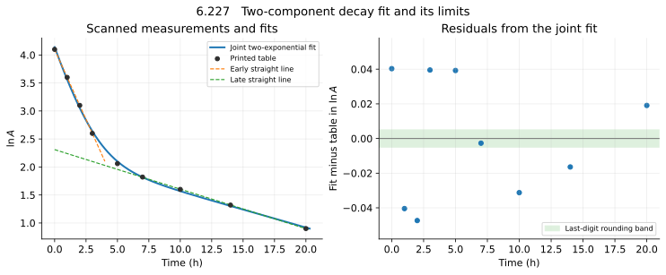
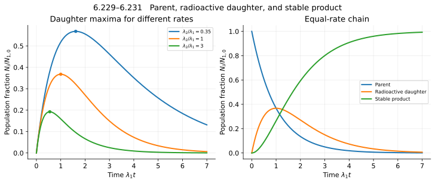
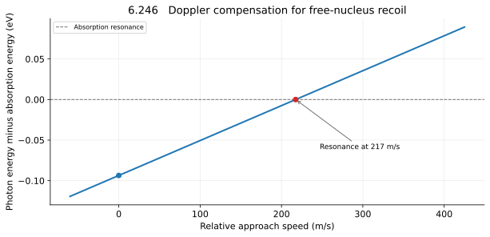
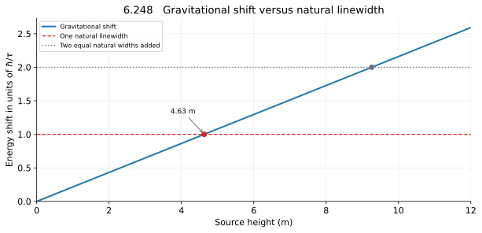

# 6.5 Radioactivity

[Chapter index](../README.md#chapters) · [Structured solutions](6.5.json) · [Answer audit](../audit/README.md)

## 6.214

**Problem statement**

Knowing the decay constant λ of a nucleus, find: (a) the probability of decay of the nucleus during the time from 0 to t; (b) the mean lifetime τ of the nucleus.

**Solved · high confidence.** Normalize the exponential survival law and integrate its lifetime probability density.

**Assumptions**

- The nucleus is undecayed at t = 0 and has a constant positive decay constant λ. The ideal exponential law applies for t ≥ 0.

Survival probability is the remaining fraction of an initially identical ensemble.

$$
S(t)=e^{-\lambda t},\qquad P(0\le t_{\rm decay}\le t)=1-S(t)=1-e^{-\lambda t}.
$$

Differentiate the cumulative probability to get the normalized lifetime density.

$$
f(t)=\lambda e^{-\lambda t},\qquad\int_0^\infty f(t)\,dt=1.
$$

The mean lifetime is the first moment of that density, or equivalently the integral of survival probability.

$$
\tau=\int_0^\infty t\lambda e^{-\lambda t}\,dt=\int_0^\infty e^{-\lambda t}\,dt=\frac1\lambda.
$$

**Results**

Probability of decay during the interval from zero to t

$$
P=1-e^{-\lambda t}
$$

Mean nuclear lifetime

$$
\tau=1/\lambda
$$

## 6.215

**Problem statement**

What fraction of the radioactive cobalt nuclei whose half-life is 71.3 days decays during a month?

**Solved · high confidence.** Subtract the surviving fraction after a defined thirty-day month.

**Assumptions**

- Take the unspecified month to mean 30 days. Use the stated cobalt half-life 71.3 days, without substituting a value for another cobalt isotope.

Write the survival fraction using half-life rather than a separately tabulated decay constant.

$$
N(t)/N_0=2^{-t/T_{1/2}},\qquad f_{\rm decay}=1-2^{-t/T_{1/2}}.
$$

Insert the month and half-life in the same time unit.

$$
f_{\rm decay}=1-2^{-30/71.3}=0.25296764.
$$

**Results**

Fraction of the original nuclei decaying in thirty days

$$
f\simeq0.253\quad(25.3\%)
$$

## 6.216

**Problem statement**

How many beta-particles are emitted during one hour by 1.0 μg of Na²⁴ radionuclide whose half-life is 15 hours?

**Solved · high confidence.** Integrate the decay law over the first hour to count the emitted beta particles.

**Assumptions**

- The initial 1.0 μg preparation is pure Na-24, and each decay produces one beta particle. Count all emitted beta particles, independent of detector efficiency.
- Use the stated 15 h half-life and the Appendix Na-24 atom mass. The neutral atom mass is appropriate for converting preparation mass to atom number.

Convert the initial preparation mass to kilograms and divide by one isotope atom mass.

$$
m_0=1.0\times10^{-9}\ \mathrm{kg},\qquad N_0=m_0/m_{24}.
$$

The integrated number of decays equals the difference of initial and surviving nuclei.

$$
N_\beta=N_0-N(\Delta t)=N_0\left(1-e^{-\lambda\Delta t}\right)=N_0\left(1-2^{-1/15}\right).
$$

Evaluate the one-hour loss using the exact stated half-life factor.

$$
N_\beta=1.13392\times10^{15}\ \text{beta particles}.
$$

A constant initial-rate estimate is slightly larger because the activity decreases during the hour.

$$
A_0\Delta t=N_0\frac{\ln2}{15}=1.16032\times10^{15},\qquad N_\beta<A_0\Delta t.
$$

**Results**

Beta particles emitted during the full first hour

$$
N_\beta=\frac{m_0}{m_{24}}\left(1-2^{-1/15}\right)\simeq1.13\times10^{15}
$$

Initial activity multiplied by one hour, for comparison only

$$
A_0\Delta t\simeq1.16032\times10^{15}
$$

This is not the integrated answer; it is about 2.3% larger.

## 6.217

**Problem statement**

To investigate the beta-decay of Mg²³ radionuclide, a counter was activated at the moment t = 0. It registered N_1 beta-particles by a moment t_1 = 2.0 s, and by a moment t_2 = 3t_1 the number of registered beta-particles was 2.66 times greater. Find the mean lifetime of the given nuclei.

**Solved · high confidence.** Use cumulative integrated counts at t₁ and 3t₁ to eliminate initial population and counter efficiency.

**Assumptions**

- The source is not replenished. Detection efficiency is constant, and background and dead-time effects are absent or corrected.
- The stated numbers are cumulative counts from t = 0, not instantaneous activities or counts in equal separate windows.

The registered cumulative count has the same time dependence as the number of decays, with one constant normalization.

$$
C(t)=K(1-e^{-t/\tau}).
$$

Let x = exp(−t₁/τ). The ratio at three times the first time reduces to a quadratic polynomial.

$$
\frac{C(3t_1)}{C(t_1)}=\frac{1-x^3}{1-x}=1+x+x^2=2.66,\qquad x^2+x-1.66=0.
$$

Select the physical root between zero and one, then solve for lifetime.

$$
x=\frac{-1+\sqrt{7.64}}2=0.88202750,\qquad\tau=-\frac{t_1}{\ln x}=-\frac{2.0}{\ln x}=15.9322\ \mathrm s.
$$

**Results**

Mean lifetime inferred from cumulative beta counts

$$
\tau\simeq15.9\ \mathrm s
$$

## 6.218

**Problem statement**

The activity of a certain preparation decreases 2.5 times after 7.0 days. Find its half-life.

**Solved · high confidence.** Determine the decay exponent from the measured activity reduction, then convert it to half-life.

**Assumptions**

- The preparation activity follows a single exponential with no radioactive daughter contribution or replenishment.

The measured factor fixes the decay constant in inverse days.

$$
A(7\,\mathrm d)/A_0=1/2.5=e^{-7\lambda},\qquad\lambda=\ln(2.5)/(7\,\mathrm d).
$$

Use the half-life relation T₁/₂ = ln(2)/λ.

$$
T_{1/2}=7\frac{\ln2}{\ln2.5}\ \mathrm d=5.29530\ \mathrm d.
$$

**Results**

Preparation half-life

$$
T_{1/2}\simeq5.30\ \mathrm d
$$

## 6.219

**Problem statement**

At the initial moment the activity of a certain radionuclide totalled 650 particles per minute. What will be the activity of the preparation after half its half-life period?

**Solved · high confidence.** Evaluate exponential activity at half of one half-life.

**Assumptions**

- The stated 650 particles per minute represents the initial activity in the same counting convention as the requested later activity.

Activity has the same exponential factor as parent population.

$$
A(t)=A_0\,2^{-t/T_{1/2}}.
$$

At half a half-life the survival factor is 2^(−1/2), not one half.

$$
A(T_{1/2}/2)=\frac{650}{\sqrt2}=459.619\ \mathrm{min^{-1}}.
$$

**Results**

Activity after half of the half-life

$$
A=650/\sqrt2\simeq460\ \mathrm{min^{-1}}
$$

Same activity in inverse seconds

$$
A\simeq7.66\ \mathrm{Bq}
$$

## 6.220

**Problem statement**

Find the decay constant and the mean lifetime of Co⁵⁵ radionuclide if its activity is known to decrease 4.0% per hour. The decay product is nonradioactive.

**Solved · high confidence.** Convert the finite one-hour retention factor to a continuous decay constant.

**Assumptions**

- A decrease of 4.0% per hour means A(t + 1 h) = 0.960 A(t). It does not mean the continuous logarithmic derivative is exactly 0.040 h⁻¹.
- The daughter is nonradioactive as stated, so the measured activity has no daughter ingrowth term.

The exponential survival factor over one hour equals the retained activity fraction.

$$
e^{-\lambda(1\,\mathrm h)}=0.960,\qquad\lambda=-\ln(0.960)/(1\,\mathrm h).
$$

Compute the exact logarithmic decay constant and its reciprocal mean lifetime.

$$
\lambda=0.04082199\ \mathrm{h^{-1}}=1.1339443\times10^{-5}\ \mathrm{s^{-1}},\qquad\tau=\lambda^{-1}=24.4966\ \mathrm h=8.81878\times10^4\ \mathrm s.
$$

Using the small-decrease approximation λ ≈ 0.040 h⁻¹ would instead give 25 h; it is close but is not the exact finite-step result.

$$
-\ln(1-f)=f+\tfrac12f^2+\cdots,\qquad f=0.040.
$$

**Results**

Decay constant from exact one-hour retention

$$
\lambda=-\ln0.96/(3600\,\mathrm s)\simeq1.13\times10^{-5}\ \mathrm{s^{-1}}
$$

Mean lifetime

$$
\tau=1/\lambda\simeq24.5\ \mathrm h
$$

Mean lifetime in SI seconds

$$
\tau\simeq8.82\times10^4\ \mathrm s
$$

## 6.221

**Problem statement**

A U²³⁸ preparation of mass 1.0 g emits 1.24×10⁴ alpha-particles per second. Find the half-life of this nuclide and the activity of the preparation.

**Solved · high confidence.** Infer the decay constant from the parent alpha rate and the number of uranium atoms.

**Assumptions**

- Treat the 1.0 g sample as pure U-238, with one alpha particle emitted per parent decay. Daughter-chain activities and nonradioactive mass are absent.
- Use the documented approximation m_238 ≈ 238 u for the isotope atom mass.
- Report half-life in seconds and convert using an explicitly defined Julian year: 365.25 days = 31557600 s. The measured alpha rate is the activity under the one-alpha-per-decay assumption.

Convert sample mass to initial parent-atom count.

$$
N=\frac{m}{m_{238}}=\frac{10^{-3}\ \mathrm{kg}}{238\,\mathrm u}=2.53113\times10^{21}.
$$

Each decay contributes one alpha, so A = λN. Use the measured rate to determine half-life.

$$
A=1.24\times10^4\ \mathrm{s^{-1}},\qquad\lambda=A/N,\qquad T_{1/2}=\frac{N\ln2}{A}=1.41488\times10^{17}\ \mathrm s.
$$

Express the same half-life in Julian years and the preparation activity in curies.

$$
T_{1/2}=4.48348\times10^9\ \mathrm{Julian\ years}\simeq4.5\times10^9\ \mathrm{years},\qquad A=1.24\times10^4\ \mathrm{Bq}=3.35135\times10^{-7}\ \mathrm{Ci}.
$$

**Results**

U-238 half-life inferred from the stated sample and rate

$$
T_{1/2}\simeq1.41\times10^{17}\ \mathrm s
$$

Same half-life in explicitly defined Julian years

$$
T_{1/2}\simeq4.48\times10^9\ \mathrm{Julian\ years}
$$

Preparation activity

$$
A=1.24\times10^4\ \mathrm{Bq}
$$

Same activity in curies

$$
A\simeq3.35\times10^{-7}\ \mathrm{Ci}=0.335\ \mathrm{\mu Ci}
$$

**Limitations**

- If daughter radionuclides also contribute to the observed alpha rate, the one-parent-decay inference requires their separate contributions; they are excluded in the stated pure-isotope model.

## 6.222

**Problem statement**

Determine the age of ancient wooden items if it is known that the specific activity of C¹⁴ nuclide in them amounts to 3/5 of that in lately felled trees. The half-life of C¹⁴ nuclei is 5570 years.

**Solved · high confidence.** Use the specific-activity ratio as the surviving C-14 fraction.

**Assumptions**

- At the end of exchange with the environment, the wood had the same C-14 specific activity as the reference freshly felled trees.
- The dated carbon is a closed sample thereafter, and its normalization mass is unchanged for this mathematical decay calculation.
- Use the stated historical half-life 5570 years rather than substituting another value.

Specific activity is proportional to C-14 population when the comparison uses the same normalization.

$$
\frac{a(t)}{a_0}=e^{-\lambda t}=2^{-t/T_{1/2}}=\frac35.
$$

Solve for elapsed time using the supplied half-life.

$$
t=\frac{T_{1/2}}{\ln2}\ln\frac53=5570\frac{\ln(5/3)}{\ln2}\ \mathrm{years}=4104.90\ \mathrm{years}.
$$

**Results**

Decay-law age from the stated C-14 activity ratio

$$
t\simeq4.10\times10^3\ \mathrm{years}
$$

**Limitations**

- The answer is the stated constant-reference, closed-sample decay model, without independent calibration or environmental corrections.

## 6.223

**Problem statement**

In a uranium ore the ratio of U²³⁸ nuclei to Pb²⁰⁶ nuclei is η = 2.8. Evaluate the age of the ore, assuming all the lead Pb²⁰⁶ to be a final decay product of the uranium series. The half-life of U²³⁸ nuclei is 4.5×10⁹ years.

**Solved · high confidence.** Recover the initial uranium count from conserved parent-to-final-daughter counts.

**Assumptions**

- All Pb-206 is radiogenic as stated, and no U-238 or Pb-206 has entered or left the ore since closure.
- Each completed U-238 decay chain yields one Pb-206 nucleus. Neglect the small inventory temporarily residing in radioactive intermediate daughters.
- The supplied half-life 4.5 × 10⁹ years is used directly; no seconds-per-year conversion is needed for an age reported in the same years.

The initial number of uranium atoms equals the surviving uranium plus the final lead atoms.

$$
N_{U,0}=N_U+N_{Pb},\qquad\eta=N_U/N_{Pb}=2.8,\qquad\frac{N_U}{N_{U,0}}=\frac{\eta}{\eta+1}.
$$

Apply the parent decay law to that surviving fraction.

$$
e^{-\lambda t}=\frac{\eta}{\eta+1},\qquad t=\frac{T_{1/2}}{\ln2}\ln\left(1+\frac1\eta\right).
$$

Evaluate with the specified ratio and half-life.

$$
t=\frac{4.5\times10^9}{\ln2}\ln(1+1/2.8)=1.98258\times10^9\ \mathrm{years}.
$$

**Results**

Closed-ore age under the stated radiogenic-lead assumption

$$
t\simeq2.0\times10^9\ \mathrm{years}
$$

**Limitations**

- Initial lead, isotope loss or gain, or a significant undecayed intermediate inventory would require a more detailed isotope-balance model.

## 6.224

**Problem statement**

Calculate the specific activities of Na²⁴ and U²³⁵ nuclides whose half-lifes are 15 hours and 7.1×10⁸ years respectively.

**Solved · high confidence.** Compute activity per unit mass from decay constant and isotope atom mass.

**Assumptions**

- Specific activity refers to a pure isotope and equals activity divided by that isotope’s mass. Daughter activities are not included.
- Use the stated half-lives: 15 h for Na-24 and 7.1 × 10⁸ years for U-235. One Julian year is 31557600 s for the conversion to Bq.
- Use the Appendix Na-24 atom mass and the explicitly approximate U-235 mass 235 u; no heavy-isotope mass precision beyond this is required by the supplied half-life.

A pure isotope contains 1/m_atom atoms per kilogram. Multiply this by λ = ln(2)/T₁/₂.

$$
a=\frac{A}{m}=\frac{\lambda}{m_{\rm atom}}=\frac{\ln2}{T_{1/2}m_{\rm atom}}.
$$

For Na-24, convert fifteen hours to seconds and use the exact bound Appendix atom-mass entry.

$$
a_{24}=\frac{\ln2}{(15\times3600\,\mathrm s)m_{24}}=3.22312\times10^{20}\ \mathrm{Bq/kg}=3.22312\times10^{17}\ \mathrm{Bq/g}.
$$

For U-235, convert the stated years to seconds before taking the inverse lifetime.

$$
a_{235}=\frac{\ln2}{[(7.1\times10^8)(31557600)\,\mathrm s](235\,\mathrm u)}=7.93026\times10^7\ \mathrm{Bq/kg}=7.93026\times10^4\ \mathrm{Bq/g}.
$$

Use the Appendix curie conversion only after both specific activities have consistent mass units.

$$
a_{24}=8.71112\times10^6\ \mathrm{Ci/g},\qquad a_{235}=2.14331\times10^{-6}\ \mathrm{Ci/g}.
$$

**Results**

Na-24 specific activity in SI mass units

$$
a_{24}\simeq3.22\times10^{20}\ \mathrm{Bq/kg}
$$

Equivalent to 3.22 × 10¹⁷ Bq/g.

U-235 specific activity in SI mass units

$$
a_{235}\simeq7.93\times10^7\ \mathrm{Bq/kg}
$$

Equivalent to 7.93 × 10⁴ Bq/g.

Na-24 specific activity in curies per gram

$$
a_{24}\simeq8.71\times10^6\ \mathrm{Ci/g}
$$

U-235 specific activity in curies per gram

$$
a_{235}\simeq2.14\times10^{-6}\ \mathrm{Ci/g}
$$

## 6.225

**Problem statement**

A small amount of solution containing Na²⁴ radionuclide with activity A = 2.0×10³ disintegrations per second was injected in the bloodstream of a man. The activity of 1 cm³ of blood sample taken t = 5.0 hours later turned out to be A' = 16 disintegrations per minute per cm³ . The half-life of the radionuclide is T = 15 hours. Find the volume of the man's blood.

**Solved · high confidence.** Apply the stated ideal radioactive-dilution model to a uniformly mixed closed compartment.

**Assumptions**

- This is the historical problem’s mathematical dilution model: the tracer is uniformly mixed in one constant-volume compartment, and its only loss is radioactive decay.
- The initial activity A refers to the amount added. The added solution volume is negligible for the requested volume, and the sample is representative without altering the compartment appreciably.
- Use only the stated tracer half-life and activities; no additional physiological kinetics or clinical interpretation is inferred.

Correct the total tracer activity for the elapsed five hours.

$$
A_{\rm total}(t)=A\,2^{-t/T_{1/2}}=(2.0\times10^3)2^{-5/15}=1587.40\ \mathrm{Bq}.
$$

Convert the measured activity per cubic centimetre to the same time unit as the total activity.

$$
a_{\rm sample}=16\ \mathrm{min^{-1}cm^{-3}}=\frac{16}{60}\ \mathrm{Bq/cm^3}.
$$

Uniform mixing gives total activity equal to activity density times volume.

$$
V=\frac{A_{\rm total}(t)}{a_{\rm sample}}=\frac{2000\,2^{-1/3}}{16/60}=5952.75\ \mathrm{cm^3}=5.95275\ \mathrm L.
$$

**Results**

Compartment volume in the stated mathematical tracer model

$$
V\simeq5.95\ \mathrm L
$$

Same model volume in cubic centimetres

$$
V\simeq5.95\times10^3\ \mathrm{cm^3}
$$

**Limitations**

- The result applies only to the stated ideal closed, uniformly mixed dilution model; additional tracer losses or compartment structure are not specified.

## 6.226

**Problem statement**

The specific activity of a preparation consisting of radioactive Co⁵⁸ and nonradioactive Co⁵⁹ is equal to 2.2×10¹² dis/(s•g). The half-life of Co⁵⁸ is 71.3 days. Find the ratio of the mass of radioactive cobalt in that preparation to the total mass of the preparation (in per cent).

**Solved · high confidence.** Convert the measured activity per preparation mass to the number and mass ofCo58 atoms.

**Assumptions**

- The preparation consists only ofCo58 and stableCo59, and everyCo58 decay contributes one disintegration to the quoted activity.
- Use the mass-number molar approximationM58 approximately58g/mol. No external heavy-isotope mass is needed at the stated precision.
- The half-life is 71.3 days with 1day=86400 s. The requested quantity is radioactive mass divided by total preparation mass, not a nucleus-number ratio.

The decay constant isln2 divided by half-life, and a pureCo58 sample would have activity per gram lambda N_A/M58.

$$
\lambda=\frac{\ln2}{71.3(86400)};\qquad a_{58}=\frac{\lambda N_A}{58\,\mathrm{g/mol}}.
$$

For total massm and radioactive massm58, the measured specific activity is proportional to the radioactive mass fraction.

$$
a=\frac{A}{m}=\frac{\lambda N_A}{M_{58}}\frac{m_{58}}m,\qquad f=\frac{m_{58}}m=\frac{aM_{58}}{\lambda N_A}.
$$

Insert the activity in disintegrations per second per gram andM58 in grams per mole.

$$
f=0.00188284957,\qquad100f=0.18828496\%\simeq0.19\%.
$$

**Results**

RadioactiveCo58 mass percentage

$$
\boxed{100m_{58}/m\simeq0.19\%}
$$

Radioactive mass fraction

$$
m_{58}/m\simeq1.88\times10^{-3}
$$

**Limitations**

- The isotope molar mass is approximated by its mass number in grams per mole; the given two-significant-figure activity does not warrant more precise nuclear masses.

## 6.227

**Problem statement**

A certain preparation includes two beta-active components with different half-lifes. The measurements resulted in the following dependence of the natural logarithm of preparation activity on time t expressed in hours: t (hours): 0, 1, 2, 3, 5, 7, 10, 14, 20; ln A: 4.10, 3.60, 3.10, 2.60, 2.06, 1.82, 1.60, 1.32, 0.90. Find the half-lifes of both components and the ratio of radioactive nuclei of these components at the moment t = 0.

**Solved · medium confidence.** Fit a positive sum of two decay activities to the scanned logarithms and retain the distinct straight-line approximations as diagnostics.

**Assumptions**

- The total activity is A(t)=a_f exp(-lambda_f t)+a_s exp(-lambda_s t), with positive component amplitudes and λ_f>lambda_s>0. Time is in hours.
- The primary numerical model minimizes equally weighted squared residuals in ln A, using the printed table. This is an explicit fitting convention because no measurement error model is supplied.
- Activity amplitudes are lambda times nucleus numbers. Their ratio is not the requested initial nucleus ratio; the rate conversion must be included.
- The printed table is not exactly compatible with two distinct positive exponentials at last-digit rounding precision. All fitted parameters are approximate effective estimates rather than uniquely exact answers.

Use a log-sum-exp model for the observed logarithms, with positivity and rate ordering enforced.

$$
\ln A(t)=\ln\left[e^{b_f-\lambda_ft}+e^{b_s-\lambda_st}\right],\qquad b_i=\ln a_i.
$$

A constrained joint least-squares fit to all nine points gives the following component rates and logarithmic amplitudes.

$$
\lambda_f=0.700951204\,\mathrm{h^{-1}},\quad\lambda_s=0.0639527954\,\mathrm{h^{-1}},\qquad b_f=3.98552734,\quad b_s=2.19811459.
$$

Convert rate constants to half-lives and activity amplitudes to the initial radioactive-nucleus ratio.

$$
T_f=\frac{\ln2}{\lambda_f}=0.9888665\,\mathrm h,\quad T_s=\frac{\ln2}{\lambda_s}=10.838419\,\mathrm h,\qquad\frac{N_{f0}}{N_{s0}}=e^{b_f-b_s}\frac{\lambda_s}{\lambda_f}=0.5450486.
$$

The joint model hasRMS logarithmic residual0.03370 and maximum absolute residual0.04734, exceeding the nominal0.005 rounding half-unit. The first four printed points are exactly collinear, whereas a true positive two-exponential log is strictly convex.

$$
\frac{d^2\ln A}{dt^2}=w_fw_s(\lambda_f-\lambda_s)^2>0,\qquad w_i=A_i/A.
$$

Conventional separate early0–3 h and late7–20 h straight-line estimates give different approximate values. They treat the early total as though it were the fast component.

$$
T_{f,\rm lines}=1.3862944\,\mathrm h,\quad T_{s,\rm lines}=9.8169948\,\mathrm h,\quad(N_f/N_s)_{\rm lines}=0.8455920.
$$

Those two extrapolated line amplitudes sum to ln A(0) about4.2544 rather than the printed 4.10. Subtracting the extrapolated slow tail in activity units before fitting the early residual changes the fast estimate to 0.930716 h and the population ratio to 0.508291; the slow half-life remains9.816995 h.

$$
T_{f,\rm subtracted}=0.9307157\,\mathrm h,\qquad(N_f/N_s)_{\rm subtracted}=0.5082910.
$$

Leaving out individual points gives sensitivity rangesTf about0.884–1.023 h,Ts about10.375–12.475 h andNf/Ns about0.524–0.563 for the joint model. These are sensitivity diagnostics, not statistical confidence intervals; the graphical-method discrepancy is larger still.

The rounded table itself excludes an exact two-rate decomposition. Write R_j=A(j+1)/A(j) in hourly steps and let w be the initial slow activity fraction. The first two printed ratios both lie between exp(−0.51) and exp(−0.49). The tail ratios give r_s≥exp(−0.071) and w≥exp(−2.51)−exp(−4.9). These bounds force the two early ratios farther apart than the rounding permits.

$$
R_1-R_0=\frac{w(r_s-R_0)^2}{(1-w)R_0}\ge0.01322>0.01214\ge R_1-R_0.
$$

**Results**

Primary joint-fit fast-component half-life

$$
\boxed{T_f\simeq0.99\,\mathrm h}
$$

Primary joint-fit slow-component half-life

$$
\boxed{T_s\simeq10.8\,\mathrm h}
$$

Primary initial fast-to-slow radioactive-nucleus ratio

$$
\boxed{N_{f0}/N_{s0}\simeq0.55}
$$

Conditional separate early/late straight-line half-lives

$$
(T_f,T_s)_{\rm lines}\simeq(1.3863,9.8170)\,\mathrm h
$$

Approximate graphical asymptotes of the measured total; not an exact decomposition.

Population ratio from those separate-line amplitudes

$$
(N_f/N_s)_{\rm lines}\simeq0.8456
$$

Conditional tail-subtracted fast half-life

$$
T_{f,\rm subtracted}\simeq0.9307\,\mathrm h
$$

Conditional tail-subtracted nucleus ratio

$$
(N_f/N_s)_{\rm subtracted}\simeq0.5083
$$

**Limitations**

- No exact two-exponential parameter set reproduces the supplied table at its nominal rounding precision. Quoted guard digits identify a chosen fit and should not be interpreted as experimental accuracy.

## 6.228

**Problem statement**

A P³² radionuclide with half-life T = 14.3 days is produced in a reactor at a constant rate q = 2.7×10⁹ nuclei per second. How soon after the beginning of production of that radionuclide will its activity be equal to A = 1.0×10⁹ dis/s?

**Solved · high confidence.** Solve constant production opposed by radioactive decay and invert the resulting activity buildup.

**Assumptions**

- Initially noP32 is present. Production remains constant atq and decay is the only removal process; there is no target burnup or extraction.
- The requested activity counts theP32 parent decays only. Half-life14.3 days is converted with 86400 s per day.

The population satisfies a source-minus-decay rate equation.

$$
\frac{dN}{dt}=q-\lambda N,\quad N(0)=0,\qquad N(t)=\frac q\lambda(1-e^{-\lambda t}).
$$

Multiply bylambda and solve for the time at which the activity reachesA.

$$
A(t)=q(1-e^{-\lambda t}),\qquad t=\frac1\lambda\ln\frac q{q-A}=\frac{T_{1/2}}{\ln2}\ln\frac q{q-A}.
$$

The target is below the saturation activityq, so a finite solution exists.

$$
t=\frac{14.3}{\ln2}\ln\frac{2.7}{1.7}\,\mathrm{days}=9.5441727\,\mathrm{days}\simeq9.5\,\mathrm{days}.
$$

**Results**

Time to reach the specifiedP32 activity

$$
\boxed{t\simeq9.54\,\mathrm{days}}
$$

Same production time in seconds

$$
t\simeq8.2462\times10^5\,\mathrm s
$$

## 6.229

**Problem statement**

A radionuclide A_1 with decay constant λ_1 transforms into a radionuclide A_2 with decay constant λ_2. Assuming that at the initial moment the preparation contained only the radionuclide A_1, find: (a) the equation describing accumulation of the radionuclide A_2 with time; (b) the time interval after which the activity of radionuclide A_2 reaches the maximum value.

**Solved · high confidence.** Solve the sequential decay equation with an integrating factor and differentiate the daughter population for its activity maximum.

**Assumptions**

- The chain has one-to-one branching, positive decay constants, initial N1=N10 and N2=0, and no external production or removal.
- For the displayed difference-of-exponentials expression assume lambda1 differs from λ2; its continuous equal-rate limit is supplied and treated separately in the next problem.

The parent decays exponentially and feeds the daughter at ratelambda1 N1.

$$
N_1(t)=N_{10}e^{-\lambda_1t},\qquad\frac{dN_2}{dt}+\lambda_2N_2=\lambda_1N_{10}e^{-\lambda_1t}.
$$

Integration with N2(0)=0 gives the daughter accumulation law. Multiplication bylambda2 gives its activity.

$$
\boxed{N_2(t)=\frac{\lambda_1N_{10}}{\lambda_2-\lambda_1}(e^{-\lambda_1t}-e^{-\lambda_2t})},\qquad A_2(t)=\lambda_2N_2(t).
$$

At the maximum, daughter production equals daughter loss. Solve the resulting exponential equation.

$$
\frac{dA_2}{dt}=0\iff\lambda_1N_1=\lambda_2N_2\iff\lambda_2e^{-\lambda_2t}=\lambda_1e^{-\lambda_1t},\qquad\boxed{t_{\max}=\frac{\ln(\lambda_2/\lambda_1)}{\lambda_2-\lambda_1}}.
$$

The time is positive whichever rate is larger. Near equal rates the removable singularities tend to a regular daughter population and maximum time.

$$
\lambda_2\to\lambda_1=\lambda:\quad N_2\to N_{10}\lambda t e^{-\lambda t},\qquad t_{\max}\to1/\lambda.
$$

**Results**

Daughter population versus time

$$
\boxed{N_2=N_{10}\lambda_1(e^{-\lambda_1t}-e^{-\lambda_2t})/(\lambda_2-\lambda_1)}
$$

Time of maximum daughter activity

$$
\boxed{t_{\max}=\ln(\lambda_2/\lambda_1)/(\lambda_2-\lambda_1)}
$$

## 6.230

**Problem statement**

Solve the foregoing problem if λ_1 = λ_2 = λ.

**Solved · high confidence.** Solve the equal-rate chain directly instead of evaluating a removable difference-of-rates singularity.

**Assumptions**

- Both successive decay constants are lambda>0. Initially N1=N10 and N2=0, with unit branching and no external source.

Substitute the parent population into the equal-rate daughter equation and use an integrating factor.

$$
N_1=N_{10}e^{-\lambda t},\qquad\frac{d}{dt}(e^{\lambda t}N_2)=\lambda N_{10}.
$$

The daughter population and its activity are therefore linear in time times the common exponential.

$$
\boxed{N_2=N_{10}\lambda t e^{-\lambda t}},\qquad A_2=N_{10}\lambda^2t e^{-\lambda t}.
$$

Differentiating gives a unique maximum at one mean lifetime.

$$
\frac{dA_2}{dt}=N_{10}\lambda^2e^{-\lambda t}(1-\lambda t),\qquad\boxed{t_{\max}=1/\lambda},\quad N_{2,\max}=N_{10}/e,\quad A_{2,\max}=\lambda N_{10}/e.
$$

**Results**

Daughter population for equal rates

$$
\boxed{N_2=N_{10}\lambda t e^{-\lambda t}}
$$

Time of maximum daughter activity

$$
\boxed{t_{\max}=1/\lambda}
$$

Maximum daughter activity

$$
A_{2,\max}=\lambda N_{10}/e
$$

## 6.231

**Problem statement**

A radionuclide A_1 goes through the transformation chain A_1 → A_2 → A_3 (stable) with respective decay constants λ_1 and λ_2. Assuming that at the initial moment the preparation contained only the radionuclide A_1 equal in quantity to N_10 nuclei, find the equation describing accumulation of the stable isotope A_3.

**Solved · high confidence.** Use conservation of nuclei together with the exact first and second member populations.

**Assumptions**

- The closed chain has unit branching A1 → A2 → A3, with A3 stable. Initially N1=N10 and N2=N3=0; nuclear transformations preserve the number of chain members.
- The main expression assumes unequal positive decay constants; the equal-rate limit is also stated.

The stable population is the initial total minus the surviving parent and intermediate daughter.

$$
N_3=N_{10}-N_1-N_2.
$$

Insert the two exponential populations and combine their coefficients.

$$
\boxed{N_3(t)=N_{10}\left[1-\frac{\lambda_2e^{-\lambda_1t}-\lambda_1e^{-\lambda_2t}}{\lambda_2-\lambda_1}\right]}.
$$

For equal rates replace the daughter by its regular limit.

$$
\lambda_1=\lambda_2=\lambda:\qquad\boxed{N_3=N_{10}[1-e^{-\lambda t}(1+\lambda t)]}.
$$

The stable population grows only through the intermediate daughter, which also supplies a differential check.

$$
\frac{dN_3}{dt}=\lambda_2N_2\ge0,\qquad N_3(t\ll1/\lambda_i)\simeq\frac12N_{10}\lambda_1\lambda_2t^2.
$$

**Results**

Accumulation of stable A3 for unequal rates

$$
\boxed{N_3=N_{10}[1-(\lambda_2e^{-\lambda_1t}-\lambda_1e^{-\lambda_2t})/(\lambda_2-\lambda_1)]}
$$

Stable-product accumulation at equal rates

$$
N_3=N_{10}[1-(1+\lambda t)e^{-\lambda t}]
$$

## 6.232

**Problem statement**

A Bi²¹⁰ radionuclide decays via the chain Bi²¹⁰ --λ_1→ Po²¹⁰ --λ_2→ Pb²⁰⁶ (stable), where the decay constants are λ_1 = 1.60×10⁻⁶ s⁻¹, λ_2 = 5.80×10⁻⁸ s⁻¹. Calculate alpha- and beta-activities of the Bi²¹⁰ preparation of mass 1.00 mg a month after its manufacture.

**Solved · high confidence.** Use the exact parent-daughter buildup and identify the beta and alpha steps separately.

**Assumptions**

- At manufacture the 1.00 mg preparation is pureBi210 with noPo210 orPb206 initially. Follow the stated chain with unit branching and no loss of daughter atoms.
- Take a month to mean30 days, so elapsed time is 2592000 s. A calendar-month interpretation would produce a different numerical activity.
- Approximate the initialBi210 molar mass by210g/mol. This mass-number approximation is adequate for the supplied decay constants.

The initial parent count follows from preparation mass and molar mass.

$$
N_{10}=\frac{1.00\times10^{-6}\,\mathrm{kg}}{0.210\,\mathrm{kg/mol}}N_A=2.8680952\times10^{18}.
$$

Use the exact two-member decay populations, not a secular-equilibrium approximation.

$$
N_{\rm Bi}=N_{10}e^{-\lambda_1t},\qquad N_{\rm Po}=\frac{\lambda_1N_{10}}{\lambda_2-\lambda_1}(e^{-\lambda_1t}-e^{-\lambda_2t}).
$$

TheBi decay isbeta minus and thePo decay isalpha, so their activities are λ1N_Bi and λ2N_Po respectively.

$$
A_\beta=\lambda_1N_{\rm Bi},\qquad A_\alpha=\lambda_2N_{\rm Po}.
$$

Evaluate at 30 days.

$$
A_\beta=7.2544998\times10^{10}\,\mathrm{s^{-1}},\qquad A_\alpha=1.4578522\times10^{11}\,\mathrm{s^{-1}}.
$$

**Results**

Alpha activity after a30-day month

$$
\boxed{A_\alpha\simeq1.46\times10^{11}\,\mathrm{Bq}}
$$

Beta activity after a30-day month

$$
\boxed{A_\beta\simeq7.25\times10^{10}\,\mathrm{Bq}}
$$

**Limitations**

- Activities are disintegration rates, not detector count rates. Detector efficiencies and unmodeled branch fractions would require further information.

## 6.233

**Problem statement**

(a) What isotope is produced from the alpha-radioactive Ra²²⁶ as a result of five alpha-disintegrations and four β⁻-disintegrations? (b) How many alpha- and β⁻-decays does U²³⁸ experience before turning finally into the stable Pb²⁰⁶ isotope?

**Solved · high confidence.** Conserve mass number and nuclear charge across alpha and beta-minus transformations.

**Assumptions**

- An alpha decay changes(A,Z) to(A-4,Z-2). A beta-minus decay leavesA unchanged and increasesZ by1.
- UseRaZ=88 from digitized Appendix27 and the locally registeredPbZ=82 andUZ=92. Ignore alternative branches not specified in the task.

Fivealpha decays andfourbeta-minus decays fromRa226 give mass number206 and charge82.

$$
A_f=226-5\cdot4=206,\qquad Z_f=88-5\cdot2+4=82\quad\Longrightarrow\quad\boxed{{}^{206}_{82}\mathrm{Pb}}.
$$

ForU238toPb206 the mass-number change fixes thealpha count.

$$
238-4n_\alpha=206\quad\Longrightarrow\quad n_\alpha=8.
$$

Then charge conservation fixes thebeta-minus count.

$$
92-2(8)+n_{\beta^-}=82\quad\Longrightarrow\quad\boxed{n_{\beta^-}=6}.
$$

**Results**

Final isotope after the specifiedRa226 decays

$$
\boxed{{}^{206}_{82}\mathrm{Pb}}
$$

Alpha decays in theU238toPb206 chain

$$
\boxed{n_\alpha=8}
$$

Beta-minus decays in that chain

$$
\boxed{n_{\beta^-}=6}
$$

## 6.234

**Problem statement**

A stationary Pb²⁰⁰ nucleus emits an alpha-particle with kinetic energy T_α = 5.77 MeV. Find the recoil velocity of a daughter nucleus. What fraction of the total energy liberated in this decay is accounted for by the recoil energy of the daughter nucleus?

**Solved · high confidence.** Apply two-body momentum conservation toalpha emission and retain daughter recoil in the total decay energy.

**Assumptions**

- The stationaryPb200 parent emits only the specifiedalpha and a daughter nucleus, without an additional radiation momentum at this stage. The daughter isHg196.
- Approximate the heavy daughter mass as196u and use the registeredalpha-particle mass. Nonrelativistic kinetic energy is adequate at the stated two-to-three-significant-figure precision.
- The daughter velocity vector is opposite to the emittedalpha momentum; the answer reports its speed.

The two final momenta have equal magnitudes. Infer thealpha momentum from its supplied kinetic energy.

$$
p_D=p_\alpha\simeq\sqrt{2m_\alpha T_\alpha},\qquad v_D\simeq\frac{\sqrt{2m_\alpha T_\alpha}}{M_D}.
$$

The daughter recoil energy is the same momentum squared divided by twice its mass.

$$
T_D=\frac{p_\alpha^2}{2M_D}=\frac{m_\alpha}{M_D}T_\alpha\simeq0.1177993\,\mathrm{MeV}.
$$

Both kinetic energies belong in the released energy. The recoil fraction has a simple mass-ratio form.

$$
Q=T_\alpha+T_D,\qquad\frac{T_D}{Q}=\frac{m_\alpha}{M_D+m_\alpha}\simeq\frac4{196+4}=0.020.
$$

Evaluate the recoil speed and fraction with the stated mass conventions.

$$
v_D=3.4059290\times10^5\,\mathrm{m/s},\qquad T_D/Q=0.02000736\simeq2.0\%.
$$

**Results**

DaughterHg196 recoil speed, opposite toalpha emission

$$
\boxed{v_D\simeq3.4\times10^5\,\mathrm{m/s}}
$$

Fraction of decay energy in daughter recoil

$$
\boxed{T_D/Q\simeq0.020\simeq2.0\%}
$$

Daughter recoil kinetic energy

$$
T_D\simeq0.118\,\mathrm{MeV}
$$

**Limitations**

- The heavy mass is approximated by its mass number. Relativisticalpha momentum and exact isotope masses would shift guard digits, not the requested estimate.

## 6.235

**Problem statement**

Find the amount of heat generated by 1.00 mg of a Po²¹⁰ preparation during the mean lifetime period of these nuclei if the emitted alpha-particles are known to possess the kinetic energy 5.3 MeV and practically all daughter nuclei are formed directly in the ground state.

**Solved · high confidence.** Count decays during one mean lifetime and include bothalpha and daughter recoil kinetic energy in the heat per decay.

**Assumptions**

- The 1.00 mg preparation is initially purePo210; approximate its molar mass as210g/mol. Over one mean lifetime the remaining parent fraction ise^-1, independent of the numerical half-life.
- Daughters are predominantlyPb206 in their ground state, so the released energy is thealpha kinetic energy plus daughter recoil, with no significant additional gamma branch.
- Allalpha and recoil energy is ultimately thermalized in the preparation or surrounding calorimeter. Escaping radiation would reduce locally retained heat.

The number decaying by one mean lifetimetau=1/lambda is N0(1-e^-1).

$$
N_0=\frac{m}{M_{\rm Po}}N_A,\qquad\Delta N=N_0(1-e^{-1}).
$$

Momentum conservation adds the daughter recoil to each5.3MeValpha kinetic energy.

$$
T_D=\frac{m_\alpha}{M_D}T_\alpha,\qquad Q=T_\alpha\left(1+\frac{m_\alpha}{M_D}\right),\qquad M_D\simeq206u.
$$

The total heat released is the decayed population times thisfull energy.

$$
H=N_0(1-e^{-1})T_\alpha\left(1+\frac{m_\alpha}{206u}\right).
$$

Evaluate with N0=2.8680952e18 andQ=5.4029513 MeV.

$$
\boxed{H=1.5692316\times10^6\,\mathrm J\simeq1.6\,\mathrm{MJ}}.
$$

**Results**

Heat released during one mean lifetime

$$
\boxed{H\simeq1.57\times10^6\,\mathrm J}
$$

Total kinetic energy thermalized per decay

$$
Q\simeq5.403\,\mathrm{MeV}
$$

**Limitations**

- The computed quantity is total thermalizable decay energy. Actual heat left in a small uncovered source depends on energy escape and thermal collection.

## 6.236

**Problem statement**

The alpha-decay of Po²¹⁰ nuclei (in the ground state) is accompanied by emission of two groups of alpha-particles with kinetic energies 5.30 and 4.50 MeV. Following the emission of these particles the daughter nuclei are found in the ground and excited states. Find the energy of gamma-quanta emitted by the excited nuclei.

**Solved · high confidence.** Subtract the two totalalpha-decay kinetic energies, including daughter recoil in each branch, to obtain the daughter excitation energy.

**Assumptions**

- The same stationaryPo210 ground state feedsPb206 ground and excited levels through the two listedalpha groups. Approximate both heavy daughter masses by206u for their recoil terms.
- Use nonrelativisticalpha-decay recoil at the precision of the supplied0.01 MeV kinetic energies. The quoted gamma-line energy means the usual daughter-rest-frame transition energy to this precision.
- Photon recoil, the tiny excited-state mass difference in the precedingalpha recoil, and Doppler shifts of a freely recoiling emitter are much smaller than the precision of the suppliedalpha energies.

In the ground-state branch the fullQ value isTg plus daughter recoil. In the excited branch the sameQ isTe plus recoil plus the excitationE_star.

$$
Q=T_g\left(1+\frac{m_\alpha}{M_D}\right)=T_e\left(1+\frac{m_\alpha}{M_D}\right)+E_*.
$$

Subtract the branches. The excitation is larger than the bare0.80MeValpha-energy difference because the recoil energies also differ.

$$
E_*=(T_g-T_e)\left(1+\frac{m_\alpha}{M_D}\right)\simeq(5.30-4.50)\left(1+\frac4{206}\right)\,\mathrm{MeV}\simeq0.81554\,\mathrm{MeV}.
$$

The gamma energy is approximately this excitation. For an exact known excitation and an initially resting excited daughter, the small photon-recoil correction would be given by the two-body photon formula.

$$
E_{\gamma,\rm rest}=E_*\left[1-\frac{E_*}{2(M_Dc^2+E_*)}\right]\simeq E_*,\qquad\boxed{E_\gamma\simeq0.82\,\mathrm{MeV}}.
$$

Thegamma-emission recoil correction is only of orderelectronvolts here, below both the input precision and other omitted corrections. A laboratory photon from a still-moving daughter would additionally have a direction-dependent Doppler shift.

**Results**

Approximate daughter de-excitation gamma energy

$$
\boxed{E_\gamma\simeq0.816\,\mathrm{MeV}}
$$

Includes the dominant difference inalpha-decay recoil energies; gamma recoil and emitter Doppler shifts are below the stated input precision.

Inferred daughter excitation in the two-body recoil approximation

$$
E_*=(T_g-T_e)(1+m_\alpha/M_D)\simeq0.81554\,\mathrm{MeV}
$$

**Limitations**

- The displayed guard digits are not nuclear-line accuracy. Exact isotope masses, relativisticalpha kinematics, and photon emission angle would be needed to predict a more precise laboratory gamma energy.

## 6.237

**Problem statement**

The mean path length of alpha-particles in air under standard conditions is defined by the formula R = 0.98×10⁻²⁷ v_0³ cm, where v_0 (cm/s) is the initial velocity of an alpha-particle. Using this formula, find for an alpha-particle with initial kinetic energy 7.0 MeV: (a) its mean path length; (b) the average number of ion pairs formed by the given alpha-particle over the whole path R as well as over its first half, assuming the ion pair formation energy to be equal to 34 eV.

**Solved · high confidence.** Use the empirical range with the required centimetre velocity units, then infer the residual kinetic energy from residual range.

**Assumptions**

- Use nonrelativisticalpha kinetic energy to obtainv0. The empirical formula requiresv0 in centimetres per second and returnsR in centimetres.
- Treat the range relation as a continuous-slowing-down residual-range law along the mean path. Thus the remaining range at a point determines the remaining energy by the same relationR(E) proportional toE^(3/2).
- The 34 eV per ion pair is an effective mean energy expenditure, so total lost kinetic energy divided by34 eV gives the mean ion-pair count. Range straggling is neglected.

Compute the initial speed and convert it before applying the range formula.

$$
v_0=\sqrt{2T_0/m_\alpha}=1.8375099\times10^7\,\mathrm{m/s}=1.8375099\times10^9\,\mathrm{cm/s}.
$$

Insert the centimetre speed into the specified empirical formula.

$$
R=0.98\times10^{-27}(v_0[\mathrm{cm/s}])^3\,\mathrm{cm}=6.08016\,\mathrm{cm}\simeq6.1\,\mathrm{cm}.
$$

Over the full path thealphaparticle loses all its7 MeV kinetic energy.

$$
N_{\rm all}=\frac{T_0}{W}=\frac{7.0\times10^6}{34}=2.0588235\times10^5.
$$

At distanceR/2 the residual range isR/2. SinceR(E) is proportional toE to the 3/2 power, the remaining energy is 2^(-2/3) of the initial energy.

$$
\frac{R_{\rm res}}{R_0}=\left(\frac{T_{\rm res}}{T_0}\right)^{3/2}=\frac12,\qquad T_{\rm res}=2^{-2/3}T_0.
$$

Only the deposited energy, not the distance fraction itself, determines the ion count in the first half.

$$
N_{\rm first\ half}=\frac{T_0-T_{\rm res}}W=N_{\rm all}(1-2^{-2/3})=7.6184598\times10^4\simeq7.6\times10^4.
$$

**Results**

Meanalpha range in standard air

$$
\boxed{R\simeq6.1\,\mathrm{cm}}
$$

Mean ion pairs over the entire path

$$
\boxed{N_{\rm all}\simeq2.1\times10^5}
$$

Mean ion pairs over the first half of the path

$$
\boxed{N_{R/2}\simeq7.6\times10^4}
$$

**Limitations**

- The empirical continuous-slowing-down law is only a mean-track model; detailed end-of-track stopping and fluctuations are not resolved.

## 6.238

**Problem statement**

Find the energy Q liberated in β⁻- and β⁺-decays and in K-capture if the masses of the parent atom M_p , the daughter atom M_d and an electron m are known.

**Solved · high confidence.** Convert nuclear mass balances into the conventional neutral-atomic-mass Q formulas.

**Assumptions**

- M_p and M_d are neutral ground-state atomic masses, and m is electron rest mass. Use the usual atomic-mass Q convention, neglecting small electronic ionization/rearrangement corrections for beta decay.
- Q denotes the total energy available as kinetic/radiative/atomic-relaxation energy, excluding lepton rest energies. A branch to an excited daughter requires subtracting its nuclear excitation energy.
- For electron capture distinguish total available energy from the primary neutrino line energy; the K vacancy subsequently releases atomic relaxation energy.

For beta minus decay the daughter nuclear charge rises by one. Replacing nuclear masses by atomic masses cancels the emitted electron rest mass.

$$
Q_{\beta^-}=(M_p-M_d)c^2.
$$

For beta plus decay the daughter nuclear charge is lower by one. Neutral-atom bookkeeping leaves two electron rest masses to subtract.

$$
Q_{\beta^+}=(M_p-M_d-2m)c^2.
$$

Electron capture also lowers nuclear charge by one, but consumes an initially bound electron. Its neutral-atomic total Q has no2mc² penalty.

$$
Q_{\rm EC}=(M_p-M_d)c^2.
$$

For capture from the K shell, the daughter is left with a hole. Its excitation energy E_hole relative to the neutral daughter electronic ground state is withheld from the primary neutrino, then appears in X rays/Auger electrons.

$$
E_\nu+T_R=Q_{\rm EC}-E_{\rm nuc}^*-E_{\rm hole},\qquad E_{\rm hole}\approx B_K^{(\rm daughter)}.
$$

A K binding subtraction belongs in the prompt neutrino/recoil energy, not in an inclusive total Q that also counts the subsequent atomic relaxation. One must not blindly subtract the captured parent-electron binding from an already neutral-atomic Q.

**Results**

Conventional beta-minus Q value

$$
Q_{\beta^-}=(M_p-M_d)c^2
$$

Conventional beta-plus Q value

$$
Q_{\beta^+}=(M_p-M_d-2m)c^2
$$

Total electron-capture Q including atomic relaxation

$$
Q_{\rm EC}=(M_p-M_d)c^2
$$

K-capture prompt neutrino/recoil convention

$$
E_\nu+T_R=Q_{\rm EC}-E_{\rm nuc}^*-E_{\rm hole}
$$

The daughter electronic vacancy energy is needed in addition to atomic masses for a precise neutrino line.

**Limitations**

- Only masses are supplied, so shell-hole energies and precise ionic final-state corrections cannot be evaluated. The standard beta formulas omit those small electronic corrections.

## 6.239

**Problem statement**

Taking the values of atomic masses from the tables, find the maximum kinetic energy of beta-particles emitted by Be¹⁰ nuclei and the corresponding kinetic energy of recoiling daughter nuclei formed directly in the ground state.

**Solved · high confidence.** Use the ground-state atomic mass difference and the zero-neutrino-momentum beta endpoint.

**Assumptions**

- The decay is¹⁰Be→¹⁰B+e⁻+antineutrino with no daughter nuclear excitation. Neglect neutrino mass and electronic binding/ionization corrections to the standard atomic Q.
- At the beta endpoint neutrino energy tends to zero and daughter recoil balances the electron momentum. Approximate daughter nuclear rest energy W by its neutral atomic value minus5 electron rest energies.

Appendix26 gives masses10.01354u and 10.01294u.

$$
Q=(10.01354-10.01294)(931.4\ \mathrm{MeV})=0.558840\ \mathrm{MeV}.
$$

With total endpoint rest-frame energy W+m_ec²+Q, two-body kinematics gives the recoil exactly within the adopted mass approximation.

$$
T_R=\frac{Q(Q+2m_ec^2)}{2(W+m_ec^2+Q)},\qquad W=(10.01294)(931.4)-5(.511)\ \mathrm{MeV}.
$$

Subtract recoil from the available kinetic energy.

$$
T_R=47.37145\ldots\ \mathrm{eV},\qquad T_{e,\max}=Q-T_R=0.55879263\ldots\ \mathrm{MeV}.
$$

**Results**

Maximum beta-electron kinetic energy

$$
T_{e,\max}=0.55879263\ldots\ \mathrm{MeV}\simeq0.559\ \mathrm{MeV}
$$

Ground-state daughter recoil at that endpoint

$$
T_R=47.37145\ldots\ \mathrm{eV}\simeq47\ \mathrm{eV}
$$

## 6.240

**Problem statement**

Evaluate the amount of heat produced during a day by a β⁻-active Na²⁴ preparation of mass m = 1.0 mg. The beta-particles are assumed to possess an average kinetic energy equal to 1/3 of the highest possible energy of the given decay. The half-life of Na²⁴ is T = 15 hours.

**Solved · medium confidence.** Integrate the decay count and distinguish beta-only textbook energy from deposited decay heat.

**Assumptions**

- The initial preparation is pure²⁴Na of mass 1.0 mg. Retain the given nominal half-life15 h and integrate over 24 h; escaped neutrino energy is not heat.
- The problem stipulates average beta kinetic energy equal to one-third of a chosen endpoint. Keep that approximation explicit rather than replacing it by an evaluated beta-spectrum average.
- For the conventional mass-Q estimate, idealize the endpoint as the neutral atomic Q to ground-state²⁴Mg and assume all beta kinetic energy is deposited locally.
- Actual²⁴Na beta branches populate excited daughter states. Gamma/de-excitation deposition depends on containment; a literal total heat therefore requires branch weights and deposited-energy fractions not specified in the statement. Authorized LNHB/DDEP properties are used only to expose these alternatives.

Compute the initial number of atoms and decays during the day.

$$
N_0=\frac{10^{-6}\ \mathrm{kg}}{M(^{24}\mathrm{Na})}=2.5109849\ldots\times10^{19},\quad N_d=N_0(1-2^{-24/15})=1.6826688\ldots\times10^{19}.
$$

The Appendix atomic mass difference gives the ideal ground-state Q.

$$
Q=(23.99097-23.98504)(931.4\ \mathrm{MeV})=5.523202\ \mathrm{MeV}.
$$

Under the textbook mass-Q/3 beta-only estimate, multiply the decay count by Q/3.

$$
H_{\beta,\rm mass\ Q}=N_dQ/3=4.9628463\ldots\ \mathrm{MJ}.
$$

The evaluated dominant beta endpoint is 1.39272 MeV; the highest listed endpoint among evaluated branches is 4.14694 MeV. Applying the stipulated one-third rule to each interpretation yields different beta-only totals.

$$
H_{\beta,\rm dominant}=1.2514218\ldots\ \mathrm{MJ},\qquad H_{\beta,\rm highest\ listed}=3.7262128\ldots\ \mathrm{MJ}.
$$

In a dominant-branch approximation, the daughter cascade carries4.122889 MeV. If all beta energy and that whole cascade are absorbed, the corresponding total is about12.37 MJ.

$$
H_{\rm dominant,full}=N_d(1.39272/3+4.122889)\ \mathrm{MeV}=12.365227\ldots\ \mathrm{MJ}.
$$

A general deposited-heat expression must weight each branch and the actual deposited fractions. Do not add the dominant cascade to the ideal ground-state Q/3 estimate, since those describe different decay branches.

$$
H=N_d\sum_i b_i\left[f_{\beta i}\langle T_{\beta i}\rangle+f_{\gamma i}E_{\gamma i}+f_{Ri}T_{Ri}+E_{{\rm other},i}^{\rm dep}\right].
$$

**Results**

Idealized mass-Q/3 beta-only deposited energy

$$
H_\beta\simeq4.96\ \mathrm{MJ}
$$

Uses Q=5.523202 MeV as an ideal ground-state endpoint and assumes complete beta deposition; it is not a uniquely determined real total heat.

Beta-only energy with the dominant evaluated endpoint and stipulated one-third rule

$$
H_{\beta,\rm dominant}\simeq1.25\ \mathrm{MJ}
$$

Beta-only energy using the highest listed evaluated endpoint in that same stipulated rule

$$
H_{\beta,\rm highest}\simeq3.73\ \mathrm{MJ}
$$

Using a global highest endpoint for the entire mean is an extra interpretation, not a branch-weighted spectrum calculation.

Dominant-branch approximation with full cascade deposition

$$
H_{\rm dominant,full}\simeq12.4\ \mathrm{MJ}
$$

If beta energy deposits fully and only a fraction fγ of cascade energy deposits, use N_d[Eβ,max/3+fγE_cascade].

**Limitations**

- The statement does not specify whether escaping photons are counted as produced heat, nor the preparation/container geometry, deposition fractions or full beta branching weights.
- Actual spectrum-averaged beta energies need not be exactly one-third of their endpoints; every numerical alternative retains the stipulated approximation.
- The historical mass-table Q=5.523202 MeV differs by about7.6 keV from the evaluated dominant endpoint-plus-cascade sum5.515609 MeV, consistent with the coarse atomic-mass entries. The two data sets are kept separate rather than mixed as an exact energy balance.

## 6.241

**Problem statement**

Taking the values of atomic masses from the tables, calculate the kinetic energies of a positron and a neutrino emitted by C¹¹ nucleus for the case when the daughter nucleus does not recoil.

**Solved · high confidence.** Require equal opposite positron and neutrino momenta when the daughter recoil is zero.

**Assumptions**

- Use¹¹C→¹¹B+e⁺+ν with a massless neutrino, neglect electronic rearrangement energies, and assume the daughter is in its ground state.
- Zero daughter recoil is a special energy-sharing configuration, not the positron endpoint: p_ν=−p_e and therefore E_ν=p_ec.

Use the beta-plus atomic-mass subtraction of 2m_ec².

$$
Q=(11.01143-11.00930)(931.4)-2(.511)=0.961882\ \mathrm{MeV}.
$$

Combine E_ν+T_e=Q with the relativistic positron relation.

$$
E_\nu^2=T_e(T_e+2m_ec^2),\quad E_\nu=Q-T_e\quad\Longrightarrow\quad T_e=\frac{Q^2}{2(Q+m_ec^2)}.
$$

Evaluate both kinetic energies.

$$
T_e=0.31408388\ldots\ \mathrm{MeV},\qquad E_\nu=0.64779812\ldots\ \mathrm{MeV}.
$$

**Results**

Positron kinetic energy

$$
T_e=0.31408388\ldots\ \mathrm{MeV}\simeq0.314\ \mathrm{MeV}
$$

Neutrino energy

$$
E_\nu=0.64779812\ldots\ \mathrm{MeV}\simeq0.648\ \mathrm{MeV}
$$

## 6.242

**Problem statement**

Find the kinetic energy of the recoil nucleus in the positronic decay of a N¹³ nucleus for the case when the energy of positrons is maximum.

**Solved · high confidence.** Take the beta-plus endpoint and compute the two-body recoil against the positron.

**Assumptions**

- The decay¹³N→¹³C+e⁺+ν ends in the daughter ground state. Neglect neutrino mass and small electronic binding corrections to the atomic-mass Q.
- At maximum positron energy the neutrino energy tends to zero. Use daughter nuclear rest energy W≈M_atom(¹³C)c²−6m_ec².

Subtract two electron masses from the atomic mass difference.

$$
Q=(13.00574-13.00335)(931.4)-2(.511)=1.204046\ \mathrm{MeV}.
$$

With no neutrino momentum at the endpoint, the positron and nucleus have equal opposite momenta. Exact two-body kinematics gives the recoil.

$$
T_R=\frac{Q(Q+2m_ec^2)}{2(W+m_ec^2+Q)},\qquad W=(13.00335)(931.4)-6(.511)\ \mathrm{MeV}.
$$

Evaluate and, for comparison, state the heavy-daughter approximation.

$$
T_R=110.66344\ldots\ \mathrm{eV},\qquad T_R\simeq\frac{Q(Q+2m_ec^2)}{2W}.
$$

**Results**

Recoil kinetic energy at the positron endpoint

$$
T_R=110.66344\ldots\ \mathrm{eV}\simeq111\ \mathrm{eV}
$$

## 6.243

**Problem statement**

From the tables of atomic masses determine the velocity of a nucleus appearing as a result of K-capture in a Be⁷ atom provided the daughter nucleus turns out to be in the ground state.

**Solved · high confidence.** Balance the ground-state electron-capture neutrino momentum against daughter recoil.

**Assumptions**

- Use the ground nuclear branch⁷Be→⁷Li+ν. Atomic masses give Q_EC; the daughter K-hole relaxation energy is omitted in the numerical estimate because it is not supplied and is small on the≈.857 MeV nuclear energy scale.
- Let q=Q_EC−E_hole be the prompt neutrino-plus-recoil energy. Approximate the daughter nuclear mass by M_atom(⁷Li) minus three electron masses; the nucleus/atom recoil distinction is below the precision of this estimate.

The neutral atomic mass difference gives the inclusive capture Q.

$$
Q_{\rm EC}=(7.01693-7.01601)(931.4)=0.856888\ \mathrm{MeV}.
$$

In exact two-body recoil kinematics with a massless neutrino and daughter rest energy W, use q as the prompt available energy.

$$
E_\nu=\frac{q(2W+q)}{2(W+q)},\quad T_R=\frac{q^2}{2(W+q)},\quad v_D=c\frac{E_\nu}{W+T_R}.
$$

Set q≈Q_EC for the requested atomic-table estimate and use W≈(7.01601)(931.4)−3(.511) MeV.

$$
v_D=3.9319019\ldots\times10^4\ \mathrm{m/s}\simeq3.9\times10^4\ \mathrm{m/s}.
$$

**Results**

Ground-state capture recoil speed, neglecting the atomic-hole correction

$$
v_D\simeq3.93190\ldots\times10^4\ \mathrm{m/s}
$$

Leading heavy-daughter result

$$
v_D\simeq(Q_{\rm EC}-E_{\rm hole})/(M_Dc)
$$

**Limitations**

- A precision neutrino/recoil value would require the daughter electronic-hole excitation energy and a more detailed atomic recoil treatment; those are not determined solely by the listed neutral atomic masses.

## 6.244

**Problem statement**

Passing down to the ground state, excited Ag¹⁰⁹ nuclei emit either gamma quanta with energy 87 keV or K conversion electrons whose binding energy is 26 keV. Find the velocity of these electrons.

**Solved · high confidence.** Subtract the K binding energy and use relativistic electron kinematics.

**Assumptions**

- The heavy-nucleus recoil correction is neglected at the keV input precision. Thus the transition energy may be identified with the quoted 87 keV gamma energy for estimating the conversion-electron kinetic energy.
- The stated26 keV is the conversion electron binding energy, not an additional electron rest-energy subtraction.

The internal-conversion electron receives the transition energy minus its binding energy.

$$
T_e\simeq87\ \mathrm{keV}-26\ \mathrm{keV}=61\ \mathrm{keV}.
$$

This is not sufficiently small relative to 511 keV to use a precision nonrelativistic speed. Use the exact relation between total energy and velocity.

$$
\gamma=1+\frac{T_e}{m_ec^2},\qquad\frac vc=\sqrt{1-\gamma^{-2}}=\frac{\sqrt{T_e(T_e+2m_ec^2)}}{T_e+m_ec^2}.
$$

Evaluate with m_ec²=.511 MeV.

$$
v/c=0.44934831\ldots,\qquad v=1.3471462\ldots\times10^8\ \mathrm{m/s}.
$$

**Results**

K-conversion electron speed

$$
v\simeq1.3471462\ldots\times10^8\ \mathrm{m/s}\simeq1.35\times10^8\ \mathrm{m/s}
$$

**Limitations**

- Exact transition and conversion energies differ by the small photon-versus-electron nuclear recoil energies; these are negligible relative to the keV precision of 87 and 26.

## 6.245

**Problem statement**

A free stationary Ir¹⁹¹ nucleus with excitation energy E = 129 keV passes to the ground state, emitting a gamma quantum. Calculate the fractional change of gamma quanta energy due to recoil of the nucleus.

**Solved · high confidence.** Use exact two-body photon emission from a stationary excited nucleus.

**Assumptions**

- Let M be the ground-state nuclear mass and W=Mc². Approximate the mass of¹⁹¹Ir by191u, since no precise heavy-isotope mass is supplied; the requested accuracy does not require one.
- The supplied129 keV is the internal excitation gap δ, so the excited nucleus rest energy is W+δ. Define fractional loss relative to δ.

Energy and momentum conservation give the exact photon energy.

$$
E_\gamma=\frac{(W+\delta)^2-W^2}{2(W+\delta)}=\delta\left(1-\frac{\delta}{2(W+\delta)}\right).
$$

The missing photon energy is the nuclear recoil kinetic energy. Divide it by the internal transition energy.

$$
\frac{\delta-E_\gamma}{\delta}=\frac{\delta}{2(W+\delta)}\simeq\frac{\delta}{2W}.
$$

Use W≈191(931.4 MeV).

$$
\frac{\delta-E_\gamma}{\delta}=3.6256827\ldots\times10^{-7},\qquad\delta-E_\gamma=0.0467713\ldots\ \mathrm{eV}.
$$

**Results**

Fractional photon-energy decrease relative to the excitation gap

$$
(\delta-E_\gamma)/\delta=3.6256827\ldots\times10^{-7}
$$

Signed fractional change

$$
(E_\gamma-\delta)/\delta=-3.6256827\ldots\times10^{-7}
$$

## 6.246

**Problem statement**

What must be the relative velocity of a source and an absorber consisting of free Ir¹⁹¹ nuclei to observe the maximum absorption of gamma quanta with energy ε = 129 keV?

**Solved · high confidence.** Match the recoil-shifted emission and absorption energies using the exact approaching-source Doppler factor.

**Assumptions**

- Use identical free nuclei, initially in their appropriate excited/source and ground/absorber states. Recoil is not suppressed by a lattice. Approximate their ground-state mass by191u.
- A relative approach is required: emission is below the transition gap, while absorption by a stationary free nucleus requires energy above it.
- For the primary number interpret ε=129 keV as the emitted photon energy, as worded. Also give the exact expression in terms of the internal gap δ to connect with 6.245; the numerical difference is negligible here.

For ground nuclear rest energy W and transition gap δ, write the exact source emission and stationary-absorber resonance energies.

$$
E_{\rm em}=\frac{(W+\delta)^2-W^2}{2(W+\delta)},\qquad E_{\rm abs}=\frac{(W+\delta)^2-W^2}{2W}.
$$

Their ratio is exactly1+δ/W. The approaching longitudinal Doppler factor must equal this ratio.

$$
r=\frac{E_{\rm abs}}{E_{\rm em}}=1+\frac\delta W=\sqrt{\frac{1+\beta}{1-\beta}},\qquad\beta=\frac{r^2-1}{r^2+1}.
$$

If ε denotes the emitted photon energy instead, energy conservation implies r=ε/W+√[1+(ε/W)²]. Substitution gives a compact exact formula.

$$
\beta=\frac{\varepsilon}{\sqrt{W^2+\varepsilon^2}},\qquad v\simeq\frac{\varepsilon c}{W}=\frac{\varepsilon}{Mc}.
$$

Evaluate using W≈191(931.4 MeV) and ε=.129 MeV.

$$
v=217.39609\ldots\ \mathrm{m/s}\simeq217\ \mathrm{m/s}.
$$

**Results**

Relative approaching speed for resonance

$$
v=217.39609\ldots\ \mathrm{m/s}\simeq2.17\times10^2\ \mathrm{m/s}
$$

If129 keV is taken as the internal gap instead

$$
\beta=\frac{(1+\delta/W)^2-1}{(1+\delta/W)^2+1},\quad v=217.39602\ldots\ \mathrm{m/s}
$$

**Limitations**

- For nuclei bound in a recoil-free lattice the free-recoil mismatch is suppressed; this calculation concerns explicitly free nuclei.

## 6.247

**Problem statement**

A source of gamma quanta is placed at a height h = 20 m above an absorber. With what velocity should the source be displaced upward to counterbalance completely the gravitational variation of gamma quanta energy due to the Earth's gravity at the point where the absorber is located?

**Solved · high confidence.** Cancel the gravitational blueshift of falling photons by the source-away Doppler redshift.

**Assumptions**

- The absorber is below the source and stationary. Treat g as uniform over 20 m and gh/c²≪1. Upward source motion is away from the absorber and the detected photon propagates downward.
- Use the instantaneous height difference20 m and the established Appendix-rounded g=9.81m/s².

A photon falling from the elevated source is blueshifted at the lower absorber.

$$
\frac{\Delta E_{\rm grav}}E\simeq\frac{gh}{c^2}>0.
$$

An upward-moving source sends downward photons with an opposite longitudinal Doppler shift.

$$
\frac{\Delta E_{\rm Dop}}E\simeq-\frac vc.
$$

Set the sum to zero.

$$
v=\frac{gh}{c}=6.5443629\ldots\times10^{-7}\ \mathrm{m/s}.
$$

**Results**

Required upward source velocity

$$
v=6.5443629\ldots\times10^{-7}\ \mathrm{m/s}\simeq0.654\ \mathrm{\mu m/s}\quad\text{upward}
$$

## 6.248

**Problem statement**

What is the minimum height to which a gamma quanta source containing excited Zn⁶⁷ nuclei has to be raised for the gravitational displacement of the Mossbauer line to exceed the line width itself, when registered on the Earth's surface? The registered gamma quanta are known to have an energy ε = 93 keV and appear on transition of Zn⁶⁷ nuclei to the ground state, and the mean lifetime of the excited state is τ = 14 μs.

**Solved · high confidence.** Convert the excited-state lifetime into the Lorentzian natural FWHM and compare with gravitational shift.

**Assumptions**

- Use the recoil-free Mössbauer line and an effectively stable ground state. The givenτ=14 μs is the mean population lifetime of the excited state.
- The primary line width is the intrinsic emitted-photon Lorentzian full width at half maximum Γ=ħ/τ. Instrumental, thermal and sample broadening are absent in the ideal estimate.
- For gravitational shift larger than the width, the physical condition is strict h>h_crit; equality gives the onset infimum rather than an attained minimum satisfying greater-than.

The population decays as exp(−t/τ), so the amplitude decays as exp(−t/2τ). Its spectral intensity has half-width ħ/(2τ) and full width ħ/τ.

$$
I(E)\propto\frac1{(E-E_0)^2+[\hbar/(2\tau)]^2},\qquad\Gamma_{\rm FWHM}=\frac\hbar\tau=4.6994828\ldots\times10^{-11}\ \mathrm{eV}.
$$

At the Earth-surface absorber, a source higher by h gives a shift magnitude εgh/c². Equate this to the natural FWHM to find the critical height.

$$
\varepsilon\frac{gh_{\rm crit}}{c^2}=\Gamma\quad\Longrightarrow\quad h_{\rm crit}=\frac{\hbar c^2}{\varepsilon g\tau}.
$$

Insert93 keV and 14 μs.

$$
h_{\rm crit}=4.6297908\ldots\ \mathrm m\simeq4.6\ \mathrm m.
$$

If instead the observed resonance profile is a convolution of equally broad source and absorber Lorentzians, its FWHM is Γ_s+Γ_a=2Γ. That separate comparison would double the required height.

$$
h_{\rm crit,source+absorber}=2h_{\rm crit}=9.2595815\ldots\ \mathrm m.
$$

**Results**

Height at which the shift equals the intrinsic natural FWHM

$$
h_{\rm crit}=4.6297908\ldots\ \mathrm m\simeq4.6\ \mathrm m
$$

Condition requested for shift exceeding that width

$$
h>h_{\rm crit}
$$

If using the convolved identical source-plus-absorber resonance FWHM

$$
h>9.2595815\ldots\ \mathrm m
$$

This uses a different linewidth convention from the primary intrinsic photon line.

**Limitations**

- A measured Mössbauer absorption profile can include source, absorber, instrumental and material broadening. Its actual total width must replaceΓ if that is the intended experimental comparison.
