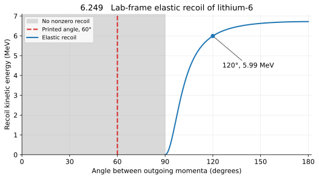

# 6.6 Nuclear Reactions

[Chapter index](../README.md#chapters) · [Structured solutions](6.6.json) · [Answer audit](../audit/README.md)

## 6.249

**Solved · medium confidence.** Retain the sign of the outgoing-angle relation before solving elastic-collision energies.

**Assumptions**

- The literal divergence angle is the angle between the two outgoing momentum vectors. The Li-6 nucleus is initially at rest.
- The motion is nonrelativistic and elastic. Alpha mass m is smaller than the Li-6 target mass M.
- A separate conditional interpretation treats the stated 60° as the acute angle between unoriented track lines, corresponding to an actual outgoing divergence of 120°.

Let p be the outgoing alpha momentum and P the Li recoil momentum. Energy and vector momentum conservation give two expressions for the initial squared momentum.

$$
p_0^2=p^2+\frac mM P^2,\qquad p_0^2=p^2+P^2+2pP\cos\Theta.
$$

Subtract the expressions without squaring. For nonzero recoil, the sign of the cosine is fixed by the mass ordering.

$$
2pP\cos\Theta=\left(\frac mM-1\right)P^2.\qquad m<M\ \Longrightarrow\ \cos\Theta<0.
$$

Thus a literal outgoing divergence of 60° is impossible. If the outgoing divergence is its supplement 120°, the same conservation equations give a physical recoil energy.

$$
T_R=T_0\frac{4mM\cos^2\Theta}{(M-m)^2+4mM\cos^2\Theta},\qquad\Theta=120^\circ:\ T_R=5.99198\ \mathrm{MeV}\simeq6.0\ \mathrm{MeV}.
$$

**Results**

Result for the printed outgoing divergence of 60°

$$
\text{No nonzero-recoil elastic solution exists for }\Theta=60^\circ.
$$

Conditional recoil if the actual outgoing divergence is 120°

$$
T_R(120^\circ)\simeq6.0\ \mathrm{MeV}
$$

The exact Appendix masses give 5.99198 MeV; using mass numbers 4 and 6 gives exactly 6.0 MeV. This does not solve the literal 60° outgoing-vector geometry.

**Limitations**

- The scan states 60° and is preserved. A physical numerical recoil requires a different angle convention or corrected input.

## 6.250

**Solved · high confidence.** Apply two-body elastic energy transfer for a stationary target.

**Assumptions**

- The requested fraction is lost neutron kinetic energy divided by its incident kinetic energy. The motion is nonrelativistic.
- Part (b) means the outgoing neutron is deflected through 90° in the laboratory, rather than through 90° in the center-of-mass frame.
- General expressions use the Appendix neutron and deuteron masses; the familiar rational limits take m_d ≈ 2m_n.

A head-on collision leaves the projectile velocity factor (m − M)/(m + M). The target receives the remaining kinetic energy.

$$
f_{\rm head}=1-\left(\frac{m_n-m_d}{m_n+m_d}\right)^2=\frac{4m_nm_d}{(m_n+m_d)^2}\simeq\frac89.
$$

For a 90° laboratory neutron deflection, the incoming and outgoing neutron momenta are perpendicular. Momentum conservation then fixes the target squared momentum.

$$
P^2=p_0^2+p^2,\qquad\frac{p_0^2}{2m_n}=\frac{p^2}{2m_n}+\frac{p_0^2+p^2}{2m_d}.
$$

Solve for the retained and lost projectile energy fractions.

$$
\frac{T_n^{\prime}}{T_n}=\frac{m_d-m_n}{m_d+m_n},\qquad f_{90}=\frac{2m_n}{m_n+m_d}\simeq\frac23.
$$

**Results**

Fraction lost in a head-on collision

$$
f=4m_nm_d/(m_n+m_d)^2\simeq8/9
$$

Appendix masses give 0.889445; the mass-number approximation gives 8/9.

Fraction lost when the neutron scatters through 90° in the lab

$$
f=2m_n/(m_n+m_d)\simeq2/3
$$

Appendix masses give 0.667502; the mass-number approximation gives 2/3.

## 6.251

**Solved · high confidence.** Use the tangent to the outgoing projectile-velocity circle in the laboratory.

**Assumptions**

- A deuteron of mass m_d scatters elastically from an initially stationary proton of mass m_p. Nonrelativistic kinematics applies, with m_d > m_p.

The center-of-mass velocity and the projectile speed relative to that center have a fixed ratio.

$$
V_{\rm cm}=\frac{m_d}{m_d+m_p}v_0,\qquad u_d=\frac{m_p}{m_d+m_p}v_0.
$$

Possible final deuteron velocities end on a circle centered a distance V_cm from the origin with radius u_d. The largest viewing angle occurs at its tangent.

$$
\sin\theta_{\max}=u_d/V_{\rm cm}=m_p/m_d,\qquad\theta_{\max}=\arcsin(m_p/m_d)\simeq30^\circ.
$$

**Results**

Greatest laboratory deuteron deflection angle

$$
\theta_{\max}=\arcsin(m_p/m_d)\simeq30^\circ
$$

The rounded Appendix masses give 30.0149°; m_d ≈ 2m_p gives 30°.

## 6.252

**Solved · high confidence.** Apply the literal printed radius coefficient and cancel the mass number from the volume.

**Assumptions**

- Preserve the scan’s R = 0.13 A^(1/3) pm exactly: r₀ = 0.13 pm = 1.3 × 10⁻¹³ m = 130 fm. No silent radius-unit correction is made.
- Approximate nuclear mass as Au, sufficient for an order-of-magnitude density estimate. The nucleus is modeled as a uniform sphere.

The spherical volume is proportional to A, because the radius scales as its cube root.

$$
R=r_0A^{1/3},\qquad V=\frac{4\pi}{3}r_0^3A.
$$

Divide mass Au and nucleon count A by that volume; both ratios are independent of A.

$$
\rho=\frac{3u}{4\pi r_0^3}=1.80380\times10^{11}\ \mathrm{kg/m^3},\qquad n_N=\frac{3}{4\pi r_0^3}=1.08663\times10^{38}\ \mathrm{m^{-3}}.
$$

The printed coefficient is unusually large for a nuclear radius. A separate hypothetical coefficient of 1.3 fm would be one hundred times smaller and would raise both densities by a million.

$$
r_0=1.3\ \mathrm{fm}\ \text{instead of the printed }130\ \mathrm{fm}\quad\Longrightarrow\quad\rho,n_N\ \text{each multiply by }10^6.
$$

**Results**

Nuclear density following the literal printed pm coefficient

$$
\rho\simeq1.80\times10^{11}\ \mathrm{kg/m^3}
$$

Nucleons per unit nuclear volume with that same coefficient

$$
n_N\simeq1.09\times10^{38}\ \mathrm{m^{-3}}
$$

**Limitations**

- The literal printed radius coefficient is retained despite its unusual scale. No inference about an intended corrected unit is needed for the formal results.

## 6.253

**Solved · high confidence.** Conserve mass number and electric charge in each reaction.

**Assumptions**

- Use the standard element charge numbers in the supplied nuclear notation. Particle d is a deuteron, α is helium-4, p is a proton and n is a neutron.
- This exercise determines missing species from A and Z conservation, without claiming a reaction rate or threshold.

In part (a), the products have total A = 12 and Z = 6. Subtract the boron target A = 10, Z = 5.

$$
(a)\quad{}^{10}_{5}\mathrm B+{}^{2}_{1}\mathrm H\to{}^{4}_{2}\mathrm{He}+{}^{8}_{4}\mathrm{Be},\qquad x=d.
$$

In part (b), remove one neutron from the initial total A = 19, Z = 9.

$$
(b)\quad{}^{17}_{8}\mathrm O+{}^{2}_{1}\mathrm H\to{}^{1}_{0}n+{}^{18}_{9}\mathrm F,\qquad x={} ^{18}_{9}\mathrm F.
$$

In part (c), the initial total is A = 24, Z = 12 and neon contributes A = 20, Z = 10.

$$
(c)\quad{}^{23}_{11}\mathrm{Na}+{}^{1}_{1}\mathrm H\to{}^{4}_{2}\mathrm{He}+{}^{20}_{10}\mathrm{Ne},\qquad x=\alpha.
$$

In part (d), subtract the incident proton from the product totals A = 38, Z = 18.

$$
(d)\quad{}^{37}_{17}\mathrm{Cl}+{}^{1}_{1}\mathrm H\to{}^{1}_{0}n+{}^{37}_{18}\mathrm{Ar},\qquad x={} ^{37}_{17}\mathrm{Cl}.
$$

**Results**

Missing incoming particle

$$
x={}^2_1\mathrm H=d
$$

Missing residual nucleus

$$
x={} ^{18}_{9}\mathrm F
$$

Missing outgoing particle

$$
x={}^4_2\mathrm{He}=\alpha
$$

Missing target nucleus

$$
x={} ^{37}_{17}\mathrm{Cl}
$$

## 6.254

**Solved · high confidence.** Cancel the integer atomic-mass contributions and show how atomic electrons cancel to the stated approximation.

**Assumptions**

- Define mass surpluses relative to one atomic mass unit: Δ_H = m_H − u, Δ_n = m_n − u and Δ = M_atom − Au.
- The book’s atomic-mass formula neglects electronic binding-energy differences. Atomic electron rest masses cancel because Z hydrogen atoms and the neutral atom each contain Z electrons.
- If the mass surpluses are masses in SI, multiply by c². If they are already expressed as rest-energy surpluses, no further c² is needed; Appendix u values convert with the bound u rest-energy factor.

Start with the nuclear binding energy and relate nuclear mass to atomic mass, neglecting electron binding at nuclear-energy precision.

$$
B=[Zm_p+(A-Z)m_n-M_{\rm nucleus}]c^2\simeq[Zm_H+(A-Z)m_n-M_{\rm atom}]c^2.
$$

Replace the atomic and neutron masses by integer-u contributions plus mass surpluses.

$$
m_H=u+\Delta_H,\quad m_n=u+\Delta_n,\quad M_{\rm atom}=Au+\Delta.
$$

The coefficients of u sum to zero because Z + (A − Z) = A, yielding Eq. (6.6b).

$$
B\simeq[Z\Delta_H+(A-Z)\Delta_n-\Delta]c^2.
$$

If exact electronic binding is retained, its correction has a definite sign. B_e is the positive total electronic binding of the neutral atom and B_H that of hydrogen.

$$
B_{\rm nucleus}=[Zm_H+(A-Z)m_n-M_{\rm atom}]c^2-B_e+ZB_H.
$$

**Results**

Binding energy from atomic mass surpluses

$$
B\simeq[Z\Delta_H+(A-Z)\Delta_n-\Delta]c^2
$$

**Limitations**

- Electronic binding-energy differences are neglected in the printed nuclear-scale formula; the exact correction is displayed separately.

## 6.255

**Solved · high confidence.** Cube the stated radius ratio to identify A, then use the atomic mass defect for the equal-proton-neutron nucleus.

**Assumptions**

- One and a half times smaller means R = R_Al/1.5. The radius law R ∝ A^(1/3) has the same coefficient for the two nuclei, so that coefficient cancels.
- The nucleus has N = Z. Atomic mass bookkeeping neglects small electronic binding-energy corrections as in the chapter formula.

Convert the radius ratio to a mass-number ratio; do not apply the radius factor directly to A.

$$
A=27\left(\frac{1}{1.5}\right)^3=8,\qquad Z=N=A/2=4\quad({}^8\mathrm{Be}).
$$

Use four hydrogen atom masses and four neutron masses against the Be-8 atom mass so all four electron rest masses cancel.

$$
B=[4m_H+4m_n-M({}^8\mathrm{Be})]c^2.
$$

The Appendix mass surpluses give the binding directly.

$$
B=[4(0.00783)+4(0.00867)-0.00531]\,u c^2=(0.06069)(931.4)\ \mathrm{MeV}=56.5267\ \mathrm{MeV}.
$$

**Results**

Identified equal-N-and-Z nucleus

$$
{}^8_4\mathrm{Be}
$$

Total nuclear binding energy

$$
B\simeq56.5\ \mathrm{MeV}
$$

## 6.256

**Solved · high confidence.** Use atomic-mass differences with balanced electron counts for nuclear binding and separation energies.

**Assumptions**

- All table masses are neutral-atom masses. Use m_H rather than a bare proton mass when constructing binding energies; electronic rest masses cancel in every displayed balance.
- Neglect small electronic binding-energy differences, consistently with the Appendix mass precision. One u has the bound rest energy 931.4 MeV.
- Separation energy is a positive required input: final fragment rest energy minus initial nuclear rest energy.

For O-16, compare its atom with eight hydrogen atoms and eight neutrons, then divide total nuclear binding by sixteen.

$$
B({}^{16}\mathrm O)=[8m_H+8m_n-M({}^{16}\mathrm O)]c^2=127.6856\ \mathrm{MeV},\qquad B/16=7.98035\ \mathrm{MeV}.
$$

Removing one neutron from B-11 leaves B-10; the atomic electron counts remain equal.

$$
S_n=[M({}^{10}\mathrm B)+m_n-M({}^{11}\mathrm B)]c^2=(10.01294+1.00867-11.00930)u c^2=11.4655\ \mathrm{MeV}.
$$

Removing one alpha particle from B-11 leaves Li-7. The three plus two final atomic electrons balance the five initial ones.

$$
S_\alpha=[M({}^{7}\mathrm{Li})+M({}^{4}\mathrm{He})-M({}^{11}\mathrm B)]c^2=8.67133\ \mathrm{MeV}.
$$

Four identical ordinary nuclear fragments conserving A = 16 and Z = 8 are four alpha particles. Atomic helium masses again cancel all eight electron rest masses.

$$
E_{{}^{16}\mathrm O\to4\alpha}=[4M({}^{4}\mathrm{He})-M({}^{16}\mathrm O)]c^2=14.4274\ \mathrm{MeV}.
$$

**Results**

Mean binding energy per O-16 nucleon

$$
B/16\simeq7.98\ \mathrm{MeV}
$$

Neutron separation energy from B-11

$$
S_n\simeq11.47\ \mathrm{MeV}
$$

Alpha-particle separation energy from B-11

$$
S_\alpha\simeq8.67\ \mathrm{MeV}
$$

Energy required to separate O-16 into four alpha particles

$$
E\simeq14.43\ \mathrm{MeV}
$$

## 6.257

**Solved · high confidence.** Compare neutron and proton separation channels using balanced atomic masses.

**Assumptions**

- Removing a neutron from B-11 leaves B-10; removing a proton leaves Be-10. For the proton channel use a hydrogen atom mass with the neutral residual atom so electron rest masses balance.
- The requested difference is reported as S_n − S_p. Nuclear and electronic binding corrections below the table precision are neglected as in the chapter formula.

Write the two separation energies in a common atomic-mass convention.

$$
S_n=[M({}^{10}\mathrm B)+m_n-M({}^{11}\mathrm B)]c^2,\qquad S_p=[M({}^{10}\mathrm{Be})+m_H-M({}^{11}\mathrm B)]c^2.
$$

Subtract so the B-11 mass cancels; only the two residual masses and the neutron–hydrogen difference remain.

$$
S_n-S_p=[M({}^{10}\mathrm B)-M({}^{10}\mathrm{Be})+m_n-m_H]c^2=(0.00024)u c^2=0.223536\ \mathrm{MeV}.
$$

Thus the neutron is more tightly bound in this separation-energy sense. Proton Coulomb repulsion makes proton removal less costly; residual-nucleus structure and neutron–proton mass differences are already included in the tabulated total difference.

**Results**

Neutron minus proton separation energy in B-11

$$
S_n-S_p\simeq0.224\ \mathrm{MeV}
$$

Neutron separation energy

$$
S_n\simeq11.47\ \mathrm{MeV}
$$

Proton separation energy

$$
S_p\simeq11.24\ \mathrm{MeV}
$$

**Limitations**

- The qualitative Coulomb explanation does not decompose the full numerical difference into individual nuclear-structure contributions.

## 6.258

**Solved · high confidence.** Subtract the final fragments’ total binding from the initial binding.

**Assumptions**

- Use exactly the stated binding energies per nucleon. The specified fragments conserve the total numbers of protons and neutrons.
- The energy required for separation is the rest-energy increase, not a projectile laboratory threshold calculation.

Multiply each binding per nucleon by its mass number.

$$
B_i=20(8.03)=160.60\ \mathrm{MeV},\qquad B_f=2[4(7.07)]+12(7.68)=148.72\ \mathrm{MeV}.
$$

Less total final binding means that energy must be supplied to form the fragments.

$$
E_{\rm required}=B_i-B_f=11.88\ \mathrm{MeV},\qquad Q=B_f-B_i=-11.88\ \mathrm{MeV}.
$$

**Results**

Energy required for the specified Ne-20 separation

$$
E_{\rm required}=11.88\ \mathrm{MeV}
$$

## 6.259

**Solved · high confidence.** Use the atomic-mass binding formula for Li-8, then explicitly remove electron masses for the requested C-10 nucleus.

**Assumptions**

- Li-8 is requested as a neutral atom, whereas C-10 is requested as a bare nucleus. These are different mass conventions.
- Use the Appendix hydrogen atom and neutron masses in u, and subtract B/(uc²) with the printed 931.4 MeV/u conversion.
- Electronic binding energies are negligible at the requested precision. To avoid mixing coarse SI proton data with precise isotope masses, infer the nuclear proton contribution from m_H − m_e.

Li-8 has Z = 3 and N = 5. The atomic mass formula already includes the correct three electron rest masses.

$$
M_{\rm atom}({}^{8}\mathrm{Li})=3m_H+5m_n-\frac{41.3\ \mathrm{MeV}}{c^2},\qquad\frac{M_{\rm atom}}u=3(1.00783)+5(1.00867)-\frac{41.3}{931.4}=8.02249815.
$$

C-10 has Z = 6 and N = 4. First find its total binding and the corresponding neutral-atom mass.

$$
B({}^{10}\mathrm C)=10(6.04)=60.4\ \mathrm{MeV},\qquad M_{\rm atom}/u=6(1.00783)+4(1.00867)-60.4/931.4.
$$

Remove the six electron rest masses because part (b) asks for the nucleus, not the atom.

$$
\frac{M_{\rm nucleus}({}^{10}\mathrm C)}u=\frac{M_{\rm atom}}u-6\frac{m_e}u=10.01351861.
$$

**Results**

Neutral Li-8 atom mass

$$
M({}^{8}\mathrm{Li\ atom})\simeq8.02250\ \mathrm u
$$

Bare C-10 nuclear mass

$$
M({}^{10}\mathrm C\ \mathrm{nucleus})\simeq10.01352\ \mathrm u
$$

## 6.260

**Solved · high confidence.** Express every nuclear mass as free-nucleon mass minus binding and use charge and nucleon conservation.

**Assumptions**

- The four species are nuclei in the specified states, with positive binding energies E_i. Proton and neutron counts are conserved and no additional massive particles are omitted.
- Q is positive for energy release and negative for an endothermic reaction.

For each nucleus, subtract its binding energy from the rest energy of its free proton and neutron constituents.

$$
M_ic^2=Z_im_pc^2+(A_i-Z_i)m_nc^2-E_i.
$$

Subtract total final rest energy from total initial rest energy. Conserved proton and neutron terms cancel.

$$
Q=(M_1+M_2-M_3-M_4)c^2=E_3+E_4-E_1-E_2.
$$

**Results**

Energy released by the nuclear reaction

$$
Q=E_3+E_4-E_1-E_2
$$

## 6.261

**Partial · high confidence.** Part (a) only: multiply the stipulated per-nucleus fission energy by the isotope count, then compare with coal heat.

**Assumptions**

- For part (a), every nucleus in the stipulated one-kilogram isotope sample undergoes one fission releasing the given 200 MeV.
- Approximate the U-235 atom mass as 235 u. The coal calorific value is the supplied 30 kJ/g = 3.0 × 10⁷ J/kg.

Count isotope atoms in the stipulated mass and convert the given per-nucleus energy to joules.

$$
N=\frac{1\ \mathrm{kg}}{235u},\qquad q_f=200\times10^6(1.602\times10^{-19})\ \mathrm J.
$$

Multiply to obtain the total stipulated released energy.

$$
E=Nq_f=8.21328\times10^{13}\ \mathrm J.
$$

Divide by coal energy per unit mass to find the thermal equivalent.

$$
m_{\rm coal}=\frac{E}{3.0\times10^7\ \mathrm{J/kg}}=2.73776\times10^6\ \mathrm{kg}.
$$

**Results**

Stipulated energy from fission of the given one-kilogram isotope sample

$$
E\simeq8.2\times10^{13}\ \mathrm J
$$

Coal mass with the same stipulated heat

$$
m_{\rm coal}\simeq2.7\times10^6\ \mathrm{kg}
$$

**Limitations**

- This record includes part (a) only.

## 6.262

**Solved · high confidence.** Use the net two-deuterium to helium-4 mass defect and the final helium atom count.

**Assumptions**

- Calculate only the stated net conversion of two deuterium nuclei into one helium-4 nucleus. Reaction dynamics are not specified or required for its energy balance.
- Use neutral isotope masses: two hydrogen-isotope atoms and one helium atom each contain two electron rest masses in total, so those masses cancel.
- Treat the stipulated one gram of helium as the isotope product mass and assume the released energy is available as heat. Use the supplied coal calorific value.

Find the energy release per helium nucleus from the balanced atomic mass defect.

$$
q=[2M({}^{2}\mathrm H)-M({}^{4}\mathrm{He})]c^2=[2(2.01410)-4.00260]u c^2=23.84384\ \mathrm{MeV}.
$$

Count helium atoms in one gram and multiply by this released energy.

$$
N_{\rm He}=\frac{10^{-3}\ \mathrm{kg}}{4.00260u},\qquad E=N_{\rm He}q=5.74895\times10^{11}\ \mathrm J.
$$

Convert the coal heat value from joules per gram to joules per kilogram and divide.

$$
q_{\rm coal}=3.0\times10^7\ \mathrm{J/kg},\qquad m_{\rm coal}=E/q_{\rm coal}=1.91632\times10^4\ \mathrm{kg}.
$$

**Results**

Heat from the stated net formation of one gram of He-4

$$
E\simeq5.75\times10^{11}\ \mathrm J
$$

Coal mass with the same heat

$$
m_{\rm coal}\simeq1.92\times10^4\ \mathrm{kg}
$$

## 6.263

**Solved · high confidence.** Evaluate the atomic mass defect and divide by the eight reacting nucleons; compare only with the stated generic U-235 fission benchmark.

**Assumptions**

- Use neutral-atom masses Li-6, D-2, He-4 from the Appendix and 931.4 MeV per atomic mass unit. The total atomic charge is 4 on either side, so electron rest masses cancel; small electronic binding differences are neglected.
- The reacting system contains 8 nucleons. For the requested U-235 comparison use the supplied generic 200 MeV per U-235 fission from the adjacent exercise, not an unspecified fission-fragment mass calculation.

Subtract twice the He-4 atomic mass from the Li-6-plus-deuterium mass.

$$
\Delta m=6.01513+2.01410-2(4.00260)=0.02403\,\mathrm u,\qquad Q=0.02403(931.4)=22.381542\,\mathrm{MeV}.
$$

Divide by the total number of nucleons participating in fusion.

$$
\boxed{q_{\rm fusion}=Q/8=2.79769275\,\mathrm{MeV/nucleon}\simeq2.80\,\mathrm{MeV/nucleon}}.
$$

The specified approximate fission benchmark gives a smaller energy per parent nucleon.

$$
q_{\rm fission}\simeq200/235=0.851064\,\mathrm{MeV/nucleon},\qquad q_{\rm fusion}/q_{\rm fission}\simeq3.2873.
$$

**Results**

Energy released per reacting nucleon

$$
\boxed{q\simeq2.80\,\mathrm{MeV/nucleon}}
$$

Fusion reaction energy

$$
Q\simeq22.38\,\mathrm{MeV}
$$

Generic U-235 fission energy per parent nucleon

$$
q_f\simeq0.851\,\mathrm{MeV/nucleon}
$$

Fusion-to-fission energy-per-nucleon ratio under the supplied benchmark

$$
q/q_f\simeq3.29
$$

**Limitations**

- The generic 200 MeV fission benchmark is not a unique exact U-235 decay channel energy.

## 6.264

**Solved · high confidence.** Subtract initial total binding energy from final total binding energy using the supplied binding-per-nucleon data.

**Assumptions**

- Use the stated 5.60 MeV/nucleon for Li-7 and 7.06 MeV/nucleon for He-4, rather than replacing them by separately rounded atomic-mass data.
- The free incident proton has zero nuclear binding energy.

The initial bound nucleus contributes seven times its mean binding per nucleon. The two final alphas contribute eight times the helium mean.

$$
B_{\rm initial}=7(5.60)=39.20\,\mathrm{MeV},\qquad B_{\rm final}=2\cdot4(7.06)=56.48\,\mathrm{MeV}.
$$

An increase in total binding releases positive energy.

$$
\boxed{Q=B_{\rm final}-B_{\rm initial}=17.28\,\mathrm{MeV}}.
$$

**Results**

Energy of the reaction from the supplied binding data

$$
\boxed{Q=+17.28\,\mathrm{MeV}}
$$

## 6.265

**Solved · medium confidence.** Infer the oxygen recoil from the measured proton angle and energy, then subtract the incident kinetic energy.

**Assumptions**

- The N-14 target is stationary. The measured proton leaves at 60 degrees relative to the incident alpha. Momentum conservation fixes the O-17 recoil vector.
- For kinematics, convert the Appendix atomic masses using 931.4 MeV/u and subtract 0.511 MeV per electron to obtain nuclear rest energies. For charge-balanced reaction Q values, use the neutral masses directly. The approximation neglects electronic binding.
- The kinematic data are primary. The incoming energy 4.0 MeV and the independently rounded mass table do not justify forcing the kinematic Q to identical guard digits of an atomic mass-defect check.

Subtract the outgoing proton momentum vector from the incoming alpha momentum.

$$
\mathbf p_O=\mathbf p_\alpha-\mathbf p_p,\qquad p_O^2=p_\alpha^2+p_p^2-2p_\alpha p_p\cos60^\circ.
$$

At textbook nonrelativistic order, infer the recoil kinetic energy and then Q.

$$
T_O=\frac{\mu_\alpha T_\alpha+\mu_pT_p-2\sqrt{\mu_\alpha\mu_pT_\alpha T_p}\cos60^\circ}{\mu_O},\qquad Q=T_p+T_O-T_\alpha\simeq-1.185871\,\mathrm{MeV}.
$$

For a relativistic benchmark use P_i=p_i c=sqrt[T_i(T_i+2mu_i)] and the exact recoil kinetic energy. The correction is small compared with the input precision.

$$
T_O=\sqrt{\mu_O^2+P_\alpha^2+P_p^2-2P_\alpha P_p\cos60^\circ}-\mu_O=0.7244743\,\mathrm{MeV},\qquad Q=-1.185526\,\mathrm{MeV}\simeq-1.2\,\mathrm{MeV}.
$$

The independent atomic mass defect gives about -1.20151 MeV. The 16 keV difference is small relative to the coarse incident-energy and mass-table precision and is retained as a consistency check rather than erased.

$$
Q_{\rm mass}=[A_r(N14)+A_r(He4)-A_r(H1)-A_r(O17)]uc^2=-1.201506\,\mathrm{MeV}.
$$

**Results**

Reaction energy inferred from the stated laboratory kinematics

$$
\boxed{Q\simeq-1.19\,\mathrm{MeV}\text{, endoergic}}
$$

Textbook nonrelativistic kinematic estimate

$$
Q_{\rm NR}\simeq-1.18587\,\mathrm{MeV}
$$

Independent rounded atomic-mass check

$$
Q_{\rm mass}\simeq-1.20151\,\mathrm{MeV}
$$

**Limitations**

- An experimental uncertainty estimate would require actual energy and angle measurement errors, which are not supplied.

## 6.266

**Solved · high confidence.** Evaluate each charge-balanced neutral-atom mass defect with the printed atomic-mass energy equivalent.

**Assumptions**

- All listed reactants and residual nuclei are taken in their ground states. Nuclear Q is initial rest energy minus final rest energy.
- Use neutral-atom masses consistently on both sides; the total number of electron rest masses cancels in each reaction. Small electronic binding differences are neglected.
- For the radiative capture in part (b),Q is the total reaction energy, not exactly one photon energy if final-nucleus recoil is resolved.

For Li-7(p,n)Be-7, the mass defect is negative.

$$
Q_a=[7.01601+1.00783-7.01693-1.00867](931.4)=-1.639264\,\mathrm{MeV}.
$$

For Be-9(n,gamma)Be-10, the mass defect is positive.

$$
Q_b=[9.01219+1.00867-10.01354](931.4)=+6.817848\,\mathrm{MeV}.
$$

For Li-7(alpha,n)B-10, the mass defect is negative.

$$
Q_c=[7.01601+4.00260-10.01294-1.00867](931.4)=-2.794200\,\mathrm{MeV}.
$$

For O-16(d,alpha)N-14, the mass defect is positive.

$$
Q_d=[15.99491+2.01410-14.00307-4.00260](931.4)=+3.110876\,\mathrm{MeV}.
$$

**Results**

Li-7(p,n)Be-7 reaction energy

$$
\boxed{Q_a\simeq-1.64\,\mathrm{MeV}}
$$

Be-9(n,gamma)Be-10 reaction energy

$$
\boxed{Q_b\simeq+6.82\,\mathrm{MeV}}
$$

Li-7(alpha,n)B-10 reaction energy

$$
\boxed{Q_c\simeq-2.79\,\mathrm{MeV}}
$$

O-16(d,alpha)N-14 reaction energy

$$
\boxed{Q_d\simeq+3.11\,\mathrm{MeV}}
$$

**Limitations**

- The last table mass digits and electronic binding corrections limit precision. Excited final states would reduce the available kinetic Q by their excitation energy.

## 6.267

**Solved · high confidence.** Treat the slow-neutron capture as a nearly stationary initial system and divide the released kinetic energy between two back-to-back products.

**Assumptions**

- Neglect the incident neutron kinetic energy and momentum compared with theMeV release. The reaction produces ground-state Li-7 and He-4; an unspecified excited-state branch would have a smaller kinetic release.
- For kinematics, convert the Appendix atomic masses using 931.4 MeV/u and subtract 0.511 MeV per electron to obtain nuclear rest energies. For charge-balanced reaction Q values, use the neutral masses directly. The approximation neglects electronic binding.
- The requested coming-apart speed is the nonrelativistic relative speedv_alpha+v_Li in the initial laboratory/center-of-mass frame. Relativistic velocity-addition differences are beyond the intended mass-table precision.

The charge-balanced atomic mass difference supplies the release.

$$
Q=[10.01294+1.00867-4.00260-7.01601](931.4)=2.794200\,\mathrm{MeV}.
$$

Equal and opposite momenta give a reduced-mass relation for the sum of speeds.

$$
p_\alpha=p_{\rm Li}=p,\qquad Q=\frac{p^2}{2m_\alpha}+\frac{p^2}{2m_{\rm Li}},\qquad u=v_\alpha+v_{\rm Li}=\sqrt{2Q\left(\frac1{m_\alpha}+\frac1{m_{\rm Li}}\right)}.
$$

With masses represented by theirMeV rest energies, multiply the dimensionless speed by c.

$$
u=c\sqrt{2Q(\mu_\alpha^{-1}+\mu_{\rm Li}^{-1})}=1.4548254\times10^7\,\mathrm{m/s}\simeq1.45\times10^7\,\mathrm{m/s}.
$$

The individual speeds are set by inverse masses and point in opposite directions.

$$
v_\alpha=u\frac{\mu_{\rm Li}}{\mu_\alpha+\mu_{\rm Li}},\qquad v_{\rm Li}=u\frac{\mu_\alpha}{\mu_\alpha+\mu_{\rm Li}}.
$$

**Results**

Relative separation speed of the products at nonrelativistic order

$$
\boxed{u\simeq1.45\times10^7\,\mathrm{m/s}}
$$

Alpha speed in the initial rest frame

$$
v_\alpha=u\mu_{\rm Li}/(\mu_\alpha+\mu_{\rm Li})
$$

Li-7 speed in the opposite direction

$$
v_{\rm Li}=u\mu_\alpha/(\mu_\alpha+\mu_{\rm Li})
$$

**Limitations**

- If Li-7 is produced excited, its excitation energy must be subtracted before applying the formula. Relativistic relative speed measured in one product rest frame is a slightly different quantity.

## 6.268

**Solved · high confidence.** Impose zero laboratory neutron momentum, then distinguish this condition from the ordinary reaction threshold.

**Assumptions**

- The Li-7 target is stationary and the neutron is required to be stationary in that same laboratory frame. The Be-7 product then carries the entire incident proton momentum.
- For kinematics, convert the Appendix atomic masses using 931.4 MeV/u and subtract 0.511 MeV per electron to obtain nuclear rest energies. For charge-balanced reaction Q values, use the neutral masses directly. The approximation neglects electronic binding.
- Use the tabulated reaction energy Q=-1.639264 MeV for the ground-state channel. The zero-neutron condition is not the minimum threshold condition, where both products instead share a non zero common velocity.

At leading nonrelativistic order, all incident momentum goes into Be-7, giving its recoil energy as a fixed fraction of the proton energy.

$$
p_{\rm Be}=p_p,\qquad T_{\rm Be}=\frac{m_p}{M_{\rm Be}}T_p,\qquad T_p+Q=T_{\rm Be}.
$$

Solve for the proton energy required to leave the neutron at rest.

$$
\boxed{T_{p,0n}^{\rm NR}=\frac{|Q|}{1-m_p/M_{\rm Be}}=1.9141225\,\mathrm{MeV}}.
$$

For an exact relativistic condition, let D=mu_p+mu_Li-mu_n=mu_Be+Q. Energy conservation givesD+T_p=sqrt[mu_Be squared+T_p(T_p+2mu_p)]. Squaring and solving introduces no additional physical positive-energy branch.

$$
D=\mu_{\rm Be}+Q,\qquad T_{p,0n}=\frac{\mu_{\rm Be}^2-D^2}{2(D-\mu_p)}=1.9144433\,\mathrm{MeV}.
$$

The ordinary invariant threshold is lower. At that threshold the neutron moves with the center of mass and is not at rest in the laboratory.

$$
T_{\rm th}=|Q|(1+\mu_p/\mu_{\rm Li})+\frac{Q^2}{2\mu_{\rm Li}}=1.8748723\,\mathrm{MeV}<T_{p,0n}.
$$

**Results**

Proton kinetic energy for a stationary laboratory neutron

$$
\boxed{T_p\simeq1.91\,\mathrm{MeV}}
$$

Textbook stationary-neutron estimate

$$
T_p^{\rm NR}=|Q|/(1-m_p/M_{\rm Be})\simeq1.91412\,\mathrm{MeV}
$$

Lower ordinary reaction threshold

$$
T_{\rm th}\simeq1.87487\,\mathrm{MeV}
$$

**Limitations**

- Electronic binding and isotope table rounding limit precision beyond the approximate 1.91 MeV result.

## 6.269

**Solved · high confidence.** Use the right-angle neutron geometry to eliminate the carbon recoil momentum without a cross term.

**Assumptions**

- The Be-9 target is stationary, and the neutron emerges at 90 degrees to the incoming alpha in the laboratory.
- Use the supplied Q=+5.7 MeV as the reaction energy rather than replacing it by a separate rounded mass-table reconstruction.
- For kinematics, convert the Appendix atomic masses using 931.4 MeV/u and subtract 0.511 MeV per electron to obtain nuclear rest energies. For charge-balanced reaction Q values, use the neutral masses directly. The approximation neglects electronic binding.

At a right angle the residual carbon momentum squared is the sum of the incident alpha and emitted-neutron momentum squares.

$$
\mathbf p_C=\mathbf p_\alpha-\mathbf p_n,\qquad p_C^2=p_\alpha^2+p_n^2.
$$

At nonrelativistic order write carbon recoil energy in terms of the two kinetic energies, then solve the kinetic-energy balance.

$$
T_C=\frac{m_\alpha}{M_C}T_\alpha+\frac{m_n}{M_C}T_n,\qquad T_\alpha+Q=T_n+T_C,\qquad\boxed{T_n=\frac{(M_C-m_\alpha)T_\alpha+M_CQ}{M_C+m_n}}.
$$

The nuclear rest-mass ratios from the Appendix give 8.51616 MeV. The simpler mass-number ratios 4,12,1 give 8.52308 MeV, the same intended result.

$$
T_n^{\rm NR}=8.516156\,\mathrm{MeV}\simeq8.5\,\mathrm{MeV}.
$$

An exact relativistic benchmark can be obtained without a quadratic branch because the cross term vanishes. Let S=T_alpha+Q.

$$
T_n=\frac{2\mu_CS+S^2-T_\alpha(T_\alpha+2\mu_\alpha)}{2(\mu_C+S+\mu_n)}=8.512261\,\mathrm{MeV}.
$$

**Results**

Neutron kinetic energy at a right angle, textbook order

$$
\boxed{T_n\simeq8.5\,\mathrm{MeV}}
$$

Relativistic kinematic benchmark with the supplied Q

$$
T_n\simeq8.51226\,\mathrm{MeV}
$$

**Limitations**

- The supplied Q is the governing input. A different tabulated mass defect would constitute a different precision convention rather than a correction to this stated reaction energy.

## 6.270

**Solved · high confidence.** Use the symmetric laboratory directions to establish equal alpha energies, then apply longitudinal momentum conservation.

**Assumptions**

- The Li-7 target is stationary. The two outgoing directions are reflected across the incident-proton axis, with non zero transverse components of opposite sign.
- For kinematics, convert the Appendix atomic masses using 931.4 MeV/u and subtract 0.511 MeV per electron to obtain nuclear rest energies. The reaction Q values use neutral-atom mass differences with balanced electron counts. Electronic binding is below the precision of these calculations.
- Use the table-based Q of this problem, not the separately supplied rounded binding-per-nucleon values of 6.264.

The charge-balanced atomic mass defect gives the available rest-energy release.

$$
Q=[7.01601+1.00783-2(4.00260)](931.4)=17.361296\,\mathrm{MeV}.
$$

Opposite transverse momentum components at equal angles force equal momentum magnitudes for the identical alphas, hence equal kinetic energies.

$$
p_1\sin\theta=p_2\sin\theta\quad\Longrightarrow\quad p_1=p_2,\quad T_1=T_2,\qquad\boxed{T_\alpha=(T_p+Q)/2=9.180648\,\mathrm{MeV}}.
$$

The longitudinal components sum to the incoming proton momentum. In rest-energy units the exact relativistic momentum isP =pc=sqrt[T(T+2mu)].

$$
2p_\alpha\cos\theta=p_p,\qquad\cos\theta=\frac{\sqrt{T_p(T_p+2\mu_p)}}{2\sqrt{T_\alpha(T_\alpha+2\mu_\alpha)}}.
$$

The physical branch has both alphas slightly forward, with 0<theta <90 degrees. Their divergence angle is 2theta.

$$
\boxed{\phi=2\theta=170.50499^\circ\simeq170.5^\circ}.\qquad\phi_{\rm NR}=170.50167^\circ.
$$

**Results**

Kinetic energy of each alpha particle

$$
\boxed{T_1=T_2\simeq9.18\,\mathrm{MeV}}
$$

Angle between the two outgoing alpha directions

$$
\boxed{\phi\simeq170.5^\circ}
$$

Nonrelativistic momentum benchmark

$$
\phi_{\rm NR}\simeq170.502^\circ
$$

**Limitations**

- The ground-state two-alpha channel and the rounded atomic-mass Q are assumed. Exact atomic binding corrections are below the intended precision.

## 6.271

**Solved · high confidence.** Minimize the invariant final mass and expand the resulting exact laboratory threshold to first order in the reaction energy.

**Assumptions**

- The target nucleus of rest mass M is stationary and the incident particle has rest massm. Let the sum of the final product rest masses be M_f.
- The endoergic reaction energy is Q=(m+M-M_f)c² <0. The threshold is kinematic, ignoring Coulomb barriers and rate suppression.
- At threshold the massive products have no relative motion in their center-of-mass frame. They are not generally at rest in the laboratory.

The initial invariant energy squared depends linearly on the incident laboratory kinetic energy T.

$$
\mathcal E_{\rm CM}^2=(m+M)^2c^4+2Mc^2T.
$$

The minimum final invariant mass is the sum of product masses. Set the invariant at threshold equal to M_f squared.

$$
T_{\rm th,exact}=\frac{[M_f^2-(m+M)^2]c^2}{2M}.
$$

Substitute M_f=m+M+|Q|/c² and expand the square exactly.

$$
\boxed{T_{\rm th,exact}=|Q|\left(1+\frac mM\right)+\frac{Q^2}{2Mc^2}}.
$$

For nuclear reaction energies small compared with rest energies, drop the second-order correction. This yields the textbook first-order thresholdEq 6.6 d.

$$
\boxed{T_{\rm th}\simeq|Q|\left(1+\frac mM\right)}.
$$

An independent nonrelativistic argument gives available center-of-mass kinetic energy M T/(m+M). Requiring it to supply |Q| reproduces the same leading formula.

$$
T_{\rm CM}=\frac{M}{m+M}T\ge|Q|.
$$

**Results**

Textbook first-order endoergic threshold

$$
\boxed{T_{\rm th}\simeq|Q|(1+m/M)}
$$

Exact special-relativistic kinematic threshold

$$
\boxed{T_{\rm th,exact}=|Q|(1+m/M)+Q^2/(2Mc^2)}
$$

**Limitations**

- This is an energetic threshold; dynamical barriers or selection rules may suppress an otherwise kinematically allowed reaction.

## 6.272

**Solved · high confidence.** Apply the endoergic threshold to proton-induced deuteron breakup, including the center-of-mass recoil cost.

**Assumptions**

- Interpret splitting as the nuclear breakupp+d to p+p+n with a stationary deuteron. The energy required in the center-of-mass frame is the given binding 2.2 MeV.
- For kinematics, convert the Appendix atomic masses using 931.4 MeV/u and subtract 0.511 MeV per electron to obtain nuclear rest energies. The reaction Q values use neutral-atom mass differences with balanced electron counts. Electronic binding is below the precision of these calculations.
- Use the stated binding energy rather than reconstructing a slightly different deuteron binding from independent rounded table entries.

The reaction has Q=-E_b. The leading threshold includes projectile and target mass ratio.

$$
T_{\rm th}^{\rm NR}=E_b\left(1+\frac{m_p}{m_d}\right)\simeq\frac32E_b\simeq3.3\,\mathrm{MeV}.
$$

Using the nuclear masses derived from the Appendix gives the exact first-order numerical coefficient and the small invariant correction.

$$
T_{\rm th}^{\rm NR}=3.300553\,\mathrm{MeV},\qquad T_{\rm th,exact}=E_b(1+\mu_p/\mu_d)+\frac{E_b^2}{2\mu_d}=3.301843\,\mathrm{MeV}.
$$

The approximately 1.1 MeV above the binding energy remains in the common laboratory motion of the three products at threshold. It is not additional internal breakup energy.

**Results**

Kinematic proton threshold for deuteron breakup

$$
\boxed{T_p\simeq3.3\,\mathrm{MeV}}
$$

Textbook first-order threshold

$$
T_{\rm th}^{\rm NR}\simeq3.30055\,\mathrm{MeV}
$$

**Limitations**

- The input 2.2 MeV supports only an approximate 3.3 MeV result; displayed guard digits identify the optional exact-kinematics convention.

## 6.273

**Solved · medium confidence.** Compute the two separate endoergic thresholds from their stated Q values and bracket the common beam energy.

**Assumptions**

- Take the supplied deficits 1.65 MeV and 1.85 MeV as the governing Q magnitudes, not the independently rounded mass-defect values from another exercise.
- For kinematics, convert the Appendix atomic masses using 931.4 MeV/u and subtract 0.511 MeV per electron to obtain nuclear rest energies. The reaction Q values use neutral-atom mass differences with balanced electron counts. Electronic binding is below the precision of these calculations.
- Interpret initiation versus noninitiation as energetic accessibility. In an actual experiment nonobservation alone could also reflect rate suppression; the textbook inference neglects that complication.

The lower bound is the Li-7(p,n) threshold; the upper bound is the Be-9(p,n) threshold.

$$
T_{\rm Li}=1.65(1+\mu_p/\mu_{\rm Li})+\frac{1.65^2}{2\mu_{\rm Li}},\qquad T_{\rm Be}=1.85(1+\mu_p/\mu_{\rm Be})+\frac{1.85^2}{2\mu_{\rm Be}}.
$$

Evaluate the nominal thresholds. The textbook first-order values differ only by about 0.2 keV.

$$
T_{\rm Li}=1.887153\,\mathrm{MeV},\qquad T_{\rm Be}=2.057026\,\mathrm{MeV}.
$$

The beam must reach the first threshold without reaching the second.

$$
\boxed{1.887\,\mathrm{MeV}\lesssim T_p<2.057\,\mathrm{MeV}}\quad\text{or approximately }1.89\le T_p<2.06\,\mathrm{MeV}.
$$

**Results**

Allowed proton-energy interval under the threshold interpretation

$$
\boxed{T_{\rm Li}\le T_p<T_{\rm Be},\quad(T_{\rm Li},T_{\rm Be})\simeq(1.887,2.057)\,\mathrm{MeV}}
$$

Corresponding textbook first-order bounds

$$
(T_{\rm Li}^{\rm NR},T_{\rm Be}^{\rm NR})
$$

A non zero observed cross section normally requires strictly above the limiting lower threshold.

**Limitations**

- The bracket assumes noninitiation means below threshold rather than small cross section or detector inefficiency. Endpoint onset is a limiting kinematic statement.

## 6.274

**Solved · high confidence.** Invert the neutron-induced threshold relation to determine the negative reaction energy.

**Assumptions**

- A stationary B-11 nucleus and incoming neutron form an endoergic (n,alpha) channel. Its energy Q is negative.
- For kinematics, convert the Appendix atomic masses using 931.4 MeV/u and subtract 0.511 MeV per electron to obtain nuclear rest energies. The reaction Q values use neutral-atom mass differences with balanced electron counts. Electronic binding is below the precision of these calculations.
- Only the initial target/projectile masses and the measured threshold are needed. No external Li-8 mass is required to infer Q.

At textbook first order solve T_th=|Q|(1+m_n/M_B) for Q.

$$
Q_{\rm NR}=-\frac{T_{\rm th}}{1+m_n/M_B}=-3.664203\,\mathrm{MeV}\simeq-3.7\,\mathrm{MeV}.
$$

For the exact invariant expression write the increase in final summed rest energy as δ = |Q|. The initial rest-energy sum is S=mu_n+mu_B.

$$
T_{\rm th}=\frac{(S+\delta)^2-S^2}{2\mu_B},\qquad\delta=\sqrt{S^2+2\mu_BT_{\rm th}}-S.
$$

Use the rationalized form to avoid subtracting close large numbers.

$$
\delta=\frac{2\mu_BT_{\rm th}}{\sqrt{S^2+2\mu_BT_{\rm th}}+S}=3.663603\,\mathrm{MeV},\qquad\boxed{Q\simeq-3.66\,\mathrm{MeV}}.
$$

**Results**

Reaction energy inferred from the 4.0 MeV threshold

$$
\boxed{Q\simeq-3.7\,\mathrm{MeV}}
$$

Textbook first-order inversion

$$
Q_{\rm NR}\simeq-3.66420\,\mathrm{MeV}
$$

**Limitations**

- The measured threshold is assumed kinematic for the specified final-state channel, rather than a dynamical onset above threshold.

## 6.275

**Solved · high confidence.** Identify both residual nuclei, calculate their atomic-mass Q values, and apply the endoergic laboratory threshold.

**Assumptions**

- The Li-7 target is stationary and the final nuclei are in their ground states. The (p,d) residue is Li-6 by mass-number and charge conservation.
- For kinematics, convert the Appendix atomic masses using 931.4 MeV/u and subtract 0.511 MeV per electron to obtain nuclear rest energies. The reaction Q values use neutral-atom mass differences with balanced electron counts. Electronic binding is below the precision of these calculations.
- Use the tabulated mass defects here. The slightly different 1.65 MeV deficit supplied explicitly in 6.273 is a separate rounded problem input.

Identify the channels and their atomic mass differences.

$$
{}^7Li+p\to{}^7Be+n,\qquad{}^7Li+p\to d+{}^6Li.
$$

The two energy deficits are determined by neutral-atom sums with balanced total charge.

$$
Q_{pn}=[7.01601+1.00783-7.01693-1.00867](931.4)=-1.639264\,\mathrm{MeV},\qquad Q_{pd}=[7.01601+1.00783-2.01410-6.01513](931.4)=-5.020246\,\mathrm{MeV}.
$$

Use the same incident-proton to target mass ratio for each threshold. The exact relativistic correction is the positive Q-squared term.

$$
T_{{\rm th},i}=|Q_i|(1+\mu_p/\mu_{\rm Li})+\frac{Q_i^2}{2\mu_{\rm Li}}.
$$

Evaluate both thresholds.

$$
\boxed{T_{pn}=1.8748723\,\mathrm{MeV}\simeq1.87\,\mathrm{MeV}},\qquad\boxed{T_{pd}=5.7430955\,\mathrm{MeV}\simeq5.74\,\mathrm{MeV}}.
$$

**Results**

Proton threshold for Li-7(p,n)Be-7

$$
\boxed{T_{pn}\simeq1.87\,\mathrm{MeV}}
$$

Proton threshold for Li-7(p,d)Li-6

$$
\boxed{T_{pd}\simeq5.74\,\mathrm{MeV}}
$$

Corresponding first-order thresholds

$$
(T_{pn}^{\rm NR},T_{pd}^{\rm NR})
$$

**Limitations**

- Electronic binding and table mass rounding dominate the significance of the displayed guard digits. Coulomb and dynamical suppression are not included in these kinematic thresholds.

## 6.276

**Solved · high confidence.** Find the endoergic threshold from the table Q and use the common center-of-mass velocity of all threshold products.

**Assumptions**

- The Li-7 target is stationary. Use the ground-state Li-7(alpha,n)B-10 channel, so the threshold corresponds to no relative kinetic energy of B-10 and neutron in their center-of-mass frame.
- For kinematics, convert the Appendix atomic masses using 931.4 MeV/u and subtract 0.511 MeV per electron to obtain nuclear rest energies. The reaction Q values use neutral-atom mass differences with balanced electron counts. Electronic binding is below the precision of these calculations.
- At threshold the products share a non zero forward laboratory velocity. They are not individually at rest.

The atomic mass defect gives the reaction deficit.

$$
Q=[7.01601+4.00260-10.01294-1.00867](931.4)=-2.794200\,\mathrm{MeV}.
$$

Compute the laboratory threshold with its optional exact invariant correction.

$$
T_{\rm th}^{\rm NR}=|Q|(1+\mu_\alpha/\mu_{\rm Li})=4.3882146\,\mathrm{MeV},\qquad T_{\rm th,exact}=T_{\rm th}^{\rm NR}+\frac{Q^2}{2\mu_{\rm Li}}=4.3888122\,\mathrm{MeV}.
$$

At threshold each product is stationary in the center-of-mass frame and therefore moves at the center-of-mass speed in the laboratory. Obtain that speed from the initial total four-momentum.

$$
v_B=V_{\rm CM}=c\frac{\sqrt{T_{\rm th}(T_{\rm th}+2\mu_\alpha)}}{\mu_\alpha+\mu_{\rm Li}+T_{\rm th}}.
$$

Evaluate the forward B-10 velocity. The leading nonrelativistic center-of-mass expression agrees.

$$
\boxed{v_B=5.2842940\times10^6\,\mathrm{m/s}\simeq5.3\times10^6\,\mathrm{m/s}},\qquad V_{\rm CM,NR}=c\frac{\sqrt{2\mu_\alpha T_{\rm th}^{\rm NR}}}{\mu_\alpha+\mu_{\rm Li}}=5.2846390\times10^6\,\mathrm{m/s}.
$$

**Results**

Threshold alpha kinetic energy

$$
\boxed{T_{\rm th}\simeq4.39\,\mathrm{MeV}}
$$

B-10 speed at threshold, along the incident alpha direction

$$
\boxed{v_B\simeq5.28\times10^6\,\mathrm{m/s}}
$$

Textbook first-order threshold

$$
T_{\rm th}^{\rm NR}\simeq4.38821\,\mathrm{MeV}
$$

**Limitations**

- These are ideal kinematic ground-state thresholds. Reaction probability near onset and excited final branches require additional nuclear information.

## 6.277

**Solved · high confidence.** Infer the endothermic Q from its threshold and conserve momentum at right-angle alpha emission.

**Assumptions**

- Use the nonrelativistic reaction model and mass-number ratios m_n:M_C:m_α:M_Be≈1:12:4:9. These determine the requested accuracy for a 10 MeV incident neutron.
- The alpha particle is emitted at 90 degrees in the laboratory relative to the incoming neutron; the carbon target is stationary.

The target-rest threshold is−Q(1+m_n/M_C), so the given 6.17 MeV fixes Q.

$$
Q=-\frac{T_{\rm th}}{1+m_n/M_C}\simeq-\frac{12}{13}(6.17)=-5.6953846\ldots\ \mathrm{MeV}.
$$

At90 degrees the residual-nucleus momentum squared is p_n²+p_α². Convert this to its kinetic energy and impose energy conservation.

$$
T+Q=T_\alpha+\frac{m_nT+m_\alpha T_\alpha}{M_{\rm Be}}.
$$

Solve for the alpha kinetic energy.

$$
T_\alpha=\frac{M_{\rm Be}(T+Q)-m_nT}{M_{\rm Be}+m_\alpha}\simeq\frac{9(10+Q)-10}{13}=2.2108876\ldots\ \mathrm{MeV}.
$$

**Results**

Laboratory alpha kinetic energy at90 degrees

$$
T_\alpha\simeq2.21\ \mathrm{MeV}
$$

**Limitations**

- The result uses the stated chapter nonrelativistic mass-number model; exact isotope masses and relativistic kinematics change small guard digits.

## 6.278

**Solved · high confidence.** Use the invariant photodisintegration threshold including unavoidable centre-of-mass recoil.

**Assumptions**

- The deuteron is initially at rest. Let E_b=2.2 MeV be the given binding energy, so (m_p+m_n)c²=M_dc²+E_b.
- Use the Appendix deuterium atomic mass minus one electron rest energy for the initial deuteron mass, neglecting its atomic binding correction.

At threshold the invariant final mass is m_p+m_n, although the final pair as a whole still carries the incident photon momentum.

$$
M_d^2c^4+2M_dc^2E_{\gamma,\rm th}=(M_dc^2+E_b)^2.
$$

Solve exactly for photon energy and form the requested fractional excess.

$$
E_{\gamma,\rm th}=E_b+\frac{E_b^2}{2M_dc^2},\qquad100\frac{E_{\gamma,\rm th}-E_b}{E_b}=100\frac{E_b}{2M_dc^2}.
$$

Insert M_dc²≈(2.01410)(931.4)−.511 MeV.

$$
100\frac{E_{\gamma,\rm th}-E_b}{E_b}=0.05865347\ldots\%.
$$

**Results**

Percentage excess above the binding energy

$$
0.05865347\ldots\%\simeq0.059\%
$$

## 6.279

**Solved · high confidence.** Add proton–deuteron capture binding energy to their centre-of-mass collision energy.

**Assumptions**

- The target deuteron is stationary and the captured proton forms ³He*. The sought energy is its excitation above the ³He ground state before de-excitation.
- Use nonrelativistic centre-of-mass kinematics. Atomic electron numbers balance in H+D→He, so neutral atomic masses give the capture Q without an electron-mass correction.

The capture Q is the difference between initial atom masses and ground-state ³He mass.

$$
Q_c=[M({}^1H)+M({}^2H)-M({}^3He)]c^2=5.495260\ \mathrm{MeV}.
$$

Only the centre-of-mass part of the projectile kinetic energy contributes to excitation.

$$
T_{\rm cm}=T\frac{M_d}{m_p+M_d}\simeq\frac23T.
$$

Use nuclear masses from the same atomic entries for the small mass-ratio refinement.

$$
E^*=Q_c+T_{\rm cm}=6.4950926\ldots\ \mathrm{MeV}\simeq6.50\ \mathrm{MeV}.
$$

**Results**

Excitation energy of the compound ³He nucleus

$$
E^*\simeq6.50\ \mathrm{MeV}
$$

**Limitations**

- Relativistic and electronic binding corrections are smaller than the precision justified by the given beam energy and historical masses.

## 6.280

**Solved · high confidence.** Identify the compound nucleus and convert each projectile resonance energy to compound excitation.

**Assumptions**

- The entrance channel ¹³C+d forms ¹⁵N* before it emits a neutron to¹⁴N. The listed maxima identify compound excitation energies, not final¹⁴N energies.
- Use nonrelativistic centre-of-mass kinematics and the tabulated neutral atomic masses; the entrance/final compound electron counts balance.

The capture Q to ground-state ¹⁵N is fixed by the atomic masses.

$$
Q_c=[M({}^{13}C)+M({}^2H)-M({}^{15}N)]c^2=(13.00335+2.01410-15.00011)(931.4)=16.150476\ \mathrm{MeV}.
$$

For a target at rest, add only the deuteron collision energy in the centre-of-mass frame.

$$
E_i^*=Q_c+\frac{M_C}{M_C+M_d}T_i,\qquad\frac{M_C}{M_C+M_d}=0.86588493\ldots\simeq\frac{13}{15}.
$$

Apply the conversion to the four measured maxima.

$$
E_i^*\simeq16.67001,\ 16.92977,\ 17.49260,\ 17.70907\ \mathrm{MeV}.
$$

**Results**

Compound ¹⁵N level for T=0.60 MeV

$$
E^*=16.67001\ \mathrm{MeV}
$$

Compound ¹⁵N level for T=0.90 MeV

$$
E^*=16.92977\ \mathrm{MeV}
$$

Compound ¹⁵N level for T=1.55 MeV

$$
E^*=17.49260\ \mathrm{MeV}
$$

Compound ¹⁵N level for T=1.80 MeV

$$
E^*=17.70907\ \mathrm{MeV}
$$

**Limitations**

- Guard digits depend on the coarse mass table; appropriate physical rounded values are 16.67,16.93,17.49 and 17.71 MeV.

## 6.281

**Solved · high confidence.** Infer the microscopic effective cross section from Beer attenuation and cadmium atom density.

**Assumptions**

- Use a uniform natural-cadmium plate with Appendix density 8650 kg/m³ and CIAAW molar mass. Every effective interaction removes a neutron from the narrow primary beam; no scattered radiation is counted back into it.
- The attenuation factorη=360 means I/I₀=1/360, and the thickness .50 mm is 5.0 ×10⁻⁴ m.

Find the atom number density from mass density.

$$
n_{\rm Cd}=\frac{\rho N_A}{M_{\rm Cd}}=4.6345606\ldots\times10^{28}\ \mathrm{m^{-3}}.
$$

Invert I=I₀exp(−nσd).

$$
\sigma=\frac{\ln\eta}{n_{\rm Cd}d}=2.5400915\ldots\times10^{-25}\ \mathrm{m^2}=2540.0915\ldots\ \mathrm b.
$$

**Results**

Effective thermal-neutron interaction cross section

$$
\sigma\simeq2.54\times10^3\ \mathrm b
$$

## 6.282

**Solved · high confidence.** Add the independent deuterium and oxygen removal cross sections per heavy-water molecule.

**Assumptions**

- Use fully deuterated D₂¹⁶O with the Appendix heavy-water density 1100 kg/m³. Molecular mass is derived from the tabulated deuterium and oxygen-16 atomic masses, with chemical binding mass negligible.
- Treat the given effective cross sections as removal from the narrow primary beam and neglect return scattering.

Each molecule contributes two deuterons and one oxygen nucleus.

$$
\Sigma=n_{\rm mol}(2\sigma_D+\sigma_O),\qquad2\sigma_D+\sigma_O=18.2\ \mathrm b.
$$

Use the isotope-derived molecular mass and density.

$$
m_{\rm D_2O}=(2\cdot2.01410+15.99491)u=3.3238363\ldots\times10^{-26}\ \mathrm{kg},\quad n_{\rm mol}=3.3094290\ldots\times10^{28}\ \mathrm{m^{-3}}.
$$

The requested decrease factor is the inverse transmitted fraction.

$$
\Sigma d=3.0115804\ldots,\qquad\frac{I_0}I=e^{\Sigma d}=20.319487\ldots.
$$

**Results**

Factor by which the narrow-beam intensity decreases

$$
I_0/I=20.31949\ldots\simeq20
$$

## 6.283

**Solved · high confidence.** Integrate first-scattering losses while allowing competing absorption to remove incident neutrons.

**Assumptions**

- Use the Appendix iron (steel) density 7800 kg/m³ and the authorized natural-iron molar mass. Both absorption and scattering remove a neutron from the narrow primary beam.
- The requested fraction is relative to the incident beam. A neutron that first scatters is already counted as having quit the beam, regardless of what later happens to it. Return scattering into the beam is neglected.

The surviving uncollided flux is attenuated by the total cross section, not by scattering alone.

$$
\sigma_t=\sigma_a+\sigma_s=13.5\ \mathrm b,\qquad I(x)=I_0e^{-n\sigma_tx}.
$$

The fraction experiencing its first beam-removing event as scattering in dx is nσ_s exp(−nσ_tx)dx.

$$
P_s=\int_0^d n\sigma_s e^{-n\sigma_tx}dx=\frac{\sigma_s}{\sigma_t}\left(1-e^{-n\sigma_td}\right).
$$

Insert n≈8.4124631 ×10²⁸m⁻³ and d=.0050 m.

$$
n\sigma_td=0.56784126\ldots,\qquad P_s=\frac{11}{13.5}(1-e^{-0.56784126\ldots})=0.35302049\ldots.
$$

**Results**

Incident neutrons removed by scattering

$$
P_s=0.35302049\ldots\simeq35.3\%
$$

Scattering fraction among all removed neutrons

$$
P_s/(1-I/I_0)=\sigma_s/(\sigma_s+\sigma_a)=11/13.5=0.8148148\ldots
$$

This conditional fraction is different from the fraction of the original incident beam requested above.

## 6.284

**Solved · medium confidence.** Relate activity yield to production yield and retain the finite-irradiation saturation correction.

**Assumptions**

- w counts all formed radionuclides per incident projectile; k is observed activity divided by the total number of incident projectiles, so k has units s⁻¹.
- The simple part (a) relation assumes an effectively short irradiation, or negligible decay during production. With finite continuous irradiation, its duration and timing of activity measurement are additional required data.
- For part (b), use a constant proton rate I/e, an activity measured immediately at irradiation end, negligible target depletion and no initially present ⁷Be.

If N_r=wN_b formed nuclei all remain when activity is measured, A=λN_r gives k=λw.

$$
\lambda=k/w,\qquad T_{1/2}=\frac{w\ln2}{k}.
$$

For a finite constant beam over t_i, solve dN/dt=wR_b−λN. The end activity is wR_b(1−e^(−λt_i)), rather than λwR_bt_i.

$$
k=\frac{w(1-e^{-\lambda t_i})}{t_i},\qquad T_{1/2}=-\frac{t_i\ln2}{\ln(1-kt_i/w)}.
$$

Apply the finite result directly to the known ⁷Be half-life in part (b).

$$
\lambda=\frac{\ln2}{53\times86400}\ \mathrm{s^{-1}},\quad R_b=I/e,\qquad w=\frac{Ae}{I(1-e^{-\lambda t_i})}.
$$

Insert the given activity, current and 2 h irradiation.

$$
w=0.0019854757\ldots\simeq1.99\times10^{-3}=0.1985\ldots\%.
$$

**Results**

Half-life for negligible in-irradiation decay

$$
T_{1/2}=w\ln2/k
$$

Half-life for known finite constant irradiation time

$$
T_{1/2}=-t_i\ln2/\ln(1-kt_i/w)
$$

Requires 0<kt_i/w<1. Without t_i and measurement timing, w and k alone do not specify an exact finite-irradiation half-life.

Reaction yield including finite saturation

$$
w=1.9854757\ldots\times10^{-3}\simeq0.20\%
$$

**Limitations**

- Target depletion or an additional cooling delay changes the activity-to-projectile relation and must be included if present.

## 6.285

**Solved · high confidence.** Include parent depletion and product decay, then distinguish the exact finite peak from the quasi-saturation approximation.

**Assumptions**

- The foil is thin and sees the fixed given flux. Each Au-197 capture removes one target atom and produces Au-198; further capture by Au-198 and attenuation across the foil are neglected.
- Use a=Jσ=9.8 ×10⁻¹³s⁻¹ and λ=ln 2/(2.7 d). The initial target count is m/(197u), and initially no Au-198 is present.

Stable target depletion is exponential, so a 1% target loss fixes the irradiation time.

$$
N_1(t)=N_0e^{-at},\qquad t_{1\%}=-\frac{\ln(0.99)}a=1.0255445\ldots\times10^{10}\ \mathrm s.
$$

The radioactive product obeys dN₂/dt=aN₁−λN₂. Its exact solution retains target burnup.

$$
N_2(t)=N_0\frac a{\lambda-a}(e^{-at}-e^{-\lambda t}).
$$

Differentiate to locate the maximum; it is finite because N₁ eventually vanishes.

$$
t_* =\frac{\ln(\lambda/a)}{\lambda-a},\qquad N_{2,\max}=N_0\frac a\lambda e^{-at_*}.
$$

Numerically the peak is about 58.14 days and differs only slightly from the constant-target saturation estimate.

$$
t_*=58.1359\ldots\ \mathrm d,\quad N_{2,\max}=1.0085598\ldots\times10^{13},\qquad N_{\rm sat,constant}=N_0a/\lambda=1.0085648\ldots\times10^{13}.
$$

**Results**

Time for 1% loss of stable Au-197

$$
t_{1\%}=1.0255445\ldots\times10^{10}\ \mathrm s\simeq325\ \mathrm{yr}
$$

Exact maximum Au-198 count in the depletion/decay model

$$
N_{2,\max}=1.0085598\ldots\times10^{13}\simeq1.0\times10^{13}
$$

Irradiation time of that maximum

$$
t_*=58.1359\ldots\ \mathrm d
$$

Constant-target saturation approximation

$$
N_{\rm sat}\simeq N_0J\sigma/\lambda=1.0085648\ldots\times10^{13}
$$

**Limitations**

- The very long 1% exposure time follows the ideal fixed-flux, unchanged-material model; no long-term experimental stability is asserted.

## 6.286

**Solved · high confidence.** Solve the linear activation equation and give its target-depletion extension.

**Assumptions**

- n is interpreted first as the approximately constant target areal density in the usual thin-foil activation approximation; initial radioactive product density is zero.
- Let a=Jσ. If n instead denotes a finite initial target inventory, parent removal must be included; no product recapture or self-shielding is included.

For an undepleted target the production rate per unit area is nJσ, and decay removes λN.

$$
\frac{dN}{dt}=nJ\sigma-\lambda N,\quad N(0)=0\quad\Longrightarrow\quad N(t)=\frac{nJ\sigma}{\lambda}(1-e^{-\lambda t}).
$$

For a finite initial target, n_target(t)=ne^(−at). Use its declining source term.

$$
\frac{dN}{dt}=ane^{-at}-\lambda N\quad\Longrightarrow\quad N(t)=n\frac a{\lambda-a}(e^{-at}-e^{-\lambda t}),\qquad a\ne\lambda.
$$

The apparent singular case is removable by a limit.

$$
\lambda=a:\quad N(t)=nat\,e^{-at}.
$$

**Results**

Undepleted-target accumulation per unit area

$$
N(t)=nJ\sigma(1-e^{-\lambda t})/\lambda
$$

Finite initial-target accumulation

$$
N(t)=n[J\sigma/(\lambda-J\sigma)](e^{-J\sigma t}-e^{-\lambda t})
$$

Equal formation-removal and decay constants

$$
\lambda=J\sigma:\quad N(t)=nJ\sigma t\,e^{-\lambda t}
$$

**Limitations**

- The ordinary saturation form presumes negligible target depletion or maintained target inventory; it should not be extrapolated to arbitrary burnup.

## 6.287

**Solved · high confidence.** Correct the measured delayed activity for irradiation saturation and post-irradiation decay.

**Assumptions**

- The isotope is stable Au-197 before capture, approximated as 197u per atom. Use the supplied 96 b formation cross section and 2.7 d half-life, distinct from the cross section in 6.285.
- The target is thin and unattenuating, initially contains no radioactive product and remains essentially undepleted over 6 h; the estimated burnup is checked after solving.

At irradiation end, undepleted-target activation gives A_end =JσN₀(1−e^(−λt_i)). Cooling multiplies activity by e^(−λτ).

$$
A_{\rm obs}=J\sigma N_0(1-e^{-\lambda t_i})e^{-\lambda\tau},\qquad N_0=m/(197u).
$$

Invert the measured activity, keeping both time factors.

$$
J=\frac{A_{\rm obs}e^{\lambda\tau}}{\sigma N_0(1-e^{-\lambda t_i})}=5.9187952\ldots\times10^9\ \mathrm{cm^{-2}s^{-1}}.
$$

The inferred target removal probability during irradiation is negligible, validating the saturation calculation without burnup.

$$
J\sigma t_i=1.2273214\ldots\times10^{-8}\ll1.
$$

**Results**

Thermal-neutron flux density

$$
J=5.9187952\ldots\times10^9\ \mathrm{cm^{-2}s^{-1}}\simeq5.9\times10^9\ \mathrm{cm^{-2}s^{-1}}
$$

## 6.288

**Solved · high confidence.** Iterate the stated multiplication constant with an explicit generation index.

**Assumptions**

- Interpret the given N₀ as the initial zeroth generation. Each subsequent generation has expected population multiplied by the stated constant k=1.05; stochastic fluctuations are outside this ideal population model.

The recurrence solves as a geometric progression.

$$
N_{j+1}=kN_j\quad\Longrightarrow\quad N_j=N_0k^j.
$$

Apply 100 generation updates to the initial N₀=1000.

$$
N_{100}=1000(1.05)^{100}=131501.2578\ldots.
$$

**Results**

Hundredth generation with the supplied N₀ as generation 0

$$
N_{100}\simeq1.3150126\times10^5
$$

If the initial seed were instead called generation 1

$$
N_{100}=1000(1.05)^{99}\simeq1.2523929\times10^5
$$

This is a different naming convention, with 99 multiplication steps rather than 100.

## 6.289

**Solved · high confidence.** Divide the stated reactor thermal power by its assigned energy per fission and multiply by neutron yield.

**Assumptions**

- Use the supplied 200 MeV as the effective thermal energy release per fission in the stated civilian-reactor model. The neutron yield 2.5 is an average per fission.
- The requested count is neutrons produced per second, not the neutron inventory or the net change after absorption/loss.

Convert the energy per fission to joules and find the fission rate.

$$
E_f=200\times10^6(1.602\times10^{-19})=3.204\times10^{-11}\ \mathrm J,\qquad\dot N_f=P/E_f.
$$

Multiply by the stated mean neutron yield.

$$
\dot N_n=\nu\frac P{E_f}=2.5\frac{10^8}{3.204\times10^{-11}}=7.8027466\ldots\times10^{18}\ \mathrm{s^{-1}}.
$$

**Results**

Neutron production rate in the supplied thermal-power model

$$
\dot N_n=7.8027466\ldots\times10^{18}\ \mathrm{s^{-1}}\simeq7.8\times10^{18}\ \mathrm{s^{-1}}
$$

## 6.290

**Solved · medium confidence.** Apply the textbook discrete-generation growth law and distinguish a continuous mean-lifetime model.

**Assumptions**

- Primary textbook model: each effective generation lasts τ=.10 s and multiplies the population by k=1.010. The power is proportional to this population in the stated fixed-parameter model.
- For the e-folding period use the exponential envelope N(t)=N₀exp[(lnk)t/τ] of the discrete generations. At60 s the count 600 of generations is an integer.
- A mean lifetime alone can alternatively describe continuous exponential event times; that separate model is stated explicitly instead of silently equating lnk and k−1.

After t/τ fixed generation intervals the multiplication factor is k^(t/τ).

$$
\frac{N(t)}{N_0}=k^{t/\tau},\qquad\frac t\tau=600,\qquad\frac{N(60\,\mathrm s)}{N_0}=(1.010)^{600}=391.583397\ldots.
$$

Set the exponential envelope factor to e to find the period.

$$
k^{T/\tau}=e\quad\Longrightarrow\quad T=\frac\tau{\ln k}=10.049917\ldots\ \mathrm s.
$$

For comparison, if individual lifetimes are exponentially distributed with mean τ and the mean event yield is k, the mean population obeys the constant-rate equation below.

$$
\frac{dN}{dt}=\frac{k-1}{\tau}N,\qquad\frac{N(60)}{N_0}=e^6=403.428793\ldots,\qquad T_{\rm continuous}=10.0\ \mathrm s.
$$

The continuous expression is also the familiar near-critical approximation to the fixed-generation envelope because ln k≈k−1. The two exact idealizations differ slightly at the given k.

**Results**

Textbook fixed-generation increase factor after 1 min

$$
N/N_0=P/P_0=391.583397\ldots\simeq3.9\times10^2
$$

Textbook fixed-generation envelope period

$$
T=10.049917\ldots\ \mathrm s\simeq10.0\ \mathrm s
$$

Continuous exponential-lifetime model or near-critical approximation

$$
N/N_0=e^6=403.428793\ldots\simeq4.0\times10^2
$$

Continuous exponential-lifetime period

$$
T_{\rm continuous}=\tau/(k-1)=10.0\ \mathrm s
$$

**Limitations**

- The primary values follow the textbook fixed-generation interpretation. A generation-time distribution is not specified, so the stated continuous-time interpretation need not have exactly the same growth exponent.
- This supplied-parameter population exercise is not a detailed reactor-kinetics or operating model.
